# IBM数据科学专业证书课程8：《Python数据可视化课程（IBM）》python-for-data-visualization（中英字幕） - P11：11_散点图绘制.zh_en - GPT中英字幕课程资源 - BV19k4y1375E

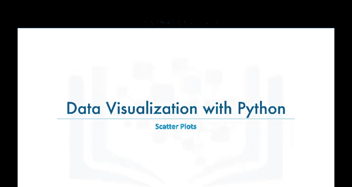

In this video， we will learn about an additional visualization tool， the scatter plotot。

 and we will learn how to create it using MapllootLib。😊。

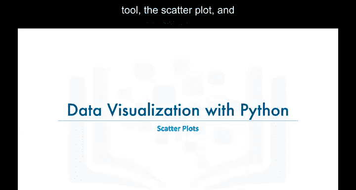

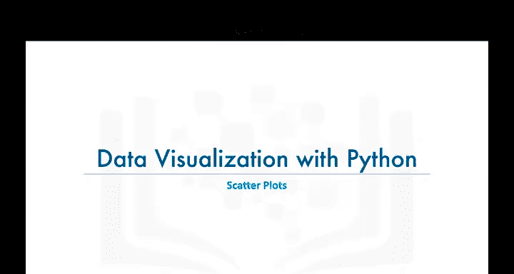

So what is a scatter plot， a scatter plot is a type of plot that displays values pertaining to typically two variables against each other。

Usually it is a dependent variable to be plotted against an independent variable in order to determine if any correlation between the two variables exists。

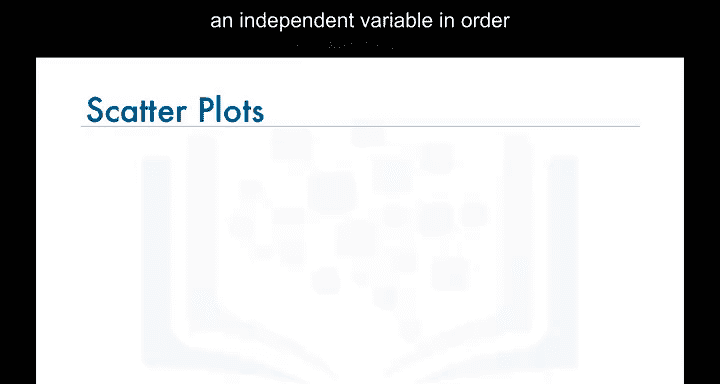

For example， here is a scatterplot of income versus education。

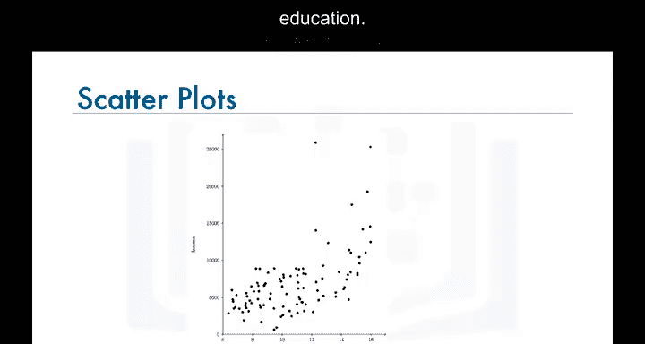

And by looking at the plotted data， one can conclude that an individual with more years of education is likely to earn a higher income than an individual with fewer years of education。

 so how can we create a scatterplot with MAplot Lib？

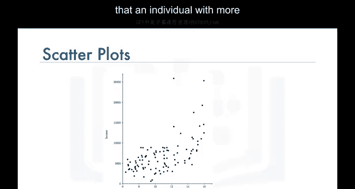

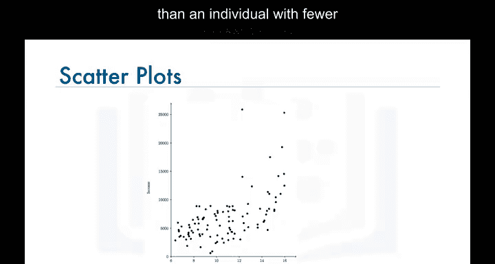

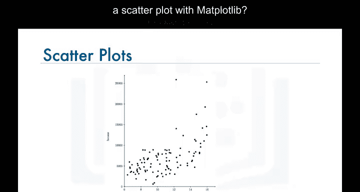

Before we go over the code to do that， let's do a quick recap of our data。

Recall that each row represents a country and contains metadata about the country。

 such as where it is located geographically and whether it is developing or developed。

Each rule also contains numerical figures of annual immigration from that country to Canada from 1980 to 2013。

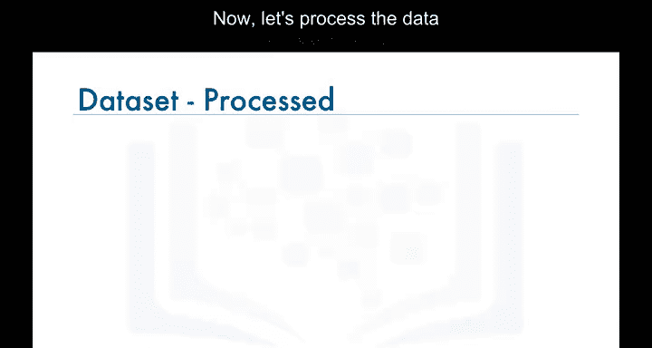

Now let's process the data frame so that the country name becomes the index of each row。

 this should make retrieving rows pertaining to specific countries a lot easier。

Also let's add an extra column which represents the cumulative sum of annual immigration from each country from 1980 to 2013。

So for Afghanistan， for example， it is 58，639 total， and for Albania， it is 15，699 and so on。

And let's name our data frame DF_ Canada。So now that we know how our data is stored in the data frame DF underscored Canada。

 say we're interested in plotting a scatter plot of the total annual immigration to Canada from 1980 to 2013。

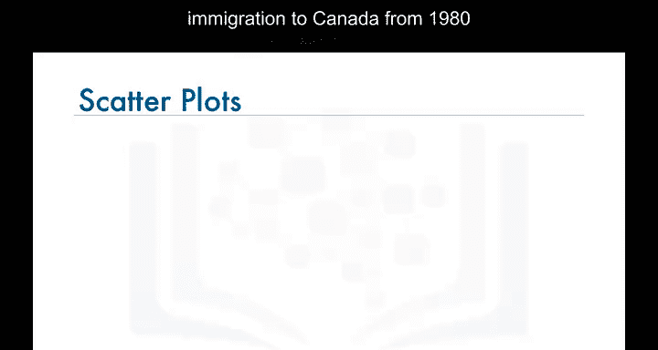

To be able to do that， we first need to create a new data frame that shows each here and the corresponding total number of immigration from all the countries worldwide as shown here。

Let's name this new data frame， DF_ To。

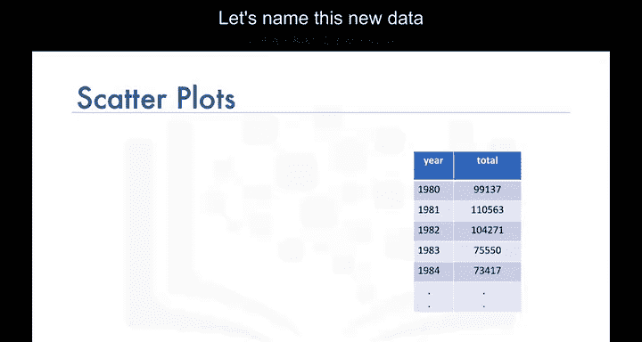

In the lab session， we will walk together through the process of creating DF underscore total from DF_ Canada so make sure to complete this module's lab session。

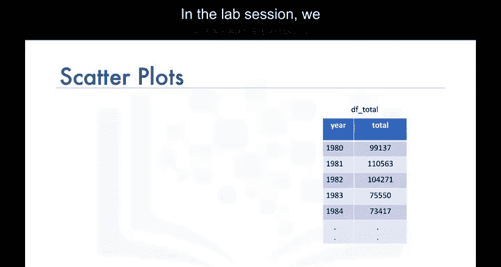

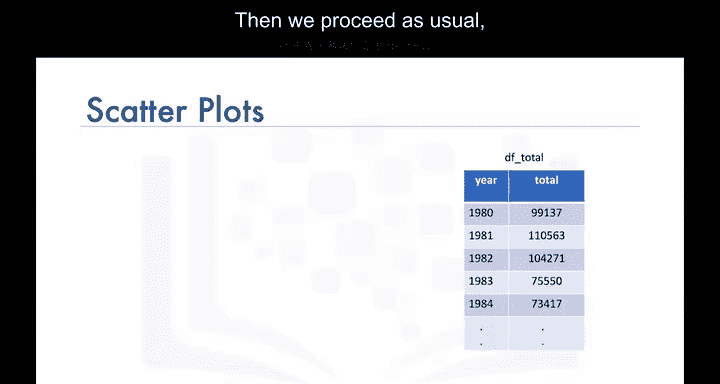

Then we proceed as usual， we import Matplot Libb as MPL and its scripting layer the Piplot interface as PLT。

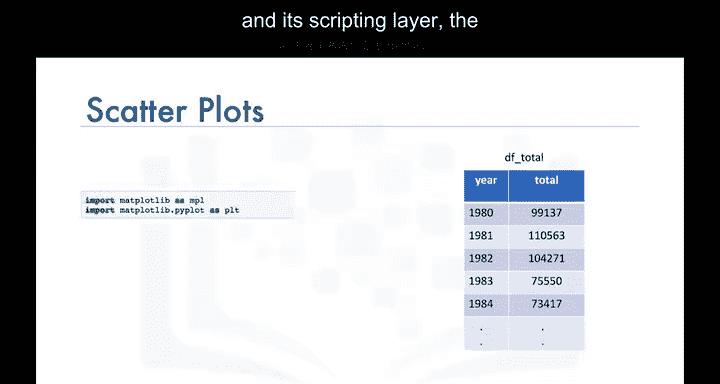

Then we call the plot function on the data frame Df underscore total。

 and we set kind equals scatter to generate a scatter plot。

Now， unlike the other data visualization tools where only passing the kind parameter was enough to generate the plot with scatter plots。

 we also need to pass the variable to be plotted on the horizontal axis as the X parameter and the variable to be plotted on the vertical axis as the Y parameter。

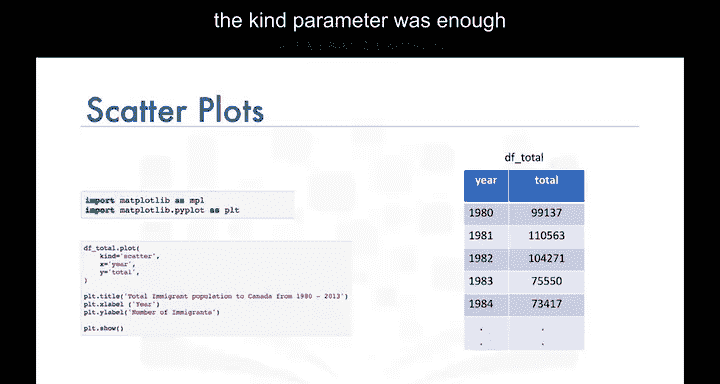

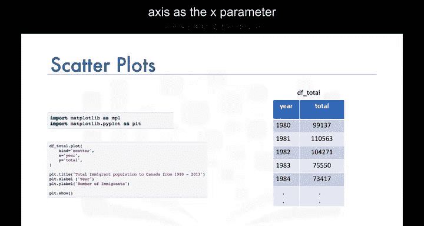

In this case， we're passing column year as the x parameter and column total as the Y parameter。

Then to complete the figure， we give it a title and we label its Xs。

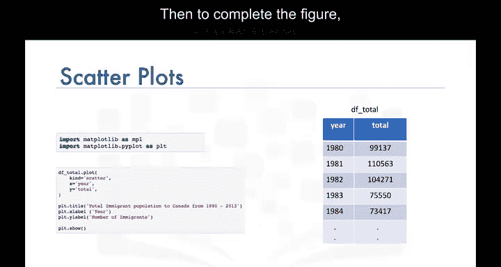

Finally， we call the show function to display the figure。

And there you have it， a scatter plot that shows total immigration to Canada from countries all over the world from 1980 to 2013。

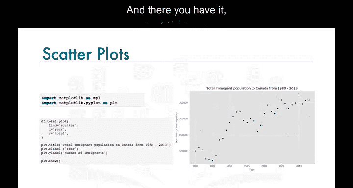

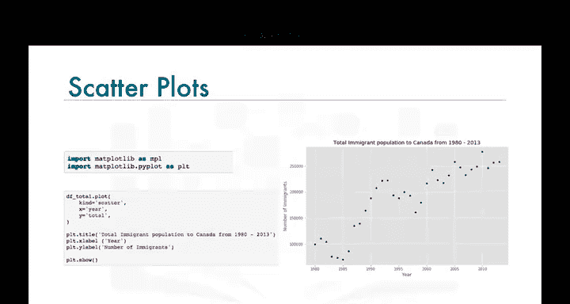

The scatter plot clearly depicts an overall rising trend of immigration with time。

In the lab session， we explore scatter plots in more details and learn about a very interesting variation of the scatter plot。

 a plot called the bubble plot， and we learn how to create it using Maplloot lid。

 so make sure to complete this modules lab session。

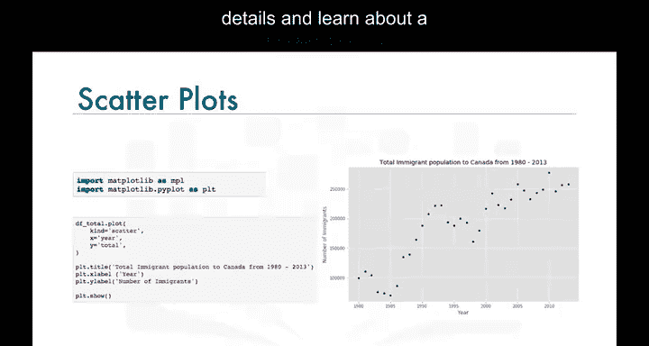

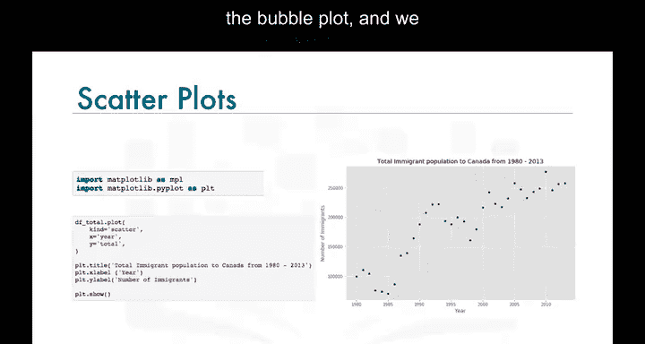

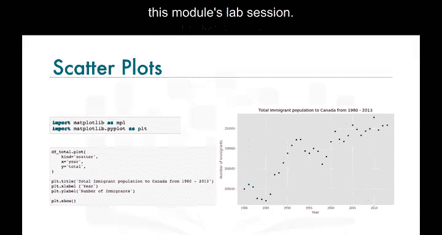

And with this， we conclude our video on scatter plots， I'll see you in the next video。

