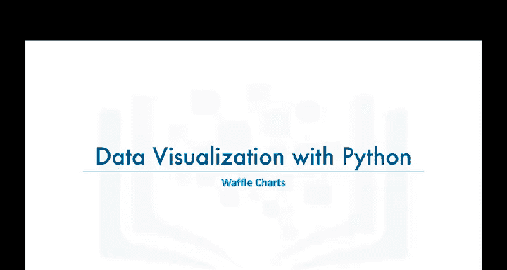
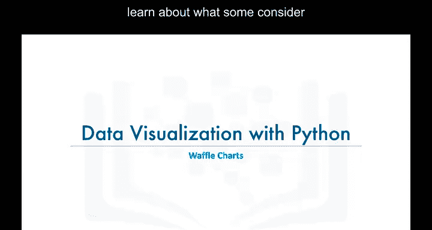
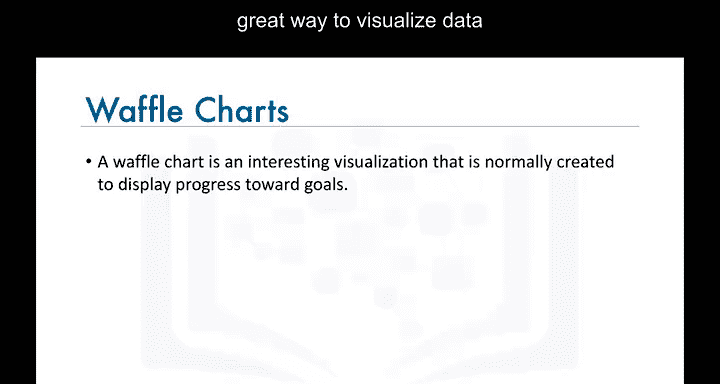
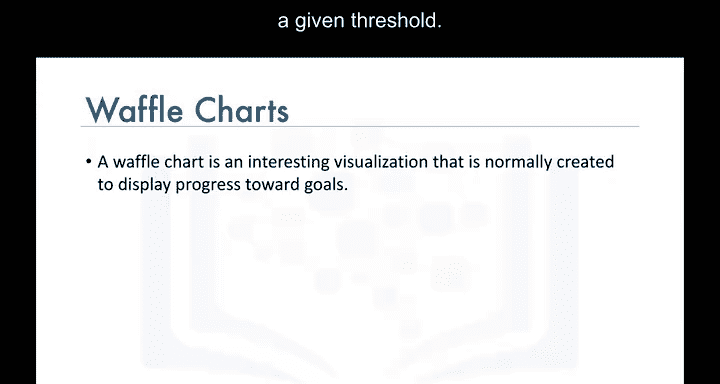
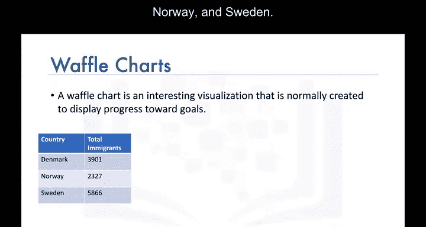
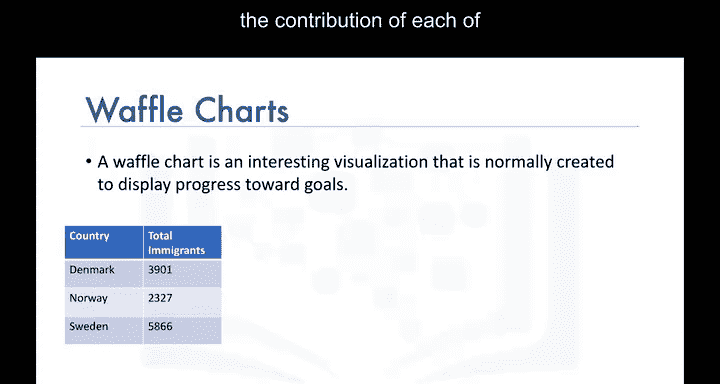
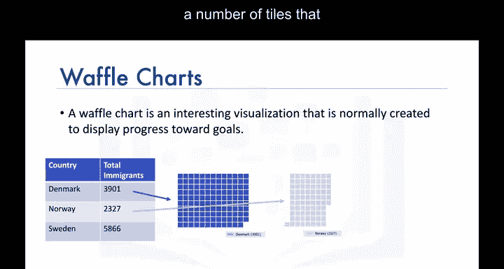

# IBM数据科学专业证书课程8：《Python数据可视化课程（IBM）》python-for-data-visualization（中英字幕） - P12：12_华夫饼图绘制.zh_en - GPT中英字幕课程资源 - BV19k4y1375E

In this video， we will learn about what some consider an advanced visualization tool。

 namely the Waaffle chart。

So what is a waffle chart， a waffle chart is a great way to visualize data in relation to a whole or to highlight progress against a given threshold。

For example， say immigration from Scandinavia to Canada is comprised only of immigration from Denmark。

 Norway and Sweden。

And we're interested in visualizing the contribution of each of these countries to the Scandinavian immigration to Canada。

The main idea here is for a given waffle chart whose desired height and width are defined。

 the contribution of each country is transformed into a number of tiles that is proportional to the country's contribution to the total。

So the more the contribution， the more the tiles。Resulting in what resembles a wale when combined。

 hence the name waffle chart。Unfortunately， Matplotlibb does not have a builtin function to create waffle charts therefore in the lab session I'll walk you through the process of creating your own Python function to create a waffle chart so it's really important that you'll complete this module's lab session and with this we conclude our video on Waaffle charts I'll see you in the next video。

