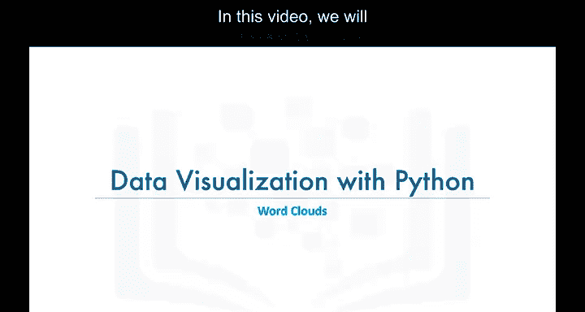
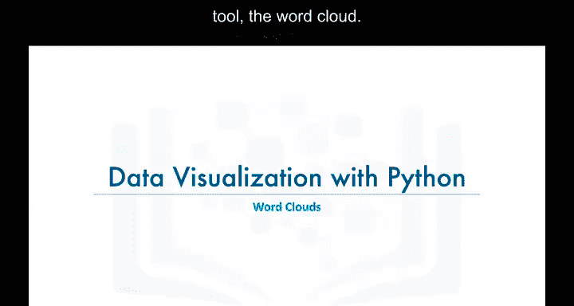
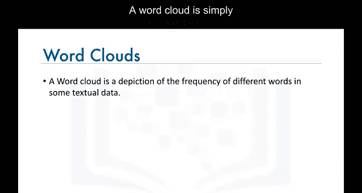
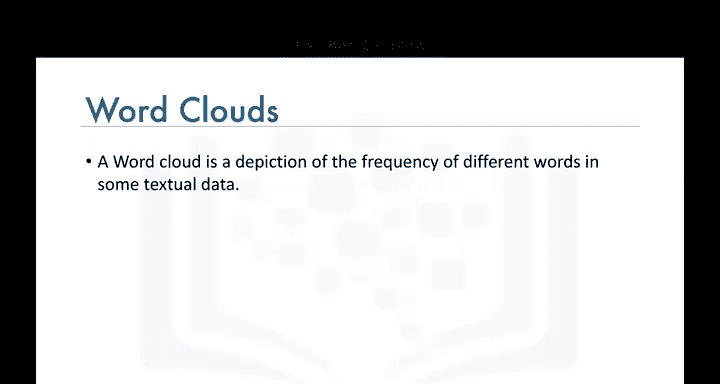
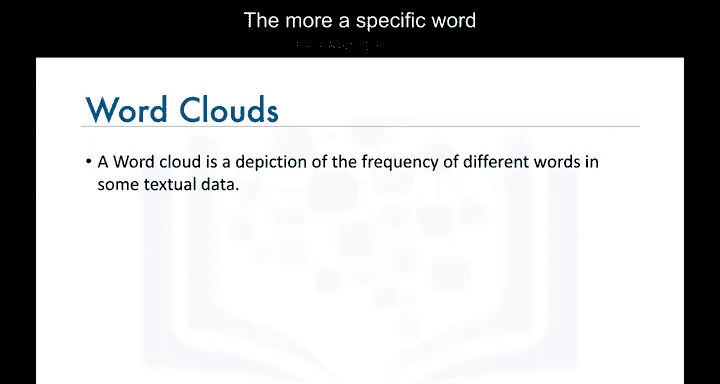
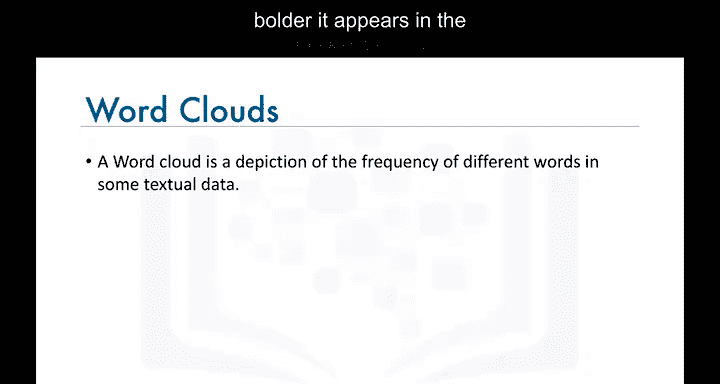
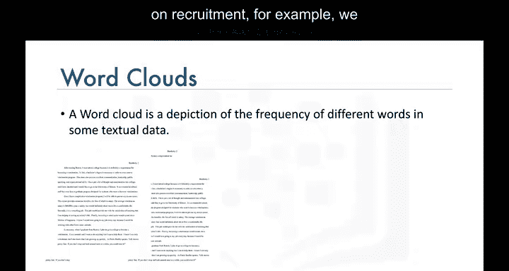

# IBM数据科学专业证书课程8：《Python数据可视化课程（IBM）》python-for-data-visualization（中英字幕） - P13：13_词云生成.zh_en - GPT中英字幕课程资源 - BV19k4y1375E

In this video， we will learn about another advanced visualization tool， the word cloud。

So what is the word cloud？A word cloud is simply a depiction of the importance of different words in a body of text。

A word cloud works in a simple way， the more a specific word appears in a source of textual data。

 the bigger and bolder it appears in the world cloud。

Given some text data on recruitment， for example， we generate a cloud of words like this。

 this cloud is telling us that words such as recruitment， talent， candidates。

 and so on are the words that really stand out in these text documents。

And assuming that we didn't know anything about the content of these documents。

 a word cloud can be very useful to assign a topic to some unknown textual data。😊，Unfortunately。

 just like Waaffle charts， MaplotLib does not have a built in function to generate word clouds。

 however， luckily a Python library for Cloud word generation that was created by Andrea Muer is publicly available so in the last session we will learn how to use Moler's word cloud generator and we will also create interesting word clouds superimposed on different background images。

So make sure to complete this module as the lab session。And with this。

 we conclude our video on word clouds， I'll see you in the next video。

