# IBM数据科学专业证书课程8：《Python数据可视化课程（IBM）》python-for-data-visualization（中英字幕） - P14：14_Seaborn与回归图.zh_en - GPT中英字幕课程资源 - BV19k4y1375E

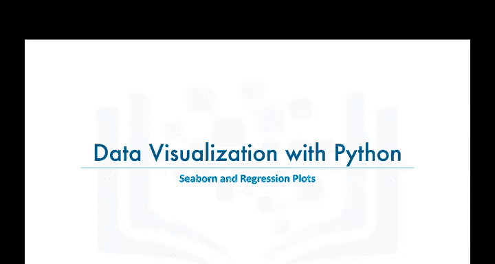

In this video， we will learn about a new visualization library in Python， which is Seaborn。

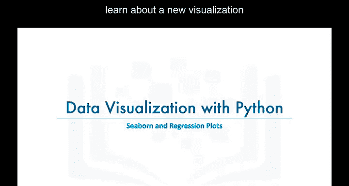

Although Seaborn is another data visualization library， it is actually based on MAplotLi。

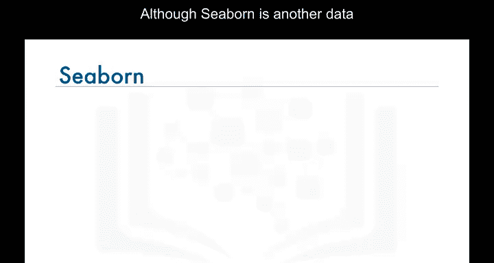

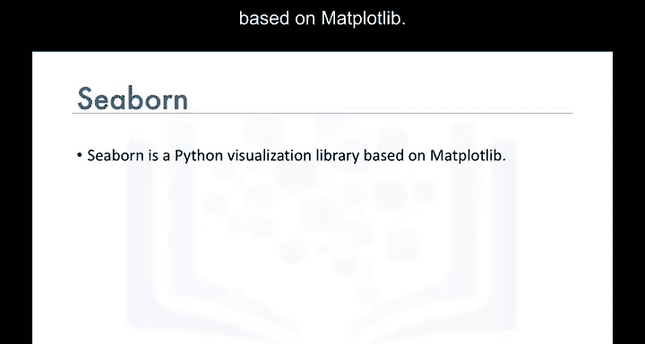

It was built primarily to provide a high level interface for drawing attractive statistical graphics such as regression plots。

 box plots， and so on。

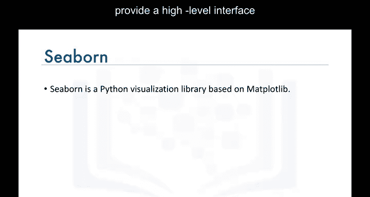

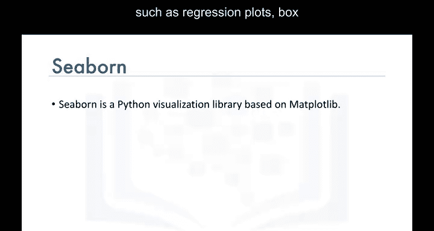

Cborne makes creating plots very efficient， therefore with Cborn。

 you can generate plots with code that is five times less than with MAplotlib。

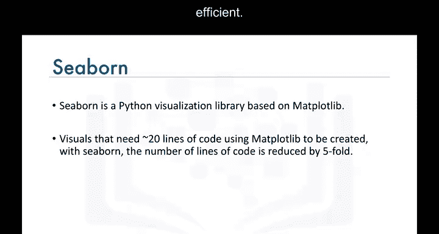

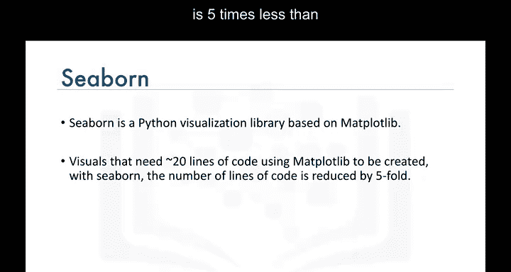

Let's see how we can use Seaborn to create a statistical graphic， let's look into regression points。

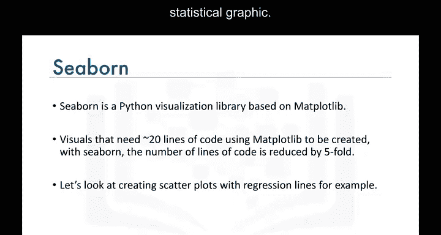

Let's say we have a data frame called DF_ Tot of total immigration to Canada from 1980 to 2013。

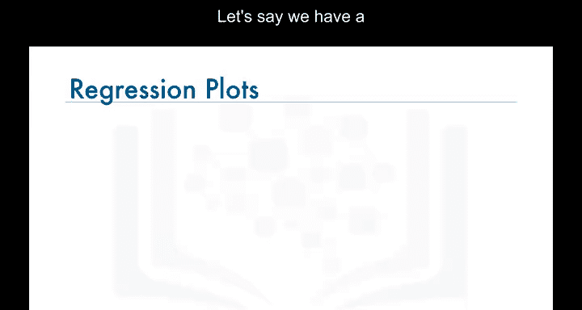

With the year in one column and the corresponding total immigration in another column。

And say we're interested in creating a scattered plot along with the regression line to highlight any trends in the data。

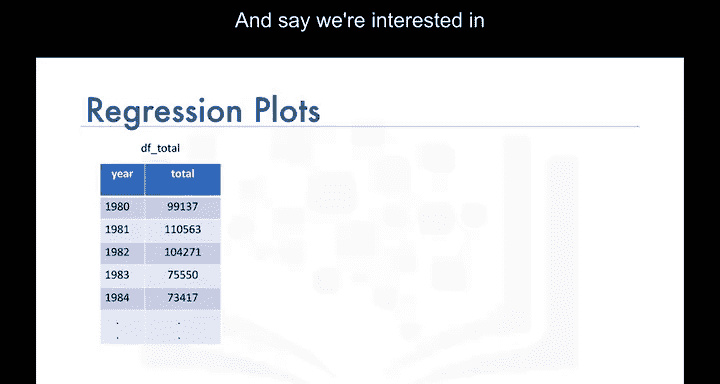

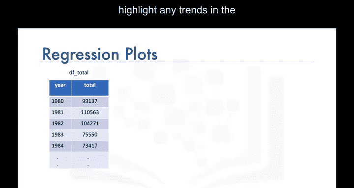

With Cborn， you can do all this with literally one line of code。

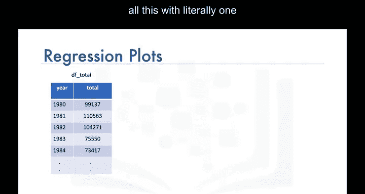

The way to do this， we first import Cborn and let's import it as SNS。

Then we call the seaborn red plot function。

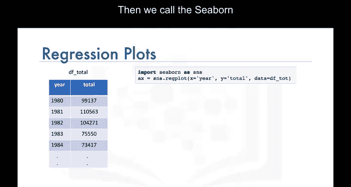

We basically tell it to use the data frame Df underscore total and to plot the column year on the horizontal axis and the column total on the vertical axis。

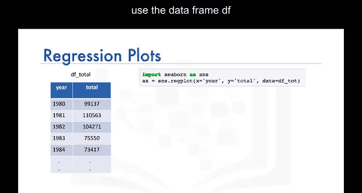

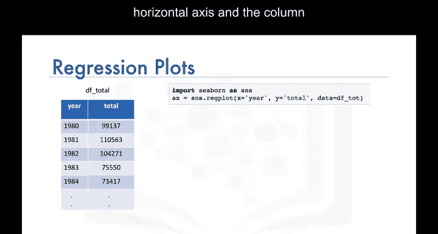

And the output of this one line of code is a scatter plot with a regression line and not just that。

 but also 95% confidence interval， isn't that really amazing？

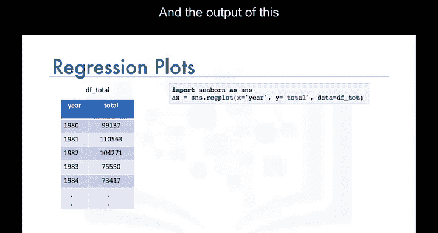

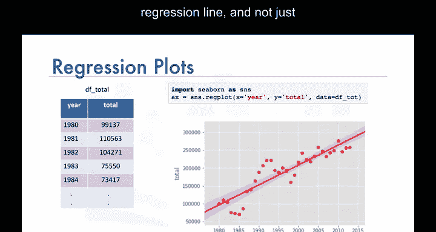

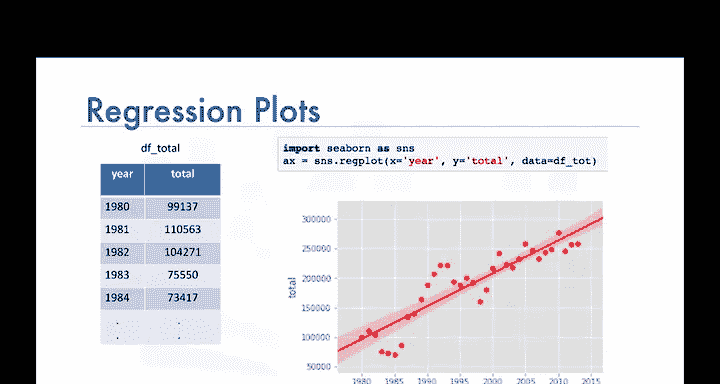

Sborne's red plot function also accepts additional parameters for any personal customization。

 so you can change the color for example， using the color parameter let's go ahead and change the color to green。

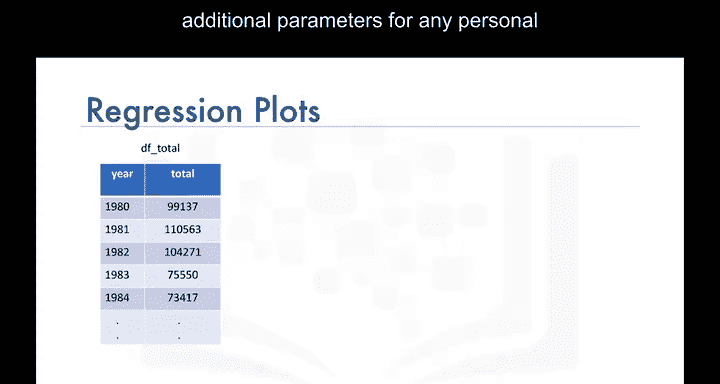

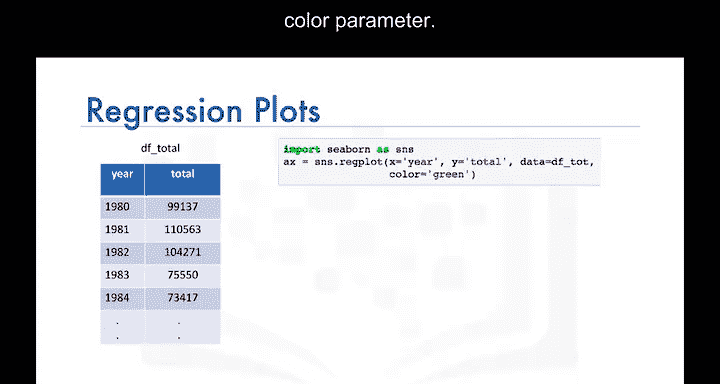

Also， you can change the marker shape as well using the marker parameter。

 let's go ahead and change the shape of our markers to a plus marker and instead of the default circular marker。

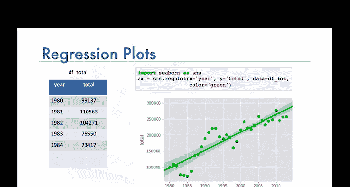

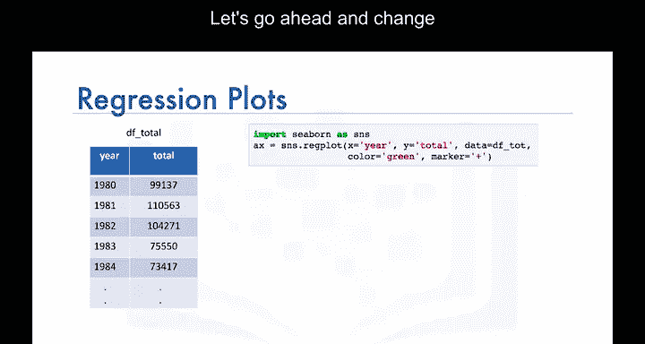

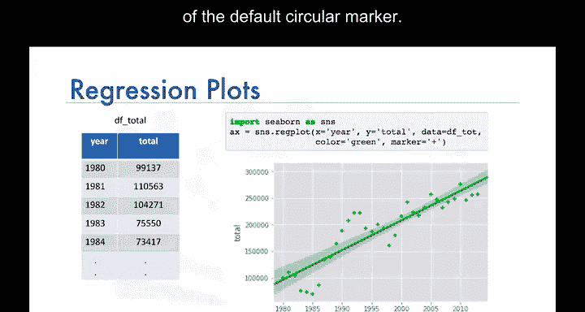

In the lab session we explored regression plots with CbornN in more details so make sure to complete this modules lab session and with this we conclude our short introduction to Seaborne and regression plots。

 I'll see you in the next video。

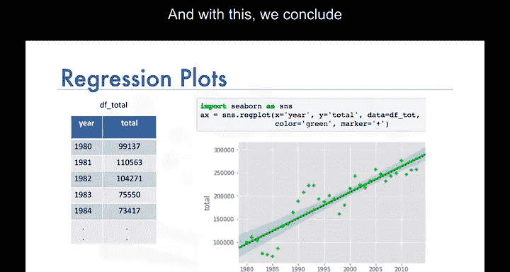

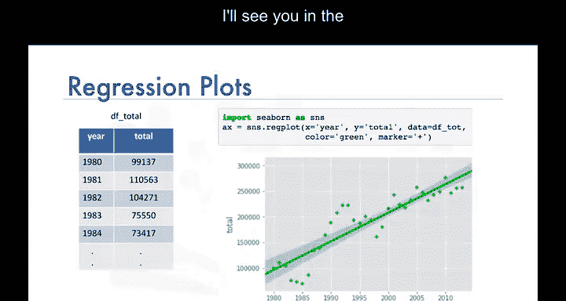