# IBM数据科学专业证书课程8：《Python数据可视化课程（IBM）》python-for-data-visualization（中英字幕） - P15：15_Folium地图库入门.zh_en - GPT中英字幕课程资源 - BV19k4y1375E

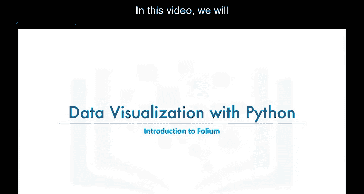

In this video， we will learn about a very interesting data visualization library in Python。

 which is volume。

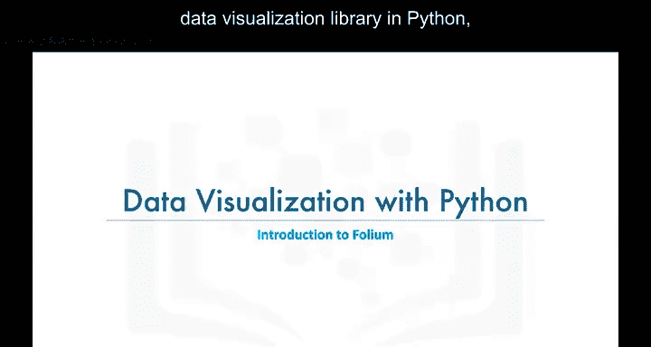

Volume is a powerful data visualization library in Python that was built primarily to help people visualize geospatial data。

With volume， you can create a map of any location in the world as long as you know its latitude it and longititude its values。

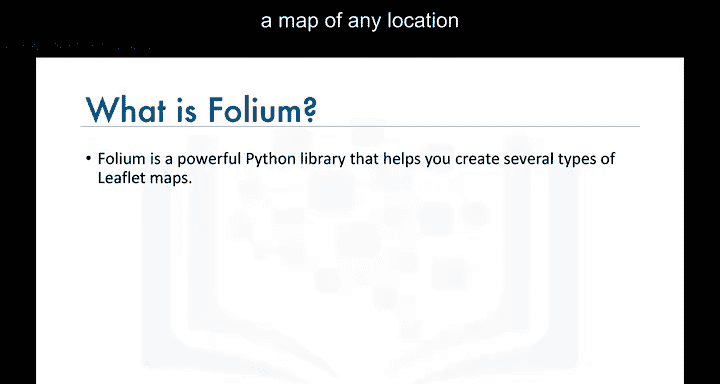

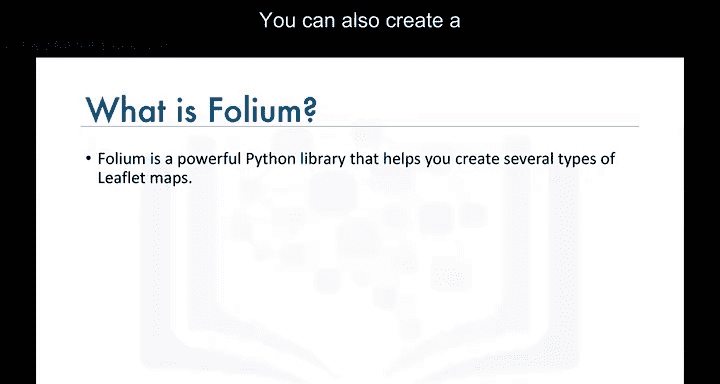

You can also create a map and superimposed markers as well as clusters of markers on top of the map for cool and very interesting visualizations。

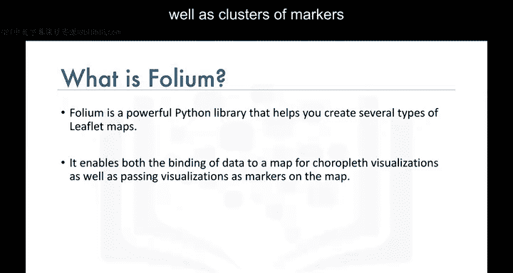

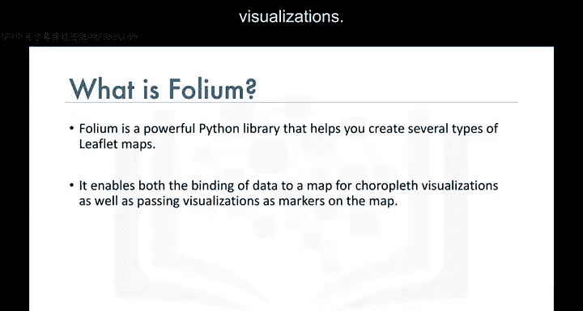

You can also create maps of different styles such as street level Ma， a Sta map and a couple others。

 which we will look into in just a moment。Creating a world map with volume is pretty straightforward。

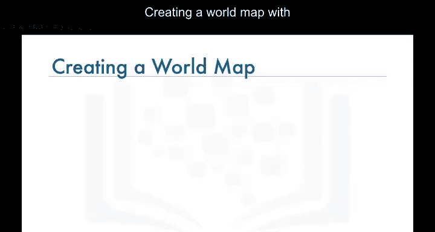

You simply call the map function， and that is all。

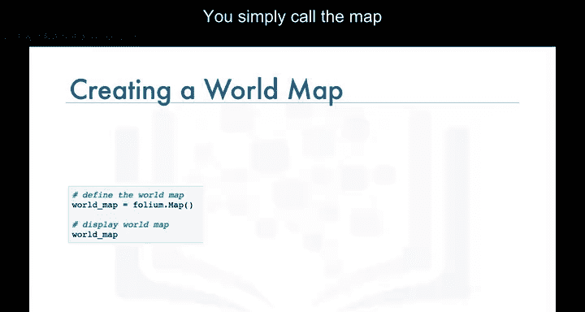

What is really interesting about the maps created by Foium is that they are interactive so you can zoom in and out after the map is rendered。

 which is a super useful feature。

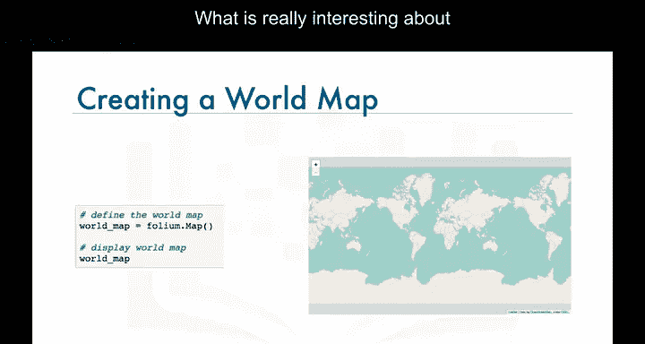

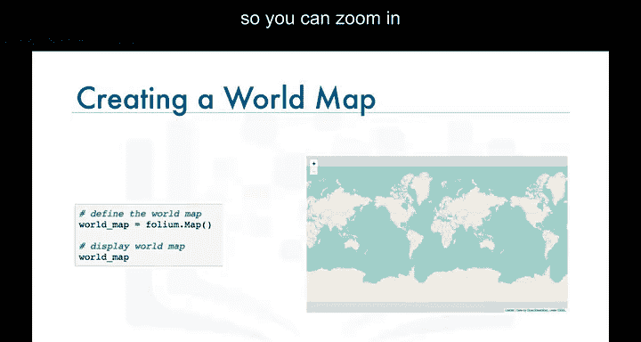

The default map style is the OpenStreet map， which shows a street view of an area when you're zoomed in and shows the borders of the world countries when you're zoomed all the way out。

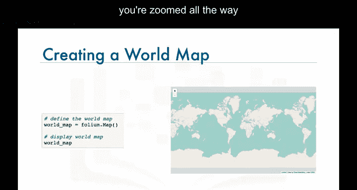

Now let's create a world mapap centered around Canada to do that。

 we pass in the latitude and the longitude values of Canada using the location parameter。

 and with volume， you can set the initial Zoom level using the Zoom start parameter。

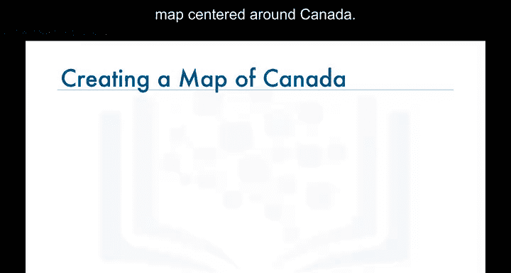

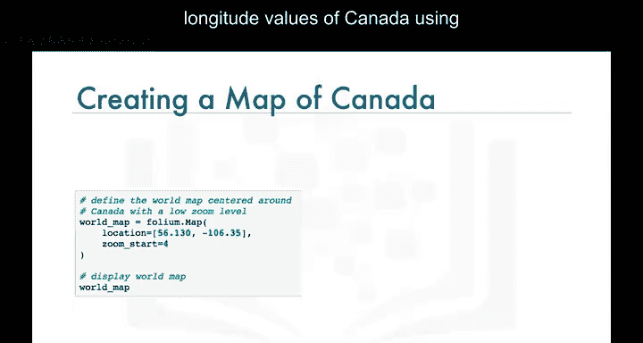

Now I stay initial because you can easily change the Zoom level after the map is rendered by zooming in or zooming out。

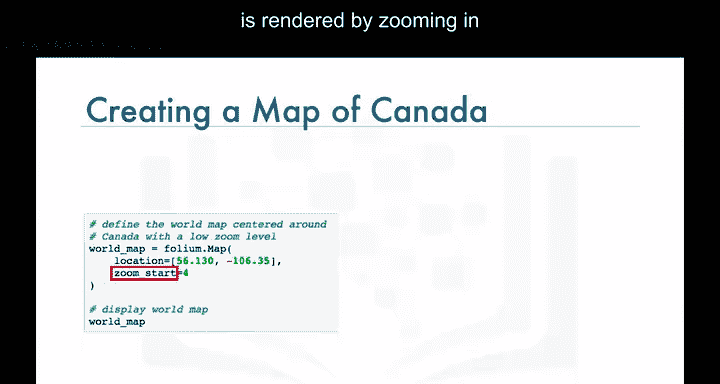

You can play with this parameter to figure out what the initial Zoom level looks like for different values Now let's set the zoom level for our map of Canada to4 and there you go Here is a world map centered around Canada。

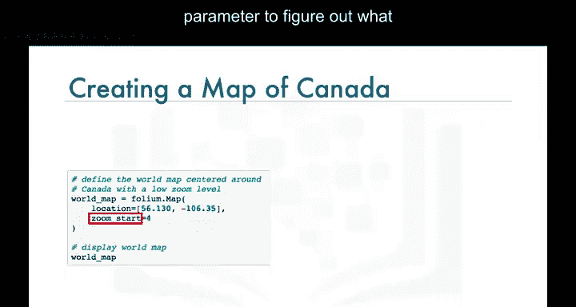

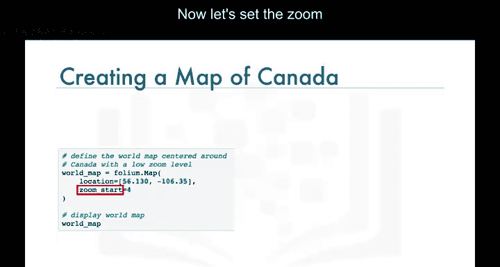

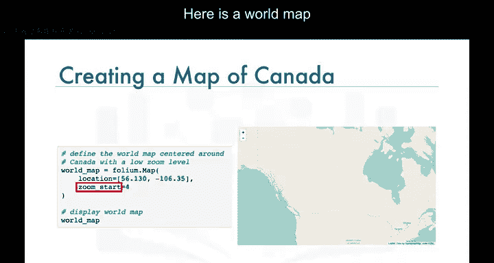

Another amazing feature of volumeum is that you can create different map styles using the tiles parameter。

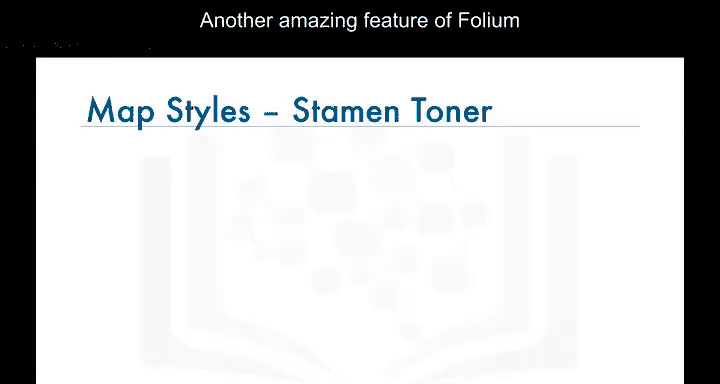

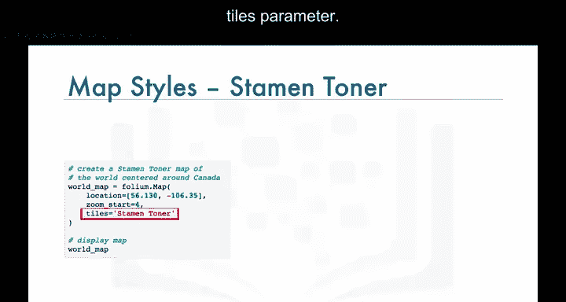

Let's create a steam toner map of Canada。This style is great for visualizing and exploring river meanders and coastal zones。

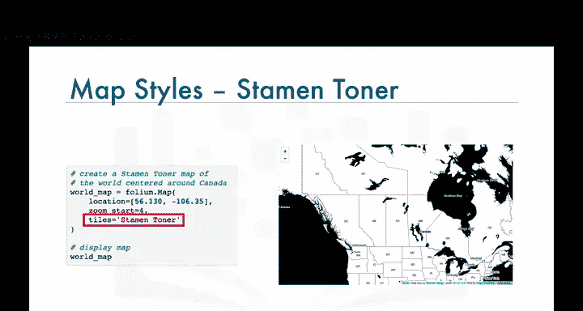

Another style is Staing terrain。

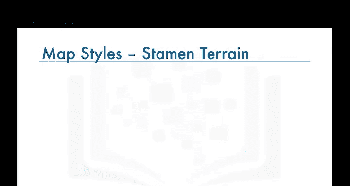

Let's create a map of Canada in Sta and terrain。This style is great for visualizing hill shading and natural vegetation colors。

And with this， we conclude our introduction to volume。 I'll see you in the next video。

