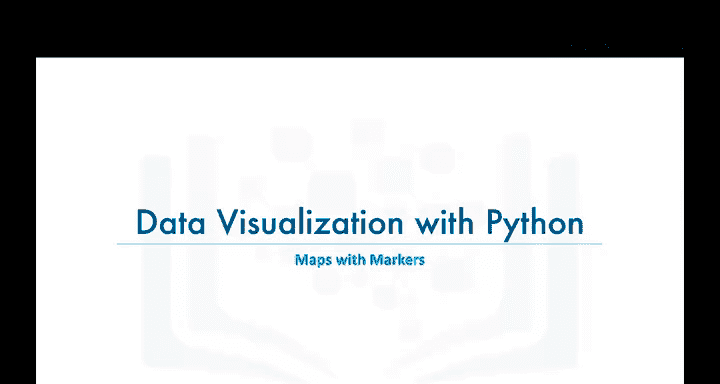
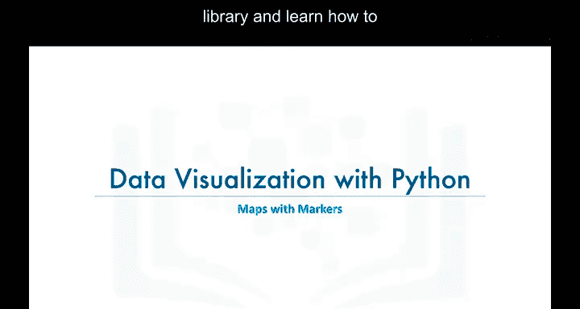
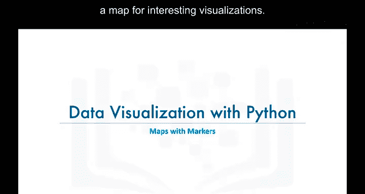
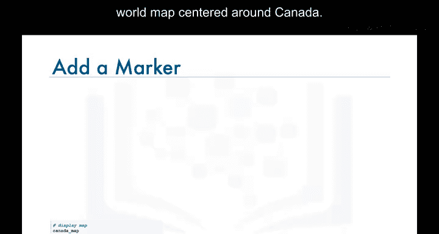
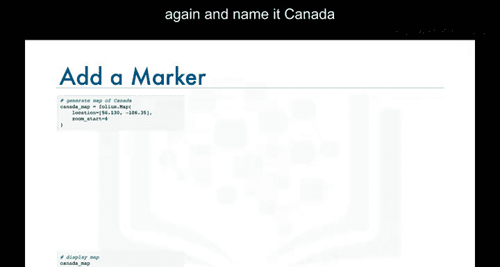
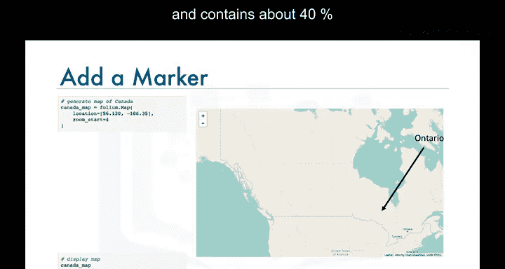
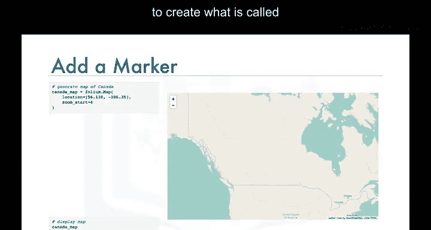
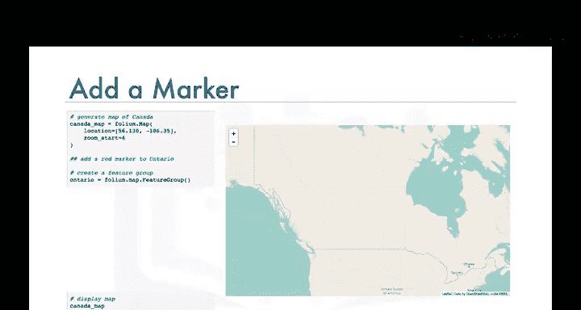
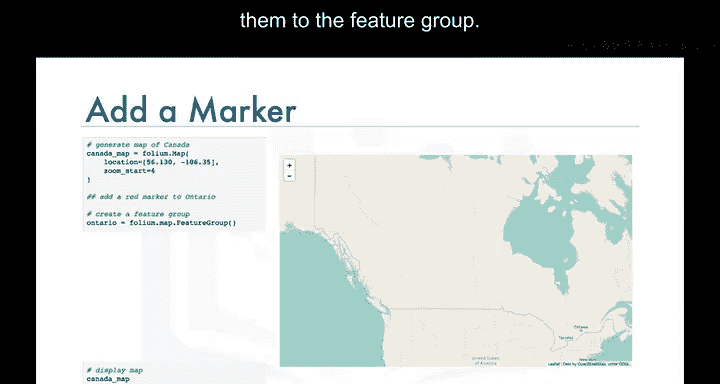

# IBM数据科学专业证书课程8：《Python数据可视化课程（IBM）》python-for-data-visualization（中英字幕） - P16：16_标记地图制作.zh_en - GPT中英字幕课程资源 - BV19k4y1375E

In this video， we will continue working with the Foium Library and learn how to superimpose markers on top of the map for interesting visualizations。

In the previous video， we learned how to create a world map centered around Canada。

So let's create this map again and name it Canada_ map this time。

Ontario is a Canadian province and contains about 40% of the Canadian population。

 it is considered Canada's most populous province。

Let's see how we can add a circular mark to the center of Ontario。

To do that， we need to create what is called a featured group。

Let's go ahead and create a feature group named Ontario。

Now when a feature group is created， it is empty， and that means what's next is to start creating what is called children and adding them to the feature group。

So let's create a child in the form of a red circular mark located at the center of the Ontario province。

We specified the location of that child by passing in its latitude and longitude values。

And once we're done adding children to the future group， we add the future group to the map。

And there you have it， a red circular mark superimposed on top of the map and added to the center of the province of Ontario。

Now， it would be nice if you could actually label this marker in order to let other people know what it actually represents。

To do that， we simply use the marker function and the pop up parameter to pass in whatever text we want to add to this marker。

And there you go。 Now our marker displays Ontario when clicked on。

In the lab session we will look into a real worldor example and explore crime rate in San Francisco。

 we will create a map of San Francisco and superimpose thousands of these markers on top of the map。

 not just that， but I'll show you how you can also create clusters of markers in order to make your map look less congested。

This modules lab session is a very interesting one， so please make sure to complete it。And with this。

 we conclude our video on Aic markers to maps with volume。 I'll see you in the next video。

