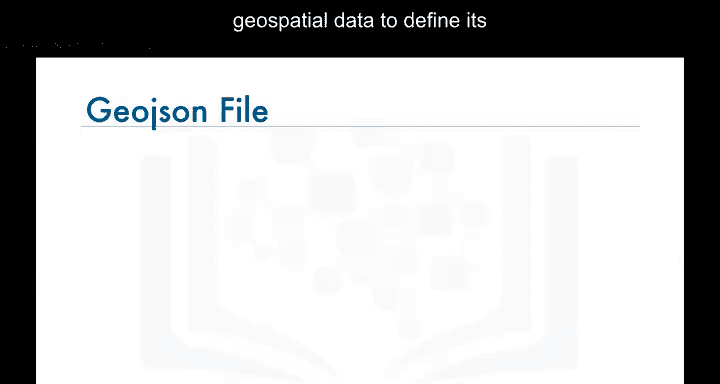
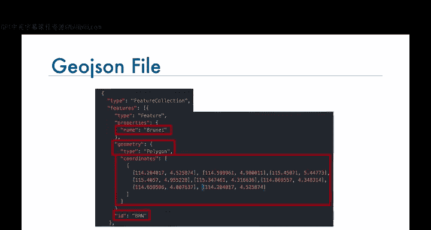
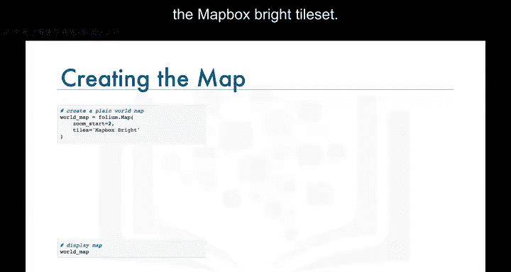

# IBM数据科学专业证书课程8：《Python数据可视化课程（IBM）》python-for-data-visualization（中英字幕） - P17：17_区域统计地图.zh_en - GPT中英字幕课程资源 - BV19k4y1375E

In this video， we will learn how to create a special type of map called Coople Ma with volume。😊。

I'm sure that most of you have seen maps similar to this one and this one。

These are what we call choo maps。So what is a chlorroppyly map？

A corlyph map is a thematic map in which areas are shaded or patterned in proportion to the measurement of the statistical variable being displayed on the map such as population density or per capita income。

The higher the measurement， the darker， the color。So the map to the left is a corole map of the world showing infant mortality rate per 1。

000 births。The darker， the color， the higher the infant mortality rate。According to the map。

 African countries had very high infant mortality rates。

 with some of them reporting a rate that is higher than 160 per 1，000 births。Similarly。

 the map to the right is a corle map of the US showing population per square mile by state。Again。

 the darker， the color， the higher the population。According to the map。

 states in the eastern part of the US tend to be more populous than states in the western part。

 with California being an exception。In order to create a choth mat of the region of interest。

 volume requires a geoOJSON file that includes geospatial data of the region for a choth map of the world。

 we would need a geoJSON file that lists each country。

 along with any geospatial data to define its borders and boundaries。

Here is an example of what the GeOJSN file would include about each country。

The example here returnss to the country Brunei。As you can see。The file includes the country's name。

It's ID， geometry shape， and the coordinates that define the country's borders and boundaries。

So let's see how we can create a corrole map of the world like this one showing immigration to Canada。

Before we go over the code to do that， let's do a quick recap of our data set。

Recall that each row represents a country and contains metadata about the country such as where it is located geographically and whether it is developing or developed。

Each rule also contains numerical figures of annual immigration from that country to Canada from 1980 to 2013。

Now let's process the data and let's add an extra column which represents the cumulative sum of annual immigration from each country from 1980 to 2013。

So for Afghanistan， for example， it is 58，639 total， and for Albania， it is 15，699 and so on。

And let's name our data frame， DF_re Canada。So now that we know how our data is stored in the data frame。

 DF underscore Canada， let's see how we can generate a corplth map of the world showing immigration to Canada。

We should be experts now in creating world mapps with volume。

 so let's go ahead and create a world mapap， but this time let's use the Mabox bright time set。

The result is a nice world map displaying the name of every country。

Now to convert this map into a corroppl map， we first define a variable that points to our JOJSN file。

 then we apply the coroppl function to our world map and we tell it to use the columns country and total in our DF_ Canada data frame and to use the country names to look up the Gepatial information about each country in the GeOJON file。

And there you have it， a corroppl map of Canada showing the intensity of immigration from different countries worldwide。

In the lab session， we explore choopl maps in more details。

 so please make sure to complete this modules lab session。And with this。

 we conclude our video on Coo maps。