# IBM数据科学专业证书课程8：《Python数据可视化课程（IBM）》python-for-data-visualization（中英字幕） - P19：19_Plotly可视化入门.zh_en - GPT中英字幕课程资源 - BV19k4y1375E

In this video， we are going to provide an overview of the Ply Python Library， so what is Ply？

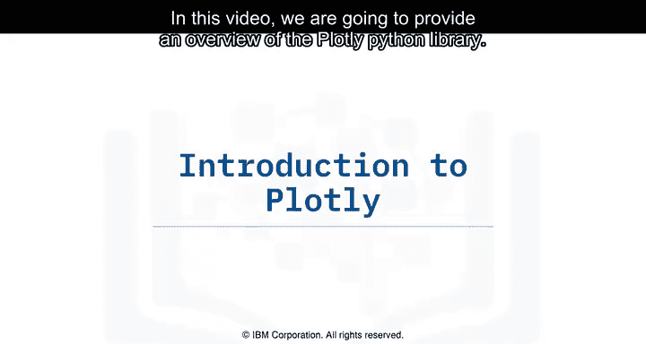

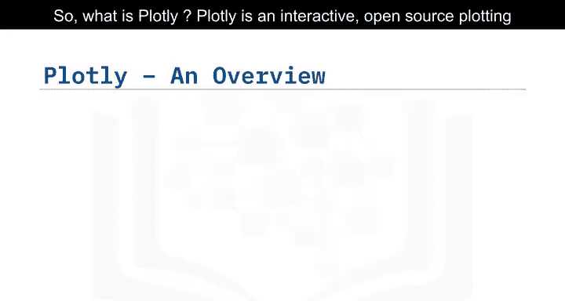

Plotly is an interactive open source plotting library that supports over 40 unique chart types。

It is available in Python， R and JavaScript。

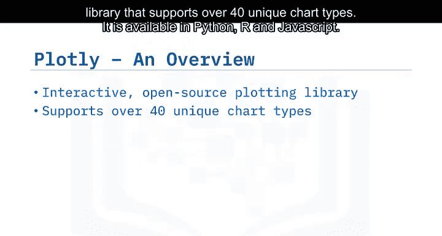

Platlet Python is built on top of Ptly JavaScript library and includes chart types like statistical。

 financial， maps， scientific， and three dimensional data。

The web based visualizations created using Ploly Python can be displayed in Jupiter Note。

 save to standalone HTML files。Or served as part of pure Python built web applications using Dash。

The focus of this lesson will be on two of the plotly submods， plotly graph objects。

 and Ploly Express。

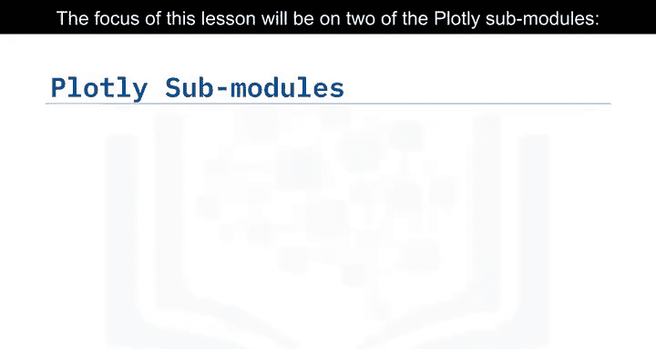

Plotly graphraph objects is the low level interface to figures， traces and layout。

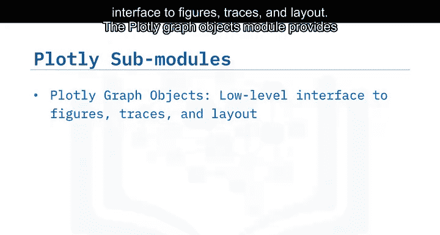

The Ply Graph Object module provides an automatically generated hierarchy of classes， figures。

 traces， and layout called graphra objects。These graph objects are used for representing figures with a top level class plotly。

graph_object。 figure。

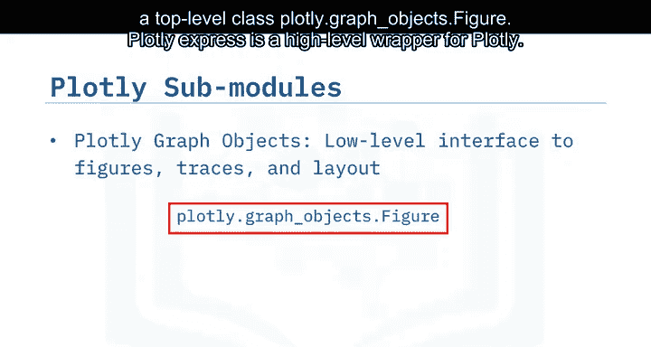

Plotly expresses a high level raper for plotly。It is a recommended starting point for creating most common figures provided by Ply。

 using a more simple syntax， it uses graph objects internally。

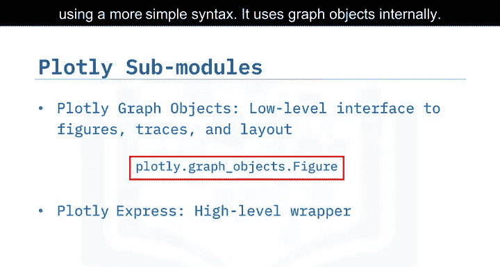

Let us see how to use Ply。Graph_ Obs submodule by creating a simple line chart。First。

 import the required packages。Here we are importing graph objects as go。

Then generate sample data using NumpI。

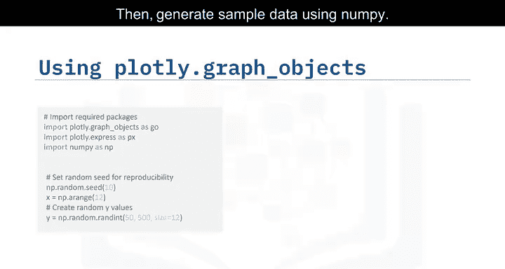

The plotly dot graph contains a J object， which has a dictionary structure。

Since we imported plotly graph objects as go in the previous slide， go will be the J object。

The chart can be plotted by updating the values of the go Ob keywords。

We will create the figure by adding a scatter type trace。Next。

 the layout of the figure is updated using the updatedate layout method。

Here we are updating the X axis， Y axis， and chart title。

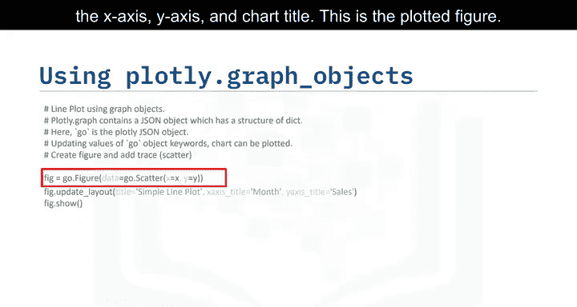

This is the plotted figure Now we will create the same line chart using Ploly Express in Ploly Express the entire line chart can be created using a single command Viualization is automatically interactive Ploly Express makes visualization easy to create and modify and now it's time to play with the plotly library Next is going to be a lab session。

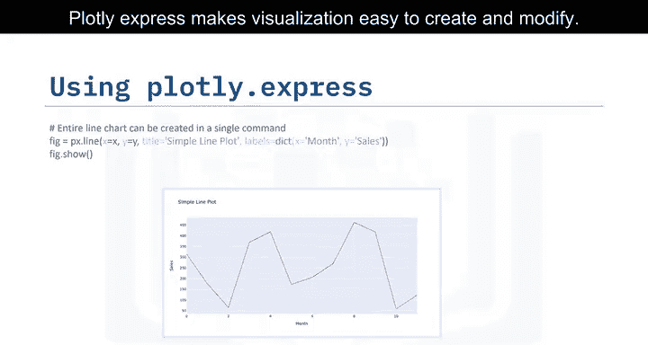

We will be using the airline reporting database from Data Aset Exchange to demonstrate how to use plotly graph objects and Express for creating charts。

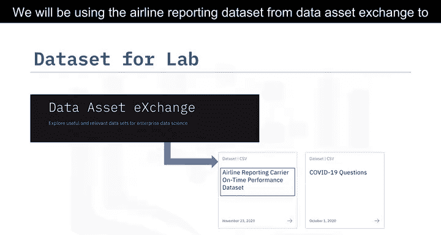

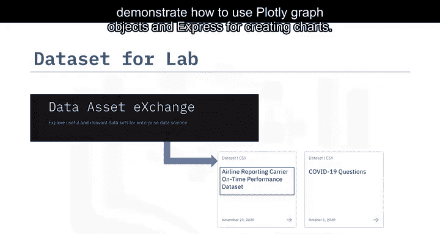

Here is a quick overview of the airline reporting data set。

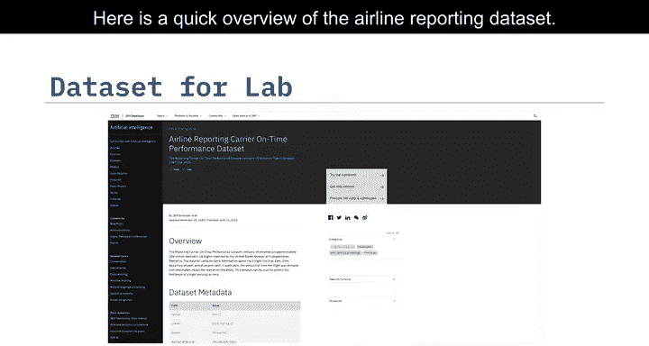

The reporting carrier on time performance dataset contains information on approximately 200 million domestic US flights reported to the United States Bureau of Transportation Statistics。

 The data contains basic information about each flight， such as date， time， departure， airport。

 arrival airport and if applicable， the amount of time the flight was delayed and information about the reason for the delay。

 Now let us start the lab。

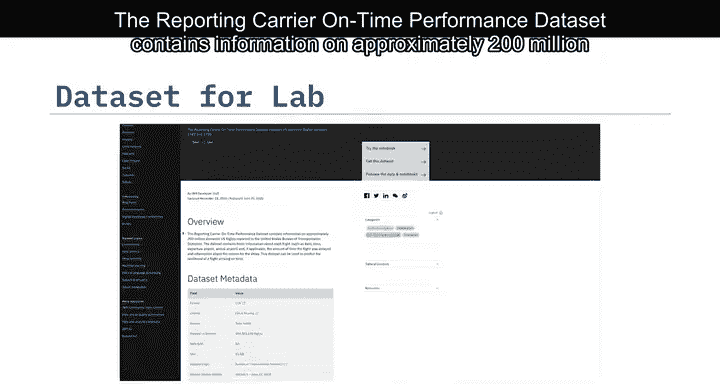

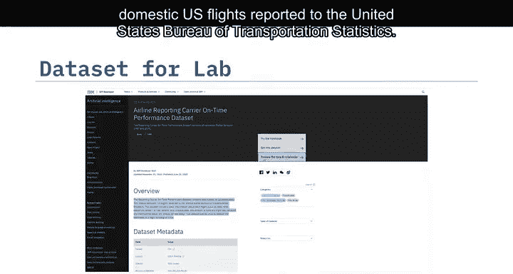

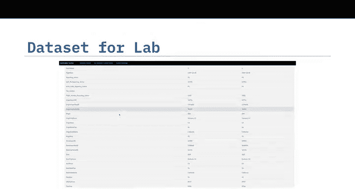

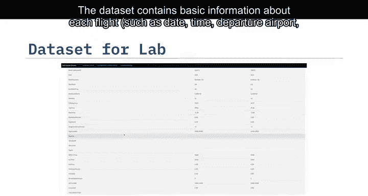

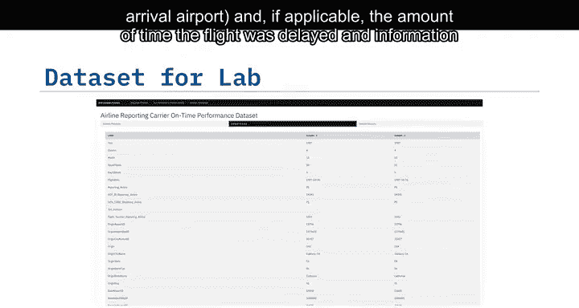

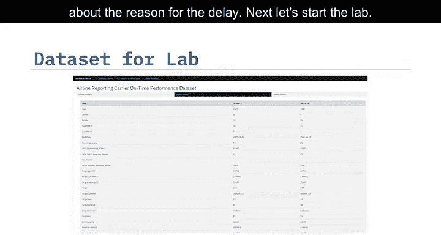