# IBM数据科学专业证书课程8：《Python数据可视化课程（IBM）》python-for-data-visualization（中英字幕） - P1：1_数据可视化导论.zh_en - GPT中英字幕课程资源 - BV19k4y1375E

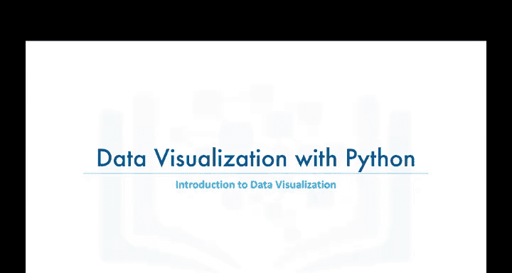

Hello， everyone and welcome to the first module of the data visualization with Python course In this video。

 we're going to introduce data visualization and go over an example of transforming a given visual into one which is more effective。

 attractive and impact。

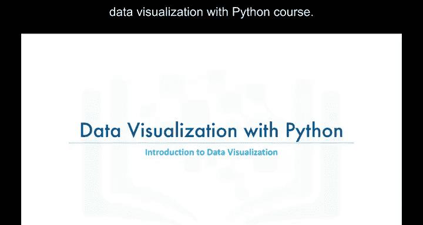

So， let's get startedarded。

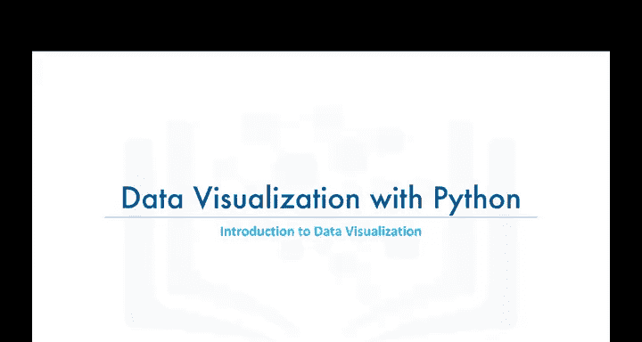

Now， one might ask， why would I need to learn how to visualize data， Well。

 data visualization is a way to show complex data in a form that is graphical and easy to understand。

This can be especially useful when one is trying to explore the data and getting acquainted with it。

Also， since a picture is worth a thousand words， then plots and graphs can be very effective in conveying a clear description of the data。

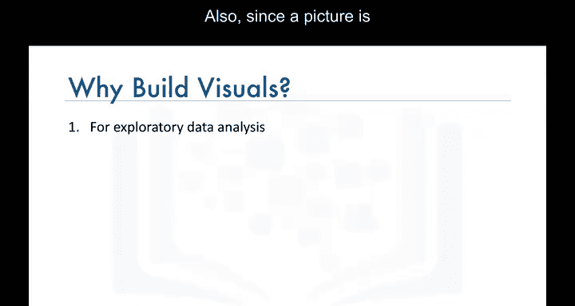

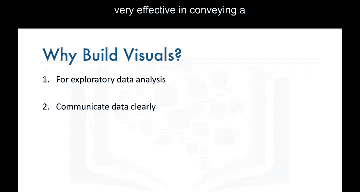

Especially when disclosing findings to an audience or sharing the data with other pure data scientists。

Also， they can be very valuable when it comes to supporting any recommendations you make to clients。

 managers or other decision makers in your field。

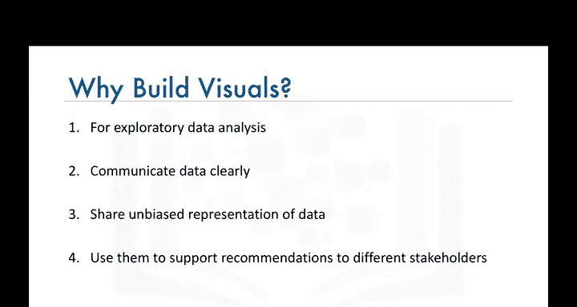

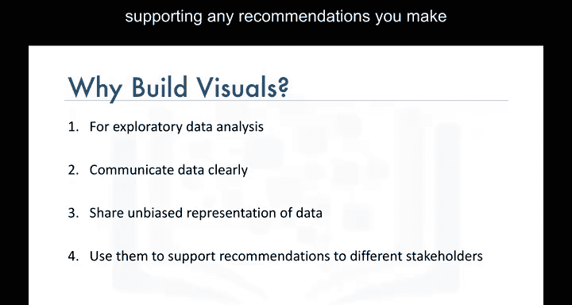

Darkro Analytics is a company that spun out of a research lab at the University of Alberta in 2008 and has done fascinating work on data visualization。

Dark Course Ana specialize in quantitative consulting in several areas。

 including data visualization and geospatial analysis。

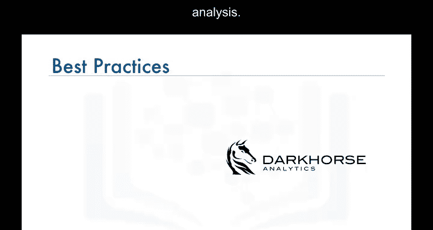

Their approach when creating a visual revolves around three key points， less is more effective。

 It is more attractive， and it is more impact。 In other words。

 any feature or design you'll incorporate in your plot to make it more attractive or pleasing should support the message that the plot is meant to get across and not distract from it。

 Let's take a look at an example。

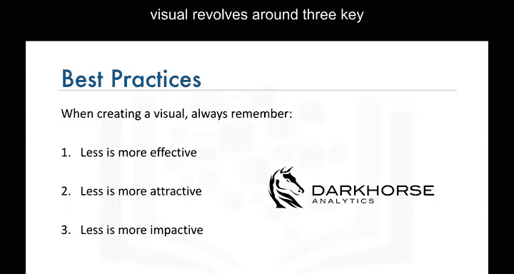

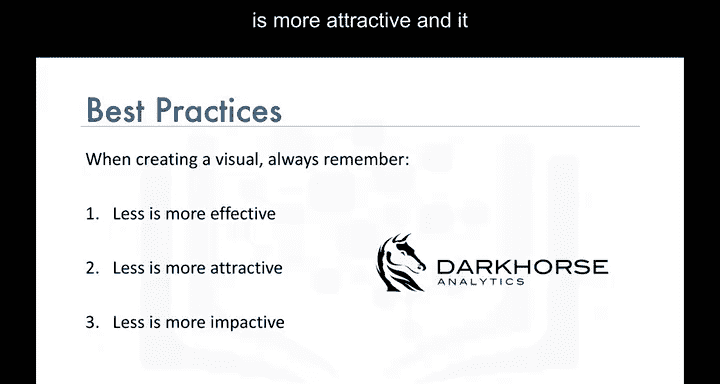

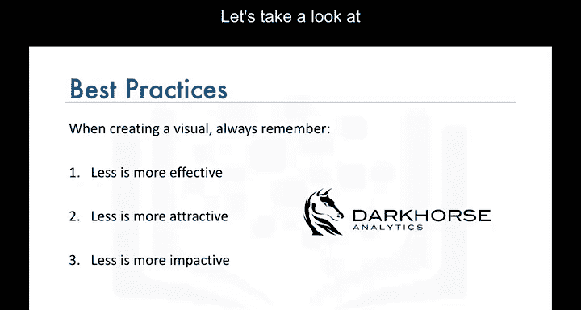

So here is a pie chart of what looks like people's preferences when it comes to different types of pig meat。

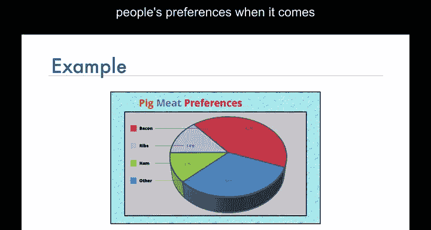

The chart's message is almost half of the people surveyed preferred bacon over the other types of big meat。

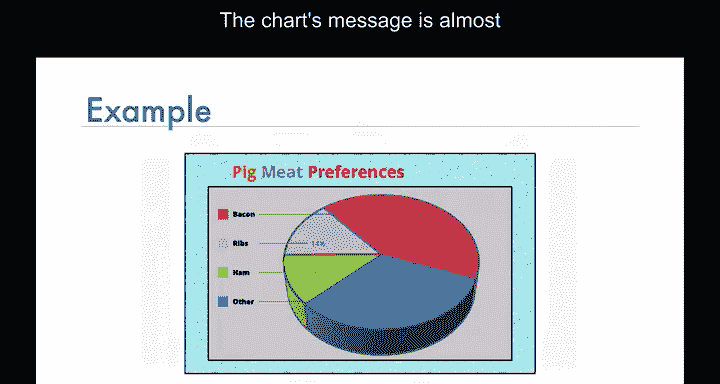

But I'm sure that almost all of you agree that there is a lot going on in this pie chart。

 and we're not even sure a feature such as the blue background or the 3D orientation are meant to convey anything。

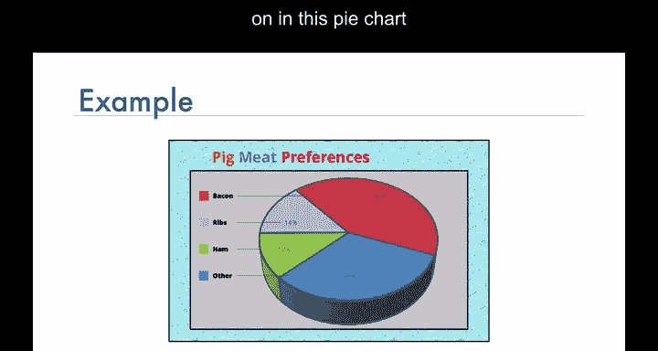

In fact， these additional unnecessary features distract from the main message and can be confusing to the audience。

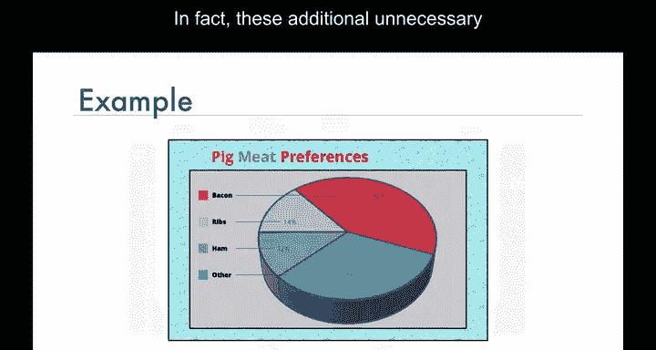

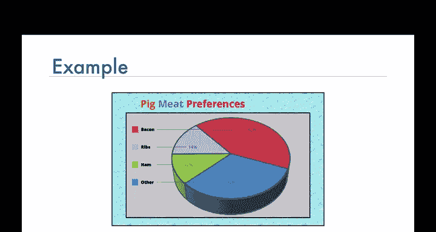

So let's apply Darkcoses analytics approach to transform this into a visual that's more effective。

 attractive and impact。As I mentioned earlier， the message here is that people are most likely to choose bacon over other types of pig meat。

 so let's get rid of everything that can be distracting from this core message。

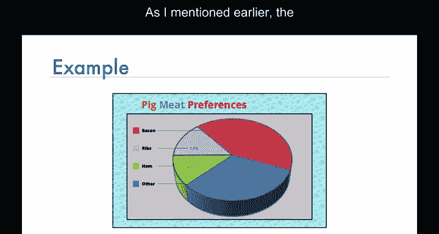

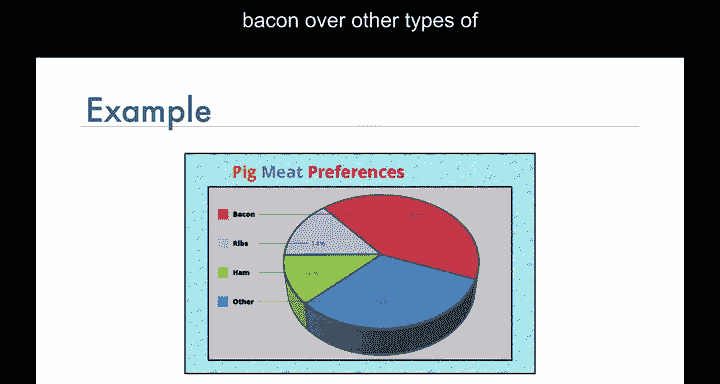

The first thing is， let's get rid of the blue background。And the gray background。

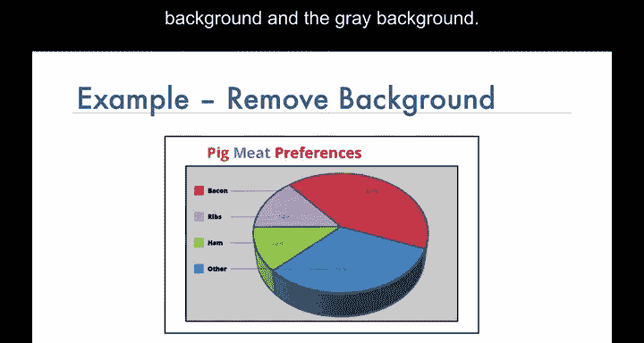

Let's also get rid of borders as they do not convey any extra information。

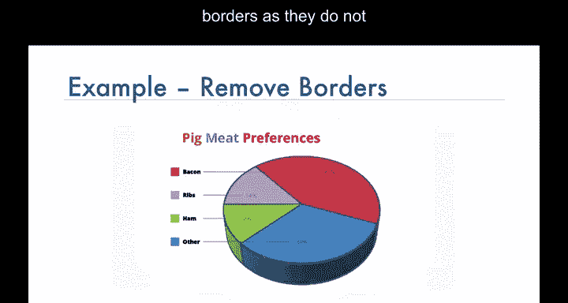

Also， let's drop the redundant legend since the pie chart is already color quoted。

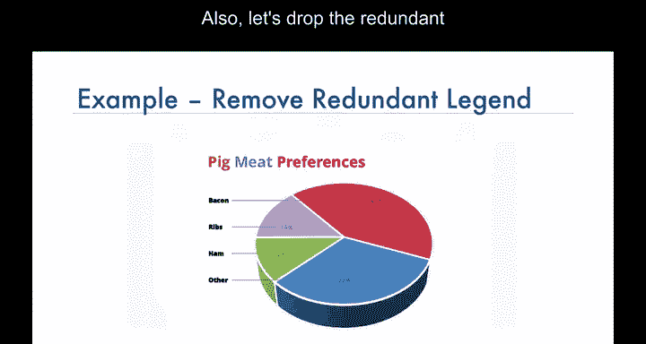

3D isn't adding any extra information。 so let's say bye to it。Text buildinging is also unnecessary。

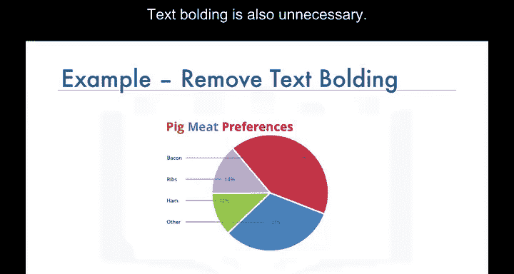

And let's get rid of the different colors。

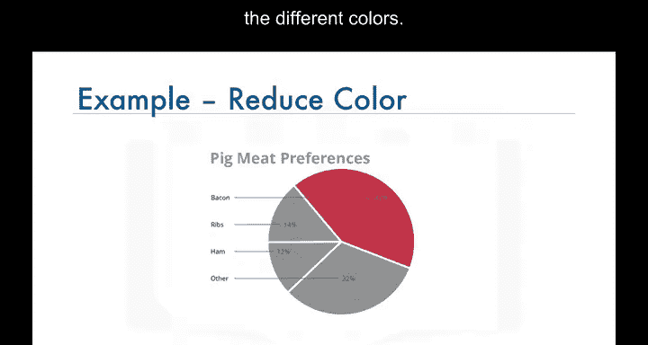

And the wedges。 whoa， what just happened。

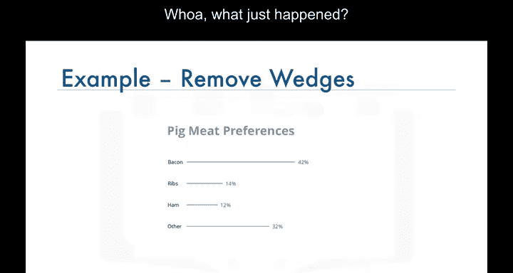

Well， let's stick into the lines to make them more meaningful。Now， this looks a little familiar。

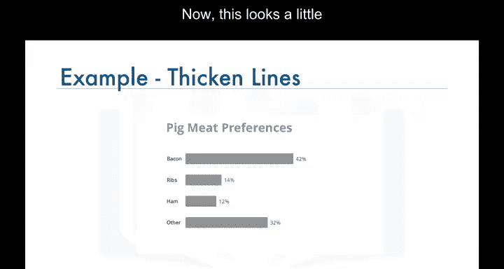

Yes， this is a bur graph。 After all， one with horizontal bars。

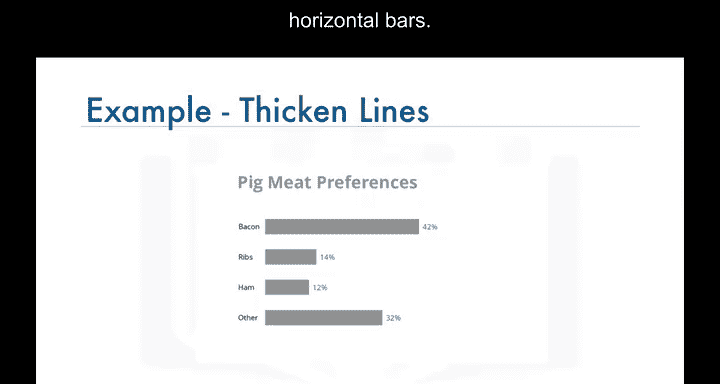

And finally， let's emphasize bacon so that it stands out among the other types of pig meat。

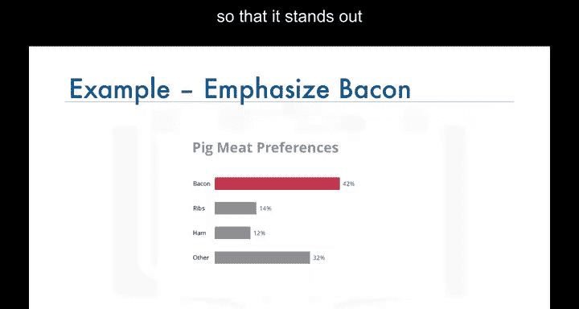

Now， let's juxtapose the pie chart and the bar graph and compare which is better and easy to understand。

 I hope that we unanimously agree that the bar graph is the better of the two。 It is simple， cleaner。

 less distracting and much easier to read。

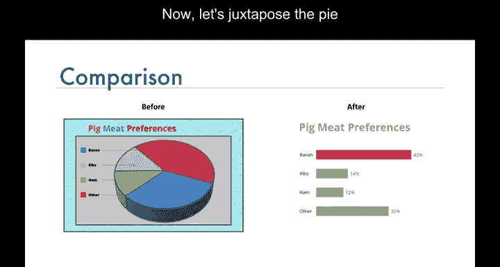

In fact， pie charts have recently come under fire from data visualization experts who argue that they are relevant only in the rares of circumstances。

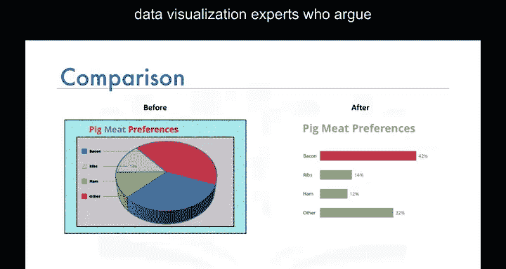

Bar graphs and charts， on the other hand， are argued to be far superior ways to quickly get a message across。

But don't worry about this for now。 We will come back to this point when we learn how to create pie charts and bar graphs with Matplotlib。

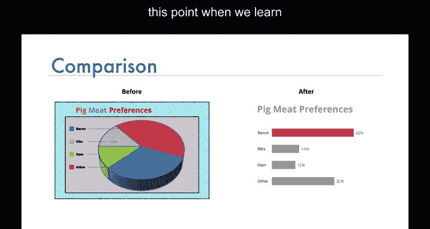

For more similar and interesting examples， check out Dark coursese Analytics website。

 They have a couple more examples on how to clean bar graphs and maps of geospatial data。

 All these examples reinforce the concept of less is more effective， attractive and impact。

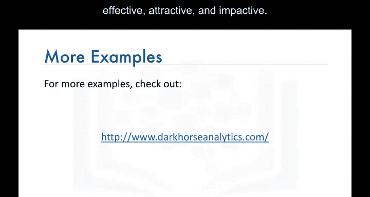