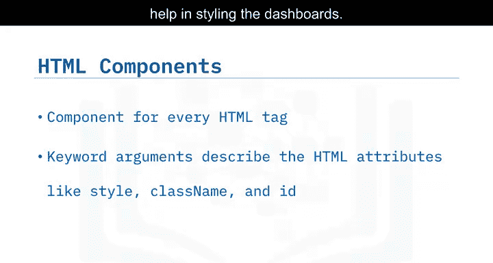
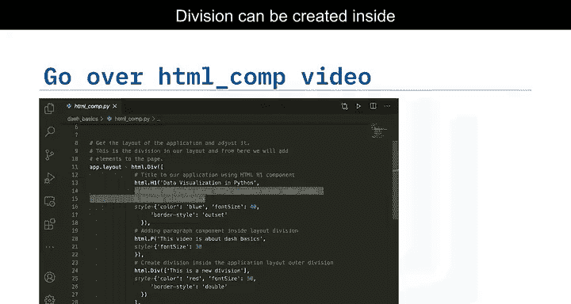
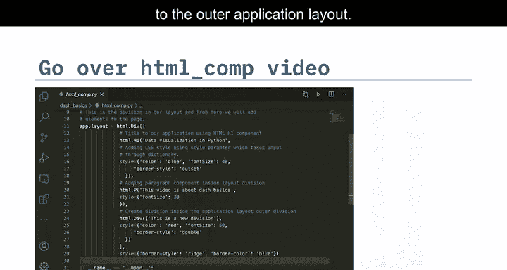
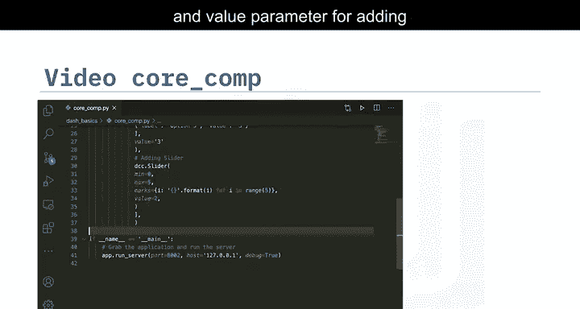

# IBM数据科学专业证书课程8：《Python数据可视化课程（IBM）》python-for-data-visualization（中英字幕） - P20：20_Dash框架导论.zh_en - GPT中英字幕课程资源 - BV19k4y1375E

In this video we are going to see an overview of Dash Library Dash is an open source user interface Python library for creating reactive web based applications。

It is Enterprise Ready and a first class member of Ptly's open source tools Dash applications are web servers running flask and communicating JO packets over HTTP requests D's frontend renders components using React JS。

It is easy to build a graphical user interface using Dash as it abstracts all technologies required to build the applications。

Dash is declarative and reactive Dash output can be rendered in web browser and can be deployed to servers。

Dash uses a simple reactive decorator for binding code to the UI This is inherently mobile and cross platform ready。

Let us say you are planning to create an application to answer a business question as a first step。

 you need to determine the layout of the application， decide which chart to use and where to place。

 for example， this is called layout Part in dash。The second part is to add interactivity to the application。

There are two components of dash， first is core components。

 we can import core components as DCCC using the import statement。Next is HTML components。

We can import HTML components as HTML using this import statement。Let us explore these further。

The dashash_ HTML underscore Compons library has a component for every HTML tag you can compose your layout using Python structures with the HTML dashash Comp library。

The Dash_ HTML underscore Compon Library also provides classes for all of the HTML tags。

The keyword arguments describe the HTML attributes like style， class name， and ID。

No knowledge of HTML or CSS is required， but can help in styling the dashboards。

Let us see an example of how to use HTML components。We start by creating a dash application。

From here we create division in our application layout and then add components to it。

In the outer layer division， we first provide a name for our application using the HTML heading componentent H1。

The style parameter is used to change the font color， size。

 and border of the heading Next we will add paragraph content to the page using an HTML paragraph component P。

Division can be created inside the outer division。

Here we are providing division content as this is a new division and styling it using style parameter components。

To put all this together in the application layout。

 create an HTML division and add components multiple divisions can be added to the outer application layout the dash underscore core_ components describe higher level components that are interactive and generated with JavaScript。

 HTML and CSS through the React JS library some examples of core components are creating a slider input area。

 check items and date Picker you can explore other components using the reference link provided at the end of the slide。

Now let us see how to add a slicer and drop down to the application。For the dropdown。

 we use the DCCC dropdown component。We will create a dropdown list under the options parameter as a dictionary labelbel will hold the dropdown display label name and value will hold the value of the label we can also provide a default dropdown display label using value parameter for the slider we use the DCcc。

 slider component and provide min and Max value to the slider。

The marks parameter is used for adding a slide marker and value parameter for adding default value。

