# IBM数据科学专业证书课程8：《Python数据可视化课程（IBM）》python-for-data-visualization（中英字幕） - P21：21_交互式仪表盘开发.zh_en - GPT中英字幕课程资源 - BV19k4y1375E

嗯。In this video， we will see how to connect core and HTML components using callbacks。

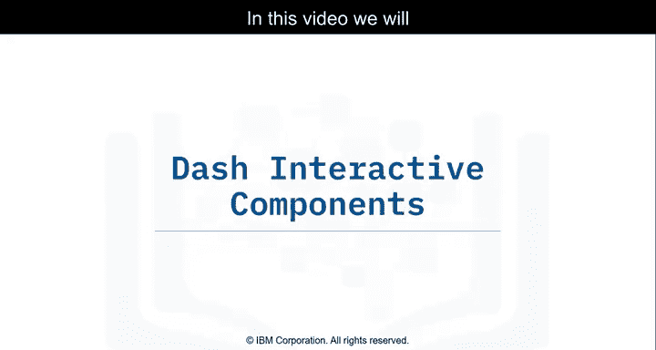

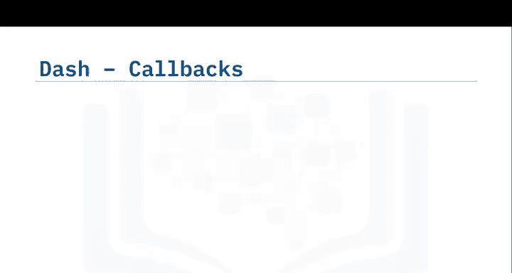

A callback is a Python function that is automatically called by dashash whenever an input components's property changes callback function is decorated with at app。

callback Decator。

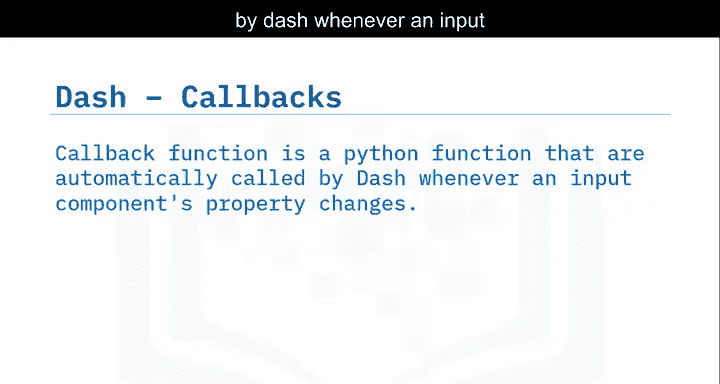

So what does this decorator tell dash basically whenever there is a change in the input component value。

 the callback function wrapped by the decorator is called。

 followed by the update to the output component children in the application layout。

Let us look at the callback function skeleton first create a function that will perform operations to return the desired result for the output component。

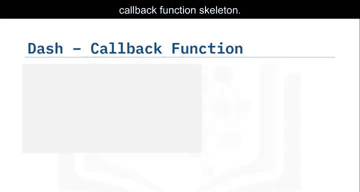

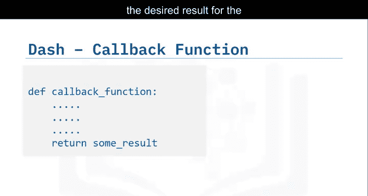

Decorrate the callback function with at app。 callllback decorator This takes two parameters output This sets the result returned from the callback function to a component ID and input this sets the input provided to the callback function to a component ID from here we will connect the input and output to desired properties we will see this in action with an example using the airline data The use case here is to extract the top 10 airline carriers in the provided input year selected by the number of flights based on the input year the output will change。

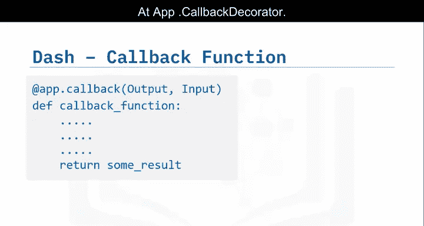

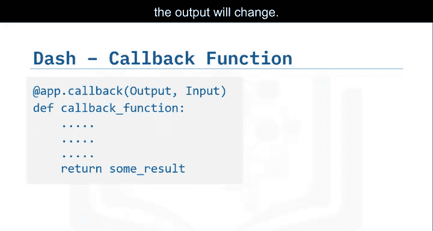

First， we import the required packages， as seen before we will import panndadas， dash。

 dashCo and HTML components the new entry here has dash dependencies from dash dependencies we will import input and output that we will use in the callback function we read the airline data into the panda's data frame。

 we load our data frame at the start of the app and it can be read inside the callback function。

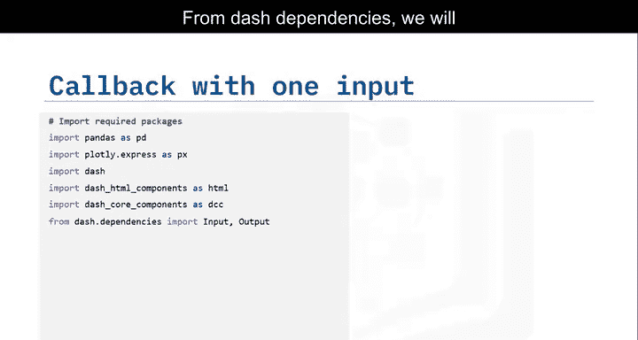

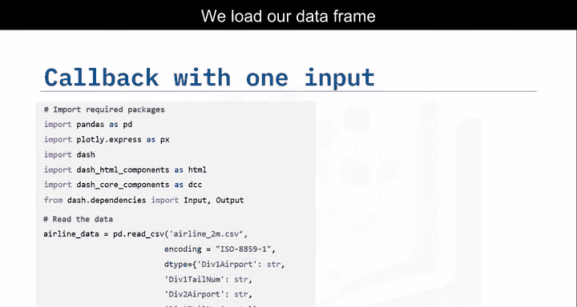

We will start designing the dash application layout by adding components First we will provide the title to the dash app using the HTML heading component H1 and style it using the style parameter Next we will add an H division and text input core component In dash the inputs and outputs of the application are simply the properties of a particular component In this example。

 our input is the value property of the component that has the ID input dash year By default。

 the value has 2010 we will update this value in our callback function Lastly。

 we will add a division with a G core component The core component has bar dash plot as ID which we will update inside the callback function Note the component IDs We will add a callback decorator app callback input to the callback will be the component with ID input dash year and property。

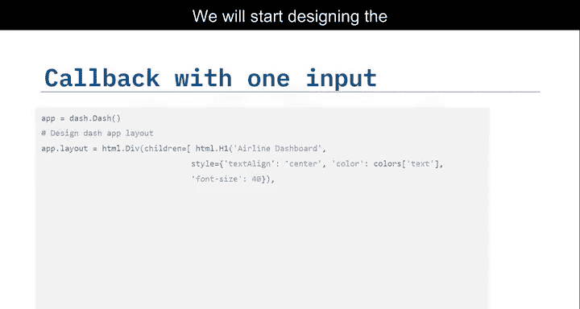

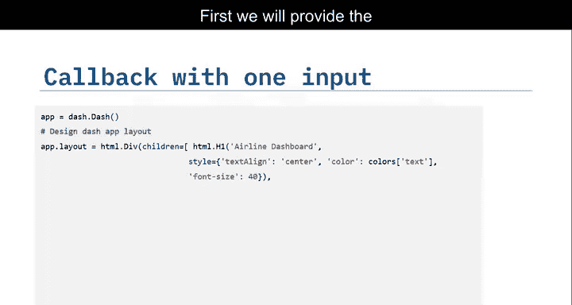

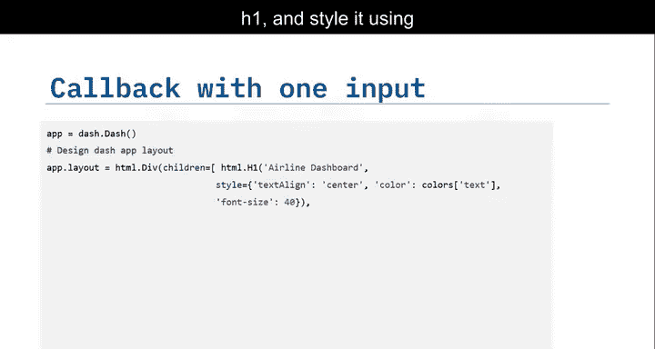

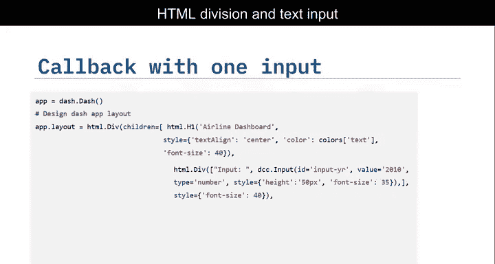

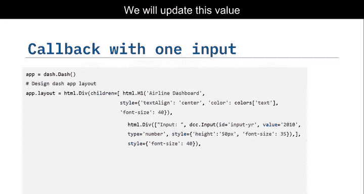

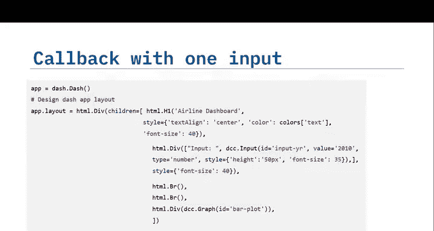

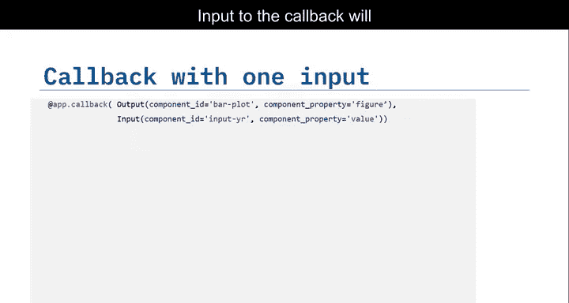

Value output to the callback will be the component with ID bar plot and property figure componentent underscore ID and component underscore property keywords are optional and are included here for clarity Next we will define the callback function get_ graph the entered year will be the input using the year we extracted the required information from data Finally。

 the application layout graph is updated and lastly we will run the application。

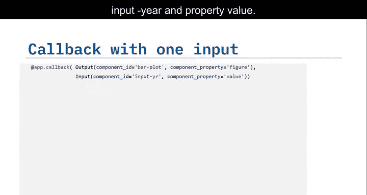

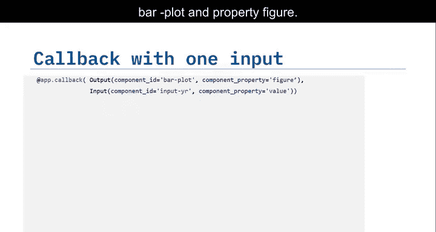

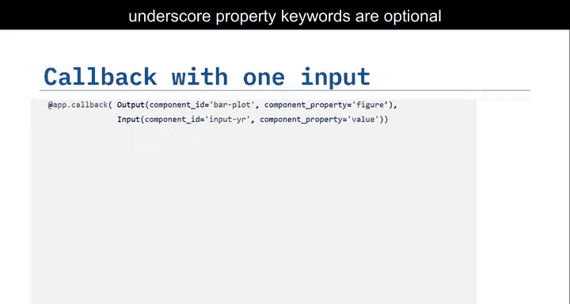

This is the output of the code， our initial input year is 2010， note that as we update the year。

 the graph is updated for that year。

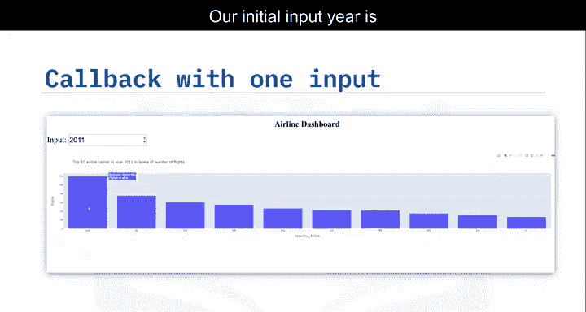

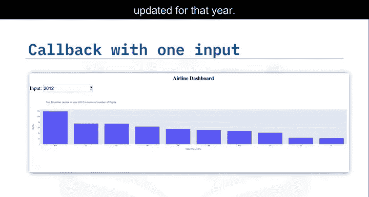

Second example is a callback with two inputs， it is similar to the one input callback except for a few changes。

We will add a division with one more text input with the component ID inputAB。

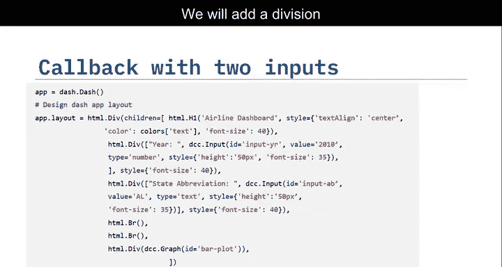

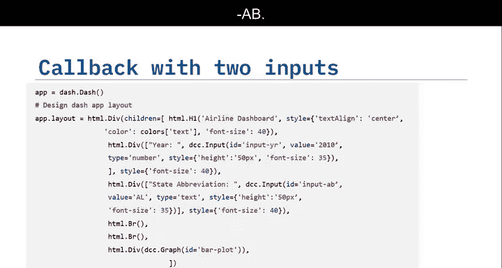

Now we will add the new input and component ID input dash AB to the decorator inside the list Next we will define callback function get_ graphraph This takes the entered year and the entered state as input parameters Comput is performed to extract the information and the application layout is updated with the graph。

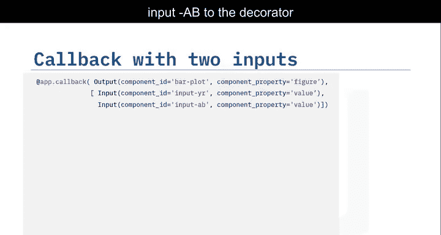

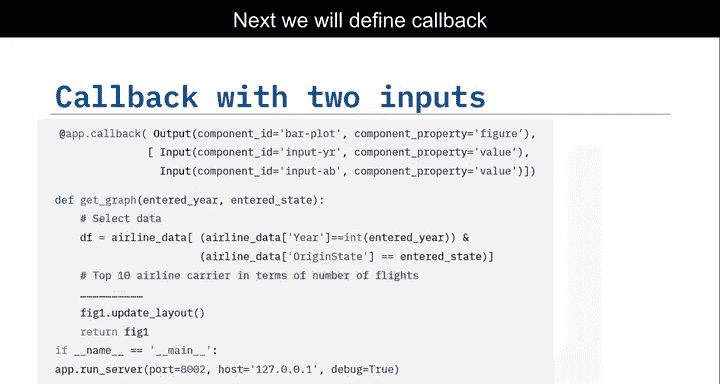

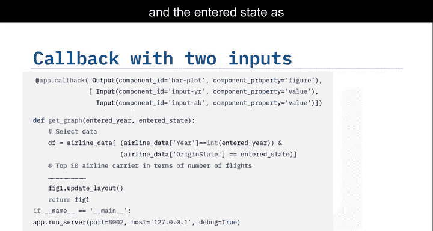

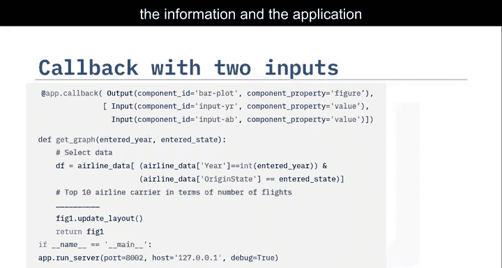

This is the output of the code our initial input year is 2010 and state is AL。

 which is Alabama as I updated the year and state， you can observe that the graph is updated in parallel。

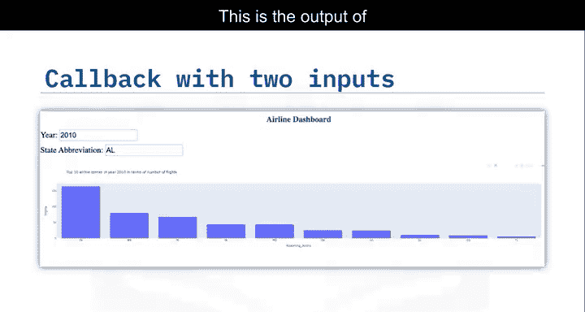

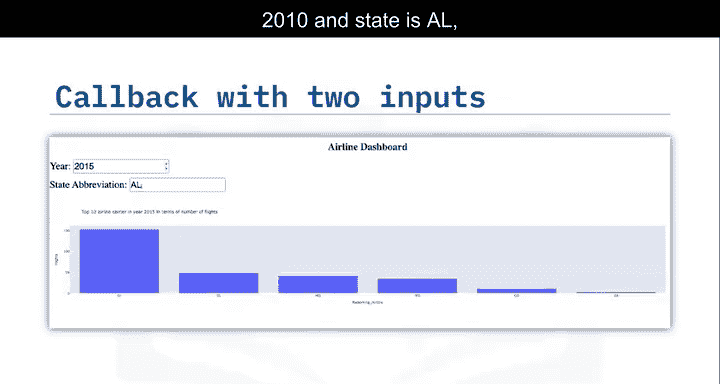

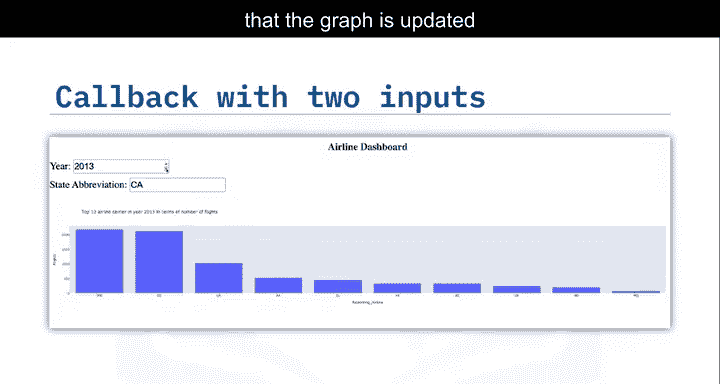

Now let us start the lab。

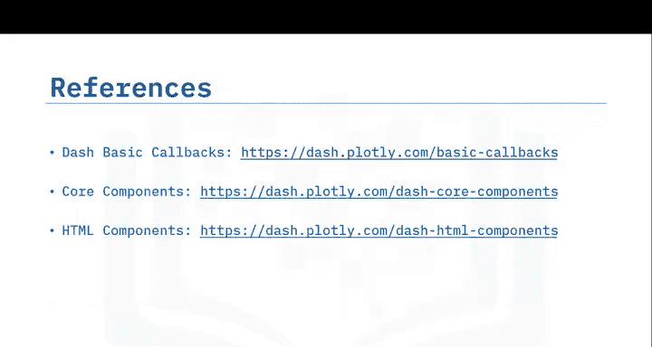

。