# IBM数据科学专业证书课程8：《Python数据可视化课程（IBM）》python-for-data-visualization（中英字幕） - P4：4_加拿大移民数据集.zh_en - GPT中英字幕课程资源 - BV19k4y1375E

In this video， we will learn more about the data set that we will be using throughout the course。

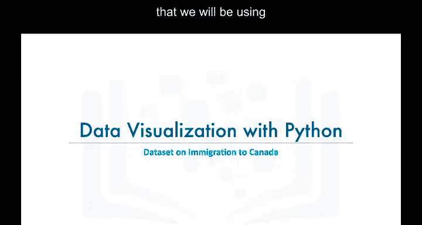

The population division of the United Nations compiled immigration data pertaining to 45 countries。

 the data consists of the total number of immigrants from all over the world to each of the 45 countries。

 as well as other metadata pertaining to the immigrants countries of origin。

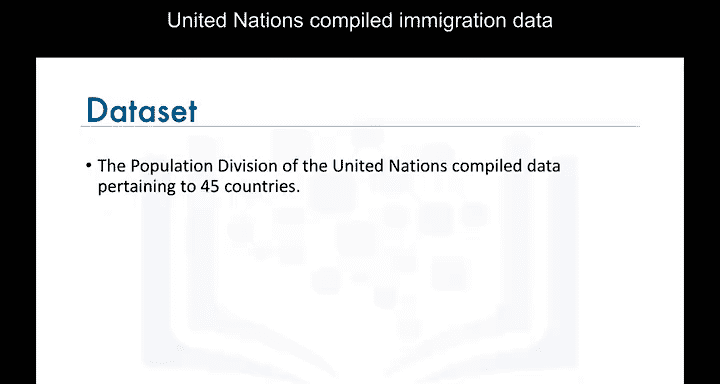

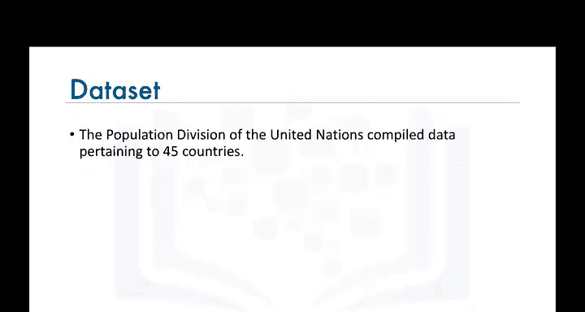

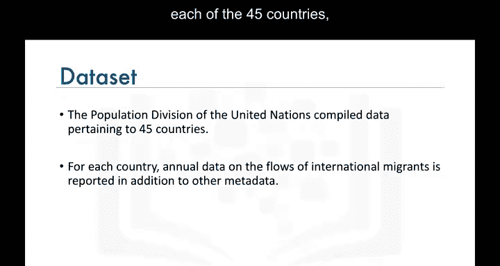

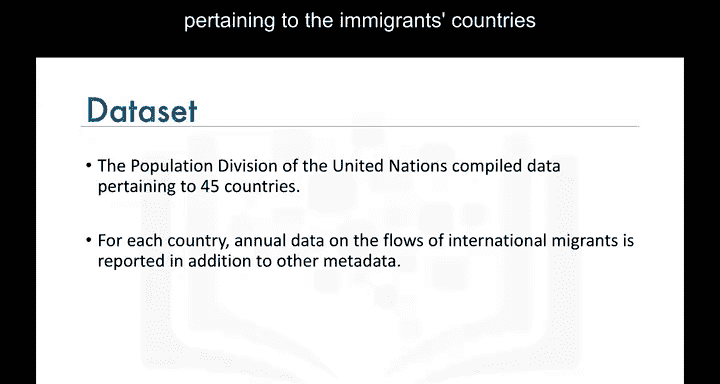

In this course， we will focus on immigration to Canada and we will work primarily with the data set involving immigration to the Great white North。

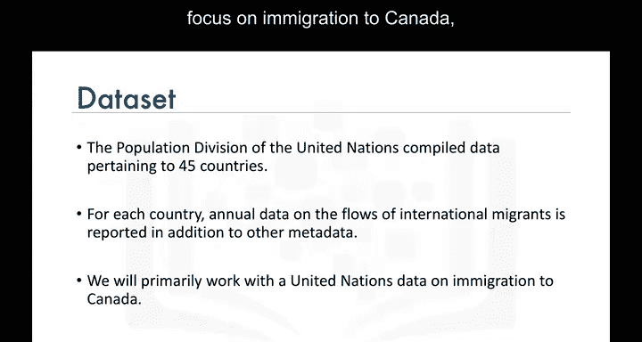

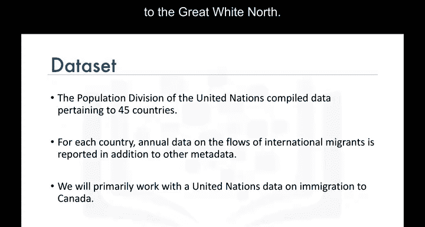

Here is a snapshot of the UN data on immigration to Canada in the form of an Excel file。

 as you can see， the first onearrow rows contain textual data about the UN department and other irrelevant information row 21 contains the labels of the columns。

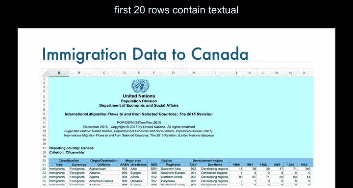

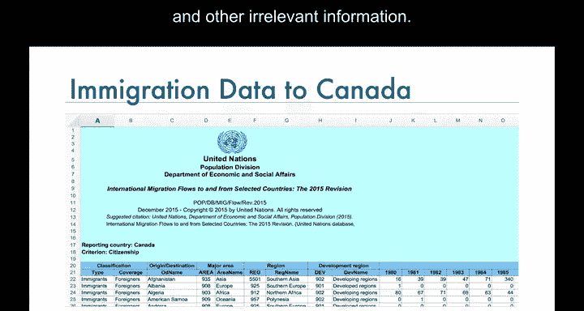

Following that， each row represents a country and contains metadata about the country。

 such as what continent it resides in， what region it belongs to。

 and whether the region is developing or developed。

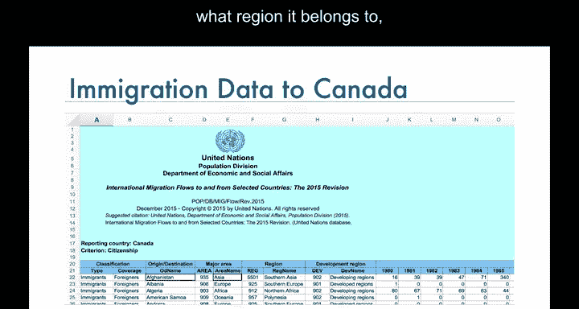

Each row also contains the total number of immigrants from that country for the years 1980 all the way to 2013。

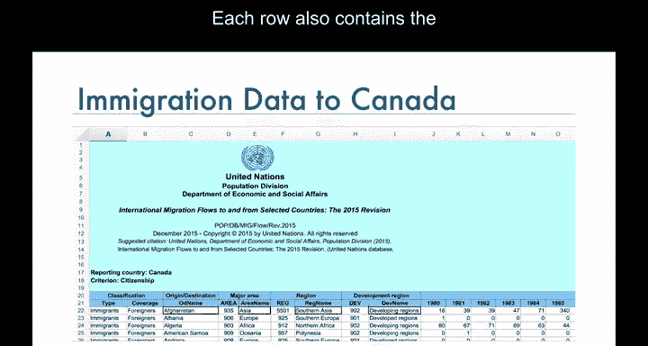

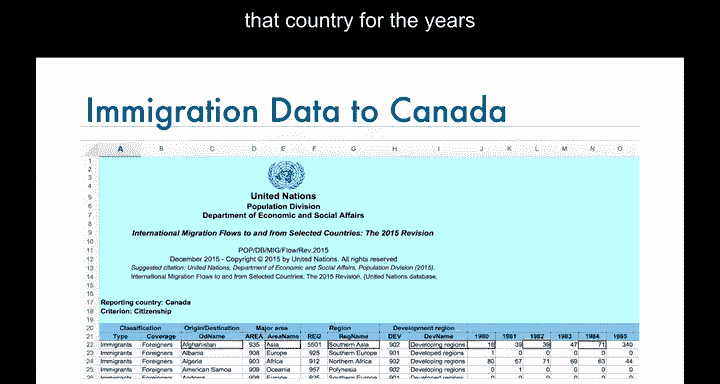

Throughout this course， we will be using PS for any analysis of the data before creating any visualizations。

So in order to start creating different types of plots of the data。

 whether for exploratory analysis or for presentation。

 we will need to import the data into appendice data frame。To do that。

We will need to import the Pdas library as well as the XLRD library。

 which is required to extract data from Excel spreadsheets files。

Then we call theends function， read underscore Excel to read the data into appends data frame。

And let's name this data frame Df underscored can。Notice how we're skipping the first 20 rows to read only the data corresponding to each country。

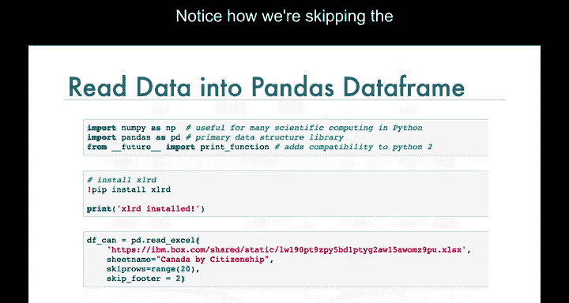

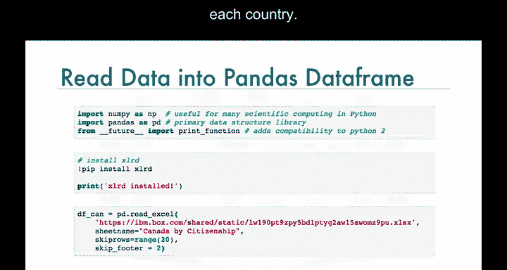

If you want to confirm that you have imported your data correctly in panas。

 you can always use the head function to display the first five rows of the data frame。

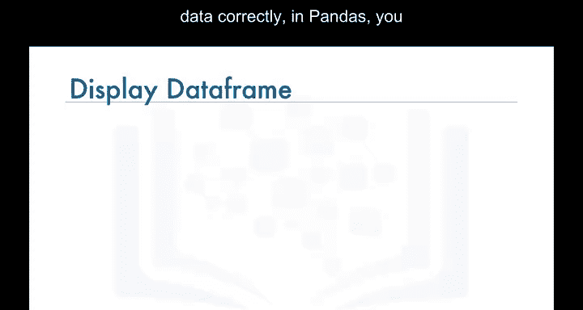

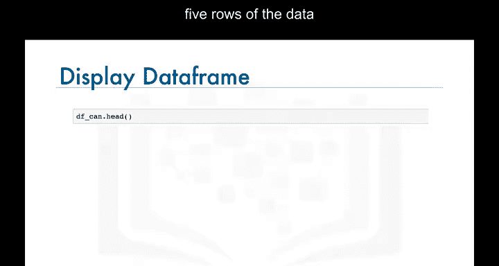

So if we call this function on our data frame， DF underscore can。

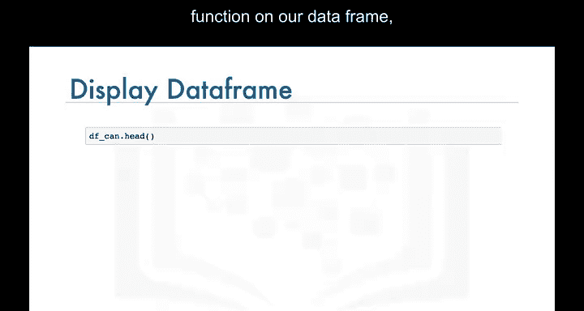

Here is the output。As you can see， the output of the head function looks correct。

 with the columns having the correct labels and each shore representing a country and containing the total number of immigrants from that country。

This concludes our video on immigration to Canada data set。I will see you in the next video。

