# IBM数据科学专业证书课程8：《Python数据可视化课程（IBM）》python-for-data-visualization（中英字幕） - P5：5_折线图绘制.zh_en - GPT中英字幕课程资源 - BV19k4y1375E

In this video， things will start getting more exciting。

 We will generate our first visualization tool， the line plot。😊。

So what is the length plot？As its name suggests， it is applied in the form of a series of data points connected by straight line segments。

 it is one of the most basic type of chart and is common in many fields， not just data science。

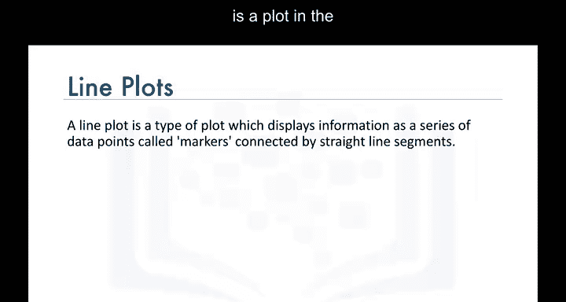

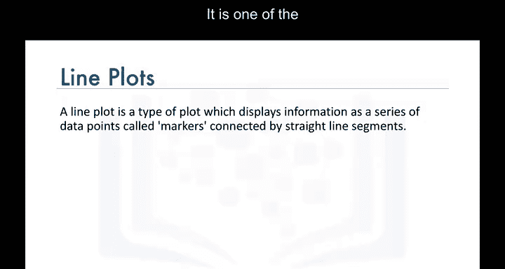

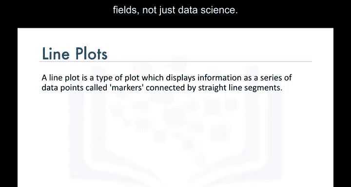

The more important question is when to use line plots the best use case for a line plot is when you have a continuous data set and you're interested in visualizing the data over a period of time。

 as an example， say we're interested in the trend of immigrants from Haiti to Canada we can generate a line plot and the resulting figure will depict the trend of Haitian immigrants to Canada from 1980 to 2013。

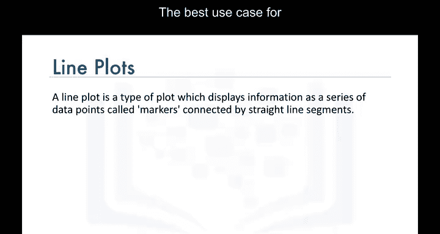

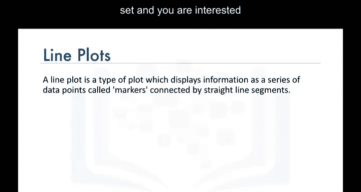

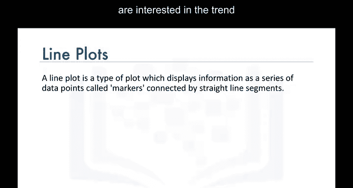

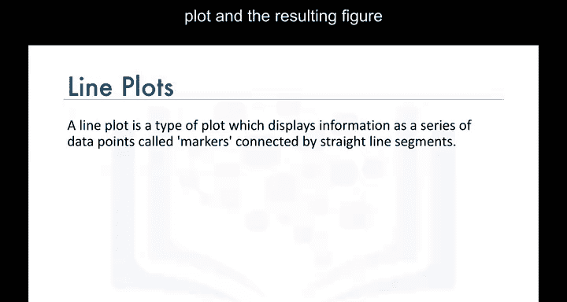

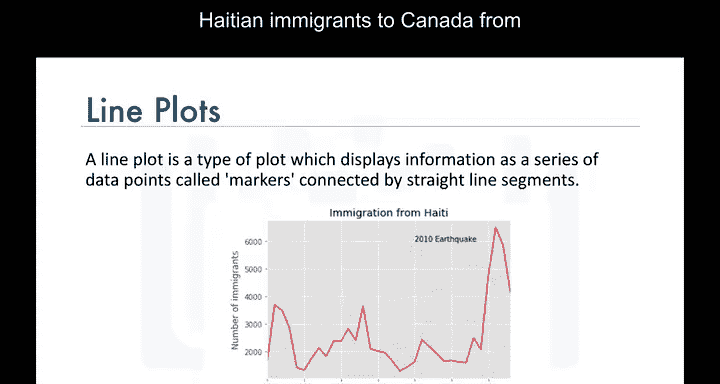

Based on this line plot， we can then research for justifications of obvious anomalies or changes。

 so in this example we see that there is a spike of immigration from Haiti to Canada in 2010。

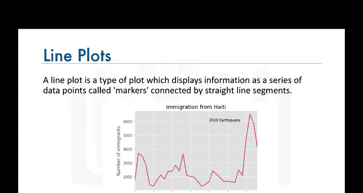

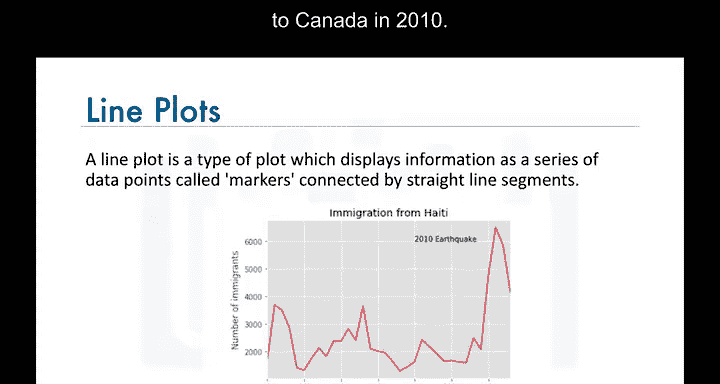

A quick Google search for major events in Haiti in 2010 would return the tragic earthquake that took place in 2010。

 and therefore this influx of immigration to Canada was mainly due to that tragic earthquake okay now how can we generate this line plot？

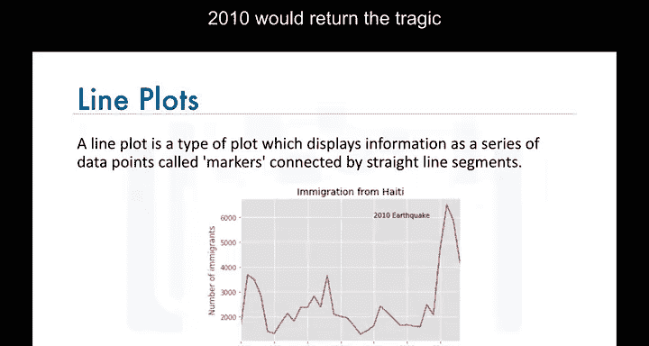

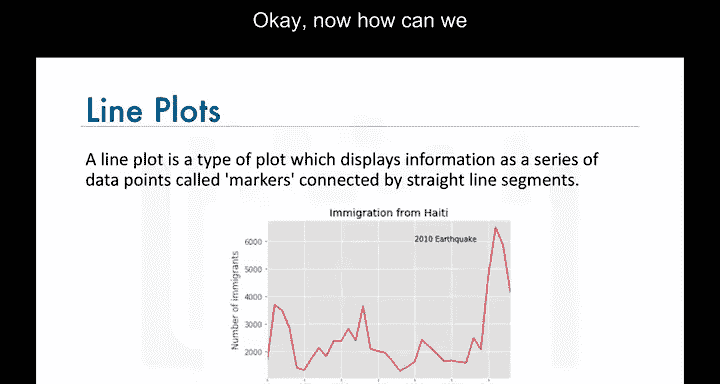

Before we go over the code to do that， let's do a quick recap of our data。

Each represents a country and contains metadata about the country。

 such as where it is located geographically and whether it is developing or developed。

Each row also contains numerical figures of annual immigration from that country to Canada from 1980 to 2013。

Now let's process the data frame so that the country name becomes the index of each row。

 this should make worrying specific countries easier。

 also let's add an extra column which represents the cumulative sum of annual immigration from each country from 1980 to 2013。

 so for Afghanistan it is 58，639 total and for Albania it is 15，699 and so on。

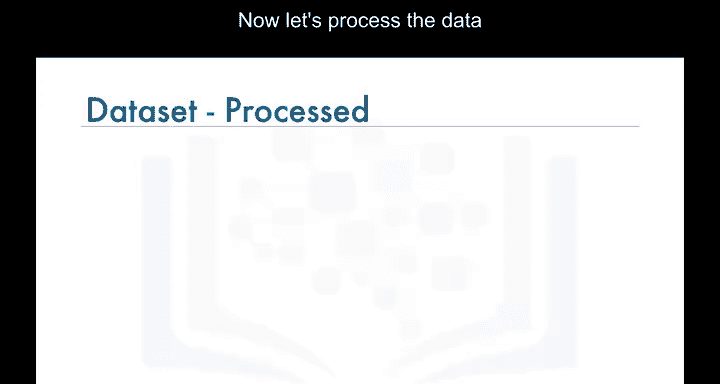

And let's name our data frame， DF_ Canada。So now that we know how our data is stored in the data frame。

 DF underscore Canada， let's generate the line plot corresponding to immigration from Haiti。

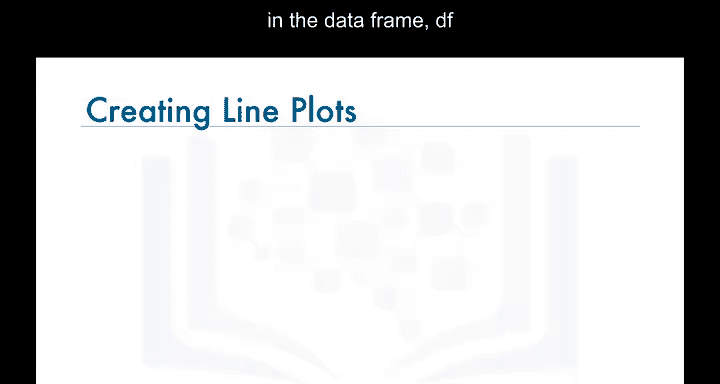

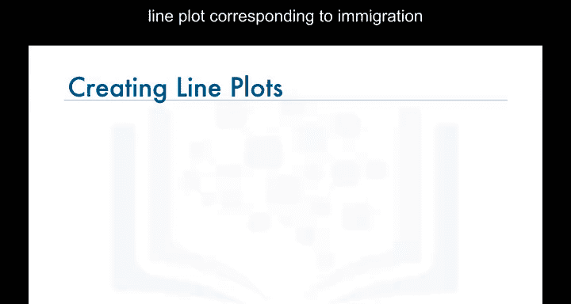

First， we import Matplotlibb as MPL。

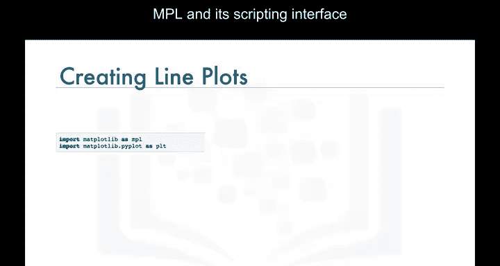

And it's scripting interface as PLT。Then we call the plot function on the ro corresponding to Haiti。

 and we set kind equals line to generate a line plot。

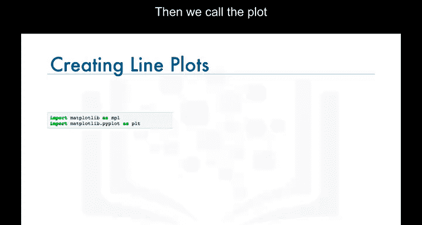

Note that we usedE， which is a list containing string format of years from 1980 to 2013 in order to exclude the column of total immigration that we added。

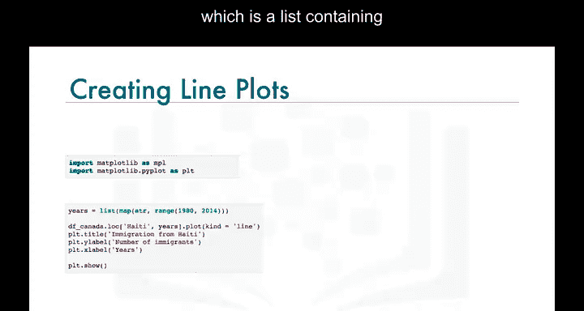

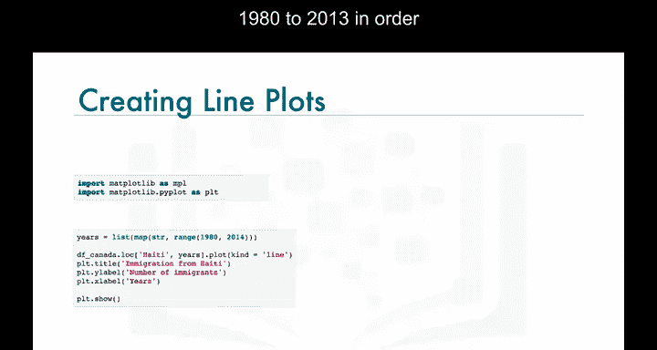

Then to complete the figure， we give it a title and we label its axes。

Finally， we call the show function to display the figure。

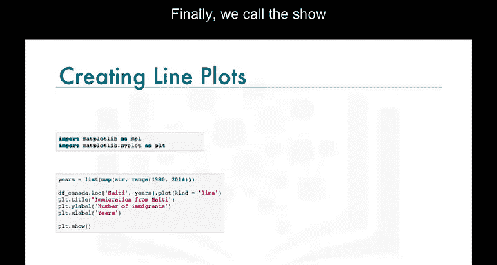

Note that this is the code to generate the line plot using the magic function。

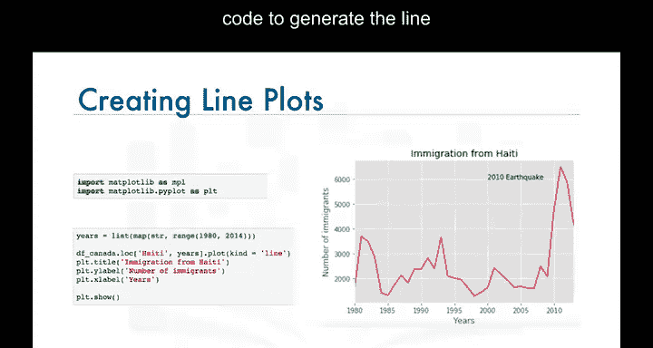

Percent sign Mattlo laid with the inline backend。

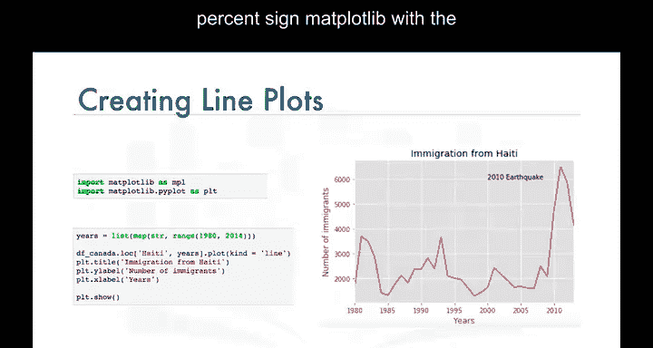

And there you have it， a line plot that depicts immigration from Haiti to Canada from 1980 to 2013。

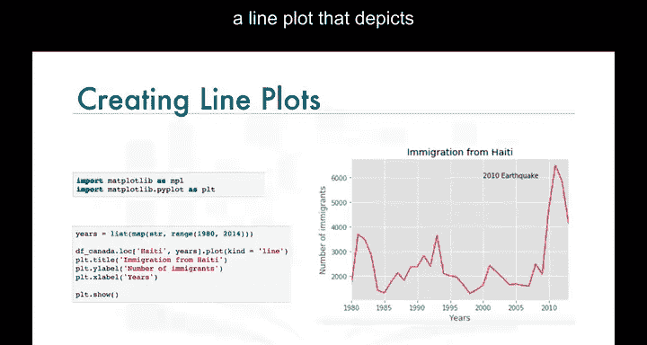

In the lab session， we explore line plots in more details so make sure to complete this module's lab session。

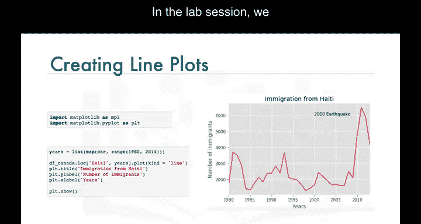

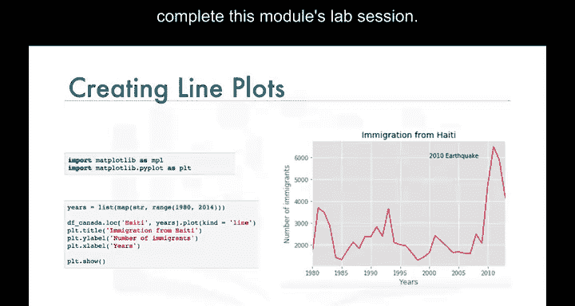

This concludes our video online plots， I'll see you in the next video。

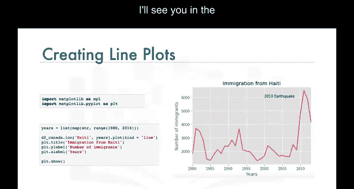