# IBM数据科学专业证书课程8：《Python数据可视化课程（IBM）》python-for-data-visualization（中英字幕） - P6：6_面积图绘制.zh_en - GPT中英字幕课程资源 - BV19k4y1375E

In this video， we will learn about another visualization tool， the area plot。

 which is actually an extension of the line plot that we learned about in an earlier video。

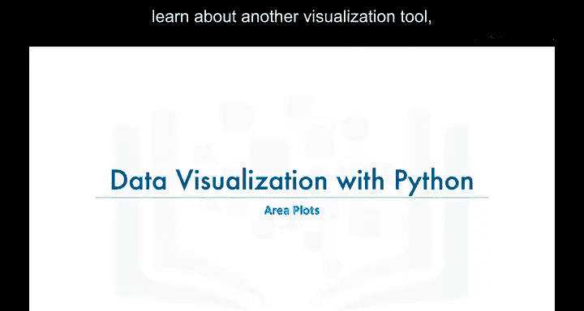

So what is an area plot， an area plot also known as an area chart or graph is a type of plot that depicts accumulated totals using numbers or percentages over time。

 it is based on the line plot and is commonly used when trying to compare two or more quantities。

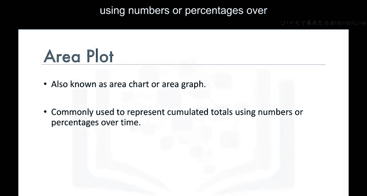

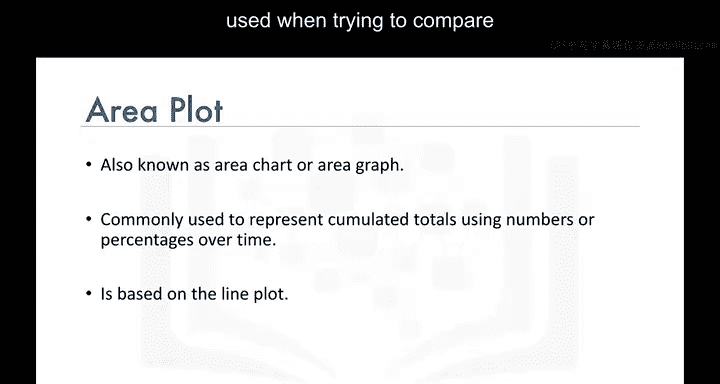

So how can we generate an area plot with MApl Lib？

Before we go over the code to do that， let's do a quick recap of our data set。

Recall that each sh represents a country and contains metadata about the country。

 such as where it is located geographically and whether it is developing or developed。

Each row also contains the miracle figures of annual immigration from that country to Canada from 1980 to 2013。

Now let's process the data frame so that the country name becomes the index of each row。

This should make retrieving rows pertaining to specific countries a lot easier Also let's add an extra column which represents the cumulative sum of annual immigration from each country from 1980 to 2013。

 so for Afghanistan， it is 58，639 total， and for Albania it is 15，699 and so on。

And let's name our data frame， DF_ Canada。So now that we know how our data is stored in the data frame。

 DF underscore Canada， let's try to generate area plots for the countries with the highest number of immigration to Canada。

We can try to find these countries by sorting our data frame in descending order of cumulative total immigration from 1980 to 2013。

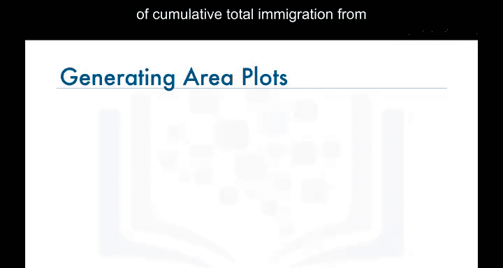

We use the sort underscore values function to sort our data frame in descending order。

 and here is the result， so it turns out that India， followed by China， then the UK。

 Philippines and Pakistan are the top five countries with the highest number of immigration to Canada。

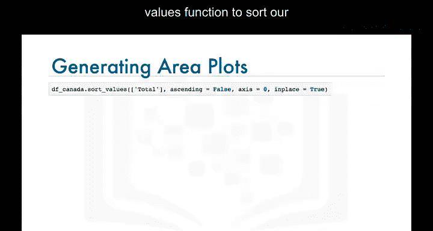

So。Can we now go ahead and generate the area plots using the first five rows of this data frame。

 Not quite yet。First， we need to create a new data frame of only these five countries。

And we need to exclude the total column。More importantly。

To generate the area plots for these countries， we need the years to be plotted on the horizontal axis and the annual immigration to be plotted on the vertical axis。

Note that MApllootLi plots the NdiceCs of a data frame on the horizontal axis。

And with the data frame as shown， the countries will be plotted on the horizontal axis。

 so to fix this， we need to take the transpose of the data frame。Let's see how we can do this。

After we sort our data frame in descending order of cumulative annual immigration。

 we create a new data frame of the top five countries and let's call it。

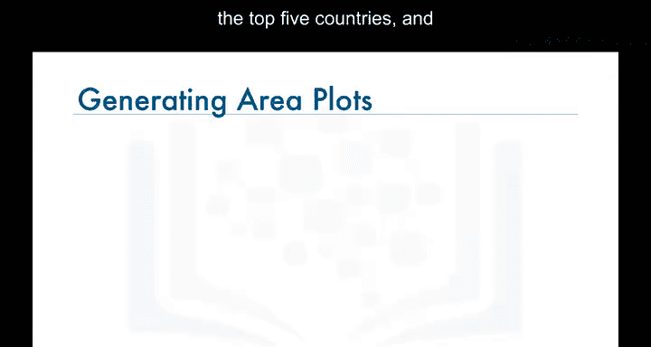

DF underscore top five。

We then select only the columns representing the years 1980 to 2013。

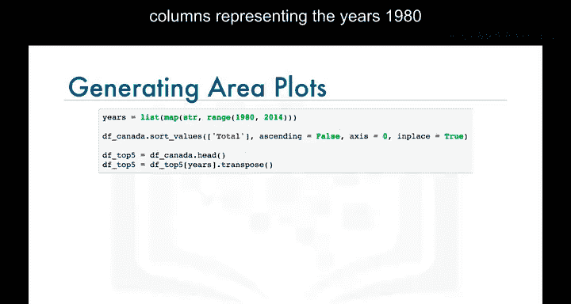

In order to exclude the total column before applying the transpose method。

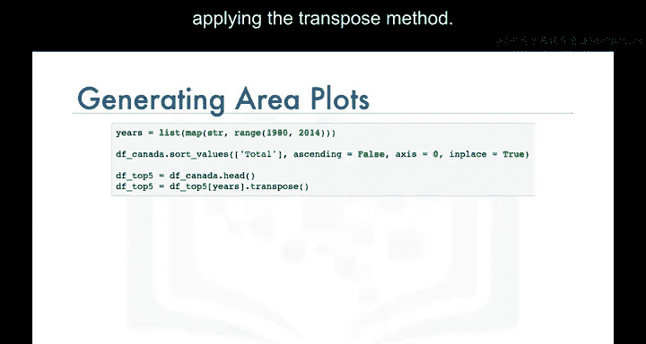

The resulting data frame is exactly what we want with five columns where each column represents one of the top five countries。

 and the years being the indices。

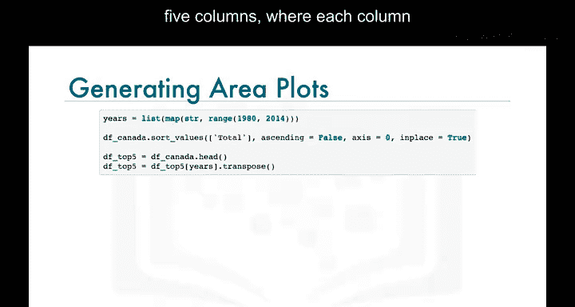

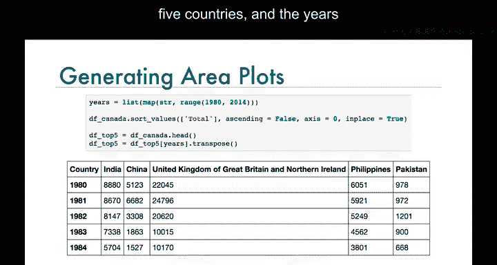

Now we can go ahead and call the plot function on data frame DF underscore top five to generate the area plots。

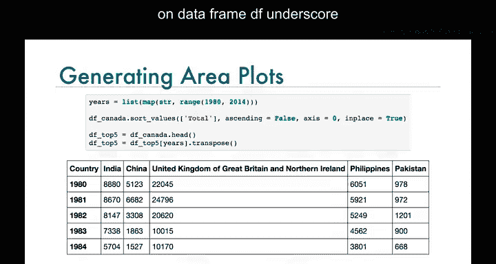

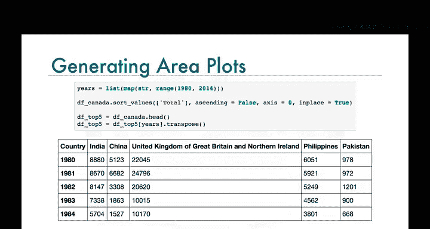

To do that， first we import MAplotLb as MPL。

And it's scripting interface as PLT。Then we call the plot function on the data frame Df underscore top five。

 and we set kind equals area to generate an area plot。

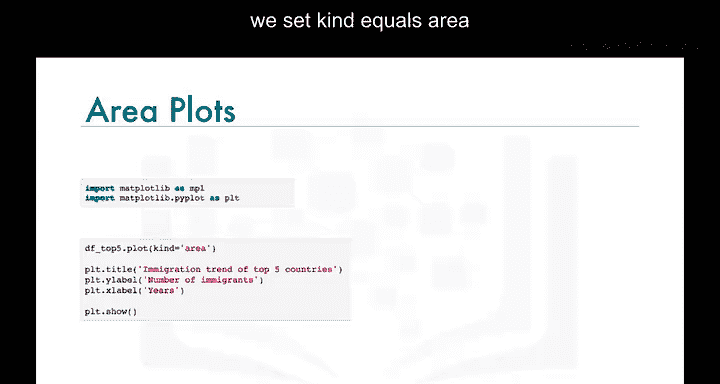

Then to complete the figure， we give it a title and we label its axes。

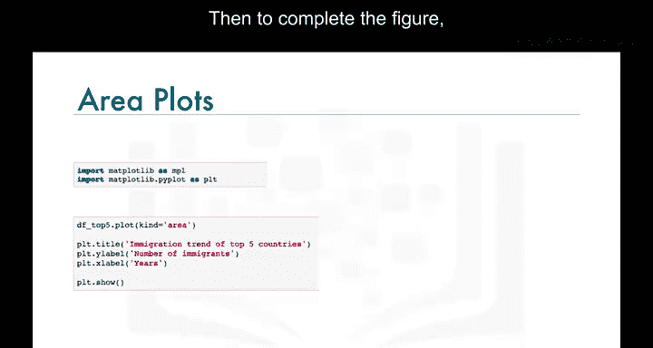

Finally， we call the show function to display the figure。

Note that here we're generating the area plot using the inline backend。

And there you have it， an area plot that depicts immigration trend。

Of the five countries with the highest immigration to Canada from 1980 to 2013。

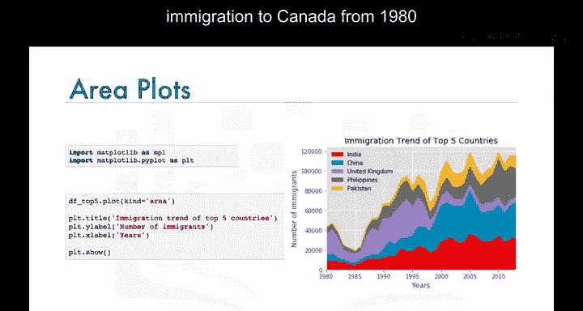

In the lab session， we explore area plots in more details so make sure to complete this module's lab session。

And with this， we conclude our video on area plots， I'll see you in the next video。

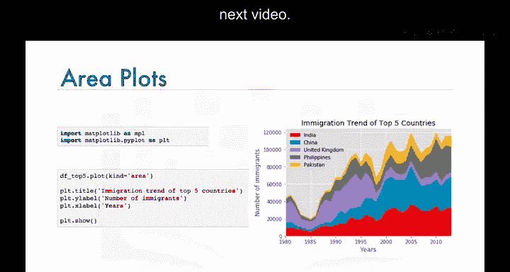