# IBM数据科学专业证书课程8：《Python数据可视化课程（IBM）》python-for-data-visualization（中英字幕） - P7：7_直方图绘制.zh_en - GPT中英字幕课程资源 - BV19k4y1375E

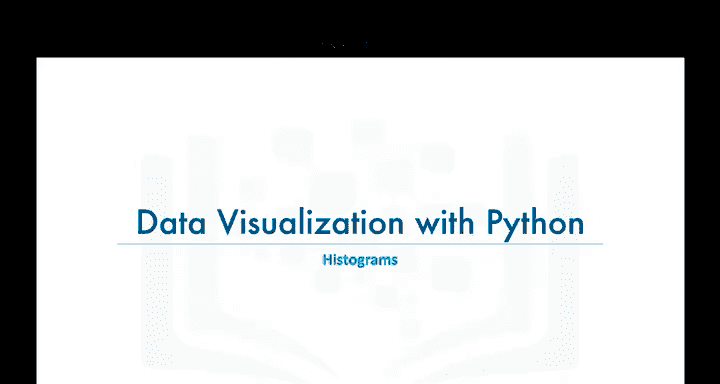

In this video， we will learn about another visualization tool， the histogram。

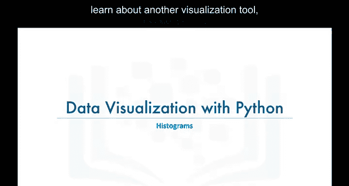

And we will learn how to create it using Maplot Lib。

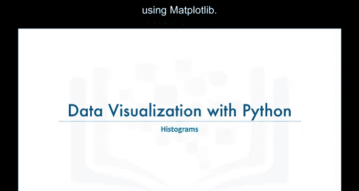

Let's start by defining what a histogram is。

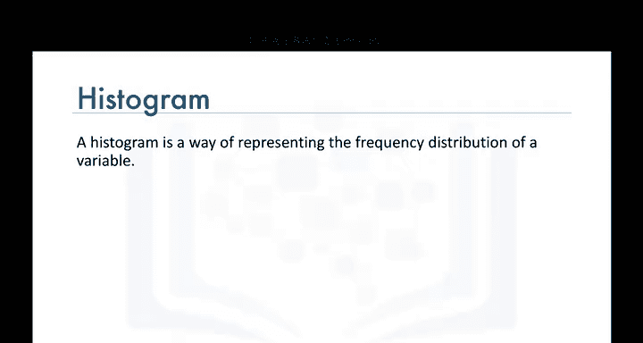

A histogram is a way of representing the frequency distribution of an numeric data set。

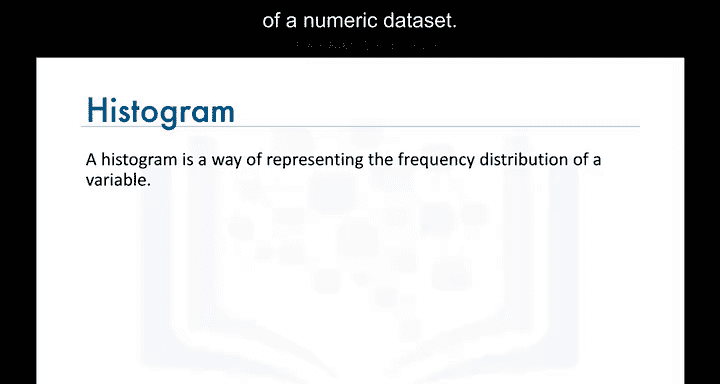

The way it works is it partitions the spread of the numeric data into bins。

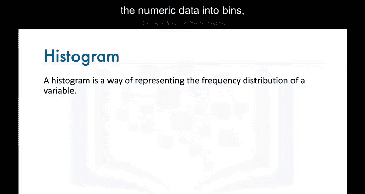

Assigns each data point in the data set to a bin。And then counts the number of data points that have been assigned to each bin。

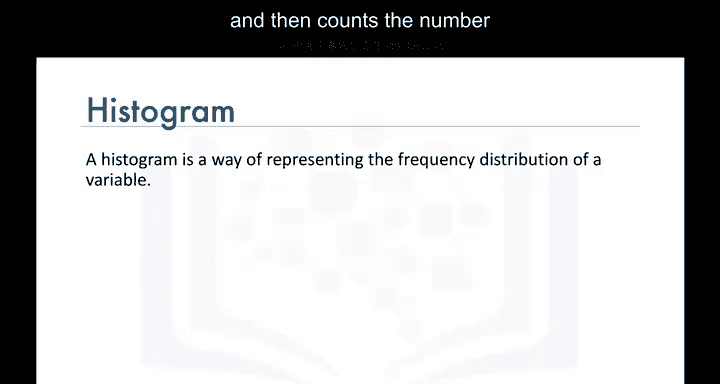

So the vertical axis is actually the frequency or the number of data points in each bin。

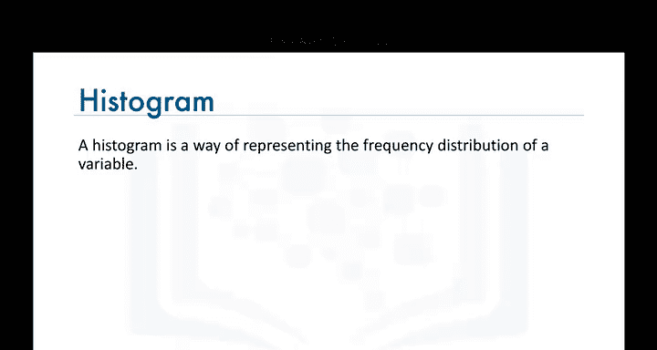

For example， let's say the range of the numeric values in the data set is 34，129。

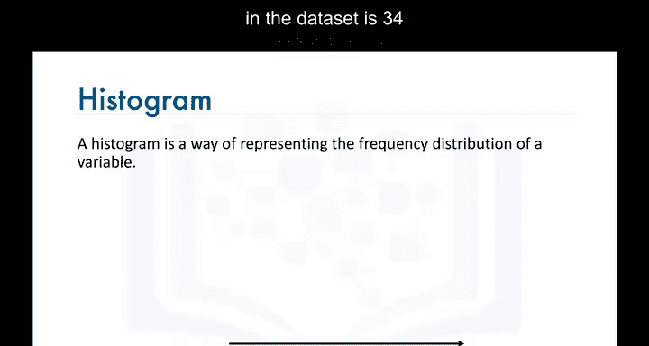

Now the first step in creating the histogram is partitioning the horizontal axis in say 10 bins of equal width。

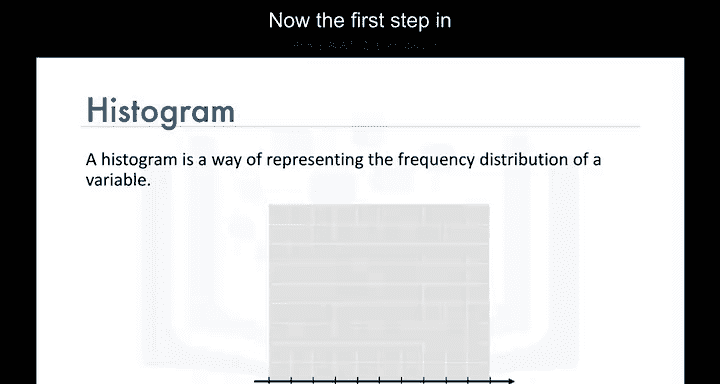

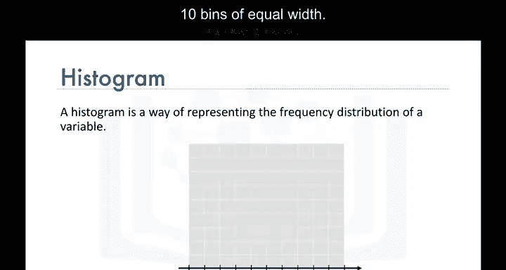

And then we construct the histogram by counting how many data points have a value that is between the limits of the first bin。

 the second bin， the third bin， and so on。

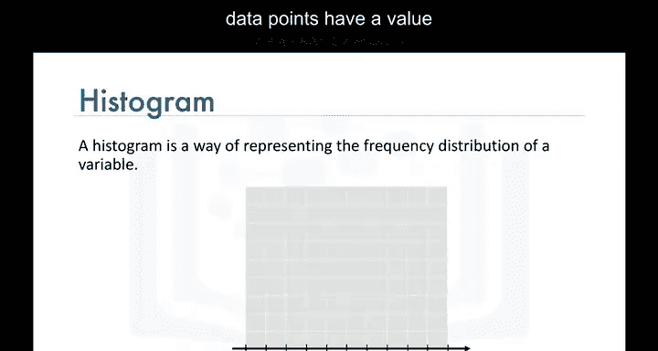

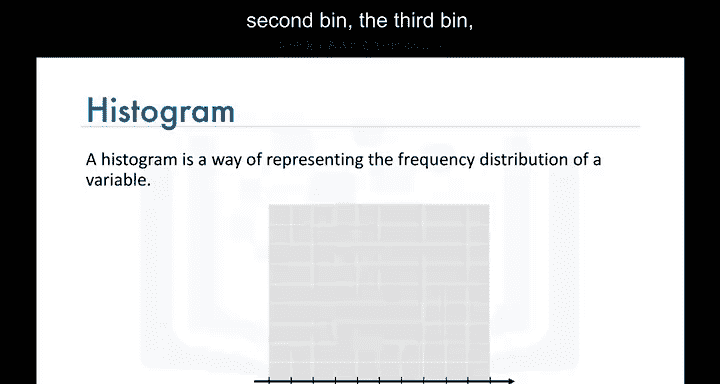

Say the number of data points， having a value between zero and 3，413 is 175。

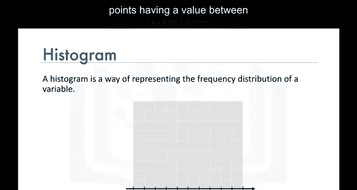

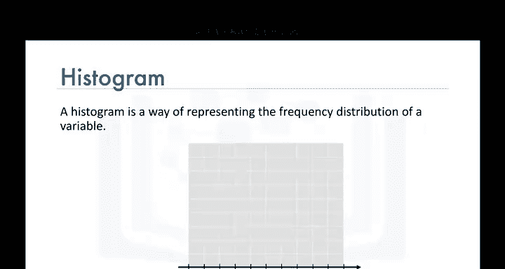

Then we draw a bar of that height for this bin。

We repeat the same thing for all the other bins。And if no data points fall into a bin。

 then that bin would have a bar of high zero。

So how do we create a histogram using Mattpllootlibb？

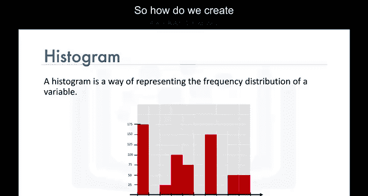

Before we go over the code to do that， let's do a quick recap of our data set。

Recall that each row represents a country and contains metadata about the country。

 such as where it is located geographically and whether it is developing or developed。

Each rule also contains numerical figures of annual immigration from that country to Canada from 1980 to 2013。

Now let's process the data frame so that the country name becomes the index of each row。

 this should make retrieving rows pertaining to specific countries a lot easier。Also。

 let's add an extra column which represents the cumulative sum of annual immigration from each country from 1980 to 2013。

So for Afghanistan， for example， it is 58，639 total， and for Albania， it is 15，699 and so on。

And let's name our data frame DF_ Canada。So now that we know how our data is stored in the data frame。

 DF underscored Canada， say we're interested in visualizing the distribution of immigrants to Canada in the year 2013。

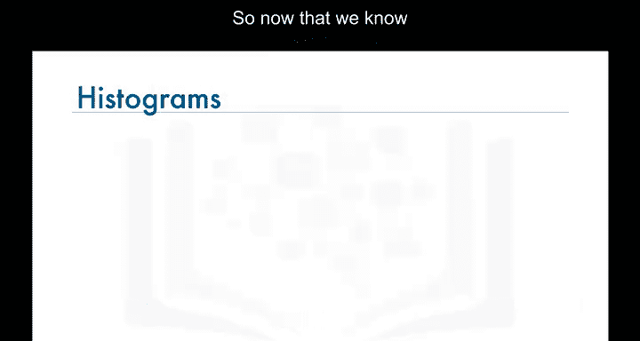

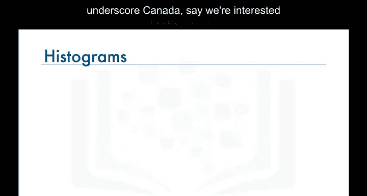

The simplest way to do that is to generate a histogram of the data in columnary 2013。

And let's see how we can do that with Matplloot Libb。

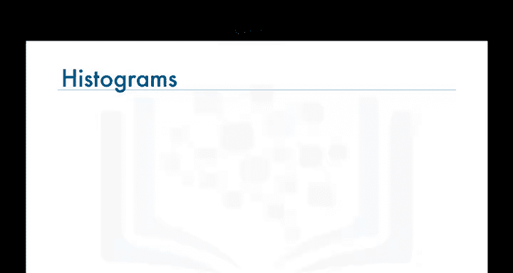

First， we import MApllootLib as MPL。And it's scripting interface as PLT。

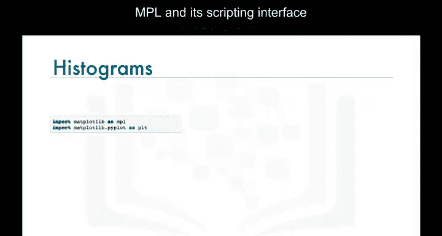

Then we call the plot function on the data in column 2013。

 and we set kind equals hist to generate a histogram。

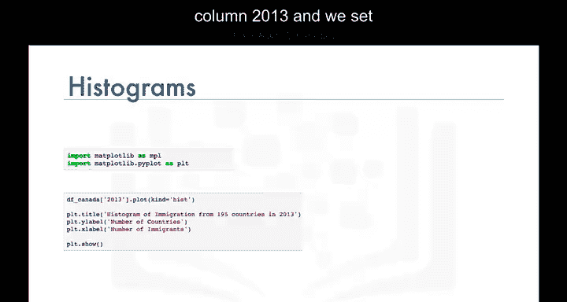

Then to complete the figure， we give it a title and we label its axes。

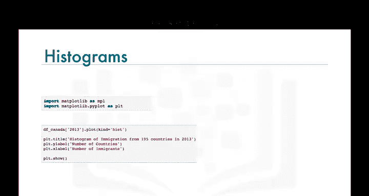

Finally， we call the show function to display the figure。

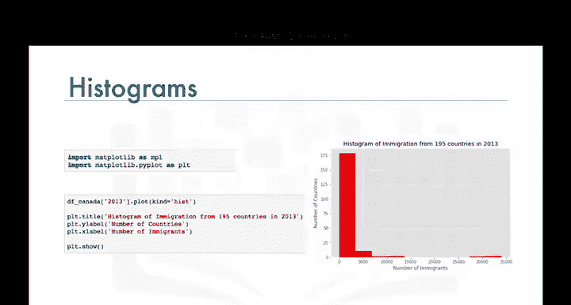

And there you have it， a histogram that depicts the distribution of immigration to Canada in 2013。

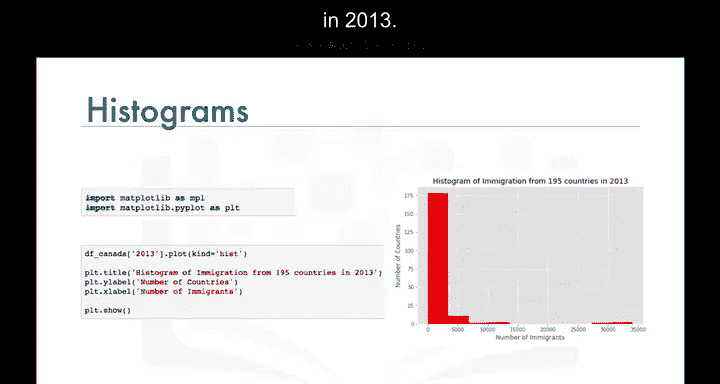

But notice how the bins are not aligned with the tick marks on the horizontal axis。

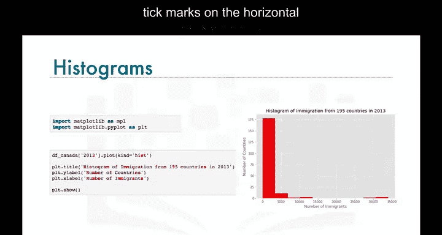

This can make the histogram hard to read。

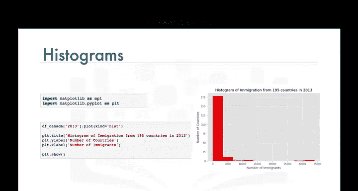

So let's try to fix this in order to make our histogram more effective。

One way to solve this issue is to borrow the histogram function from the NumpI Library。

So as usual， we start by importing Maplotlibb and inscripting interface。

 but this time we also import the NI library。

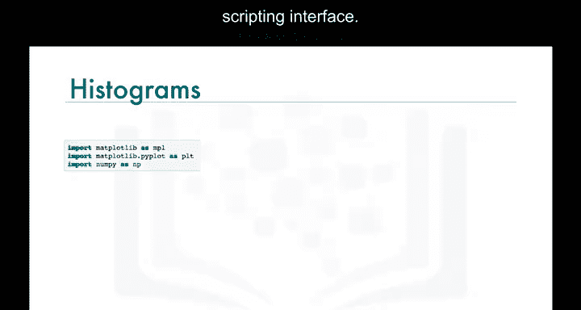

Then we call the N histogram function on the data in column 2013。

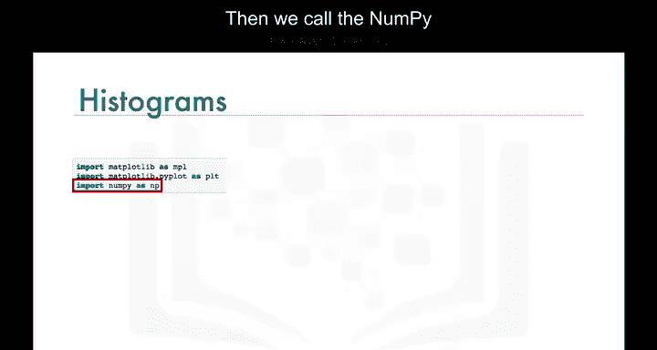

What this function is going to do is it is going to partition the spread of the data in column 2013 into 10 bins of equal width。

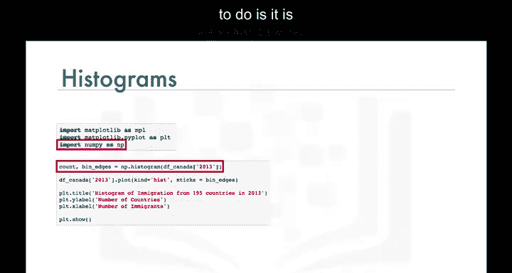

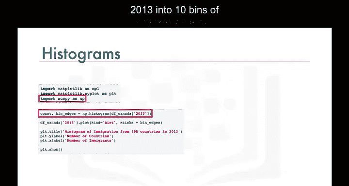

Compute the number of data points that fall in each bin and then return this frequency of each bin。

 which we're calling count here and the bin edges， which we're calling bin_ edges。

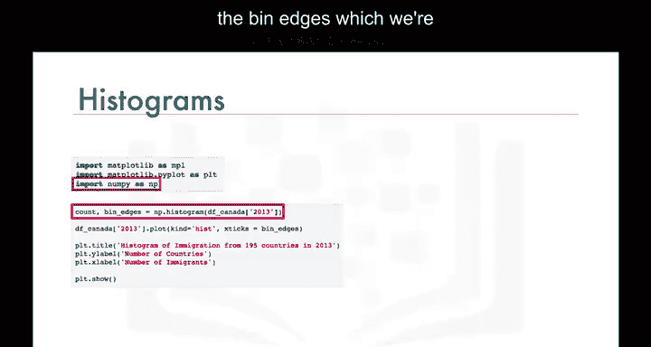

We then pass these bin edges as an additional parameter in our plot function to generate the histogram。

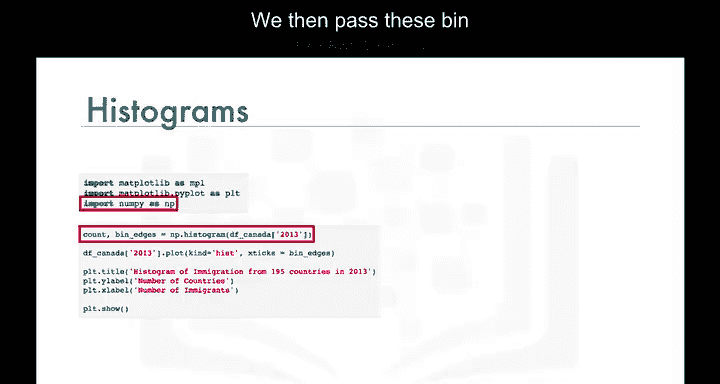

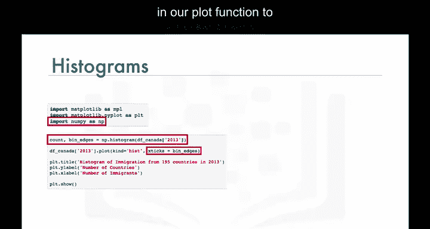

And there you go， a nice looking histogram whose bin edges are aligned with the tick marks on the horizontal axis。

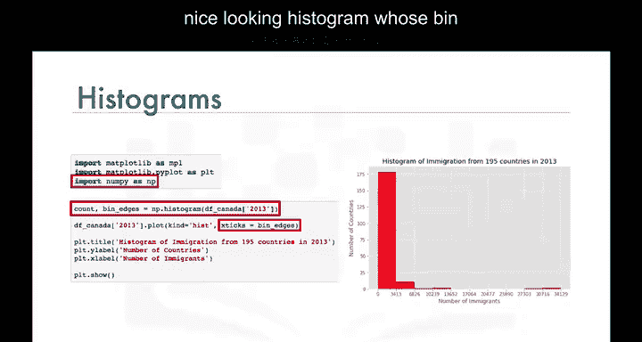

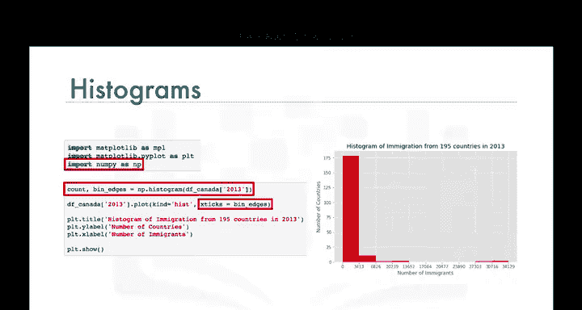

In the lab session， we explore histograms in more details so make sure to complete this module's lab session。

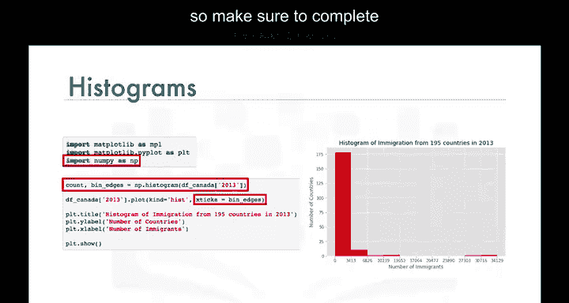

And with this， we conclude our video on histograms。

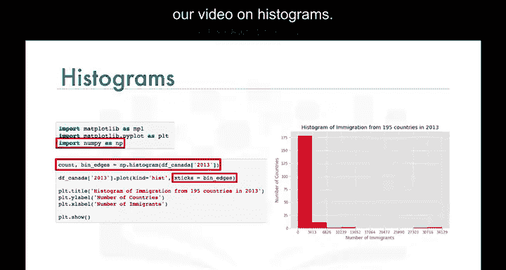

I'll see you in the next video。