# IBM数据科学专业证书课程8：《Python数据可视化课程（IBM）》python-for-data-visualization（中英字幕） - P8：8_条形图绘制.zh_en - GPT中英字幕课程资源 - BV19k4y1375E

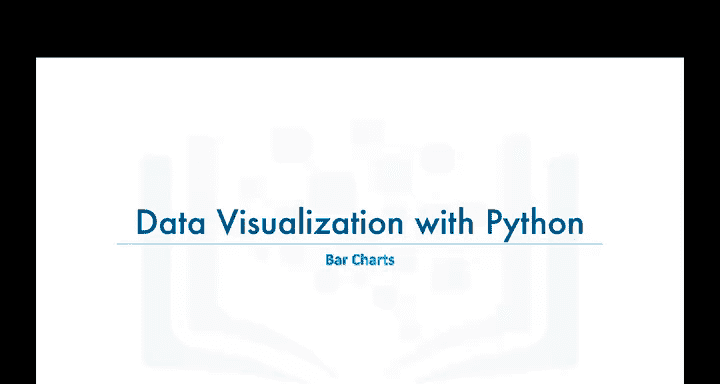

In this video， we will learn about an additional visualization tool， namely the bart chart。

 and learn how to create a using Matplloot Lib。

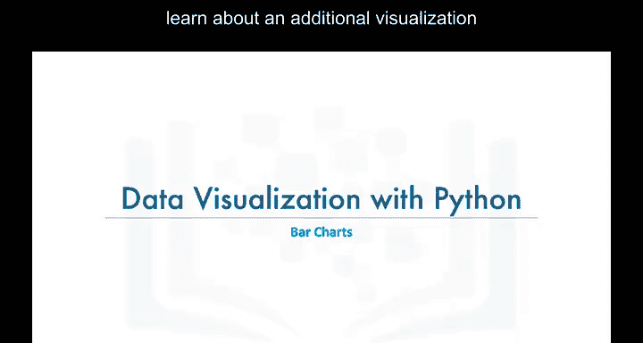

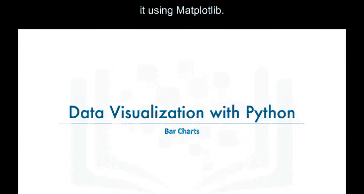

A bar chart is a very popular visualization tool。

Unlike a histogram， a bar chart also known as a bar graph。

 is a type of plot where the length of each bar is proportional to the value of the item that it represents。

It is commonly used to compare the values of a variable at a given point in time。

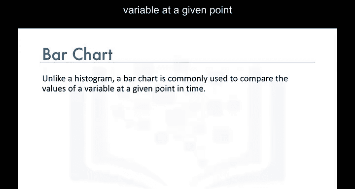

For example， say we're interested in visualizing in a discrete fashion how immigration from Iceland to Canada looked like from 1980 to 2013。

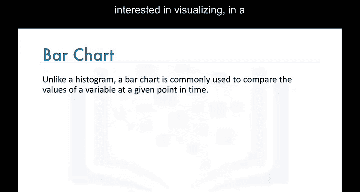

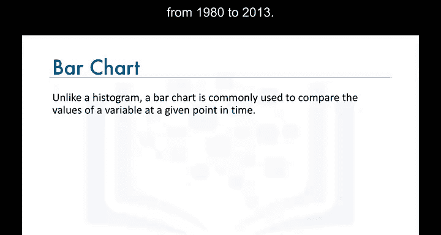

One way to do that is by building a bar chart where the height of the bar represents the total immigration from Iceland to Canada in a particular year。

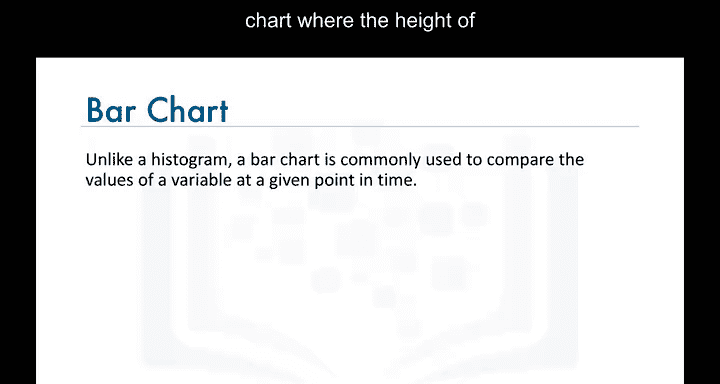

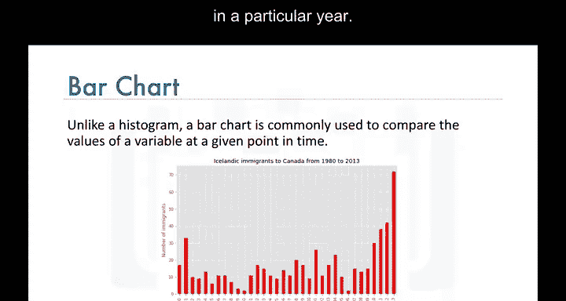

So how do you do that with Mattplloot Lib？Before we go over the code to do that。

 let's do a quick recap of our data set。Recall that each row represents a country and contains metadata about the country。

 such as where it is located geographically and whether it is developing or developed。

Each row also contains numerical figures of annual immigration from that country to Canada from 1980 to 2013。

Now let's process the data frame so that the country name becomes the index of each row。

 this should make retrieving rows pertaining to specific countries a lot easier。Also。

 let's add an extra column which represents the cumulative sum of annual immigration from each country from 1980 to 2013。

So for Afghanistan， for example， it is 58，639 total， and for Albania， it is 15，699 and so on。

And let's name our data frame， DF_ Canada。So now that we know how our data is stored in the data frame DF underscore Canada。

 let's see how we can use MapllootLB to generate a bar chart to visualize how immigration from Iceland to Canada looked like from 1980 to 2013。

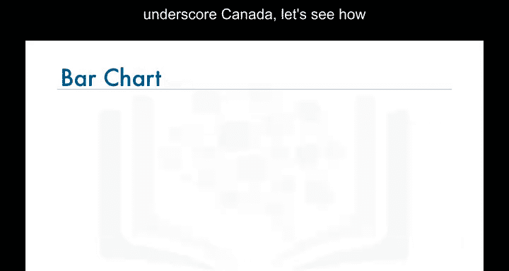

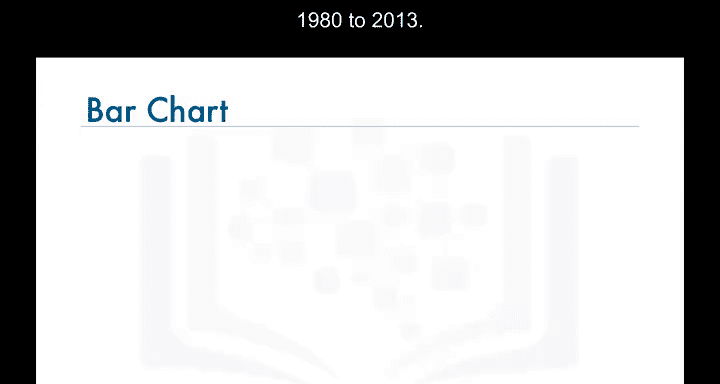

As usual， we start by importing Malalib and its scripting interface。

 then we use the years variable to create a new data frame， let's name it DF_ Iceland。

 which includes the data pertaining to annual immigration from Iceland to Canada and excluding the total column。

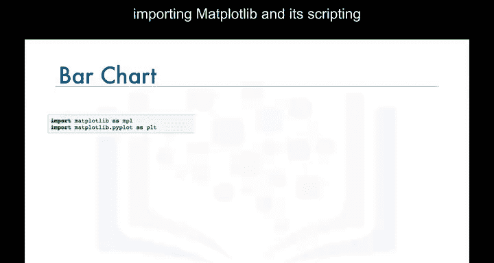

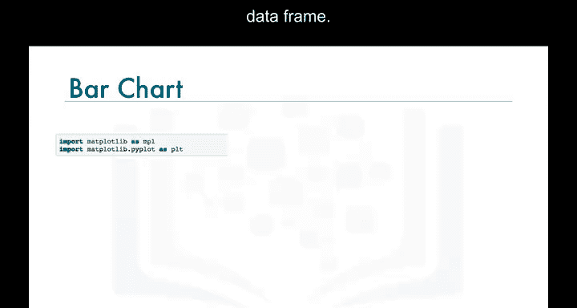

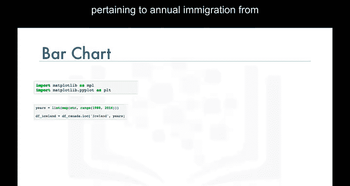

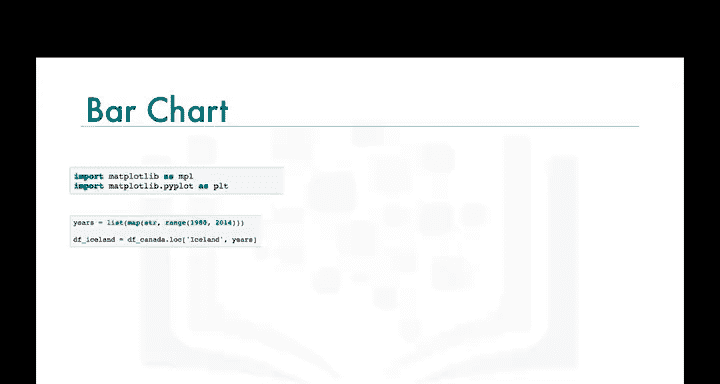

Then we call the plot function on DF_ Iceland， and we set kind equals bar to generate a bar chart。

Then to complete the figure， we give it a title and we label its axes。Finally。

 we call the show function to display the figure。

And there you have it， a bar chart that depicts the immigration from Iceland to Canada from 1980 to 2013。

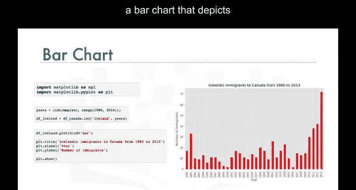

By examining the bar chart， we noticed that immigration to Canada from Iceland has seen an increasing trend since 2010。

I'm sure that the curiouss among you are already wondering who the culprit behind this increasing trend is。

In the lab session， we revealed the reason， and we also learned how to create a bar chart with horizontal bars。

 so make sure to complete this module's lab session。And with this。

 we conclude our video on bar charts， I'll see you in the next video。

