# IBM数据科学专业证书课程8：《Python数据可视化课程（IBM）》python-for-data-visualization（中英字幕） - P9：9_饼图绘制.zh_en - GPT中英字幕课程资源 - BV19k4y1375E

In this video， we will learn about another visualization tool， the Pi chart。

 and we will learn how to create it using MapllootLib。

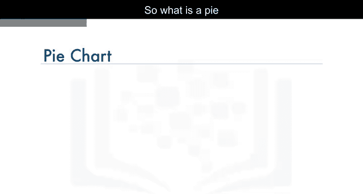

So what is a pie chart， a pie chart is a circular statistical graphic divided into slices to illustrate numerical proportion。

 for example， here is a pie chart of the Canadian Federal election back in 2015。

 where the liberals in red won more than 50% of the seats in the House of Commons。

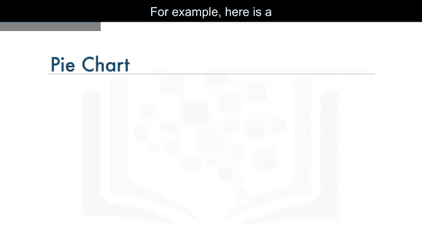

That is why the red color occupies more than half of the circle。

So how do we create a pie chart with Mattplloot Libb？

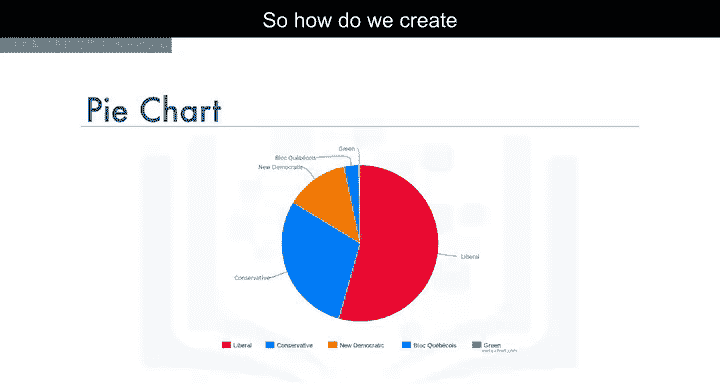

Before we go over the code to do that， let's do a quick recap of our data set。

Recall that each role represents a country and contains metadata about the country。

 such as where it is located geographically and whether it is developing or developed。

Each rule also contains numerical figures of annual immigration from that country to Canada from 1980 to 2013。

Now let's process the data frame so that the country name becomes the index of each row。

 this should make retrieving rows pertaining to specific countries a lot easier。

Also let's add an extra column which represents the cumulative sum of annual immigration from each country from 1980 to 2013。

So for Afghanistan， for example， it is 58，639 total。And for Albania， it is 15，699 and so on。

And let's name our data frame， DF_ Canada。So now that we know how our data is stored in the data frame。

 DF underscore Canada， say we're interested in visualizing a breakdown of immigration to Canada Con wise。

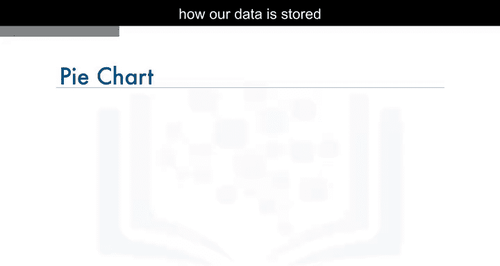

The first step is to group our data by continent using the Con column。

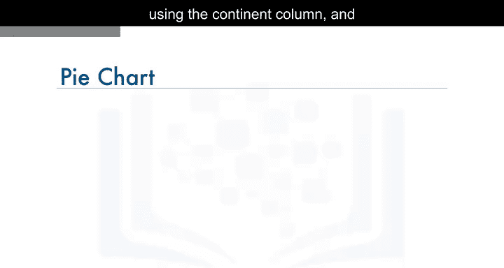

And we use pandas for this。We call the panndas Group by function on DF underscore Canada。

 and we summed the number of immigrants from the countries that belong to the same continent。

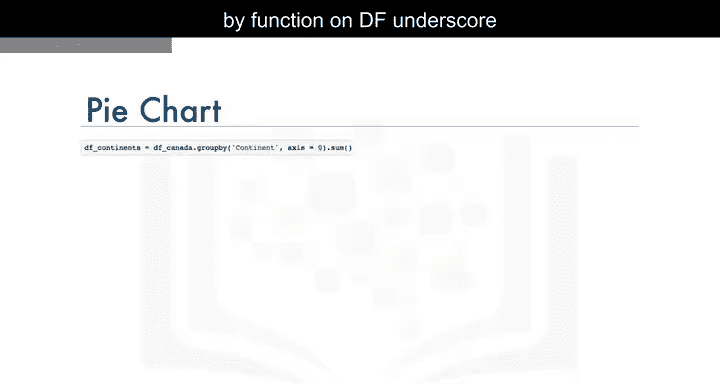

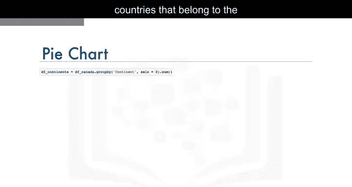

Here is a resulting data frame and let's name it DF underscore continenttinence。

The resulting data frame has six rows， each representing a continent， and 35 columns。

 representing the years from 1980 to 2013 plus the cumulative sum of immigration for each continent。

And now we're ready to start creating our pie chart。

We start with the usual importing Maplot La as MPL and a scripting layer the Piplot interface as PLT。

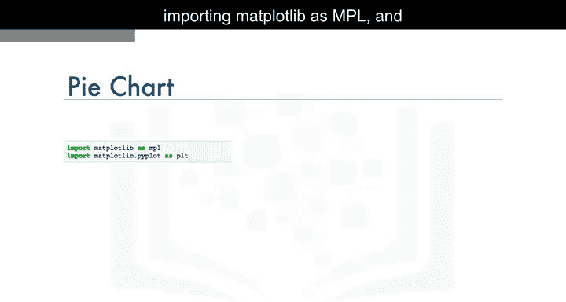

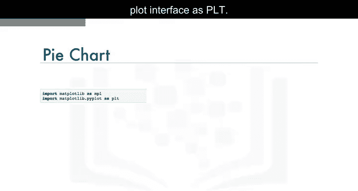

Then we call the plot function on column total of the data frame DF underscore continenttinence。

 and we set kind equals pi to generate a pi chart。

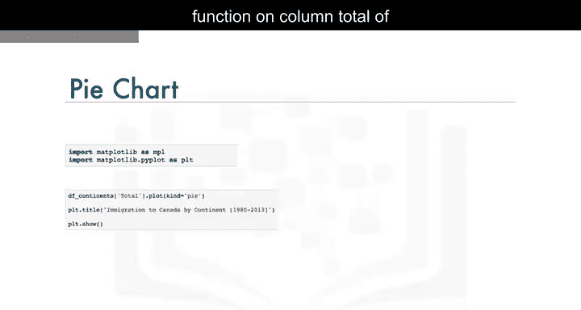

Then to complete the figure， we give it a title。Finally。

 we called the show function to display the figure。

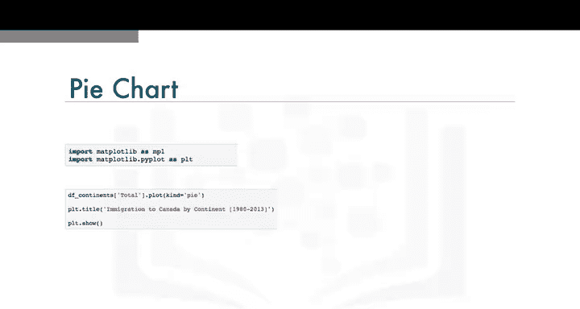

And there you have it， a pie chart that depicts each continent' proportion of immigration to Canada from 1980 to 2013。

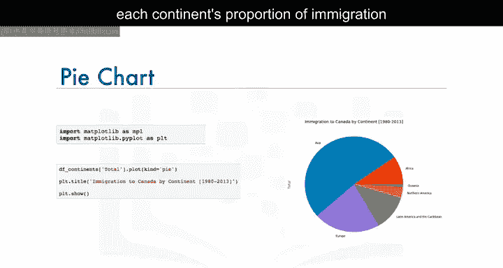

In the lab session， we will go through the process of creating a very professional looking and aesthetically pleasing pie chart and transform the pie chart that we just created into one that looks like this。

 so make sure to complete this modules lab session。

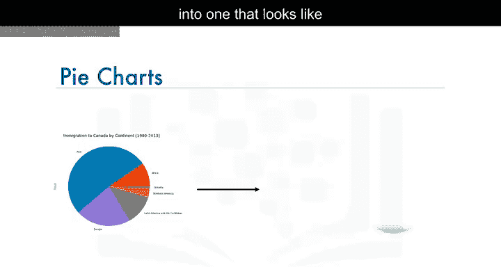

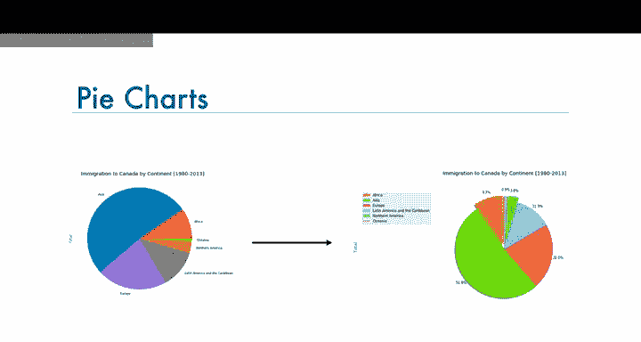

One last comment on pipe charts。There are some very vocal opponents to the use of pie charts under any circumstances。

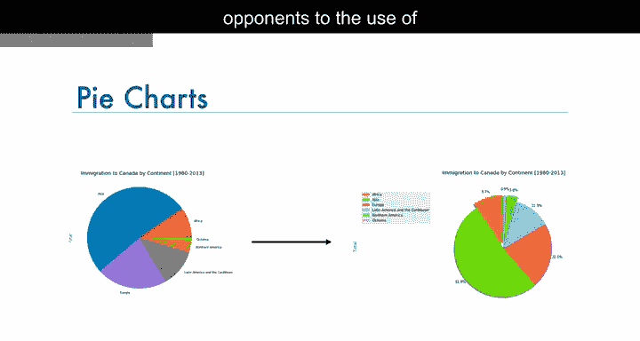

Most argue that P charts fail to accurately display data with any consistency。

Bar charts are much better when it comes to representing the data in a consistent way and getting the message across。

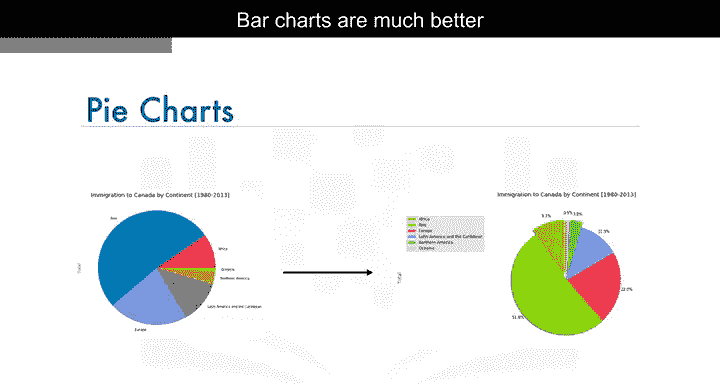

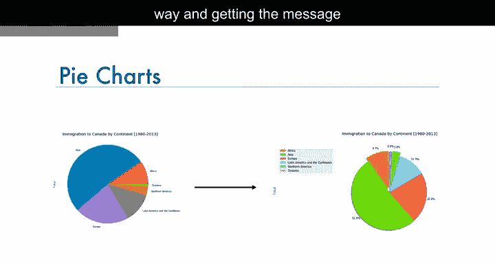

If you're interested in learning more about the arguments against Pi charts。

 here is a link to a very interesting article that discusses very clearly the flaws of Pi charts。

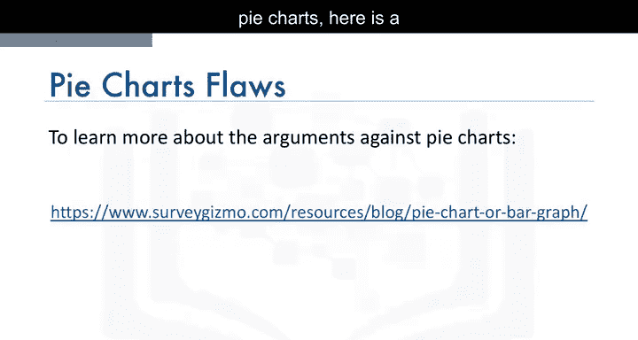

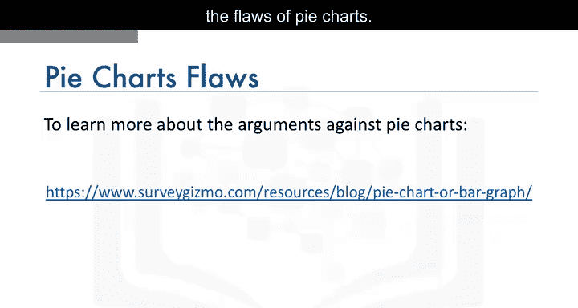

You can also find the link under the video。And with this， we conclude our video on pie charts。

 I'll see you in the next video。

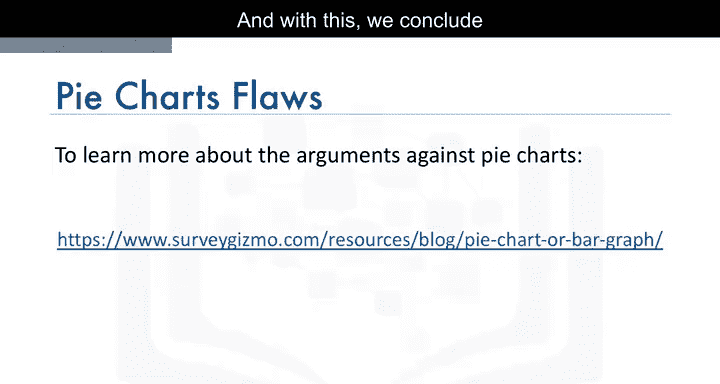