# IBM数据科学专业证书课程9：《Python机器学习课程（IBM）》machine-learning-with-python（中英字幕） - P10：9_多元线性回归.zh_en - GPT中英字幕课程资源 - BV1Vp4y1V7n2

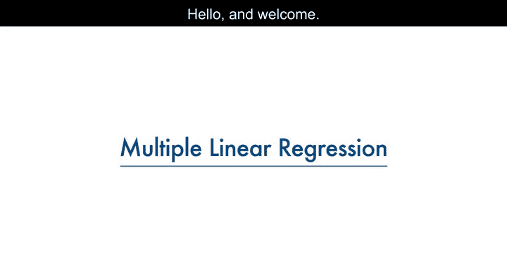

Hello and welcome In this video we'll be covering multiple linear regression。

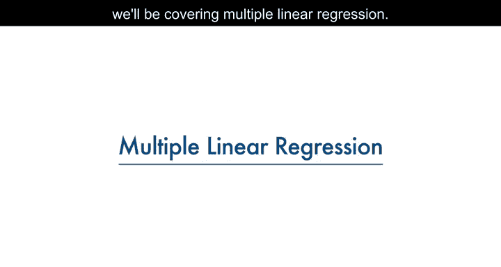

As you know， there are two types of linear regression models。

 simple regression and multiple regression。

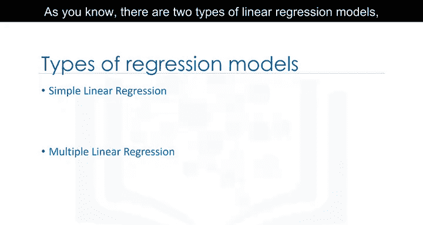

Simple linear regression is when one independent variable is used to estimate a dependent variable。

 For example， predicting CO2 emission using the variable of engine size。

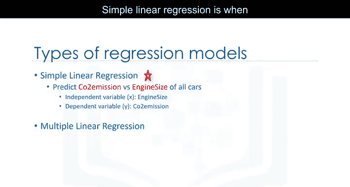

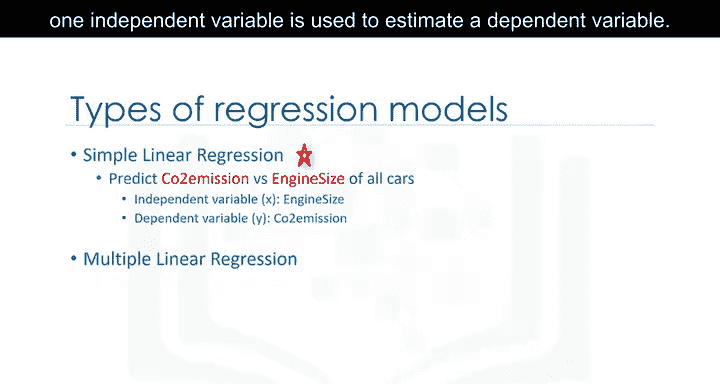

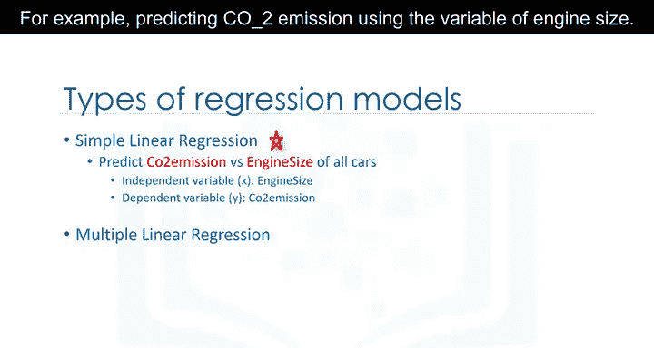

In reality， there are multiple variables that predict the CO2 emission。

 when multiple independent variables are present， the process is called multiple linear regression。

 For example， predicting CO2 emission using engine size and the number of cylinders in the car's engine。

Our focus in this video is on multiple linear regression。

 The good thing is that multiple linear regression is the extension of the simple linear regression model。

 So I suggest you go through the simple linear regression video first。

 if you haven't watched it already。😊，Before we dive into a sample data set and see how multiple linear regression works。

 I want to tell you what kind of problems it can solve， when we should use it。

 and specifically what kind of questions we can answer using it。

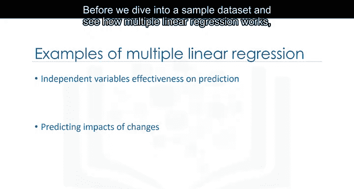

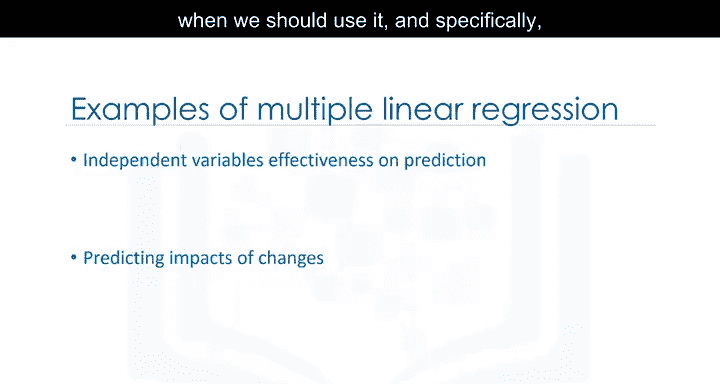

Basically， there are two applications for multiple linear regression。

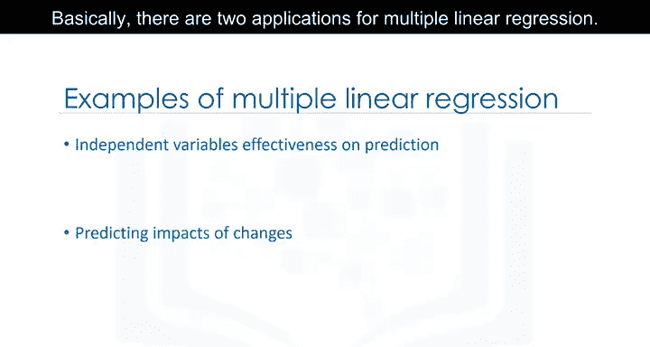

First， it can be used when we would like to identify the strength of the effect that the independent variables have on a dependent variable。

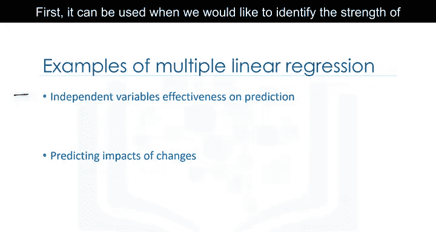

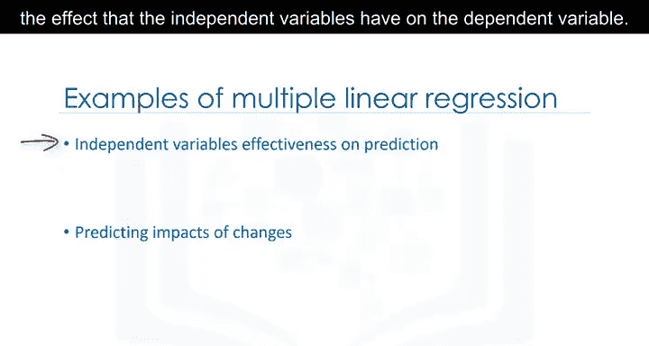

For example， does revision time， test anxiety， lecture attendance。

 and gender have any effect on exam performance of students？Second。

 it can be used to predict the impact of changes。 That is to understand how the dependent variable changes when we change the independent variables。

For example， if we were reviewing a person's health data。

 a multiple linear regression can tell you how much that person's blood pressure goes up or down for every unit increase or decrease in a patient's body mass index。

 holding other factors constant。As is the case with simple linear regression。

 multiple linear regression is a method of predicting a continuous variable。

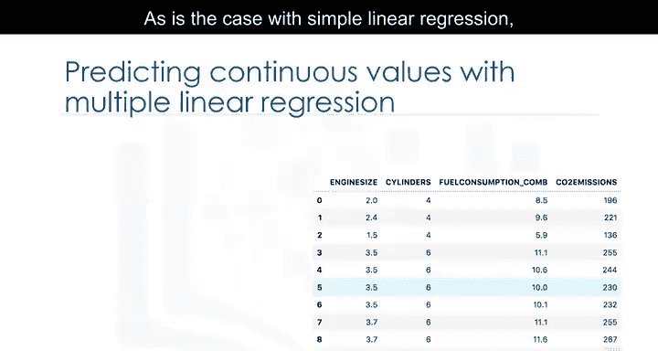

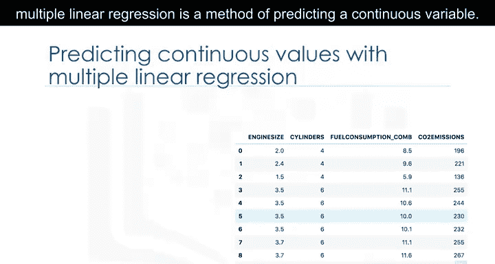

It uses multiple variables called independent variables or predictors that best predict the value of the target variable。

 which is also called the dependent variable。

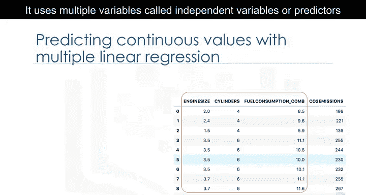

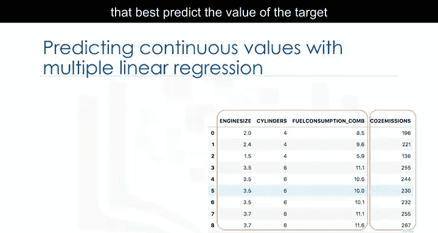

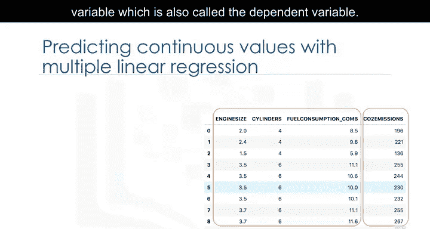

In multiple linear regression， the target value， Y is a linear combination of independent variables X。

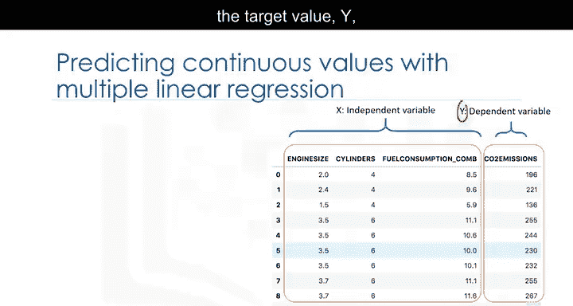

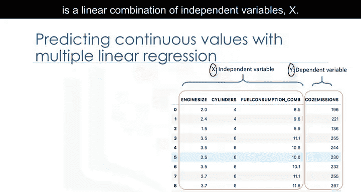

For example， you can predict how much CO2 a car might emit due to independent variables such as the car's engine size。

 number of cylinders， and fuel consumption。Multiple linear regression is very useful because you can examine which variables are significant predictors of the outcome variable。

 Also， you can find out how each feature impacts the outcome variable。And again。

 as is the case in simple linear regression， if you manage to build such a regression model。

 you can use it to predict the emission amount of an unknown case， such as record number 9。Generally。

 the model is of the form y hat equals theta 0 plus theta 1， x1， plus theta 2， x2， and so on。

 up to theta n x n。Mathematically， we can show it as a vector form as well。

 This means it can be shown as a dot product of two vectors。

 The parameters vector and the feature said vector。 General。

 we can show the equation for a multidimensional space as theta transposed X。

 where theta is an n by one vector of unknown parameters in a multidimensional space and x is the vector of the featured sets。

 as theta is a vector of coefficients and is supposed to be multiplied by x。 conventionally。

 it is shown as transposed theta。😊，Theta is also called the parameters or weight vector of the regression equation。

 Both these terms can be used interchangeably。And X is the feature set， which represents a car。

 For example， x1 for engine size or x2 for cylinders and so on。

The first element of the feature set would be set to one because it turns the theta 0 into the intercept or bias parameter When the vector is multiplied by the parameter vector。

Please notice that theta transposed x in a one dimensional space is the equation of a line。

It is what we use in simple， linear regression。In higher dimensions。

 when we have more than one input or X， the line is called a plane or a hyperplane。

 And this is what we use for multiple linear regression。

 So the whole idea is to find the best fit hyperplane for our data to this end。

 and as is the case in linear regression we should estimate the values for theta vector that best predict the value of the target field in each row。

To achieve this goal， we have to minimize the error of the prediction。 Now， the question is。

 how do we find the optimized parameters？To find the optimized parameters for our model。

 we should first understand what the optimized parameters are。

 then we will find a way to optimize the parameters。

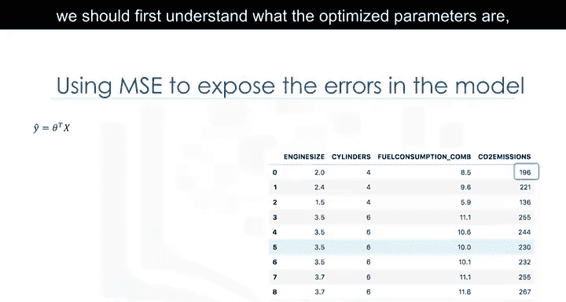

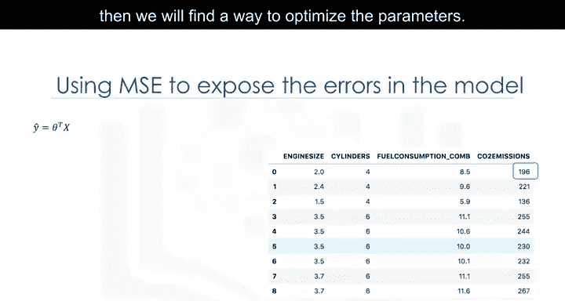

In short， optimized parameters are the ones which lead to a model with the fewest errors。

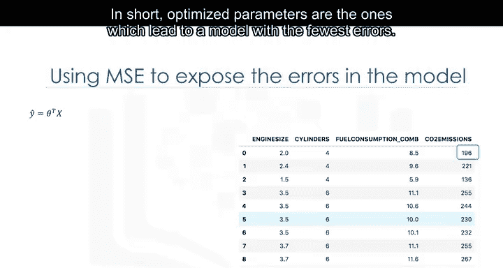

Let's assume for a moment that we have already found the parameter vector of our model；

 it means we already know the values of theta vector。

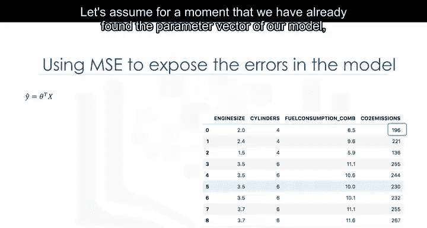

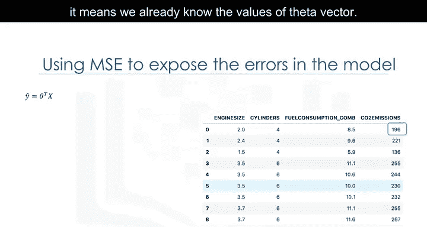

Now we can use the model and the feature set of the first row of our data set to predict the CO2 emission for the first car。

 correct？

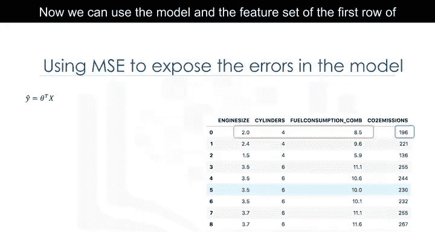

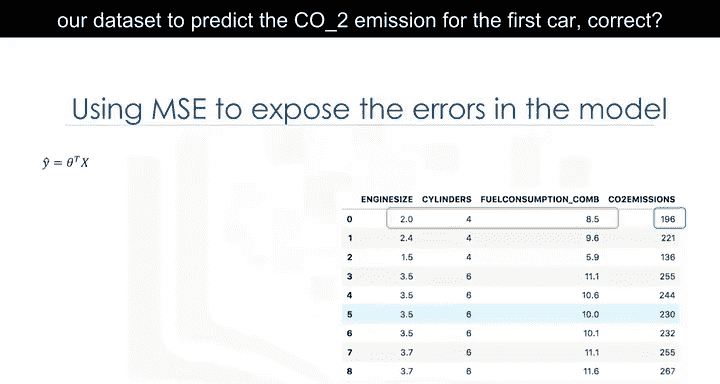

If we plug the feature set values into the model equation， we find Y hat。 Let's say， for example。

 it returns 140 as the predicted value for the specific row。

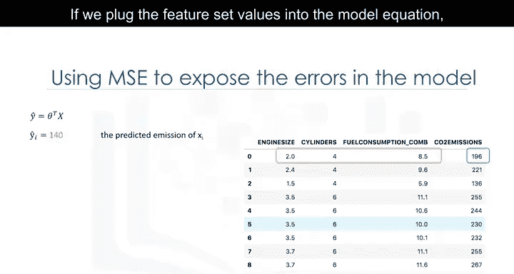

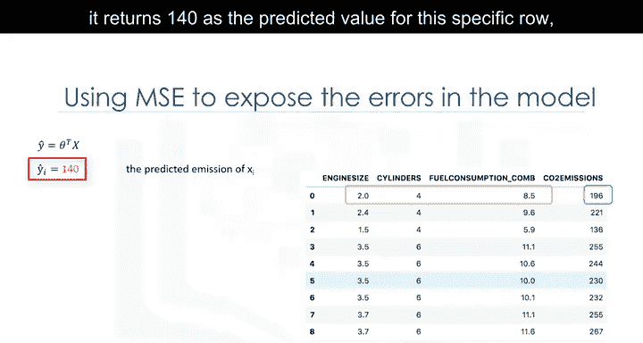

What is the actual value？

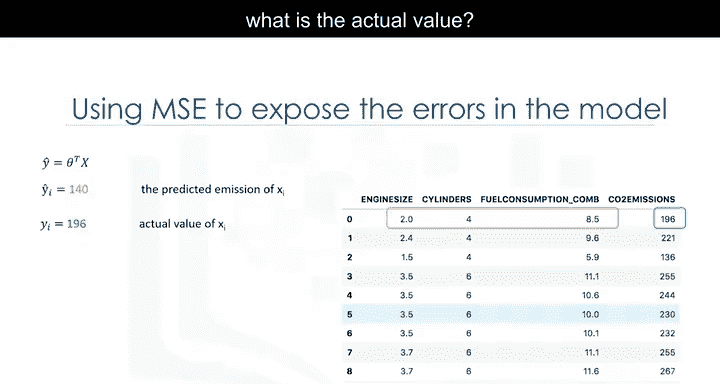

Y equals 196。How different is the predicted value from the actual value of 196？Well。

 we can calculate it quite simply as 196 subtract 140， which of course equals 56。

This is the error of our model only for one row or one car in our case。

As is the case in linear regression， we can say the error here is the distance from the data point to the fitted regression model。

The mean of all residual errors shows how bad the model is representing the data set。

 It is called the mean squared error， or MSE。Mathematically， M E can be shown by an equation。

 While this is not the only way to expose the error of a multi linear regression model。

 it is one of the most popular ways to do so。 The best model for our data set is the one with minimum error for all prediction values。

 So the objective of multi linear regression is to minimize the M E equation。 to minimize it。

 we should find the best parameters theta。 but how。Okay。

 how do we find the parameter or coefficients for multiple linear regression？

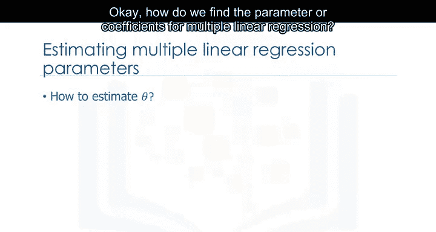

There are many ways to estimate the value of these coefficients。 However。

 the most common methods are the ordin least squares and optimization approach。

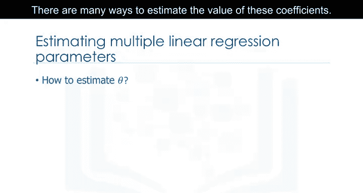

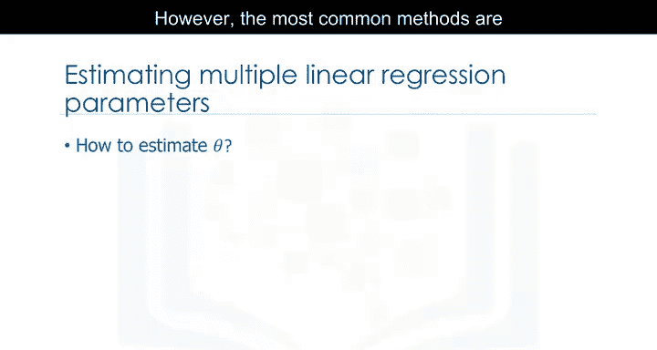

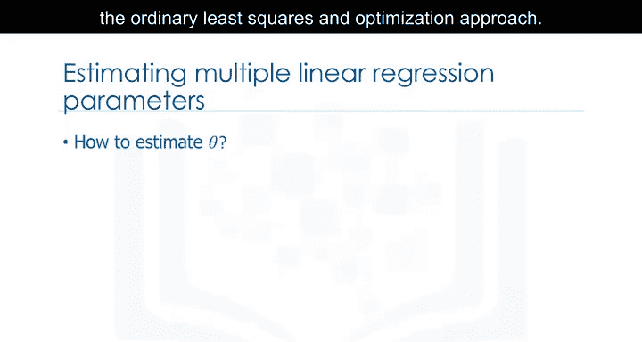

Ordinarily squares tries to estimate the values of the coefficients by minimizing the mean square error。

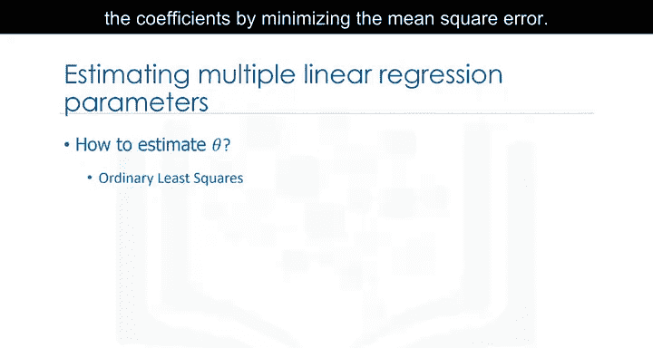

This approach uses the data as a matrix and uses linear algebra operations to estimate the optimal values for the theta。

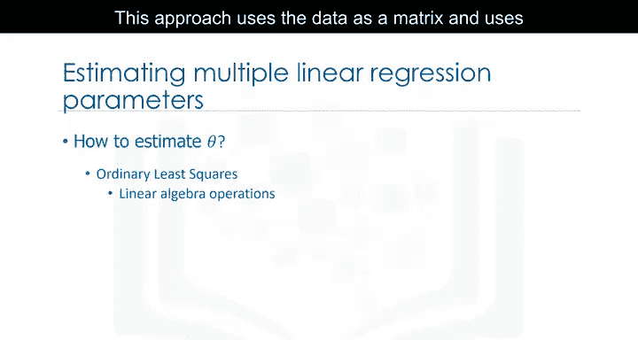

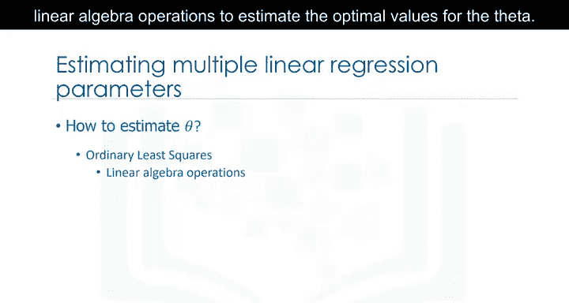

The problem with this technique is the time complexity of calculating matrix operations as it can take a very long time to finish。

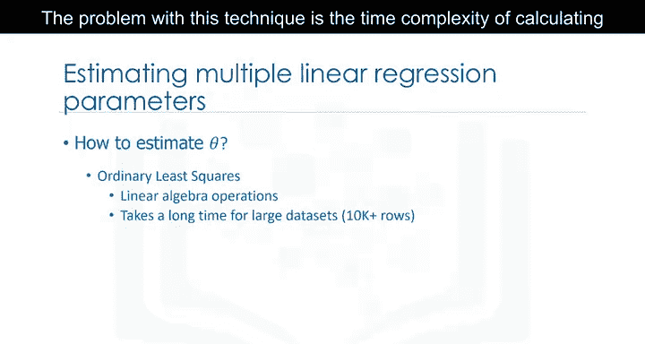

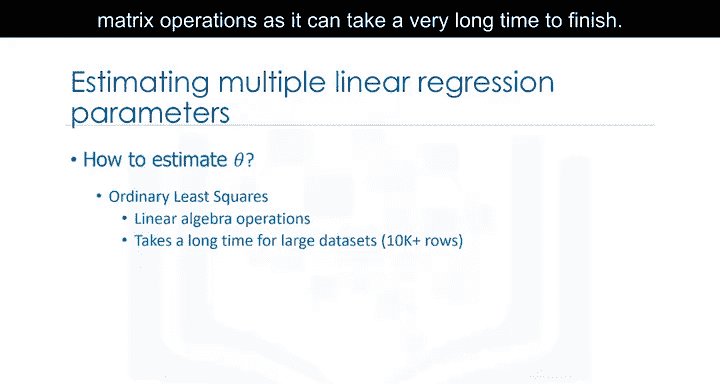

When the number of rows in your dataset is less than 10，000。

 you can think of this technique as an option； however。

 for greater values you should try other faster approaches。

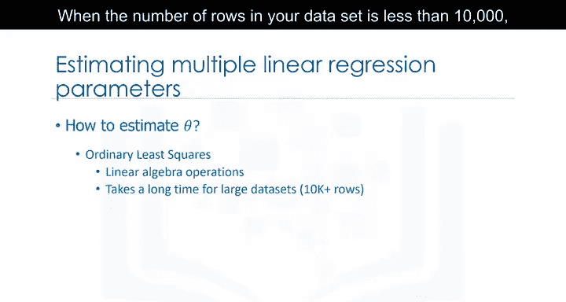

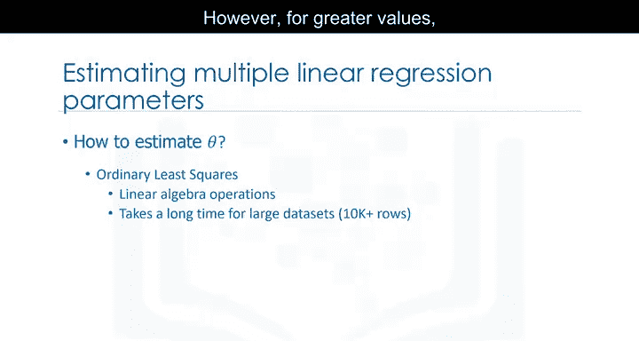

The second option is to use an optimization algorithm to find the best parameters。 That is。

 you can use a process of optimizing the values of the coefficients by iteratively minimizing the error of the model on your training data。

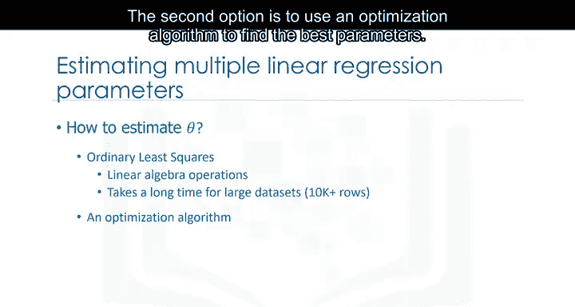

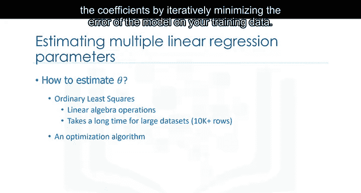

For example， you can use gradient descent， which starts optimization with random values for each coefficient。

 then calculates the errors and tries to minimize it through wise changing of the coefficients in multiple iterations。

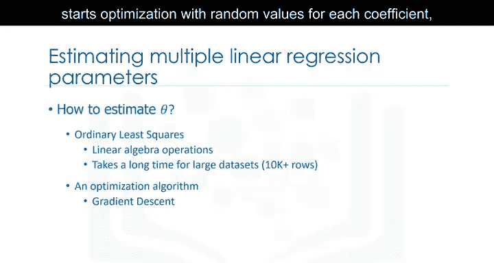

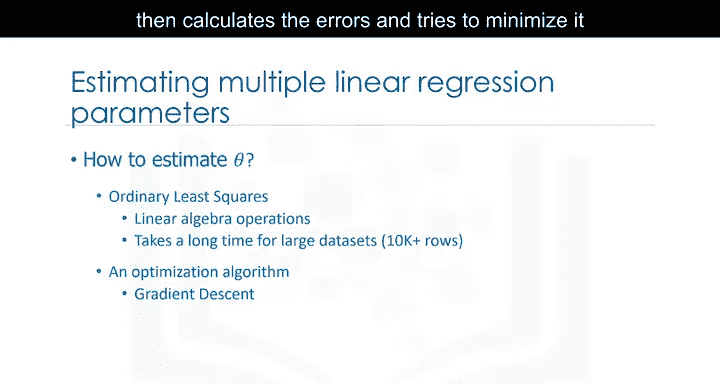

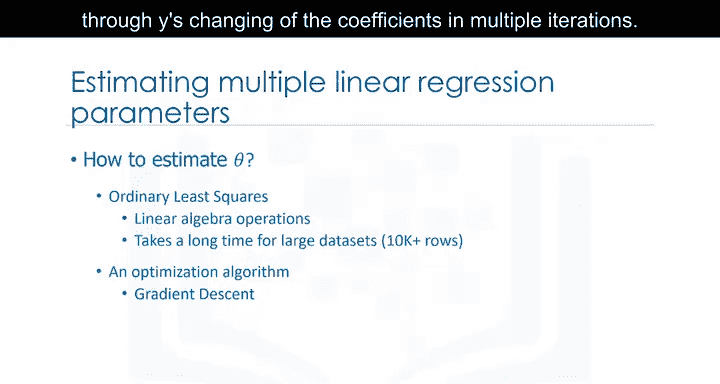

Graadient descent is a proper approach if you have a large data set。Please understand， however。

 that there are other approaches to estimate the parameters of the multiple linear regression that you can explore on your own。

After you find the best parameters for your model， you can go to the prediction phase。

After we found the parameters of the linear equation。

 making predictions is as simple as solving the equation for a specific set of inputs。

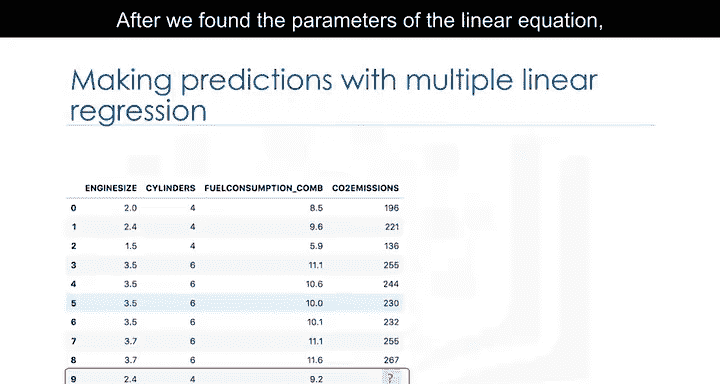

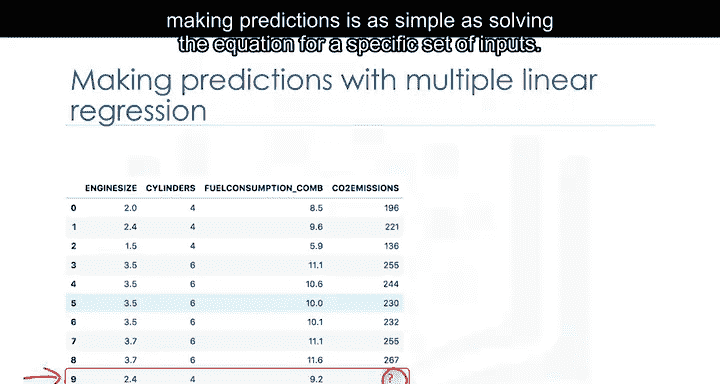

Imagine we are predicting CO2 emission or Y from other variables for the automobile in record number9。

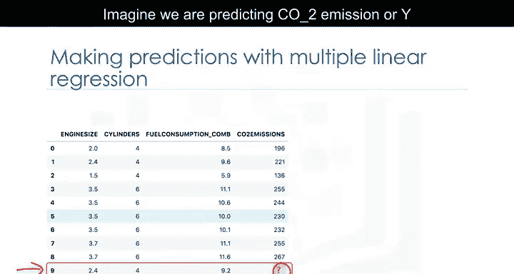

Our linear regression model representation for this problem would be Y hat equals theta transposed x。

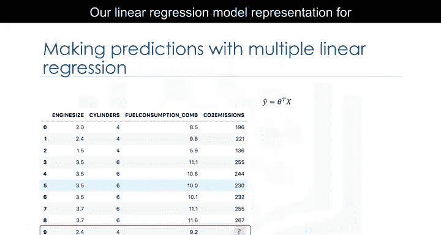

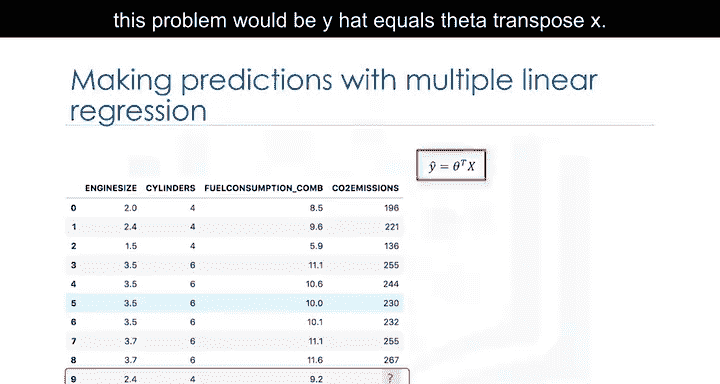

Once we find the parameters， we can plug them into the equation of the linear model。 for example。

 let's use theta 0 equals 125， theta 1 equals 6。2， theta 2 equals 14 and so on。

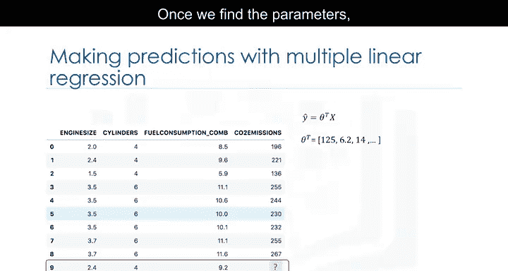

If we map it to our dataset， we can rewrite the linear model as CO2 emissions equals 125 plus 6。

2 multiplied by engine size， plus 14 multiplied by cylinder and so on。

As you can see， multiple linear regression estimates the relative importance of predictors。

For example， it shows cylinder has higher impact on CO2 emission amounts in comparison with engine size。

Now， let's plug in the ninth throw of our data set and calculate the CO2 emission for a car with the engine size of 2。

4， so CO2 emission equals 125 plus 6。2 times 2。4 plus 14 times 4 and so on。

We can predict the CO2 emission for this specific car would be 214。1。Now。

 let me address some concerns that you might already be having regarding multiple linear regression。

As you saw， you can use multiple independent variables to predict a target value in multiple linear regression。

It sometimes results in a better model compared to using a simple linear regression。

 which uses only one independent variable to predict the dependent variable。

Now， the question is， how many independent variables should we use for the prediction。

Should we use all the fields in our data set。

Does adding independent variables to a multiple linear regression model always increase the accuracy of the model。

Basically， adding too many independent variables without any theoretical justification may result in an overfit model。

An overfi model is a real problem because it is too complicated for your data set and not general enough to be used for a prediction。

So it is recommended to avoid using many variables for a prediction。

There are different ways to avoid overfitting a model in regression， however。

 that is outside the scope of this video。

The next question is， should independent variables be continuous。

Basically， categorical independent variables can be incorporated into a regression model by converting them into numerical variables。

For example， given a binary variable such as car type。

 the code dummy zero for manual and one for automatic cars。As a last point。

 remember that multiple linear regression is a specific type of linear regression。

 So there needs to be a linear relationship between the dependent variable and each of your independent variables。

There are a number of ways to check for linear relationship。 For example。

 you can use scatter plots and then visually check for linearity。

 If the relationship displayed in your scatter plot is not linear。

 then you need to use linear regression。This concludes our video。 Thanks for watching。

