# IBM数据科学专业证书课程9：《Python机器学习课程（IBM）》machine-learning-with-python（中英字幕） - P12：11_K近邻算法.zh_en - GPT中英字幕课程资源 - BV1Vp4y1V7n2

Hello and welcome In this video we'll be covering the K nearest neighbors algorithm。

 so let's get started。

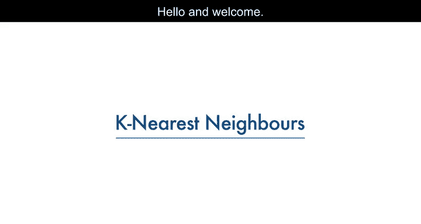

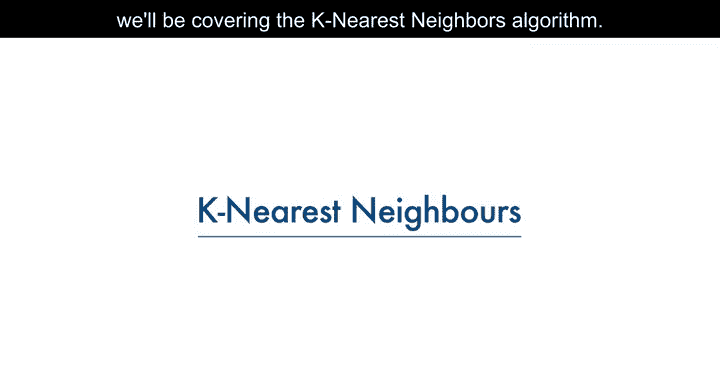

Imagine that a telecommunications provider has segmented his customer base by service usage patterns。

 categorizing the customers into four groups。

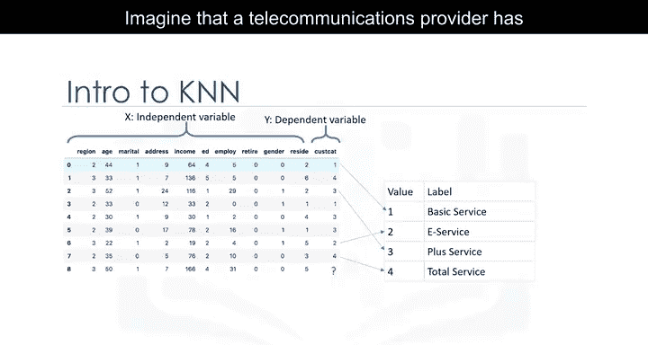

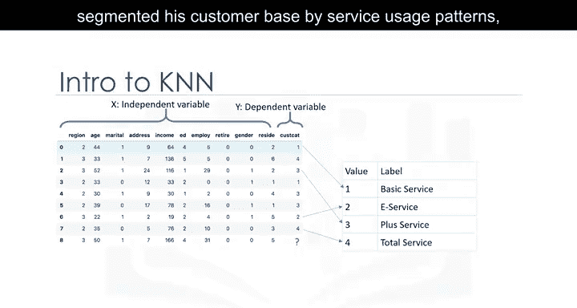

If demographic data can be used to predict group membership。

 the company can customize offers for individual prospective customers。

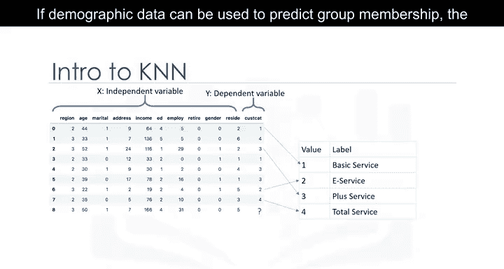

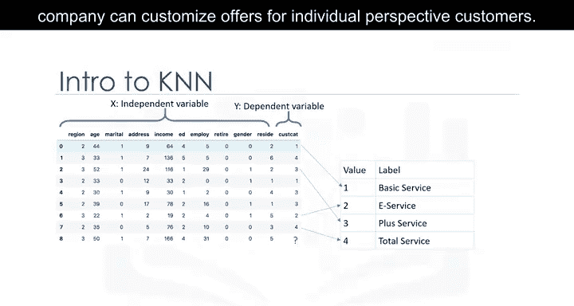

This is a classification problem。 That is， given the data set with predefined labels。

 we need to build a model to be used to predict the class of a new or unknown case。

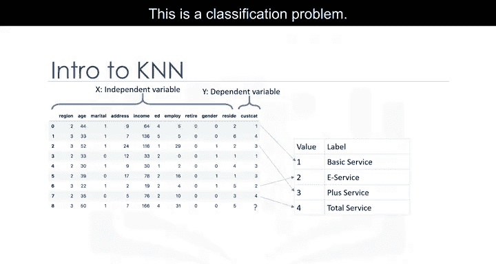

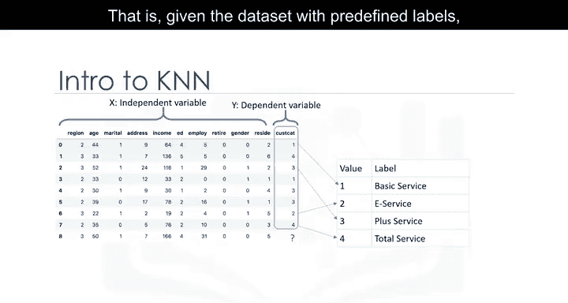

The example focuses on using demographic data such as region。

 age and marital status to predict usage patterns。

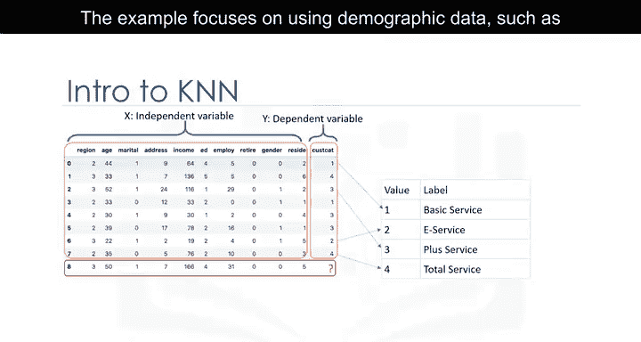

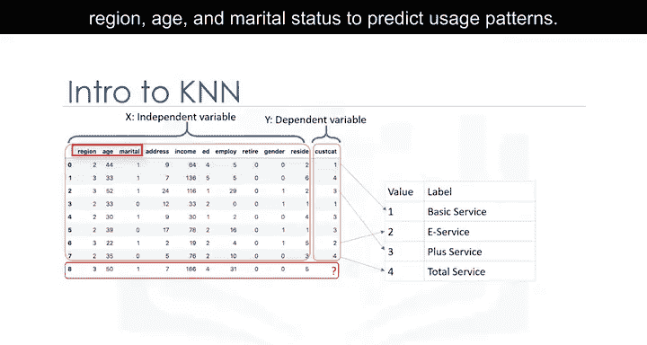

The target field called Cutcat， has four possible values that correspond to the four customer groups as follows。

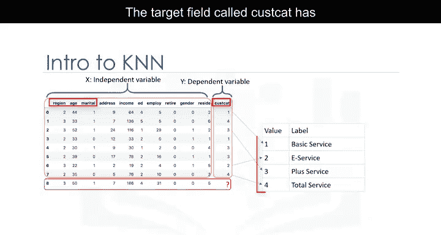

Basic service， E service， plus service and total service。

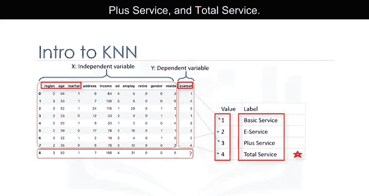

Our objective is to build a classifier， for example。

 using the rows 0 to 7 to predict the class of row 8。

 we will use a specific type of classification called K nearest neighbor。

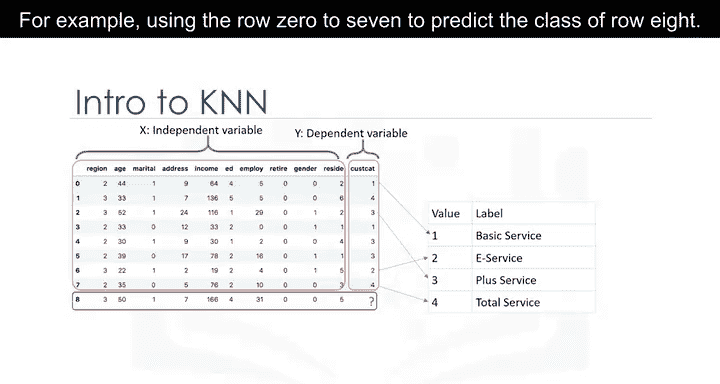

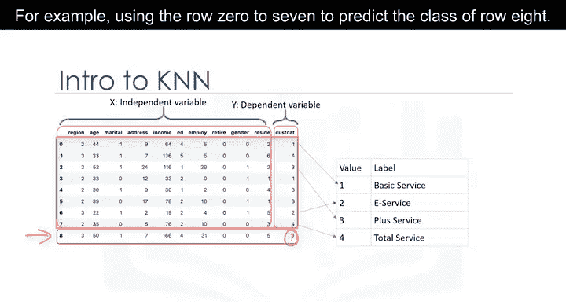

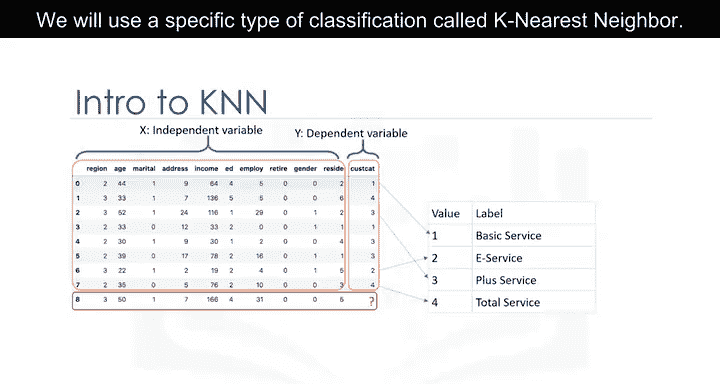

Just for sake of demonstration， let's use only two fields as predictors， specifically age and income。

 and then plot the customers based on their group membership。Now。

 let's say that we have a new customer， for example， record number 8 with a known age and income。

 How can we find the class of this customer。Can we find one of the closest cases and assign the same class label to our new customer？

Can we also say that the class of our new customer is most probably group 4 I。e totalal service。

 because its nearest neighbor is also of class 4？Yes， we can。 In fact。

 it is the first nearest neighbor。 Now， the question is， to what extent can we trust our judgment。

 which is based on the first nearest neighbor。

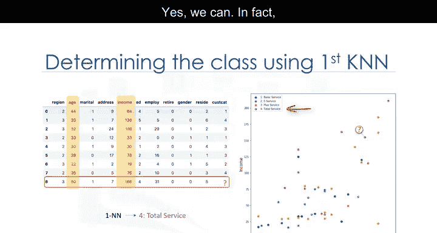

It might be a poor judgment， especially if the first nearest neighbor is a very specific case or an outlier。

 correct？Now， let's look at our scatter plot again。

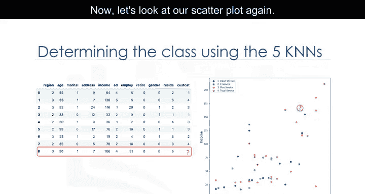

Rather than choose the first nearest neighbor， what if we chose the five nearest neighbors and did a majority vote among them to define the class of our new customer。

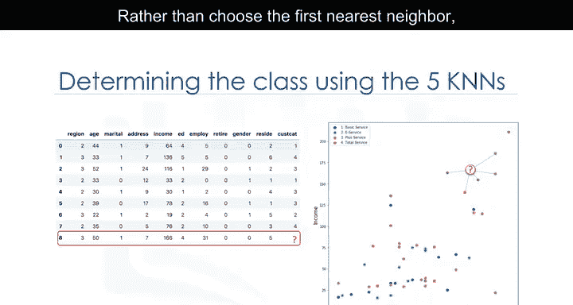

In this case， we'd see that three out of five nearest neighbors tell us to go for class3。

 which is plus service。Doesn't this make more sense？

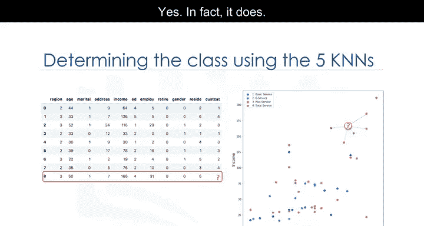

Yes， in fact， it does。 In this case， the value of k in the K nearest neighbor's algorithm is 5。

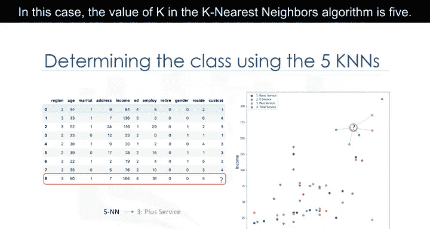

This example highlights the intuition behind the K nearest neighbor's algorithm。Now。

 let's define the Ca nearest neighbors。

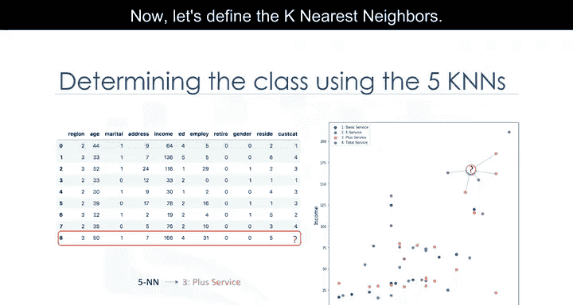

The K nearest neighbor's algorithm is a classification algorithm that takes a bunch of labeled points and uses them to learn how to label other points。

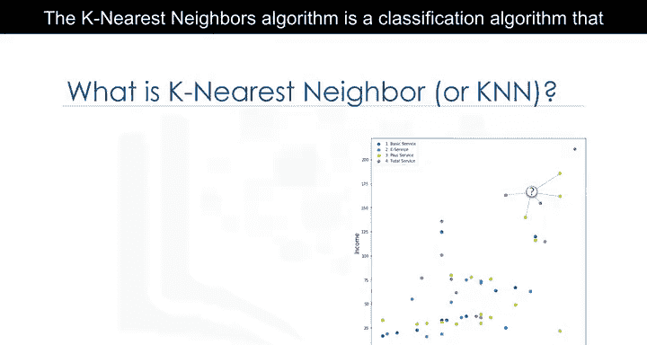

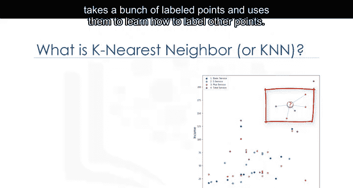

This algorithm classifies cases based on their similarity to other cases。

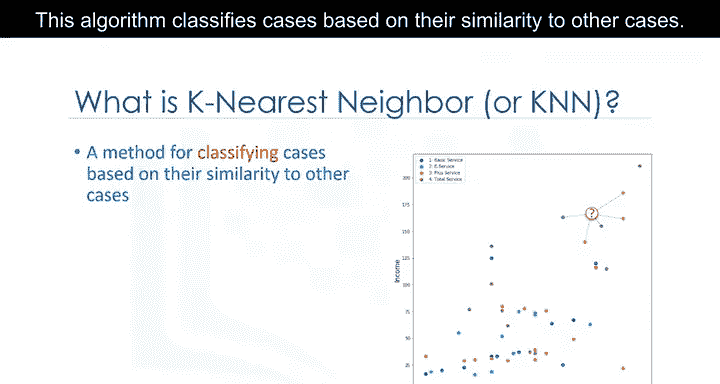

In K nearest neighbors， data points that are near each other are said to be neighbors。

Caate nearest neighbors is based on this paradigm。 Similar cases with the same class labels are near each other。

Thus， the distance between two cases is a measure of their dissimilarity。

There are different ways to calculate the similarity or conversely the distance or dissimilarity of two data points。

 For example， this can be done using Euclidean distance。 Now。

 let's see how the K nearest neighbors algorithm actually works。

And a classification problem that K nearest neighbor's algorithm works as follows。

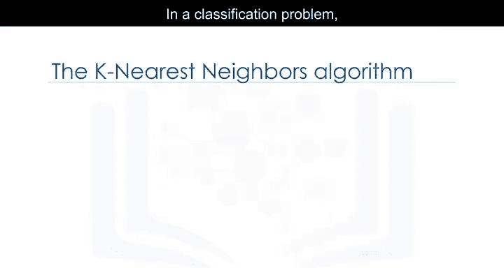

One， pick a value for K。

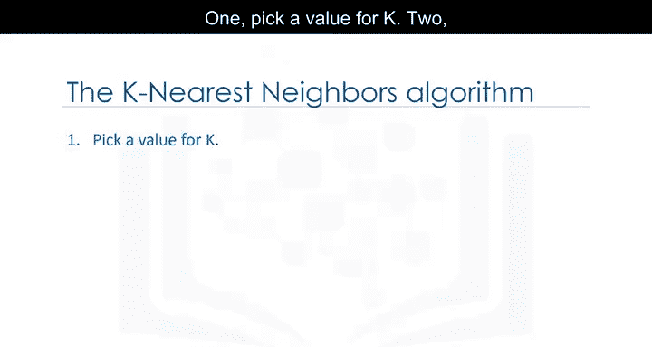

2， calculate the distance from the new case hold out from each of the cases in the data set。

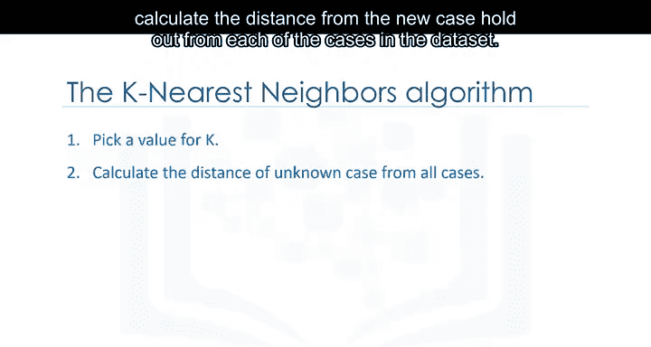

Three， search for the K observations in the training data that are nearest to the measurements of the unknown data point。

And4， predict the response of the unknown data point using the most popular response value from the K nearest neighbors。

There are two parts in this algorithm that might be a bit confusing。 First。

 how to select the correct K and second， how to compute the similarity between cases， for example。

 among customers。Let's first start with a second concern。 That is。

 how can we calculate the similarity between two data points。Assume that we have two customers。

 customer 1 and customer 2。 And for a moment， assume that these two customers have only one feature age。

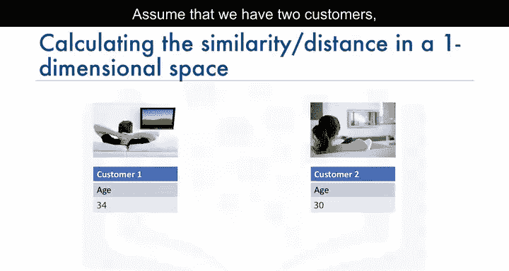

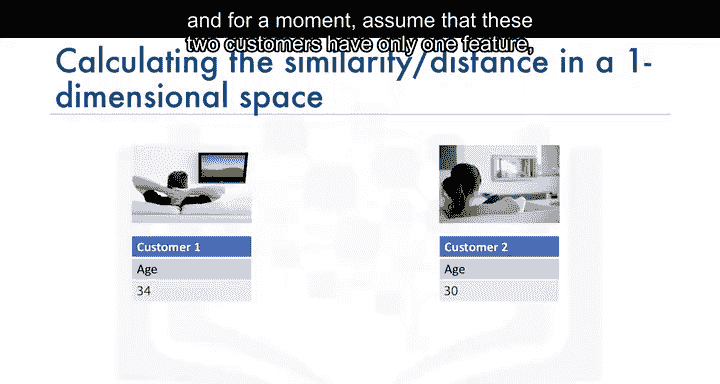

We can easily use a specific type of Menkowski distance to calculate the distance of these two customers。

 It is indeed， the Euclidean distance。😊。

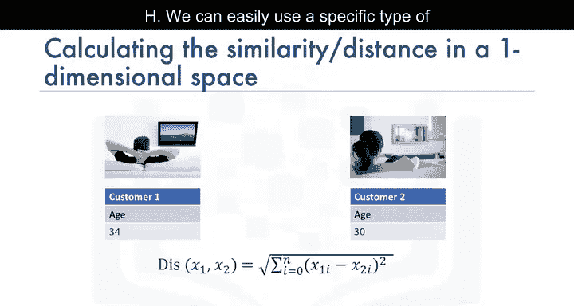

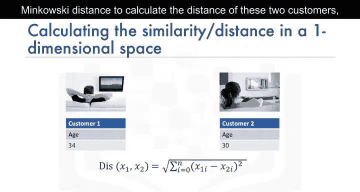

Distance of x1 from x2 is root of 34 minus 30 to power of 2， which is 4。

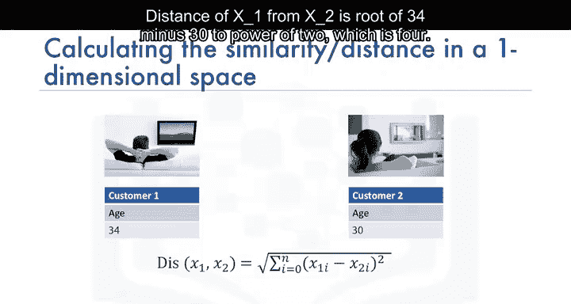

What about if we have more than one feature， for example， age and income。

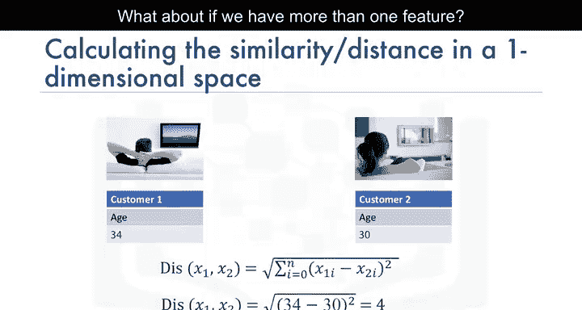

If we have income and age for each customer， we can still use the same formula。

 but this time we're using it in a two dimensional space。

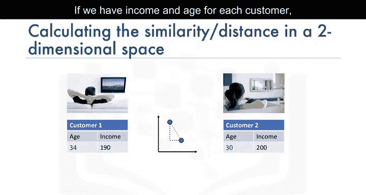

We can also use the same distance matrix for multidisional vectors。Of course。

 we have to normalize our feature set to get the accurate dissimilarity measure。

There are other dissimilarity measures as well that can be used for this purpose， but as mentioned。

 it is highly dependent on data type and also the domain that classification is done for it。

As mentioned， K in K nearest neighbors is the number of nearest neighbors to examine。

 It is supposed to be specified by the user。 So how do we choose the right K。

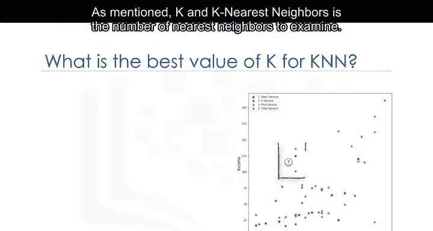

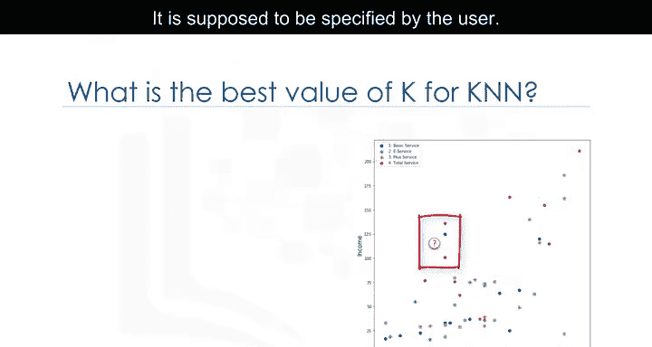

Assume that we want to find the class of the customer noted as question mark on the chart。

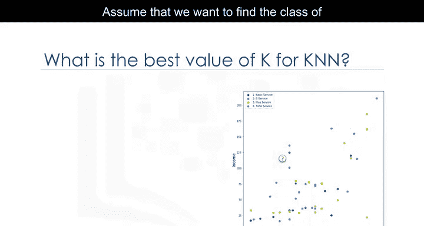

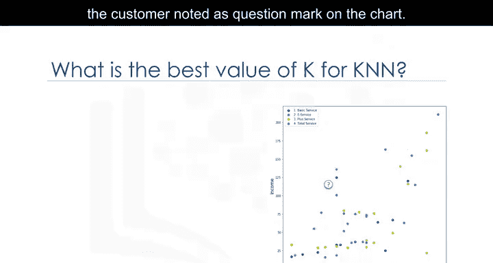

What happens if we choose a very low value of k， let's say K equals 1。

The first nearest point would be blue， which is class1。

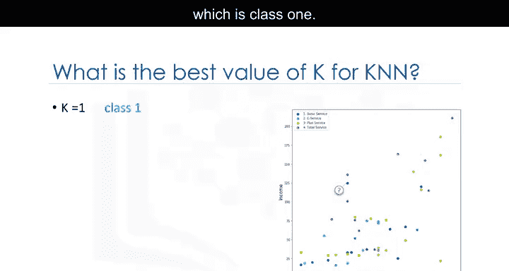

This would be a bad prediction since more of the points around it are magenta or Class 4。

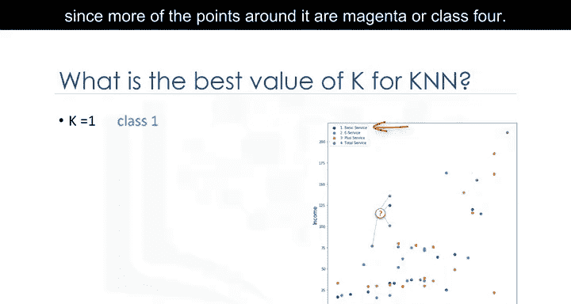

In fact， since its nearest neighbor is blue， we can say that we captured the noise in the data。

 or we chose one of the points that was an anomaly in the data。

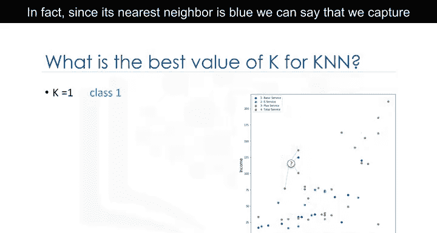

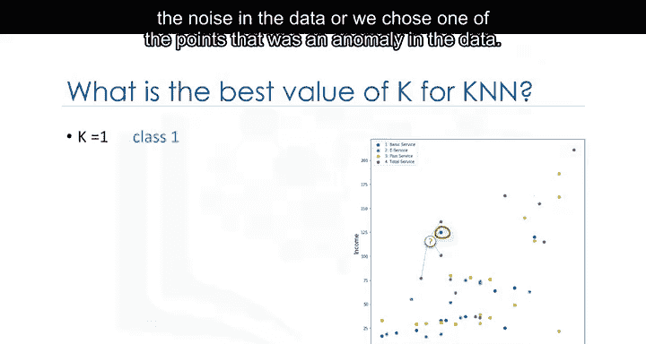

A low value of K causes a highly complex model as well。

 which might result in overfitting of the model。

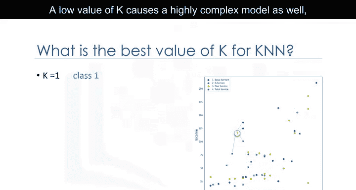

It means the prediction process is not generalized enough to be used for out of sample cases。

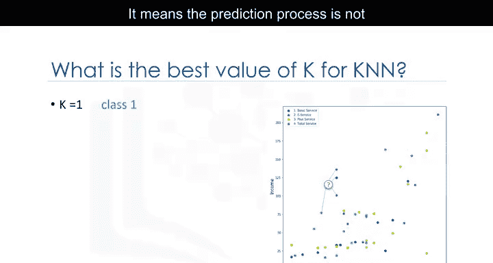

Out of sample data is data that is outside of the data used to train the model。

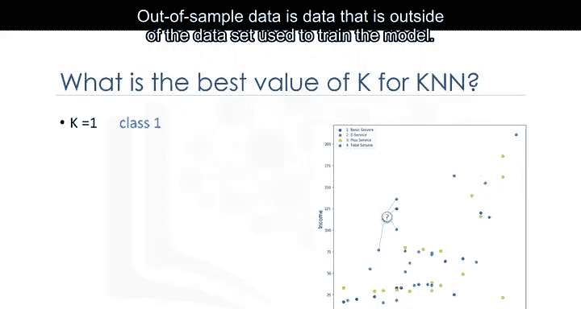

In other words， it cannot not be trusted to be used for prediction of unknown samples。

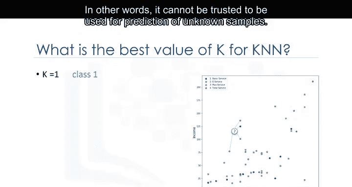

It's important to remember that overfitting is bad as we want a general model that works for any data。

 not just the data used for training。

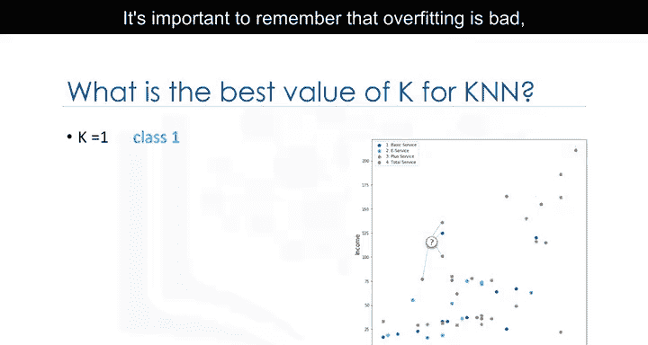

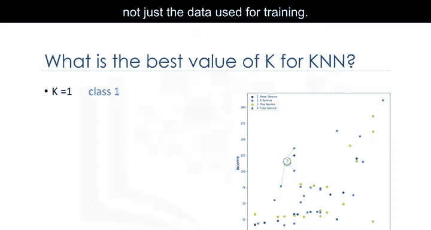

Now， on the opposite side of the spectrum， if we choose a very high value of k， such as k equals 20。

 then the model becomes overly generalized。 So how can we find the best value for K。

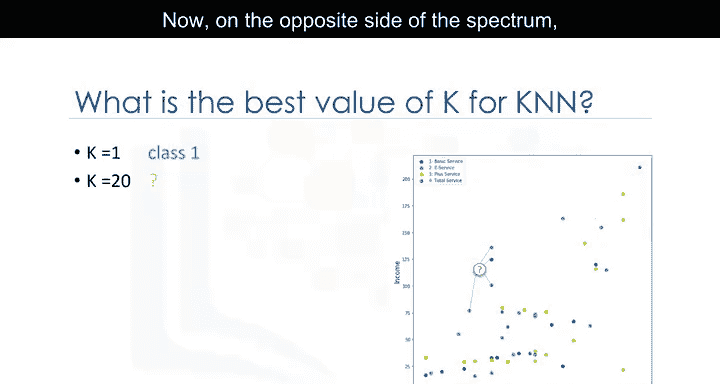

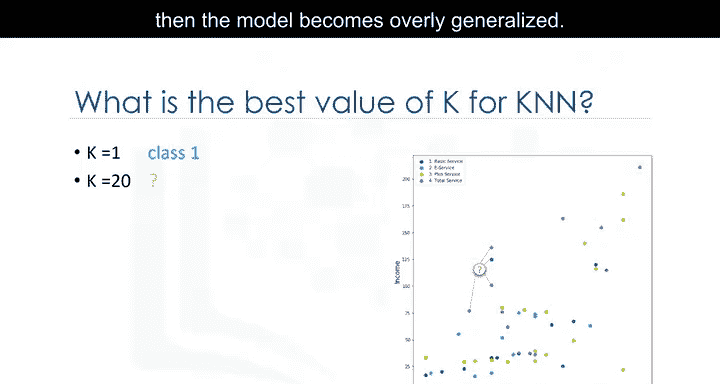

The general solution is to reserve a part of your data for testing the accuracy of the model。

 Once you've done so， choose K equals 1 and then use the training part for modeling and calculate the accuracy of prediction using all samples in your test set。

Repeat this process increasing the K and see which K is best for your model。 For example。

 in our case， K equals 4 will give us the best accuracy。

Nearest neighbors analysis can also be used to compute values for a continuous target。

In this situation， the average or median target value of the nearest neighbors is used to obtain the predicted value for the new case。

For example， assume that you are predicting the price of a home based on its feature set。

 such as number of rooms， square footage， the year it was built， and so on。

You can easily find the three nearest neighbor houses， of course， not only based on distance。

 but also based on all the attributes and then predict the price of the house as the median of neighbors。

This concludes this video， thanks for watching。