# IBM数据科学专业证书课程9：《Python机器学习课程（IBM）》machine-learning-with-python（中英字幕） - P1：0_课程介绍.zh_en - GPT中英字幕课程资源 - BV1Vp4y1V7n2

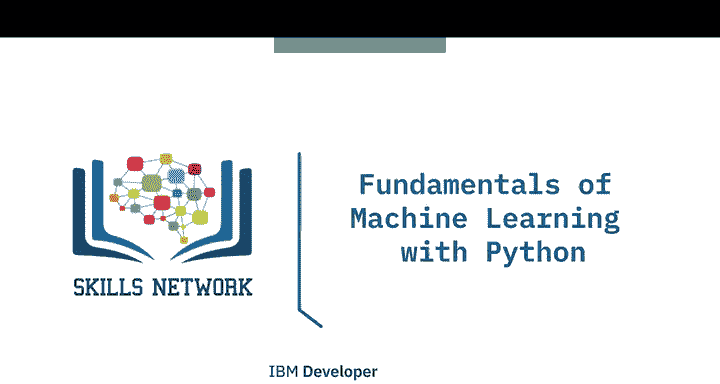

Hello and welcome to the fundamentalmentals of machineine learning with Python coursese。

 instructed by Saed Abigaorbi， Joseph Saneg Gndrilo， and Deziim Hijani。

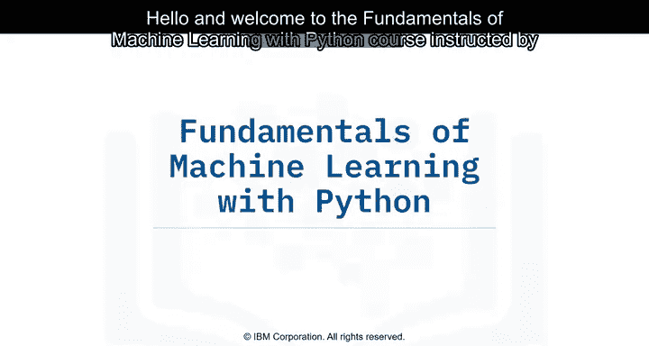

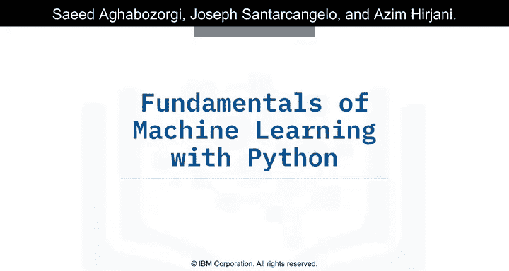

In this course， you will be introduced to machine learning and learn how to apply various machine learning algorithms。

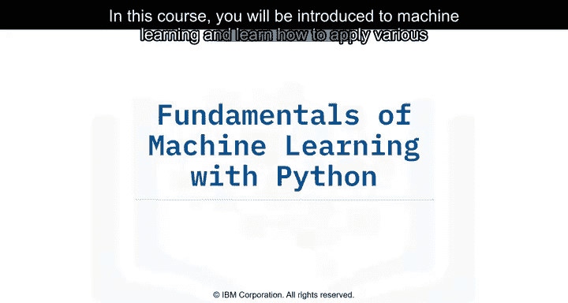

The instructors for the course are Saed Abaga Zorbi。

 Joseph Sannagongelo and Aziim Hijani Saed Abagazoorbi PhD is a senior AIML customer engineer at Google with a track record of developing enterprise level solutions that increase customers' ability to turn their data into actionable knowledge。

 He has worked at IBM and Amazon Web services。 Said is also a researcher in the artificial intelligence and machine learning field。

 Joseph Sannagongelo has a PhD in electrical engineering。

 His research focused on using machine learning， signal processing and computer vision to determine how videos impact human cognition。

 Joseph has been working for IBM since he completed his PhD。

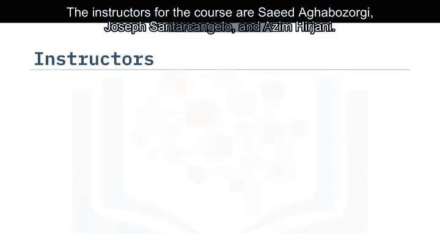

And Aim here Janny is a data scientist intern at IBM。

 creating content for various IBM data science courses。

 he is pursuing a BS in computer science from the University of Toronto。

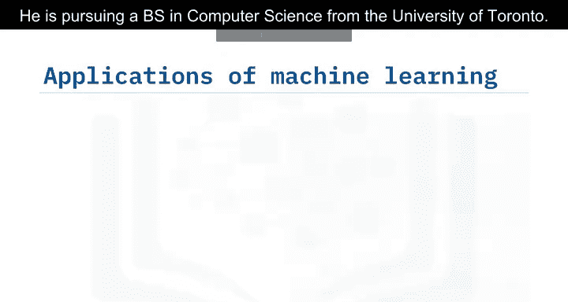

Machine learning is present in many fields and industries。

 it is used heavily in the self driving car industry to classify objects that a car might encounter while driving。

 for example， people， traffic signs and other cars。

Many cloud computer service providers like IBM and Amazon use machine learning to protect their services；

 it is used to detect and prevent attacks like a distributed denial of service attack or suspicious and malicious usage。

Machine learning is also used to find trends and patterns in stock data that can help decide which stocks to trade or which prices to buy and sell at。

Another use for machine learning is to help identify cancer in patients。

 using an X- ray scan of the target area， machine learning can help detect any potential tumors。

This course consists of four modules， introduction and regression， classification， clustering。

 and the final project， Each module comprises videos with hands on labs to apply what you've learned。

 The Hand on Las use Jupiter Lab which is hosted on Skills Network Las and uses the Python programming languagen and various Python libraries like Padas。

 Numpy and Ps Ki Learnn。

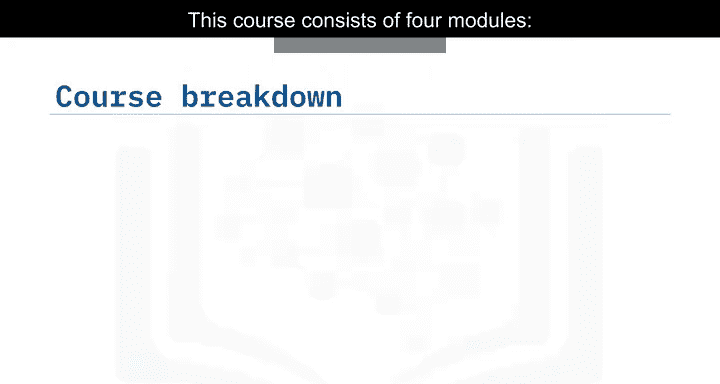

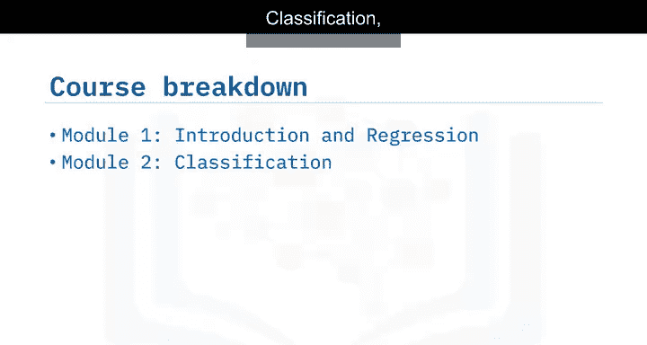

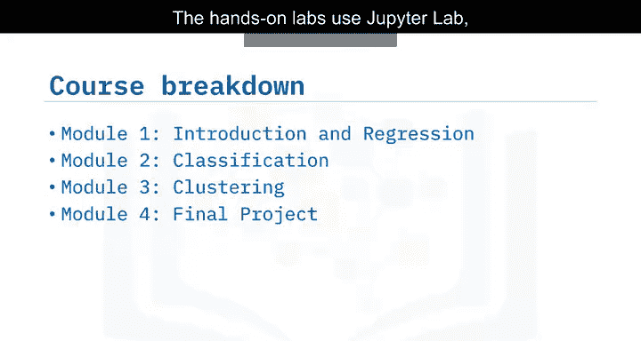

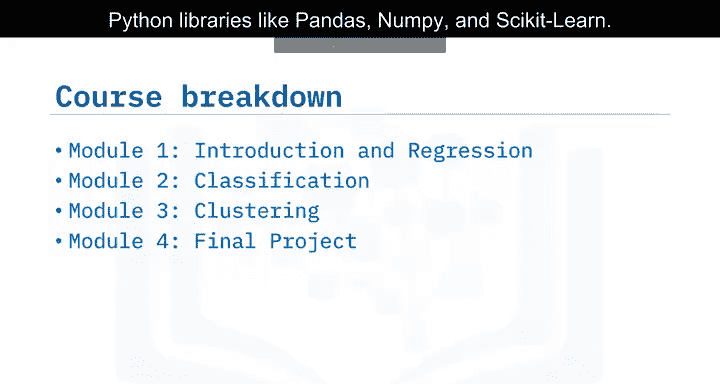

You will explore different machine learning algorithms in this course and work with a variety of data sets to help you apply machine learning。

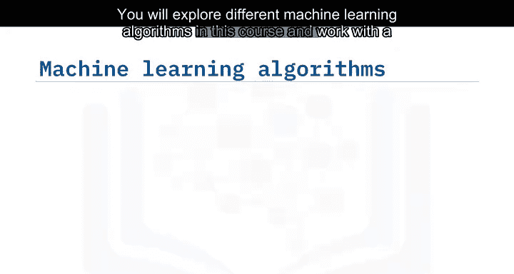

With linear regression， you will work with an automobile data to estimate the CO2 emission of cars using various features。

 and then predict the CO2 emissions of cars that haven't even been produced yet。

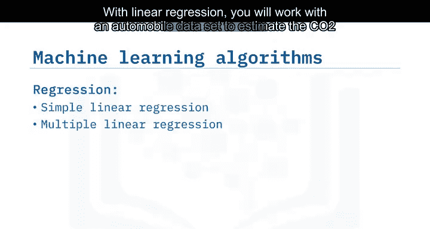

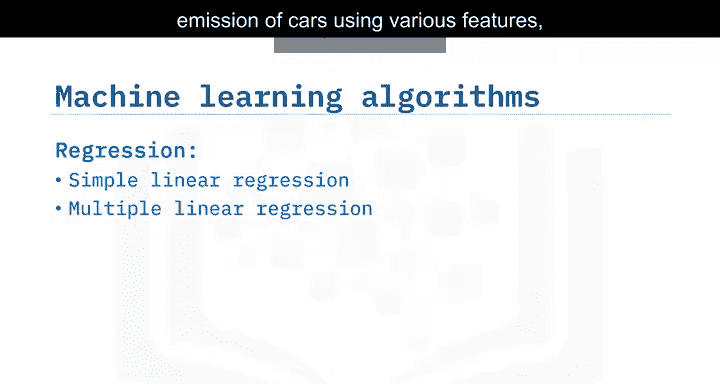

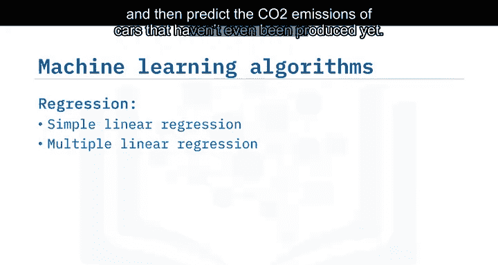

In regression trees， you will work with real estate data to predict the price of houses in logistic regression。

 you will work with customer data for telecommunication companies and see how machine learning is used to predict customer loyalty。

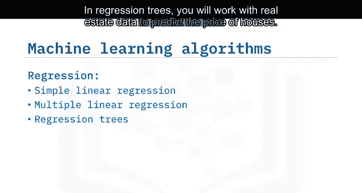

With K nearest neighbors， you will use telecommunication customer data to classify customers。

For support vector machines， you will classify human cell samples as benign or malignant。

In multiclass prediction， you will work with the popular IIS data set to classify types of flowers。

With decision trees， you will build a model to determine which drugs to prescribe to patients。

 and finally， with K means， you will learn to segment a customer data set into groups of individuals with similar characteristics。

In the last module， you will complete the final project where you will use many of the classification algorithms to predict rain in Australia。

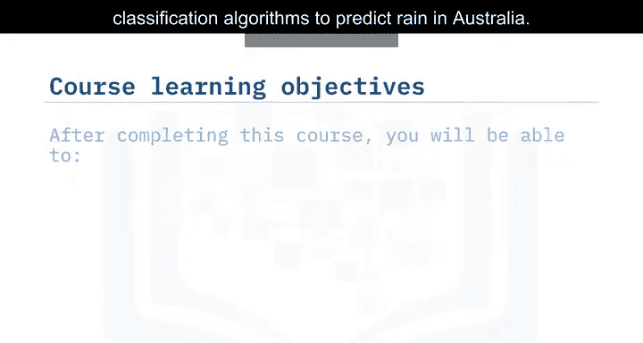

After completing this course， you will be able to explain， compare。

 and contrast various machine learning topics and concepts like supervised learning。

 unsupervised learning， classification， regression and clustering you will also be able to describe how the various machine learning algorithms work。

And finally， you will learn how to apply these machine learning algorithms in Python using various Python libraries。

