# IBM数据科学专业证书课程9：《Python机器学习课程（IBM）》machine-learning-with-python（中英字幕） - P22：21_K均值进阶.zh_en - GPT中英字幕课程资源 - BV1Vp4y1V7n2

Hello and welcome In this video， we'll look at K means accuracy and characteristics。

 Let's get started。😊。

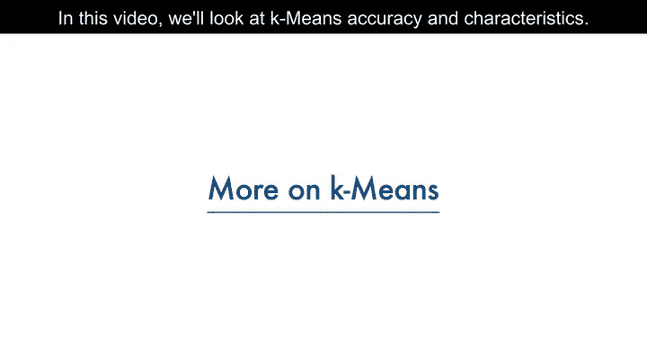

Let's define the algorithm more concretely before we talk about its accuracy。

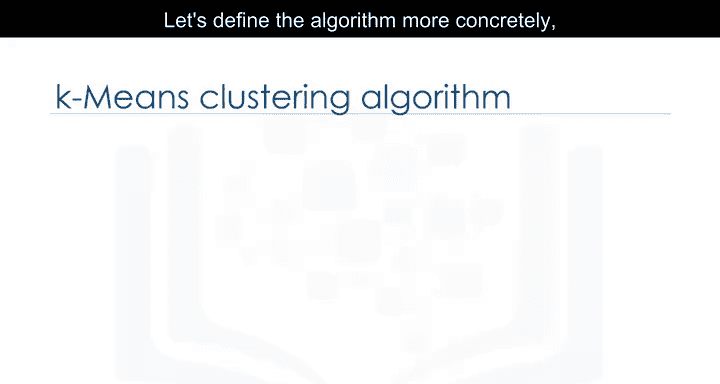

A K means algorithm works by randomly placing K centroids， one for each cluster。

 The farther apart the clusters are placed， the better。

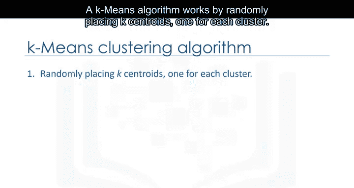

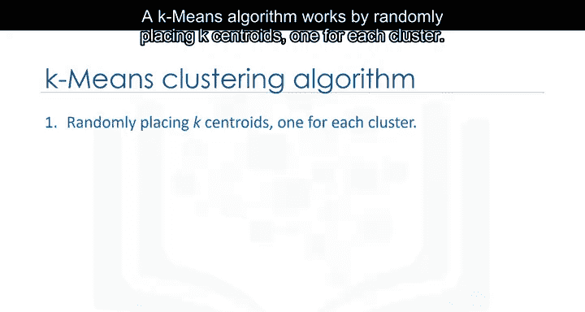

The next step is to calculate the distance of each data point or object from the centroids。

 Euclidean distance is used to measure the distance from the object to the centroid。 Please note。

 however， that you can also use different types of distance measurements。

 not just Euclidean distance。 Euclidean distance is used because it's the most popular。

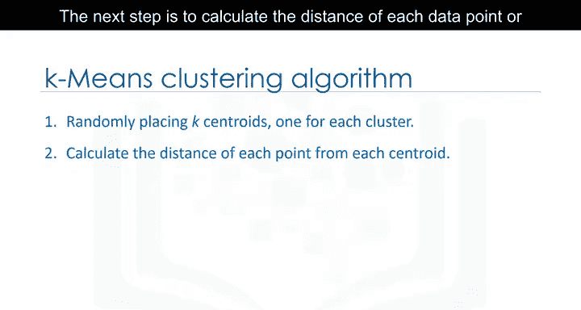

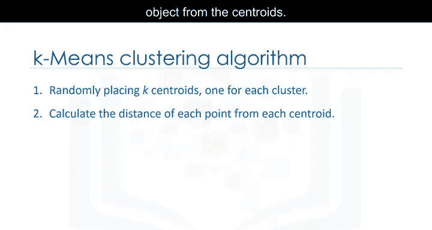

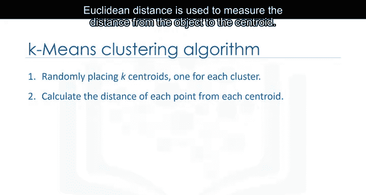

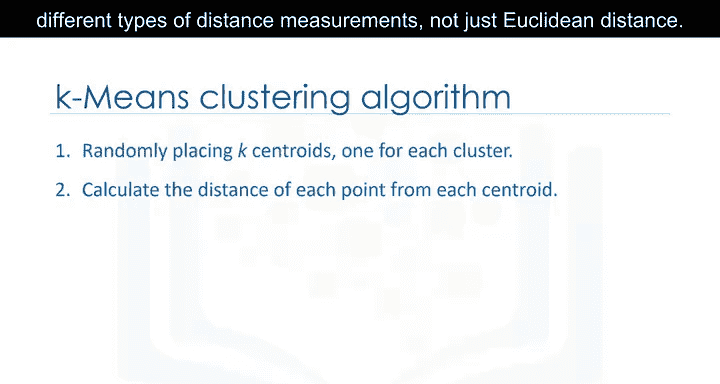

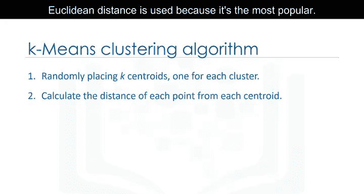

Then assign each data point or object to its closest centroid， creating a group。Next。

 once each data point has been classified to a group， recalculate the position of the K centroids。

The new centroroid position is determined by the mean of all points in the group。Finally。

 this continues until the centroids no longer move。Now， the question is。

 how can we evaluate the goodness of the clusters formed by K means， In other words。

 how do we calculate the accuracy of k means clustering？

 One way is to compare the clusters with the ground truth if it's available。 However。

 because K means is an unsupervised algorithm。 We usually don't have ground truth and real world problems to be used。

 But there is still a way to say how bad each cluster is based on the objective of the K means。😊。

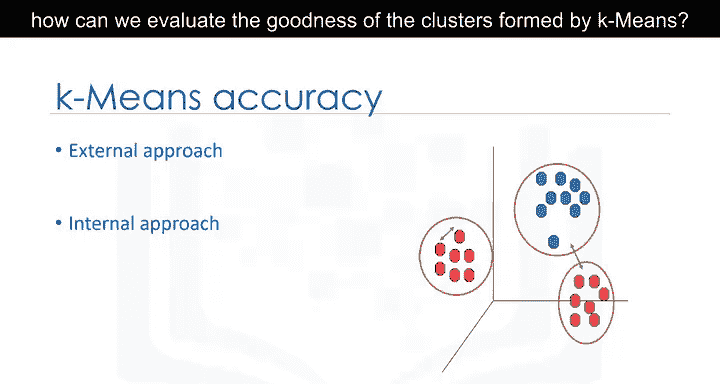

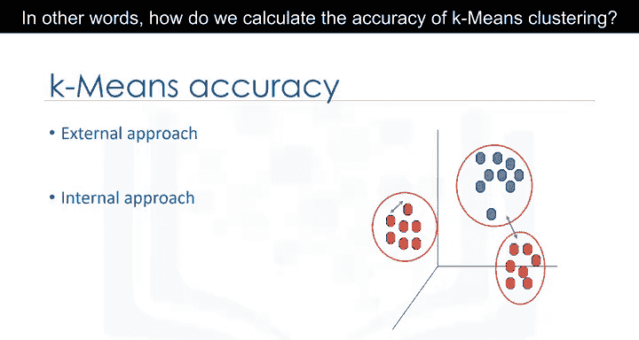

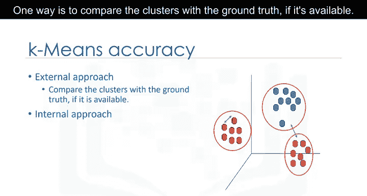

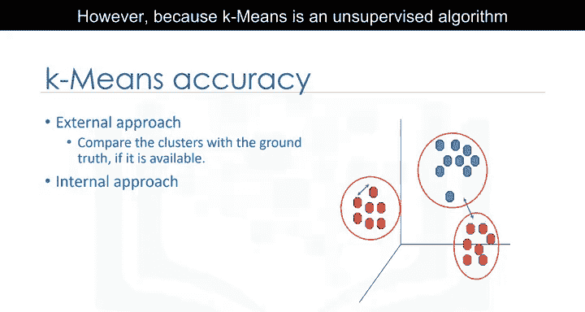

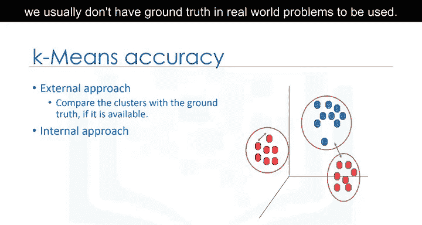

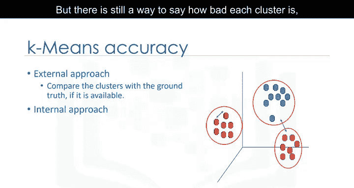

This value is the average distance between data points within a cluster。Also。

 average of the distances of data points from their cluster centroids can be used as a metric of error for the clustering algorithm。

Essentially， determining the number of clusters in a data set or K as in the K means algorithm。

 is a frequent problem in data clustering。

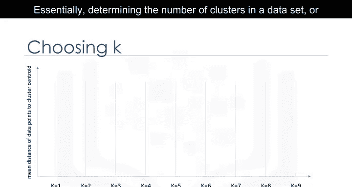

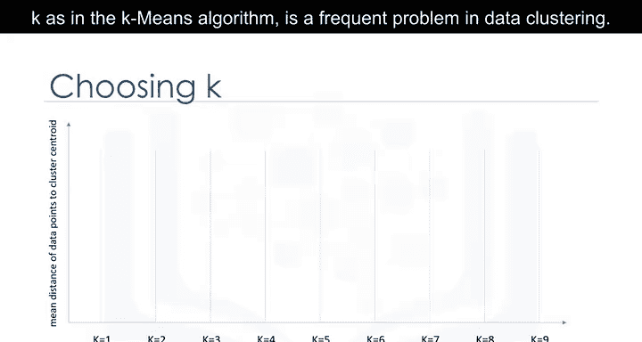

The correct choice of K is often ambiguous because it's very dependent on the shape and scale of the distribution of points in a data set。

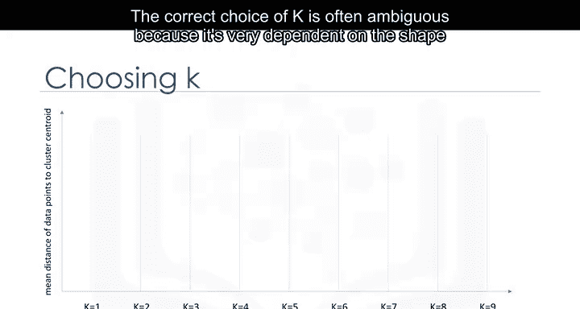

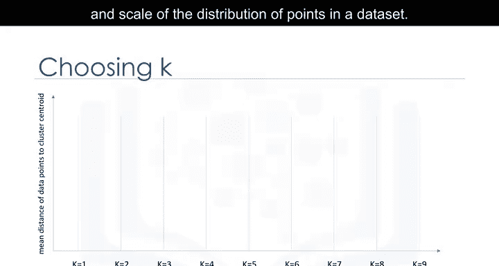

There are some approaches to address this problem， but one of the techniques that is commonly used is to run the clustering across the different values of K and looking at a metric of accuracy for clustering。

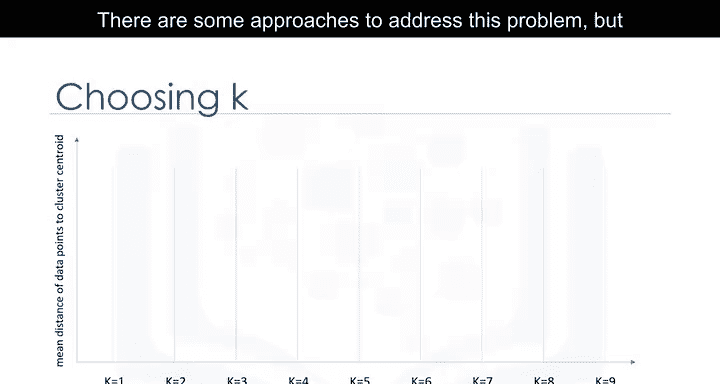

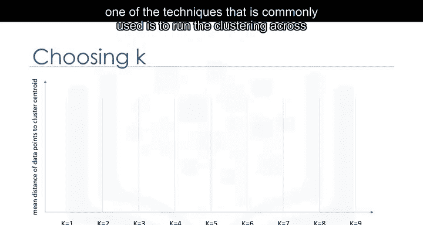

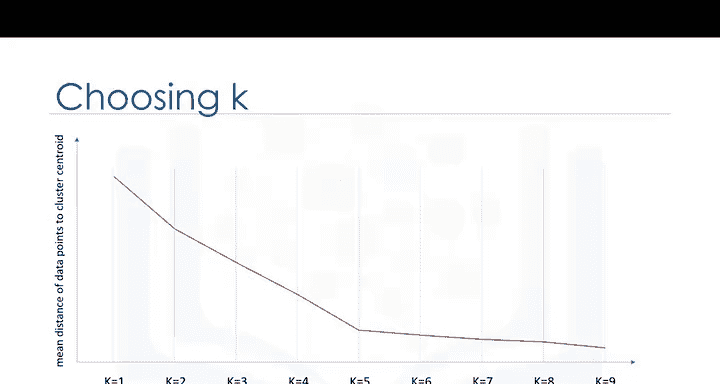

This metric can be mean distance between data points and their cluster centroid。

 which indicate how dense our clusters are， or to what extent we minimize the error of clustering。

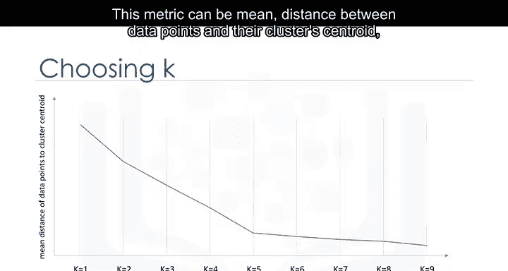

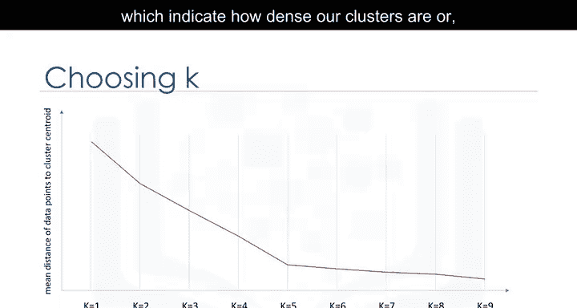

Then looking at the change of this metric， we can find the best value for K。

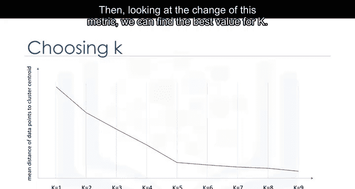

But the problem is that with increasing the number of clusters。

 the distance of centroids to data points will always reduce。

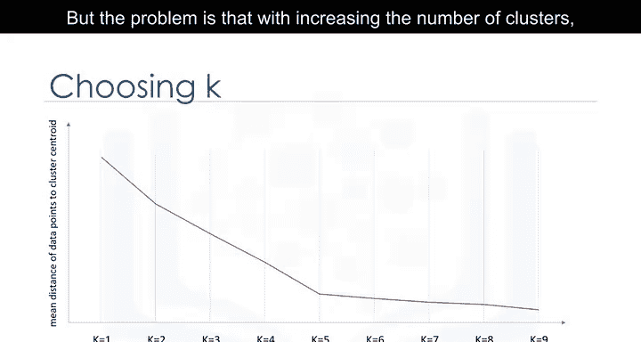

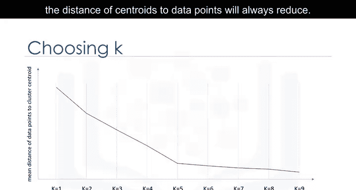

This means increasing K will always decrease the error。

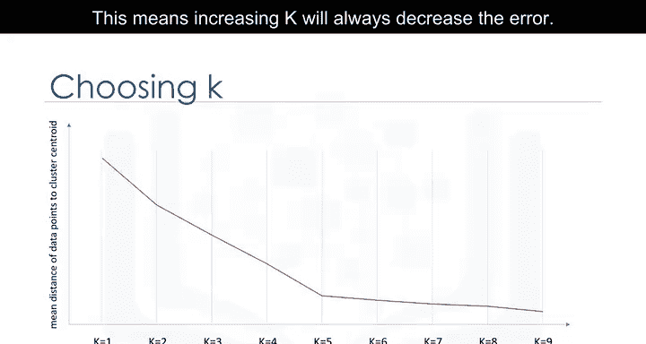

So the value of the metric as a function of k is plotted。

 and the elbow point is determined where the rate of decrease sharply shifts。

 It is the right K for clustering。

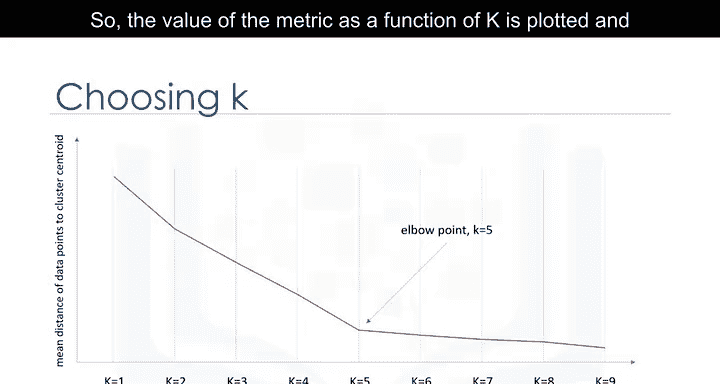

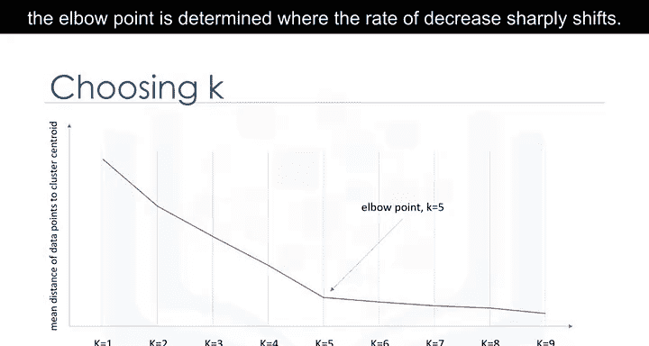

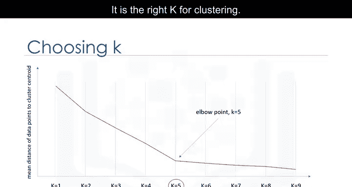

This method is called the elbow method。So let's recap K means clustering。

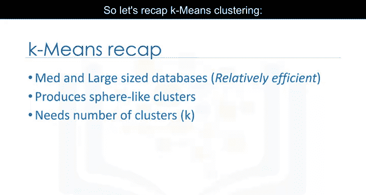

K meanss is a partition based clustering， which is a relatively efficient on medium and large size data sets。

 B produces sphere like clusters because the clusters are shaped around the centroids。 And C。

 its drawback is that we should pre specify。 the number of clusters， and this is not an easy task。

 Thanks for watching。

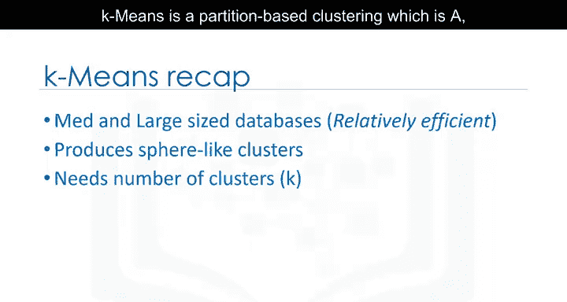

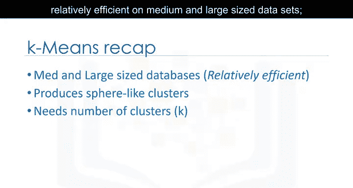

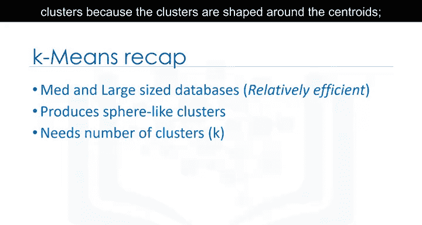

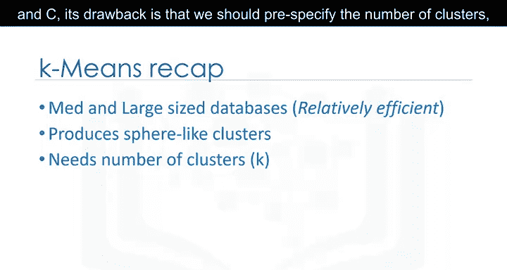

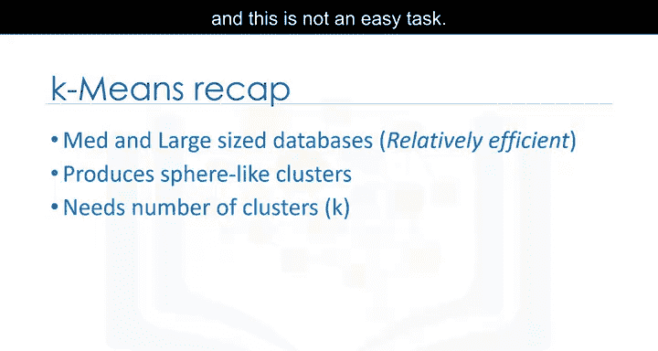