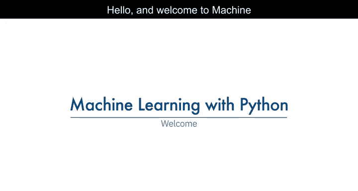
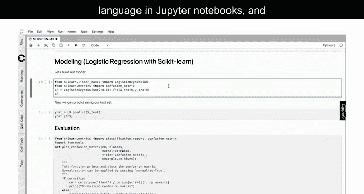
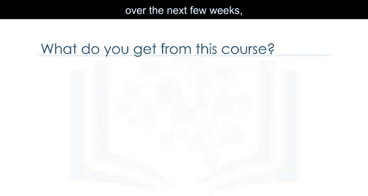
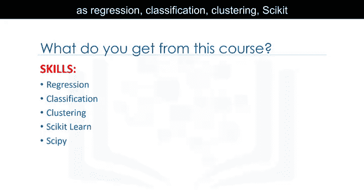
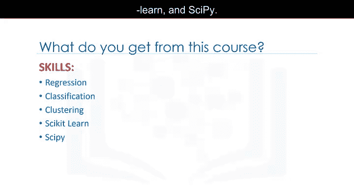
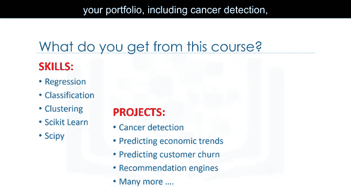
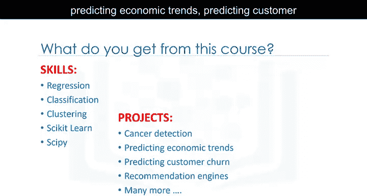

# IBM数据科学专业证书课程9：《Python机器学习课程（IBM）》machine-learning-with-python（中英字幕） - P2：1_导论.zh_en - GPT中英字幕课程资源 - BV1Vp4y1V7n2

Hello and welcome to Ma learning with Python。In this course。

 you'll learn how machine learning is used in many key fields and industries。For example。

 in the healthcare industry， data scientists use machine learning to predict whether a human cell that is believed to be at risk of developing cancer is either benign or malignant。

As such， machine learning can play a key role in determining a person's health and welfare。

You'll also learn about the value of decision trees and how building a good decision tree from historical data helps doctors to prescribe the proper medicine for each of their patients。

You'll learn how bankers use machine learning to make decisions on whether to approve loan applications。

And you will learn how to use machine learning to do bank customer segmentation。

 where it is not usually easy to run for huge volumes of varied data。In this course。

 you'll see how machine learning helps websites such as YouTube。

 Amazon or Netflix develop recommendations to their customers about various products or services。

 such as which movies they might be interested in going to see or which books to buy。

 There is so much that you can do with machine learning。😊。

Here you'll learn how to use popular Python libraries to build your model。For example。

 given an automobile data set， we can use the PsCt Learn Library to estimate the CO2 emission of cars using their engine size or cylinders。

We can even predict what the CO2 emissions will be for a car that hasn't even been produced yet。

And we'll see how the telecommunications industries can predict customer churn。

You can run and practice the code of all these samples using the builtt in lab environment in this course。

You don't have to install anything to your computer or do anything on the cloud。

All you have to do is click a button to start the lab environment in your browser。

 The code for the samples is already written using Python language in Jupiter notebooks。

 and you can run it to see the results or change it to understand the algorithms better。

So what will you be able to achieve by taking this course？ Well。

 by putting in just a few hours a week over the next few weeks。

 you'll get new skills to add to your resume， such as regression， classification， clustering，sit。

 learn and s Pi。 You'll also get new projects that you can add to your portfolio。

 including cancer detection， predicting economic trends， predicting customer churn。

 recommendation engines and many more。😊。

You'll also get a certificate in machine learning to prove your competency and share it anywhere you like online or offline such as LinkedIn profiles and social media。

So let's get started。