# IBM数据科学专业证书课程9：《Python机器学习课程（IBM）》machine-learning-with-python（中英字幕） - P9：8_回归模型评价指标.zh_en - GPT中英字幕课程资源 - BV1Vp4y1V7n2

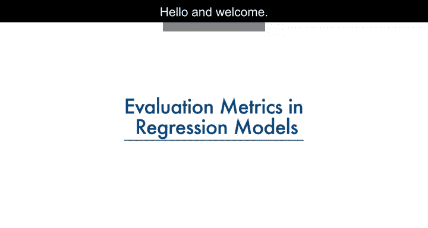

Hello and welcome In this video， we'll be covering accuracy metrics for model evaluation。

 so let's get started。😊。

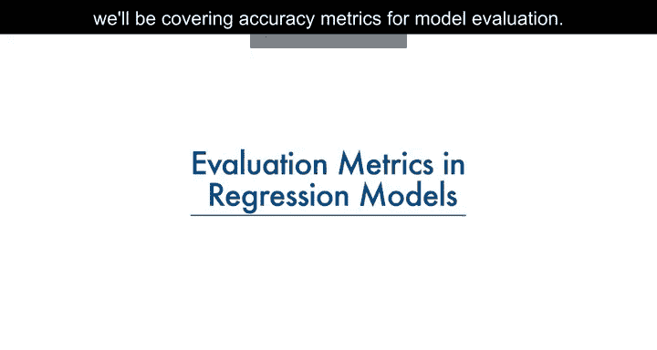

Evaluation metrics are used to explain the performance of a model。

 Let's talk more about the model evaluation metrics that are used for a regression。

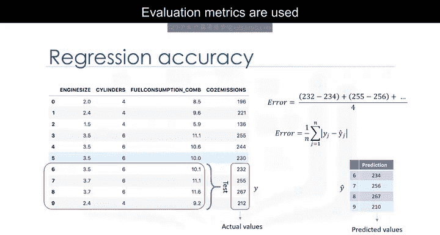

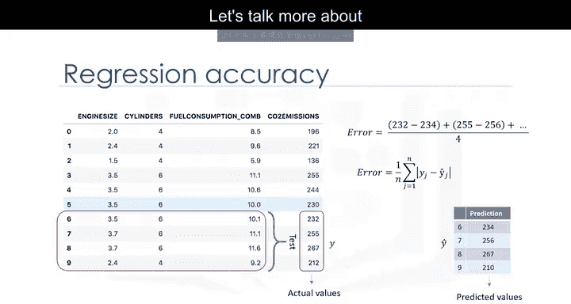

As mentioned， basically， we can compare the actual values and predicted values to calculate the accuracy of a regression model。

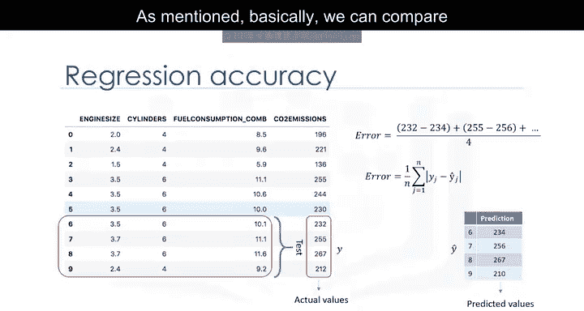

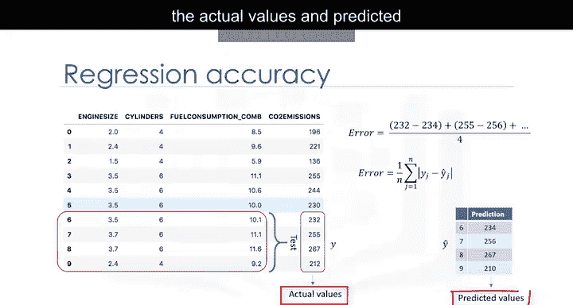

Evaluation metrics provide a key role in the development of a model as it provides insight to areas that require improvement。

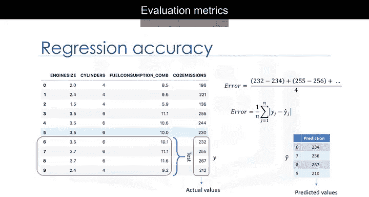

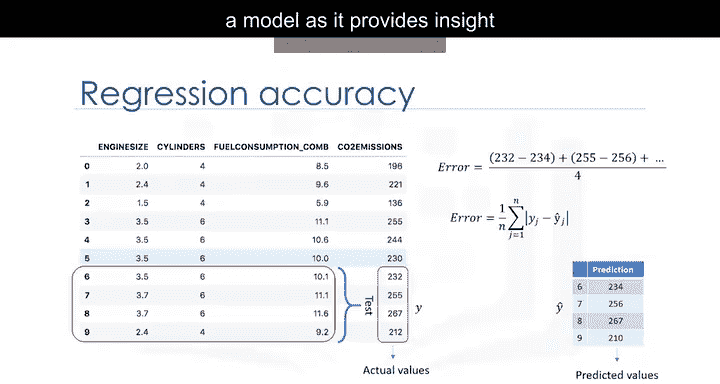

We'll be reviewing a number of model evaluation metrics， including mean absolute error。

 mean squared error， and root mean squared error。

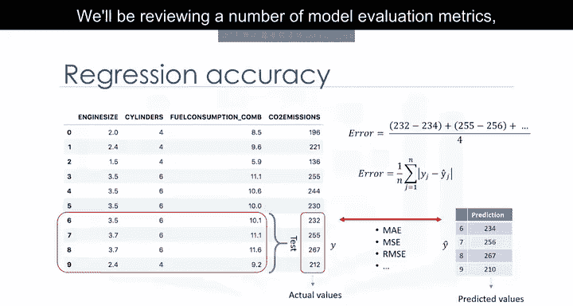

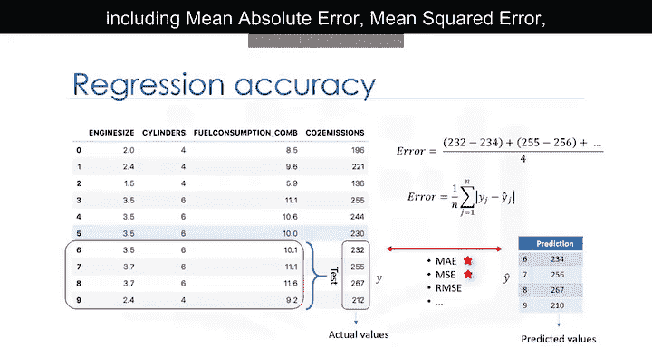

But before we get into defining these， we need to define what an error actually is。

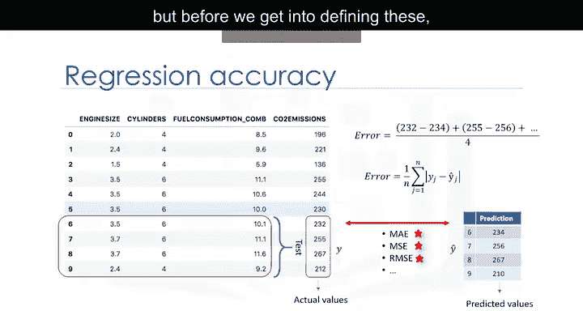

In the context of regression， the error of the model is the difference between the data points and the trend line generated by the algorithm。

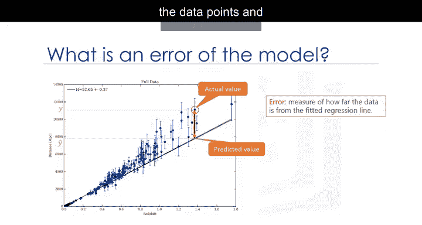

Since there are multiple data points， an error can be determined in multiple ways。

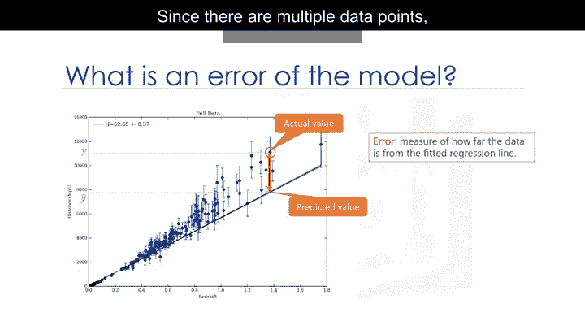

Mean absolute error is the mean of the absolute value of the errors。

 This is the easiest of the metrics to understand， since iss just the average error。

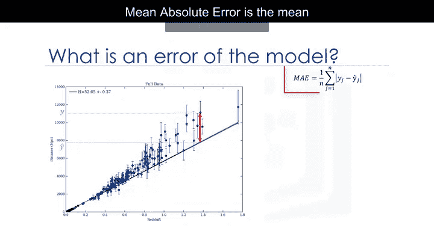

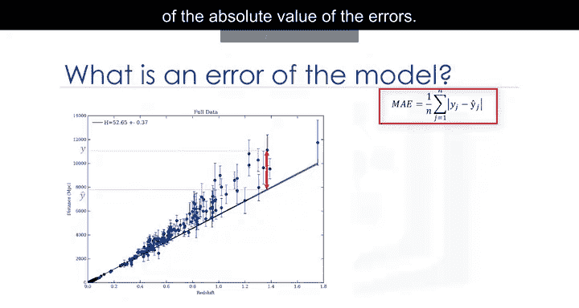

Mean squared error is the mean of the squared error。

 It's more popular than mean absolute error because the focus is geared more towards large errors。

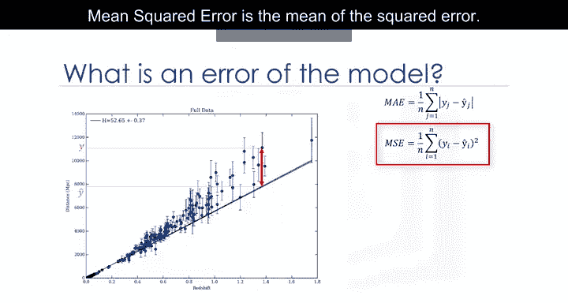

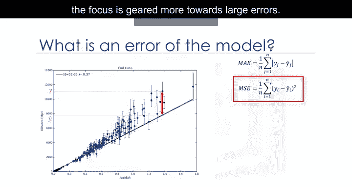

This is due to the squared term exponentially increasing larger errors in comparison to smaller ones。

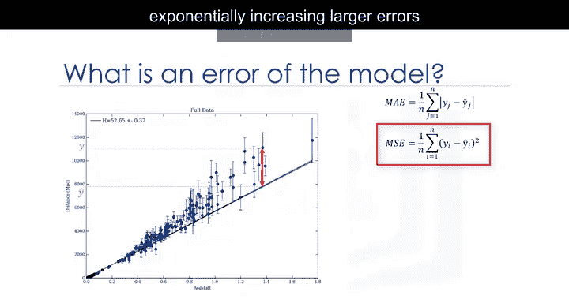

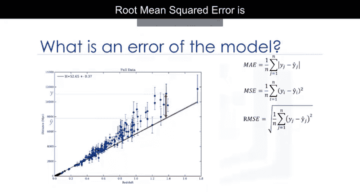

Route mean squared error is the square root of the mean squared error。

This is one of the most popular of the evaluation metrics because root means squared error is interpretable in the same units as the response vector or Y units。

 making it easy to relate its information。

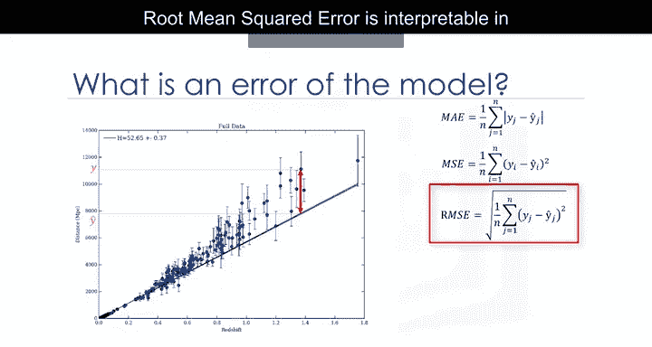

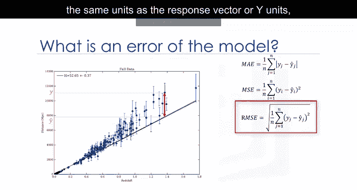

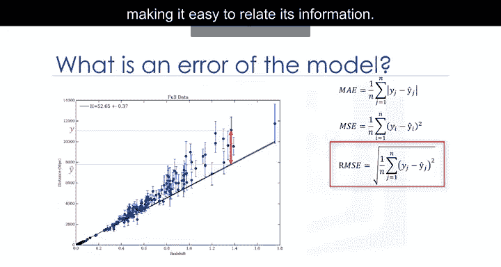

Relative absolute error， also known as residual sum of square。

 where y bar is a mean value of y takes the total absolute error and normalizes it by dividing by the total absolute error of the simple predictor。

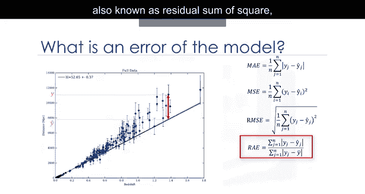

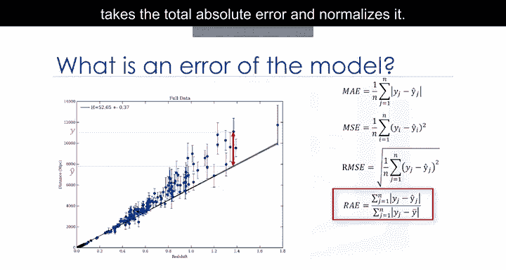

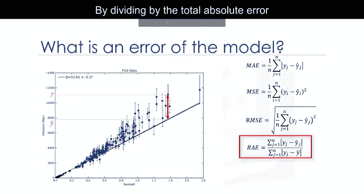

Relative squared error is very similar to relative absolute error。

 but is widely adopted by the data science community as it is used for calculating R squared。

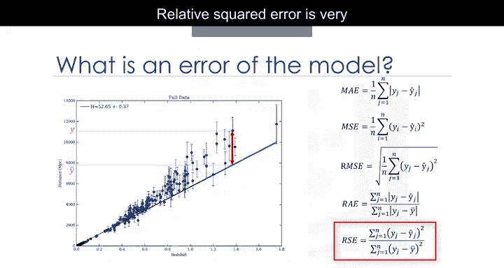

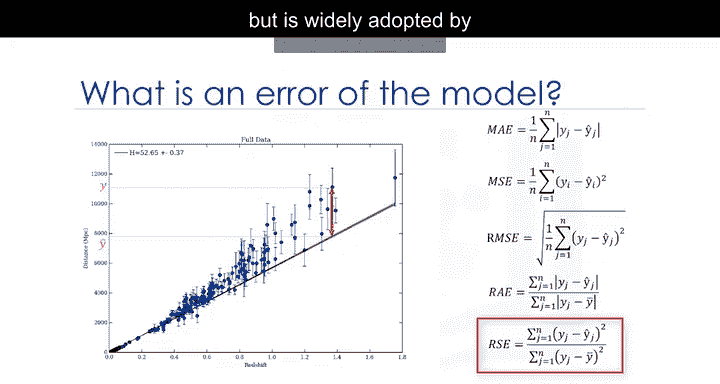

R squared is not an error per se， but is a popular metric for the accuracy of your model。

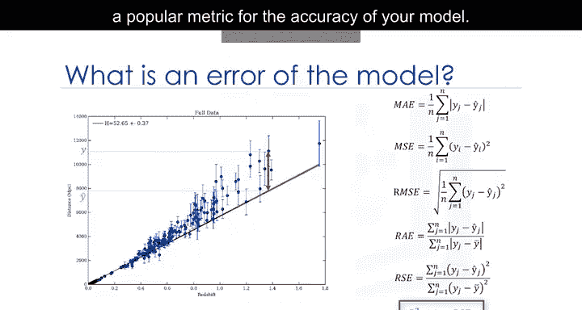

It represents how close the data values are to the fitted regression line。

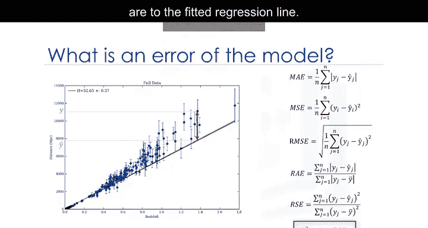

The higher the r squared， the better the model fits your data。

Each of these metrics can be used for quantifying of your prediction。

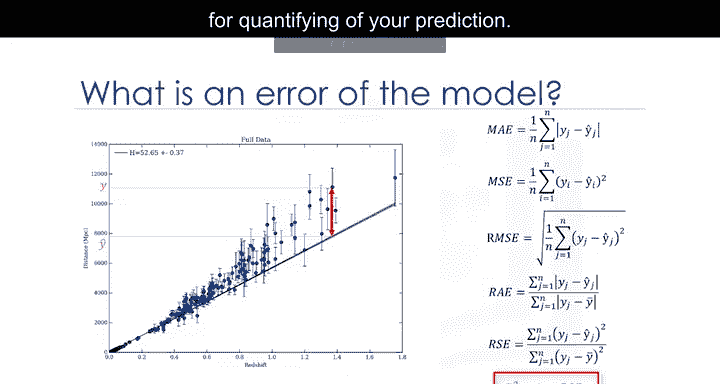

The choice of metric completely depends on the type of model， your data type and domain of knowledge。

 Unfortunately， further review is out of scope of this course。

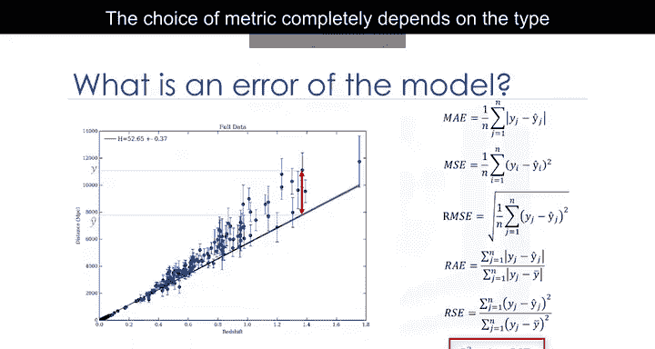

Thanks for watching。

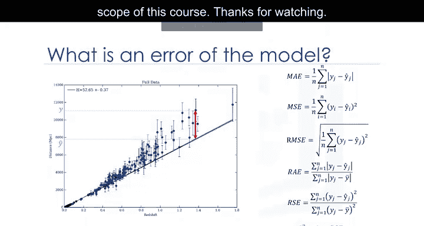