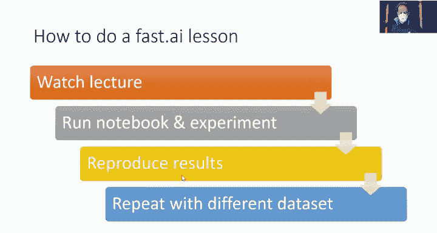
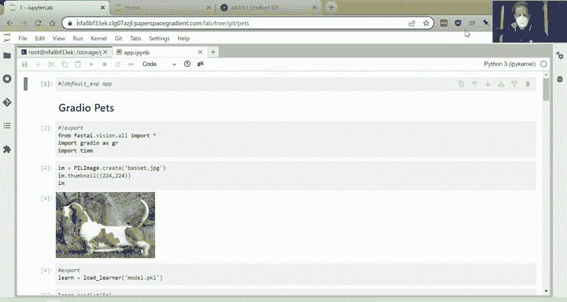
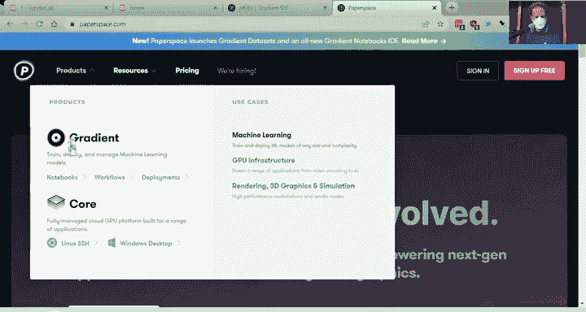
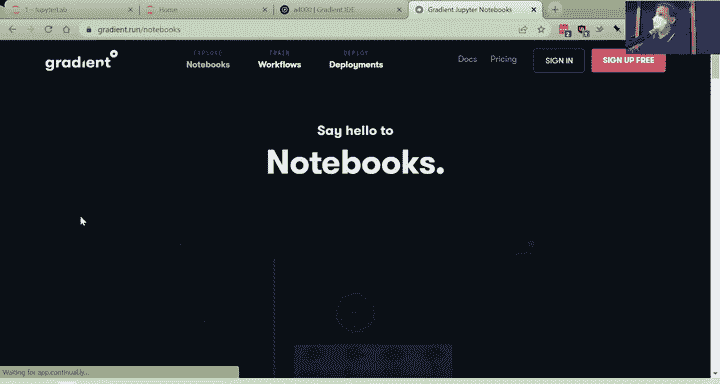
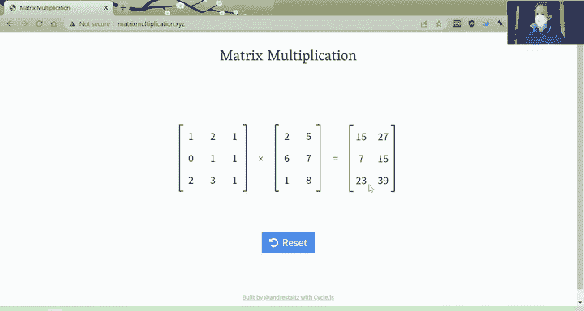
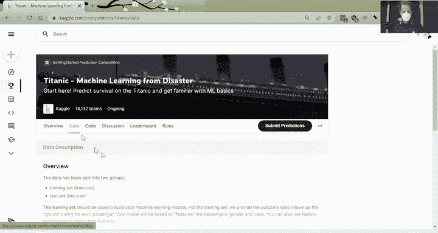
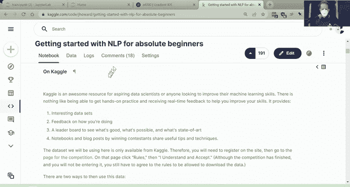

# Jeremy Howard《给码农的深度学习实践课程1｜Practical Deep Learning for Coders2022》中英字幕 - P3：[3]Lesson 3_ Practical Deep Learning for Coders 2022.zh_en - GPT中英字幕课程资源 - BV15Z421H7zj

Hi everybody and welcome to lesson three of Pra deep learning for coders。

We did a quick survey this week to see how people feel the course is tracking。

Over half if you think it's about right pace and of the rest who aren't。

Some of you think it's a bit slow and some of you think it's a bit sorry。

 Some think it's a bit slow and some of you think it's a bit fast。

 So hopefully were that's about the best we can do。 generally speaking。

 the first two lessons are a little more easy pacing for anybody who's already familiar with the kind of。

😊，Basic technology pieces， and then the later lessons get。

 you know more into kind of some of the foundations。 and today we're going to be talking about。

You know， things like。The matrixx multiplications and gradients and calculus and stuff like that。

 so for those of you who are more mathy and less computer。

 you might find this one more comfortable and vice versa。😊。

So remember that there is a official course updates Str where you can see all of the up to date info about everything you need to know and of course the course website as well。

So by the time you know you watch the video of the lesson。

 it's pretty likely that if you come across a question or an issue somebody else will have。

 so definitely search。The forum and check the facts first and then of course feel free to ask a question yourself on the forum if you can't find your answer。

One thing I did want to point out， which you'll see in the lesson thread in the course website is there is also a lesson zero lesson zero is。

Based heavily on Raex's book Meta Learn， which internally is based heavily on all the things that I've said over the years about how to learn fast AIs we try to make the course full of。

Tech bits about the science of learning itself and put them into the course。

It's a different course to probably any other you've taken。

 and I strongly recommend watching lesson zero。As well。

 the last bit of lessons 0 is about how to set up a Linux box from scratch。

 which you can have police skip over unless that's of interest， but the rest of it is。

Full of juicy information that I think you'll find useful。

So the basic idea of what to do to do a faster AI lesson。

I watch the lecture and I generally you know， when the video recommend watching it all the way through without stopping once and then go back。

And watch it with lots of pauses running the notebook as you go。

 because otherwise you're kind of like running the notebook。

Without really knowing where it's heading if that makes sense and the idea of writing the notebook is is you you know there's a few notebooks you could go through so obviously there's the book so going through chapter one of the book going through chapter two of the book as notebooks。

Rriunning every code cell。And experimenting with inputs and outputs to try and understand what's going on and then trying to reproduce those results。

And then trying to repeat the whole thing with a different data set And if you can do that last step。

 you know， that's quite a stretch goal particularly at the start of the course because there's so many new concepts。

 but that really shows that you you've got it sorted Now this third bit reproduce results。

I recommend using， you'll find in the fast book repo， so the repository for the book。

 there is a special folder called。Plein and plain contains all of the same chapters of the book。

 but with all of the text removed except the headings and all the outputs removed。

 and this is a great way for you to test your understanding of the chapter is before you run each cell。

 try to say to yourself， okay， what's this for？And what's it going to output if anything and if you kind of work through that slowly。

 that's a great way at any time you're not sure you can jump back to the version of the notebook with the text to remind yourself and then head back over to the clean version。

😊，嗯。So that's an idea for something which a lot of people find really useful for self study。

I say self- study， but of course， as we've mentioned before。

 the best kind of study is study done to some extent with others for most people。

 you know the research shows that you're more likely to stick with things if you're doing it as kind of a bit of a social activity。

The forums are a great place to find and create study groups and you'll also find on the forums a link to our Discord server so yes our Discord server where there are some study groups there as well so you know in person study groups virtual study groups are a great way to。

You know， I really make good progress and find other people at a similar level to you。

If there's not a study group going at your level， in your area， in your time zone， create one。

 so you just post something saying， hey， let's create a study group。

So this week there's been a lot of fantastic activity。

 I can't show all of it so what I did was I used the summary functionality in the forums to grab all of the things with the highest votes and so Ill quickly show a few of those we have a Marvel detector created this week identify your favorite Marvel character I love this the Rock Paper scissors game where you actually use pictures of the Rock Paper scissors symbols and apparently the computer always loses that's my favorite kind of game。

There is a lot of Ellon around so very handy to have an Ellon detector to you know either find more of him if that's what you need or maybe less of him I thought this one is very interesting I love these kind of really interesting ideas that's like gee。

 I wonder if this would work can you predict the average temperature of an area based on a aerial photograph？

And apparently the answer is， yeah， actually you can predict it pretty well here in Brisbane。

 it was predicted， I believe to within one and a half Celsius。😊。

I think this student is actually a genuine meteorologist if I remember correctly he built a cloud detector so then building on top of the what's your favorite Marvel character there's now also an is it a Marvel character my daughter loves this one what dinosaur is this and I'm not as good about dinosaurs as I should be I feel like there's。

😊，1 times more dinosaurs than there was when I was a kid， so I never know their name。

 so this is very handy。😊，Thisrs Co， choose your own adventure where you choose your path using facial expressions。

And I think this music genre classification is also really cool。😊，嗯。

Brian Smith created a Microsoft power app application that actually runs on a mobile phone。

 so that's pretty cool， wouldn't be surprised to hear that Brian actually works at Microsoft so also an opportunity to promote his own stuff there I thought this art movement classifier was interesting in that there's a really interesting discussion on the forum about。

😊，What it actually shows about similarities between different art movements。

And I thought this reductiona detector project was really cool as well。

 and there's a whole tweet thread and blog posts and everything about this one。

 particularly great because of。😊，Okay， so。I'm going to quickly show you a couple of little tips before we kind of jump into the mechanics of what's behind a neural network。

 which is I was playing a little bit with how do you make your neural network more accurate during the week。

 and so I created this pet detector and this pet detector is not just protectinging dogs or cats but what breed is it？

That's obviously much more difficult。Exercise。Now， because I put this out on hikinging F spaces。

 you can download and look at my code because if you just click files and versions on the space。

 which you can find a link on the forum and the course website。

You can see them all here and you can download it to your own computer。So， I'll show you。

What I've got here。Now， one thing I mention is today。I'm using a different platform。

 so in the past I've shown you coab and I've shown you CAle and we've also looked at doing stuff on your own computer。

 not so much training models on your computer， but using the models you've trained create applications。

Paper space is a another。Website， a bit like。Kle and Google。But in particular。

 they have a product called gradientant Notebooks which is at least as I speak and things change all the time so check the course website。

 but as I speak， in my opinion is by far the best platform running this course and for you know doing experimentation I'll explain why as we go so why haven't I been using the past two weeks because I've been waiting for them to build some stuff for us to make it particularly good and they they just finished so I've been using it all week that it's totally amazing。

😊。

This is what it looks like， so you've got a machine running in the cloud。

 but the thing that was very special about it is it's a real computer you're using。

 it's not like that kind of weird virtual version of things that Kagle or CoLab has。😊。

So if you wh on this button down here， you'll get a full version of Jupiter La。

Or you can switch over to a full version of classic Jupiter notebooks。

And I'm actually going to do stuff in Jupiter lab today because it's a pretty good environment for beginners who are not familiar with the terminal。

 which I know a lot of people in the course are that situation， you can do really everything。😊。

Kind of graphically there's a file browser so here you can see I've got my pets repo it's got a get repository thing you can pull and push to get。

And then， you can also。Open up a terminal， create your notebooks。And so forth。

 so what I tend to do with this is I tend to go into a full screens it's kind of like its own whole IDdeE。

嗯。And so you can see I've got here my terminal。And here's my notebook。

They have free GPUs and most importantly there's two good features one is that you can pay I think it's  eight or 9 a month to get better GPUs and basically as many as you you know as many hours as you want and they have persistent storage so with coLAP if you've played with a amount of notices annoying you have to muck around with saving things to Google Drive and stuff on kggle that isn't really a way of kind of having a persistent environment whereas on paper space you have you know whatever you save in your storage it's going to be there the next time you come back so。

I'm going to be adding。Walkthroughs of all of this functionality。

 So look at so if you're interested in really taking advantage of this， check those out。Okay， so。

I think the main thing that I wanted you to take away from lesson two isn't necessarily all the details of how do you use a particular platform to train models and deploy them into applications through JavaScript or online platforms。

But the key thing I wanted you to understand was the concept。There's really two pieces。

 there's the training piece， and at the end of the training piece you end up with this bottlet pickle file。

 right？And once you've got that。That's now a thing where you feed at inputs and it spits out outputs based on that model that you trained。

 And then so you don't need。know because that happens pretty fast。

 you generally don't need a GPU once you've got that train and so then there's a separate step。

Which is deploying。So I'll show you how I trained my pet classifier。

So you can see I've got two iython notebooks。One is app。

 which is the one that's going to be doing the inference and production。

 one is the one road trainer model。So this first bit I'm going to skip over because you've seen it before。

 I create my image data loaders。😊，Check that my data looks O with show batchch。Train a resident 34。

 and I get 7% accuracy。So that's pretty good。😊，诶。But check this out， there's a link here。

To a notebook I created actually most of the work was done by Ross Whiteman。

Where we can try to improve this by finding a better architecture。There are。

 I think at the moment in the Pytorrch image models libraries over 500 architectures and we'll be learning over the course。

😊，You know what they are， how they differ， but you know broadly speaking。

 they're all mathematical functions， you know， which are basically matrix modifications and these nonlinearities such as values that we' talk about today。

😊，Most of the time those details don't matter what we care about is three things， how fast do they。

 how much memory do they use and how accurate are they and so what I've done here with Ross is we've grabbed all of the models from Pytorrch image models and you can see all the code we've got is very very little code to create this plot。

😊，对。Now my screen resolutions a bit。Here we got us do that。And so， on this plot。

On the X axis we've got seconds per sample。 so how fast is it so to the left is better is' faster and on the right is how accurate is it。

 So how how accurate was it on imageNe in particular。And so generally speaking。

 you want things that are up towards the。Top and left。

Now we've been mainly working with ResNe and you can see down here here's Resnet18 Now Resnet 18 is a particularly small and class version for prototyping we often use ResNe 34 which is this one here。

And you can see this kind of like classic model that's very widely used。

 actually nowadays isn't the state of the art anymore。😊。

So we can start to look up at these ones up here and find out some of these better models。

The ones that seem to be the most accurate。And fast for these bvit models。

So I tried them out on my pets and I found that they didn't work particularly well。

 So I thought okay， let's try something else out。 So next up I tried。These co next models。

And this one in here was particularly interesting。 It's kind of like super high accuracy。 It's the。

 you know， if you want。001 seconds， inference time。 it's the most accurate。 So I tried that。

 So how do we try that。All we do is I can say， so the Ptoch image models is in the TM module。

 so the first start I imported that。And we can say list models and pass here。A glob a match。

And so this is going to show all the column of next models。

And here I can find the ones that I just saw and all I need to do is when I create the vision learner。

 I just put the name of the model in as a string Okay so youll see earlier this one is not a string that's because it's a model that FA AI provides the library。

😊，Firstly I only provides a pretty small number， so if you install tis。

 you only need to p install ti or conr installed tim。

You'll get hundreds more and you put that in a strip。So if I now train that。

 the time for these epochs goes from 20 seconds to 27 seconds， so it is a little bit slower。

But the accuracy goes from 7。2%。Down to 5。5 per cent。

So you know that's a pretty big relative difference。7。2 divided about 5。5。 Yeah。

 it's about a 30% improvement。 So that's pretty fantastic。 And， you know， it's。😊。

It's been a few years， honestly， since we've seen anything。Really beat Resnet that's。

 that's widely available and usable on regular GPs。 So this is， this is a big step。 And so this is。

 you know， there's a few architectures nowadays that really are。

Probably better choices a lot of the time。 And these cons。 So if you are not sure what to use。

 try these con next architectures。You might wonder what the names are about， obviously tiny。

 more large， etc cetera is how big is the model， so that'll be how much memory is it going to take out and how fast is it。

😊，嗯。And then these ones here that say in 22 FT1K these ones have been trained on more data。

 so imageNe there's two different image data sets there's one that's got 1000 categories of pictures and there's another one that's got 22。

000 categories of pictures so this is trained on the one with 22。

000 categories of pictures so these are generally going to be more accurate on kind of standard photos of natural objects。

Okay so from there I exported my model and that's the Okay so now I've trained my model and I'm all done you know。

 other things you can do obviously is add more epochs， for example。

 that image augment there's various things you can do but you know I found this this is actually pretty。

😊，Pretty hard to beat this by much if any of you find you can do better， I'd love to hear about it。

So then to turn that into an application I just did the same thing that we saw last week which was to load the learner as is something I did want to show you the learner once we load it and call predict spits out a list of 37 numbers that's because there are 37 breeds of dog and cat so these are the probability of each of those breeds what order are they in that's an important question the answer is that fast AI always storess this information about categories this is a category in this case of dog or cat breed in something called the vocab object and it's inside the data loaders so we can grab those categories and that's just a list of strings just tells us the order。

So if we now zip together the categories and the probabilities。

 we'll get back a dictionary that tells you， well， like said。So here's that list of categories。

And here's the probability of each one。And this was a bassett hound， so there you can see， y。

 almost certainly a bassett hound。So from there， just like last week。

 we can go and create our interface and then launch it。And there we go。😊，What did we just do really。

 What is this magic model pickle file？So we can take a look at the model pick file it's an object type called a learner and the learner has two main things in it The first is the list of preprocessing steps that you did to turn your images into things of the model and that's basically。

嗯。This information here。So it's your data blocks or your image data loaders or whatever。

And then the second thing， most importantly， is the trained model。

And so you can actually grab the trained model by just grabbing the dot model attribute。

 So I's going to call that M。 And then if I type M， I can look at the model。 and so here it is。😊。

Lots of stuff。 So what is this stuff。 Well we'll learn about it all over time。 But basically。

 what you'll find is。It contains lots of layers because this is a deep moing model and you can see it's kind of like a tree that's because lots of the layers themselves consist of layers so there's a whole layer called the Tim body which is most of it and then right at the end there's a second layer called sequential。

😊，And then the ti body contains something called model and then it contains something called STM and something called stages and then stages code code  zero。

 one， two， etc。So what is all this stuff， Well， let's take a look at one of them。

So to take a look at one of them， there's a really convenient method in Pytorch called Get sub moduleule。

 where we can pass in a kind of。A dotted string navigating through this hierarchy。

 So zero model stem1 goes zero model stem one。So this is going to return this layer norm through anythingy。

So what is this mayoon 3 D thing， Well， the key thing is。

It's got some code with the mathematical function we've talked about。

 and then the other thing that we learned about is it has。😊，Parameters。

 and so we can list its parameters and look at this， it's just lots and lots and lots of numbers。

Let's grab another example， we could have a look at0。moded。tages。0。block。1。mlP。fc1 and parameters。

Another big bunch of numbers。So what's going on here， what are these numbers？

And where on earth did they come from and how come these numbers can figure out whether something is a bass pound on them。

Okay， so。To answer that question， we're going to have a look at a。Cagle notebook。

How does a neural network really work， I've got a local version of it here。

 which I'm going to take you through。 And the basic idea is。

Machine learning models are things that fit functions to data。 So we start out with a very。

 very flexible in fact， an infinitely flexible， as we've discussed function in neural network。

And we get it to do a particular thing， which is to recognize the patterns in the data examples we give it。

嗯。So let's do a much simpler example than a neural network。 Let's do a quadratic。

So let's create a function F， which is 3 x squared。Plus 2 x。Plus one， Okay。

 so it's a quadratic with coefficient 3，2 and1。 so we can plot that function F and give it a title。

 If you haven't seen this before， things between dollar signs is what's called latex。

 it's basically how we can create kind of types set mathematical equations。Okay， so let's run that。

And so here can see the function。 here can see the title I passed it， and here is。quadratic。Okay。

 so what we're going to do is we're going to。Imagine that we don't know that's the true mathematical function。

 we're trying to find。 because it's obviously much simpler than the function that figures out whether an image is。

Baset hound or not， that we're just going to start super simple。 So this is the real function。

 and we're going to try to recreate it from some data。嗯。

Now it's going to be very helpful if we have an easier way of creating different quadratics。

 so I've defined a kind of a general form of a quadratic here with coefficients A。

 B and C and at some particular point x， it's going to be a x squared plus B x plus C。😊。

And so let's test that。Okay， so that's for x equals 1。5， that's 3 x squared plus 2 x plus 1。

 which is the quadratic we were did before。Now we're going to want to create lots of different quadratics to test them out and find out which one's best。

So this is a somewhat advanced but very， very helpful feature of Python that's worth learning if you're not familiar with it and it's used in a lot of programming languages。

 it's called a partial application of a function， basically I want this exact function but I want to fix the values of A B and C to pick a particular quadratic。

😊，And the way you fix the values of the function is you call this thing in pathython called partial and you're pass in the function。

 and then you pass in the values that you want to fix。So for example。If I now say make a quadratic3。

2， one， that's going to create a quadratic equation with coefficients，3，2， and one。

And you can see if I then pass in， so that's now F， if I pass in 1。5。

 I got the exact same value I did before。Okay， so we've now got an ability to create any quadratic。😊。

Equation we want by passing in parameters of the coefficients the quadratic that gives us a function that we can then just call as just like any normal function。

 so that only needs one thing now which is a value of x because the other three A。

 B and C are now fixed。So if we plot that function。

We'll get exactly the same shape because it's the same coefficients。Okay。

So now I'm going to show an example of some data， some data that matches the shape of this function。

 but in real life data is never exactly going to match the shape of a function。

 it's going to have some noise， so here's a couple of functions to add some noise。嗯。

So you can see I've still got the basic functional form here。

 but this data is a bit dotted around it the level to which you look at how I implemented these is entirely up to you it's not like super necessary。

 but it's all stuff which。You know， the kind of things we use quite a lot。

 so this is to create normally distributed random numbers。

This is how we set the seed so that each time I run this'' not going to get the same random numbers。

This one is actually particularly helpful， this creates a tensor。

 so in this case a vector that goes from negative to2 and equal steps and there's 20 of them that's why there's 20 steps along here。

So then my y values is just F of x。With this amount of noise added。Okay。

 so as I say the details of that don't matter too much。

 the main thing to know is we've got some random data now and so the idea is now we're going to try to reconstruct the original quadratic equation。

 find one which matches this data。😊，So how would we do that？哦。Well。

 what we can do is we can create a function called quadratic。That first of all。

 plots our data as a scatter plot and then it plots a function which is ad quadraically pass in。

Now that's a very helpful thing for experimenting。In Gpter Notes， which is the app interact。Function。

 if you add it on top of a function， then it gives you these nice little sliders。

So here's an example of a quadratic with coefficients， 1。5， 1。5，1。5。Yeah。

And it doesn't fit particularly well So how would we try to make this fit better Well。

 I think what I'd do is I take the first later and I would try moving it to the left and see if it looks better or worse。

That looks worse to me。 I think it needs to be more curvy， so let's try the other way。Yeah。

 that doesn't look bad。 Let's do the same thing for the next slide up。 have it this way。No。

 I think that's worse。 Let try the other way。Okay， final slider， try this way。That's worse this way。

So you can see what we can do we basically pick each of the coefficients。Find at a time。

 try increasing a little bit， see if that improves it， try decreasing it a little bit。

 see if that improves it， find the direction that improves it。

And then slide it in that direction a little bit。 And then when we're done。

 we can go back to the first one and see if。We can make it any better。Now we've done that。

And actually you can see that's not bad because I know the answer is meant to be3，2，1。

 so they're pretty close。And I wasn't cheat， I promise。That's basically what we're going to do。

 That's basically how those parameters are created， but we obviously don't have time because the。

You know， big fancy mu have。Often hundreds of millions of parameters。

 we don't have time to try1 hundreds of hundred million sliders。 So we need something better。

 Well the first step is we need a better idea of like， when I move it。

 is it getting better or is it getting worse。So if you remember back to Arthur Samuel's。

Description of machineine learning that we learn about in Cha one of the book and in lesson one。

We need some something we can measure， which is a number that tells us how good is our model。

 and if we had that then as we move these loaders， we could check to see whether it's getting better or worse。

So this is called a loss function。So there's lots of different loss functionss you can pick。

 but perhaps the most simple and common is mean squared error， which is going to be。

 so it's going to get in our predictions and it's got the actuals and we're going to go predictions minus actuals squared。

😊，And take the main， so that's mainquito。So。If I now rerun the exact same thing I had before。

 but this time I'm going to calculate the loss， the MSC between the values that we predict， F of x。

 remember where F is the quadraically credited and the actuals Y。

 and this time I'm going to add a title to our function which is the loss。So now。

Let's do this more rigorously。We're starting at a mean square error of 11。46。

 So let's try moving this to the left certificates better。 No， wait so over to the right。😊，All right。

 so we' around there， Okay， now let's try this one。Okay。Best when I go to the right。Okay。

 what about C， 3。91s getting worse？So， keep going。So about that。

 And so now we can repeat that process， right， so we've we've had H of A， B and C move a little bit。

 that's going back to a。 Can I get any better than 3。28。 That's try moving left。Yeah。

 left was a bit better。 And for B， let's start moving left。我。Right， with better。

And have finally same to the right。Oh， definitely's better。There we go。Okay， so。

That's a more rigorous approach。 It's still manual， but at least we can like。

 we don't have to rely on us to kind of recognize does a little better or course。So finally。

 we're going to automate this。😊，So the key thing we need to know is for each parameter。

When we move it up， does the loss get better or when we move it down， does the loss get better？

One approach would be to track， we could manually increase the parameter of it and see if the loss improves and by SeveA。

But there's a much faster way。And the much faster way is to calculate its derivative。

So if you've forgotten what a derivative is， no problem， there's lots of tutorials out there。

 you could go to Khan Academy or something like that， but in short。

 the derivative is what I just said， the derivative is a function that tells you if you increase the input。

 does the output increase or decrease and by how much？So that's called a slope。Or the gradient。Now。

 the good news is pietorrch can automatically calculate that for you so if you。😊，Went through。

Horrifying months of learning derivative rules in year 11 and are worried you're going to have to remember them all again。

 don't worry you don't you don't have to calculate any of this yourself。

 it's all done for you watch this。So the first thing to do is we need a function that takes the coefficients of the quadratic A B and C as inputs。

I've going to put them all in the list， you'll see why in a moment。

 and I' kind of call them parameters。We create a quadratic。Passing him those parameters， A B and C。

This star on the front was a very very common thing in Python。

 basically it takes these parameters and spreads them out to turn them into A B and C and pass each of them to the function。

 so they've now got a quadratic。With those coefficients。

And then we return the min error of our predictions against our actions。

So this is a function that's going to take the coefficients of a quadratic and return the loss。Yes。

So let's try it。Okay， so if we start with A B and C of 1。5， we get a mean squared error of 11。46。

It looks a bit weird says it's a tensor so don't worry about that too much in short in pie torch everything is a tensor a tensor just means that it doesn't just work with numbers。

It also works with lists or vectors of numbers that's got a 1D tensor。Rectangles of numbers。

 so tables of numbers it's got a 2D tensor。Layers of tables of numbers has got a 3D tensor and so forth。

 So in this case， this is a single number， but it's still a tensor。

 that means it's just wrapped up in the pie torch machinery that allows it to do things like calculatec derivatives。

😊，Butest showed us the number 11。46。Okay， so what I'm going to do is I've going to create my parameters A。

 B and C， and I'm going to put them all in a single 1 D tensor。

 Now 1 D tensor is also known as a rank1 tensor。😊，So this is a rank one tensor。

 and it contains a list of numbers， 1。5， 1。5， 1。5。And then I'm going to tell Pytorch。

That I want you to calculate the gradient。For these numbers， whenever we use them in a calculation。

 and the way we do that is we just say requires credit。So here is our canceror， it contains 1。

5 three times， and it also tells us we flagged it to say。

 please calculate't collect gradients for this。Particular tensor， when we use it in calculations。

So let's now use it in the calculation， we're going to pass it to that quad MSA。

 that's the function we just created that gets the MSE the main grid error for a set of coefficients。

And not surprisingly， it's the same number we saw before， 11。46， okay。Not very exciting。

 but there is one thing that's very exciting， because has added an extra thing to the end called grad function。

😊，And this is a thing that tells us that if we wanted to。

 Pytorch knows how to create calculate the gradients。Fer inputs and to tell by torch yes。

 please go ahead and do that calculation， you call backward。On the result of your loss function。 Now。

 when I run it， nothing happens。Well it doesn't look like nothing happens。

 but what does happen is it's just added an attribute called grad。

 it is a gradient to our inputs ABC so if we run this cell。😊，This tells me that if I increase A。

 the loss will go down。If I increase B， the loss will go down a bit less。And if they increase C。

 the loss will go down。 Now， we want the loss to go down。So that means we should increase A。

 B and C Well how much by Well， given that A is says if you increase a even bit bit。

 the loss improves a lot， that suggests we're a long way away from the right answer。

 so we should probably increase this one a lot。This one， the second most and this one。

 the third most。 Okay， so this is saying when I increase。This parameter， the loss decreases。

So in other words， we want to adjust our parameters A， B and C by the negative of these。

 We want to increase， increase， increase。So we can do that。By saying okay， let's take at aB c。

Minus equals， so that means equals ABC minus。The gradient。

But we're just going to like decrease it a bit， we don't want to jump too far， Okay。

 so just we're just going to go a small distance。So we're just going to somewhat arbitrarily pick 0。

01。So that is now going to create a new set of parameters。

 which you're going to be a little bit bigger than before because weve subtracted negative numbers。

And we can now calculate the loss again。So remember before。It was 11。46。

So hopefully it's going to get better。😊，要是对。10。11。There's one extra line of code which we didn't mention。

 which is with torch。nograd。Remember earlier on， we said that the parameter ABC requires grad。

 and that means PToch will automatically calculate its derivative when it's used in a function。

Here it's being used in a function， but we don't want the derivative of this。 This is not our loss。

 right， This is us updating the gradients。 So this is basically。

The standard inner part of the Piwatch loop and every neural net deep learning。

 pretty much every machine learning model， at least of this style that's your build basically looks like this。

If you look deep inside FA ice source code， you'll see something that basically looks like this。

So we could automate that right， so let's just take those steps， which is we're going to。Calculate。

 let's get back to here， we're going to calculate the main squared error for our quadratic。

Call backward。And then， subtract。The gradient times a small number from the gradient。

Says to it five times。So so far we're up to a loss of 10。1。

 so we're going to calculate our loss cold dot backward to calculate the gradients。And then。

 with no grad。Subtract the gradients times a small number and print how we going。And there we go。

 the loss。Keeps improving。So， we now have。嗯。Some coefficients。And there they are， 3。2， 1。9， 2。0。

 so they're definitely heading in the right direction。

So that's basically how we do it's called optimization Okay so you'll hear a lot in deep learning about optimizes。

 this is the most basic kind of optimizer， but they're all built on this principle it's called gradient decent and you can see why it's called gradient descent we calculate the gradients。

And then there a descent， which is we're trying to decrease the loss。So。Llieve it or not， that's。

 that's。The entire foundations of how we create those parameters。 So we need one more piece。

 which is what is the mathematical function that we're finding parameters for。

We can't just use quadratics right because it's pretty unlikely that the relationship between parameters and whether a pixel is part of a basst ho is a quadratic。

 it's going to be something much more complicated。😊，没 problem。

It turns out that we can create an infinitely flexible function from this one tiny thing。😊。

This is called a rectified linear unit。The first piece I'm sure you will recognize。

It's a linear function。 We've got a output， Y。Our input X and coefficients， M and B。

 this is even simpler than our quadratic。And this is a life。

And Torch dot clip is a function that takes our put y and if it's greater than that number。

 it turns it into that number， so in other words this is going to take anything that's negative and make it zero。

So this function is going to show two things。Calculate the output of a line。

 and if it is bigger smaller than zero， it'll make it zero。So that's rectified linear。

So let's use partial。To take that function and set the M And B to1 and1。

 So this is now going to be this function here will be。Y equals x plus 1。

 followed by this torchdot clip。And here's the shape， okay， as you would expect， it's a line。

Until it gets under zero， when it becomes well is still a aligned， it becomes a horizontal line。

So we can now do the same thing， we can take this plot function and make it interactive using Inter。

And we can see what happens when we change this two parameters， M and B。

 so we're now plotting the rectified linear and fixing M and B。So M is the slope。Okay。

 and B is the is the。Intercept with a shift up and down。Okay。So， that's。How does。What， now。

 why is this interesting， Well， it's not interesting of itself。

But what we could do is we could take this rectified linear function。And create a double revenue。

Which adds up two rectified linear functions together。So there's some slope M1 B1。

 some s and slope N to B2。 we're going calculator at some point X。And so， let's take a look。

At what that function looks like if we plot it。And you can see what happens is we get this downward slope and then a hook and then an upward slope。

 so if I change M1 it's going to change the slope of that first bit。

And B1 is going to change its position。Okay， and I'm sure you won't be surprised to hear that M2 changes the slope with the second bit。

And B2 changes that location。Now， this is interesting， why？

Because we don't just have to do a double value。 We can add as many values together as we want。

 And if we add as many values together as we want， then we can have an arbitrarily sququiggly function。

 and with enough values， we can match it as close as we want。😊。

 so you could imagine incredibly quicklygg like， I don't know， like an audio waveform of me speaking。

😊，And if I gave you 100 million rells to add together， you could almost exactly match that。Now。

 we want functions that are not just。That we've plot in 2D。

 we want things that can have more than one input， but you can add these together across as many dimensions as you like。

 and so exactly the same thing will give you a value over surfaces。Or a rally over。3D， 4D。

5D and so forth。 And it's the same idea with this。Incredibly simple foundation。

 you can construct an arbitrarily accurate， precise model。😊，嗯。Ppa is。Innateates the numbers for them。

 younate parameters。Oh， no problem， we know how to get parameters。😊，What he great to。

So believe it or not。是。We have just derived， take money。Everything from now on。Is。

Tweaks to make it faster and make it need less data。You know， this is， this is it。

Now I remember a few years ago when I said something like this in a class。

 somebody on the forum was like this reminds me of that thing about how to draw an owl Jeremy's basically saying okay。

 step one， draw two circles。Step two draw the rest of the o。

The thing I I find I have a lot of trouble explaining to students is when it comes to deep learning。

 there's nothing between these two steps when you have。Where he is getting added together。

And gradient descent to optimize the parameters。And samples of inputs and outputs that you want。

The computer draws the L， right That's that's that's it。

 So we're going to learn about all these other tweaks and they're all very important。

 But when you come down to like trying to understand something in deep learning。

 just try to keep coming back to remind yourself。😊，Of what it's doing。

Wwhich it's using gradient descent to set some parameters to make a wigly function。

 which is basically the addition of lots of rectified linear units or something very similar to that。

 match your data。Okay， so we've got some questions on the forum。Okay。

 so question from Zakia with six up votes so for those of you watching the video。

 what we do in the lesson is we want to make sure that the questions that you hear answered are the ones that people really care about so we pick the ones which get the most up votes So this question is。

Is there perhaps a way to try out all the different models and automatically find the best performing one？

Yes， absolutely you can do that。😊，If we go back to our trading script。

 remember there's this thing called list models。And that's a list of strings。

 So you could easily add a for loop around this that basically goes， you know， for。

Architecture in chair dot list models。And you could do the whole lot， which would be like that。

And then， you could。Do that， and it away you go。It's going to take a long time for 500 and something models so generally speaking like I've never done anything like that myself。

 I would rather look at a picture like this and say like okay where am I？😊。

The vast majority of the time， and this is something this would be the biggest。

 I reckon number one mistake of beginners I see， is that they jump to these models。

From the start of a new project， at the start of a new project， I pretty much only use Resnet 18。

Because I want to spend all of my time trying things out I'm going to try different data augmentation。

 I'm going to try different ways of cleaning the data I'm going to try you know。

Different external data I can bring in and so I want to be trying lots of things and I want to be able to try it as fast as possible right so。

Trying better architectures。Is the very last thing that I do and what I do is once I've spent all this time and I've got to the point where I've got okay。

 I've I re at 18 or maybe you know， re at 34 because it's nearly as fast。嗯。And I'm like， okay， well。

 how accurate is it？How fast is it。Do I need it more accurate for what I'm doing。

 do I need it faster for what I'm doing， could I accept some trade off to make it a bit slower to make it more accurate and so then I'll have a look and I'll say okay well I kind of need to be somewhere around 0。

001 seconds and so I try a few of these。So that would be how I would think。About that。Okay。

 next question from the forum。As around， how do I know if I have enough data。

 what are some signs that indicate my problem needs more data？

I think it's pretty similar to the architecture question， so you've got some amount of data。

 presumably you you know you've started using all the data that you have access to。

 you've built your model， you've done your best。😊，Is it good enough？

Do you have the accuracy that you need for whatever it is you're doing？嗯。

You can't know until you've trained the model， but as you've seen。

 it only takes a few minutes to train a quick model。3。

My very strong opinion is that the vast majority of projects I see in industry wait far too long before they train their first model。

 you know， in my opinion， you want to train your first model on day one with whatever CSV fails or whatever that you can hack together。

And you might be surprised that none of the fancy stuff you're thinking of doing is necessary because you already have a good enough accuracy for what you need。

😊，Or you might find quite the opposite。 you might find that， oh my God。

 we're basically getting no accuracy at all， maybe it's impossible。😊。

These are things you want to know at the start， not at the end。

We' all learned lots of techniques both in this part of the course and in part two about ways to really get the most out of your data in particular there's a reasonably recent technique called semi-upvised learning which actually lets you get dramatically more out of your data and we've also started talking already about data augmentation which is a classic technique you can use so generally speaking and it depends how expensive is it going to be to get more data and also what do you mean when you say get more data do you mean more labeled data and often it's easy to get lots of inputs and hard to get lots of outputs。

For example， in medical imaging where I've spent a lot of time。

 it's generally super easy to jump into the radiology archive and grab more CT scans。😊。

But it might be very difficult and expensive to draw segmentation masks and pixel boundaries and so forth on them。

So often you can get more， you know， in this case， images or text or whatever。

 and maybe it's harder to get labels。And again， there's a lot of stuff you can do using you can things like we'll discuss semi supererface learning to actually take advantage of unlabelled data as well。

Okay。final question here in the quadratic example where we calculated the initial derivatives for A。

 B and C。😊，We got values of -10。8，-2。4 et cetera。 What unit of these expressed in。

 Why don't we adjust our parameters by these values themselves？ So I guess the question here is。

 why are we multiplying it by a small number。I in this case point I want。Okay。

 let's take there two parts of the question。Yeah。What's the unit here？The unit is。😊。

For each increase in x of1， how much does what sorry for each increase in a of one。

 So if I increase a from in this case。We at 1。5。 So if we increase from 1。5 to 2。5。

What would happen to the loss？And the answer is it would go down by 10。98 x0。 Now。

 that's not exactly right， because it's kind of like。

It's kind of like in an infinitely small space right because actually it's going to be curved right but if it stays at stayed at that slope。

 that's what would happen So if we increased B by one。

 the loss would decrease if it stayed constant you so if the slope stayed the same。

 the loss would decrease by minus 2。12。😊，Okay， so why would we not just。

Change it directly by these numbers。Well， the reason is。The reason is that if we。是。Have some。

Function that we're fitting。And there's some kind of interesting theory that says that once you get close enough to the optimal value。

 all functions look like quadratics anyway， so we can kind of safely draw it in this kind of shape because this is what they end up looking like if you get close enough。

And where， like， let's say we're way out。Over here， Okay， so we were measuring。

I use my daughter's favourite pens and I sparkly ones。 So we're measuring the slope here。

That's a very steep slope。Okay， so that seems to suggest we should jump a really long way。

 so we jump a really long way。And what happened while we jumped way too far。

 and the reason is that that slope decreased。As we move a lot。

And so that's generally what's going to happen， right， particularly as you approach the optimal。

 is generally the slopes going to decrease。So that's why we multiply the gradient by a small number。

An its's small number。 It's a very， very， very important number。 It has a special name。😊。

It's called the learning， rate。And this is an example of a hyperparameter。It's not a parameter。

 it's not one of the actual coefficients of your function。

But it's a parameter you use to calculate the parameters。Veryty better， right， It's a hyperparameter。

 And so it's something you have to pick。 Now， we haven't picked any yet。😊。

In any of the stuff we've done that I remember， that it's because fast AI generally picks reasonable defaults for most things。

 but later in the course we will learn about how to try and find really good。😊。

Learning rates and you will find sometimes you need to actually spend some time finding a good learning rate。

You could probably understand the intuition here if you pick a learning rate that's too big。

 you'll jump too far。And so you'll end up way over here。 And then you will try to。

Then jump back again and you'll jump too far the other way and you'll actually diverge。

 And so if you ever see when your model's training that it's getting worse and worse。

 probably means your learning rate is too big。What would happen on the other hand if you pick a learning rate that's too small？

Then， you're going to。Takepe tiny steps。And， of course， the flatter it gets。

 the smaller the steps they're going to get。And so you're going to get very， very good。

So finding the right learning rate is a compromise between the speed at which you find the answer and the possibility that you're actually going to shoot past it and get worse and worse。

Okay so one of the bits of feedback I got quite a lot in the survey is that people want a break halfway through。

 which I think is a good idea， so I think now is a good time to have a break so let's come back in 10 minutes at 25 past seven。

不是。是。Yeah。Okay， hope you had a good rest。 Have a good break， I should say。

 So I want to now show you a really， really important。😊，Mathematical， computational trick。Which is。

 we want to do a whole bunch of。Rals。All right， so we're going to be wanting to do a whole lot of。M。

 X plus Bs。 And we want dont just want to do M X plus B。 We're gonna want to have like， lots of。

Variables， so， for example， every single pixel of an image would be a separate variable。

 so we're going to modifyply every single one of those times some coefficient。And then。

 add them all together。And then， do the。The crop， the value。

 and then we're going to do it a second time with a second bunch of parameters。

 and then a third time and a fourth time and fifth time。

It's going to be pretty inconvenient to write out。100 million rallies。But so happens。

 there's a mathematical single mathematical operation that does all of those things for us。

 except for the final replace negatives for zeros。😊，And is called matrix modification。

I expect everybody at some point did metrics modification at high school。

 I suspect also a lot of you have forgotten how it works。When people talk about linear algebra in。

Deep learning They give the impression you need years of graduate school study to learn all this linear algebra。

 you don't actually all you need almost all the time is matrix multiplication and it couldn't be simpler I'm going to show you a couple of different ways。

 The first is there's a really cool site called matrix multiplication dot X Y Z。

 You can put in any matrix you want。So， I'm going to put in。This one。

So this matrix is saying I've got three rows of data with three variables。

 so maybe they're tiny to the tiny images of three pixels and the value of the first one is 121 and the second is011 and the third is 231。

So those are our three rows of theta。These are our three sets of coefficients， so we've got A。

 B and C in our data， so so I guess we'd call it x1， x2 and x3。

 and then here's our face of coefficients A B and C，2，6 and1。And then our second set is 5，7 and 8。

 So here's what happens when we do matrix multi。 That second， this matrix here of coefficients。😊。

Can flipped around。And we do。This is the multis and additions that I mentioned right so modelplay add。

 model play add， modelplay addd， so that's going to give you the first number。

Because that is the left hand column of the。Second make checks times the first row。

 So that gives you the top left。Result。So the next one is going to give us two results right。

 so we've got now the right hand one with the top row and the left hand one with the second row。

Okay going down。CanAnd down。And that's it。 That's how matrix modification is。

 It's modifying things together， and adding them up。

So there'd be one more step to do to make this a layer of a neural network。

 which is if this had any negatives， we would replace them with zeros。

That's why matrix modificationplication is the critical。😊，Foundational mathematical operation。

 And basically all of deep learning。So the GPUs that we use。

 the thing that they are good at is this matrix modification。

 They have special cores called tensor core。Which we can basically only do one thing。

 which is to model play together two， four by four matrices。And then they do that lots of times。

 so big mattricies。😊，So， I'm going to show you。An example of this， we're actually going to build。

A complete machine learning model on real data in a spreadsheet。

So fast AI has become kind of famous for a number of things， and one of them is using spreadsheets。

To create deep learning models， we haven't done it for a couple of years。

 so I'm pretty pumped to show this too。What I've done。As I went over to Cabell。喂。

There's a competition I actually helped create many years ago called Plattanic。😊。

And it's like an ongoing competition。 So 14000 people have entered it so。

1 or teamss have entered it so far。 It's just a competition for a bit of fun。 There's no end date。

 And the data for it is the data about。😊。

嗯。Who here it is training data。Who survived and who didn't from the real Titanic disaster。

 and so I click here on the download button to grab it on my computer that gave me a CSP。

Which I opened up in Excel。嗯。The first thing I did then was I just removed a few columns that。

Clearly， we're not going to be important things like the name of the passengers， the passenger ID。

 just to try to make it a bit simpler。And so， I've ended up with。Each row of this is one passenger。

 The first column is the dependent variable。 The dependent variable is the thing we're want to predict。

Did they survive？And the remaining are some information such as what class of the boat first。

 second or third class， the sex， their age。How many siblings in the family he arch。

 I think his parents or something？So you should always look for a data dictionary right to find out what's what number of parents and children。

 okay？What was their far and which of the three cities did they embark onburg Queenstown， South Okay。

 so there's our data。Now， when I first grabbed it。I noticed that。

There were some people with no age now。There's all kinds of things we could do for that。

 but for this purpose， I just decided to remove them。And I found the same thing for embarked。

 I removed the blanks as well。But that left me with nearly all of the data。 Okay。

 so then I've put that over here。 Here's our data with those rows removed。嗯。And。Okay。

 so these are the columns that came directly from Keegel。So basically。

 what we now want to do is we want to multiply each of these by coefficient。

How do you multiply the word male by a coefficient？

And how do you multiply S coefficient you can't So I converted all of these to numbers malele and female are very easy。

 I created a column called is male。And as you can see。

 there's just an if statement that says if sex is male it one， otherwise a zero。😊。

And we can do something very similar if they embarked。

 we can have one column called Did they embark in South Hampton？

Same deal and another column for detail also called chsberg， something。

Cerberg did they embark in Cherberg and their peak class is one，2 or three， which is a number。

 but it's not really it's not really a continuous measurement of something There isn't one or two or three things thatre different levels so I decided to turn those into similar things into these binary these are called binary categorical variables。

So are they first class。And are they second plus。Okay， so that's all that。😊。

The other thing that I was thinking， well， you know。

 then I kind of tried it and checked out what happened and what happened was。

The people with so I created some random numbers， so to create the random numbers。

 I just went equals ran。And I copied those to the right。

And then I just went copy and I went paste values。So that gave me some random numbers。

 And that's my like so I just because like I was like before I said， oh， A B and C。

 let's just start them at 1。5，1。51。5。 What we do in real life is we start our parameters at random numbers。

😊，That are a bit more or a bit less than zero。So these random numbers actually sorry I slightly light。

 I didn't use RA I used RAand minus 0。5 and that way I got small numbers that were on either side of0。

😊，嗯。So then when I took each of these and I boied them by。

Our fars and ages and so forth What happened was that these numbers here are way bigger than。

 you know， these numbers here and so at the end all that mattered was what was their fare because they would just thick than everything else So I wanted everything to basically go from 0 to1。

 these numbers were too big。 So what I did up here is I just grabbed the maximum of this column the maximum of all the fares is 512。

 and so then。Actually， I do age first。 I did a maximum of age。Cause similar thing， right。

 thiss 80 year olds and this two year olds。And so that over here I just did， okay。

 well what's their age divided by the maximum and so that way all of these are between zero and1。

 just like all of these are between0 and1。So that's how I fix this record normalizing the data。

Now we haven't done any of these things when we've done stuff with Fast AI and that's because fast AI does all of these things for you and we'll learn about how。

 but all these things are being done behind the scenes。😊，For fare， I did something a bit more。

 which is I noticed there's some lots of very small fares and there's also some few very big fares。

 so like $70 and then $77。😊，Generally speaking， when you have lots of really big numbers and a few small ones。

So generally speaking， when you've got a few really big numbers， lots of really small numbers。

 this is really common with money。You know，Because money kind of follows this relationship where a few people have lots of it and there's been huge amounts of it and most people don't have heaps。

If you take the log of something that has that kind of extreme distribution。

 you end up with something that's much more evenly distributed。

 so I've added this here called log fair， as you can see。

And these are all around one which isn't bad， I could have normalized that as well。

 but I was too lazy I didn't bother because it seemed okay。😊，So at this point。

 you can now see that if we start from here。All of these are all around the same kind of level right。

 so none of these columns are going to saturate the others。So now I've got my coefficients。

Which are as I said， it is random？And so now I need to basically calculate。

A X1 plus B X2 plus C x 3 bla blah blah bh， bh blah， blah， blah， okay。And so to do that。

You can use some product in Excel， I could have type it out by hand， which would be very boring。

 but some product is just going to multiply each of these。This one will be multi by。

Where is it upset by this one。This one will be modified by this one， so forth。

 and then they get all added together。Now one thing if your eag eye。

 you might be wondering is in a linear equation we have y equals mx plus B at the end there's this constant term and I do not have any constant term I've got something here calledord const but I don't have any plus at the end。

 how is that working。Well， there's a nice trick that we pretty much always use in machine learning。

Which is to add a column of data just containing the number one every time。

If you have a column of data containing the number one every time then that parameter becomes your constant term so you don't have to have a special constant term and so it makes sound code a little bit simpler when you do it that way it's just a trick but everybody does it Okay so this is now the result of our linear model So this is not I'm not even going to do value right I'm just going to do the plane regression right Now if you've done regression before you might have learned about it as something you can solve with various matrix things but in fact you can solve a regression using gradient descent So I've just kind of had and created a loss for each row and so the loss is going to be equal to。

嗯。A prediction。Minus whether they survived。Squared， so this is going to be our squared error。

And there they all our square errors。 And so here， I've just。Smed them up。

 I could have taken them mean， I guess that would have been a bit。Easier to think about。

 But some is going to be given us the same result。 So here's our loss。

And so now we need to optimize that using gradient descent。

 so Microsoft Excel has a gradient descent optimizer in it called solve。And Ill say， okay。

 what are you trying to optimize， It's this one here， And I'm going to do it by changing。

They sell hair。And I'm trying to minimize it。 And so we're starting a loss of 55。78。Actually。

 let's change it to main as well。It's called main average。The average。All right， so's start at 1。03。

So， optimize that。🎼And there we go。 So it's gone from 1。03 to 。1。

 and so we can check the predictions。 So the first one。That predicted exactly correctly。It was。

 they didn't survive and would predict， wouldn't survive。

Dto for this one is very close and you can start to see so this one you can start to see actually issues here。

 which is like sometimes its predicting less than one。

 so less than zero and sometimes it's predicting more than one。😊。

Wouldn't it be cool if we had some way of。It wouldn't be cool if we had some way of constraining it to between zero and1 and that's an example of some of the things we're going to learn about that make this stuff work a little bit better but you can see it's doing an okay job so this is not deep learning。

 this is not a neural net yet this is just a regression。😊，So to make it into a neural net。

We need to do it multiple times。So I'm just going to do it twice。 So now。

 rather than one set of coefficients。I've got2 cents and again I just put in random numbers。不是。

Other than that， all the data is the same。😊，And so now I'm going to have。My some product again。

 So the first sum product is with my first set of coefficients。

And my second some product is worth my second set of coefficients。

So I'm just calling them linear1 and linear 2 Now there's no point adding those up together because if you add up two linear functions together you get another linear function we want to get all those wiggles right so that's why we have to do our value。

So in Microsoft Excel reality it looks like this， if the number is less than zero， do zero。

 otherwise use the number， so that's how we're going to replace the negative to zeros。And then。

 finally。If you're a member from mouse spreadreadsheet。We have to add them together。

 so we add the values together。So that's going to be our prediction。

 And then our loss is the same as the other sheet。 It's a survived minus prediction squared。

And let's change that to main。Not main average。Okay。So let's try solving that。Optimize A X1。

 And this time， we're changing。All of those。So so this is using gradient descent。

Excel solve is not the fastest world， but it gets the job done。Okay， let's see how we went。08。

For our deep learning model versus 0。1 for our regression。 so it's a bit better。 So there you go。

 So we've now created our first deep learning neural network from scratch。😊。

And we did it in Microsoft Excel for everybody's favorite artificial intelligence tool。

 So that was a bit slow and painful。 be a bit faster and easier if we used matrix multi。

 so let's finally do that。 So this next one is going to be exactly the same as the last one。

 but with matrix modification。😊，So all our data looks the same。

You'll notice the key difference now is our parameters have been transposed。So before。

 I had the parameters。Matching the data in terms of being in columns。For matrix multiplication。

 the expectation is the way matrix model patient works is that you have to transpose。

 there so it goes。The X and Y is kind of the opposite way around。 the rows and columns。

 the opposite way around。 other than that is the same。 I've got the same。

 I just copied and pasted the random numbers。 So we have exactly the same starting point。And so， now。

Our entire this entire thing here is a single function， which is matrix multiplay， all of this。Bye。

All of this。And so when I run that， it fills in exactly the same numbers。Make this effort。かたり？

And so now we can optimize that。Okay， like that。 A minimum。By changing these。Solve。

You should get the same number。Point0，8， wasn't it。🎼Y， and we do。Okay。

 so that's just another way of doing the same thing。 So you can see that。Mattrix modification。

 it takes like a surprisingly long time， at least for me。

To get an intuitive feel for matrix modificationplication is like a single mathematical operation。

 so I still find it helpful to kind of remind myself is just doing these some products。😊。

And additions。啊。Okay， so that is。Yes。That is。A deep learning neural network in Microsoft Excel and the Titanic kle competition。

 by the way， is a pretty fun learning competition if you haven't done much machine learning before。

 then's certainly worth trying out just to kind of get the feel for these how these all get put together。

So this is。So the chapter of the book。That this lesson goes with is Cha 4。And Chaer 4 of the book。

Is the chapter where we lose the most people because it's， to be honest， it's time。

But part of the reason it's hard is I couldn't put this into a book。

Okay so we're teaching it a very different way in the course to what's in the book and you know you can use the two together。

 but if you've tried to read the book and been a bit disheartened， yeah。

 you know try following through the spreadsheet instead。

 maybe like if you use numbers or Google Sheets or something you could try to create your own kind of version of it。

And whatever spreadsheet platform you prefer， or you could try to do it yourself from scratch and Python。

 you know， if you want to really test yourself。So there's some suggestions。Okay。Okay。

 question from Victor Gurera in the Excel exercise when Jeremy is doing some feature engineering。

 he comes up with two new columns P class one and P class2。That is true。

P class one and three class 2。Why is there no p class3 column I it because p if p class 1 is0 and p plus 2 is0 then p class3 must be1 so in a way two columns are enough to encode the input with the original column yes。

 that's exactly the reason。😊，There's no need to。Tell the computer about things that can kind of figure out for itself。

 So when you create， these are called dummy variables。

 So when you create dummy variables for a categorical variable with。Three levels like this one。

 you need two dummy variables。 So in general， a categorical variable with n levels needs n minus1 columns。

Thanks for a good question。So what we're going to be doing in our next lesson is looking at natural language processing。

So so far we've looked at some computer vision and just now we've looked at some what we call tabular data so kind of spreadsheet type data next up where we're going to be looking at natural language processing so I give you a taste of it so you might want to open up the getting started with an LP for absolute beginners notebook。

So here's the getting started with an LP F beginners Notebook。I will say as a notebook author。

 I may sound a bit lame， but I always see when people have up voteded it。

 it always makes me really happy and it also helps other people find it so remember to upvote these notebooks or any other notebooks you like。

I also always read all the comments， so if you want to ask any questions or make any comments。

 I enjoy those as well。So natural language processing。Is about rather than taking， for example。

 image data and making predictions we take text data that text data most of the time is in the form of prose so plain English text so you know English is the most common language used for NLP but there's NLP models in dozens of different languages nowadays。

And if you're。A non English speaker。You'll find that， for many languages。

There's less resources in non English languages and there's a great opportunity to provide NLP resources in your language。

 This has actually been one of the things that the Fast Ao community has been fantastic at in the global community is building NLP。

😊，Resources， for example， the first FAI NLP resource was created by a student from the very first faster AI course at the IndC languages。

 some of the best resources have come out of faster AI alumni and so forth。

 so that's a particularly valuable thing you could look at so if your language is not well represented。

 that's an opportunity， not a problem。啊。So some examples of things you could use NLP for Well perhaps the most common and practically useful in my opinion is classification classification means you take a document Now when I say a document that could best be one or two words。

 it could be a book， could be a Wikipedia page， so it could be any length， we' use the word document。

 it sounds like that's a specific kind of length， it can be a very short thing a very long thing。

 we take a document， and we try to figure out a category for it。

Now that can cover many and many different kinds of applications。

 so one common one that we'll look at a bit is sentiment analysis so for example。

 is this movie review positive or negative sentiment analysis is very helpful in things like。😊。

Marketing and product development， you know， in big companies， there's lots and lots of。

 you know information coming in about your product it's very nice be able to quickly sort it out and to kind of track metrics from week to week。

Something like figuring out what author wrote a document would be an example of a classification exercise because you're trying to put it a category in this case is which author。

It there a lot of opportunity in legal discovery， there's already some products in this area where in this case the category is is this legal document in the scope or out of scope in the court case？

😊，Just organizing documents。Treearchaging inbound emails so like。

Which part of the organization should it be sent to， Is it urgent or not stuff like that。

 So these are examples of categories of classification。 What you'll find is when we look at。

Classification tasks and NLP is it's going to look very， very similar to images。

But what we're going to do is we're going to use a different library。

 the library we're going to use is called hugging face transformers rather than fast AA。😊。

And there's two reasons for that。 the main reason why is because I think it's really helpful to see how things are done in more than one library and hugging face transformers so fast A has a very layered architecture so you can do things at a very high level with very little code or you can dig deeper and deeper and deeper getting more and more fineprint Haging face transformers doesn't have the same high level API at all that fast AI has So you have to do more stuff manually And so at this point of the course you know。

 we're going to actually intentionally use a library。

 which is a little bit less user friendly in order to see kind of what extra just depth you have to go through to use other libraries Having said that the reason they picked。

😊，This particular library is it is particularly good。😊，It has really good models in it。

 it has a lot of really good techniques in it。😊，Not at all surprising because they have hired lots and lots of FA AI alumni so they have very high quality people working on it。

😊，So before the next lesson， yeah， if you've got time。

Take take a look at this notebook and take a look at the data。

 the data we're going to be working with is quite interesting。 It's from a cable competition。

Whi is trying to figure out in patterns whether two concepts are referring to the same thing or not。

 where those concepts are represented as English text。And when you think about it。

 that is a classification task because the document is， you know， basically text one， bh， text2， bh。

 and then the category is similar or not similar。And in fact， in this case。

 they actually have scores， it's got to be basically 000。25。5。7501 of like how similar is it。

 but it's basically a classification to us when you think of it that way。😊，So yeah。

 you can have a look at the data and next week we're going to go through step by steps through this notebook and we're going to take advantage of that as an opportunity also to talk about the really important topics of validation sets。

And metrics， which are two of the most important topics in not just deep learning。

 but machine learning more generally。All right， thanks to everybody， I'll see you next week， ae。

