# Jeremy Howard《给码农的深度学习实践课程1｜Practical Deep Learning for Coders2022》中英字幕 - P7：[7]Lesson 7_ Practical Deep Learning for Coders 2022.zh_en - GPT中英字幕课程资源 - BV15Z421H7zj

All right， welcome to lesson7， the penultimate lesson of practical deep learning for coders part one。

嗯。And today， we're going be digging。Into what's inside a neural net。

 We've already seen what's inside a kind of。The most basic possible。Near Oette， which is。Sandwi of。

Fully connected layers or linear layers。And， and values。And so we built that from scratch。

 but there's a lot of tweaks。That we can do。 And and so。Most of the tweaks。

 actually that we probably care about， are tweaking the very first layer or the very last layer。嗯。呃。

So that's where we will focus。But over the next couple of weeks， where look。

That's some of the tricks we can do inside as well。

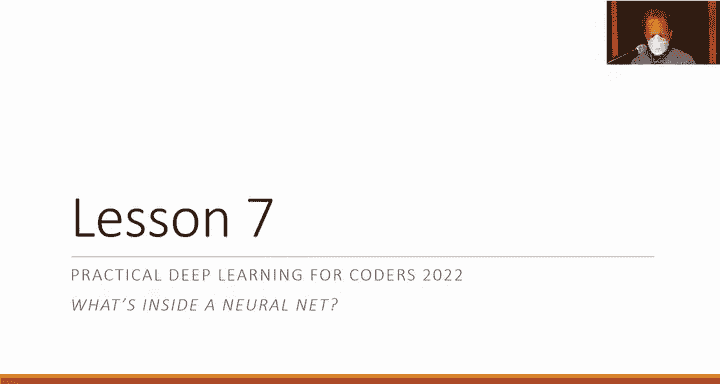

So I'm going to do this through the lens of。TheThe race padty competition we've been talking about。

And。We got to a point。Where。U。

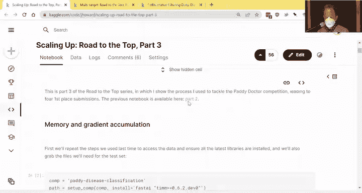

Take a look。

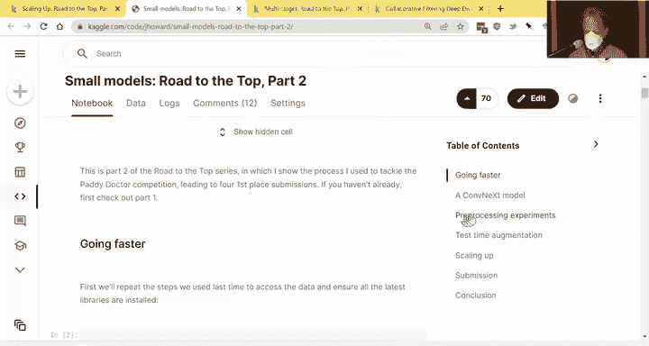

So we created a conf next bottle。呃 we。Tried a few different types of basic preprocessing。

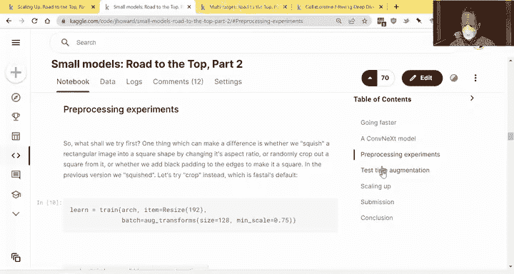

We added test time augmentation。And then we scaled it up to。😔，Large images and rectangular。Images。

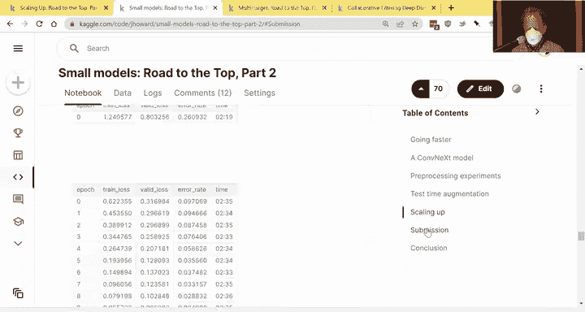

And that。Got us。And to the top 25% of the competition。

So that's part two of the so called road to the top series。Which is increasingly。

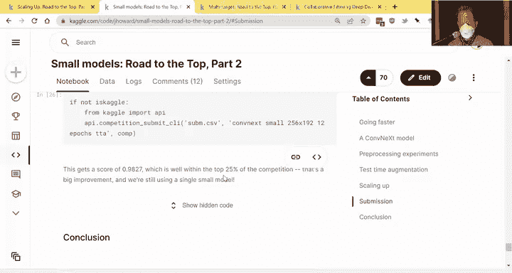

Misnamed。Since we've been presenting these notebooks。

呃。More and more of our students have been passing me on the leaderboard。So。Currently。

 first and second place are both people from this class， Korean and Nick。Go to hell。

 You're in my target。And leave my class immediately。

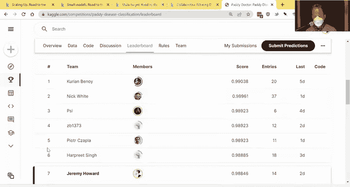

Yeah。And congratulations， good luck to you。

So in part three。😊，I'm going to show you a really interesting trick。

 a very simple trick for scaling up these models further。😊。

What' you'll discover if you've tried to use larger models so you can replace the words more with the word large in those architectures and try to train a larger model。

 A larger model has more parameters。

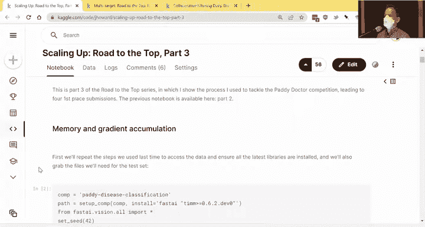

More parameters main thick and find more。Trackly little features。

 and broadly speaking models with more parameters therefore ought to be more accurate。

Problem is that those。Actations， or more specifically。The the gradients that have to be calculated。

 choose that memory on your GPU。😊，And your GPU。Is not as clever as your CPU at kind of sticking stuff it doesn't need right now into virtual memory on the hard drive when it runs out of memory。

 it runs out of memory。And it also doesn't do such a good job as your CPU are kind of shuffling things around to try and find memory。

 it just allocates blocks of memory and it stays allocated until you remove them。😊。

So if you try to scale up your models to bigger models unless you have。Very expensive GPUs。

 you will run out。Of space。And you'll get an error， something like Kuda out of memory error。

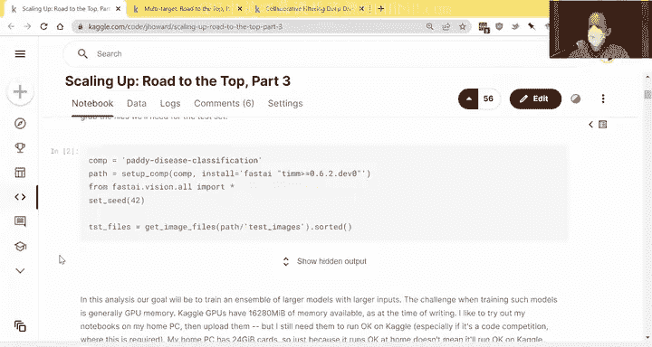

So if that happens， first thing I mention is it's not a bad idea to。

Restar your notebook because it can be a bit tricky to recover from other ways。

 And then I'll show you how you can use as large a model as you like。Almost。Is you know， basically。

 you'll be able to use a X large model。Un kckle。嗯。So， let me explain。Now。

 I want when you run something on Cale。Like， actually on kggle。

You're generally going to be on a 16 gig GPU。And you don't have to run stuff on car。

 You can run stuff on your home computer or paper space or whatever， but。

Sometimes if you want to do kgel competition， sometimes you'll have to run stuff on kggle because a lot of competitions are what they call code competitions。

 which is where the only way to submit is from a notebook that you're running on kgggel。😊。

And then a second reason to run stuff on kggle is。That， you know， your。Your notebooks will appear。

 you know， with the leaderboard score on them。 And so people can see which。

 which notebooks are actually good。 And I kind of like， even in things at art code competitions。

 I love trying to be the person who's number one on the notebook。

Score laidboard Cause that's something which。You know。

 you can't just work it in video and use a thousand GPUs and win a competition through a combination of skill and bru force。

 everybody has the same nine hour timeout to work with。So I think it's a good way of。Keeping the。

 the， you know， things a bit more。对。Now， so my home GPU has 24 gig。😊，So I wanted to find out。

What can I get away with， you know， in 16 gig and the way I get that it， I think。

 a useful thing to discuss because again， it's all about fast iteration。

So I wanted to really quickly find out how much memory will a model use。Um。

So there's a really quick hacky way I can do that， which is to say， okay， for the training set。

 let's not use， so here's the value counts of label， so the number of each disease。

 let's not look at all the diseases。Let's just pick one， the smallest one， right。

 And let's make that our training set。 Our training set is the bacterial panicnacle blight images。

 and now I can train a model with just 337 images。😊。

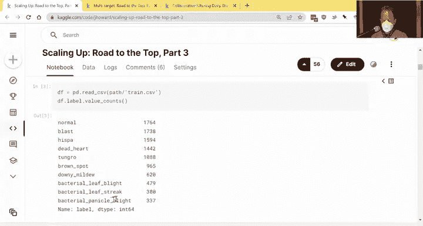

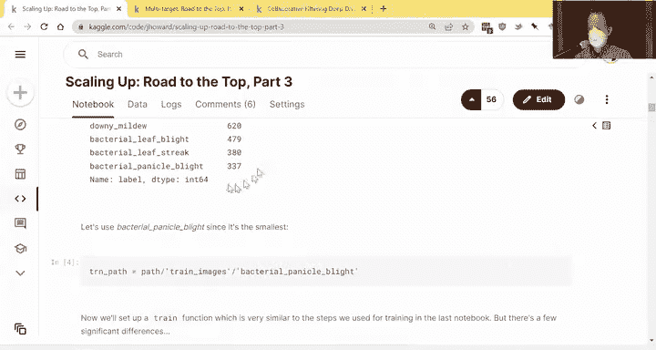

Without changing anything else。Not that I care about that model。

 but then I can see how much memory it used。 It's important to realize that you know each image you pasture with the same size。

 each batch size is the same size。 So trading for longer won't use more memory。 So that'll tell us。

How much memory we gonna to need。嗯。so。What I then did。Where I then tried training。Different models。

To see how much memory they， they used up。 Now， what happens if we train a model。

 So obviously Comp small doesn't use too much memory。

 So here's something that reports the amount of GPU memory just by basically printing out。😊。

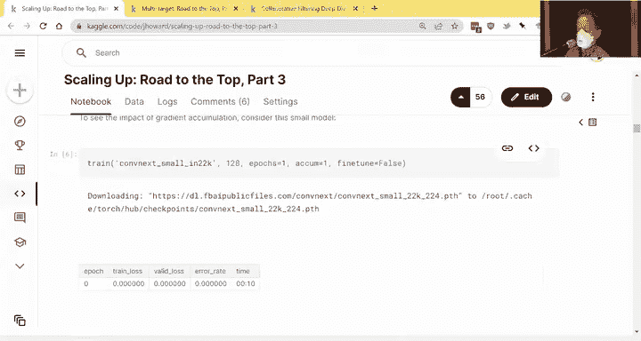

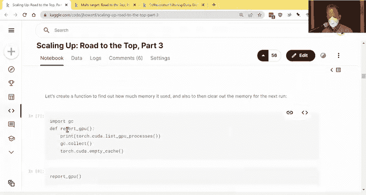

Coud as GPU processes。And you can see con next small took up for gig。And also。

 this might be interesting to you if you then call Python's garbage collection Gc dot collect and then call Pytorrchs empty cash。

 that should basically get your GPU back to a。A clean state of not using any more memory than it needs to when you can start trading the next bottle without without restarting the kernel。

So what would happen if we tried to train this little model and it crashed with a couper out of memory error。

 what do we do？

We can use a cool little trick。Cllold。Gradian accumulation。What's gradient into accumulation？

So what's gradient accumulation， Well， I added this。Perrameter to my train method here。

 Right So my train method。Creates by data loaders。Creates my learner。

And then depending on whether I'm fine shing or not， either fits or fine shs it。嗯。

But there's one other thing it does。 It does this gradient in accumulation thing。 What's that about。

 Well， the key step is here。I set my batch size， so that's the number of images that I pass through to the GPU all at once。

To 64， which is my default， divided by slashlash means integer divide in Po divided by this number。😊。

So， if I pass two。It's going to use a batch size of 32。 if I pass four， it'll use a batch size of 16。

😊，Now， that obviously should let me cure any memory problems。Is a smaller batch size。

 but the problem is that now。The dynamics of my training are different， right。

 The smaller your batch size， the more volatility there is from batch to batch。

 So now your learning rates are all messed up。 You don't want to be messing around with trying to。

 you know， find a different set of kind of optimal parameters for every batch size of every architecture。

嗯。So what we want to do is find a way。To run just， let's say accumulates 2， accumulate equals 2。

 Let's say we just want to run 6，32 images at a time through。How do we make it behave as if？

It was 64 images。Well， the solution to that problem is to consider。Our training loop。

 This is the basically the training loop we used from a couple of lessons ago。

 The one we created manually， we go through each。X， Y pair in the data letter。

We calculate the loss using some coefficients based on that X Y pair。

And then we call backward on that loss to calculate the gradients。

And then we subtract from the coefficients。The gradients times the learning rate。

And then we zero out the gradient。 So I've， I've skipped a bit of stuff like the。um。

With torch dot no grad thing。 Actually， no， I don't need that because I've got dot data。

 No that's it。 That should all work fine。 I skipped out printing the loss。 That's about it。嗯。so。

Here is a variation of that loop。😊，Where I do not always subtract。

The gradient times the learning mate。Instead， I go through each Xway power in the data loader。

I calculate the loss。I look at。How many images are in this batch， So initially。

 I start at 0 and this count is going to be 32。 Sa if I've divided the batch size by 2。

And then if count is greater than 64。I do my gradient my coefficients update。 Well， it's not。

So I skip back to here。And I do this again。And if you remember。

 there was this interesting subtlety in pieytorch， which which as if you call backward。Again。

Without zeroing out the gradients。That， it adds。This set of gradients to the old gradients。

So by doing these two half size batches without zeroing out the gradients between them。

 it's adding them up。 So I'm going to end up with the total gradient of a 64 image batch size。

That passing only 32 at a time。If I used accumulate equals four。😊。

It would go through this four times， adding them up before it。

Subtracted out the coefficient do grad times load rate and zeroed it out。If I put in a Q equals 64。

 it would go through into a single image one at a time。😊，And after 64 passes through。

 eventually count would be greater than 64。And we'll do the update。 So that's gradient accumulation。

 right， It's， it's a very。Simple idea， right， which is that you don't have to。Actually。

 update your weights。Every。Loop through for every mini batch。 you can just do it from time to time。嗯。

But it has quite significant implications， which I find。Most people seem not to realize。

 which is if you look on like Twitter or Reddit or whatever。People can say， oh。

 I need to buy a bigger GPU to train bigger models。But they don't。

They could just use gradient accumulation。And so。Given the huge price differential between， say。

 a RTX 3080 and an RTX 3090 TI。Huge price， differential。The performance is not that different。

 the big difference is the memory。Say what？Just put in a bit smaller batch size and do great into。

 So there's actually。Not that much reason to buy giant GPus。John。呃。

Are the results with gradientdian accumulation numerically identical。

They're numerically identical for this particular architecture。😊。

There is something called batch normalization， which we will look at in part two of the course。

Which keeps track of the moving average of。Stard deviations and averages。And。

Does it in a mathematically slightly incorrect way as a result of which if you've got batch normalization。

 then it basically will introduce more volatility。Which is not necessarily a bad thing。

 but because it's not mathematically identical， you won't necessarily get the same results。

Conv next doesn't use batch normalization。So it is the same。And， in fact， a lot of。

The models people want to use really big versions of， which is NLP ones。

 transformformers tend not to use batch normalization。

 but instead they use something called layer normalization。Which， yeah， doesn't have the same issue。

 I think that's probably fair to say。 I haven't thought about it that deeply。 In practice， I found。

Adding gradient into accumulation for con。Has not caused any issues。For me。

 I don't have to change any parameters when I do it。Any other questions on the forum， John？

Toorri asking， shouldn't it be count greater than equal to 64 if BS equals 64 I haven't？No。

 I don't think so， oh， yeah so we start at 0 that it's gonna be 32 that it's gonna be so。 Yeah， yeah。

 probably Yeah， probably You can probably tell I didn't actually run this code， I just't。

Maav is asking， does this mean that LR find is based on the batch size set during the data block？🤢。

Yeah， so ElI Find just uses your data loaders。Btch size。Edward is asking。

Why do we need gradient accumulation rather than just using a smaller batch size and follows up with how would we pick a good batch size？

 Well， just if you use a smaller batch size。Here's the thing， right，Different architectures。

Have different。Amounts of memory， you know， which they take up。

And so you'll end up with different batch sizes for different architectures。

Which is not necessarily a bad thing， but each of them is going to then need a different learning rate。

And maybe even different weight decay or whatever。 like the kind of the settings that's working really well for batch size 64 won't necessarily work really well for batch size 32。

 And， you know， you want to be able to experiment as easily and quickly as possible。嗯。

I think the second part of your question was how do you pick an optimal batch size honestly？😊。

The standard approach is to pick the largest one you can。Just because it's faster。That way。

 you're getting more parallel processing going on。嗯。Although， to be honest， I。

Quite often use batch sizes that are quite a bit smaller than I need because quite often it doesn't make that much difference。

But yeah， the rule of thumb would be， you know， pick a batch size that。

Fits in your GPU and for performance reasons， I think it's generally a good idea to have it B a multiple of eight。

Everybody seems to always use powers of two。 I don't know。 Like， I don't think it actually matters。

And look， there's one other just a clarification or a check if the learning rate should be scaled according to the batch size。

 so yeah， so generally speaking， the rule of thumb is that if you divide the batch size by two。

 you divide the learning rate by two， but unfortunately it's not quite perfect。

Did you have a question， Nick， if you do， you can。Yeah。No， that's us all caught up， thanks， Jeremy。

For questions。 Thank you。

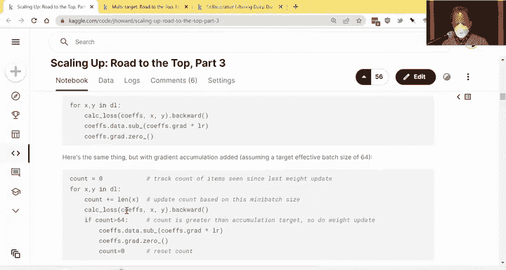

um。So creating an accumulation in。Fast A eye is very straightforward。You just。

Divide the batch size by however much you would have divided it by。 and then add。

 you add something called a callback。And a callback is something which changes the way the model trains。

This cort is called gradient accumulation。And you pass in the effective batch size you want。

And then you say when you create the learner， you say these are the callbacks they want。

And so it's going to pass in gradient accumulation callback。

 so it's going to only update the weights once it's got。64 images。So if we pass into chemicals 1。

 it won't do any gradient accumulation。😊。

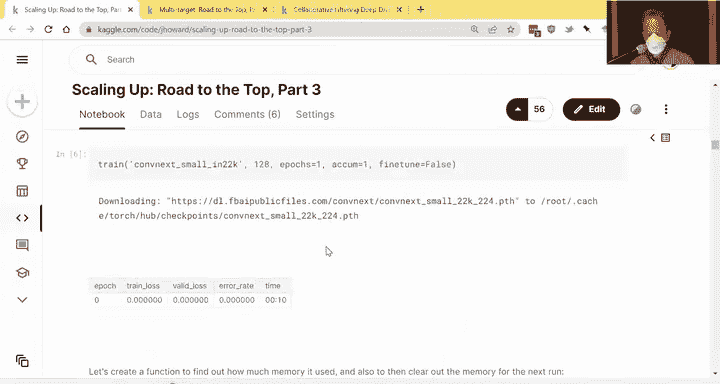

And that uses。

Forge。If we use a cub equals tu， about3 gig。

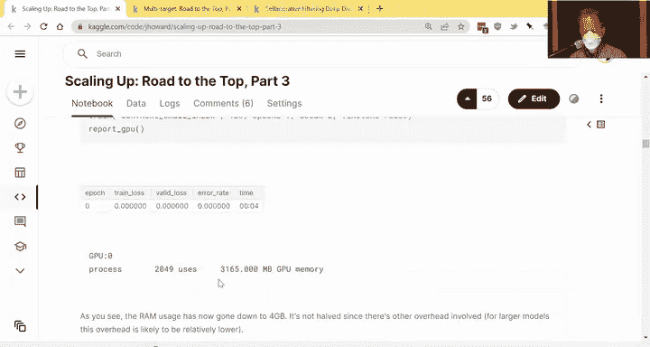

Chemicals  for about2 and a half gig。 And generally， the bigger the model。

 the closer you'll get to a kind of a linear scaling because models have a kind of a。

A bit of overhead that they have anyway。😊。

um。So what I then did was I just went through all the different models I wanted to try。

 so I wanted to try conf next large add 3，20 by 240。😊。

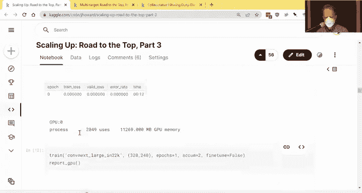

V I T large， Sw V2 large， swim large， and on each of these I just tried running it with the cus one and actually every single time for all of these。

 I got them out of memory error and then I tried each of them independently with the cuicles 2。

 and so it turns out that all of these worked with the chemicalicles2。

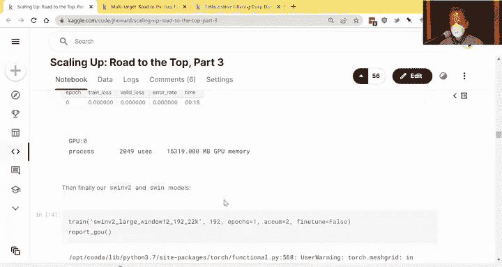

And it only taught you 12 seconds each time。 so that was a very quick thing for me to then know okay。

 I now know how to train all of these models on a 16 gigabyte card。😊。

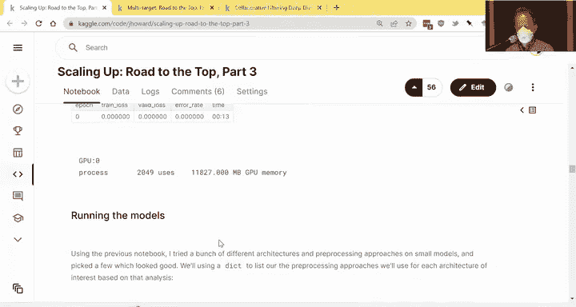

So I can check here they're all in less than 16 gig。嗯。So then I just created a little dictionary。

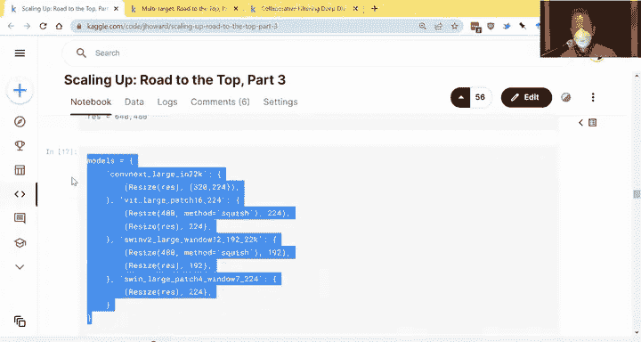

Of all the architectures I wanted。And for each architecture。

 all of the re size methods I wanted and final sizes I wanted。

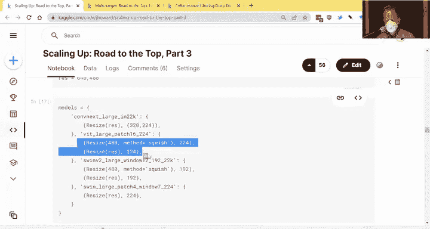

Now， these models， VIT， Sw V2 and SwN are all transformers models。Which means that。呃。Well。

 most transformers models， nearly all of them have a fixed size。 This one's 224。 This one's 1，92。

 This one's 2，24。 So I have to make sure that my final sizes a square of the size required。

 Otherwise， I get an error there there are。There is a way of working around this。

 but I haven't experimented with enough to know when it works well and when it doesn't。

 so we'll probably come back to that in part two。

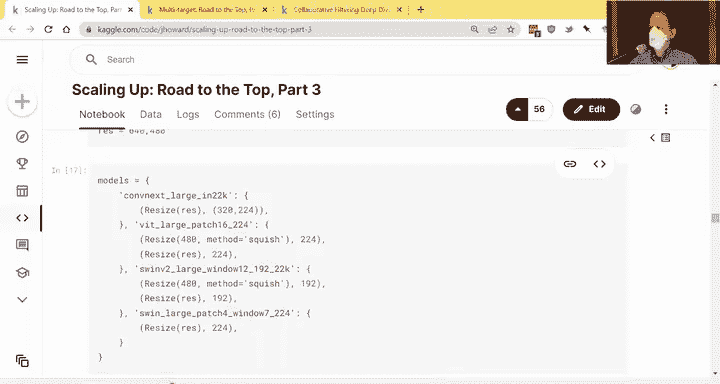

So for now， were's going to use the size that they ask us to use。

So with this dictionary of architectures and for each architecture， kind of preprocessing details。

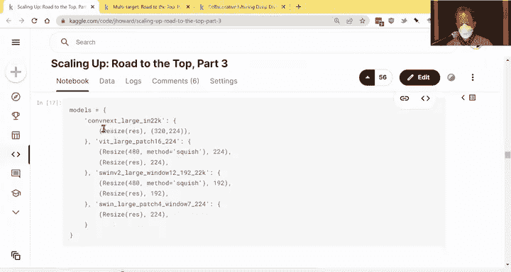

Where we switched the trading path back to using all of our images。

And then we can loop through each architecture。And loop through each item transforms and sizes。

And train。The model。And then。The training script， if you'll fine shooting。

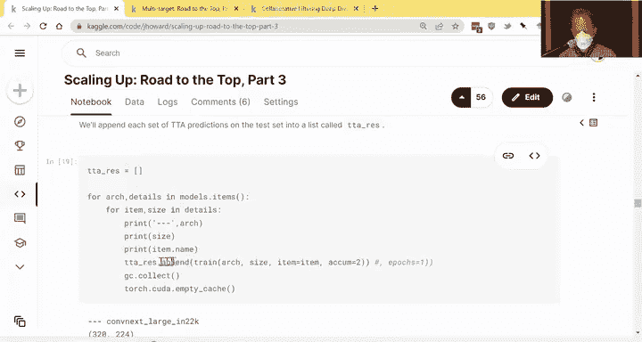

Returns the T TA。Predictions。

So I append all those TTA predictions for each model， for each type into a list。

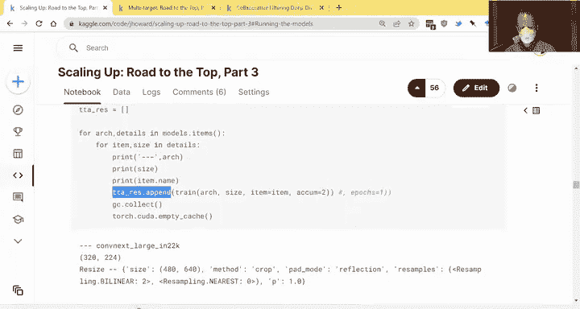

And after each one， it's good idea to do this garbage collection and empty cash that。

 because otherwise I find what happens is your。GPU memory kind of。I don't know。

 I think it got frac ban tu or something。 And after a while。

 it runs out of memory even when you thought it wouldn't。

 So this way you can really do as much as you like without running out of memory。😊。

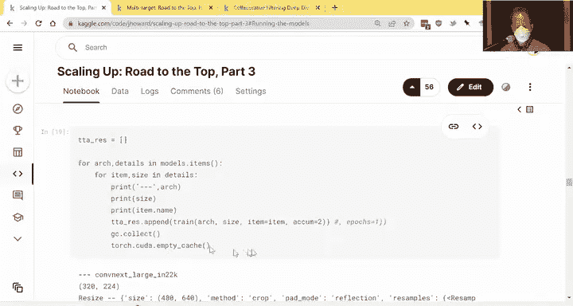

So they will train。

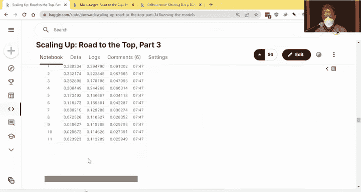

Train， train， train。And one key thing to note here。😊。

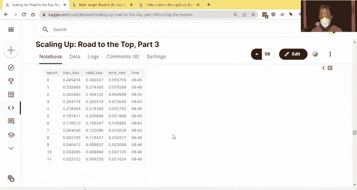

I it in my train script。My data loaders does not have the seed equals。Parameter。

 so I'm using a different trading set every time。So that means that for。Each of these different runs。

 they're using also different validation sets， so they're not directly comparable。😊。

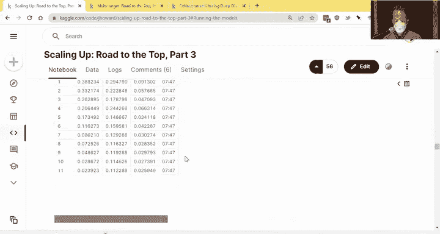

But you can kind of see they're all doing pretty well， 2。1%， 2。3%。

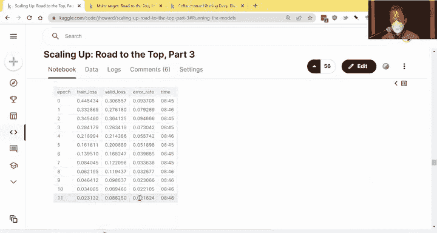

1。7% and so forth。

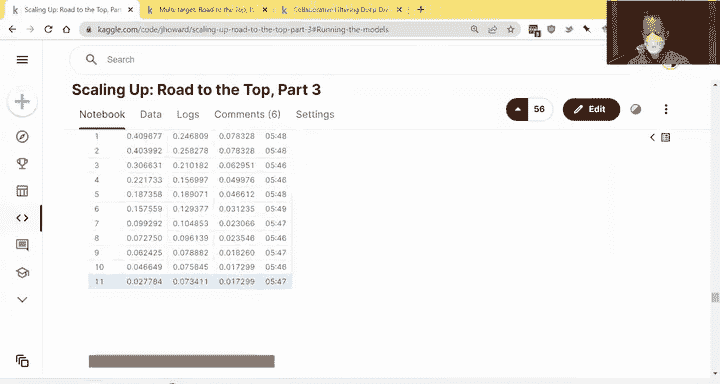

So why am I using different training and validation sets for each of these？

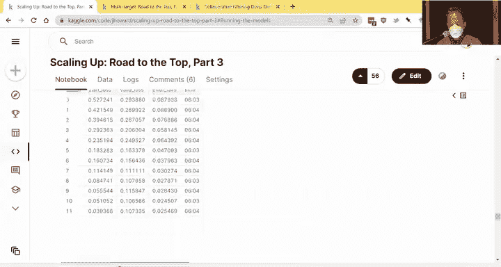

That's because I want to ensemble them。So I'm going to use。Bgging。Which is， I am going to。

Take the average of their predictions。 Now， I mean， really。

 when we talked about random forest bagging。We were taking the average of like intentionally weak models。

 These are not intentionally weak models。 They're meant to be good models， but they're all different。

 They're using different architectures and different prepro approaches。 And so in general。

We would hope that these different approaches， some might work well for some images。

 and some might well work well for other images。 And so when we average them out。Hopefully。

 we've get a good blend of kind of different ideas， which is kind of what you want in bagging。

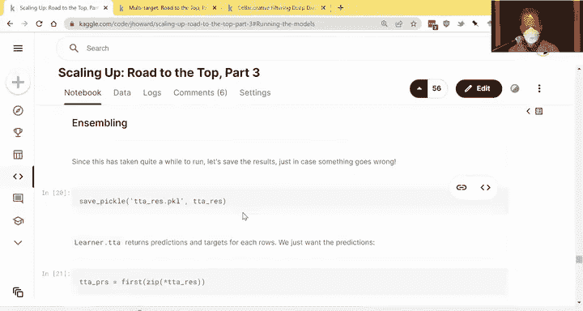

So。We can stack up that list different of all the different probabilities and take their mean。

And so that's going to give us 3469 predictions。 That's our That's our test set size。

 and each one has 10。Probabilities， the probability of each disease。

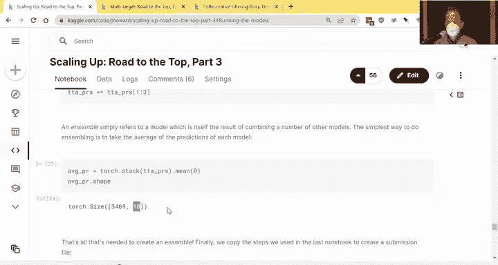

And so then we can use AG Max to find which probability index is the highest。

So that' sort of going to give us our list of indexes。

So this is basically the same steps as we used to for to create our CSSV submission file。😊。

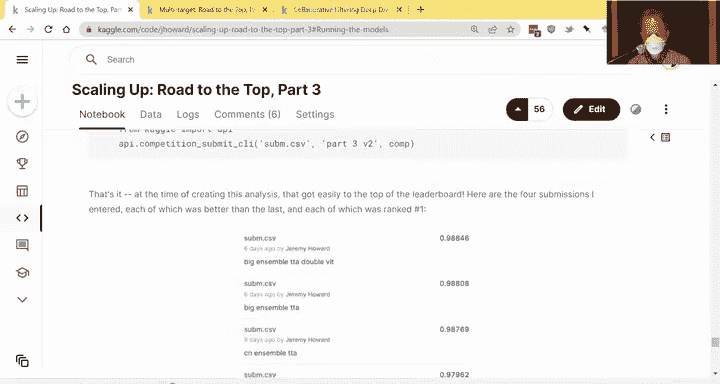

嗯。So at the time of creating this analysis that got me to the top of the leaderboard。And， in fact。

These are my four submissions。And it can say H1 got better。

Now you're not always going to get this nice monotonic improvement， right。

 but you want to be trained to submit something every day。To kind of like， try out something。

New right， and the more you practice， the more you'll get a good intuition of what's going to help。

 right so。Parttly， I'm showing you this to say， it's not like。

Purely random as to whether things work or don't。 Once you've been doing this for a while， you know。

 you will generally be improving things。Most of the time。

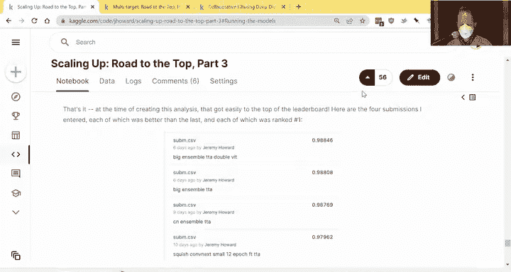

So。😊，As you can see from the descriptions， my first submission was our conf next small for 12 epochs with TTA。

And then a ensemble of conf next， so it's basically this exact same thing。

 but just retraining a few with different training subsets。And then this is the same thing again。

 this is the thing we just saw， basically。😊，The ensemble of large bottles with TTA。

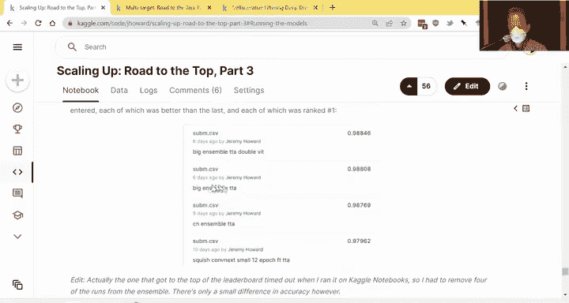

And then the last one was something I skipped over， which was a。

The VIT models were the best in my testing， so I basically weighted them as double in the ensemble。

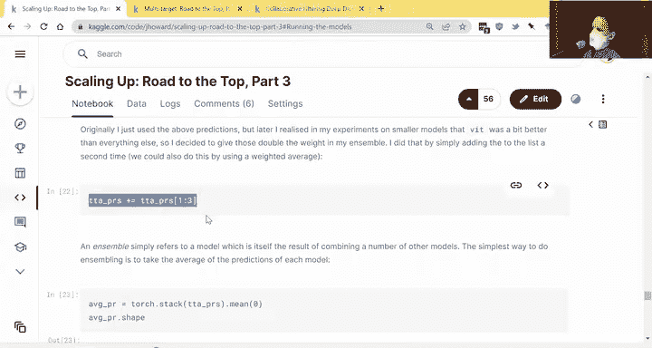

A'm pretty unscientific。 but again， it gave it another boost。

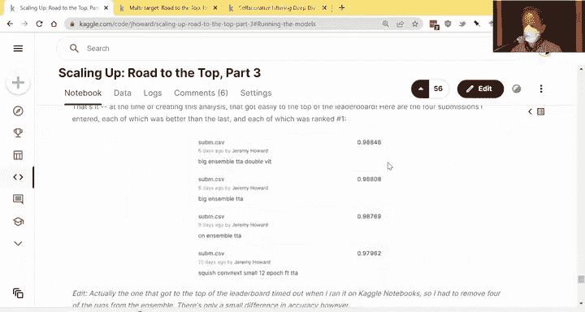

And so that was。That was it。All right， John。Yes， thanks， Jeremy。 So in no particular order。

 Cur as asking， would trying out cross validation with k folds with the same architecture makes sense。

 Okay， so ensembling a model。 Yeah， so a popular thing is to do。K fold cross validation。

 So Kfold cross validation is something very， very similar to what I've done here。

 So what I've done here is I've trained a bunch of models。

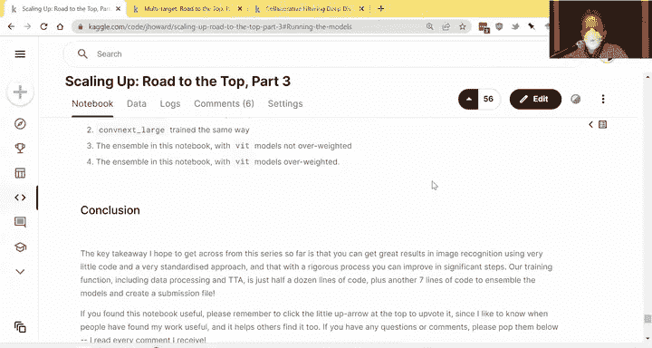

With。Different trading sets。 Each one is a different random 80% of the data。

F fold cross validation does something as similar， but what it says is rather than picking。Like say。

 five。Samples out with different random subsets。In fact， instead， thirst like。

Do all except for the first 20% of the data， and then all but the second 20%。

 and then all but the third third and so forth。 And so you end up with five subsets。

Each of which have non overlapping validation sets。And then you'll assemble those。嗯。You know， in。

 in theory， maybe that could be slightly better because。You're kind of guaranteed that every row is。

Appears four times， you know， effectively。It also has a benefit that you could average those five validation sets because there's no kind of overlap between them to get a cross validation。

Personally， I generally don't bother。 And the reason I don't is because。This way。

 I can add and remove。Mddles very easily。I don't， you know， I， I can just。You know。

 add another architecture and whatever to my ensemble without trying to find a different overlapping。

 non overlapping subset。So。嗯。Yeah， cross validation is therefore something that。

I use probably less than most people or almost， or almost never。Awesome， thank you。

Are there any yet just come back to gradientian accumulation。

 any other kind of drawbacks or potential gotchas with gradientian accumulation， no， not really。嗯。

Yeah， like amazingly。It doesn't even really slow things down much， you know。

 going from a batch size of 64 to a batch size of 32。By definition。

 you had to do it'cause your GPUs full。 So you're obviously giving a lot of data。

So it's probably going to be using its processing speed pretty effectively。 so yeah。No， it's just。

 it's just a good technique that。Where should all be buying cheaper graphics cards with less memory in them than using。

You know， have。Like I don't know the prices。 I suspect it' like you could probably buy like 2。

3080s to the price of 1，30900 or something。That would be a very good deal。

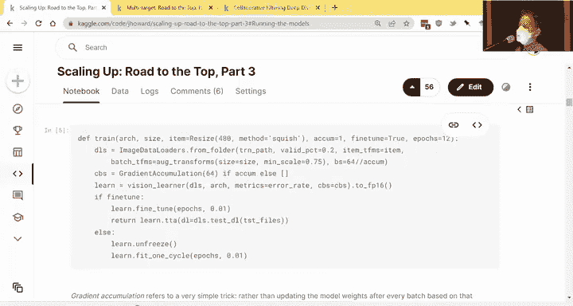

Yes， clearly you're not on the NviIDdia payroll。So look， this is a good segue。

 then we did have a question about sort of GPU recommendations and there's been a bit of chat on that as well so any any。

You know， commentary， any additional commentary around GPU recommendations。No， not really。 I mean。

 obviously， at the moment。And Vtty is the only game in town。 you know， if you buy。

 if you train to use a。You know， Apple M1 or M2 or an AMD card。

 you're basically in for a world of pain in terms of compatibility and stuff and。Unoptimized。

Libraries and whatever。The NviDdia consumer cards。So the ones that start with RTX are。Much cheaper。嗯。

But are just as good。As the expensive。Enterprise cards。

 So you might be wondering why anybody would buy the expensive enterprise cards。

 And the reason is that there's a licensing issue that NviDdia will not allow you to use an RTX consumer card in a data centre。

Which is also why cloud computing is more expensive than。

They kind of ought to be because everybody selling cloud computing GPUus is selling these cards that are like。

 I can't remember。 I think they're like three times more expensive for kind of the same features。

 So yeah， if you do get serious about。Deep learning to the point that you're prepared to invest。

You know， a few days in。Administering a box。 and。You know， I guess you know。

 prices hopefully will start to come down， but currently or00 or$2000 and buying a GPU then。You know。

 that'll probably。Pay you back pretty quickly。Great， thank you。 Let's see some another ones come in。

If you have a it back on models， not hardware， If you have a well functioning， but large model。

 can it make sense to train a smaller model to produce the same final activations as the larger model？

 Oh， yeah， absolutelysly。 I'm not sure we'll get into that this time around， but。U。Yeah。

 we'll cover that in part2， I think。 But yeah， basically。

 that there's a of teacher student models and model distillation， which broadly speaking， there。

 there are ways to。Make inference faster by training small models， though。

Work the same way as large models。Great， thank you。All come up。 Alright， so。

That is the actual real end of road to the top because beyond that。

 we don't actually cover how to get closer to the top。

 you'd have to ask Curan to share his techniques to find out that or Nick to get the second place in the top。

Part 4 is actually。Something that I think is very useful to know about for learning and it's got to teach us a whole lot。

About how。

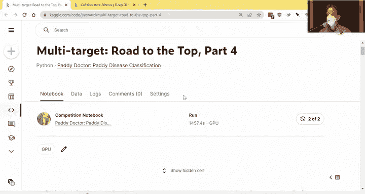

The last。Laah over neural networks。And specifically， what we're going to try to do。😊。

As we're going to try to build a model that doesn't just predict。The is。

But also predicts the type of rice。

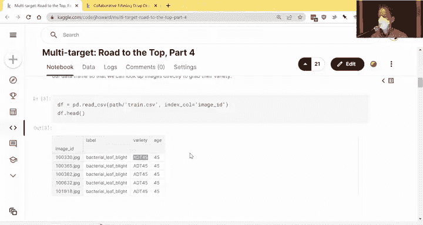

So how would you do that？So here's the data loader we've got to try to build。

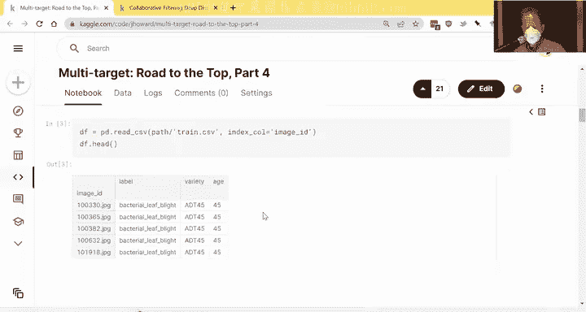

It's going to be something that for each image it tells us the disease and the type of race。

I say disease， sometimes normal， I guess some of them are not diseased。

So to build a model that can predict two things， the first thing is we're going to need data loaders that have two dependent variables。

And that is shockingly easy to do。In fast A eyee。Thanks to the data block so we've seen the data block before。

😊，We haven't been using it for the paddy competition so far because we haven't needed it。

 We could just use image data load dot from folder。So that's like the highest level API。

 the simplest API， if we go down a level deeper into the data block。We have a lot more flexibility。

So。If you've been following the walkthroughs， you'll know that as I built this。

 the first thing I actually did was to simply replicate the previous notebook。

 but replace the image data loader dot from folders with a data block to try to do first of all。

 exactly the same thing。And then I added the second dependent variable。So。If we look at the previous。

U。Image data loader from folders figure。😊，Here it is。Or you're passing in some item transforms。

And some batch transforms。And we had something saying， what percentage should be the validation set？

嗯。So in a data block， if you remember。We have to pass in a B argument saying。

 what kind of data is the independent variable and what is the dependent variable？

So to replicate what we had before， we would just pass an image block comm a category block because we've got an image as our independent variable and a category。

 one type of rice is the dependent variable。😊，So the new thing I'm going to show you here is that you don't have to only put in two things you can put in as many as you like。

😊，So if you put in three things， we're going to generate one image and two categories。Now fast AI。

 if you're saying I want three things， fast AI doesn't know which of those is the independent variable and which is the dependent variable。

So the next thing you have to tell it is how many inputs are there， number of inputs。

 And so here I've said there's one input。 So that means this is the input。

 and therefore by definition， two categories will be the output because remember we're trying to predict two things。

 the type of race and the disease。Okay， this is the same as what we've seen before to find out to get our list of items we'll call get image files。

😊，Now， here's something we haven't seen before。 Gett y is our labeling function。 Normally。

 we pass to gety a single thing， such as the parent label function。

 which looks at the name of the parent directory。Which remember is how these images structured。

And that would tell us the label。But get Y can also take an array。And in this case。

 we want two different labels。1 is。ItThe name of the parent directory， because that's the disease。

 The second is the variety。

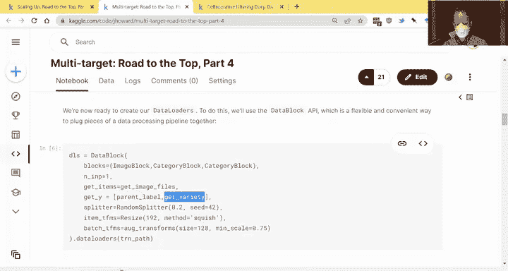

So what's got variety？G variety is a function。

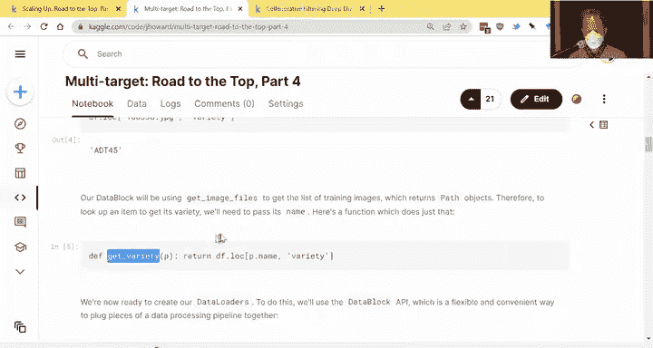

So let me explain how this function works。So we can create a data frame。😊，Containing our trainings。

 our training data that came from Kagggel。 So for each image。

 it tells us the disease and the variety。

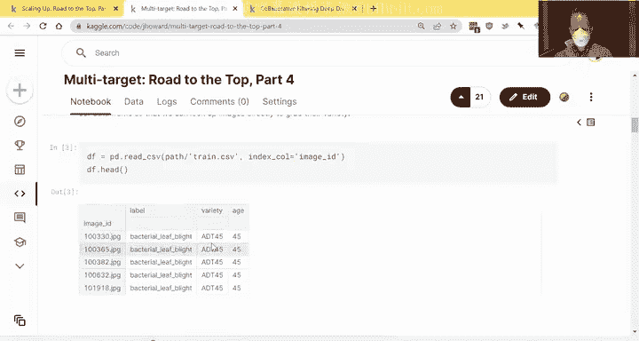

And what I did is something I haven't shown before in pandas。

 you can set one in column to be the index。And when you do that， in this case， image I。

 it makes this series， this， the data frame kind of like a dictionary。 I can index into it by saying。

 tell me the row for this image。

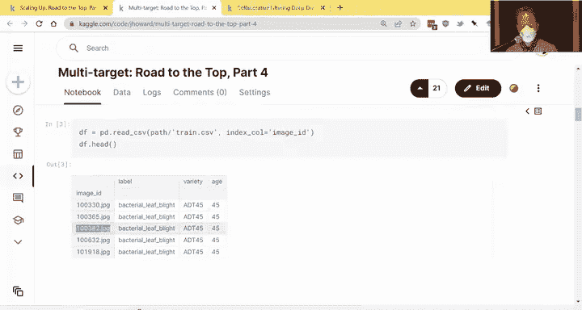

And to do that， you use the lock attribute， the location。So we want in the data frame。

The location of。This image。And then you can also say optionally what column you want。

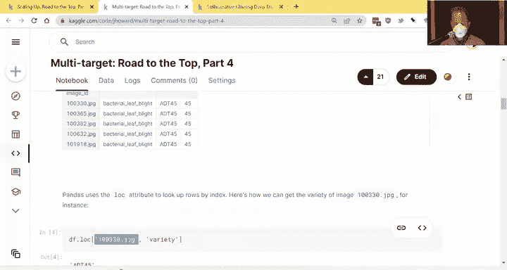

This column。And so。

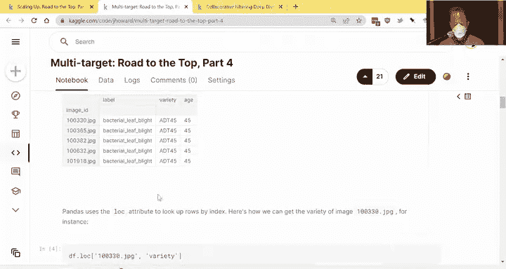

Here's this image and here's this column。And as you can see， it returns that thing。

So hopefully now you can see it's pretty easy for us to create a function that takes。

A row， sorry， a path。And returns the location in the data frame。Of the name of that file。😮。

Because remember， these are the names of files。For the variety column。

So that's our second getway。Okay， and then we've seen this before。

 randomly split the data into the 20% and so 80%。And so we could just wish them all to 19 two just for this example。

😊。

And then use data augmentation to get us down to 128 square images， just for this example。

嗯。And so that's what we get when we say show batchch。We get what we just discussed。So。Now。

We need a model。But that predicts two things。How do we create a model that predicts two things？Well。

 the key thing to realize is。We never actually had a model that predicts two things。

We had a model that predicts 10 things before。The 10 things we predicted is the probability of each disease。

So we don't actually now want a model that predicts two things。

 we want a model that predicts 20 things。The probability of each of the 10 diseases and the probability of each of the 10 varieties。

Song。How could we do that？Well， let's， first of all。Try to just create。

The same disease bottle we had before with our new data letter。

So this is going to be reasonably straightforward。 the key thing to know。😊。

Is that since we told fast AI that there's one input。 and therefore， by definition。

 there's two outputs。It's going to pass to our metrics。And to our loss functions。

Three things instead of two。The predictions from the model。And the disease。And the variety。

So if we' got it， so we can't just use error rate as our metric anymore because error rate takes two things。

 Instead， we have to create a function that takes three things。And return error rate。

Are the two things we want， which is the predictions from the model。And the disease。Okay。

 so as predictions in the model， this is the target。

So that's actually all we need to do to define a metric that's got to work。With our new data set。

 with our new data loader。 this is not going to actually tell us anything about variety。 First。

 we is going to try to replicate something that can do just disease。So when we create our learner。😊。

Will pass in this new disease error function。Okay， so we're halfway there。😊。

The other thing we're going to need is to change our loss function。Now。

 we never actually talked about what loss function to use。And that's because。

Vision learner guessed what lost function to use。Vision learner saw that our dependent variable is a single category。

 and it knows the best loss function that's probably going to be the case for things with a single category。

 And it knows how big the category is。 So it just didn't bother us at all。 Just said， O。

 I'll figure it out for you。So the only time waveve。

Provided our own loss function is when we were kind of doing linear models and neural net from scratch。

 And we did， I think， mean squared error。 We might also have done mean absolute error。

Neither of those work。😊，When the dependent variable is a category。

Yeah how would you use means square error or mean absolute error to say how close were these 10 probability predictions to this one correct answer。

So in this case， we have to use a different loss function。

 we have to use something called cross entropy loss。And this is actually the loss function that。

Fastly， I picked for us before without us knowing。 But now that we are having to pick it out manually。

 I'm going to explain to you exactly what cross entropy loss。Does， okay。And， you know， these details。

Are very important。 indeed， Like remember， I said at the start of this class。

 the stuff that happens in the middle of the model。

 you're not going to have to care about much in your life， if ever。

 But the stuff that happens in the first layer。And the last layer。

 including the loss function that sits between the last layer and the loss。

 you're going to have to care about a lot。All， this stuff comes up all the time。

So you definitely want to know about cross entrobus。And so I'm going to explain it。

Using a spreadsheet。And this spreadsheets in the Q repo。😊。

And so let's say you are predicting something like a kind of a mini imaged net thing where you're trying to predict whether something an image is a cat。

 a dog， a plane， a fish or a building。So you set up。Some model， whatever it is。

 a comesv next model or a。Just a big bunch of linear layers connected up or whatever。And initially。

 you've got some random whites。And it spits out at the end。5 predictions。 right。

 So remember to predict something with five categories， your model will spit out five probabilities。

 Now， it doesn't initially spit out probabilities。 There's nothing making them probabilities。

 It just spits out five numbers。Could be negative， could be positive。Okay。

 so here's the output of the model。So what we want to do。😮，As we want to convert these。

Andto probabilities。And so we do that in two steps。😊，The first thing we do。As we go。

X that's8 to the power of。 we go8 to the power of each of those things。Thanks so。

And so here's the mathematical formula we're using。

 this is called the soft Max we're working through。😊，We're going to go through。😊，H of the categories。

So these are our five categories， so here K is5， we've got to go through each of our categories。😊。

And we've got to go eat to the power of。The output， so Z J is the output for the J category。So。

 here's that。And then we're going to sum them all together。Here it is。 I'm up together， okay。

So this is the denominator。And then， the numerator is just。E of the power of。The thing we care about。

 So this row。 So the numerator is。Aid of the pair of cat。On this row。

Aid of the pair of dog on this row。And so forth。Now， if you think about it。

Sensor denominator adds up all the E of the pair ofs。And when we do each one divided by the sum。

That means the sum of these were equal one。😊，By definition。Right。And so， now， we have。

Things that can be treated as probabilities。 They are all numbers between。Zero and one。

Numbers that were bigger in the output will be bigger here。But there's something else interesting。

 which is because we did eight of the power of。It means that the bigger numbers will be like pushed up to numbers closer to one。

 like we're saying like， oh， really try to pick one thing。As having most of the probability。

 because we are trying to predict。You know， one thing we're trying to predict which one is it。

And so this is called。😊，Softbacks。So sometimes you'll see people complaining about the fact that their model。

😊，Which they said， let's say， is it a teddy bear or a grizzly bear or a black bear？

And they faded a picture of the cat。And they say， oh， the model's wrong。

 because it predicted grizzly bear， but it's not a grizzly bear。 As you can see。

 there's no way for this to predict anything other than the categories we're giving it。

 We're forcing it。To that now， we don't。If you want that， like， there's something else you could do。

 which is。You could actually have them not add up to one。Right。

 you could instead have something which simply says what's the probability It's a cat。

 What's probability it's a dog was probably playing totally separately。

 and they could add up to less than one。 And in that situation， you can， you know， or more than one。

 which case you could have like more than one thing being true or zero things being true。

But in this particular case， where we want to predict one and one thing only， we use softmax。

The first part。Of the cross entropy formula。The first part of the cross entry formula。In fact。

 let's look it up。And cross entropylo。The first part of what cross entropy loss in Ptorrch does。

Is to calculate。The soft specs。It's actually the log of the softm。

 but don't worry about that too much。 It's just a slightly faster to。Do the look。Okay。

 so now for each one of our five things， we've got a probability。

The next step is the actual cross entropy calculation， which is we take out five things。

We've got our five probabilities。And then we've got our as。Now， the truth is the actual， you know。

 the five things would have indices， right，0，1，2，3， or4。

 or the actual turned out to be the number one。But what we tend to do is we think of it as being one hot encoded。

 which is we put a one。

Next to the thing for which it's true and a 0 everywhere else。

And so now we can compare these five numbers。To these five numbers。And Ray would expect to have。

A smaller loss。If the soft max was high， where the actual is high。And so here's how we calculate。

This is the formula。The cross enchopilos。We sum up。They switched to M this time for some reason。

 but its the same thing。 We sum up across the five categories， M iss 5。And for each one。

 we multiply the actual target value。So that's 0。 So here it is here， the actual target value。

And we multiply that by the log。Of the predicted probability， the log of read。

 the predicted probability。And so， of course， for four of these。😊，That value is 0。

You see here Yj equals 0。By definition， for all but one of them。Cause it's one hot encoded。

So for the one that it's not。We've got our actual times the log。Softm。Okay。And so now， actually。

 you can see why。Pytorrch prefers to use log softftbacks because that it kind of skips over having to do this log at all。

So this equation looks。Slightly frightening。But when you think about it， all it's actually doing。

Is it finding the probability for the one that is one。And taking its log。

It's kind of weird doing it as a sum， but in math， it can be a little bit tricky to kind of say。

 oh look this up in an array， which is basically all it's doing。 but yeah。

 basically at least in this case just for a single result where it's soft Max。

 this is all it's doing it's finding the 。87 where it's 14 and taking the log and then finally negative。

😊，So that is what cross Entropy loss does。嗯。We add that together。For every row。

So here's what it looks like if we add it together over every row。😊，Right so n is the number of rows。

And here's a special case。This is called binary cross entropy。

What happens if we're not predicting which of five things it is， but we're just predicting。

 is it a cat。So in that case， if you look at this approach， you end up with this formula。Which it's。

 it's， this is identical to。This formula， but in for just two cases。Which is you've。

 you either are a cat。Or you're not a cat。Right， and so if you're not a cat， it's 1 minus。

 you are a cat and same with the probability。 you've got the probability you are a cat。

And then not a cat is 1 minus that。So here's this special case of。Binary cross entropy。

 and now our rows represent rows of data。Okay， so each one of these is a different image。

 a different prediction。😊，And so for H1。And just predicting are you a cat？

And this is the actual and so the actual a you're not a cat is just one minus that。

And so then these are the predictions that came out of the model。😊，Again， we can use。Soft Max or its。

 its binary equivalent。And so that will give you a prediction that you're a cat and the prediction that it's not a cat。

Is y minus that。And so， here is。Each of the part y I times log of P， Y I。And here is。

Why did I subtract， That was weird。Oh， because I've got minus of both。 so I just do it this way。

 avoids parentheses。嗯。Yeah， minus the I you're not a cat times the log of the prediction of I you're not a cat。

And then we can add those together。 And so that would be the binary cross entropy loss of this data set of five。

Cat or not cat images。Now， if you've got an e eye。You may have noticed。

但。I am currently looking at the documentation for something called N N cross entropy loss。

But over here， I had something called F do crossenttropy。Basically。

 it turns out that all of the loss functions in Pytorch have two versions。There's a version。

 which is a class。This is a class which you can instantiate， passing in various。

Tweaks you might want。And there's also a version which is just a function。😊。

And so if you don't need any of these tweaks。You can just use the function。The functions。Live in a。

I kind of remember what the submod called， I think it might be like torch。nn。 functional。

 but everybody including the Pitorrch official docs just calls it capital F。

So that's what this capital F refers to。So our loss， if we just care about disease。

 we're going to be past the three things。 we' just got to calculate cross entropy on our input。

V is disease。All right。So that's all fine。 We pass。 So now when we create a vision learner。

 you can't rely on fast A A to know what loss function to use。Because we've got multiple targets。

 so you have to say this is the loss function I want to use。This is the metrics I want to use。

 And the other thing you can't rely on is that fast AI no longer knows how many activations to create。

Because again， it it there's more than one target。 So you have to say the number of outputs to create at the last layer is 10。

 So this is just saying what's the size of the last matrix。And once we've done that， we can train it。

And we get， you know， basically the same kind of result as we always get， because this。

 this model at this point is identical to our previous。Com next small model。

We've just done it in a slightly more roundabout way。so。Finally， before our break。

 I'll show you how to expand this now into a multi target model。

And the trick is actually very simple。And you might have almost got the idea of it when I talked about it earlier。

Our vision learner。Now requires 20 outputs。 We now need that last matrix。

To have to produce 20 activations， not 10，10 of those activations are going to predict the disease。

And10 of the activations are going to predict the variety。So you might be then asking like， well。

 how does the model know what it's meant to be predicting？And the answer is。With the loss function。

 you're going to have to tell it。

So for example。😊，Disease loss。 Remember， it's going to get the input， the disease and the variety。

This is now going to have 20 columns in。So we're just going to decide， All right。

 we're just going to decide the first 10 columns。 We're going to decide are the prediction of what the disease is。

 which of the probability of each disease。 So we can now pass across entropy。The first 10 columns。

And the disease target。So the way you read this， colon means every row。And then， Colin 10。Means。

Every column up to the 10th。So these are the first 10 columns。

 and that's a loss function that just works on predicting disease using the first 1 columns。

For variety。We'll use cross entropy loss with a target of variety。

 and this time we'll use the second 10 columns。So his column 10 onwards。

So then the overall loss function。Is the sum of those two things， disease loss？

Plus， variety of us。And that's actually it。That's all the model needs。To basically。

 it's now going to， if you kind of think through。The manual neural nets we've created。

This loss function will be reduced。When the first 10 columns are doing a good job of predicting the disease probabilities and the second 10 columns are doing a good job of predicting the variety probabilities and therefore the gradients。

We'll point in an appropriate direction that the coefficients will and get better and better at using those columns for those purposes。

It would be nice to see the error rate as well for each of disease and varieties。

 so we can call error rate passing in the first 10 columns in disease。And then variety。

 the second 10 columns in variety。

And we may as well also add to the metrics， the losses。

And so now when we create a learner， we're going to pass in as the loss function。😊，The combined loss。

And as the metrics， our list of all the metrics。

And n out equals 20。

And now， look what happens when we train。As well as telling us the overall train in valid loss。

 it also tells us the disease and variety error and the disease and variety loss。

And you can see our disease error。😊，Is getting down to similar levels it was before。

That's slightly less good。嗯。That it similar。It's not surprising it's slightly less good because we've only given it the same number of epochs and we're now asking it to try to do more stuff。

 which is to learn to recognize what the rice variety looks like and also learns to recognize what the disease looks like。

😊，Here's the counterintuitive thing though。If we train it for longer。

It may well turn out that this model， which is trying to predict two things。

Actually gets better at predicting disease。Than our disease specific model。

Why is that like that sounds weird， right， because it's we're trying to have to do more stuff it's the same size model。

😊，Well the reason is that， quite often。It'll turn out that the kinds of features that help you recognize a variety of race are also useful for recognizings the disease。

You know， maybe there are certain textures， right， or maybe。Some diseases impact different varieties。

 different ways。So it'd be really helpful to know what variety it was。😊，So。

I haven't tried training this for a long time， and I don't know the answer is。

 in this particular case， does a multi target model do better than a single target model at predicting disease。

But I just wanted to let you know sometimes it does。 So， for example， a few years ago。

 there was a capital competition for recognizing the kinds of fish。On a boat。

And I remember we ended up doing a multi target model。Where we tried to predict a second thing。

 I can't even remember what it was。 Maybe it was a type of boat or something。

 And it definitely turned out in that kgel competition that predicting two things helped you predict the type of fish better than predicting just the type of fish。

So there's at least， you know， there's two reasons to look。To learn about multi target models。

 one is that。Sometimes you just want to be able to predict more than one thing。

So this is useful and the second is sometimes this will actually be better at predicting just one thing than a just one thing model。

😊，And， of course， the third reason is it really forced us to。

Dig quite deeply into these loss functions and activations in a way we haven't quite done before。So。

嗯。It's okay。 It's absolutely okay if this is confusing。嗯。The way to make it not confusing。Is， well。

 the first thing I do is like， go back to our earlier models where we did stuff。By hand。

 unlike the Titanic data set and built our own architectures。

Now maybe you could try to build a model that predicts。Two things in the Titanic data set。

 Maybe you could try to predict both sex and。Survival or something like that， or。

Or place and survival。And because that's got to kind of forced you to look at it on very small data sets。

 And then the other thing I'd say is run this notebook。And really experiment at trying to say。

What kind of outputs do you get like actually look at the inputs and look at the outputs and look at the data loaders and so forth。

All right， let's have a six minute break。So Ill see you back here at 10 plus。

Okay， welcome back。Oh， before I continue。I very rudely forgot to mention this。 very nice。

Equation image here is from an article bug。Chris said called things that confused me about cross entropy。

 It's a very good article。 So I recommend you check it out if you want to。Go a bit deeper there。

 There's a link to it inside the spreadsheet。So the next notebook we're going to be looking at is this one called collaborative Fing deep dive。

 And this is going to cover。

Our last of the four major application areas。Collaporative filing。

嗯。And this is actually the first time I'm going to be presenting。A chapter of the book。Lgely。

Without variation。Because this is one where I looked back at the chapter and I was like， oh。

 I can't think of any way to improve this， so I thought I'd just leave it as is。😊，嗯。😊。

But we have put the whole chapter up on Kagggel。So's for the way I'm going to be showing it to you。

And so we're going to be looking at a data set called the movie lens。Data set。

Which is a data set of movie ratings。And we' got to grab a。Smallller version of it，100。

000 record version of it。

And it comes as a CSV file， which we can read in， well it's not really a CSV file。

 it's a TV file this here means a tab。😊，In Python。嗯。These the names of the columns。

So here's what it looks like。😊，It's got a user， a movie， a rating and a timestamp。

 We're not going to use the timestamp at all。So basically three columns we care about。

 this is a user ID。😊，So maybe 196 is Jeremy and maybe 186 is Rachel。And22 is John。 I don't know。

 Maybe this movie is。Return of the Jedi and this one's Cassablanca。 and this one's L A confidential。

 And then this rating says。How did Jeremy feel about return of the Jedi？ He gave it a3。Out of five。

 that's how we can read this。Da的 set。This kind of data is。Very common。

Anytime you've got a user and a product。Or service。And you might not even have ratings。

 maybe just the fact that they bought that product。

 You could have a similar table with zeros and ones。U。So for example。Radick。

 who's in the audience here， is now in videodia doing like basically just this， right。

 recommendation systems。 So recommendation systems， you know， it's， it's a huge industry。

And so what we're learning today is。

You know， a really key foundation of it。嗯。

So these are the first year rows。 This is not a particularly great way to see it。

 I prefer to of cross tabulate it like that like this。 This is the same information。

So for each movie。😊，For each user， here's the rating。So use the 212 never watched movie 49。😊，Now。

 if you're wondering。呃。Why there's so few empty cells here。

 I actually grew with the most watched movies and the most movie watching users。For this particular。

Sample matrix， that's why it's particularly for。So yeah。

 so this is what kind of a collaborative filtering data set looks like when we cross tabulate it。😊。

So how do we fill in？This cat。So maybe user 212 is Nick。And Ruvy 49， what's a movie you haven't seen。

 Nick， and you'd quite like to。 Maybe not sure about it。The new Elvis movie， Bas Luman， Good choice。

 Australian director。Filmed in Queensland。Yeah， okay， so that's movie2 on that's movie number 49。😊。

So is Nick going to like the new Elvis movie？Well。To figure this out。What we could do。😊，Ideally。

 we'd like to know。For each movie。What kind of movie is it Like what are the kind of features of it。

 Is it like actiony， science fictioning， dialogue driven， critical acclaimed， you know， So let's say。

 for example， we were trying to look at。The last Skywalker。

 maybe that was the movie that Nick's wondering about watching。And so， if we like。Had。

Three categories being science fiction， action or kind of classic old movies would say the last Skywalker is very science fiction。

 Let's see this is from like negative one to one。Pretty action。Definitely not an old classic。

 at least。Not yet。And so then maybe we then could say like， okay， well， maybe like。

Next tastes in movies are that he rarely likes science fiction。

Quite likes action movies and doesn't really like old classics。

Right so that we could kind of like match these up。

To see how much we think this user might like this movie。To calculate the match。

 we could just multiply the corresponding。Values use a one times last guidewalker and add them up。

09 times 。98 plus 0。8 times 0。9 plus negative 0。6 times negative 0。9。

 that's going to give us a pretty high number， right？

With a maximum of three。So that would suggest Nick probably would like the last guywalker。

On the other hand。The movie， Casablanca。😊，We would say definitely not very science fiction。

Not really very action。 Definite very old classic。So then we' do exactly the same。

Calculation and get this negative result here， so you probably wouldn't like Hasablanca。

This thing here， when we multiply the corresponding parts of a vector together and add them up is called a dot product。

In mathth。 So this is the dot product。Of the user's preferences and the type of movie。Now。

 the problem is。We weren't given that information。

We know nothing about these users， or about the movies。So what are we going to do？

We want to try to create these factors。😊，Without knowing ahead of time。

What they are。We wouldn't even know what factors to create。

 What are the things it really matters when it does people decide what movies they want to watch。

What we can do is we can create things called latent factors。

 latent factors is this weird idea that we can say。

I don't know what things about movies matter to people。But， there's probably something。

And let's just try like using SJD to find them。And we can do it。And everybody's。

Favourite mathematical optimization software？😊，Microsoft Excel。So， here is。That table。

And what we can do。😊，Let's head over here， actually。Here's that table。

So what we could do is we could say for each of those movies。So Xo for Mo 27。

Let's assume there are five。Latnt factors。 I don't know what they're for。

There is five latent factors。We'll figure them out later。And for now。

 I certainly don't know what the value of those five latent factors for movie 27。

 so we're going to just chuckled little random numbers in them。😊。

And we're going to do the same thing for Mo 49， pick another5 random numbers and the same thing for Mo 57。

😊，Pick another five numbers。 And you might not be surprised to hear we're going to do the same thing for each user。

So for user 14。We're going to pick five random numbers for them。And for user 29。

 we'll pick5 random numbers for them。And so， the idea is。That this number here，0。

19 is saying if it was true that user I D 14。Fes not very strongly about the factor that for Bvy 27。

Has a value of 。71。So therefore， in here。We do the dot product。

The details of why don't matter too much。 But well， actually。

 you can figure this out from what we've said so far。

 If you go back to our definition of matrix product。You might notice that the。

Matrix product of a row with a column is the same thing as a dot product。And so here in Excel。

 I have a row in a column so therefore I say matrix modelplay。😊，That by that。

 that gives us the dot product。So here's the dot product of that。By that， or the matrix modelly。

Given that they row column。The only other site work here。Is that if。四。Actual writing。Is 0。Is empty。

 I'm just going to leave it blank。I'm gonna to set it to zero， actually。So here is。

Everybody's rating， predicted rating of movies。I say predicted， of course。

 these are currently random numbers， so they are terrible predictions。

But when we have some way to predict things。And we start with terrible random predictions。

 We know how to make them better， Don't we， We use to cast a gradient descent。Now to do that。

 we're going to need a loss function。😊，So that's easy enough。We can just calculate。

For sum of x minus y squared divided by the count， that is the mean squared error。

 And if we take the square root， that is the root mean squared error。

 So here is the root mean squared error in Excel。Between these predictions。And these actuals。

And so now that we have a loss function， we can optimize it。😊，Data。Silva。Set objective。This one here。

By changing cells。These ones here， and。These ones here。Solf。Okay and。Initially， our loss is 2。81。

So we hope it's going to go down。😊，And as it solves， not a great choice of background colour。

 but it says 。68。 So this number is going down。 So this is using。Actually， in Excel。

 it's not quite using stochastic gradient descent because Excel doesn't know how to calculate gradients。

 There are actually optimization techniques that don't need gradients。

 They calculate them numerically as they go。 But that's a minor quirk。

One thing you'll notice is it's doing it very， very slowly。😊，um。There's not much data here。

 It's still going。 One reason for that is that。🎼If its because it's not using gradients。

 it's much slower， and the second is X L is much slower than Pytoch。Anyway。

 it's come up with an answer and look at that。It's got to。42。

So it's got a pretty good prediction and so。We can kind of get a sense of this， for example。

Looking at the last three。Movie user 14 likes， dislikes， likes， let's see somebody else like that。

Here's somebody else。 This person likes， dislikes， likes。 So based on our kind of approach。

 we're saying， okay， since they have the same feeling about these three movies。

Maybe they'll feel the same about these three movies。

So this person likes all three of those movies and。This person likes two out of three of them。So。

 you know， you kind of this is the idea， right， as if somebody says to you I like this movie。

 this movie， this movie and you're like， oh， they like those movies， too。

 what other movies do you like and they'll say， oh， how about this？😊，There's a chance。

 good chance that you're going to like the same thing。 That's the basis of collaborative filtertry。

Okay， it's， and， and mathematically， we call this matrix completion。

 So this matrix is missing values。 We just wantan to。Complete them。

 so the core of collaborative filtering is it's a matrix completion exercise。

How can you grab a microphone？Is that my question was， is with the dot products， right。

 so if we think about the math of that for a minute is， yeah。

 if we think about the coastline of the angle between the two vectors。

 that's going to roughly approximate the correlation。

Is that essentially what's going on here in one sense with the that we're So is the cosine of the angle between the vectors much the same thing as the dot product。

 the answer is yes， they're the same once you normalise them。 So yeah。好。Yes that' stillon。

it's correlation what we're doing here at， at scale as well。 Yeah， you can， yeah。

 you can think of it that way。 Okay， cool so。嗯。Now。😔。

This looks pretty different to how pieytorrch looks。Ptor has things in rows。We've got a user。

 a movie rating， user movie rating。RightSo how do we do the same kind of thing in Ptorch？

So let's do the same kind of thing in Excel by using the table in the same format that Pytorch has it。

😊，So to do that next cell， the first thing I'm going to do is I'm going to see， okay。

 this I've got to look at user number 14。😊，And I want to know what。Index。

 like how far down this list is 14。 Okay， so we're just match means find the index。

 So this is user index 1。And then what I'm going to do。😊，As I'm gonna to say the。

These five numbers is basically， I want to find。Row 1 over here。And in Excel， that's called offset。

 So we're going to offset from here。By Wan row。And so you can see here it is 。19。63，19。63， et cetera。

 right， So here's the。Second user。25。03， et cetera。 And we can do the same thing for movies。 right。

 So movie 4，1，7。Is。Andd X 14。That's going to be 075。47， et cetera。 And so same thing， right。

 But now we're going to offset from。Here。By 14。To get this row， which is。75。47， et cetera。

 And so the prediction now there's the。Dot product is called some product in Excel。

 This is a some product of those two things。 So this is exactly the same。As we had before， right。

 But when we kind of put everything next to each other， we have to like， manually look up the index。

And so then for each one， we can calculate the error squared prediction minus rating squared。

And then we could add those all up。 And if you remember。

 this is actually the same root mean squared error we had before we optimized before。😊，2。81。

 because we've got the same numbers as before。 And so this is mathematically。Identical。

So what's this weird word up here， embedding。You've probably heard it before。

And you might have come across the impression at some very complex， fancy mathematical thing。

But actually， it turns out。That it is just looking something up in an array。

That is what an embedding is。We call this。An embedding matrix。And these are。Our user embeddings。

And our movie embeddings。So let's take a look at that。In Pytoch。And， you know， at this point。

 if you've heard about embeddings before， you might be thinking that can't be。It。And yeah。

 it's just as complex as the rectified linear unit。

 which turned out to be replaced negatives with zeros。

Ebedding actually meanss look something up in an array。

So there's a lot of things that we use as deep loading practitioners to try to make you as intimidated as possible。

So that you don't。Wander into our territory and start winning our chaal competitions。

 And unfortunately， once you discover the simplicity of it。

You might start to think that you could do it yourself。 and then it turns out you can。So yeah。

 that's what basically it turns out pretty much all of this jargon。Turns out to be。So。

 we're gonna try to。Learn these latent factors， which is exactly what we just did in Excel。

 We just learned the latent factors。

All right， so if we're going to learn things in Pytorrch， we're going to need data loaders。😊。

One thing I did is there is actually a movies。😊。

Table as well with the names of the movies。 So I merged that together with the ratings so that then we've now got the user I D and the actual name of the movie。

 We don't need that， obviously， for the model， but it's just going to make it a bit more fun to interpret letter。

😊。

So， this is called。Writings。We have something called collaborative data loaders。

 so collaborative filtering data loadus， and we can get that from a data frame by passing in the data frame。

And it expects a user column and an item column。 So the user column is what it sounds like the the person that is rating this thing and the item column is the product or service that they're rating。

In our case， the user column is called user， so we don't have to pass that in。

 and the item column is called title， so we do have to pass this in because by default the user column should be called user and the item column will be called item。

😊。

Give it a batch size。And as usual， we can call showbach。

And so， here's our。Data loaders。

A batch of data letters。Or at least a bit of it。

And so now that since we told about the names， we actually get to see the names， which is nice。😊。

All right， so。

Now， we're going to create。The user factors and movie factors。I。This one。And this one。

So the number of rows of the movie factors will be equal to the number of movies and the number of rows of the user factors will be equal to the number of users。

And the number of columns will be whatever we want。 However， many factors we want to create。John。

This might be a pertinent time to jump in with a question。

 any comments about choosing the number of factors？really we。We have defaults that we use。

For embeddings in Fast eye。It's a very obscure formula。

 And people often ask me for like the mathematical derivation of where it came from。

 But what actually happened is it's。I wrote down how many factors I think is appropriate for different size categories on a piece of paper at a table。

Well actually had Excel， and then I fitted a function to that， and that's the function。

 So it's basically a mathematical function that fits my intuition about what works well。😊。

But it seems to work pretty well。 I say it used in lots of other places now。

Lots of papers will' be like using fast A Is rule of thumb for embedding sizes。 Here's the formula。

好 thank you。It's pretty fast to train these things so you can try a few。😊，So we're got to create。

So the number of users is just the length of how many users there are， number of movies。

 is the length of how many titles there are。 soll create a matrix of random numbers of users by five。

And movies of movies by5。

And now we need to look up the index of the movie in our movie latent factor matrixtri。The thing is。

When we've learned about deep learning， we learn that we do matrix modifications。

Not lock something up in a matrix in an array。So in Excel。We were saying offset， which is to say。

 find element number 14。And the table。Which， that's not。A matrix model play。 How does that work。Well。

 actually it is。It actually is for the same reason。That we talked about。Here。

 which as we can represent。Find the element number one thing。In this list。

Is actually the same as multiplying。By a one hot end matrix。So， remember how。If we。

 let's just take off the log for a moment。Look， this is returned，87。

And particularly if I take the negative off here if I add this up。This is 0。87。

 which is the result of finding the index number one thing in this list。But we didn't do it that way。

 We did this by taking the dot product of this。So， of this。And this。

But that's actually the same thing。 Now， taking the dot product。

Of a one hot encoded vector with something。It's the same as。Looking up this index。And the vector。So。

 that means that。This exercise here of looking up the 14th thing is the same。

As doing a matrix model play with a one hot encoded vector。 And we can see that here。

This is how we create。A one hot encoded vector of length and users in which the third element is set to one。

 and everything else is 0。And if we multiply that。😊。

So at means to remember matrix multiply in Python。 So if we multiply that by our user factors。

We get back this answer。And if we just ask for user factors number three。

We get back the exact same answer。They the same thing。So you can think of。😊，At embedding。

As being a computational shortcut。For multiplying something by a one hot encoded vector。

And so if you think back to what we did with dummy variables。Right。

 this basically means embeddings are like a cool。Math trick for speeding up。

 doing matrix multiplers with dummy variables， not to speeding up。

 we'd never even have to create the dummy variables。

We never have to create the one hot and coated vectors。Where you can just look up in an array。

All right， so we're now ready to build a collaborative filtering model。😊。

And we're going to create one。From scratch。And that's what we've discussed before。😊，In pieytorrch。诶。

Moddle。Is a class。And so we briefly touched on this， but I've got to touch on it again。

This is how we create a class。In in Python。You give it a name。😊。

And then you say how to initialize it， how to construct it。 So in Python， remember。

 they call these things dunder， whatever， this is dunder edit。

 These are magic methods that Python will call for you at certain times。😊，The the。

Method called D edit is called when you create an object of this class。So we could pass it a value。😊。

And so now we set the attribute。Clled a equal to that value。 And so then later on。

 we could call a method called say。That will say hello to whatever you passed in here。

And this is what it'll say。So for example， if you construct an object or type example passing in silver。

Self dot a now equals silver。 So if you say。Use the dot method， the dot say method。 Nice to meet you。

 X is now nice to meet you。😊，So it will say hello。😊，小凡。Nice to meet you。So， that's。

That's kind of all you need to know about object oriented programming in playtorrch to create a model。

Oh， there is one more thing we need to know， sorry， which is。

You can put something in parentheses after your class name。And that's called the superclass。

 It's basically。Go to give you some stuff for free。 Give you some functionality for free。

 And if you create。😊，Moel in paytorch。You have to make module your superclass。

This is actually fast A eyes's version of module， but it's nearly the same as paytorches。

So when we create this dot product object， it's going to call Dununder init and we have to say， well。

 how many users are going to be in our model and how many movies and how many factors？

And so we can now create an embedding of users by factors for users and an embedding of movies by factors for movies。

And so then。😊，Py torch does something quite magic。😊。

Which is that if you create a。Dot product object like so。

Yet then you can treat it like a function。 You can call it and up and calculate values on it。

 And when you do that。This is really important to know。

Pie torch is going to call a method called forward。In your class。

 So this is where you put your calculation of your model。 it has to be called forward。

And it's going to be past the object itself。And the thing you're calculating on。In this case。😔。

User and。没。For a batch。 So this is your batch of data。Each row will be one。

User and movie combination， and the Cols will be users and movies。So， we can grab。The first column。

Right， so this is every row of the first column。And look it up。And the user factors is embedding。

To get our users。Ebeddings。So that is the same as doing。This， let's say this is one mini batch。

And then we do exactly the same thing for the second column。Passing it into our。

Movie factors to look up the movie embeddings。And then。Take the dot product。Dam equals one。😊。

Because we're summming across the columns for each row。 the cat letting a prediction for each row。

So once we've got that。😊，We can pass it to a learner。Passing in our data loaders and our model。

And that loss function means squared error。And we can call fit。

And way it goes。And。This， by the way， is running on CPU。And they are very fast to run。

So this is doing 100000 rows in 10 seconds， which is a whole lot faster than our。

F dozen rows in Excel。😊，And so you can see the loss going down。😊。

And so we've trained a bottle。😊。

嗯。It's not going to be a great muddle。And one of the problems is that。

Let's see if we can see this in our Excel one。Look at this one here。This predictions bigger than5。

But nothing's bigger than5。So that seems like a problem。

 we're predicting things that are bigger than the highest possible number。And， in fact。

There's a very much movie enthusiast that nobody gave anything or one。😊，Yeah。

 maybe even gave anything a one here。so。Do you remember when we learn about。Sickmd。

 the idea of squishing things between 0 and 1。We could do stuff still without a sigmoid。

 but when we added a sigmoid， it trained better because the model didn't have to work so hard to get it kind of into the right zone。

Now， if you think about it， if you take something and put it through a sigmoid。😊。

And then multiply it by5。Now you've got something that's going to be between 0 and 5。

 used to have something which between 0 and 1。So we could do that。In fact， we could do that in Excel。

嗯。I'll leave that as an exercise to the reader。 Let's do it over here in。P torch。

So if we take the exact same classes as before。And this time we call sigmoid range。

And so cycloid range is something which will。Take an hour。Prediction， and then squash it。

Into our range。 and by default， we'll use a range of 0 through to 5。5。So it can't be smaller than 0。

 can't be bigger than 5。5。 Why didn't I use 5。

That's because a sigmoid can never hit one。Right， and a sigmoid times 5 can never hit5。

But some people do give things movies 5。 So we want to make it a bit bigger than our highest。

So this one got a loss of 0。8628。

8，6， Oh， it's not better。 Isn't that always the way。

All right， didn't actually help， doesn't always， so be it。

嗯。Let's keep trying to improve it。

Let me show you something I noticed。嗯。Some of the users。Like this one。This person here。

Just loved the movies。They give nearly everything a4 or5。There were scores of three。Okay。

 this person。 Oh， here's a one。 This person's got much more range。 Some things are twos， some ones。

 some fives。This person doesn't seem to like movies very much。 considering how many they watch。

 Nothing gets a five。 They've got discerning tastes， I guess。At the moment。We don't have any way。

And啊。Kind of formulation of this model to say this user tends to give low scores and this user tends to give high scores。

There's just nothing like that， right， but that would be very easy to add。Let's add。

One more number to our five factors。Just here。For each user。And now。

 rather than doing just the matrix multiply， let's add。Oh， it's actually the top one。 That's add。

This number to it， H 19。And so for this one， let's add。I9 into it。 yet。 So I've got it wrong。

 This one here。 So this。This row here。We're going to add。To each writing。

And then we're going to do the same thing here。😊，嗯。

Each movie has now got an extra number here that again， we're going to。Add a26。

So it's our matrix modification plus we call it the bias， the user bias plus。The movie bias。

So effectively， that's like making it so we don't have an intercept of zero anymore。

And so if we now train this model。Got up。Sove up。Sove。So previously we got 2。42。Okay。

 and so we're going to let that go along for a while。

 and then let's also go back and look at the paytorrch version。So for paywach now。

We're going to have a user bias， which is an embedding of end users。By one， right。 Remember。

 theres just one number for each user。And movie bias is an embedding of end movies also by one。

And so we can now。Look up the user embedding。The movie embedding。Do the dot product。😮。

And then look up the user bias。And the movie bias， and add them。😊，Check that through the sigmoid。

Let's train that so if we beat 。865。

Wow， we're not training very well， Are we still not too great。894。 I think X normally does do better。

 though。 Let's see。

🎼Okay， Excel oh， Excel's done a lot better， it's gone from 0。42 to 0。35。

Okay。So what happened here？Why did it get worse。Well， look at this， the valid last got better。

And then it started getting worse again。So we think we might be overfitting。😊，Which， you know。

 we have got a lot of parameters。In our embeddings。

So how do we avoid？呃fetting。

So a classic way to avoid overfitting is to use something chor， wait the。😊。

Also known as L2 regularization。Which sounds much more fancy。What are we going to do？😮。

Is when we compute the gradients。We're going to first add to our loss function。

The sum of the whites squared。As is something you should go back and add to your Titanic model。

 not that it's overfitting， but just to try it， right， So previously。

Our gradients have just been at our loss function has just been about the difference between our predictions and our actuals。

Right， and so our gradients were based on the derivative of that with respect to the， the derivative。

Of that， with respect to the coefficients。But we're saying now， let's add。

The sum of the square of the weights。Time some small number。

So what would make that loss function go down？That lost function will go down if we reduce our weights。

For example。If we reduce all of our weights to zero。😊，I should say。

 we reduce the magnitude of our weights。If we reduce the more to  zero。

 that part of the loss function。Will be 0， causeuse the sum of 0 is squared is 0。

Now problem is if our weights are all zero， our model doesn't do anything。😊，Right。

 so it'd have crappy predictions。So it would want to increase the weights so that it's actually predicting something useful。

😊，But at if increases this awaits too much。Then it starts overfitting。

So how is it going to actually get the lowest possible value of the loss function？😊。

By finding the right mix。Weight's not too high， right， but high enough to be useful at predicting。

If there's some。Carameter。That's not useful。 for example。

 say we asked for five factors and we only need four。

It can just set the weights for the fifth factor to0。Right， and then。Problem solved。

 right It won't be used to predict anything， but it also won't contribute to our weight decay part。

So previously， we had something calculating the loss function。

 So now we're going to di do exactly the same thing。😊，But we're going to square the parameters。

 We're going to sum them up。And we're going to multiply them by some small number， like 0。01 or 。001。

And， in fact。We don't even need to do this。Because remember。😊。

The whole purpose of the loss is to take its gradient。had to print it out。

The gradient of parameter squared。Is two times parameters。

 It's okay if you don't remember that from high school， but the。

You can type my word for it the gradient of。Y equals x squared is 2 x。So actually， all we need to do。

😊，Is takeout gradient an ad。The weight decay coefficient，01 or whatever， times  two times parameters。

And given this is just number， some number we get to pick。

 where we may as well fold the two into it and just get rid of it。😊，So what you call fit。

 you can pass in a WD parameter。Which does。Adds this times the parameters to the gradient。for it。

And so that's going to ask the model it's going to say to the model。

 please don't make the the weights any bigger than they have to be。And yea， finally。

 our loss actually improved。 Can you can see it getting。Better and better。🤧K。

In fast AI applications like Vi， we try to set this for you appropriately。

 and we generally do a reasonably good job。 Just the defaults are normally fine。

But in things like Tular and collaborative filtering。

 we don't really know enough about your data to know what to use here。 so you should just try。

A few things。 Let's try a few multiples of 10。 Start at 。1 and then divide by 10 a few times。

You know， and to see which one gives you the best result。

So this is called regularization。 So regularization is about making your bottle model no more complex than it has to be。

 right， It has a lower capacity。And so the higher the weights。

 the more they're moving the model around， right So we want to keep the weights down。

But not so far down that they don't make good predictions。 And so the value of this， if it's higher。

Will keep the weights down more。 It will reduce overfetting。

 but it will also reduce the capacity of your model to make good predictions。And if it's lower。

It increases the capacity of model， and increases overfitting。

All right， I'm going to take this bit for next time。

Before we wrap up， John， are there any more questions。Yeah， there are the there's some from。

 from back at the start of the。Collaborative filtering so we had a bit of a conversation a while back about。

This， the size of the embedding vectors。 And you talked about your fast AI rule of thumbs。

 So there was a question if anyone has ever done a kind of a hyperparameter search an exploration for I mean。

 people often will do a hyper parameterameter search for sure。 A big point。

 People will often do a hyperparameter search for their model， but I haven't seen a。

I haven't seen any other rules other than my rule of thumb。Right。

 so not not productively to your knowledge productively for an individual model that somebody's built right。

And then。That's。There's a question here from Zacia。

 which I didn't quite wrap my head around to Zachia。

 if you want to maybe clarify in the chat as well。Can recommendation systems be built based on average ratings of users experience rather than collaborative filtering。

 Not really， right I mean。If you've got lots of metadata， you could， right， So if you've got lots。

 you know， like。Lots of information about demographic data about where the users from and。

You know what loyalty scheme results they've had and blah， blah， blah。 And then for products。

 there's metadata about that as well。 Then sure， averages would be fine， but。

If all you've got is kind of purchasing history， then you really want the granular。Data， otherwise。

 how could you say like they like this movie， this movie in this movie， Therefore， my。

 they might also like that movie。 or you've got is like， oh， they kind of like movies。

 There's just not enough information there。 Yep， great That's about it。 Thanks， Okay， great。

Alright， thanks， everybody。 See you next time for our。😊，Last lesson。

