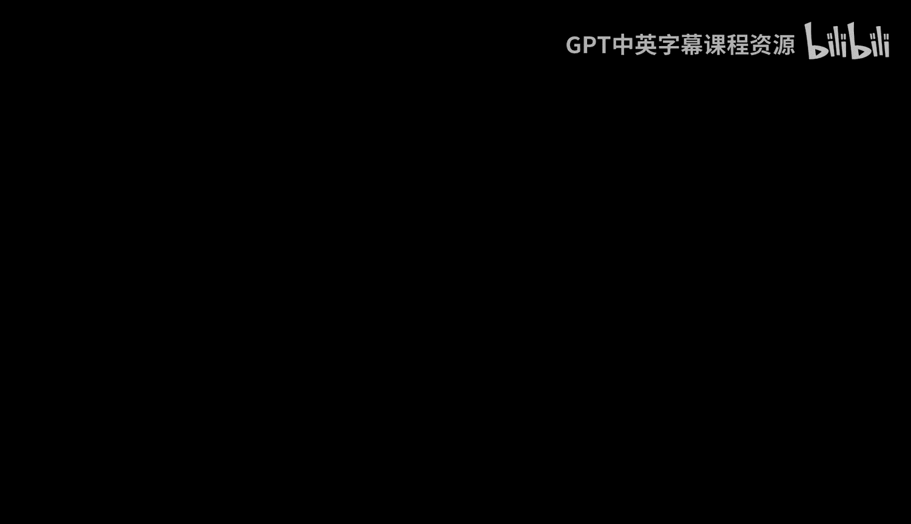
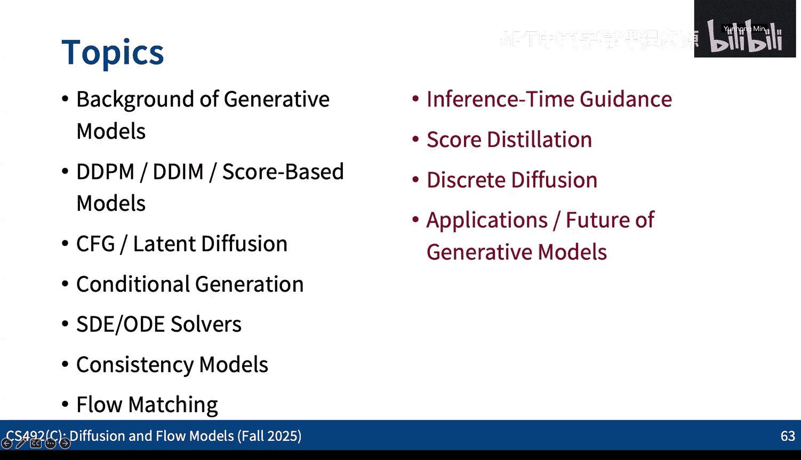

# KAIST《扩散和流模型｜CS492(C) Diffusion and Flow Models 2025》中英字幕 - P10：Lecture 11_ Flow Matching 2 (Diffusion and Flow Models, Fall 2025, KAIST).zh_en - GPT中英字幕课程资源 - BV1CKpvz1EH5

Okay， so from the last lecture， we started to discuss some kind of the new model。

 which is the flow model。 and we started to discuss the flow matching。

 the thing is that it's quite confusing in terms of that now we are changing many things in basically the terminology and also the notations the thing is that basically in the di model。

 the context we defined the time range from the going from the capital T to the all the way to the0 in the generated process。

 So that's why we call this kind of the generating the process in the model is kind of the reverse process but in the flow matching the context we are now changing the time domain in terms of the time goess from the0 to1 in the generated process。

 So when you say like the x0 that was basically the sample from the reference the base distribution and the x1 basically the sample from the data distribution。

 So we are having this kind of the time。The changes。

And the also in the context of the floor matching， we are discussing basically three key things。

 like one is the flow map and also the vector field and the probability path。

And we also discussed how these are basically related to each other。

 basically the vector field could be compute as kind of the derivative of the flow map。

 and also the relationship between the vector field and the probability path could be defined based on the vocalcal plank the equation。

 which was basically defined in this way。So from this。

 what we could see is that we could consider basically encoding the information of the flowM by training a neural network。

 which is basically implicly presenting the flow map basically by modeling the back field。

 then we could basically see such kind of the neural network。

 which is kind of similar with the noise prediction the network in the digital model case right So it comes of that now we are having the network that can predict the velocity for the arbitrary the XT。

 the intermediateitadata point and also the time T there as well。

The thing is that obviously we don't have any kind of the closed form expression for the target the vector field here。

So that's why we started to discuss the conditional def flow matching。So in this context。

 we also discussed these three things， the conditional flow map and the conditional vector built and also the conditional de probability department。

 And we and also seeing some kind of some special case where the conditional the flow map is defined as some kind of the linear function with respect to the as here。

😊，So given that the conditional flow map is is defined as kind of the linear function like this。

And when we also assume that this x0 is basically a sample from the standard de Gaussian distribution。

 then we could also see that the conditional the probability path is also defined as kind of de Gaussian distribution like this。

And by taking the enable table of the flow map， we could also compute the effect fields like this。

So this was because like one specific the way of like defining the conditional default map。

 And we also can further specify those kind of the， the two parameter functions， right。

 the sma function and the mu function here。So like one special case that we have seen last time is that basically's simplifying everything in terms of that we are even making the flow map as kind of the interpolation between the linear interpolation between the x and the x1。

 Then everything becomes like simple like this in a way that we have the Gaoian the probability path and the linear the flow map and also the vector field。

 So we can say that here the velocity is really defined as kind of the direction along the straight line between the X and the X1。

And the other option is basically that we are following the trajectory of the Dffion D models。

 the BP the case in terms of the defined probability pest as like this。

 then the vector field was also defined like this from the relationship between these two。

So given these kind of the two ways were basically。

 this is kind of like more de general form to define the default。 And based on that。

 we could basically train the the the the the neural network predicting the velocity like this。

 So this was like quite similar with the training of the diffusion models。

And this is actually the case like when you have some kind of the closed phone with the conditional they probability pass。

So for the more de general case， even when the analog form of the conditional path is not available。

 we can still consider training the flow map like this So here。

 basically what you can see is that the small difference is that instead of like not only just like just like sampling the X1 here。

 we are sampling both the X1 and the X0， the pairs like these too。 And based on that。

 we compute the intermediate data point X T using the conditional the flow map and also compute the velocity and also based on that。

 we could consider basically train the velocity prediction the neural network using the L to loss like this。

So this also becomes some kind of the more general form of training a D， the flow map。

Any questions on this？So as we have seen last time。

 what we are going to discuss for today briefly is about more like how this kind of the flow map is basically related to the divisionffion models。

So actually， what we are going to see for today is that actually we can consider the flow model is kind of the same with the diffusion model more precisely。

 actually， the flow model is kind of the generalization of the diff models。

 So in the other the way around basically di model can be seen as kind of some specific the special case with the flow models。

 So di model was the case。 that we are basically learning these core function， right。😊。

And the flow map is now the case that we are learning the flow， the velocity。

 basically the detector vector field。So it's basically me like know。

 which one we see is kind of is a major defect defining the the models。 In digital model case。

 we basically first demoed the probably the paths。 And based on that， we define the other things。

 Basically the the trajectory and also the velocity as well。InThe follow model case。

 we first define some kind of the first model， the conditional the follow map。

 and based on that we can also derive some kind of the conditional the vector field and also the probability path as well。

So this is basically a different kind of the perspective to define some kind of models。 But actually。

 we can see that these two are basically having some kind of the close relationship of each other。

 which means that like one can be computed from the other。

So which means that even when you have some kind of the pretrained division model from the pretrain model。

 we can actually compute the velocity and treat the pretrain the division model as kind of the flow model and perform the generation the process as well。

So this is kind of the interesting aspects。So if we also see the variation di models from the perspective of the flow matching。

 but actually then we can say that it's kind of the special case that we are having a linear de Gaussian deco conditional flow map。

 which is defined like this。So here， the thing that now， so。

 sorry for the confusion we did many the new notations。 but these， the sigma and the output function。

 those sigma， the output function， these two functions are basically the same functions that we have seen in the definition of the variation of diffusion models before the first test。

 Okay， don't get confused。 So these are basically the the functions that we have used when we define the variation of diffion models。

😊，So in the previous lecture， actually， we。The positions of like these two functions kind of switch it like this R and the sigma here。

 But now we have the sigma in the。 And the reason for that is that now we are the also changing the time domain here。

 right， So here basically it can be confusedible X is0 here is the the sample from the reference distribution and the X 1 is basically sample from the the data distribution。

Okay， so after basically changing the the time range now we are having these。

 the same the sigma and the alpha functions here， right。

To the same definition of the variation of distribution models。So。

 so we are going to basically see the version of the division models from the perspective of the flow demat and before we get to that。

Let's briefly recall some kind of the older the topics。Do you remember this the twist folder。

 This is basically exactly the same slide I shown in the lecture5 by is。

 So when you have some kind of the unknown the prior distribution。

And the Gausian and the likelihood distribution like this and when the emerge distribution is basically defined like this。

 the2 this formula is about basically computing the expected value of the mu here。

 which is the sample from the prior distribution， given a sample from the emerge distribution。

So basically here， this is the key that we have some kind of sample of the x。

 which is actually defined as like which distribution is defined like this as kind of the combination of the Gausian and the likelihood and also the unknown the prior distribution。

😊，So given the sample of the x， what would be kind of the expected value of the mu。

 which was basically the sample from the prior distribution。

 and what we have seen from the two dis formula was that this is exactly the same slide that we have seen in the lecture5。

 So actually， the expected value of the mu given the x could be computed based on this core function。

 right， using this core function like this。 So this was basically the first time we started to say this core function。

😊，So if we have some kind of the quiz here。So now we are basically having this kind of be linear the function。

 linear integral of the x U and the x1 given these two functions， which is now computing x here。

 right？So気 the X there。Well do be kind of the expected value of the x1。Here。

 basically the thing is that x0 is basically a sample from the standard de Gaussian distribution。

 right？This is basically the known fact from the effect that the x0 is basically the sample from the standard gaus and the distribution。

 given the x from the intermediate the data point， what do we basically expect value for the X1。

Can you quickly compute this？So did everyone get this？

This is kind of the same as like what we have seen in the previouss lecture， right。

 we only basically use the the only differences that we are now using this like R and the sigma the functions that used to define the the。

ベョィマ。So I'm going to basically update the lecture slide including all the answer after the lecture。

 So you can just like download again So yeah， so thing is that this is basically exactly the same thing from the di model。

 we could see that we can compute before we perform like all the generation the process we could basically compute the expected value the final the output from the intermediate value。

 right， exactly the same thing。 We are just like introducing the and the sma functions。

 defining the division models and changing the time domain that it goes from the0 to one in the generation the process。

Then then we get this right， so this is the parts that we basically introduce this core function here。

And also， we have seen the basically relationship between the noise that we are predicting using the noise potentially network and also this core come here。

 having this kind of relationship between the So this is basically the quantity that we are predicting using the neural network。

 right， And from that we could also compute these core here。

 So these are all the same thing as like we discussed last time。

 but just using the sigma but the functions and also the change the change the time domain。

So please keep this in mind the same thing， basically computing the X1， the final the output。

 expected value of the final the output from the intermediate value based on these two things。

So based on this fact， what we are going to do is that now we are going to see some the connection between the velocity basically the vector field and also this core function。

 So basically， we can see this connection between we can at least like see that there will be some connection between these two。

 because we have seen this kind of the relationship between the vector field and also the the probability path from the the focal plan called the equation。

 right， So we are basically going to see the same thing without that。 So basically。

 the thing is that。From the our the definition of the linear the Gausian the pass。

 the the conditional diploma here， now we can compute the conditional the de vector field in this way。

 That's just taking the derivative， right。So we want to also。

 this is basically the function of the x1 and also the intermediateta point of the x， right？So。

 also to make this expression as kind of the function of the X and the X1。

 we are going to replace the X0 based on this fact that the X can be completed like this， right。

So from our definition of the conditional Fm， now we can basically substitute the X with basically this expression。

 then now we can see that the velocity the conditional velocity computed in this way。Isically。

 so this is basically just like some asthmatic kind of things， right？And based on this。

 what we are going to do is that now the margin of the vector field this。The U T here。

 So this is vector the vector field today we are going to obtain through the neural network training。

 right， and this can be computed as the expectation of the conditional detector vector field over this probability pass then this becomes basically computing this but having the expected value of the x1 from the the given the X the intermediateit data point。

是。Then from the tweies， the formula that we have seen in the previous slide。

We can simply plug in these three formula here， then what we can see is that now we can see the connection between the velocity and its core function here。

So given any kind of the intermediate data point， the x here for any kind of the time t。

 the intermediate data point， if you basically have the information of this core function based on that。

 you can compute the velocityity here， right？Or the other way around。

 given any kind of the data point x here， if you have the velocity here。

 then based on that you can compute this query function。

So this means that for the linear the Gaus and the pass， for the conditional the flow map。

 whether you make it the general model is kind of the flow the model or basically as the digital model。

 you can basically do some interchange between these two， you can compute to one from the other。

 given any kind of the times that the intermediate data point of the apps here。Makes sense。

So if we go one more step here， we have seen that there's the relationship between the core function and the noise。

We are predicting the diffusion models， right？So based on this relationship。

 can you also find the relationship between the vector field and also the most as well？

You can quickly compute this way。Can you quickly compute this relationship between these two？

So basically we're going to get this right so this basically shows the relationship between the noise that we are predicting in the digital models and also the velocity that we are predicting in the flow models right。

So from all those like de formulations， basically now you can see。

 so what we have discussed in this class is that at the very beginning of this class。

 we started to discuss the degene model， which is defined as kind of the mapping from some kind of the simple distribution。

 typically the standard de distribution to the digital distribution， right？

Well this was like all about basically how we are going to define the mapping between the standard Gausian distribution to the data distribution。

So at the very beginning， we started with the again and the and after that。

 we make that the mapping is kind of the iterative process through the full process。

 right through the deterion process， which is basically repeatedly adding some kind of the Gaus and the noise in a way that ends up basically becoming the sample of the the Gausian。

So this was more robust define some kind of the conditional de probability path from the old way。

 from the data， the sample to the standard the Gaussian the sample。And in the continuous time domain。

 we start to see that actually this kind of the iter of the process is kind of like equivalent with the stochastic basically solvinglving this stochastic differential equation。

So we could basically find the equivalent， the continuous form， the formulation。

 the continuous time domain， which is now defined as the stochastic differential equation。

And after that， what we have seen is that actually we can find and we corresponding the ODE ordinary differential equation withoutto till。

 which is giving the same original distribution。So for all the division model。

 now we can basically find the corresponding deterministic de mechanism process through the O D E。

 the the equation。And now what we are seeing is that actually we didn't need to first define the conditional department pass。

 we can directly defined the conditional the flow map first。

 in a way that we are seeing now the diffusion model is kind of some special case of those kind of the flow models。

So we can see now this kind of the connection and also the all different perspectives of like seeing the digital models and the flow models。

sure whether this will be clear to you。 So and also one more thing is that for the P F O D。

 the flow the O D， we didn't see how exactly this can be derived from the S information， right。

 So without getting into the all details for that And it's like we are going to see now how this connection between the。

The velocity and also this score function here， this connection between these two is also aligned with the PD。

So what we can easily see is that so this is basically the vector field that can be compute from this score function here right so this is the equation that we obtained from the previous this slide。

And given that if we go back to the POデ So this was basically the POデ we have seen digital model case。

 it。And also， the connection between the relationship between the alpha sigma function and the F and the G functions here could be derived in this way。

So what we can see is that if we plug in。Those kind of the some the definitions for the f functions into this equation。

 We could see that we should see the same equation with this， right。

So I recommend you to check this out whether we can really you get the same D equation。

 So if you really put all the things， the F and D key functions into these part。

 then you gonna to see that actually， we are getting the same D equation。

The same equation is showing the relationship between the vector field and the disord function。

So the derivation of the vector field， the velocity obtained from the conditional de vector field。

 and also from the property， the flow， the ODE are basically identical。So basically from this。

 we can see some kind of all the connections between the differential models and theform models and how are conditional probability is also related to the conditionalform map and also detector vector field。

Okay， brief。So so this is kind of key thing， so basically the diffusion models and the flow models are mathematically related in a way that if we define the conary default flow map as kind of linear the Gaussian path like this in the form that we have seen in the visual diffusion models。

 then these two basically become equivalent in the mathematical deform。

The only difference is that whether we're going obviously train in network for the noise。

 we are trained the network for the velocity。But obviously， once you're trained。

 basically learn one of these two things based on the noise。

 you can also compute velocity and learn the velocity， you can also compute noise。

So I strongly recommend you to try this kind of conversion for the models that you already implemented in the first assignment。

So what you need to do in the third assignment is that the first assignment was to implement the DDPM and the DDIM。

 right？And most we， I told you that you could basically And also the second assignment was basically running re generation the process by solving the O D E。

 right， using the DPM overboard the idea。So now you can basically also perform the generationary process by switching the noise into the velocity and per。

 so it will be basically equivalent it the same as you have done in the the second of the assignment。

😊，And what you need to do in this third assignment is that now even you are not learning the noise。

A strictlyly learning the velocity。And then based on that， you just perform the O D E。

Indigen the process。So we are seeing some kind of some old variations of like in terms of know。

 the way that we can basically train either theffgative flow models and also perform the generation process of the diffative flow models。

Ex sense。But this is the thing。 the flow basically these two becomes basically become the identical when you basically define the conditional the flow map as kind of this kind of the linear the Gausian the path what the flow map is kind of the more。

 you can think its kind of more the general the concept in terms of that it can basically generalize the division models the multiple ways。

The first thing is that the conditional flow map does not need to be that de linear form。

So you can also explore many different options。 You can design your own conditional flow map in many different ways and see whether this can really improve the performance。

Also we have some kind of the register like just explain with some kind of the non nonlinear kind of things like some quadratic whatever sort of things and see whether this can really improve。

 I guess the answer was no but yeah you can try many different options for the conditional flow maps。

And more importantly for the flow the matching， the thing is that if we go into the more the arbitrary the con flow maps。

 then now we can consider the case making the reference distribution。

It's not as kind of the standard Gaoian， but any arbitrary distribution。

So the good thing of the flow dimension matching is that now we can consider basically mapping two different distribution。

Even we can consider learning some kind of the mapping from like the one data distribution to the another the data distribution。

This is even possible in the the concept of the the law models。

So you can think that the flow model in or also the flow model is the case that we are now using the O D E。

 While the digital model has been introduced from based on stochastic deformulation。

So you can see some kind of the differences and how the flow models basically generalize the idea of the diffusion models。

Any questions on this？So I don't know how you would feel it。 But actually。

 this is kind of the most interesting part in this class。 I mean。

 how all those things are basically connected each other and how the same thing can be basically explained in the all the multiple ways。

 So I recommend you to check out some more details for those kind of connections。And actually。

 one more reason like why we discuss the flow model is that basically。

 we're gonna see that many recent models are now using the flow matching， not the di models。

 And one of the reasons for that is that it becomes much easier in terms of like accelerating the generation the process through the fine tune。

So last time we have seen the idea for the consistency model。

 which was also kind of be some simple idea in terms of accelerating the generation the process through defined tuning。

😊，So here basically if you're going to discuss the same thing。

 basically how we can accelerate de generation the process with some kind of defined tu。So for that。

 So the thing is that this is like very new topic。 So still people are using some kind of the mixed theinology for the same thing。

 So to simplify all things from now， we're gonna say the conditional the flow matching model is simply just like the flow model。

😊，And we also have seen the two options for the trajectory， right。

 the linear the conditional trajectory and also the the decrease。

 the the trajectory for the linear the conditional trajectory。

 we are people typically also call this the the rectified the flow model。 Okay。

 so let's assume that we are basically targeting this kind of electtified flow model。

And for any follow model the training procedure becomes like this。

 so this is the same slide that for the de general the case， what we can do is that we sample the X1。

 the data point and the samples from the standard de Gaussian。

 it can be does not need to be standard Gausian distribution， it can be any reference distribution。

So based on these two， what they can do is that we are computing the intermediatemitt data point X T using the predefined the conditional default flow map and also computing the velocityD by just taking the real and basically for computing the Lta loss to train the BiD neural network。

So what we can see is that in the training of the flow model。

 this sampling process is basicallyvoked， we are taking any random pair of the X0 and the x1。

 the data point and also the standard de calcium dis sample。

The thing is that even when you basically train a rectified model。

 V is basically having the conditioner， the linear the trajectory。

 the final the output trajectory may not be linear。So， let me first show this slide here。

 So what you can see is that so these are all the kind of a conditional the trajectory for any arbitrary sample from here to here and the here to here。

 So this is the case that we are taking this is kind of the the。

 the two Gausians as kind of source distribution and also the two red the the does here。

 the groups of the red that as kind of the the target distribution。

So if we see the conditional velocity at this point， depending on which pair you choose。

 the conditional velocity can be either this or this， right？Can go up and can go down， right？

So which means that if we compute the expected the value here。

 basically if we compute the marginal the velocity at this point。

 the marginal velocity may not be either this way or the this way can be like oh this way。

 for example。So which means that even when you basically make the conditional trajectory to be linear。

 the straight line between these two points， if we compute the marginal the velocity at the end through the between neural network。

 then the follow map， which could be compute based on the marginal velocity may not be straight。

 it may result in this kind of disbanded the curves like this。Mes。

So the linear trajectory is only for the case like when you basically take these samples here and also the not sample here。

For any to a point， obviously the conditional trajectory between these two dos would be straight。

 So that's how we defined， we defined the conditional trajectory kind of the straight line。

But as you can see， like depending on which the two points to end points we choose。

 even the conditional velocity that this point can go up or it can go down， right？

Which means that at the end， the margin of de velocity can be something like this at this point。

 and the flow map， the marginal flow map that are basically defined based on the emerge de vector field may result in this kind of thebed the trajectory。

Then what would be the issues we deb the trajectory？Thankancy。Yeah。

 so because like we are now competing all this kind of trajectory by solving the O D， right。

The trajectory is physically defined based on the velocity。

So if we had this kind of decent some street did traffic appear like this， the good thing is that。

From this starting point。if we know that kind of the case。

 but if we if there is such kind of case that the all the margin of the flow map is kind of a straight line。

😊，Which means that from this starting point。If you predict the velocity， then you can go straight。

All the way to the end point here。Which means that now you can make the one step digital model。

You don't need to have any kind of iteration。The reason like why we still need to basically compute velocity multiple times is that we are having this kind of dependented trajectory。

We cannot go straight on all the way to the end because we know that the chapter will be bended like this。

 So that's why basically we need to basically know chop the kind of the the time domainの way that basically going one step small one small step and just like going another small step and just repeating those kind of things。

In terms of soing the 오D？So what we can see is that it's always good to find some kind of the straight trajectorycur mapping between the points in the source distribution and also the points in the target distribution。

The problem is that even when you basically define the conditional the flow map as kind of the straight trajectory。

The output marginally trajectory may not be straight， so that's kind of issue。

So some kind of this simple way to make it straighter is that while skipping some details here。

Is that so previously to train the a diffusion model。

 what we need to do was step basically taking the random pairs from the source division and also the target divisionion。

The simple way to make it stricter is that once you basically have any kind of the pretrained the flow model。

We are using the pret the flow model to take pair the sample of the docon the pairs of the x U and the x1。

So let's say we now know， fine tune the flow model by just not taking the random pairs of X X X X U and the X1。

 but by performing the generation the process using the pret model and just taking these pairs。

Then surprisingly， then what we can see is that when these are basicallys trajectories that we could see from the first rectified model。

 the flow model， after another defined tuning which is called the two rectified model。

 for the two rectified model， we can see that now the trajectories are become like this trait like this。

If you repeat this one more time， then you're going to get even straighter the trajectories like this。

So these are some kind of the very simple the tricks and obviously there are some kind of the loss of the theory in terms of like why we are tip straighter deject whichities red define tony。

 but after skip some kind of details here。For the flow models。

 the way that we can basically make some kind of the faster different model is that you first train a flow model and based on that fine tuneD models by just taking the pairs from the previous model that you're going to get the straighter and the straighter trajectories which means that even with the fewer number of the time steps。

 the audio absorbber， you're going to be able to get some kind of a clean the outputs。

So after some kind of be a couple of the iterations of like fine2 model。 Now， now。

 what you can do is that now we can make some kind of be even a single step bottle。

 which means that from the sample of this standard Gaussian。

 you can directly map this point into the one of the data point。😊，So this is kind of interesting。

 right， we actually started from the one step model。

We e again those are basically master model right？We have seen actually。

 there are lots of kind of disadvantages in terms of the diversity or the quality of the outputs。

 So that's why we started to basically discuss the digital model while basically sacrificing the competition。

 the the efficiency we iterative process。 And now we are going back to the the at the model。

Basically， through this kind of defined Triity techniques in terms of that now。

 we can get the fast speed and also the good quality as well。So actually。

 if you see many recent the image and the video generated models， like3 and the3 and the fluxs。

 those things， you will be able to see that those are basically not based on the di the models。

 but based on the flow models。 Basically， these are basically identical。

 but you can see that then they are not basically predicting the noise， but predicting the velocity。

And if you remember what we have done in the first lecture。

Do you remember this slide so at the very beginning of like this class I was asking you to try to make some there are some kind of images using the flux model。

 so actually this flux foundational this one， this is the model which is basically trained based on this kind of the leaf load the technique。

So you can go back to this model and see how this model has been was trained。

And also one more thing is that we also discuss discuss the concept model for the division and also now define discussing the leaf flow the technical for the flow model right。

 so these are kind of some rival in terms of the just like competing each other and see like now we are seeing still seeing some kind of the competition between these two in terms like which one is basically better for the view step de generation So if you see some kind of some。

Comparison here。The C D and the C， those things are like all based on the consensus models。

 and the app I D goes down to four what three here。 And also with the two rectified flow。

 we are also seeing some kind of similar the API I D here。Yeah， we do one and the two steps。

So you can see that we are these are some kind of the two very different approaches in terms of how we can accelerate the generation the process using either the digital models or the flow models。

I need questions on this。可以。So this is the end of the kind of discussion for the all the basics for the diff models and the flowD models。

 so we discuss basically how the idea has been evolvedvoked from the B again to the DDP and the DM and also the SD and the OD formulation and also the flowD models for the rest of the three weeks we are going to see more into the application side。

 so basically not only in terms of generating some kind of like some realistic data points what can you do more in terms of getting something not just like realistic but something that we want to see how we can basically inject some kind of the more the user preference in the generation process so for the next week we are going to discuss the inference time the guidance which is basically injecting some kind of the user the preference at the inference time without any kind of training and also were going to move on to the diff model。

 the case for the disk data in the week。The next week。嬉しい です けど。Let's end the lecture here。

Well who hasburg best。