# KAIST《扩散和流模型｜CS492(C) Diffusion and Flow Models 2025》中英字幕 - P11：Lecture 12_ Inference-Time Guided Generation 1 (Diffusion and Flow Models, F - GPT中英字幕课程资源 - BV1CKpvz1EH5

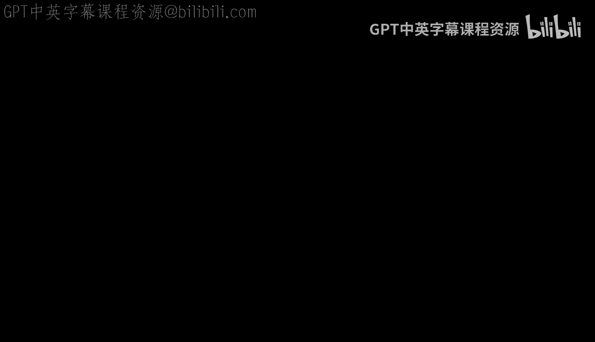

So until last week， basically what we have discussed is basically some kind of be some actually some basic ideas in terms of like how we can basically train a either division model or the flow model and also how we can perform the generation the process。

 and from this week for the until the next week， what we are going to do is that what we can do more with some kind of the pretrained models。

 So as you already know， actually， there are some kind of many some pretrained the division models。

 especially for the image video generation and also the video generation。

 and we are also seeing some kind of the many other the division the flow models。

 not only for the images and the de for the many other things like for the molecules where I don't know for the emotions or some kind of the robotic。

 the robotics the applications， for the many other things。

And these models are typically trained with some tones of the data。

 so we don't have some kind of the computing resources that we can really train those kind of models with the tones of the images for the videos。

 for example， right But here the question is that we these kind of the preted models what can you do more can you just some kind of like typical images where can you maybe some like many other things。

 So that's basically the topics that we are going to discuss for this week and the next week。

This is basically the slide we have seen multiple times right so basically the advantage for the equationion model where that is basically a chip some kind of the better quality without basically losing the diversity right？

But the kind of the。Things some kind of the downside with di model was basically the slow speed because of the kind of the iterating the process。

 and what we have discussed so far was basically how we can accelerate this kind of the de generated process through some kind of the inference time techniques。

 which is basically changing some formulations in the generation the process in a way that we can achieve some kind of the good results even with some kind of view the iterations。

 right。And we also briefly discuss some kind of the techniques that we can also accelerate the generation process through some kind of the fine tool。

 right？So those are some kind of the all the attempts in terms。

 so like how we can basically run the generation the process the faster with the few number of these steps。

But actually， what we are going to discuss for today is that this kind of the eterative process actually can be useful in terms of like injecting some kind of the guidance。

 So what we have seen in the previous lecture is that the generation process of the di and the flow model is all about making some kind of the trajectory。

 right。😊，Starting from the if we go back to the diffion D context starting from the capital D and all the way going down to the zero right in the diffion D context right。

 then it's basically really making some kind of a trajectory starting from the standard the Gausian the sample x capital D and then just like making the path in the space in a way that we are reaching to the x0。

 right。So it's all about basically making this kind of a path。

 but here basically what we are going to do is that we are every time when we basically make this kind of be some path we are basically pushing those kind of points in a way that trajectoryally become something that is reaching to the final point which is something that we really want to see。

Actually， we only have seen such kind of the case as an example。 Do you remember what this was？

Some kind of the case is that we are injecting some kind of the guidance in de generation process。

No idea。Yeah， the classifier guidance and the classifier pre guidance actually was the case that we are basically injecting some kind of the guidance。

 Basically， what we are doing is that it's all about basically competing the predict this core and basically performing the reverse process based on this core information。

😊，And what we have seen last time for the classified guidance is that given the condition。

 now we want to compute the score for the joint probability here， right？

And this core for the joint probability could be decomost into the marginal of this score here and also the likelihood score here。

So that's the me like basically how we can compute the likelihood score here in some of that we are basically injecting some kind of some offset to some kind of each of these core function here。

And the idea for the classifier， the guidance basically was to train a kind of the classifier in terms of that we can compute this more explicitly by just training another kind of the additional the neural network。

And the idea for the question of the big guidance was to basically train a single network that can learn both the unconditional the noise and also the conditional noise as well。

 which is corresponding to the the marginal discor here and also the likelihood the score here。 So。

 and we could also even control the strengths of the conditional noise in terms like how much we are going to push the kind of the。

It intermediate the data point over， the， the trajectory in a way that we can control those kind of the the the passes。

 So that is kind of the basic idea that we discussed last time。

But the thing is that these are all the cases that we need to basically train kind of the additional neural net。

 or basically， we are training the the noise predictor with the pairs of the output that we want to see and also the noise here。

 So we need to basically have some kind of the training data in terms of the training the noise the predictor。

And what we are going to discuss for today is that how we can do this kind of the injection of the guidance with some kind of tree trend0 models without basically clearly training those kind of models from scratch with some kind of the condition information。

So how we can do some kind of the test time kind of things in terms of basically adding some kind of big guidance。

So more formally， we are going to try this， which is guiding our the process at the inference time to make some kind of the realistic data point。

 which is basically something that we want to see， which is aligned with some kind of some specific the usual。

 So how we are going to do that at the test time， is kind of the the idea。And actually。

 diffusion and diploma model is really kind of the framework for doing those kind of thing。

 So as I said， for the gain and the B， these are basically all the one step model right for those kind of one step models is's really hard to basically as some kind of the guidance at the test time。

 but for those kind of the e rate process， as I said。

 we can basically control kind of the either the velocity world noise in a way that the trajectory that we are making is going to some kind of the target data point that we want to see。

So there are some pointss of actually the techniques for that。

 So I typically classified those kind of techniques into these3D classes。 Actually， there are more。

 There are many other kind of things。 So we are going to briefly talk about some kind of the very recent techniques in terms of achieving this goal。

😊，Into these three categories。So actually， the first two are kind of the same。

 So you can see that actually the secondone is kind of some special case of this quality manipulation。

 So for today we are going to discuss like first these two things and the next week we're going to have some time to also discuss this one well。

😊。

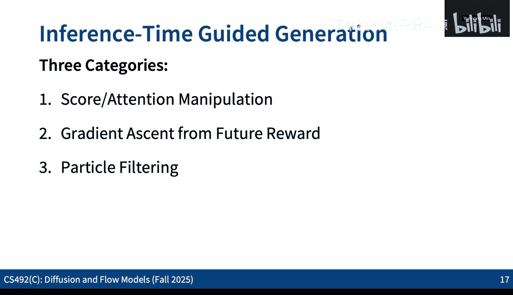

So for the first these two things， the basic ideas that as we have seen for the Queifier of the guidance and also the case。

 we are doing some kind of the manipulation of this core。

So every time when we perform the reverse process with the model。

 we are basically modifying this qua here in a way that becomes some kind of like you know the trajectory making some kind of the output we want to see。

So there are actually quite many practical ideas in terms of this called de manipulation。

 so I'd like to just show like one specific example here。

 but I also like emphasizesize that there are literally literally like tons of some kind of examples for that and also there are many some practical ideas and some of those techniques are basically not explained with any kind of theory so quite some practical ideas but basically it works well in practice and also many of those kind of the techniques that are basically developed especially for the image and the video generation and you can also consider applying those techniques for the other the data mod case as well。

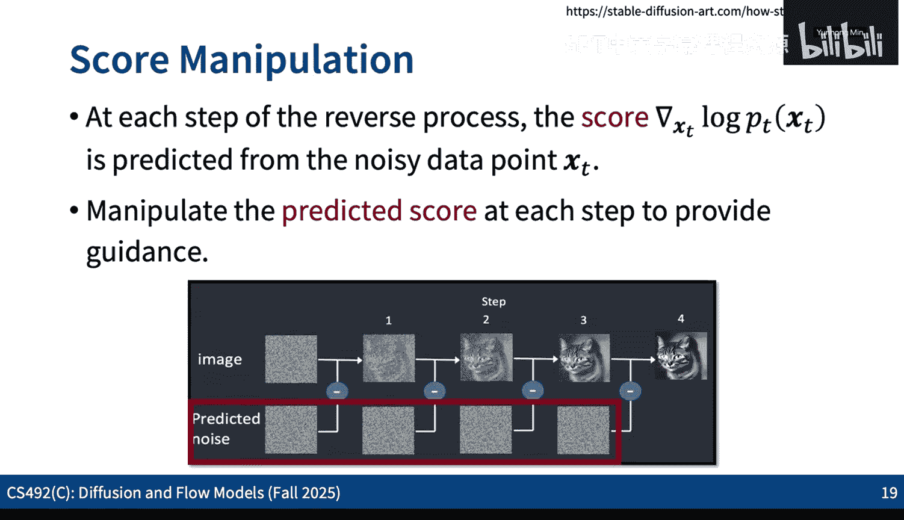

So if I showed like this specific example， which is called the reprintint。

 this is the problem which is basically filling some kind of the missing regions in the images。

 so let's think about the case and now we want to generate the images which is basically having these background region。

 so we basically want to fix these parts。And you only want to fill in this kind of be some the mask vision。

Then how we can make some kind of the image， which basically prejuves kind of the background region。

And this is obviously kind of some problem of de generationeration because there can be multiple the possible some kind of the ways to fill in this kind of program vision right so if I show some examples here。

 for instance， if I erase these parts and fill in some kind of the images here。

 there can be some multiple different kind of some expressions。

 the facial expressions like this so this is related de generation the process the problem。

Another very extreme example that we only have this part and we want to fill in the outer the part。

 then there can be even some cases that we are not even like making the what's that。

 some kind of be some apple is not the， some kind of flu images， but something else。

 while still basically fixing this kind of some these kind of the descent region here。

So you can see that this is basically some kind of a conditionary problem， right？

And we can consider basically training a division model with this kind of a condition。

If we already have some kind of the tones of some kind of the pairs of the input condition and the of the output。

 then you can obviously use some kind of the class the class the guidance or free guidance for whatever whatever kind of things。

 So there are actually lots of the approaches to solve the same problem。But here， basically。

 the idea is that without basically training another division model。

 what we are going to do is that we are going to use the pretrain model to do this kind of the。

 the the， the the task。So the basic idea for this is that we are basically performing the denoing the process for the full ground region。

 so let's say this full ground region is basically the vision that we are going to fill and this background is region that we want to basically preserve from the input。

So here the basic idea is that how we can basically perform the deno in the process for the fulleground region。

 while basically also preserving this kind of background。And here the kind of the idea is that。

So as I said， let's， there is no theoretical expression why this works。 No theory here。

 just practical the idea。 you can try this yourself and see how much it works。

 So the basic idea is that so each of the denoging step， let's say we have the X T。😊，Right。

 so this is the intermediate the noisyD data point。

And we perform the deno one step in a way that we get the X T-1， right。So this is the X T。

 and we perform the1 D noting step and getting the X T minus1。

And now what we want to do is that for the background region here。

 we also perform not the liver process， but the food process。

So which basically means that we are performing the reverse process for the fullground region and the fold process for the background region with the same amount of the times step minus1 here in a way that we are getting some kind of the two do easyD data points。

 but one is coming from the reverse process and the other one is coming from the fold process。

So this one is basically having some kind of the information about the input。

 the background region here， because we perform the the food process。

 And this is kind of the the output from the pure diversity process， the generated the process。

 And what they do is that we combine these tool。 for the fulleground region， obviously。

 we take the information here。 And for the background region， we take the information here。

So we basically here the idea is that we are achieving having some kind of the two xt minus-1 here。

 the intermediate the data points， while basically the background region。

 the Xt minus1 is basically achieved by performing the full process from the background for the fulleground region we are basically achieving the xt minus-1 by performing reverse process。

So2 x t minus1 with the same amount of the noise， same level of the noise。

But one is coming from the port and one is coming from the rivers and then combine this。And then。

Repeat this process。Then some of this basically leads to basically getting some kind of the outputs which is preservrbing the background region and also making the images in the foreground region。

 which is basically aligned with the background。So can you guess why this works？

So here basically one the thing is that its。Pretty sure like why we are basically preserving the background region。

 right？Because every time we just like run the full process from this like given image。

 which means that if it goes to the end， the last step of the delivers process。

 what we are going to do is that we are just performing the full the diffusion。

 like just like one step。Probably out of like 1000 step。

 And also running the labor process again based on that。 So basically。

 which means that for the background reason， the information that we are basically making here would be quite the same。

Almost the same from the input image because we just like perform the foreground like one step and just like learning the original again。

 we just like one step out of the last of the steps， typically like 1000 steps。

So it's quite clear in terms of like why we are going to or some kind of the like preju the background region from the input images。

Obviously it is not very clear in terms of how it can be this kind of like seamlessly like the connected images for the foreground。

 basically but this kind of the combination of the the X t minus1 coming from the default process is giving some kind of guidance in terms of that the XT should be going into the direction in a way that the background be should match be given the image。

So for those kinds of the techniques， the thing is that there's no theoretically guaranteed and if you try yourself。

 actually there will be some failure cases as so， there are actually some cases that def foreground in the background but they do not match each other。

So there are some kind of some engineering the techniques in terms of basically how we can achieve some kind of the battery outputs。

 but this is kind of like one sort of like example in terms of that。

 how we can do some kind of the some score manipulation very practically in terms of that we can use some kind of the prediction model not only to make some kind of the full images。

 but just to build in some kind of the missing regions。

So there are many these kind of some interesting examples。

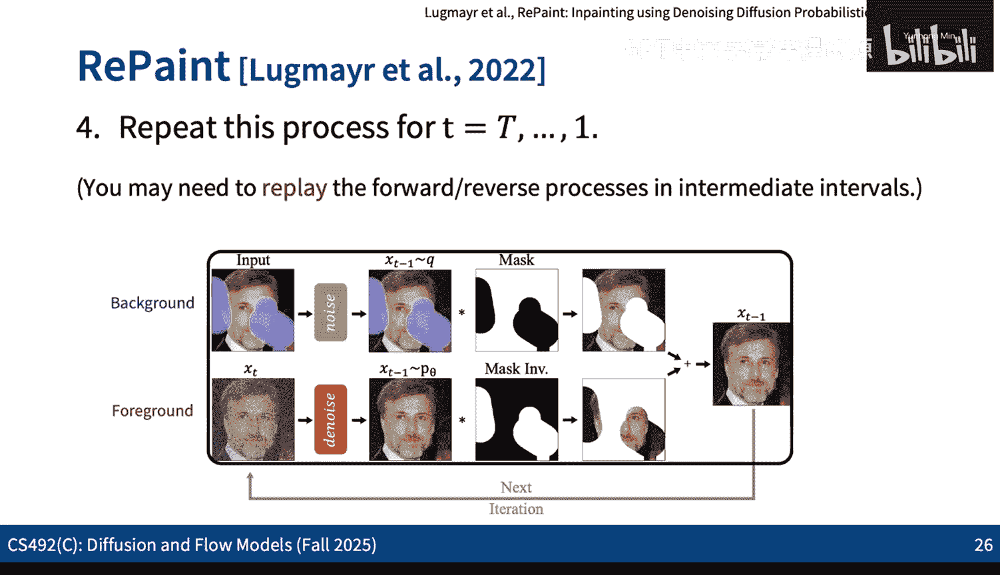

And also， especially for the image generation， what also people do is that typically when we design the knowledge prediction the network。

 we're going to have some kind of the attention of the modules right。

 the cross attention and also the cell potential the modules inside the knowledge prediction the network for those kind of cases。

 we can also do this core the manipulation by manipulating the attention maps in the cell attention and the cross attention。

 the modules inside the the knowledge prediction the network in a way that this core also become something that we want to get。

There are also tons of the examples for that。 But this is basically not the main topic for today。

 So I'm going to skip some details here。 If you are more interesting some kind of kind of practical techniques。

 I recommend you to check out the survey paper and also check out lots of the work here。

 These are all the the kind of the techniques that are doing this kind of some security manipulation。

😊。

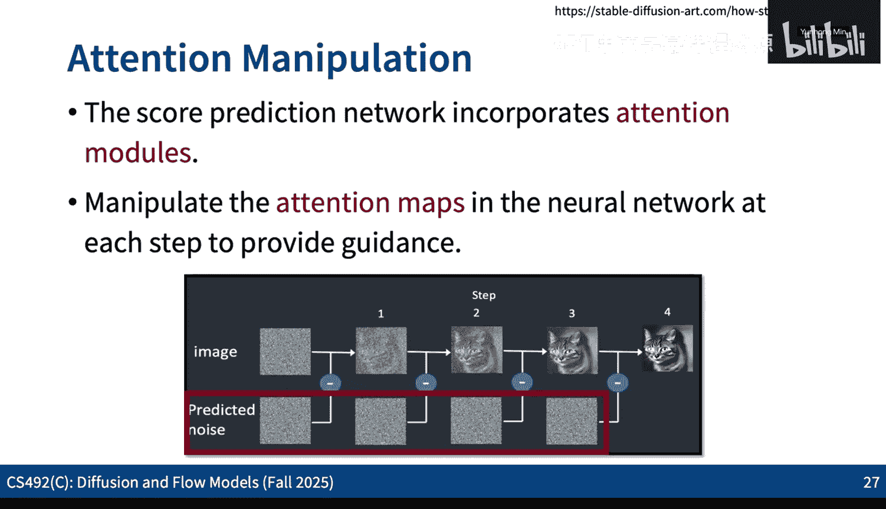

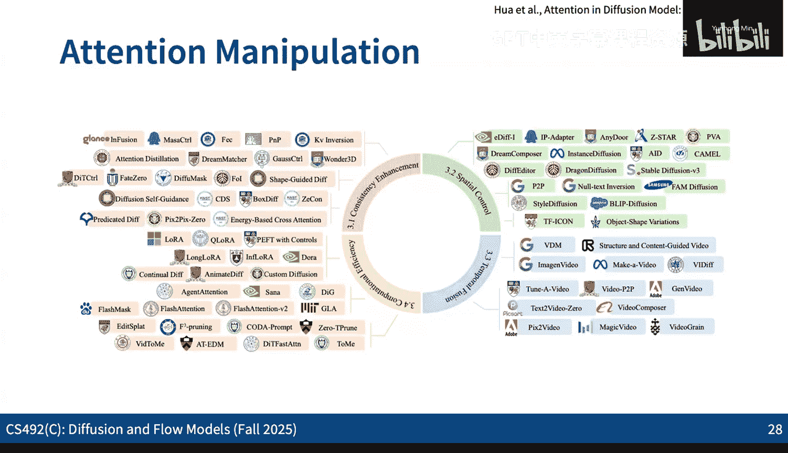

So if I show some kind of more examples for that， what you can do by doing this kind of de manipulation is that you can do something like this。

 So given this kind of the two images， like we are taking some structured information from this image from this building and some some style defect。

 the appearance information from this image in a way that we are making another image like this So these all can be done basically doing some kind of like。

Doing some like the cross attention and also basically manipulating this core function based on the cross attention。

This is also another example， there's a physics work that we have done。

 which is basically not only making the image， which is not aligned with the given the text。

 but also basically aligning some kind of the objects in the image with the given the layout here。😊。

So what we can see here is that now we have some kind of some correspondence between the some words here and also the 2D boing boxes here。

 so which means that the car yellow here should be located on this yellow box and also the green。

 the castle should be also located on the left the green box here and also the balloon as well you can see that those objects are placed in the right region given this kind of the additional some kind of the the guidance information。

And these are some kind of the other big examples as。

And this kind of some kind of the the arrangement of the objects in the images can be also achieved without like the training on other division models。

 but doing some kind of the manipulation Discor in the the kind of printing model。

So this is actually quite interesting thing or the detergen flow models through some kind of the iterative degeneration process by just like some guiding some kind of the core function。

 actually we can do some kind of many those kind of the manipulations and also the editing as well。😊。

And this is also the examples for the3 for the video as well。

 So this is the case that we have some kind of the given the video like this And by performing the inversion here。

 what we can do is that now we can re generaterate the video while basically moving the object into the new the locations here。

 So those are also some examples doing some kind of the video editing the between the video models as well。

😊。

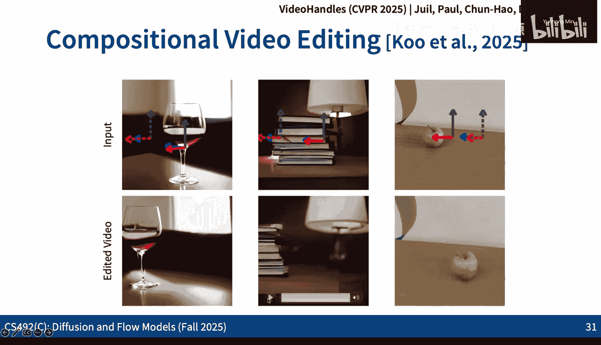

So there are lots of the examples for this more examples。

 moving the base here to the low new locations and also moving the chairs as well。

So this is basically the basic idea in terms of how we can do some kind of the， you know。

 giving some kind of inference time guidanceers with the pretrain models。

And especially for the first category here， it's kind of good in terms of that we can give some kind of the very direct some kind of guidance by just like manipulating dis course。

 but obviously the downside for like the first class of the the technique is that first of all。

 there is no theoretical explanation that's kind of the biggest problem and also the second these are all the techniques that are only applicable to some kind of some specialty cases but especially for some spatial guidance especially for the images so it can also consider applying those kind of things for the other the data modalities as well。

 but be careful in terms of the it does not guarantee to work there can be some failure of the cases and there's also no some kind of the the theoretical the explanation。

そうですカの ビダウンサイ。So that's why we are going to discuss the second one。

 which is kind of some special case for the quality de manipulation。

 but with some kind of the more slightly more specific cases。

 but for achieve more the broader the applications and also with some kind of some judicial the explanations。

So based on the second type of the technique， the tip but the types of the problem that we are going to solve is these like inverse problems。

Is there anyone who has heard about imverse problems fever？Inverse problem， I mean。

 its very the common problems， right， So this is really department that we can see for many applications。

So here the basic idea is that we want to basically find the causal factor X here。

 so this is what we want to find。But things that the only information that we have is basically the y here。

 So let's say why iss kind of this some partial observation， the partial information。

And given the partial information， the thing is that we know how each of the the data point X is basically mapped to the one of the partial observation Y here。

 So this function A is given。And the thing is that this function A may not be invertable。

 which means that given the posture absorptionation， there can be some multiple。

 some possible deco factors that would basically result in getting the y here。

And even there might be some kind of some noise， which is basically injected into the observation here。

So what we know is that we know the function A here and also the observation y here。

And given the observation D y here， how can you get some kind of some plausible the output X here。

 one of the plausible kind of the outputs。 So as I said。

 typically this a function is basically not inable。

 which means that there can be multiple possible x given the y。

So you can see that this is actually the conditional generated generated problem。

 right basically if you have some kind of the loss of the pairs of the X and D Y。

 then you can consider basically training a another di model using whatever the frequencygrance guidance whatever kind of things in terms of that you just like really making neural net that takes the y as the input and making predicting this core that can put this the X。

But here， obviously what we are going to do is that how we can solve these inverse problems without collecting the training data set for those pairs。

 but only when have the printing model that can produce the X without the condition of the Y。

So that's basically what we are going to do。啊。没。Mixes。

So again this is the setup that we only have the observationvation Y here and based on this based on this and also when we have the information for the function A here。

 we want to make one of the possible Dx that would result in the observationvation D Y here。

And there can be some cases that we are having some kind of the noise。

 small noise into the partial observation where there is no noise。

 and there are lots of the applications of the inverse problems。Yeah。

 I just brought up some kind of the examples， especially for the image and the image domain。

 but also for the other the data modalities， you can also find many of the image problems as well。

So for example， let's see the Gaussian degree in the case。

 So this is the case that we are basically only having the the blurd image here。

And based on the blurred image， we want to find this kind of the clean image。

That's basically what your the smartphone does right for the images。

 So here this is the case that this kind of the mapping function from the clean image into the blur image is defined is So we assume that this kind of the mapping is defined as kind of the convolution of the Gaussian corner。

 So in a way that the function a here is basically approximated It's kind of the convolution of the Gausian the corner。

😊。

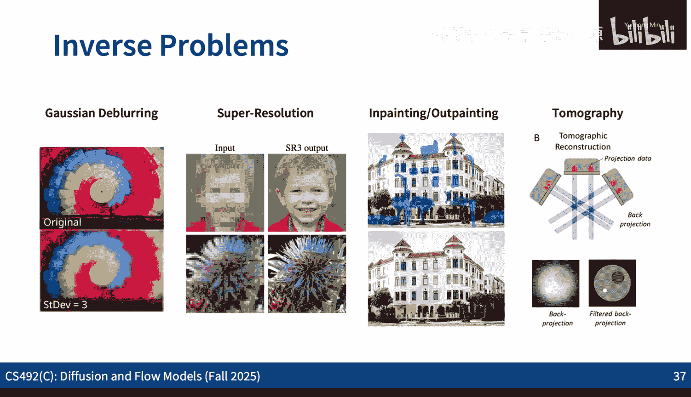

And we only have some kind of the blurred the image and given this kind of blurry image。

 how we can make some kind of the clean the image this one is basically the problem。

 the Gausian the degree。

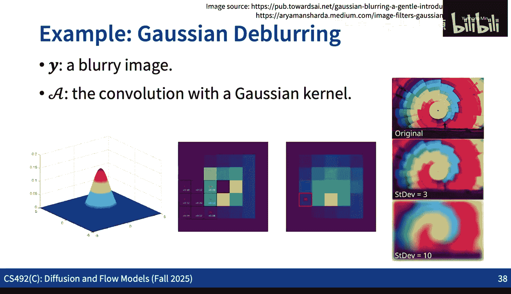

So this is one specific case。The other짬뽕 might be 들。

So let's say like we only have the low resolution the image so from the lower resolution image how we can make some kind of the higher resolution the image。

 So this is also one of the inverse problem， obviously we know how we can do the down sampling the higher resolution to the low resolution right this function is given so this kind down sampling the function is effectively given but we want to do the imversion in terms of that when we only have the lower resolution image how we can generate some kind of the high resolution the image。

 this is also one of the problems of the inverse problem。

How about the in painting so this is exactly the same the problem that we have seen for the repaint case so repaint was the example that which is actually solving the inverse problem with some kind of some practical ideas like Sc the manipulation。

 but this is actually really one of the case， we only have the background image。

And the A function here is basically some masking function， right。

 which is only taking some the some kind of region of the given the full image。

So when you have some kind of decent masking function， the A here and the given the background image。

 how we can make some kind of the full image that will basically result in this background with some kind of the masking the function。

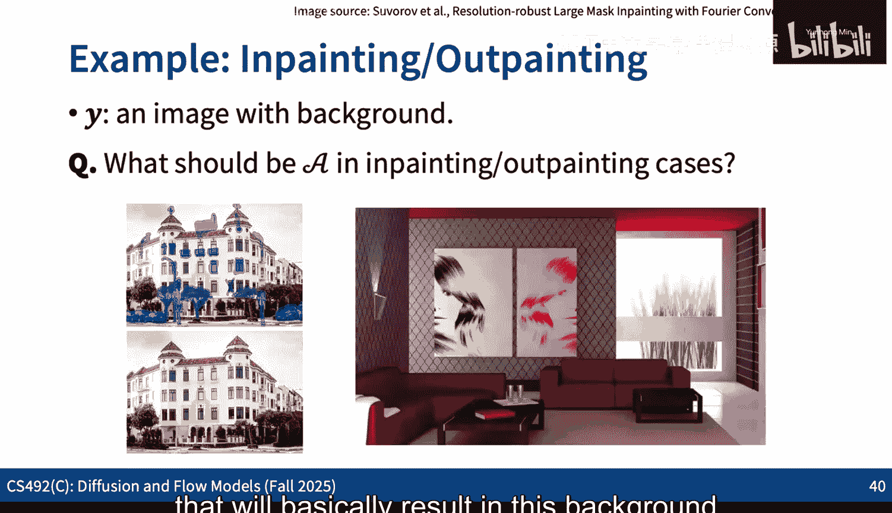

What this？And also， this is another example of the tomography like some kind of C scan MRI scan kind of things。

 What we do is that we only basically have some kind of the observations of the projection of some kind of 3D things here into the multiple views right So thiss basically what we acquire through some kind of the MRI can cities scan kind of things So when you have some kind of the multiple the projections of the 3D things into the multiple reviews from those kind of the 2 d projections。

 how we can reconstruct 3D is kind of the toography the problem and this is also the case that we know the project function from some kind of real things that we want to get here into the multiple the2 and we want to basically reconstruct 3D from the multiple the projections Also one of the examples of the。

Inmverse problems。Can you come up with some kind of the other problems not only for the images for the other mod？

So actually， it can be kind of interesting some research problem。

 if you can find some sort of some inversese problems for the other the domain as well。

 I don't know for some molecule or some other kind of things。

 there might be some cases that you have some kind of the some partial absorption and you want to make some kind of the full output that is kind of be aligned with is going to be partial the information and those kind of the mapping function is already known for those kind of cases。

 you can see that this is like one of the inverse problems and then you can solve that problem using the technique that we're going to discuss here。

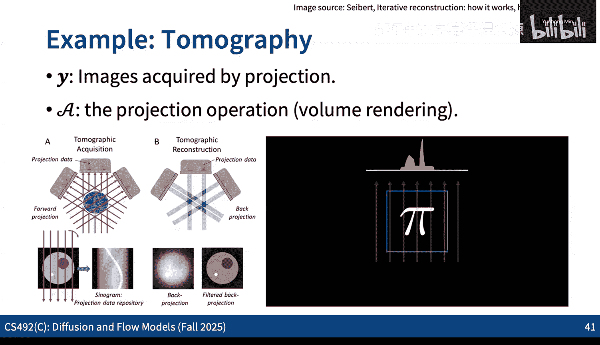

So actually there are lots of the applications。And as I said。

 obviously the solution of the inverse problem would not be unique for many of the cases。

 for many kind of the typical the cases， when you solve the inverse problem。

 that's basically typically the case that the solution is basically not unique。

So that's why basically we need to make some kind of the either some conditional degenerate model。

 or we need to somehow leverage the pretrain unconditional degenerate models while doing some kind of the conditional degene。

So if we go into some more details in terms of how we can solve the inverse problems with the pretrain diff model。

So what we are basically predicting using the pre2 model is that we are predicting this core， right。

 we now know that the noise that we are predicting using the digital model is kind of like corresponding to this information。

 this core function。But now what we want to do is that we basically want to do some kind of the conditional degeneration。

Which means that now we want to compute the conditional score here。

 the score of the X T conditioned by D Y。So given that we only have this information。

 how we can compute this。This is specifically the problem that we are doing。And using the base rule。

 basically what we can see is that we can see that this part basically the constant was after basically computing the gradient of the logo of the probability。

 actually what we can see is that actually these posterior the square conditioned by y。

It's the same with the sum like these two。This call of the the marginal discipline here。And also。

 this core of this kind of like likelihood distribution， this core of the Y conditioned by the X T。

E quick。So basically， what we are going to see is that what we want to compute is basically this this conditional the score。

 the condition， the score of the X T conditioned by D。

But actually completing this continuous score is the same with this one。From the base row。

 in terms of like basically， this is already the the information that we already know。 All。

 So instead of like computing this conditional disc， actually。

 we can just compute this and like add this to the marginal disc score。

So it's similar like whether we just directly compute this posterior score or the likelihood score here。

 and adding this to the emergence score here。And the reason basically why we are seeing what we say this is that we we' gonna say that actually computing this is like much easier than this。

 This is basically why we are going to talk。 And also for the previous slide。

 we have seen some examples of like computing this， right。😊。

You should be familiar with like this function， this is already we have seen in the previous slide。

For the classifier the guidance， or the classifier the free guidance we already have seen like how we compute this。

 right？So in the case of theifier the guidance。This likelihood score was computed from the pretrained the classifier right so that was kind of the idea for the classifier the guidance for the the free guidance we also jointly learned both the conditional and the unconded cores using the same neural network and the likely the score was computed based on the noise that we are predicting right？

So these two were basically give the examples that in terms of that we are computing this like likelihood likelihood square using another neural network by training another declassification network。

 we are jointly learning this the noise with the unconditional the noise。

So these are already some kind of examples。And obviously here what we are going to do is that we are going to somehow so the thing is that without some kind of the additional some kind of training。

 there is no way to basically compute the accurate value of like this。

 what we are going to do is that we are going to do some kind of the approximation for this without any kind of defaultly training in a way that we can do some kind of the inference time guidance in the generation。

So this is like basically all about how we are going to model this kind of the conditional score。

 the likelihood score without any kind of the training。For this， actually。

 I'm going to give some kind of the very basic ideas in terms of how we are approxiating。

 how we are modeling this query。 There are tons of the ideas for that。

 We are going to get into the some age the ones first。

So before we get into some more details for them。Let's think about some kind of the easy case first in terms of like。

 no， we are assuming that this mapping function D a is kind of the simple linear function。

So basically linear function basically means that the observation y here can be achieved by multiplying some kind of either some kind of matrix or something here into our the clean data point x zero here。

Actually， for many of the examples that we have seen in the previous slide for the convolution were some kind of the super resolution for the masking for the projection for those cases。

 to all the applications， you can see that actually this a function becomes linear function。

So actually for many of the applications， actually the inverse problems that we are seeing is the inverse problems with the linear default food model。

 linear the functions here。So obviously there some other system， which is not here。

But it we basically assume that this function is the linear function。Then now we can make it easier。

ically what you can see is that given that this a is kind of linear function， now。

 what it can see is that we can treat this condition Y here。

The partial observation Y is kind of the sample from the Gaussian distribution。Makes sense。

Since now this is kind of the linear function， What you can see is that this is the mean and this is kind of the the variance。

 the standard division for the disks， the Gaussian distribution。😊。

And now we know that when everything is basically the Gausian distribution。

 then it becomes much easier right， so that's kind of the purpose that we are making this this kind of linear function。

So now we are basically modeling this as kind of the Gaussian distribution。

Then what it can do is that since this is the Gaussian distribution。

Then we can now actually compute this conditional score。Letsically。

 the meaning of like this query is that how likely we're going to have the partial observation D given the clean data point x0。

Make sense。Okay， the meaning of like this function would be is that how much are we gonna have this partial observation D Y given this clean data point X 0。

But as you can see， the thing is that when you only have like this core function。

 there is no way that we can add some kind of the guidance in the intermediateter steps of the generation the process。

What we want to do is that we are basically using this information to basically add some kind of the offset to this score in the intermediate steps in a way that we can basically bend the trajectory into some kind of output that we want to see。

 But based on this information， only thing that we can do is that we can only compute the digs。😊。

This core function for the condition by the clean data point x0 here。

But this is actually the score that we want to get the clean data the score for the Y conditioned by the intermediate data point X T。

Make sense。佢。So basically， the thing is how we go now basically approximate this。

And do you remember the first test that we had last time？

Actually the problem four was particularly about this one if you remember to remember the problem four of the diversity test。

 actually the problem four diversity test was all about the how we are going to do this kind of like solve these like inverse problems。

And at that time， actually， we did some very crude approximation。 We assume that this is the same。

 We did this。 This is really bad approximation。 So this is the simplest case。 obviously。

 the thing is that， as I said， there is no way that we can have some kind of the precise computation for this。

 We need to remove some kind of the approximation。 but the worst approximation would be that we just treat this is the same as we did this in a way we can directly compute this from the formulation like this。

😊，But let's do slightly the better the approximation。 but also before that。

 you might only have some kind of feeling that no， this is now all about basically having this core function of the X T while we can compute this。

 right， So it seems like we need to see some kind of the connection between the X T and the X0。

W whichhich means that this is also the place that the t formula comes in， right。

 So we are also going to use the t formula here。So again， we have seen this like multiple times。

 given the X T， we can compute the mean of the X conditioned by the X T， right。

 the expected value of the X U given the X T。 So this is like we have seen multiple times using the D2 disposal。

😊，But actually， the thing is that if we want to approximate this based on this information。

What we want to have is that we need to actually know the exact distribution of the X U conditioned by the X T。

So we're gonna get into that point how we can basically use that information in terms of like the condition distribution of the X0 conditioned by the X T to compute this conditional score from this one。

 were gonna see the connection between these two。 But the things that basically we want to know how we can get some kind of the the probability distribution of the X0 given the X。

T恤。We only know the mean we can compete the mean U D D to this folder。

But we don't know the full distribution。そう。We are going to do some kind of the really bad approximation in terms of that approximating this distribution again is kind of the Gausian distribution。

 Again， this is really also the bad approximation but this would be still better than this just making these two be the same this is kind of the worst case slightly the better version might be be basically treat that this conditional distribution。

 the X zero conditioned by the X T to be another the Gaussian distribution with some kind of the arbitrary some kind of the variance here。

So we set some numbers here because we don't know this distribution。

 so it's kind of like really bad approximation， but we can actually only compute the mean barrier here using the t this formula。

 right？😊，Make sense。Then based on this。What can you do？Actually。

 we already discussed like what we can do。 So do you remember this slide。

This is almost the same the slide that we have seen the lectureified。

 If you go back to the slide of the lectureified， then you're going to see that actually there was a slide that looks like this。

 So this is basically all about basically say how we can compute the marginal distribution here when the both the。

Per and also the likelihood are basically the Gaus and the distributions。

So given that when the prior is de Gaussian and also the likelihood is like another de Gausian defined in this way。

 and we could see that the marginal distribution， the Pi here could be derived into the another de Gaussian distribution。

 So that's basically why we is approximating everything is de Gaussian for the convenience to computing all those those kind of things。

So the thing is that now we know how we can compute the marginal discipline here。Given these two。

 when these two are basically Gausian distribution。Obviously。

 this is the time that you need to solve the equation right？啊。So， this is basically。

What we know from our the the inverse problem that we have when the a function here is to be defined as kind of the the linear function。

So the our basically assumption that this like the a function is linear is making us to have this kind of de Gaussian disappear here。

AndThis is basically our approximation。 We simply thus approximated this conditional distribution。

 the X geo condition the X T as kind of the Gaussian distribution for simplicity， What say as I said。

 this is really bad approximation。😊，AndBut the thing is that based on these two。

 now we can compute this。 This is okay what we want to compute， right。

 Basically this core function for this specific， the the conditional distribution， right。😊。

So based on the facts that we have seen in the previous slide， based on this。

 you can also download these slides in the courseword page or this slide。

 download this and you can check out this and based on this information now let's considered computing this。

So while you basically calculate this。 So here are basically thing is that the more important thing than just like calculating all those kind of thing is that we need to understand the meaning like。

Competing is cool like this。This scope scope of like this conditionality distribution is specific some kind of the。

The guidance that we are adding are indigen process。So we can basically。

Imagine this kind of situation that we are seeing some kind of be some。

Journey of the X T like starting from the x capital T the time is decreasing from the capital T all the way to this zero。

 right starting from there going to some like one of the points So if we basically follow the given this core function。

 then whatever starting point that you have this will basically go into the one of these some data point the realistic the data point。

 right。Having some kind of the journey from the X capital T like going to the ex， right。

 So many making this kind of be some。The pass in the space。

 What we do is that we want to have some kind of final output。

 which partial observation becomes exactly this way。

We know basically how we can map the final the output into the deposit observation through the given function。

 the A function here， right？What we want to get is that we want to get not just kind of the any realistic data point。

 but it should be realistic and also each partial observation should be this exactly y here。

So in this way， while we make some kind of the from the x capital T to the x0。

 what we do is that we add this amount of the score， the conditional the score。

You is basically pushing the intermediate point to go into the some specific way。

So that the output gets closer in a way that the final the output is aligned with the partial observation D here。

So how we are going to add this kind of some additional some kind of the noise or the score to push the trajectory to get closer to the one of the data points。

 which partial prohibit becomes the y here。The thing is that if we make assume that our the inverse problem is the linear function。

 then we can compute this。The conditional score conditioned by the X has some the closed form。

でアウス formォ。But this is not that helpful because actually。

 we wanted to compute this score for the intermediate data point X T here。

So that's the point that we need to make some kind of the connection between the X T and the X here。

 And this is the formulation how we are basically breaching these two in a way that we can compute this cor this from the condition of the this condition of the X0。

可以。So we had that very crude approximation like this conditional distribution。

 the X0 condition by the X T。 Obviously， this is really bad approximation。

 If this is really the Gausian distribution， then why do we need to perform the reverse process。

 we can directly sample X0 from the X T， right， There is no need to run the reverse process So which doesn't make sense at all。

 right So if this was could be really approximate well the Gaussian distribution。

 then we didn't need to run the reverse process。 we can directly sample the X0 from the X T。😊。

So typically， this conditional distribution would be way more the complex distribution than the Gausian distribution。

 But for now， without any kind of the some further3D training or defined fine training。

 there is no way to really compute this。 So that's why we do this kind of some crude approximation。

So which means that when you apply those kind of techniques。

It does not guarantee to work for all the cases， but you can try this for many applications and see how much it works。

So basically this the this formulation we gonna get this kind of the the final the distribution for this likelihood distribution the Y conditioned by the xテ。

If you get this。So this is exactly what we can compute。With the the in the previous slide。

 and since this is the Gausian distribution， now we can compute the gradient of the log of the probability。

With respect to the Xt right the gradient to respect to Xt。

 which means that if we take the chain rule here， then we will away to the of the things then now we can compute the likelihood score into the this form。

Looks quite complicated， but actually this is not very complicated kind of things we can complete this。

And then so we get this。 And heres one more thing is that for many of the cases。

 especially for the support resolution was some kind of the Gaussian the delivering for many of the cases。

 there may not be some kind of the noise in the measurement。 For example。

 like the down sampling is not involve any kind of some kind of noise， right， for many of the cases。

 we can assume that the signaligma would be 0。 then the final the likelihood of the score would be this。

😊，Mixes。So this is called pseudo inverse guidance because of the fact that we need to basically compute pseudo inverse of the A here。

And as I said， this formulation holds only when the inverse problem is defined as kind of linear function。

Otherwise， we cannot compute the score。佢。So you can really try this yourself for the cases like when you have the known the A function。

 you can compute some kind of the additional the offset of the function here and then see how much this will basically affect in the university process。

So this is basically like one idea， the other kind of the idea is that。

We are really going back to that the even crude the approximation。

So why did we assume that this distribution is not simply the distribution。

 but it's the drug delta the distribution like this？😊。

So this is basically the case that we have seen the first test。

 so in this kind of degree with some kind of very cool approximation， really bad approximation。

The thing is that we can directly define these approximate this conditional distribution。

 the likelihood， the Y condition the IXT as kind of the Gaussian distribution like this。ButAs I said。

 this is really even worse the approximation。Then whats the reason for this。

 The reason why we are saying this is that this is obviously making the even the competition even much simpler。

 So that's kind of the。So this kind of be somewhat much simpler the approximation。Now。

 even we don't need to assume that this like the inverse function is a linear function。

Which means that with this kind of the even crude the approximation。

 now we can cover the broader range of the applications。

 even when this kind of the a function is not linear function。

Then what you can see is that the conditional score for this this distribution can be directly computed in this way。

So this was actually the answer the first problem in the first test。

So this is kind of good now we can compute the likelihood score as kind of the gradient of the L to loss l to difference between the observation that we have。

 and then basically the things that we are competing from the2 is folder。

So you can also see the menu like this， right， the menu like this。

 the likelihood score is that we simply compute， compare the given the observation and also the output that we compute from the tweet formula here。

Through the mapping here， so see how much of these two is different and compute the L to loss and that take the gradient with respect to to Xt。

 so that becomes some kind of the additional the guidance that we are adding to the noise in thegeneration the process。

佢。So yeah， this is kind of thing simply what we can do is that based on the really bad approximation。

 we simply take the gradient of the alter difference between the this is our the reconstruction based on the2 folder and this is the given the input。

And this becomes the addition of this score。One more the additional thing is that。

If we go back to the DDPM deformation， so basically the things we have seen like how we compute the X t minus1 giving the Xt so if we go back to the slide。

 we can actually see that this X t minus one deformation is actually some kind of the off function。

 that's creating some linear term here， multiping something into the our the noise here。

 we put noise pull off some kind of some other terms here。You can simplify in this way。

Then what you can see is that let's say that this xt minus de prime here。

 let's say this xt minus some prime which kind of the next sample。

 which is compute with the original de noise here。So without the any kind of conditioning。

 this was something that we wanted to have， right， the X minus as the sample with the original discourse。

 But now the thing is that now we want to adjust the noise by adding this term， right。

So here the thing is that when we have the next sample of the x minus1。

 let say this is x minus the prime here， which is computed only with the this noise。

What's the kind of the next sample that can be sampled by this summation of the noise here？

And what we can see is that if you already computed the xt minus1 prime here with the original den noise。

So instead of like， no， adding some kind of the noise。On the noise prediction here。

 basically what you can see is that we can basically add this term。あ、イン the。Next example。

 compute with the original D noise to sample the new X T minus-1。

 which is now computed with some the addition of the noise。Makes sense。

So the point is that instead of like updating your the noise。

We can do basically the update of the X t minus-1。A space create the same thing。

So in the DDKMD formulation， basically what you can see is that either you can basically update the node here and compute all those kind of things。

 and this is exactly the same thing that we are basically competing the Xt minus1 first and then updating the xt minus1 with basically this amount。

I mean， this is not any kind of some。Complex kind of things。 You can just like write down all things。

 Then you're gonna say that whether you basically add some kind of the additional noise into the noise here。

 We're basically adding this term into the X T-1。 these two becomes the same。

 You can basically just derive yourself。 nothing complicated。But from this specific。

 what you can see is that。This topics basically the same thing and this is exactly the same the generation the process of the gigDP for the guidance。

 what we need to do is that we are literally just like adding one line of the code。

In your the Pyth decode by just adding just a single line。

By digitally just adding a single line in your deep P to code。

 you can add some kind of guidance in the process。So this is kind of a really interesting point。

Adding the guidance at the test time even without any kind of fine tu using the pre1 vision model。

Is such easying。You just need to add like one single line into the code to give some kind of the guidance in the uppers。

 And based on that， you can solve many inverse problems。

 You can solve the support resolution in painting， whatever delivery， many other kind of things。

本 do see。But。Obviously， this does not guarantee to make some kind of some de the outputs because as we have discussed in the previous slide。

 actually we introduced many kind of some bad approximations like this。

this is really the better approximation so because of the fact that there are many kind of the better approximations that we are evolving here。

 actually the final the output may not be something that we want to see。

 they may not be only aligned with the deposit observations but actually actually some applications actually this approach really works quite well so we also have seen the two techniques for the in painting right。

😊，The first one was really basically doing some kind of the combination of these core termss using the re technique。

 And the other thing is basically just like using this technique。

 It adding this line in the code in terms of adding the injecting the noise。

Which one would work better。I'm just like showcasing the explaining that there are multiple ways to achieve the test time the guidance using the pre models。

 you can try yourself and see which one is working better basically there are multiple ways to do this kind of be some adding the guidance and the test time。

And the idea that I introduced here was basically two very basic the ideas。

 and there are 30 more ideas。You can see in many of places。So and if I go back to this slide。

 actually the title that I had for this second class and the technique was the the graded sent from the futurely word。

 but I didn't say anything about the Le here right and also here the question might is that I explained this all the things based on the DDPM deformulation that we discuss from the beginning of like this class。

 but what did we explain the same thing with the continuous deformulation with the ODE and the SDE deformation。

we can also。Try to explain the same thing based on the OD and the SD deform。

 so we're going to get into the point how the same thing。

 how this kind of the deform can be explained with the ODE and the SD formulation next time。

 we're going to also get into the point of the third one， the part during the next week。So as I said。

 there will be no lecture this Wednesday and we're going to continue the discussion for this second and this third one the next Monday。

的。

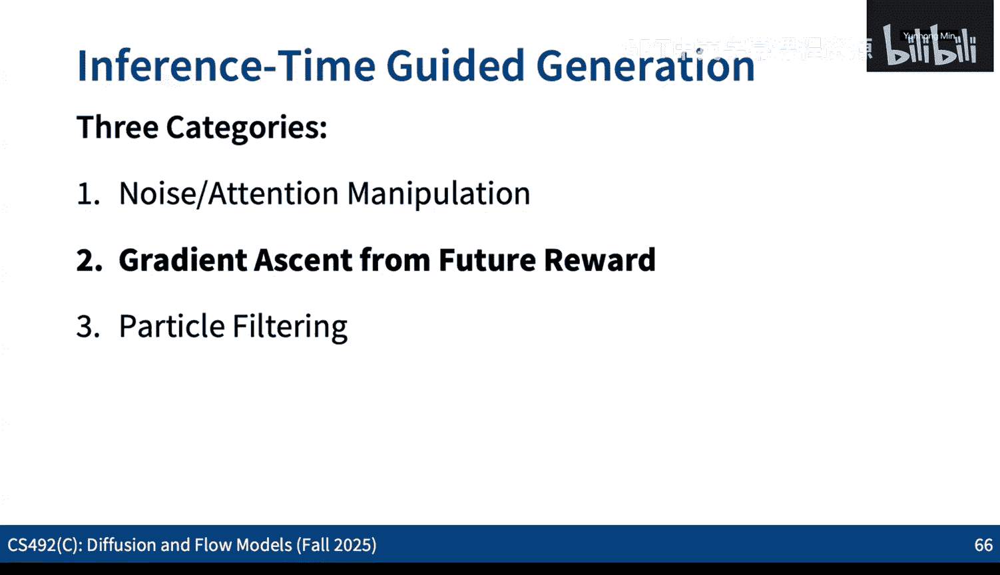