# KAIST《扩散和流模型｜CS492(C) Diffusion and Flow Models 2025》中英字幕 - P12：Lecture 13_ Inference-Time Guided Generation 2 (Diffusion and Flow Models, Fall - GPT中英字幕课程资源 - BV1CKpvz1EH5

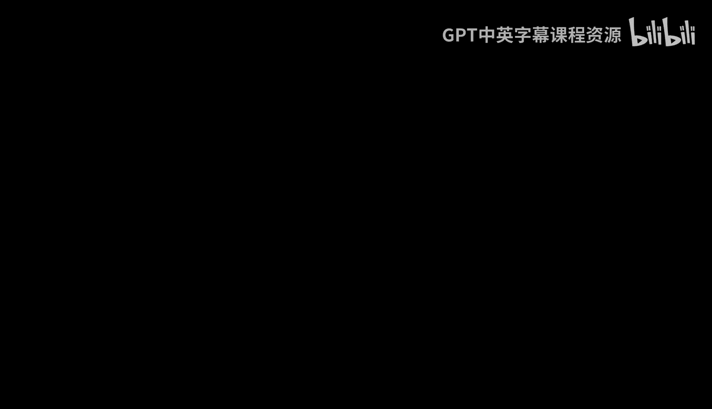

Okay， so then let's guess okay。 So from the last week。

 we started to discuss some kind of be some techniques that can basically that are basically about some kind of inference time divide。

 which means that with some kind of the pretrained D general or deploy flow the models。

 how can you basically inject some kind of the user divide guidance at the inference time at the test time in a way that the output becomes something that the user wants to see。

So for that， while there are actually lots of the techniques for that。

 I mainly basically introduced like those 3D categories。

 and the first thing was basically about some kind of like manipulation of the the score and the attention and for that actually。

There are some kind of some engineering idea in terms of how we can basically manipulate some kind of some inter layers of the neural network how we can also manipulate the output of the neural network in terms of those things。

 So those are the cases that we can provide some kind of the direct and the guidance the problem is that theres no theoretical explanation for this and also it can be only applicable to the very specific cases。

 for the some giving some specific guidance for the images can be extended to the other the data modities as well。

 But this was kind of the case。😊，So we started to discuss kind of slightly more kind of some different way。

 which is having some kind of the more theoretical explanation。

And why we titled this as kind of the greatest ascent from the visually word。 Actually。

 the things that we discussed last time was basically about the inverse problem。

 so the inverse problem was defined in this way， Basically， given some kind of the here。

 basically given the observation the why here。😊，And some kind of mapping function D A here。

 How can you generate the X that can satisfy this formulation in terms of that the Y the the X is aligned with the the observation the Y we have given this formulation。

For those kind of be some the universityity problems。Yeah， so the problem becomes like。

 know how we can basically model this kind of the conditional disc here。

So this is basically what we want to compute， right， Given the condition D y。

 how we can compute this core for the Xt。 and then using the base rule， actually。

 what we could see is that this marginal score is basically something that we are predicting using the neural net。

 right， and basically， then we need to basically compute this kind of sum sort of be offset into the our the core。

 which is now defined as kind of the the other way of the the conditional of score。

 basically the y conditioned by the X T， right。So it became ask all the way to basically how are we going to model basically this the condition of the square without having any kind of the extra training of the division the model。

And for that， we briefly discussed some kind of the two ideas specifically for the case that when we assume that the inverse problem is basically defined as kind of the linear function like this。

 then we could basically derive that this conditional square term here could be basically computed in this way。

With some kind of some parameters of the R here， which was the case that we are completing the pseudo inverse of the a。

And this could be further the simplified when you have some kind of the even more some kind of the crude de approximation in terms of approximating this conditional distribution into this way into the discussion distribution。

 obviously this would not be a simple deus distribution。

 but the benefit of having this kind of the simple the approximation is that now we can simply model the conditional square as kind of the gradient of the L to loss this way。

 So this was kind of like one simple， very convenient way that we are modeling the conditional score。

 And in a way that we can inject some kind of the guidance the test time。

And basically also changing this core function using this term could be basically rewritten in our the generation process in terms of basically not changing this query here。

 the noise here， but instead of basically modifying the final the sample at each step。

 so once we basically compute the next the sample， basically having the x minus-1 by just like having this kind of like one step of the back propagation。

 we could basically update the X t minus1， which was basically equivalent we basically modifying the noise term there。

So this was basically the page idea and also the good thing of like having this kind of the idea is that while it was kind of like derived from kind of some formulations in terms of the implementation。

 this is like really simple It just literally just adding like one line of the code into the the generation the pipeline in terms of the we basically injecting some kind of the guidance in terms of the the final output should basically de match the observation that we have。

😊，So I strongly recommend you to try this with your own division model in terms of whateverre kind of with some kind of guidance you can do。

And the also the interesting aspect might be that these are all the kind of the formulation based on the discrete。

 the time， this pace， the formulations of di models， right， based on the DPM， the formulation。

But we also discussed that actually， there's the corresponding the continuous time the theform as well。

 So this is exactly the same thing that we have seen in the the the S E de formulation。

 So when the reverse S is basically defined in this way。

 I'm just like introducing some kind of the new term here， which is nothing but just like。

This entire report。Then what we have seen in terms of basically reinterpreting thegen the process of division model is that actually the reverse process of division model could be interpreted in this way in terms like just like solving this SDE with the time domainretization。

And for there， basically， the whole process could be considered basically copying this core。

And this term， and just like computing the X T minus the delta T in three。

 So this is basically the same deform。 but let's be seeing that as kind of the discrete the time domain。

 the discreteretation of the S D deform。Then basically what we can see is that here we are seeing basically how we can compute sorry here。

 the x t minus-1 by updating it which is kind of like external the additional the here， right？

So the same thing also can be considered in the SD formation as well。So can you briefly？

Right down in terms like how is the reverse process of the the DPS can be completed also using the reverse SDE as well。

So basically the question is that when you think about this whole process in terms of basically adding these kind of the someD guidance into the disseling of the x minus1。

 how can you basically write de formulation for the same thing。

 but based on the reverse SD formulation？So for the reverse SD。

 we are basicallyhing those kind of the two steps， right。

 So this is kind of some simplified form of the degen here， right。be he exactly the same thing。

But if we basically injects this kind of the usual de guidance into the continuous the SDED formulation。

 what should it look like？Did you finish。5。I mean， this is basically nothing but exactly the same thing。

 right， basically once we basically compute， basically sample the X T minus the deelta T here。

 we just need to do some kind of the update based on the the gradient of the out here。

 So basically the same thing， basically can be seen in the continuous time domain as well。

But here are basically some bunch of the questionss that then can you apply the same idea into the UD formulation as so。

What do you think。What did we apply the same idea into the not DS SD， but into the OD formulation。

Anyance。So actually， I recommend you to try this yourself。

 So that's why we are having kind of be the team project in a way you can play with those kind of things。

 I strongly recommend you to try this with the both the S D E and the O D E formation。😊。

There is no reason not work should work。 mean， I guess the is basically exactly the same。

 but basically both for the S and the Oデform there might be some kind of be some practical some kind of things some issues。

So basically， as you can see， this is like all， basically when you solve this like O D and the SDD formation。

 we might need to have some kind of the discrete of the time domain， right。

 So how many steps should we take in terms of like adding injecting this kind of noise。

Would it be better to have some more number of time steps or the clear number of time steps？

Any issues。I mean， whatever we see， this kind of the SD formulation were sorry。

This the D PD formulation， would it be better to have some kind of the more the number of the time steps or the fewer number of the types steps。

No ideas。I mean， obviously， it'd be better to have some more number of the the times death。

 because then we we can inject this kind of some additional score， the more the number of times。

 right， So as you basically inject this kind of the score， the more and more。

 that would give some kind of the more the guidance towards to going to the final the output that we want to see。

😊，Then this question basically the question becomes that no。

 then there is basically some kind of the trade of because like as we want to basically guide the trajectory de generation basically the press into going to the something that we want to see。

It'd be basically better to have some kind of more numberty time stance。

 which means that de generation becomes like slower， right？😊。

So that's kind of the some sort of the downside。 when you basically inject this kind of the guidance only the the test time things without having kind of any tree training。

 So if we want to take the both the advantage in terms of the acceleration and also adding this kind of the the guidance that we might need to have some kind of the training the scheme。

 the training time to basically incorporate this kind of the additional the guidance。

But the equation of my is that if we basically instead of like taking the not the many the time steps。

 but few longer of the the time steps， but if we basically increased these kind of the。

 the weight for the。Additional dis， then what would happen。

So you can basically play with those kind of thing right。

 You can either basically increase the number of time steps or decrease the number of time steps。

 but just like increase this weight here right basically this basically involves some kind of the usual promptter that we can choose。

You can also think about like the meaning of like， increasing the weight here。

Based on the formulations that we have， that will basically become some kind of even the worst。

 the approximation。So basically what we typically see。

 when you basically increase the weight here is that we're going to say some kind of the output that is basically aligned with some kind of the given condition。

 the observation here， but there is like more chance that the output will become unrealistic。I mean。

 even without seeing any kind of deformation， basically what you can basically imagine is that as we have some kind of the bigger the additional disc here。

 the X T or the X T must one there， will be will go to some kind of the region that is basically becoming some kind of intermediate sample that the neural net haven't seen during the training So the noise prediction will basically become the noiseisier。

 basically not the accurate noise， which means that the trajectory will go into some kind of direction that the final the output become some kind of the unrealistic the data point while the output would be more aligned with some kind of given the usual the condition。

So there might be some kind of the tradeoff in terms of that how we can make some kind of the realistic the output。

 while also satisfying the given the condition。So many of the failure cases for those kind of the inference time guidance is that either the output does not really satisfy the condition that we are providing or the output becomes like unrealistic while satfiing and the conditions that we are providing。

 So how we basically control those kind of the usual parameters and also the number of time steps in a way that the satisfy basically both things is kind of the one of the critical depart in the inference time the guidance。

Makes sense。So this is really easy to try while we are not having any kind of assignment for this。

 I strongly recommend you to just implement this with your the code for the assignment 1，2 or the3。

 literally just like adding one line of the code into the duration the pipeline。

 then youll see that it can it plays some role in terms of giving some the guidance。

 but it may not be that easy in terms of basically getting some realistic data output while still satisfying the condition。

And quote on this。我。哎。So this is basically relatively wellknow techniques in terms。

 basically how we can add some kind of the inference time。

 some kind of the user guidance in the generation process of the D and the flow models。

 and the topics that I'm going to mainly introduce for today are basically some more advanced。

 way more the advanced techniques。 And I don't think that we're gonna have time to basically discuss all the details for that。

 So I'm gonna focus more on basically giving some kind of the highle ideas for those kind of the the techniques。

And also， the context as well， basically why we discussed those kind of the inference time the skill in the idea。

 because actually， this is kind of the trend， not only for the diion and the flow models。

 but you more the broader the journey AI， the kind of the techniques。

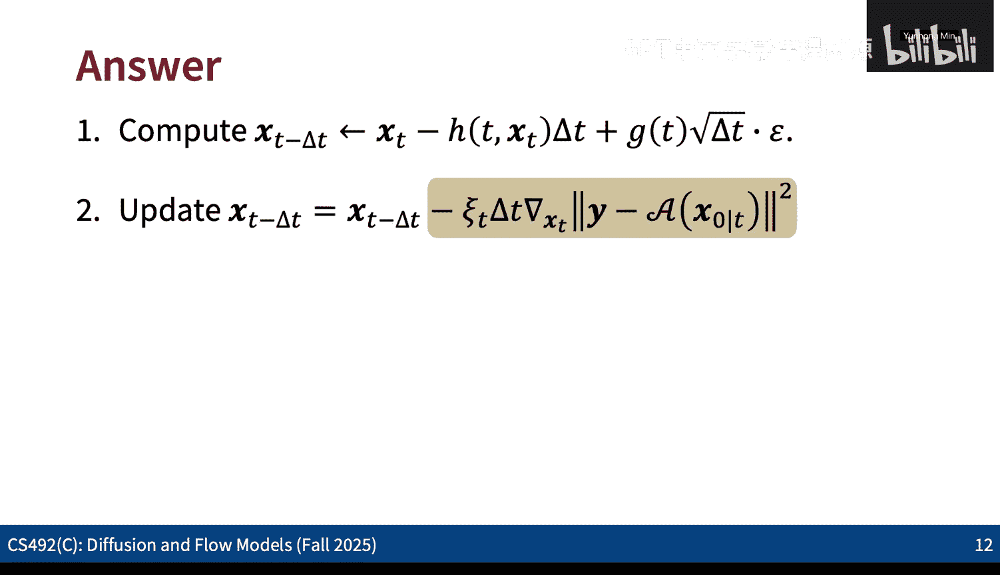

Especially for the A&M， we already seen some kind of the many techniques for the test time killing。

 so I guess most of you would know this person。Do you know。😔，Yes， no， you don't care。

 who is one of cofo open AI interesting reading some of the papers about and the flow models。

 then you actually see that the cofo of the open AI is actually one of the authors of important papers about the flow models This quite interesting even if you see for example。

 consistency models is also the paper having one of the authors。😊，So anyway。

 so he's many kind of like no， talking of like many things about the AGI and one of the things that he was talking even like one year before was about the end of the era of the the pretrain。

So basically， the claim is that for especially for the N And M。

 we already used all the data that we can use Everything that。

 you know there exists indeed the Internet。😊，So since we already used like all the data that we used。

 even when we basically scale up whatever kind of things in the training time。

 whatever we scale up basically the size of the neural net and also the competition time in the training。

 the performance gain that were going to get by spending more compute in the training time would be quite limited。

Like this。 So here the basic idea is that instead of like spending more compute in the training time。

 can you basically make some kind of the bigger the improvement in the the performance by spending more compute in the test time as well。

😊，So that was kind of the big topic over the the year this Ph year。

 And we only have seen lots of some kind of the good examples for that This is。

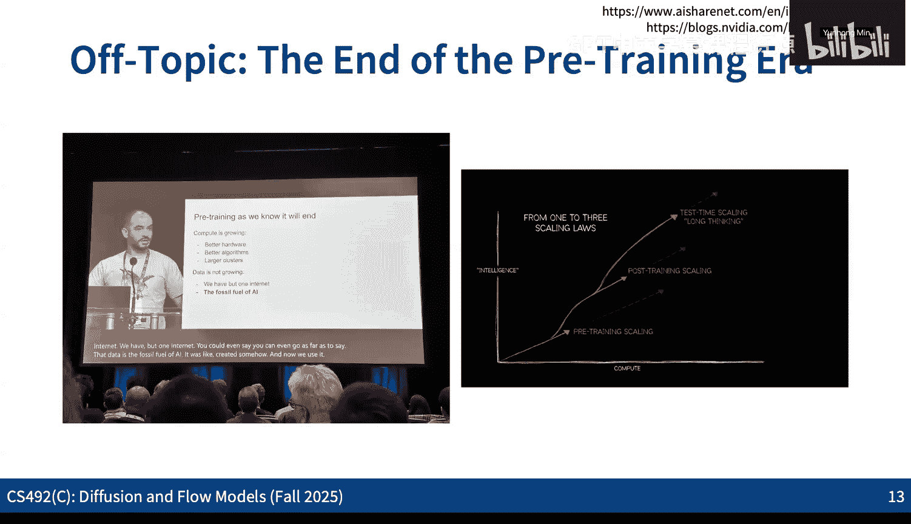

Already like， it has been the。 I guess the O1 where the O3 have been introduced last year or something。

Now， even we are seeing the Egypt5 and the many recent models。

And the kind of the shocking thing at the time， like when you see the1 and the3 was that there was some kind of the measure of like measuring the A kind of things like how the performance of theM is close the human。

 there are some kind of the benchmark for that。 before the some kind of the previous with some kind of previous models。

 the A score was like very low， like like something like the10% or the 20% But when we see start to see the O3 here。

 the age I score exceeded score of the88， which is like huge jump from here。

And this was basically the case that the the the the obtain the models started to spend some kind of the more time in the the test time。

So if you basically also click something like the thinking model need now。

 then it basically takes more time to improve the answer。

 So that's the basic idea for the test time scaling。 spending the more computing the test time。

 how we are going to improve the output of the AI the table。So the Op A is。

 the O1 and the03 were basically very representative in the case in terms of how we can basically improve the performance of the desired models by spending more compute in the test time。

And also， we have seen some kind of the another good example the early this year。

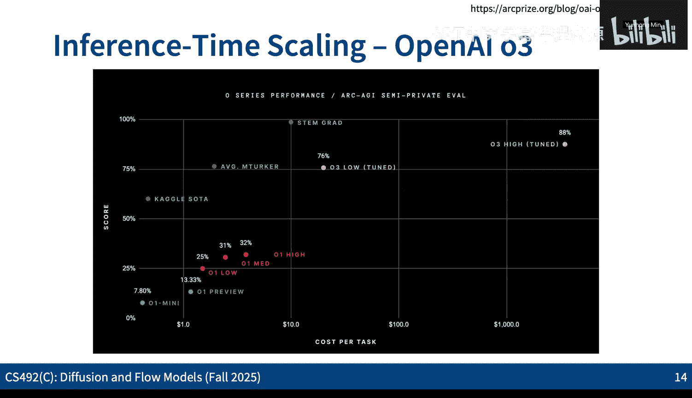

诶对 know啲。Deeps。Does everyone know how deeptick work？のイす itト。A simpleim question mean。

 deep was quite famous early this year， right， and the basic idea for the deep I mean， the R D model。

 basically here， I mean， obviously， there are lots of things to discuss for deep models。

 but one of the main ideas for the deep R D model was basically having this kind of the thinking process。

 So not just like output some kind of the final kind of things。

 but let the M to produce some kind of the some intermediate tokens in the thinking kind of the phase in terms of the mimic some kind of different thinking process making some kind of all intermediate things。

 So this aha moment was quite famous in terms of even the deep is to be fixing some of the errors in the previous thinking the process。

So this was basically all the kind of basic idea in terms of that how we can basically improve the outputs of the models by spending the compute。

 not only in the training time， but also in the the test time。So， and this like the in the addM side。

 many people are saying that this is kind of the future direction in terms of improving the quality of the upward。

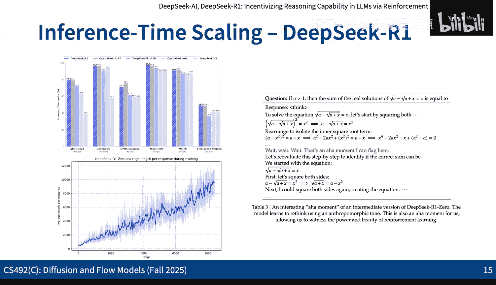

So regarding the test time is killing， I'd like to recommend you to watch this video。

 some explanation from the Daniel which use the engineering in the Open AI。

 so let me briefly play this。

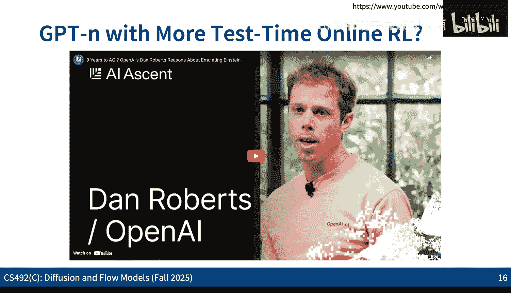

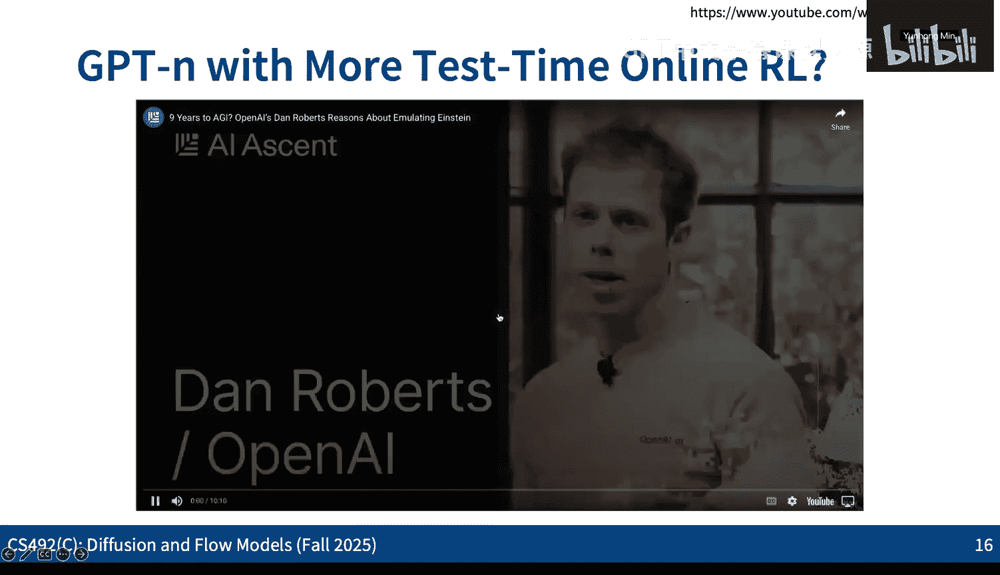

Well， let' to imagine let's do with thought experiments， who does thought experiments。

 Albert Einstein， so let's do a thought experiment about Einstein and let's imagine we go back to 1907 before he started working on general relativity and we asked him the final exam question for general relativity。

GP 4。5 have actually made this up， but I can verify that this is a valid sort of question you might ask。

 And you know， we're of AI we want to ask Einstein， wed ask Einstein B 1907 supers。 how， you know。

 sure we get maximum reasoning effort heard and maximum effort we would get。 So Einstein。

 I guess see the visual thinker something about elevators and free。

 This is you study you learn about this。 do some calculations and。

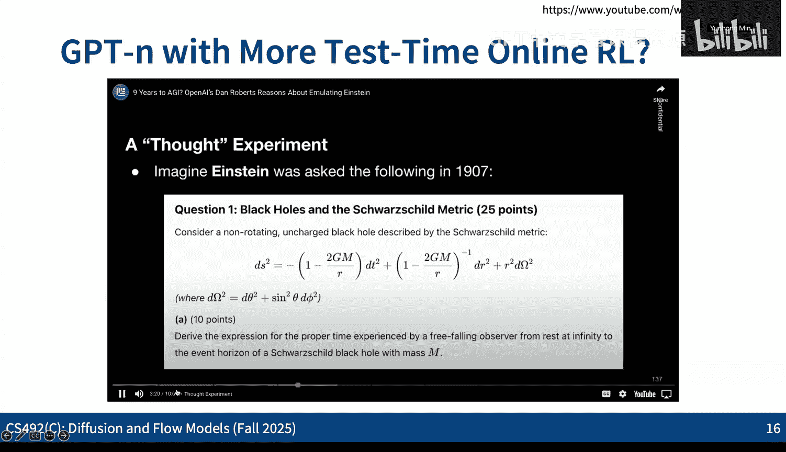

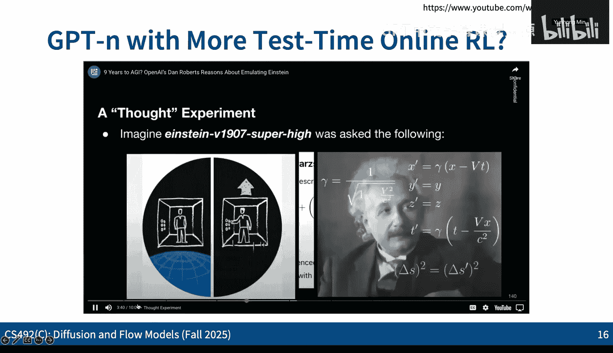

There's the rubber sheet in the ball。 and he looks like he got distracted about quantum mechanics for a bit。

 Our models get distracted too。 There we go。 That looks like a you know starting to get to the black hole。

 I also don't know why he thinks about himself and all these scenarios and there we go。

 that's like the sort of black hole thing that was going forward with the normal that's the right answer。

 turns out GDP4。5 and get this right answer。 we needed3 was able to get it。

 I think my role at open AI is mostly just checking physics calculations rather than AI research。

 but okay the point is though it gets the right answer。 Imstein we get the right answer。

 And it would take them about eight years and to solve the problem。

 or what I'm saying is that you he would just and this is what happened8 years later。

 he discovered general relativity he'd be able to answer this question。

 So our models think for a minute now and they can reproduce textbook calculations and and pertuation there。

 but like we want them to like make major contributions to the state of human knowledge to science。

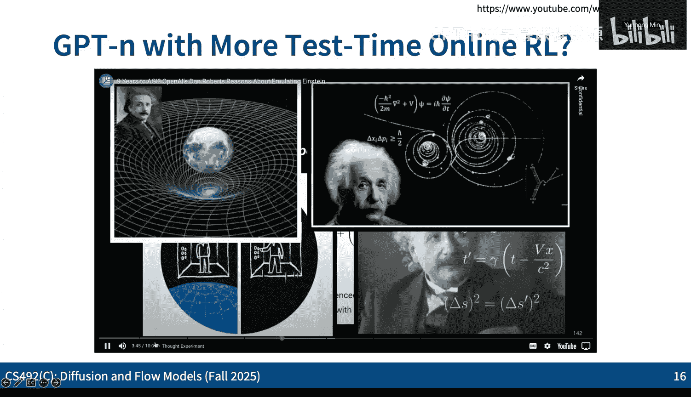

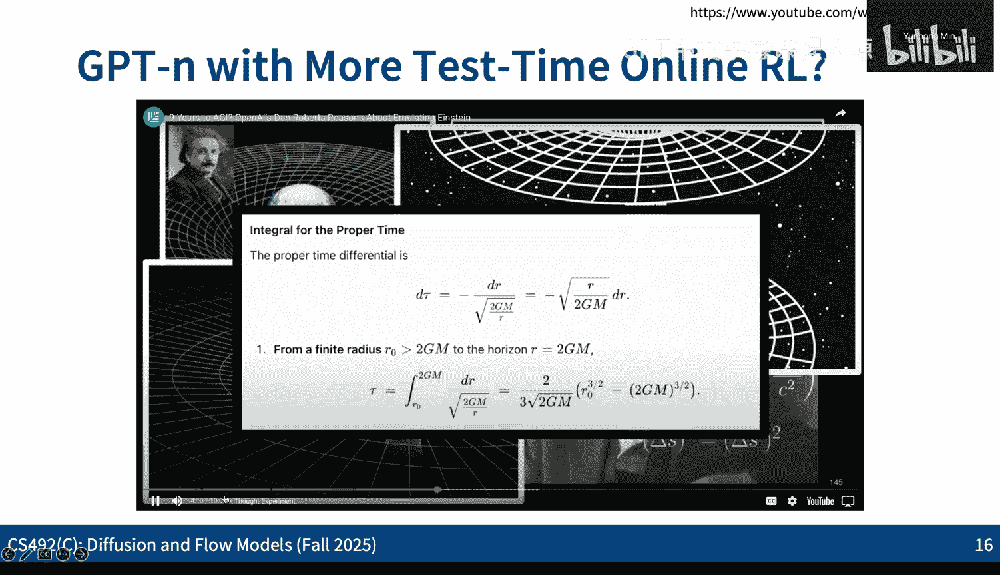

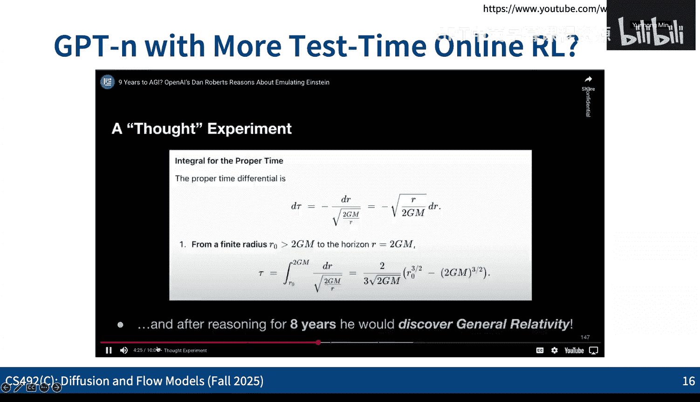

So。Coming back what how do we get there well now let's focus on the left plot the performance of the model improves the more we train it and the sort of training we do is RL or reinforcement learning and so the main thing that I want to communicate in this top is that we want to scale that up a year ago we put out G40 there was compute use and it was all pretrained compute and as you can imagine then we started doing this thing that led to test time compute so we added some reinforcement learning compute RL compute 401 I should say this is all cartoon but you know directionally it's correct 03 maybe had a little bit more RL compute。

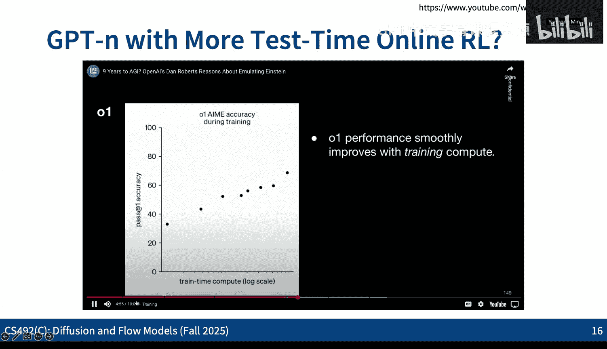

At some point in the future， maybe well have a lot of RL compute and then at some far point in the future。

 maybe we'll have just like totally dominated and crushed by ourL compute。

 And like this this is I think just kind of a contra point of view like is this is where we're going and we mean it point to emphasize sort of the contra nature of this this is some of you called AI research。

 this is a slide that y'all Mcku made some number of years ago。

 I guess 2019 based on copyright the borrow this from obviously this is a complicated slide that's hard to maybe hard to followLuckiily we have models that can summarize things for us。

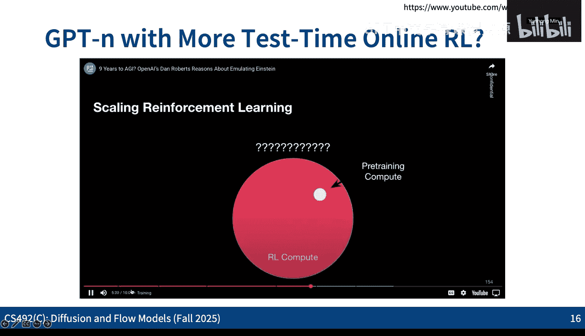

Point is that preing is like this big cake and reinforcement learning is supposed to be like this little cherry on top and you know that's basically what this plot was。

 the color scheme actually was accidental but I think it actually works quite quite well。So yeah。

 here the basic idea is that basically this guy wants to explain like how the GPT can solve the problem in we the problem that the Einstein was solving for the eight years。

 So this is basically based on some kind of the RL based some kind of the some kind of the test time is killing in terms of having some kind of the moral in compute in the test time。

So as also then briefly explain here， this kind of test time is killing the idea is based on the some reinforcemental learning。

 so we're going to briefly talk about this without having getting into any details for that。

 but as you can see， if you see some kind of the more recent the models even when you try the G the file for now。

 there will be some kind of the more the thinking the phase the thinking the model if you click that it will take some more time to kind of the outputs they basically all involving some kind of the test time they is killing in terms of like improving the outputs in the test time based on the more compute at the test time。

So the topic that I'm going to briefly talk about today today is that how we can also apply sameデ idea not for the what recently models typically used for the edit but also for the division the models that we are discussing here。

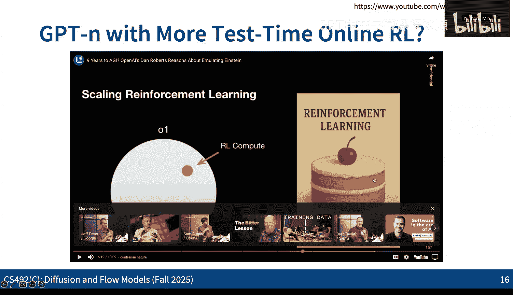

If you are also more interested the test time is killing the idea。

 theres some kind of the some sort of the survey paper。

 which is talking about lots of the techniques for that。 So check this out。

 So there are also lots of kind of the things you can try。So one kind of beside notice that so。

What I basically also heard is that if you do some kind of the if you see some kind of the research groups working on the AM side。

 especially for these days。They are not only focusing on just making developing some some single technique。

 We're just like making some kind of the papers here。

 the focus of more on basically how to start up in terms like making some kind of new just model that can outperform many existing models。

But I'm not sure how this will be kind of be promising the directions。

 But the thing is that after we start to see some kind of more the technique for the test time killing。

 this is basically not about basically how are we gonna use the tones of the GPS and handle like lots of the data to make some kind of the big the level。

 big model。 Its more basically having some kind of the some smart techniques that can be also working with some way fewer GPSus as well。

😊，Compared to some kind of between the the time they compute， right。

 So basically these here the hope is that we use even with some kind of the much smaller the amount of the the competing resource。

 even at the test time by applying those kind of techniques。

 we can make some kind of the much quarterly improvement in the test time。

 So this basically motivates kind of like many people to think about making some kind of。

Developing those kind of techniques and also thinking about starting up in terms of basically beating the performances of the main existing models。

 So this is kind of， I think this is quite interesting the direction in terms of that how we can what what basically we can do even with some kind of the much smaller the amount of the computing the resource not with some kind of the train the from scratch like those kind of models。

 but with some kind of the。Test time kind of things。So this is kind of the direction。

And while there also， as you can see， there are lots of some kind of techniques for the test time scaling but the very basic idea for the menu things things for the test time the scaling is that we are basically having the propose and the beifier。

 So this sounds like we are going back to the then framework So actually the propose basically means hour the pretrained the J model and the bayifier is kind of the un of the model。

 it can be a neural network， some kind of some kind of the code whatever kind of things in terms like just really verifying whether the output from the propose is kind of the good or the bad。

Then based on this kind of the the verifier。 So we can basically guide in the the proposal。

Or we can consider basically selecting some of the good ops after making the proposalr to basically propose like multiple of the ops。

 So that's kind of the very， the high level the idea in terms of the test and the scaling。

 So we're gonna get into slightly more details for that。😊，And at the very beginning。

 what I'm going to introduce here is that how we can also interpret the idea that we have seen for the deepest case solving the inverse problem in the context of that we are having the deal function。

So basically we can interpret this kind of the concept of having the propose and the verifier。

 basically having some kind of the pretrained theogenic model。

 so in our case there would be diffion model and also having some kind of the function。

So this leot function is basically giving some kind of the guidance about some kind of the usual de。

 So when you have some kind of the some final the output， the realistic the data point。

 if this like function， the output is basically high。

 that means that this like more aligned into the usual de and if the function basically the low。

 which means that the output is not really aligned with the usual de。

 So we are basically assuming kind of the case that no we have this kind of the some real function。

s basically giving some kind of the the notion of the usual de。

As kind of the some the some continuous and the differentiable dysfunction function。

And what to be such kind of the case？That we can assume some kind of yield function。

You can also think about many examples for that right so basically for any case when you have any sort of some differentiable some discriminutative model giving some kind of score for the output。

 we can consider this is basically define some kind of the function here right？And also。

 what we can see is that the inverse problem， the cases that we have seen last time is kind of the some special case of the having those kind of like leot function。

 because we can already basically define our the leot function like this。

 So the minus of the L to loss， basically as the L to loss is basically small is increasing the leot function when the L to loss if high。

 which means it's like decreasing the le function。 So the all the cases like the inverse problem can be considered as kind of the some special case or like the cases like making some sort of the leot function。

😊，So this is really kind of the general framework that can be applied to the many applications into the also to the many demoalities as well。

啊。For not only for the images in the videos that we have seen multiple times。

 but also for the many other cases， even that I don't know well， for example。

 for those kind of the emotion generation， what we can do is that we can。

Guide this kind of the emotion in a way that it should basically avoid those kind of collision to some kind of the object in the same。

 So if we somehow define some reward function that is basically avoiding those kind of collision to the given some kind of object that can be used to this kind of some trajectory。

 like basically making the emotion， avoiding those kind of the collision to the kind of given things。

And also for the many other there some kind of the science problems。I'm not the expert for that。

 But for example， I put some kind of the molecular generation for many kind of things。

 We might want to make some kind of the some molecule。

 some sort of the graft structure while satisfying some kind of condition。😊，I don't know。

 I heard that there are some kind of questions like， you know， we have some kind of the existing。

 some kind of the molecular structure， and we want to make another the molecular structure。

 which can be have some kind of the doing point with some kind of existing the。

 So those will be some kind of the condition that we want to satisfy， right。

 for those kind of cases if we can define some kind of the water function。

 Then we can also consider those as some the cases that we can apply the same technique。

So there are actually last of some of those kind of the applications。

 If you are also working on some specific applications with the different default models。

 then you can also consider findings which kind of the problems that you can easily define some kind of video function。

So here， the basic thing is that given this kind of reward function。

 how we can provide some kind of the guidance in the generation the process。

 see what I'm going to show is that the things that I'm going to explain here from the next slide is eventually will be exactly the same with the DPS de formulation So this is basically all about how we can basically interpret the same thing from the different perspective。

So I'm not going to get into any the details for the kind of the audioal deformation。

 but this is actually based on some kind of the audio kind of literature。

But without any kind of some background for that， basically what we can see is that actually now we want to sample some kind of the final the data point。

 not from the original data distribution， the P0， but let's say like we are defining some kind of the new data distribution in this way。

As some kind of the output of some kind of the maximization， the problem。

So this is basically some kind of the defined the data distribution。 And we want to sample from here。

 And how we define this is that basically， this is defined as kind of solution of like this maxim the problem。

 So basically what we can see is that we want to define some kind of the new distribution。

 the P0 thista here， in a way that that becomes close to the our the original the distribution。

While also basically maximizing theD word， the expected value of the D word。

So where you basically sample from the new distribution。

 the reward words for those kind of samples should be de maximize， right。

So this is already showing some kind of de trade of between how much the new distribution would be close to the original distribution and also how much the samples from the new distribution will be maximizing the divert。

So as I also mentioned from the DPS case。As we just try to maximize theot more and more and more。

 it might be the case that we are debating more from the given the original distribution。

But if we are simply sample from the Kibunde distribution。

 then we might accept some of the cases that the samples up is not having the highly worked。

So given this kind of the trade of， we are finding some kind of the new the。

Data dis here in terms like finding some kind of sweet spot with some kind of the weight here。

So it's basically made of like now how much we are going to maximize the reward with the samples from the new data the distribution while basically not being debated too much from the given the original the data distribution。

Just like we are defining the distribution in this way。

So the thing is that now we want to sample the final the data point， not from the here。

But from the here， from the P the start。And if please simplify this whilst skipping some details here。

 actually， this formulation of the P the star can be rewritten in this way with some kind of the complex de formulation disease here。

 I Q it can be simplified in this way。 having some kind of reward function and also the weight here。

And。Actually， if you are familiar with some kind of daily person of learning。

 anyone who took the audio the course before。哦， okay。

So yeah'm gonna not getting into any kind of details for the learning if you take course for now you gonna say that many techniques techniques are based on exactly the same information but for the training not for kind of test kind of So this is exactly the same thing are seeing some kind of literature learning。

😊，So what the thing is that we are basically using some kind of the the diffusion model。

 which means that we're gonna to have some kind of the intermediate the， the data points in the。

 the thenoging step， right。So then what we also need to do is that we also need to know the distribution for the not for the final the output。

 but also for the intermediate data point as well。As I said， like for the di flow model。

 especially the diff model， everything is about computing this core function right it's all about the core。

 which means that we first need to know the probability distribution for the all the intermediatemedia data point and the purpose of like having this would be obviously would be is to compute this core function right and also while skipping some all the details here。

😊，Also what we can see is that the probability distribution for the intermediate data point Xt is also defined in this way。

 so you can see that this looks quite similar with the distribution for the final the output here so here we have that the neo function for the x0 the clean data point we are simply replacing this as kind of the value function here so this v function here that satisfies like this is called the optimal thevalue function。

And so I'm going to skip so many details here。😊，So the problem is that while it's relatively like easier to basically derive this form。

 basically except for like this Zio， actually having this is kind of really kind of something that we can compute。

 right？😊，The problem is that for the distribution for the intermediate the data points。

There is no basically analytic form for those kind of debris function here。

 So there is no way to basically we can precisely compute this kind of those like de function here。

Which means that we also need to have some kind of the approximation deal。

So if we follow like what we have done for the deepest decay。

We are also going to have some kind of the some similar， some sort of crude。

 the approximation in terms like approximating these value function using the t is formula in the。

 And you can see that actually these really basically。

Blowows like now how we defined the only the the new distribution here。For the new distribution。

 for the final the output here， it does basically theer for the final the output the X0。

 and we are mimicking this in terms of then now we are completing theer for the expected the output from the X T So this can be kind of can be considered kind of the good approximation for the optimal the value function。

 And you can see that this is quite similar like what we have done for the Dp case。

 we also need to basically approximate the core function of the X T with the score function with the X0 were using the。

So doing the kind of the same thing in this， the other based de formulation。

And the good thing that we are approximating the optimal devalue function into this form is that now we can compute this core function。

 right？So as you know， like this is like all of a computing score。

 The computing score is basically made like computing the gradient of the logo of the probability。

 and now we know the discipline here and you could compute the gradient of the logo like this form。

Then what you can see is that actually this becomes equivalent with basically having the original square here。

And plus some kind of the additional tone， which is basically defined as kind of the gradient of the expected。

 the virtual， the of competitive the expected output。Makes sense。 Then what actually。

 we can see is that in the continuous depoulation， that becomes the same thing like with this。

So last time actually we have seen that the inverse problem can be seen as by defining the dever function as kind of the minus of the outer loops。

 right。So if you plug that， the minus of the Lus， then actually you can see that this becomes exactly the same formulation with the deepp formulation that we have seen。

So， this is basically。Kind of the another way to basically having some interpreting theform of the D P D P。

 not based on the the DDP deform based on， but basically some more like original style kind of deforms。

Make sense。So yeah， I skippped some of the details here。

 but here the basic idea is that we explicitly basically。

Introduce this kind of the tradeoff between the like the world maximization and also the deviation from the original the data distribution。

 So based on those kind of the tradeoff， we basically introduce and introduce a new data distribution here。

 P0 thista And then the problem becomes like you know how we can sample from that， right。

 and based on the formulation for the new the data distribution。

 what we just need to do is that we just need to derive the。

This will be for the intermediate data point of the X T here。

And then also approximate the optimalvalue function in this way。 I mean。

 there can be multiple other ways。 Even you can consider training another neural net to learn this。

 actually， there really some kind of approach for that， which is basically not stable。

 some kind of reasons。 this is kind of like some simple way to approximate the optimal value function。

 And based on this approximation， the good thing is that now we can simply compute the score in this way。

 And we can say that this becomes basically the equivalent in terms of basically having the original score。

 pull out some kind of some additional score， which is now completed the gradient of the expected the future work。

😊，And that becomes basically identical with the deformulation that we have seen in the DPS case。

 so I'm just like introducing this in terms of that there are also kind of the multiple ways to basically interpret with the same thing from the different perspectives so you can see that this is another kind of the way to derive the D deformulation。

This way。Any questions on this？So if I issue some kind of the more applications like based on this。

 do you have any kind of the ideas in terms like what you can do with this kind of the idea。

Using further the team project or for any other things。

 given any kind of some pre trained the model that can generate some kind of some realistic data points。

What kind of some sort of big guidance we can tie to add。To make something new。我po。嗯。

So basically the examples that also I have shown last time were all about basically for the。

Image the generation the imageative models， right And also how about how we can make some kind of some specific types of images based on the pretrained image the generatedative models。

But actually， also something that I'm going to introduce today and also the Wednesday as well are also about how we can make something the new in terms of that。

 Thats not something that can be directly generate from the print model。 So， for example。

 like given some kind of the pretrain。 like image the different model。

 How can you generate something more than images。😊。

So those are also some kind of the interesting questions。

So one kind of the example for that is basically also that some like some applications here is that we can also do some kind of the make some kind of the more than the images using the printing image。

 the models， something like these 3D or some kind of some panoramic images。So for example。

 like one thing that I'd like to show is that if you see some kind of the many pretrained image digital models。

Includingting the model that you are also using for your leadD team project。

 you will see that those models are basically generating some kind of the images in the certain resolution。

 like 512 by the 5，12 or some kind of into the certain resolution。So here。

 the question is that what if we want to make some kind of the images in the much bigger size？

We some kind of the random ratio。We some kind of some more like panoramic imagess were some 3。

60 imagess were in and other things。For that。TheObviously kind of the best idea might be that we are just training another the diff model for that。

 but one kind of the idea in terms of making some random size kind of the images using the print model is that we are performing the diff the process simultaneously from the different kind of the perspectives。

So this is kind of like one example that we having some kind of the big canvas for the image for the panorama image degen。

 And we are basically dividing this big space into the smoothest space where basically we can directly generate the images。

 using the pre the model。So let's say DC is the size that has been used to train the pret the diffusion model。

And we want to join some kind of the much bigger image like this。

 And what we do is that we are basically making some kind of the bunch of the windows like these box with some kind of the loss of the overlap here。

Then the question becomes like we are performing thegen process on this kind of the multiple。

 those kind of some small disk curves while making these opera regions。

To share exactly the same thing。Makes sense。So every time when we perform the generation process through the inside is like the multiple de boxes。

 we perform the your process like in parallel， while like ensuring that the opera region here basically share exactly the same thing。

Can you define the reward function for this？Over that。Yes， I mean。

 we can come away some kind of function further that， Right， I mean。

 we can compute the t for the both of the default and making the2 the over region here becomes the same。

 we can just define some kind of l loss where we can use some kind of the predeefine some kind of style loss even to make match this style across the all the kind of the windows here。

So this is kind of some simple idea， right， I mean。

 we can apply those things to make some kind of some good panorama images like this。

 So these are all kind of the examples like making some panorama images based on this idea without having any kind of the new diffusion model or the flow models for that。

And the thinking also can be applied to the some make some kind of a 360 me as well。Obviously。

 there will be some kind of loss of some kind of the implementation details in terms of how to achieve some kind of the best quality。

 But I'm just like giving you some kind of some ideas and how we can apply the same idea to make some many other things。

And also， the same idea can be applied not to make some kind of some 2D things。

 but also these 3D things as all。 So if you are not familiar with some kind of some graphics kind of a region kind of the researcher。

 But even without that， basically， the thing is that here。

 we want to add some kind of some color information defined on the over the surface here while we only have the image the model。

For those kind of cases， what you can do is that we are basically。

 what we want to generate is based some kind of the color information over this surface here。

But the thing is that we only have some kind of we only have the division model that can produce some kind of some projected images here。

Now we can apply the same idea in terms of that when you basically sort of do the reverse of the projection。

 projecting 2D things over the 3D surface into from the multiple de。

 we want to make the overlap over the 3D regionss to be exactly the same。

So we can best apply the same idea in terms like making some 3D detectors as well。

So we can also make those kind of things in terms adding some kind of colors over this surface by having those kind of some synchronation the idea。

So basically， I recommend you to try to consider those kind of some kind of re function that can make some kind of the many new things。

 giving you some kind of the ideas of like what you can do with the print models。So actually。

 for those kind of de synchronization， the the easiest way to perform this is basically exactly the same thing with the kind of the deepest kind of things。

 but we can do even like the easier way in terms of that。 We first。

 basically sample the all the X T here。😊，In the some kind of the space that we call as the instant space and then project all the things into the canon space。

 This is the real space that we are generating kind of the data points。

 And here we just make the to to be basically exacted the same in the op region。

Ba'sically modifying the the， the t is。 And then based on that。

 we also updated kind of the X T-1 for the all the instant these spaces。

 so we can apply the same idea。And actually， this simple the idea has lots of the applications。

 some interesting some applications。 Have you heard about the ambiguous images？😊。

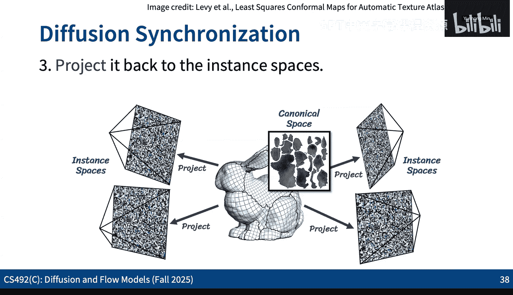

Some kind of be cute examples。Here， this is now oil painting of the people here。And if you flip。

 it becomes the old painting of the old man。And here， the painting of the house points。

 and after some flipping， it becomes the painting of the Einstein。

 So especially about making some kind of the images that can have some。

Two or multiple different kind of domain meanings， depending on some kind of transformation that you're applying to the image。

Some interesting examples， for those kind of the cases。

 can you see how you can define the canon space and the instant spaces。😊，Yeah。

 those kind of the outputs can be generated using the exactly the same idea。

 depending on how we define the chemical space and the instance spaces and also some kind of abriid dysfunction function。

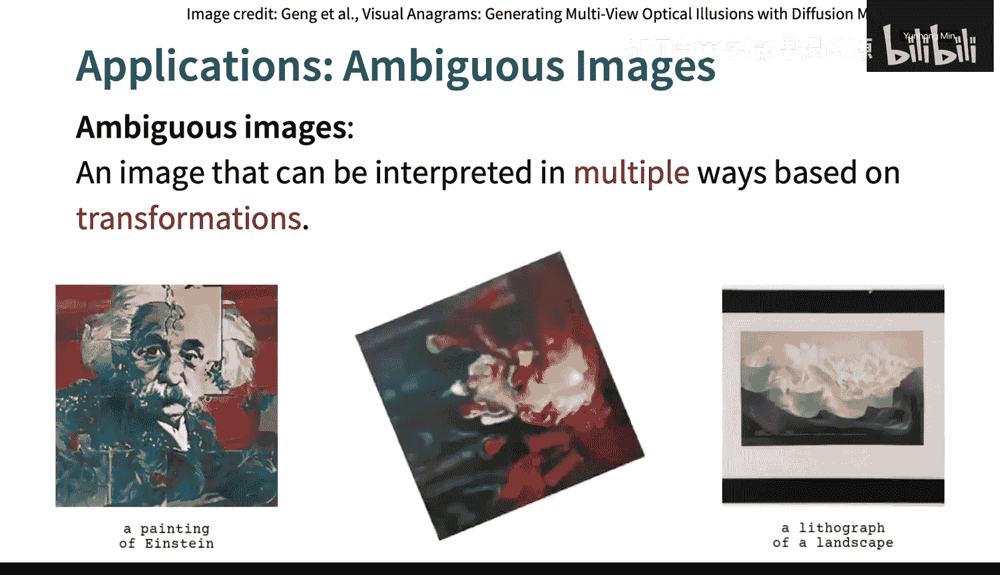

呃，Another一。스6기 잡부。In finite zooming in of the images。Yeah， so。でもぎ。Starting from the。이メージ ofデキ lu。

And getting into。The plant here。And all the way to the some details into the some。

Wass that some kind of be。Some buildings there。Intering。So this is actually kind of the video right。

 but this is also created using the pretent image user model。

And can you see basically how you can basically generate those kind of things？

So especially having some kind of the more details into the similar the region right so it's also matter of like how we define some kind of instance these pieces for each of the level and also doing some kind of some synchronous deviation。

Some马的一个江破车。嗯。Obviously， for those kind of things， there are some kind of more or some details in the implementation in terms or to achieve some kind of the best quality。

 but I'm just giving you some kind of examples like what you can do with this kind of be some test time kind of scaling things。

And also for the motion generation， what we can also do is that for some kind of the pre model。

 they can make some kind of the should the time， the sequence of the motion。

 we can make it the longer in terms of basically somehow combining the multiple the short motions into the long motions while making the transition to be smooth using this kind of some synchronizing detecting。

 So those are some kind of the also the all the applications in terms like what we can do with some kind of the greater ascent from the future。

So compared to the previous technique， as I also mentioned last time。

 the good thing for this is that this is really some kind of some kind of some de general technique that has some loss of some bru applications for whatever the cases like when you define some kind of the differentiable the function。

 you can try to apply this technique while there might be some kind of some details into terms how we can achieve some kind of best quality one kind of the downside for this is that actually the real kind of the downside is that there can be some failure cases that's kind of the one and also the other kind of the big downside is that the real function should be differentiable because we are performing the gradient descent and gradient ascent in this case right。

So one more kind of things that I'm going to briefly to mention today is that how we can also apply the kind of the same the idea。

For the cases that we are not having the differentiable the function。

 but also for the non differentiable delivered function。

 And this is kind of the most general kind of technique。

So if I go briefly with these kind of things that if we go back to the idea of the test time' killing for the addM。

So these are basically the case that we are having the propr and the verifier。

So if we really think about some kind of pretrain the LMs， I mean。

 pretrainwined the purer and some kind of the existing the Bay fire。

 what to be kind of the best way to， I mean， some simplest way to basicallygypsum kind of the better the outputs by spending more compute at the test time。

The easy giveと you can come up any any support。You might hear about this， but I mean。

 this is even the the easiest kind of the。 if you have any kind of the proposal the bay file。

 and if you have unlimited amount of the GP the resources。

 then what are you going to do to improve the quality of the outputs。

You haven't thought about the case or you having the unlimited GP。

You have some proposal and they pay fire and you have the unlimited the amount of the GPS then。

The easiest way is that you just like generate lots of things and just choose the best one。 No。

 that's kind of the easiest way。 So you just like run the propose multiple times with some kind of some random mystery making some kind of the multiple stochastic random the opposite。

😊，All realistic couple， checking all of them with your the fire and picking the best one。

That's kind of the best thing， right？Actually， this is really something that the you the GT doing。

 You the German， many are already doing this kind of thing。 This is kind of the easiest way， right。😊。

But what also people are briefly here discussing。What now is being discussed for now is that how can you also make this kind of the process to be more efficient because you still need to basically run this kind of degeneration the process until the end。

 especially for the addM it also take lots on time because it's like really sampling the token sequentially in theer manner。

 So after basically generating all the de tokens you will be able to compute the re right。

But what people are talking in especially the editingM side is that there might be some cases that we can introduce the process of the word。

The meaning of the process reward is that in the intermediate the process of the generation can we still basically define some kind of delivered for the intermediate outputs。

For example， like for some kind of the math problems。

 when the AM is producing some kind of the some math formulations。

 we can still check whether the formulation is correct or not for the intermediatemity output， right。

And also put some code。You can still check whether the code will basically make some kind of the compile error or not with some kind of intermediate output sensor。

So for those kind of cases， when you have some kind of the process reward。

 we can consider reverging this in a way to basically making the generation the process to be more efficienticient。

Which basically means that we are basically making multiple data trajectory of de generation here。😊。

And based on the basically what the signal that we are getting from the processorory world。

 we can cut each of the branch， right？If you see that already this kind of be some the。

 the generation the trajectory is kind of the bad in terms of the our the process reward that we don't need to generate more。

 right， So we cut those kind of branches and branching out some kind of the other some more the promising branches like this。

 So we can consider those kind of some more like making those kind of the some tree structure in terms of making the generation the process。

Makes sense。I mean， simple some engineering idea。Then the things that obviously we can consider doing the same thing for the diffusion and the flow models。

 diffusion the degen the process is also iterative process。So we can also do the same thing。

 basically branching out into the multiple trajectory and the cutting kind of things based on like what we have what we have with the process world and continue for the more promising directions。

The same idea also can be applied to the division and default flow models。

But what would be some kind of the major difference between the AM and also di the models。So LLM。

 the iterative process of the LLM is basically making every single de token like some kind of the word in the text。

 right？The diffion is basically the demoing the process， having the intermediate X T。

And what's the difference between this？No。就は啲。So basically， for the diffusion model。

 the intermediate the data points is really partial the output。We only have the partial information。

 We just have some kind of the in the middle of like generation to kind of give the full sentence and based on those kind of the some。

Really some kind of the partial output。 We need to be able to define some kind of the real function。

So there are very specific cases that we can define some kind of the process word。不是。

Many of the other cases is even not kind of the clear how we can really define the process regard before we are seeing some kind of the full the outputs。

But one small kind of difference between the AM and the D default flow model is that。

볼디 디퓨전 into4 models。The intermediate the op。A kind of the in terms of that is kind of some sort of the blurry and the noisey the ops。

 but still is's having the entire the content， right。

 And even we can easily compute the expected final output with one step from any intermediate kind of di op。

 right。😊，So which means that the way like we are defining the processing world can be different in the other end。

 the processing word should be something that we can really define with some kind of dis some partiality observation。

But for the diffusion deploy model， the way that we are defining the process word can be actually things。

 I mean， we can actually consider any theot function that we are competing for the final the output can serve as some kind of the process word because we can already use some kind of the is formula to compute the expected the final the outputs。

So that's kind of some small difference in terms of basically how we can define the process revert。

 both for the editM and also the image and the video generation in terms of the in this case。

 we don't need to define any kind of some special process revert。

 any of the function they we defined for the final the outputs as it can be directly into it as our the process revert。

 which sounds like that no this is kind of the much kind of the easier setup in terms of applying the test and this killing in a like much more efficient way。

Make sense。滚。So this is kind of the highlighted the idea。

 I'm going So there are some kind of few more things in terms of how we can basically apply those things。

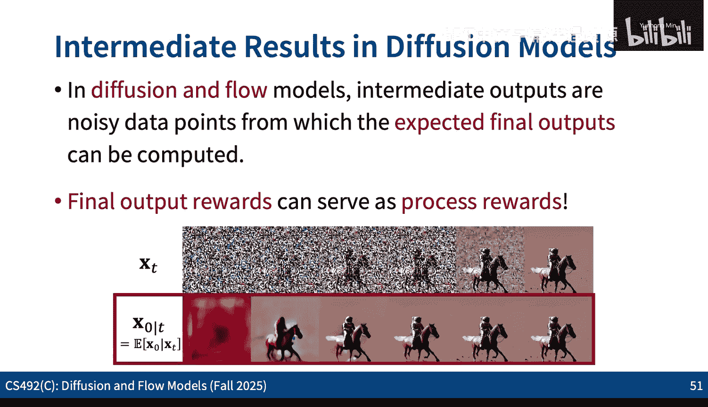

But so let me get back to this next Wednesday。 what before we wrap today。

 if I briefly introduce So what we can do with those kind of thing is that So based on the So what we can do with the。

Those kind of dis unpart thing。 the idea is that now we can use the any of the non defable the function as well。

 So， for example， E P ask whatever the image the agent model to。

Do like produce image with the the object here with the exactly the certain the amount。

 you're gonna say that there are many kind of the hallucination。

 not legal matching the number of the object you need to see。 So we can basically。

Make the number of the objects to match exactly the same some kind of the amount that we are specifying。

And also for the text alignment。 now we see that the text alignment can be easily done with the classifier of the free guidance。

 right， but still there are many kind of the cases that the text alignment is not very accurate with the pre models so we can further improve this kind of the alignment to the text with any kind of some the region language model with kind of another some kind of the verify of the model So this also can be done。

And also， many other things， even for the cases that when you can have some kind of the differentiable the function。

 we can also apply the idea of the particle filtering in a way that we can further improve this kind of quality。

So if I show some kind of the interesting examples like here。

哦。Obviously， there will be some kind of no realistic images having like four drums and7 to and the5 candles way。

 So this is really unusual the kind of images for those kind of cases， actually。

 we can make some quite realistic images like this with some exact the exact match of the number of the objects here。

😊。

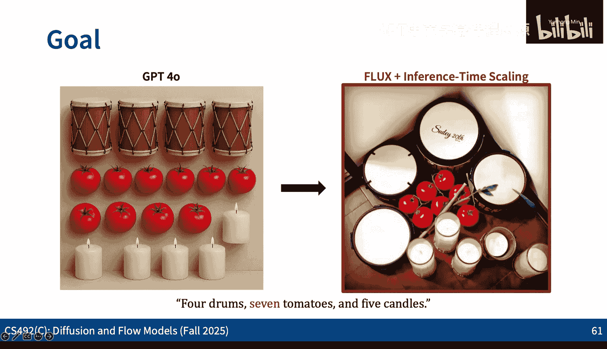

So let me show some more extity cases。Can you check like whether this image usually have some like 82 blue babies？

😊，Andverse 33D coins for those kind of some very extreme cases that we want to exactly match this kind of number of the objects。

 we can use those kind of the test time killinging the idea。😊，And also， we can do many other things。

 for example。For actually in many cases， even when you try something like this using the GPT4 or the5 or something。

you can see， actually， there are some kind of failure cases， not exactly matching the given the text。

 So this is not the meaning of like unoccupied chair， right。

 but we are basically having those kind of chair without the back part and we can precisely match this kind of some text description using the test I' killing the idea。

So those are some kind of the applications for the infinite time thising so next Wednesday I'm going to briefly wrap up those things and also we also briefly discussed the idea in terms of how we can make something new。

 some new kind of demo modalities of the data using some kind of pre models like making some3D or the panoramic images with the image division models right so I'm going to get into some more the techniques for that and I'm going to wrap up the course。

Yeah， let's end here。

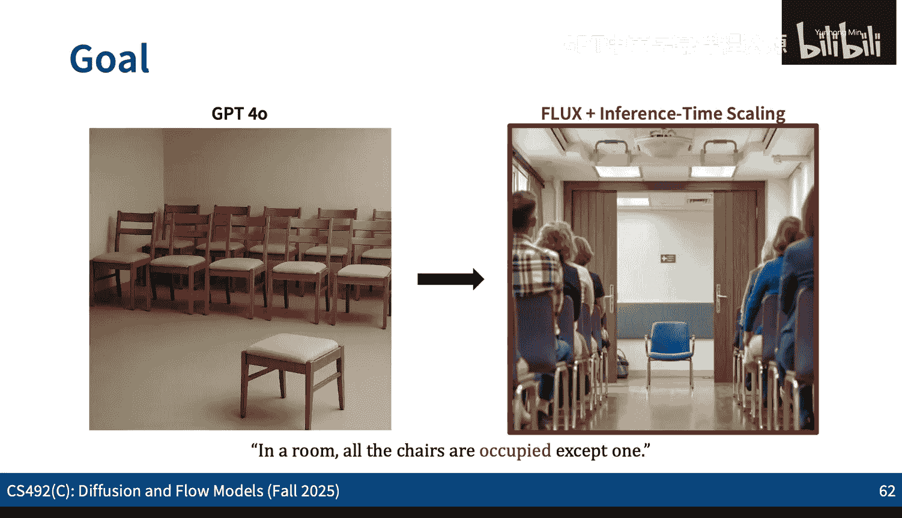