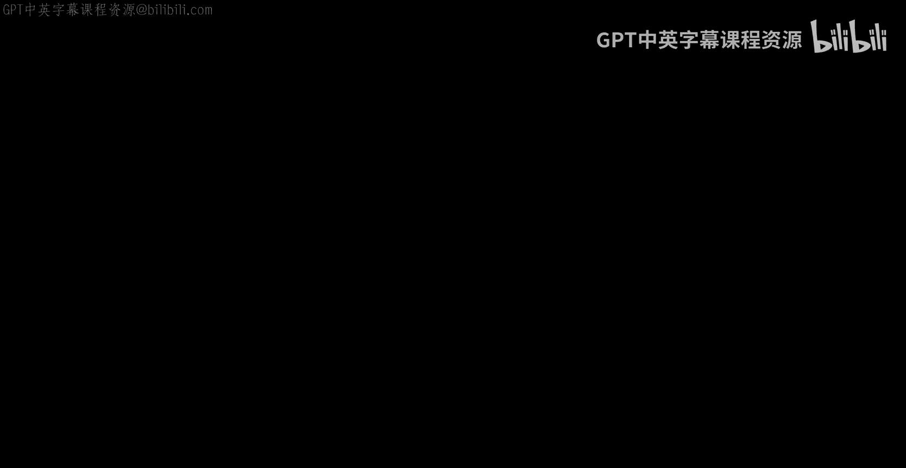
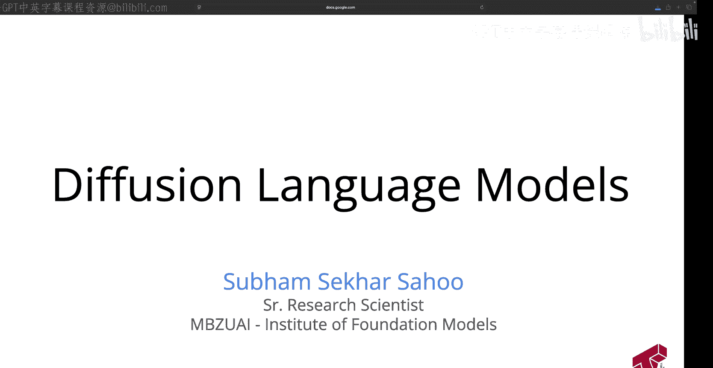
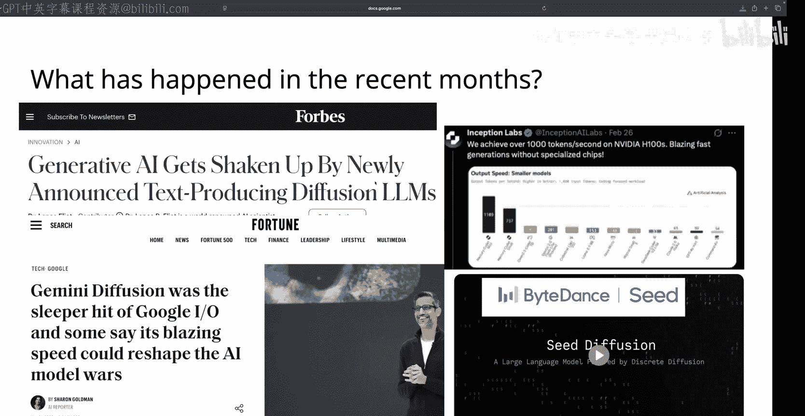
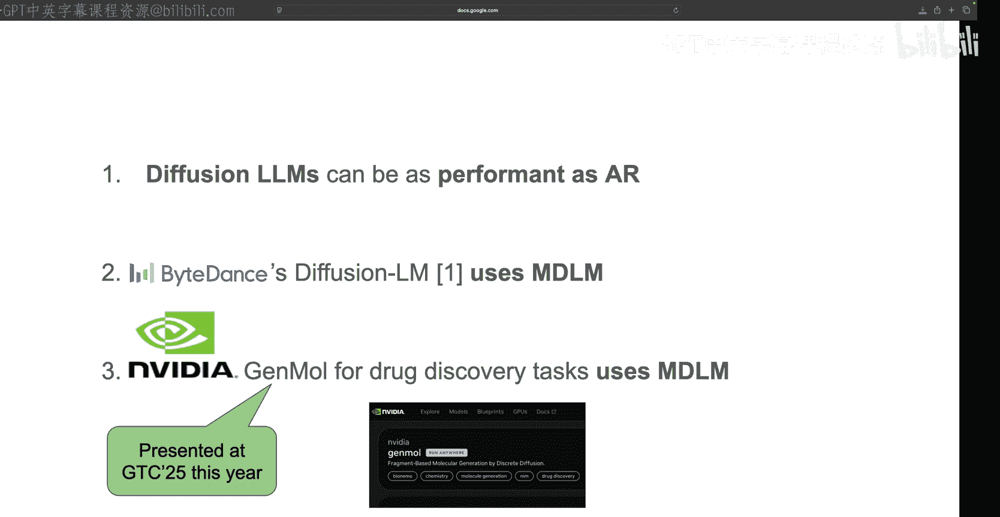

# KAIST《扩散和流模型｜CS492(C) Diffusion and Flow Models 2025》中英字幕 - P13：Guest Lecture 1_ Subham Sahoo (Diffusion and Flow Models, Fall 2025, KAIST).zh_e - GPT中英字幕课程资源 - BV1CKpvz1EH5

嗯。

Y， please take the in。All right cold， yeah， thank you thank you so much for the kind introduction Al right so today we're going talk about diffusion language models。

 which was， you know the focus of my thesis research during my PhD at Cornell。

 Okay so traditionally autoregressive models have been the dominant language generation paradigm right but now they face serious challenges from from this new class of algorithms called diffusion language models unlike AR models which generate text strictly in a left to right fashion diffusion models that are free from this constraint which means that they can generate text in any sequence and。

😊。

Most notably the congenrate words inable right and recently these models have attracted significant attention with major releases such as Google's Gemini diffusion by denser seed diffusion and inception labs market decor their impact has even reached the mainstream with forbes and fortune publishing articles highlighting the effectiveness of these algorithms and all this excitement is justified these models are not only highly effective but also substantially faster than the autoaggressive counterparts and this talk will take a closer look at these models examining the innovations that drive their success and and why they represent such a compelling shift in the landscape of text generation。

Okay， so here's a quick overview of the timeline diffusion lens were first introduced in 2022。

 unlike AR models which predict left to right， these models were generate words in a randomized order as you can see in this GF。

 let me turn on the laser pointer the main drawback though was that you know despite being much faster their text quality lag behind that of utter aggressivegressive models。

And the community didn't really take this model seriously until early last year。

 when Lu etal showed that diffusion Ls when paired with modern transformer architectures。

 could match the sample quality of older autoaggressive models like GBT2 while being significantly faster。

A few months later， we released MDLM where we where reformulated and simplified the diffusion training algorithm and showed that these models can match the performance of autoaggressive models。

 at least on smaller text dataset sets。The next week were came earlier this year in this paper called the diffusion duality where we proposed distillation algorithms which allow these models to generate。

 let's say thousand word sequences in just 10 steps with little to node degradation and central quality and finally we developed SOLMs whichfuse autoregressive models with discrete diffusion unlike previous methods SOLM support KV caching without compromising parallel generation and hence our orders of magnitude faster at inference than standard diffusion models and together these papers have made diffusion elementss practical and you know like like most notably by dances seed diffusion framework was built was built using the MDLM framework that we're going to cover in this talk。

Okay， so for today， we're going to focus on these two papers。

MBLM and SO labbs and yeah let's I would say yeah， let's get started with the first paper。

 which is simple and effective massion language models。😊，Okay。

 so our goal is to design a language model from which you can do parallel sampling that is you don't want to generate words in a left to right fashion you you know like aR models do it and these are slope so we want to design a language model which can generate multiple words at the same time so the way this is going to work is you start with a sequence of all blanks and then you feed this into a birdlike model B is essentially a transformer with bidirectional attention right where every word like you know depends on the entire context unlike autoregressit models where each word depends on itself and and the。

Prior context， okay， so you feed this sequence of models into a bird like model and the bird is going to fill out words fill you know fill out some words。

 fill out some more some more and finally when it's done you'll have a true sample from the underlying distribution。

Let's assume we have a sentence like the one that I showed earlier in the talk represented as a sequence of 1D sequence with colored boxes at the bottom。

 when we talk about noise we're going to talk about masking noise we'll wipe out words specifically to represent that they're masked and of course while talking about mass diffusion we will be comparing against a standard autoaggressive model。

Get started you can think of。Outtter regressive language model as generating words by auto regressive unmasking。

 That is you start the sequence of blanks and then the model fills out one word at a time， right。

 like given having predicted。These words， the model will predict the next words。

 so on and so forth and you know finally when done you have the clean sentence shown at the very top of the slide。

嗯。In this work we're going to take a step towards discrete masking diffusion in the upcoming slides I'll first introduce the MDLM framework that we proposed in this paper and then later on we'll discuss some of the results and we will try to compare and contrast as to how MDLM differs from the prior discrete diffusion approaches and what led to the success of MDLM。

Okay so here's what our process would look like， We have the clean sentence X at the very top of the slide and the fully mass version at the bottom so here we have function Q that goes down and wipes out words right and then you have a function P Theta on the right and the goal of you know generative model generative modeling is that to undo known corruption process so you have this function Q that is going down and is trying to and converts this the sentence X into a sequence of all mass tokens we don't yet know how Q works which we will discuss in the next few slides and then our ultimate goal is to learn this function P Theta that is going to take us from a sequence of all blanks to the clean sentence X at the top right so。

Re。So。What I'm highlighting in red is a partially mass sequence， we're going to call it ZT。😊，And。

And okay， so now now let's break this down into individual components well the first step is we need to understand what going down means you know like how do we go from clean sentence sex to sequence of all mass tokens first we're going to subdivide this space based on based on the signal level alpha t so alpha when alpha t is one it represents a clean sentence X。

And with alpha T0， it represents a fully mass version， right， and to go from clean sentence X to。

This intermediate noisy state ZT what we do is we simply flip a coin so for every clean word we flip a coin and we mask the word with probability 1 minus alpha t right so imagine this let's say for this at this point let's say alpha t is 0。

3 so you flip a coin for every word and you mask the word with probability 。

7 and doing that will give you this intermediate sequence Zt right。Okay。

 now now this is probably the one of the most important slides in this entire talk。

This functionq of ZS given Zt comms describes the is the unmassking function right so let's try to understand like what this is so this is this tells you this is essentially the reverse posterior。

So this function says that okay given some noisy sequence zt。

 how do we go to a less noisy sequence Zs right So if you notice this function Q has two like is condition in two things Zt and X so the Celsius is that you know hey if I have this noisy sequence Zt for every masked token I unmask it with a probability given here So again。

 alpha S is a noise level alpha S is the sorry alphas the signal level corresponding to your time step S know S is just a time step that is less than t and alpha T is the noise is the signal level corresponding to Zt and then you have this term here and it says that okay given Zt I unmask a token with probability this and the token is unmasked to the clean version because。

😊，In this case， you know what x is， you know what the clean signal is。

 You know what the noisy sequence E is。 The question is what is the less noisy sequence Zs right naturally this is a very you know well if you have this function itself isn't very useful in the sense that if you have x there is no reason for you to simulate the unmasking process starting from M if you have x。

 you're just like done but the challenger arises the challenge is you do not have x and the goal is to learn some representation of x that you can plug in here during generation because imagine this so during generation you have a sequence of blank token sequence of mass tokens M you do not know what x is So the question is how do you go from M to x rate and for that we're going to use this function So that's the P theta function So So what we're going do so what we do is we train a neural network which we will discuss the exact loss function and。

It's the principal way to train such a network in the next slides。

But to give you some sense of what the function P Theta is is this essentially you imagine you have a trained bird like model and to go from noisy sequence Zt to a less noisy sequence zs。

 you would simply plug in the clean representation that you network learn into the Q function and that gives you the P Theta function so P Theta will take you from ZT to ZS and the way unmasking works is you have a clean token that always stays clean we'll talk about it letter Y and for the unmasked token sort of given a mask token you flip a coin and you unmask it with this probability that we saw earlier but it is not yet clear like what token it unmasasks to right so you simply sample x theta is essentially a categoral distribution for the entire for all the mask positions。

So you flip a coin and you draw a token specified by X theta， and that becomes your unmaked token。

Okay， anyway， so now the question is， how do you train this d noise in transformer X theta right all right so。

Well。Go over this one by one。 So at the very top， what I'm showing you is。

It's called the elbow in autoregressive model， the way you train an autoregressive model is you have the true likelihood of the sentence and you're trying to minimize the negative log likelihood which essentially means maximizing the likelihood but in diffusion models you cannot compute the exact likelihood so what you do have is a bound on the likelihood which is given by this equation here and。

Yeah， and this is what I'm showing you is what are the loss functions that one can use to train these discrete division models？

Okay so。There are a couple of things there。 First， we have an expectation。

 Let's try to understand like how to compute this expectation。 So you say remember like。

We subdivide the space， you know， like from top to bottom where alpha T was very like ts alpha t equals one。

Was clean signal X and that also represented a t equals zero so your diffusion process essentially you know starts with this x which is t equals1 and goes all the way to t sorry your diffusion process starts at x which is t equals0 and goes all the way to t equals1 which is fully mass sequence you sample a you sample a times to t randomly corresponding to that you flip a coin and you get a noisy sequence zt right so this Zt is essentially fed to the denoisy model。

Okay so the next thing is you have another term here in the diffusion elbow which is alpha which is a chance of unmasking and this is something that we discussed earlier so the purpose of this slide is to show to give you an intuitive explanation as to what every individual term in the diffusion loss means right so you have you wait you have a waiting term which is essential the chance of unmasking and finally you have a cross entropy loss。

Now here what this means is your X theta is a transformer。

 you feed the noisy sequence Zt into the transformer and you're computing the loss across the entire sequence right but due to some and this transformer has a copyover operation which means that if something is clean you can just predict as it is。

 so it's effectively this crossenttropy loss is only compute it for the missing mass tokens and yeah you're feeding ZT into birdlike modeled and you're computing the crossenttropy loss for the missing tokens and you sum them over。

 you have a waiting term boom and that's your diffusion loss but one interesting thing you know we have been talking about so if I go back to the previous light。

 there's a capital T so this capital T tells you that how many the number of time discretizations between。

T equals 0 to t equals one in the MDLM paper we essentially show that you know if you set capital to infinity。

 this effectively represents a continuous time markov chain and the term and then you have this diffusion elbow which looks like something like this you have this alpha t prime over y minus alpha T and yeah and this international is the MDLM paper like this is the main contribution of the MDLM paper proposing this very simplified diffusion elbow which is very useful to train these models and also during the evaluation of these models we will talk more about we'll talk more about the interesting properties of this loss function later on this slide but yeah I just want to like summarize how to train you know how training works in MDLM。

Okay so now now let's try like compare the training algorithms of auto resident model and the MDLM model so in AR the way this works is you have a data set you sample a sentence sets。

 you would feed the sentence into again x theta is is a causal transformer in this case here and then you compute the crossenttropy loss at every token right so every token is only conditioned on the prior context yeah and then you train the model using gradient in descent and on the right hand side I'm showing the training procedure of the MDLM model and you can see these are very similar you sample a sentence X in addition additionally you also have to sample a time step T。

And this equation here is a very fancy way of saying you mask outwards by flipping coins。

 so it tells you that you know you mask every token in x with probability 1 minus alpha t that gives you a noisy sequence zt that zt is fed into this denoising model that uses bidirectional attention instead of causal attention and you have and instead of using crossenttropy loss you have this weighting term alpha t prime over1 minus alpha t and yeah there you go and then this and that's how you train a mass diffusion model。

So this slide basically tells you how if you know how to train an out aggressive model。

 you pretty much know how to train a mass diffusion model as well。

Okay now let's say you know we have trained this model the question is how do we actually sample from this model so in this slide I'm showing one step of generation right so given a noise sequence ZT how do we go to a less noisey sequence ZS if you notice Zt Zs has fewer mass tokens than ZT Well the way this verse is you just simply feed this into the birdlike model and this model is going to fill out fill out all the mass tokens and the way this verse is this model essentially learns the distribution over possible tokens for every mass token and you sample from that distribution and you just fill out fill out the entire sentence and you selectively remask some of the predictions that the model made。

😊，So the clean tokens and ZT stay clean。The mass tokens only the predictions that were made for the mass tokens will be remaked and this is one step of generation now I must say like this is ancestral sampler。

 this is not something that I came up with when you solve the maths when you do the maths you come up with sampler that force that tells you to keep the mask tokens to keep the clean tokens clean and only remasask the predicted tokens however there are a lot of heuristic ways to go about sampling from these models I'll only talk about it if there is a general interest。

 otherwise we can safely skip those。嗯。Okay， so this is one step of generation right now if you want to generate from the。

 you know， yeah， so the the full generation scheme looks something like this where you would start from all mass tokens and you recursively use the one step generation scheme that we talked about earlier until you end up with a clean sentence sex。

 So here what you see is in the first denoing step only this word is predicted in the next denoing step。

 you predict these two words and you know， like that's how that's how you recursively。😊。

Use the previous unmasking strategy and you and you end up with a cleat sentence sex。 And yeah。

 so you know， like that's that was the that's how you train and sample from the MDLM model。

 Now let's try to take a look at some of the experimental results。 Okay， so on L1 B what we see is。

On the Yx we report perplexity perplex a lower perplexity number means a better fit to the data in language modeling perplexity is the go to metric because at the end of the day what people care about is downstream performance。

 let's say encoing data sets or uncoding reasoning and all those linkss right what people found empirically was that if you if a model gets good perplexity scores on。

On your train or the on the validation set， it maps to better performance in the downstream task right。

 So that's why perplexity is a is a very useful metric in NLP。 Okay。

 so Y axis perplexity on the X axis we have MDLM and other baselines as well set is probably the the the。

😊，Closest baseline to MDdLM。And what we see is that MDLM significantly outperforms all the baselines and approaches the AR performance approaches the AR performance similar and this was on element1b element1 B is a small data set。

And the context length was 128， so when we increase the context length 2024。

 we do see a similar thing where you know like MDLM gets better perplexity than said。

 but however there's still some gap， but it's but it's not。But it's still pretty promising given。

 like earlier mass fusion models were way worse than the AR baseline。

Okay now now in this slide I'm showing zero short likelihood so what this means is you train your data on Open web text and you see how well your model performs on other data sets that it had not seen during training like PTB archive or PubM right what we road number means better what we see is that like MDLM consistently outperformed set and very interestingly it gets a better score than on three out of seven dataset set which at that time was very promising。

Okay and and NDLM you know like has been scale lab at 8 billion and I'd like to share some results from this paper。

 La Lada， a large language diffusion models is okay so effectively Lata is exactly an MDLM model but at a billion scale the name it Lata and in the blue here we have the autoreant baseline。

 so this plot here is about multiized language understanding a higher number bit better on the Y axis on the X axis you have training flops essentially you're training this model。

 this8 billion parameter model for a long period of time and then you monitor the downstream performance on this data on this particular task what you see is very interesting。

Like。😊，MDLM consistently。Gives you better better score than the AR baseline right even though like in the previous slide。

 we saw that there was some gap between performance between MDLM and AR in this slide we see that when you look at actual downstream performance on this particular test MDLM does much better than the AR baseline right similar in reasoning you see that the scaling for MDlM is way like is probably exponential as compared to like linear in the AR case and this again is very promising like MDlM does like way better at reasoning than it does than it does sorry then the AR model okay there was some negative results in the paper as well where they saw that on test like common sense questions or coding MDLM was at par with AR or slightly worse like here I mean it's inconclusive if end is better but you know we would say that you know MDM is at par with the AR baseline。

And here MD slightly likedged AR。Okay now MDLM was also now okay so here we talked about language generation right so language generation implicitly has a left to right bias that's how humans talk it is also reflected in the way natural text appears now if you look at modeling other discrete data structures let's say protein generation or drug discovery or molecule generation there is no left to right nature there is no left to right bias and that's where we see MDLM perform the best for instance。

 in this paper Gen。These people。Trained and MDL model for predicting molecules。

 And what they found was， you know， they modified the sampling scheme that we discussed earlier where they did some greedy they had some。

 yeah， they came up with a curriculum that。That perform some sampling with a temperature basically and when you okay effectively this paper suggested a sampler and when you vary the hyperparameter of that sampler you get this parameter the frontier What you see is this on the Y axis you have the quality of a predicted molecule a higher quality means high quality molecule that the model predicts and the X axis you have diversity right what this people found was the AR baseline in this short star。

 you know there is no such trade off， but with the MDLM you can you can。

Vary the sampling temperature and get this per to frontier where you are strictly better than the ERBS line here。

 so you can depending on your need， you can modify the sampling hyperparameter to get generate molecules that are of very high quality and less diversity。

But if you care about diversity， you can also do that， it's going to degrade the quality naturally。

 right， while increasing the diversity of the molecules。So yeah， so MDM has been really successful。

 has been successfully applied。😊，On tests like drug discovery and also there are a lot of controllable guidance tasks。

 which unfortunately I could not include the slides for MDLM does really well there so imagine okay imagine this you have this generative model MDLM model that predicts the molecules right let's say you want to you want your generated molecule to have certain properties and it is very difficult to do that with the AR model AR models are very notious are notoriously difficult to to perform controlled sampling from。

So。😊，But with MDLM， if you remember， but MDLM is highly suitable for control generation。

 the reason it's very simple， if you remember from the previous slide you have this。

Noisy sequence ET and then you get this and the bird like model will fill out all the masks。

Tokens right， which means that you have access to a representation of what the final sample can look like。

 And because you have access to that information， that high levelvel information。

 you can tweak your sampling process in a way that will allow you to generate samples with desirable properties。

 So yeah， there are certain some papers that came out early this year that that highlight that。 okay。

 now let's talk about the limitations of of MDlM。 Well。

 the first thing is especially in the context of language generation。

 there's something called Kv caching， let's take a look at like what is Kv caching right So the way Kv caching works is this。

 So you have a token you know like you have a word and then your causal transformer is gonna map the word the first word to the next word and then you take that word feed that into the model again。

 your ER transformer will map it to the next word。But if you notice。One thing。

 the the word a does not change， right， I mean， the activations corresponding to the word a are never going to change as the model predicts worse because it's causal。

The this token the activations here do not depend on the future tokens so what during inference what people do is they would freeze the activations once a word is predicted right so you predict B you can safely freeze the activations without any degradation and quality whatsoever so yes so this is and naturally you can see as you predict the words you're doing a forward pass of a single word instead of doing a forward pass of the entire context right imagine when you're predicting。

A cant like let's say you're predicting a sequence of text with 20000 tokens it becomes and at some point attention is going to be the biggest boly because it's an n operation so because of KV caching you don't need to do a full forward pass of the entire context and you just freeze the activations you know and that's why even though your AR model has thousands thousands of steps of decoding every。

Every decoding step is very cheap， but in MDLM， we have a problem。 So imagine this。

 you when the generation starts， you start with a sequence of all mass tokens。

 you feed this into the model。 And let's say your model predicts two right like this B and deep。😊。

So in the next denoing step you would feed B and D into the model these are the activations and let's say you sample A and F right now something interesting happens here when you feed A and F into the model you cannot just simply freeze the activations corresponding to B and D here right the reason is this because of bidirectional attention every time your input changes all the activations change recall like in AR model。

Because of causal， because， you know， they had this causal attention and that one token never was not affected by the future tokens。

 they could freeze the activations。But in MDLM， because every token attends to everything else。

 you cannot freeze the activations， so that prevents that prevents KV caching and the implications are very simple。

 even though MDLM can generate。Let's say。Thousand0 words in just 500 or 400 steps。

 every step of generation is much expensive than the autoreive model。 And yeah。

 and that's why like it's much slower than the A model。

 So how do we so in this we this paper is is cur under a review And in this paper called esoteric language models we propose a lot of things like but the main the main selling point of the paper was Kv caching for MlM。

 So the question is， how do you do， how do you design the transformer so that you can support KV caching during inference right。

 So here's what we do again， like this is in this slide what I'm showing you is the regular training。

Scheme for the MDLM model。 you have a noisy sequence E feed into the transformer and you train it with this crossintropy weighted crossintropyos。

 We do something funky here where we say that we replace the bidirectional attention of the transformer。

 What we do is this apply some shuffling。 Like if let's say this is the noisy sequence right。

 you shuffle the input and you have and you sort of like cluster all the clean tokens to the left and all the mass tokens to the right and then apply causal attention。

 Now there are a lot of questions here like it's not。

 it's very unclear like why do the shuffling and why do this clustering to the left and right right。

 It is not at all clear here。 I will describe it'll become obvious in the next light when I describe the sampling how to sample from this model。

 but。The change that we make in this paper in the MDLM training is very simple。

 you instead of applying bidirectional attention across the entire context。

 you shuffle the clean tokens。Put them to the left。

Shuffle the mass tokens put them to the right and apply causal attention that's it so naturally you can see that you know this particular mass token only depends on the clean context。

 this one only depends on the previous mass token and the clean context and not the future mass tokens right okay。

By future mass tokens I meant that tokens appearing on the right hand side in the shuffles sequence。

Okay， now let's see how to do inference in the SLM model This is yeah， this is how it works。

 So let's say your。😊，Okay， first of all， like you decide which mass tokens you want to dennoise in ancestral sampling any number of token so tokens appear at a very randomized fashion and yeah tokens appear at a very randomized fashion and n number of token like what yeah also like the number of tokens that are deco it depends on the number of sampling steps that you fix a priority right let's say your ancestral sampler wants to decode tokens it positions three and two so what you do is perform a four path of the mass tokens。

And you add the position embeddings for three for the positions three and2。

 do a forward pass and you decode both the masstros right that C and B。

 you can see how CNB appears like let's say you this is your entire context。

Instead of doing forward paths of the entire context of length eight。

 you just you selectively do forward paths of the tokens that you want to dens。

 which is mass tokens at positions3 and2 right you do a forward pass sample the tokens in the next denoing step。

 let's say your ancestral sampler wants to decode the tokens at positions one and8 so you would do a forward pass of mass tokens alongside the positional embeddings for one and8 do a forward pass and you dennos them。

And again here I'm showing you the attention scheme of the transformer it is causal。

 it is no longer bidirectional， what this means is the tokens B are not the activations for tokens B and Z are not affected by the future tokens right so naturally you can see because of this because the model you know during training was trained with the causal attention and all the clean tokens were to the left and were randomly shuffled。

The inference supports the style of generation so this inference scheme。

Dictates dictated the attention pattern that we saw before or the training scheme that we saw before。

 so we knew during inference that I do not want to perform a forward pass of the entire context of the full you know like imagine this like you performing your forward pass of only mass tokens like mass tokens literally carry an information rate it's very futile and and it's very compute intensive so you save on a lot of flops by selectively doing forward pass of the tokens that you want to dennoice and also your inference is faster because of KV caching。

So yeah， and this is how the inference proceeds， you keep on like you decide。

 let's say you want to dennoise the mass token position five。

 you know you just perform for a path of this mass token and yeah。

 all the previous all the previously predicted tokens yeah like the activations for the previously predicted tokens are frozen。

And yeah， then this is how you incorporate KV caching in this model Okay。

 now at the end of the day what we can okay， the reason why we want to use。Diffusion is because。

 you know， we hope to have fast assembly and also to have a choice。

Where we can trade off the sample quality for sampling speed and in this curve。

 that's exactly what I'm showing。SOLMs is the method that we proposed。

In ereric language bottles paper and BD3Ms is a block diffusion algorithm so blog diffusion is this right so it says。

😊，Let's say our goal is to generate text of length1000 What we're going to do is instead of doing diffusion over the entire context you divide the context into small blocks blocks of let's say 00 and you do diffusion only over those blocks right for natural language it just perfectly makes sense where you do diffusion over the first block of00 tokens there and then you move on to the next block and so on and so forth。

 So at any so doing denoizing you do not you're not doing you're not doing。

Denoizing on then you're not doing a forward passs of thousand0 tokens。

 but you do forward passs of 100 tokens， which is tractable aken like thousand tokens is still fine。

 but when you start doing denoizing over 100，000 token context length。

 it becomes prohibitively expensive。So BD3LM is the block diffusion algorithm SoOLM is our algorithm that we propose in this paper and this is MDLM right so if you look at this if's very it's very clear that it's very clear that MDlM is very slow so the curve in blue now BD3LMs because it does this blockwise generation it supports KV caching because you denize the first 00 tokens you move on to the next block of 00 tokens so there you're allowed to the model is trained in a way like where this block does not depend on the future block so you can freeze the activation so the first block when you are denoizing the future blocks so on and so forth so in B3Ls you see like it gets it's really fast if you like。

😊，If you increase the number of sampling steps， but as you decrease the number of sampling steps。

 that is as you start predicting multiple words at the same time。

 there is a significant degradation in quality， which is here。

 so it almost becomes worse than MDLM here。Now in green is our method and as per our method you can see like the perito frontier here it is way faster than MDlM produces better quality samples than MDlLM。

 it produces better quality sample because of very simple reason where one of the contributions of our work was also to interpolate between AR and mass diffusion so I did not go into the details because trading that model was a is a bit non-trivial effectively with SLMs。

 you can do left right generation as well when you do that get you get really good quality samples but almost as fast as but this slight gap in performance but when you look at the tradeoff between speed and quality it's much better than much better than BDtlM or MDlM again it's only because this model supports k caching so it's highly efficient as compared to any of the baselines in BDtlM there is partial k caching where you can。

do KV caching across blocks and while doing dennoizing within a block of100 tokens。

 there is no KV caching， but the moment you have dennoed one block， move over to the next block。

 you can freeze the activation ratios of the prior blocks。But yeah， so u yeah。

 and then if you look at the sampling time as well， like SLMs is way faster。To in terms of all time。

So here on the way axis， we have sampling time and we report this number for a very small model like at 110 million scale with 124 tokens。

嗯。Okay， so in conclusion， you know， like alarms can be made。😊，As performance as airR as we saw。

Bdenr diffusion M is built on top of the MDLM framework that we covered in this chart and VDdia is using MDLM for generating molecules。

 which is pretty cool and yeah I think that all that's all for today if you have any questions please let me know。

Yeah， thank you for the great talk。

