# KAIST《扩散和流模型｜CS492(C) Diffusion and Flow Models 2025》中英字幕 - P14：Lecture 14_ Score Distillation _ Coarse Wrap-Up (Diffusion and Flow Models, Fall - GPT中英字幕课程资源 - BV1CKpvz1EH5

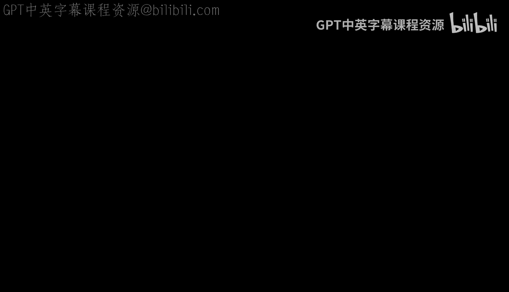

Okay， then let's get started。 So from the week from the last week。

 we are discussing some kind of the ideas in terms of like。

 how we can apply some kind of the pretrain di flow models for some kind of the really broader the applications。

 especially in terms of like injecting some kind of the guidance in the generation the the the period。

 So those are some kind of the some techniques that we discussed the last time。

And for the discussion of the inheide de generation。

 like one thing that I briefly mentioned was about basically this technique that I call the di deynchronization。

 which chose basically the case that we are making some kind of the data in the other forms like like some 3D things or some kind of panoramic images and in many other things like those things and the panoramic images we also have seen those kind of many examples for the synchronization in terms of that these are basically all the examples that we are making some kind of the data in the form that no we didn't have the data in the training of the division model right so those are all the cases that we are basically making some kind of the data。

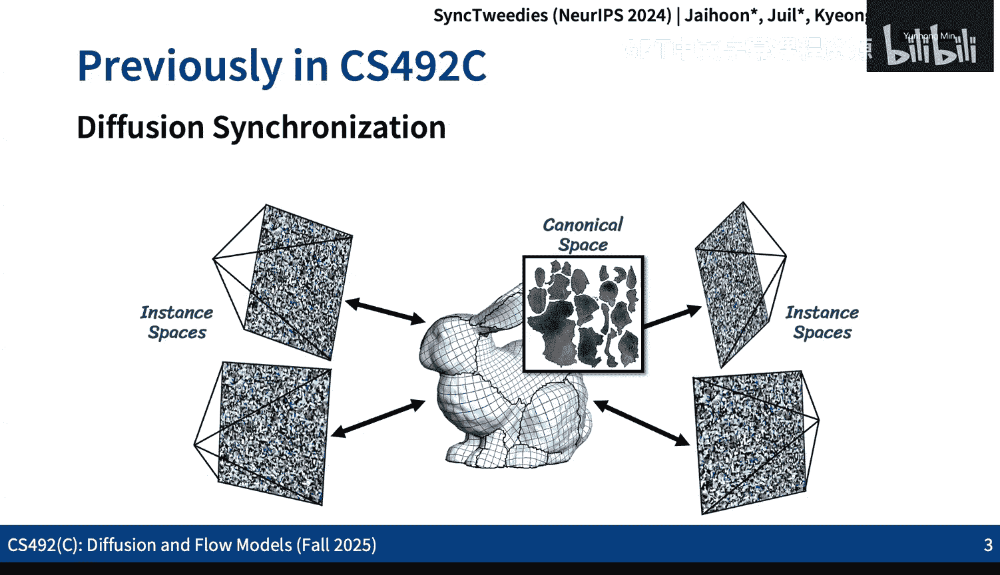

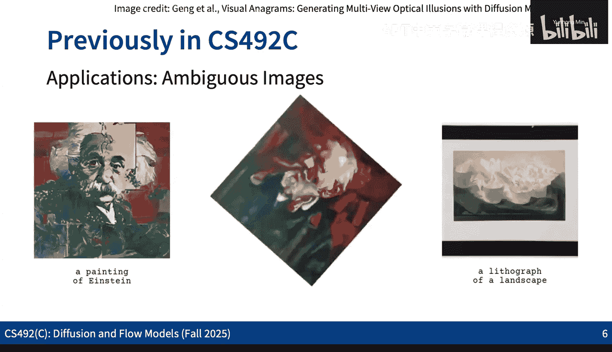

Not the form that has been used for the training of the division models。

 but the data that can be actually mapped the data that we have seen during the training in a way that we are basically performing the denoing the process from the multiple perspectives like the simultaneously in a way that these are basically integrated in the chemical space that we defined last time。

So this was kind of the interesting idea in terms of that。

 if you have some kind of the any print between the model。

 then this kind of the between model can be used not only to generate the data that we have seen during the training time。

But also for the other data that can be mapped to the data that we have seen in the de。

 So this is also kind of the one specific kind of example in terms like， you know。

 why do kind of be the range of the applications the pretrained in the division and the flow models。

And speaking to this， we are also going to briefly discuss some kind of the some very practical and simple idea。

 which is called the school disill disling。 And this idea also can be applied to the many of cases as well。

So here the basic kind of thing is that。As we also discussed from the beginning of like this class。

 the digital models can be applied not only to generate the images and the videos。

 but to generate some kind of many the diversity type of the data。

 like the audio or the molecular structure or the weather forecasting for the many other genes。

But here the basic question is that how much data do we need to produce some kind of deistic data？

Actually， this is really very pra question that I also received multiple times when I also basically discuss like making some kind of research models for the many the people。

 especially in the industry， they typically they easily very ask like so how much data do we need to make some kind of the good the di model about some kind of other research model。

😊，And obviously， there's no clear answer， right？Can you see like so you also trend your own the the model right or the also for the。

Did you feel that the amount of the dealer was like sufficient to make some kind of the good quality of images？

Did you get any sense of like how many me that you need to train some equation model for some specific type of data。

I mean， if you really try to apply those kind of the ideas for the thegen models to produce like many other types of data。

 then this is really some practical problem that you face。Like let's say。

 like you want to make some kind of the difficult model for some kind of the medical imaging。

Some kind of the images like that or having some kind indication of some kind of the disease。

 For example， for some kind of the to train some other the。

 the AI models for some diagnose for something。でハオグニでハシティディテータという意味で。So this is really kind of the。

Notri will be the question in terms of like how much kind of the amount of the data will basically guarantee the quality of the developers。

So I'm not gonna say any kind of answer for that。 but obviously， more is better， right。

 in world of cases， perhaps some kind of be more amount of data， that would be much better to。

 in terms of improving the quality of the outputs。😊，The problem is that for many cases， for many。

 many applications， we would not have some kind of the that kind of the big scale of the data for the images。

 the reason why we are seeing some kind of the really good quality of the outputs or be not only because of some kind of the basis of the generate models that we are seeing。

 but also because of the scale of the data， right， for the images we have seen that there are like billions of the images for the videos we also might have some kind of the another the bigs of the data。

But how about the other things， for the audio were some kind of mono structure or some motions here for many other things。

 Will we have some kind of such kind of big skill of the data。

So this kind of the motivation in terms of like how we are going to best leverage some kind of p knowledge that has been learned from some kind of the pre imaging models for the video models in terms of like using this information to produceate many other things because for the image generation。

 the video generation for those like the digital models。

 we know that like billions of the data have been used。And these models basically can produce like。

Very high quality of the apples and also in wide the diversity。So here。

 the question is that how can we leverage those kind of the information to produce any other things as well。

 So that's kind of the basic the idea。So for example。

 like how about those kind of like 3D kind of shapes。 So basically。

 we can find those kind of the 3D shape in some kind of the online the reposities for those kind of data。

 But obviously， it would be very hard to basically collect some kind of the good quality of like such kind of3D models in the scale of the billions。

 right。So if we really see some kind of skill of the public data set， both for 2D data and 3D data。

 then we can see that for 2 images， as we are as I mentioned before。

 we have some kind of skills of the5 billions of the images。

But if you see this scale of the3 d dealer in the the public the 3D dealer。

 the biggest one is still kind of be 10 million。So you can see the kind of the difference of the scale。

 like the five or  six billion is kind of like corresponding to the like similar to the population in the world。

 right？Compared to that， the 10 millions， is kind of similar to the population in people in the southoul。

 for example， a very small scale。So given this kind of why I mean。

10 million not small but compared to this skill with the10 million of year can we also produce like really high quality of the outputs and also in kind of the big the the the range of the diversity。

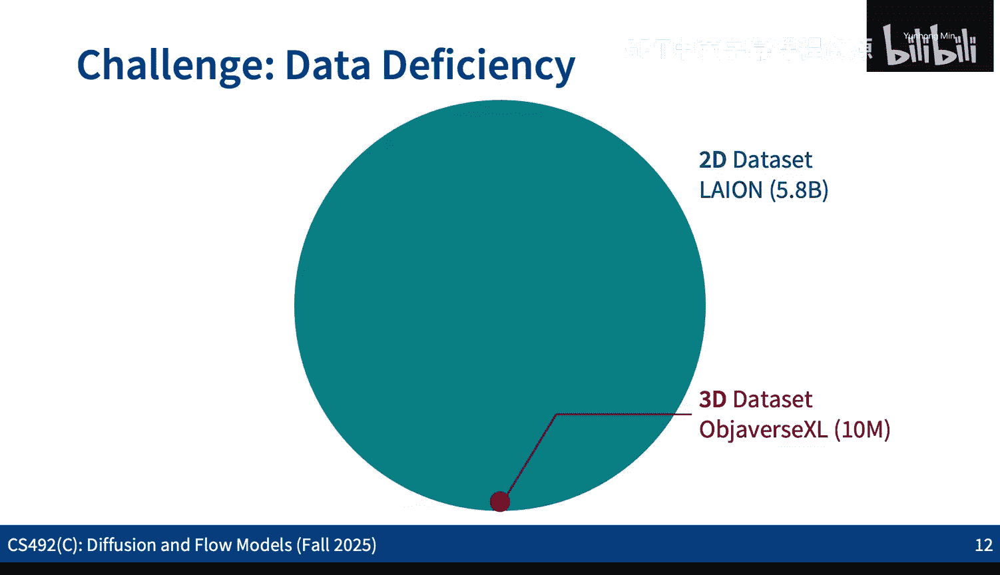

So here the question is that how can you still produce those kind of the3Dィ models using some kind of the D P and the flow models。

So if we consider making those kind of the images using the like whatever some kind of the image the digital models these days。

 using the nanolo banana， whatever， then you can really try this。

 whether the image division model can produce like those kind of images。

And typically it works quite well right because of the fact that they basically have been trained with the really internet skill of the images。

 So from the images in the internet skill， maybe there will not be exactly this image。

 but basically much more the diversity this kind of the diversity of the samples that we have in the distribution or basically giving us the giving the model to the sense of like how those kind of images can be degeneative。

 right。But even with the kind of the 10 millions of these shapes。

 Can we still also make some of these kind of the imable and 3 shapes。So this kind ofっいちゃうんです。

So what we are going to briefly discuss for today is that how can we reverse the power of the the image diffusion model where some kind of other the diffusion the flow models in a way that they can be also used to produce like many other things。

 like making these kind of some imageable some 3D shapes。

 not using some kind of the exactly the direct some 3D samples using the 2D samples that have been used to train the diffusion and the flow models。

And this kind of technique can be applied to the many other things， not only for these3D， but also。

 let's think about some kind of defect images， for example。

 what are some kind of some some catd format。Is there anyone whose major is in the industrial design？

We。😔，Other field or mechanical engineering。For the people in the design field and also some CAD committee。

 they would want to make some kind of some those kind of the 2D or the 3D data。

 not represented as some kind of the pixels and the points。

 but in not like more the structural way with some kind of some stroke information where the many other things。

 but obviously for those kind of more some structured data。

 it's really hard to basically expect to have theD data it these K the billions。

So here the question is that how can you also produce those kind of data with the very large diversity。

 not exactly just like using these samples in the data domain。But based on the。

 the priors that we could learn from using the that has been learned from the the between the image and the the di and flow models。

So this is kind of the basic question here。So what we are going to briefly discuss for today is that some kind of the techniques in terms of like leveraging some knowledge from the image division models that has been trained with the internet kill the image data set to produce like many other some kind of visual of the content and this idea also basically can be applied to not only to generate some kind of the visual content but for the many other things。

 so I didn't bring some kind of the examples here， but you can also find some examples in the internet basically using this kind of the idea to produce some kind of the audio or some kind of emotion or many other things。

So basically， the problem set up here is that we assume that we are making some kind of data that has some kind of rendering function。

I mean here basically， the meaning of the rendering is that it's basically any kind of some predefined function that can be that is basically mapping the data that we want to generate into the form of the image。

So let's say this like the represent some kind of the visual contents。

 It doesn't need to be visual things。 but I mean， for even the pretrained image equation model。

 let's say we want to make some kind of the visual presentation data here。

 which can be map to the some kind of the images。From the specific debut point of the city。

So let's say we have any kind of those kind of the function right。

 So this is something that we want to generate。 And when you choose some kind of the perspective。

 like seeing this kind of the content， we can map the content into a form of the image using this pretty defined function view。

So for any case that we can define those kind of rendering function。

 how can we basically produce the setup using the between in this digital model？

And as kind of be some off topic， I'd like to briefly introduce this idea of the new rendering。

 how many of you are familiar with the new rendering。Tar about this？Yeah。

 this is also quite interesting idea that has been。😊。

Quite popular in the area of the graphics and division region。

 but you don't need to know any details for this。 But here。

 the basic idea is that we want to somehow produce those kind of some 3D output from the collection of the images。

From the all different reviews。 So the input is the collection of the images。 And here。

 the question is that how can we basically generate something that is representing the 3D。

 the kind of the object we this here in a way that we can basically render those kind of reconstructed output from the any arbitrary。

And this is like very classically problem in the graphics and division。

 But the interesting point in the neural rendering is that those kind of reconstruction can be done by the neural network。

 So that's kind of the the。Reconstructing using the neural network basically means that actually we are having the neural network as the representation of like those kind of really things in a way that this can be like rendered into the form of the image。

😊，So without like any having any any kind of details， So this is kind of the basic kind of the the。

And there are also bunch of the ta in terms of like achieving those kind of the goal。

 You can see actually quite interesting results like this。 So this is like one example。😊。

This would look like a video。ButActually this is not a video。

 D C is basically generated the the the images in the the sequence。

 So basically here the idea is that we are having lots of the images of this thing。

And doing some kind of sweet consumption。And as we basically play a game。

 we are basically navigating this kind of some vcher this space。 So yeah。

 this is really just like randomly basically navigating this space innova。

 We are seeing some kind of the some all of the details here。😊。

And you can see that the reconstruction is not perfect here because of the lack of the information。

 So as you can see here， we are seeing some kind of the black dis sky。

 The reason why we are seeing the black sky there is that we don't have the images there， right。

 So that's kind of thing。 But this is kind of the examples in terms of that we are having some kind of the loss of the images。

With some kind of known viewpoint information。And based on that。

 we want to basically reconstruct the 3D representation detail era here。And without like know， noise。

 I mean， knowing some kind of the details here， especially in how we define the rendering function and how we also have some kind of representation for this。

 the basic idea of the the reconstruction， the reconstruction is that basically。

 we are performing the gradient descent with this specific the gradient。So basically。

 we do have some kind of the representation and also the rendering function。

 And what we want to do is that we want to basically update this data here in a way that basically minimizing the L to those here。

Very basic idea， right， nothing but basically minimizing the L to loss for the all the perspectives where basically we have some kind of big given images。

😊，So this is。Then what would be the question here？So if we have this kind of the technique that we can reconstruct some kind of3y things。

 then which questions that are you going to ask？Especially if you want to apply those kind techniques for some kind of real applications。

For example， like。How fast thecon how much the competition that we will need to recon this。And also。

 how fast the ving would be。あどざ someか ofオシンしてはいけないです。

And how much kind of the big scale of some kind of 3D things that we can reconstruct based on this technique。

 Can you just like reconstruct a single object or some kind of the scene or like the skill of the C or something。

 This skill might be also interesting in the factor。

And how can you deal with some kind of be some moving object。

 If some objects are basically moving while basically taking those kind of images。

 then can you also handle those kind of some kind of movement of the object in the thing。

 Those are some kind of questions it。Do you have any other questions？啊。Actually。

 this idea has been considered for a while to apply this for some kind of the online shopping model。

In a way that for some kind of products that we know the people are selling。

 we can basically put not only the images， but some something like a 3D in a way that the customer basically can see。

The object by rotating it in the web browser， right。

 So this kind of things has been discussed for many applications。

One of the kind of the big de bottle leg in terms like applying this technique for the many application is that actually we need quite many number of images。

So that's also one question No。 I mean， how many images should you have to make some kind of the good quality of the some kind of the3D here。

So that's kind of the real question。And typically for those kind of 3D reconstruction。

 if we reconstruct a small object and more or less like 100 images would be okay for the techs that we can typically use using some kind of code in the Internet。

But。Let's say， like， if you want to basically apply those kind of techniques for the online shopping mall。

 then people would want to basically quickly do this kind of 3Dcon。 obviously。

 the computation should be super fast。 And also， these reconstruction should be done with some very some like few number of images。

 So when you just like take some kind of photos like 10 photos of the object。

 then we should be able to still get some kind of good quality to the output， right。

Then can you also go some kind get some kind of good 3 d the ops or only from the 10 images？

W the five images？We are three images。So this is kind of the question。

So was the kind of the limit in terms of the reducinging the number of the required the inputンプ images。

So can you also make this kind of technique in a way that we can produce those kind of3 outputs only from the very few number of images。

 So this was kind of the the very basic the motivation。And for that。

 one of the kind of the only the idea， relatively the early idea in 2021 was that we are also releasing some kind of the priority knowledge from some kind of the foundation model。

 especially this like the clip model。呃。Does everyone know the佢 model he。Even should over。

 So clip is like the most popular model that is basically about some kind of the， the。

 the relationship between the text and the image， right。

So I briefly enthusiasticically for some of you who are not familiar with this is basically some kind of some embedding some kind of function in terms of the we can basically map both the image and the text into some kind of certain embedding space。

 So the role of the embedding space is that now we can measure some kind of the degree of the alignment of the image and the text in this specific embedding space。

 So it's basically very highly measure the embedding space。

 and if we measure the distance over this kind of the highly measure the embedding space after mapping both the image and the text。

 then we can see how how much they are basically aligned each other。

 how much the image this input image here can be basically described with given the input text。😊。

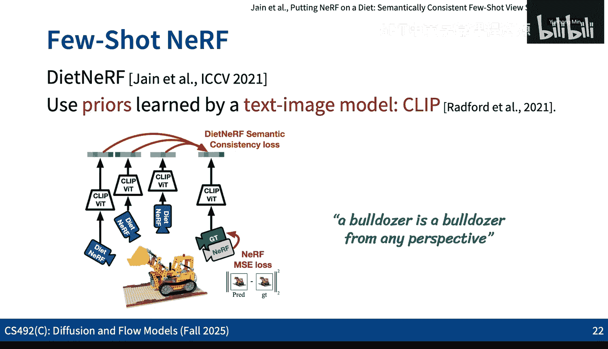

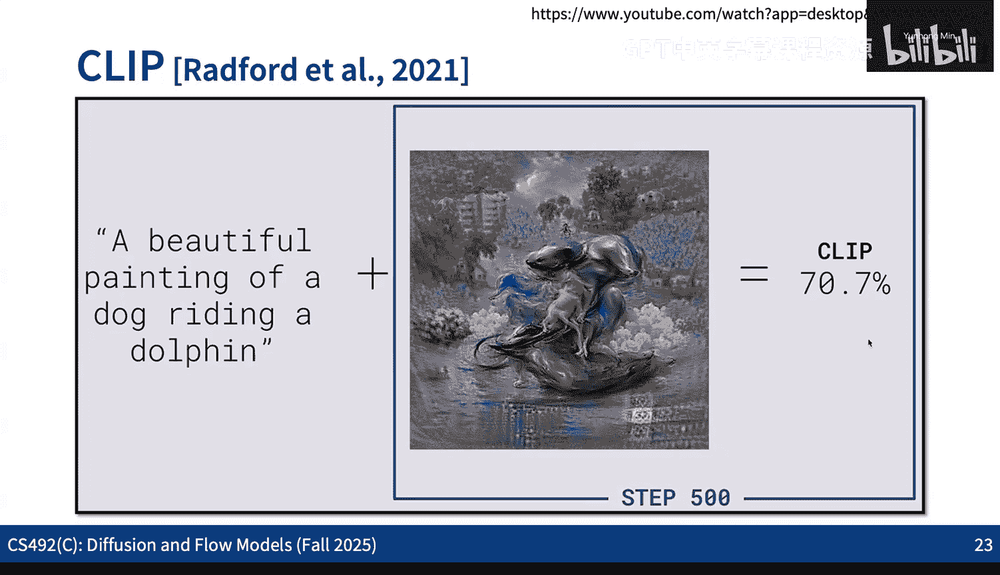

So specifically is some kind of the measure of the the alignment between the image and the text。

Then how can you use this kind of the information to do some kind of the future shot reconstruction。

To do some kind of reconstruction with few images。This is like all some very practical idea know you're here。

So here the kind of simple the idea is that So let's see this kind of the example that we are reconstructing this like the bull doger the here。

 But let's say like we only have like。ファイイメージです。 or threeイメージです。

But the thing is that for the bulldoer image here， from whatever the perspective we see the object。

 this object will be bulldoer， right。Consistently builded for the any perspective。 So basically。

 what we can do is that for those， like the perspective that we have the images。

 only3 or the5 for those cases， we can still use the L to loss。😊，Basically fully effect propagation。

 basically matching the rendered image with the basically image that we have。

But from the many other perspectives， basically what we can do is that we can basically simply check the alignment between the rendered image and also the text prompt that we have。

Because we know that the the object， right， So now we basically define the the gradient。

 Now that's kind of the out between the two images。

 but that's kind of the gradient of the distance in the embedding space。

So that's kind of very practical the idea in terms of that we are lib some kind of the prior knowledge of the pretrain the clip model。

Innovate that we can do some kind of de data construction。

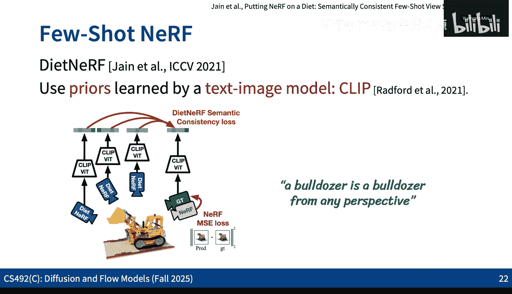

Make sense。Like just like very simple the idea。

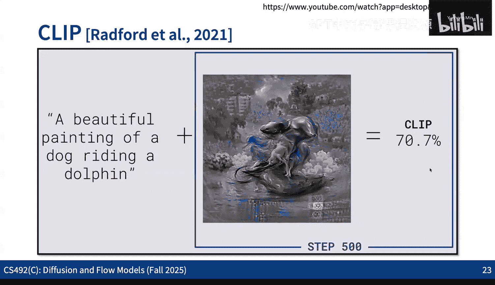

Then。Here， the question might be that then how many， how。

 how much we can reduce the number of the the images that we can be that are basically required for this consumption。

Being this kind of technique。So with some kind of the engineering。

 actually the thing is that when we start to use this kind of the clip， the priority knowledge。

 then we can reduce the number of images to the 10 or the five， even to the three。

Even to the single image， iss possible。That we only have the one single image。 And basically。

 for all that perspective， we are using the clip loads for the back prop。

But then even the extreme case is that what if we do not have any images。

 What if we only use the the clip loss for the reconstruction。

So this is kind of the first kind of the example in terms of like doing some kind of the zerosha reconstruction。

So geo reconstruction sounds quite weird in terms of the。 we don't actually have any images。

 We only have the text prompt。 So that's kind of thing。 So without having any kind of images。

 what we are going to do is that here we are doing some kind of like3D reconstruction。 Now， actually。

 it becomes that the reconstruction because there's no images， but it's more about the generation。

 right， only from the text prompt， what we are going to do is that we perform the same thing in terms of reconing this。

 But now the tech propagation is done with this kind of the distance in the em space。

And the question is that would this still work？And this works in some extent， but obviously。

 the quality is not very good。So these subjects gives some quality of the the output that you see some very early version of this three generation。

So now we are seeing lots of the many good quality some3 models。 So this quality looks really。

 really bad。 But at the time of the 2022， it looks quite interesting in terms of the We are seeing some kind of some armchair with the shape of the avocado some kind of pumpkin or pikachu So there those are some kind of the examples in terms of doing some 3D。

 not the reconstruction anymore。 but it's more about like 3D generation using only the text prompt。

 So this was kind of the first case of like seeing some kind of 3 generation using some kind of the only the 2 d priors。

So this was kind of interesting thing example terms something like 3D not having any kind of 3D data some kind of twining the data that we have but only using some kind of 2 d priors that are also learned from the pre2 model。

😊，So this is kind of the interesting examples for that。But here the question is that。

 but instead of like using the clip。Can we use some kind of nutrienttent image efficient models to basically do the kind of same thing？

So this is kind of the some， the， the basic question here。

And can you guess how we can basically use the pre image division models instead we click for this3D consumption in this case？

So as I said， while I just show some kind of examples of the3D reconstruction。

 actually you can see that this is quite the general idea that can be applied to the many other cases right。

 so basically we want to make some kind of data that can be mapped to the other form movie data that have been used for the training some foundation model。

So without really having some kind of the， some data samples for the format that we want to generate using some kind of the of the data some come to some sort of the mapping from those kind of the the data。

And also the prior that having been learned from the some pretrain the foundation the models。

 how can you produce those kind of things。So this is kind of the basic decision set。

And now we want to use not the clip but the pretrain image division model for doing doing this kind of thing。

Any thoughts how we can do this。デノい noiseい productionスト。

Dnoaging projection is the grounds then do we need to perform the dnoology process？啊对。诶你我一先唔在。

reports that they。So the core of the issues with that direction might be is that so if we try to perform the denoging process with some kind of the random the projection from some random output would be is that。

We don't know whether that so basicallys the projection of some kind of the data that we want to generate should be some kind of intermediate data points that have been seen in the training of like this model。

 right。But would this be true？For most of the cases， it would not， right。 So that's the thing。

 But that's kind of good try。 you can really try it。 that might actually。

 that's kind of like worth trying。 But for most of the cases。

 it would not work because like if you try to basically map some kind of some data points into these some kind of images。

😊，For any kind of random the， then this kind of projection would not be some kind of intermediate data points that the our the neural network has been seen has seen during the training。

So basically， the X T that we are talking in the division model should be something that is really coming some coming from the realistic data point。

 we default process， right。If the X T is not something that looked like the kind of noisy version of the clean data that we have。

 then the noise prediction will not work。 So that's kind of the one thing。Any other？面。Actually。

 there is no kind of a clear answer for this。 But this is really kind of the。

The case that we want to use the generator as kind of a discminator。So basically for the generator。

 basically what we want to do is that fully supply for the text to image generation。

 we want to take the text that's the input and make some kind of image as the output， right。

 So that's basically some kind of black box kind of things for the the generated model。😊。

But the thing is that now what we need is basically having some kind of discriminator。

 discminator is taking the both the text image and kind of the input and basically checking their kind of the alignment between these two。

 and giving this core for that or some kind of the distance。

 So the clip model can be easily used as some kind of discminator。 But here。

 the question is how we can use the pretrain the giant model as kind of the discminator as well。😊。

If we head again instead difuion model， then it could be much easier because it already has some kind discriminator。

 but for the diion model， we don't have the discminator， right。😊，做你。Very basic idea。

 some kind of practical idea without having any kind of some good theoretical explanation。

 like in terms like why it works is that the simple idea in terms of using the prent model for these case is that。

😊，So it we recall the lowest function of the di model。The lowest function also basically define。

 basically de matching the， the noise， the here， right。

So if we have some kind of pre20 feature model， this will be the case that this loss has been converged。

So which means that for whatever some kind of the clean the data point of the X U。

 we gonna we can expect that these lows will be close to some kind of some small number， right。

 something very small。So actually， the basic idea is that we are strictly leveraginging the lowest function of the di model。

So what basically this mean sees that mean。Yeah， so that's good thing。

 So if the train has conged the loss for the realistic。

 the data point X will be close to some the small value。 So actually。

 we are going to use this loss function as the measurement of the alignment。

 So that's kind of some very basic idea。😊，So in the previous case the previous cases if we use the Al loss as kind of the loss function or some kind of the click distance as kind of loss function。

 Now we are going to directly use the loss function of the digital model。

While basically putting the render， the output is some kind of the the X D de point here。So。

like more the pro， because what we are going to do is that for any kind of the given the random the data point from the the perspective。

 we first render the 3D representation into the the data point here。

And then what you do is that if we recall how we train the diffusion model。

 we basically perform the full process， basically adding some kind of a noise。

 basically making the intermediateta point of the Xt here。And predict定位。

U our the the noise predictor and measure some kind of difference with the noise that we added in the forward process and basically completing the L tools loss and performing the propagation。

That's kind of the basic idea。So what we can see is that we changed basically nothing。

 but we only changed the lowest function that we are using here。

 So in the 3Dcon we use the L to loss， we given the images for the clip basedcon。

 we use the clip loss for the clip this lowest function here and now we are using the lowest function of the di model directly as kind of the measure of the alignment here。

So that's kind of be very practical and some kind of some simple idea。So again。

 they are not basically the four steps， we basically render the visual contents and then basically performing default the process and the predicting the noise using the noise predictor and the backdrop in a way to basically is kind of the altered difference of the noise here。

So here basically one thing is that since we have some kind of the differentiable。

 the rendering function G here。The back propagation of like this L loss can go all the way to the clean data point and also into the visual content here。

So that's kind of kick thing。 So which means that the RD render function obviously should be differentiable in this case。

Itically。So this is kind of the basic idea， like one small thing is that if we try to perform the back propagation for the L difference between the pretty noise and the noise here。

 then using the chain rule， actually this gradient can be decomposed into these three parts， right？

So， the difference between the。年ways here。And the the Jacobian to the lowest predictor with respect to the X T here and also the X T and also with the the derivative of the X with respect to the the final the visual content the here。

Basically， there are these sweet parts， right？Which competition would be most expensive here？都か咁で。

At pass。Should we pick the permit probe error predict。Pix the parameter of the this Oh yes。 Oh yeah。

 obviously， this is the case that we are。Not basically changing the parameters of the node predictor using the pretrained diffusion model。

 we perform this。 So the， yeah， this what kind of thing here。 The thing is that sorry。

 I think there are some kind of the。Some notation issue。

 So because I'm using the set for the older places。 So so actually。

 these spec proagation should not be to the the parameters of the noise predictor。

 but to the actually the visual content here。 So I'm gonna fix the notation here。

But you can also see that this becomes basically taking the derivative tip for the rendering function in this case。

And also taking the derivative for the the nu predictor， for the all the parameters， the。

 the neural network of the nu prediction， right， So actually。

 this is the kind of the most expensive de in terms of the computation in terms of performing the back propagation。

SomeAlso without any kind of the theory some kind of very practical idea is that even when you do not perform the the compute to the Jacob here。

 it's assuming this Jacob is kind of the one Still， it basically works some extent。

 So that's kind of be some practical idea。 So we can somehow ignore the Jacobian the part here in terms of computing the gradient and also running the big propagation。

And the reason like we want to omit this is that this is the most expensive part in terms of the computation。

 because we need to compute the gradient for the all parameters of the neural network， right。

 So we want to skip this in terms of speeditting up the computation。So this becomes of the。

 the final the gradient for the。So theリ of content thista here。And based on that。

 we can make some kind of some 3DD outputs。 and actually either we have the Jacobian parts where we do have the have the Jacobian or do not have the Jacob the parts。

 actually， the quality is not very different。 So this is some kind of the quality of the output。

 the 3 generation without the Jacobian the parts and also this is the output with the Jacobian parts。

 So we can say that actually the quality is kind of similar。

 the only difference is that without skipping while skipping the Jacobian parts。

 we can speed up the competition。 And also we can actually， the competition is also kind of similar。

 The good thing is that we can save the memory in terms of the computation。

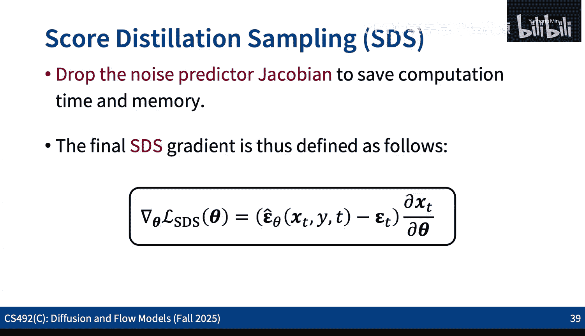

So that that's kind of be the things。

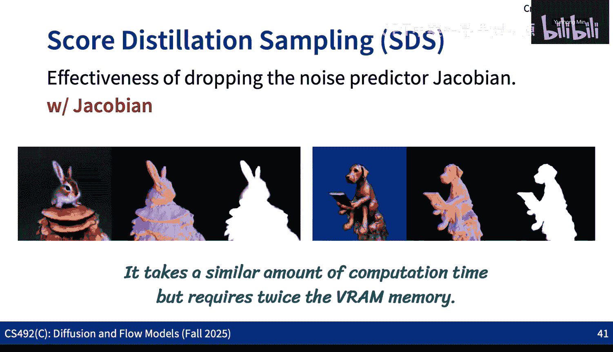

So now we can see why this technique is called this core distillation。 So basically。

 the thing is that we want to distill the knowledge learned by the pre division model in a way that we can produce like many other things。

 While the knowledge is basically distilled in the form of the the noise of the this score。

 So that's basically why this is called the core distill sampling。And this idea can be applied。

 so actually these are all the 3D the ops， I don't have the videos for this。

 but you can see that actually these are all the 3 ops and actually this is quite interesting to see。

 right I mean。Can you imagine to have like those kind of reading model in the Internet。

Floke wearing sweater。And ghost eating a hamburger。So those are really some。Some very interesting。

 some imaginable some 3D outputs， but it's really hard to expect to have some 3D models for those kind of things right。

 but still we can produce those things because we are leveraging the strongly prior of the pretrain image between models that has been trained with the billions of images。

And more examples。We啲。So， yeah。Something like。Yeah， many kind of weird in the opposite。

Playing some games with some talks here， whatever， yeah， so many interesting gals。

So this is basically the technique that can be applied to any data type the type that can be basically mapped into the data space of the pretrained division model。

 So maybe you can think about some kind of the other applications。

 not only for the pretrained image division model， but also for the molecular for the many other things。

 there are also some kind of interesting applications for this kind of technique。

So as I also briefly mentioned at the beginning， some of the applications for this is that this can be also applied to the to some kind of the back images。

For those kind of the some some stock information of the the vector images。

 it's really also hard to make some kind of the billion scale of the the data set。

 And you can use this technique to put it like those kind of things。

And we are also seeing many of the some 4D examples that as well。

 So these are also some examples that we are now using the pre video di model。

 not the image di model to produce many kind of interestingly4D outputs as well。

And also for many kind of some visual content editing， not only for the generation。

 given those kind of the already generate some kind of3D content。

 if we want to make some kind of some modification。

 if we just strictly use some kind of the physical priors in terms of making those kind of informationformation。

 then we might get some kind of some artifacts like this。

And by using some kind of the priors of the image field model。

 we can also fix these kind of some artifacts and making some more realistic outputs。

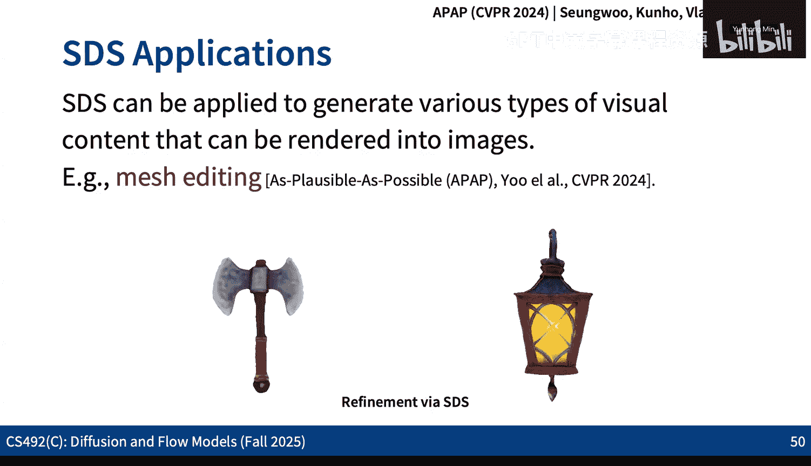

So this is kind of a very easy idea and there are lots of the code in the internet。

 So I recommend you to try to run those kind of things and see what you can generate。

 And also I recommend you to try not only for the generation， but also for the editing。

 you can also try those kind of things and also this idea can be applied not only for some visual content and also many other types of the data as well。

And but when it comes to basically， you know。Speaking to the like the making some 3D using the 2D priors。

 what would be some kind of be some failure cases。It we only have the 2D information to make some 3D。

So this is basically a case that we want to make some kind of some full like3D output。

 while the information， the prior knowledge that we have is some kind of the partial absorption。

 right not the full observation。So if we want to generate some kind of the full outputpost or using some partial absorption。

 what would be some typical def failure cases。Can you imagine some failure cases？ actually。

 this is also kind of the case that we're gonna face for many applications， right。

 While we might want to make some kind of some。Like some entirety outputs。

 the information that we have might be kind with some partial observations for many of these cases。

So one specific， I mean， the inverse problem was also such kind of the case。

 but not only for like the a training the model， but only for to generate some single the outputs。

 that also also the case that we only have some kind of the po observation。

 So how can you produce some like the entire the output that can match the the po observation right。

But in terms of like， producing some。Pu output put with the prior of this past observation。

 The typical de cases would be something like this。

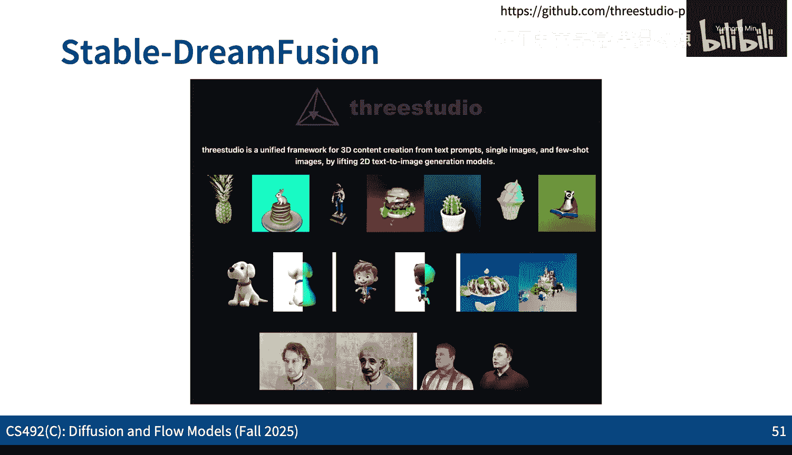

Let me play this。can can you see me value here。Did you check how many faces those characterss have？

Obviously， not one， right， multiple defs。So this was some kind of the very typical di cases in terms of that。

 the rendering of those kind of video outputs from the specific perspective might look okay from some perspectives。

 but you pre see the full structure that doesn't look like some kind of realistic data point， right。

 basically having some multiple defs。

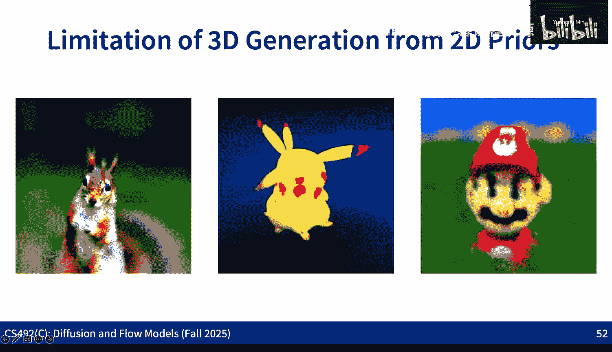

This is some kind of the better the quality of the outputs with some kind of more technique。

 but you can still see that there are some failure cases with the two mouse here。 And also， yeah。

 some part of the face is kind of the weird the occlusion is basically not correct。

 So this is kind of the issue in terms。 So like， you know。

 we are making some poor outputs really some partial the prior。

So this basically means that while we can somehow leverageverge the prior of the image division models to produce like many other things。

 then we might still need to have some the prior of the data itself for that specific domain in terms of giving some kind of some information about some the global structure of the data。

 So still， there are some kind of limitations for that。

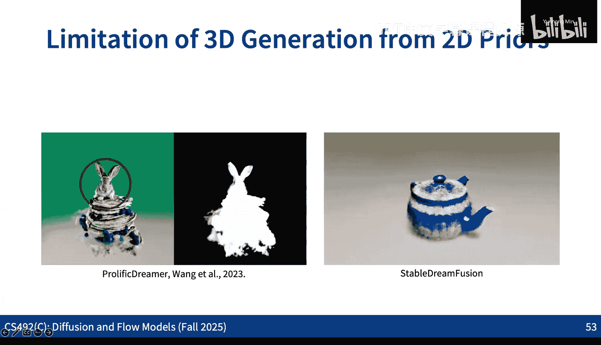

And also， one practical kind of thing is that if we want to prove some kind of the realistic opposite。

 then those are all the cases that we are doing still like some text condition。

 some kind of generation。And if we want to get some kind of the clean the apples。

 then you can play with those kind of things。 Typically。

 you need to have some very high the CF weight。 They class free guidance the weight basically increasing this basically weight is that we are basically narrowing down into some kind of the small scope of kind of the the distribution of the data that is really perfectly aligned with some kind of given the the tax prompt。

 which means that if you need to increase the C weight。

 that means that you're gonna lose some kind of diversity in the apples。

So how we can also keep some kind of the bigger diversity while maintaining the good quality using this kind of technique is also kind of some remaining kind of the questions here。

아 고長さです。可以。我柜则。Yeah， so this is the last topic for this class。

 So so far we discussed the last of topics in this class from the so especially for this semester。

 we intended to basically cover some kind of the more theoretical background of the def flow models differ in a way that we are first discussing the some basic idea for digital models and see how this idea has been evoked in the。

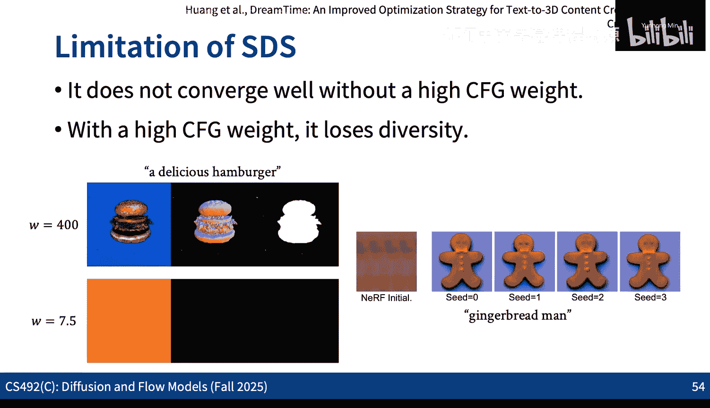

So the DDP and， the DD IM and also into the continuous time de formulationulation and how we can also do the S D and the ODD conversion and how this also can be connected into the flow models as well。

So those are also some kind of some some foundationary ideas for the di flow models。

 And also for the last parts of the dis course， we discussed some kind of the some the ideas in terms like how we can also broaden the applications of the di and the flow models with some kind of techniques for the inference time the guidance and also we these core installation。

So the thing is that we haven't discussed custom like many more applications for the diffion default models and also the this is was very interesting the topic。

 how we can also apply the idea of the diffion models not only for the content data。

 but also for the disk。😊，So that's basically why we are going to have the two the gas structures。

 So for the first gas structure， the Sub which cover some kind of the basics of the disk division。

 how the diff models also can be applied to the disk。And also。

 one of the interesting applications of the DG default flow models would be basically video models and also the world models。

Espec world models might quite interesting topic in a way that many kind of some rendering the pipelines that we discussed there would not be used many for many future applications。

 So those kind of some many future applications will be discussed in the in the second actually。

And before we wrap up the course， then here the question might be that。

So at the very beginning of like this class， I said this， actually。

There are basically two big types of the some models that we are using in the many the foundation models these days basically for the tax generation。

 for many of the cases， we are still using the auto list the models iss basically very standard thing to use the auto list model for the text generation for many kind of the sequential and the disk data。

And D in the flow models would be the best for the many kind of the continuous data and also in some kind of the high dimension of space。

But。Is this real true？So this is actually very interesting the question that now we are seeing for now because recently we are also seeing many kind of cases using the autos models for the image generation。

😊，And also with some kind of really good quality。So can you guess how we can also apply the autoism model for the image generation？

So as we know， like it's deable like to know that the autos model is basically good for the sequential diskator。

Which means that it's the middle of like how we are going to represent images as the sequential。

 discrete kind of things。So which means that we somehow need to discreetize。

Some elements of the images here and make some kind like。

 you know S the sequence of those kind of some discreteretized the elements。

So there are also lots of the ideas in terms like applying the autoous models into the image generation。

AndD呃。Kind of the good and bad things for the like the image generation。

 the auto model for now is that still the quality is not the best if we only care about the quality of the upper for now。

 it is still the best to use the di the flow the models。

And also for the fine tuning for the many applications like some training free。

 some kind of like guide de generation， we know that the dient flow models might be kind of be better。

The region， like why people want to still like use the autos model for the image generation is that we are now seeing some kind of really good quality of the language models。

 So here， the question is that how we are going to combine like all the things in a way to make some kind of multimod the models that can produce both the text and the images。

And we already are seeing some theGPT models and the determining models for many things。

So if you want to make some like one single model that can produce both the text and images。

 what would be kind of the best way to handle that？So this is now kind of very important question。

 And regarding that， still kind of the best option for now is to use the autoist model that can basically produce the both the text token and the image tokens。

And we don't know exactly how the G models basically designed。

 but many people are basically assuming that theyre gonna basically use the auto models for them。

 right， you want to generate both the text and images。

 and also for the many open source models like this one。 So let me quickly play this。Okay。嗯。

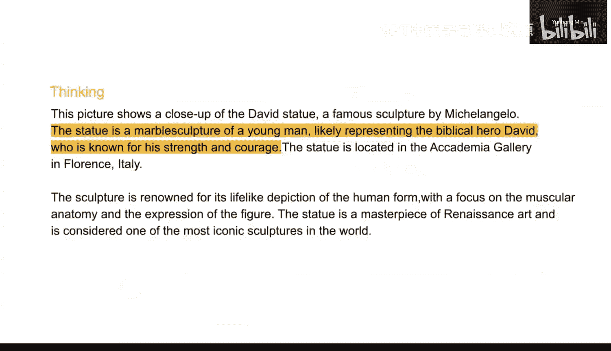

啊。我拿了。嗯。

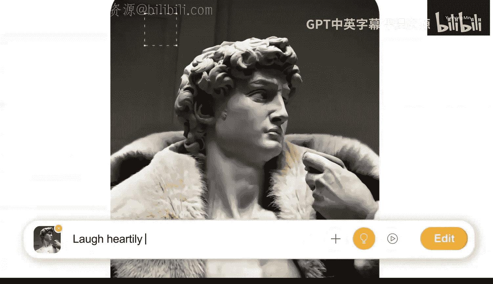

Oh。嗯，我呢。这忙什么？对。等个。Thank。都做啊。Oh。我们。Okay。嗯。So yeah， this is an open model that can take both the text and the image as the input and also produce text images as kind of the output。

 So really the model model， the model， right， for those kind of the models still the best option is to use the auto model。

 not the flow models。 So you can really check out how exactly those models basically developed。

 you can check some more details there。So it sounds like then yeah for the the cases that we we aim to make some kind of the marketing model of the model。

 then the solution still would be basically to models。

 Then we don't need to really know study the different four models， right。But also。

 the interesting thing is that we are also seeing the opposite as well。

 I think I also briefly mentioned in the beginning of this class， but。

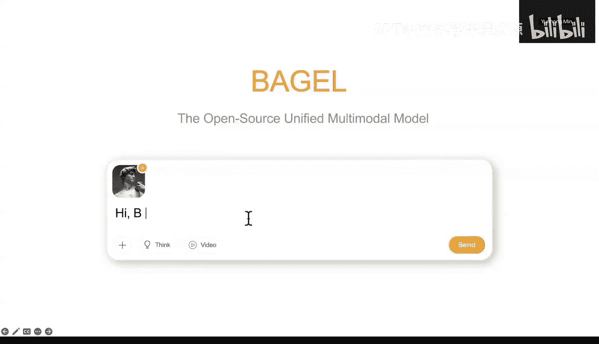

So there are many kind of some development in terms of how we are going to do the language modeling。

 weDDed models。And also what people say for now is that the benefit of like using a diff model for the tax generation is that it can be way faster like this。

 So you can see that like the comparison between the diM and theM。

 And this is like only sequential generation， like one by one。

 the oldest token cyber basically generated like at each step。😊。

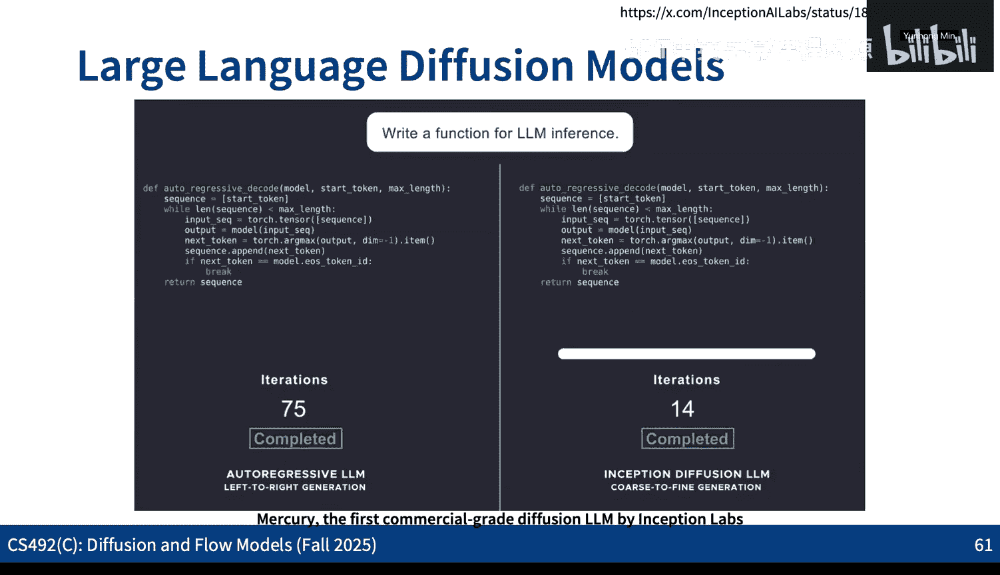

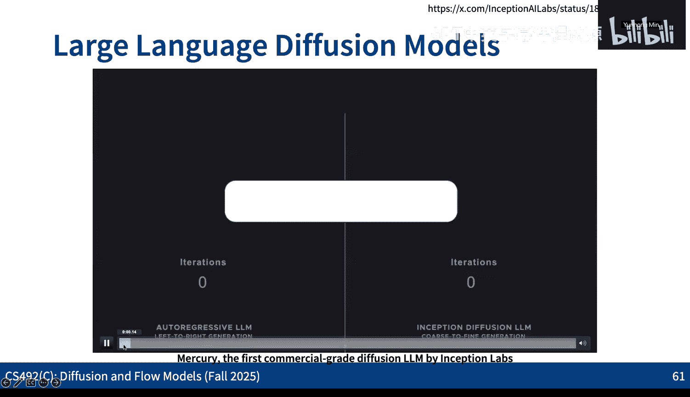

But if we use the diff model for now mimicking the denoging the process。

 then what we can do is that we can dennoice like all the tokens at the same time in a way that we can produce clear the outputs with the much fewer number of the iterations So these are also some examples in terms of adapting the idea of the di the denoing the process to produce some kind of disk data and so which means that we are basically seeing some kind of the advances of like also applying the di model for the disk data as well。

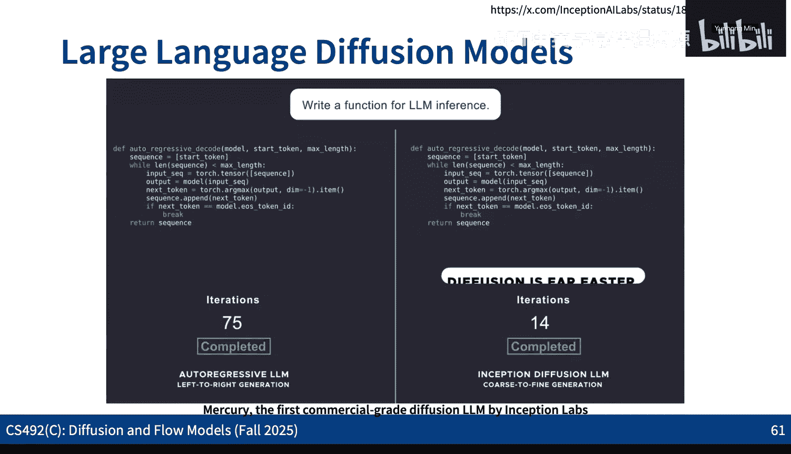

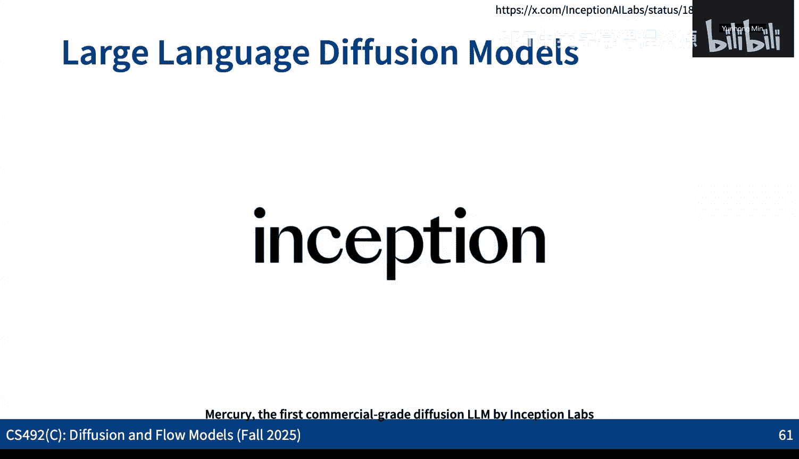

And also there is the James theィion model， which is also another example this is not。Yeah。

 another example like applying the divisionff models for the language modeling。

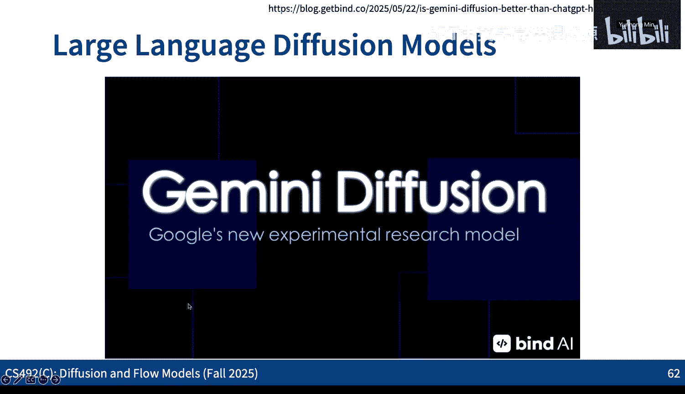

So very interesting the situation for now is that we are seeing some more cases like applying the autoism modeling into the image and the video generation。

 typically known as kind of the cases that we need to use the diff and the flow models and also there are more cases selecting some language modeling and the discrete grid and flow models and we'll see how these are basically being evolved over time。

😊，And this is also。One kind of be some the paper from the N， which was actually released last week。

 So we can see some kind of the many recent advance here。 Think in diff and talking auto regression。

 So some parts of the text generation is done especially the beginning with the diff and also the final the output is basically generated in the like more autolu way。

 So we can see many kind of some high version in terms like combining these two。😊，So， so actually。

 this is not just kind of the the case that we are seeing some kind of the competition between these two。

 So there's also some more the cases in terms of how we are going to combine these two。

And especially when it comes to not only for the text and the image and the videos。

 it could go with some kind of the more some complexity type of data。For example。

 the graphs like for those kind of the not the regular structure kind of the data。

 what do we kind of the best way to design the basically make some kind of the the general model。

 should we use some kind of the typical the test model or the repeat models where can you consider some kind of the combination between these two。

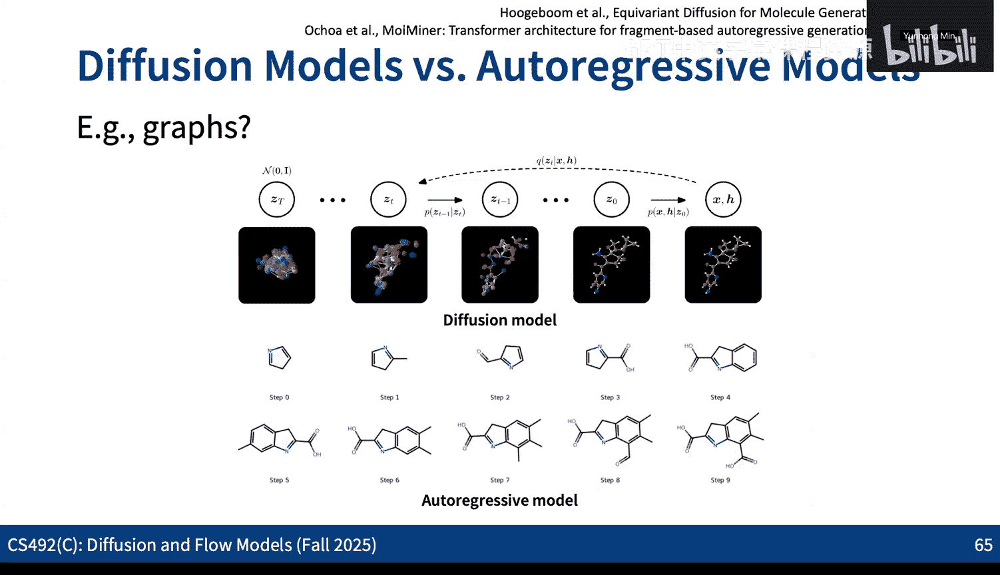

So there are many kind of research going on into this。

And also for the video generation for many kind of cases like making the videos like this。

 actually videos might be interesting the example in terms of that if we see every single frame。

 these are basically the images right So we know know that diffus and the flow models might be basically the best but actually this is the sequence of the images。

 So which means that actually if we consider the sequence of images still。

 we might need to basically produce like all those things in like the more the auto way like frame by frame。

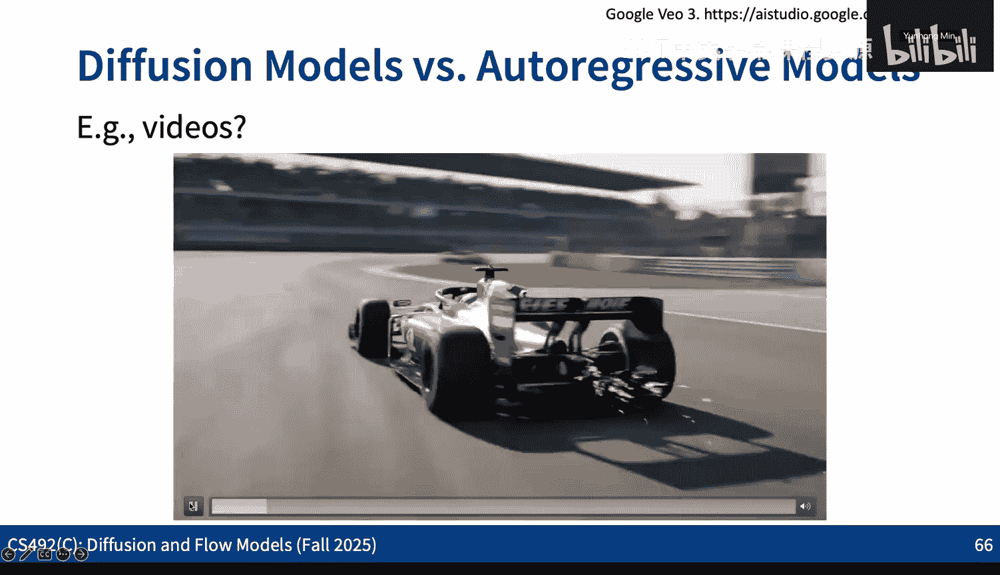

Right so this is might be also the good target in terms of like how we are going to combine the idea of the autoive de generation and also the distribution models。

 also So many interesting kind of discussions going on for those kind of cases。

And also for the more the applications， actually， we haven't discussed that much kind of the some the applications in this class。

 but actually the dient flow models can be applied to the many other things for the some more structure or some DNA or some other some kind of biological and the chemical data。

 they might also have some kind of some。😊，Notn regular based specialty structures for those kind of the cases。

 we can also come up with some kind of the new type of the DJ models。

And also diffent the flow models are also widely used for those types of the data and also for the robot de manipulationulation basically for the robot de for the many cases。

 diion of the flow models are also widely used， but this is also interesting the case that we need to produce some kind of the sequence of some data points。

 right So this might also the good target to consider making some kind of hybrid version of the autore and also the diffus d models。

And also， there are many other examples， even the diffion models can play chess You can also check out many interesting examples in terms like how the discrete diffion can do all those kind of cases and also solving the 수도 as well。

 So this is also very recent the outputs in terms like solving the the 수도 using the diffion models。

So lots of the applications and lots of the some interesting types of the data。

So here the question is that so in the future what would be kind of the ultimate dig model so at the end。

 basically we would gonna want to see some kind of the one big foundation model that can take all the types of data the input like all the text image and the audio like many other things as the input and also producing all the things as the output as well right。

For those kind of some ultimate design model， what is kind of the best way to design these。

So the future might be that。Actually， the diffion flow models may not be necessary。

 likeism like the models might be kind of the best way to handle older。

Or even the text would be like the next GT might be released with the division models， right。

 so we don't know the feature。So there are many kind of questions chance many here。

And I hope that this helpful for you in terms of like not just getting some kind of details of the some duty or the different deployment models。

 but also getting the sense of like how those kind of the the techniques are basically being involved for now。

Okay， so this is the end of the class， and thank you for your participation。

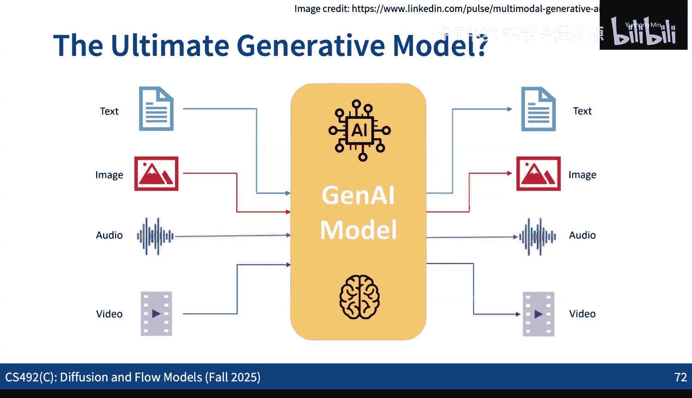

So as I said， stop this。