# KAIST《扩散和流模型｜CS492(C) Diffusion and Flow Models 2025》中英字幕 - P15：Guest Lecture 2： Philipp Henzler (Diffusion and Flow Models, Fall 2025, KAIST).z - GPT中英字幕课程资源 - BV1CKpvz1EH5

嗯。

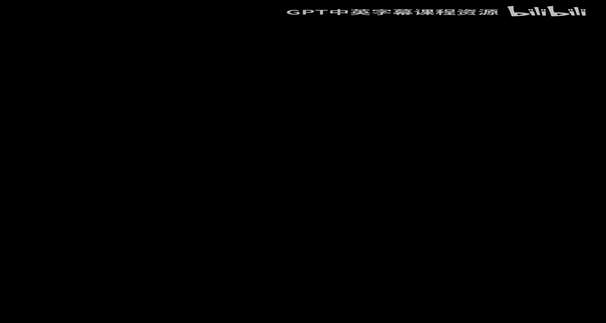

Okay， I guess you are yeah。Yeah， before I start with my talk。

 I would like to first chat it about myself， so I've been working on 3D reconstruction and generation ever since my PhD in 2018。

 where I mainly worked on self-svised 3D reconstruction and appearance modeling。

And between now and then things have moved very fast， so I joined Google in 2022。

 where I then worked on generative 3D reconstruction as well as generative 3D rewritinging before video models changed the research landscape and what is possible。

And the progress in our field has been so fast and impressive that 3D reconstruction methods with the help of generative II actually work at scale。

 so our team at Google was able to convert some of that research into product yeah so first we focused on reconstructing shoes where we used image models to help with 3D reconstruction and landed it on Google shopping。

 and then later we started to work on video models。

Which helped us to expand to any kind of object category on Google shopping。

And the progress in our field over the last couple of years has been incredibly exciting。

 and in today's talk I will be discussing 3D generation methods and how to put them into perspective with generative video models。

But first let's define what a generator fee model is。

 so at its core it's a system that takes as input， a control like a text prompt or an image and it uses a generative model to produce a 3D representation。

However， to actually see the content on the screen of a 3D model。

 it must be rendered into 2D images so we can actually look at them。

And early works on gene3 modeling used GNs in 2016。

 where we had a pure generative model with a noisy latent that was then trained to produce  three voxels with a3D cmininator。

And here we had no specific control over the inputs and needed 3D ground truth data for training。

And some follow up works like Platonic Un address the 3 data problem by removing the need for 3D ground truth by adding a differentialiable renderer and a 2D discriminator。

And this allowed to train models directly onto the internet data。

 and Platonicgan also introduced an image encoder to enable three reconstruction from single images。

And building on the idea of image based reconstruction works like pixelix nerve focused on multi view inputs。

 and the core here was to aggregate encodings from multiple input images。

 fusing them into a single consistent3 representation in the form of a nerve。

And now all of these methods I've mentioned have something in common。

 like they all directly predict a three consistent， explicit three representation。

And this has a significant advantage because once you have that 3D model。

 you can render a model from any view， which is very fast and cheap。

And this makes it perfectly viable for real time applicationss or mobile devices like phones and tablets。

But the downside is that the overall quality of those results is quite low。

So maybe we should ask ourselves well why is the quality low and if we recall a sudden splitta lesson。

 the answer might lie in two limiting assumptions。 So first high quality 3D data is very scard and secondly that we shouldn't use any strong inductive biases like in our case rendering。

But if on the other hand， we look at 2Dgenerative models like image or video models。

We realize that those models actually scale with data since we have billions of 2D images or videos on the internet。

 and furthermore， these models have limited interactive biases since they directly produce 2D pixels。

So over the years， these model have been becoming better and better since we have more and more compute。

 and so yeah we can train them on bigger models with bigger compute。But the question is。

 do those video models produce realistic and also more importantly， physically correct outputs？

And in one of our recent works， we were interested in exploring this direction and wanted to see how well do video models understand 3D？

So and to answer this question， we investigated a video model's knowledge to understand the pose。

So here， as you can see， for two images A and B of the scene with very little overlap。

 we run an off thes shelf post model such as dustster to predict camera poses。

And we know that off the shelf pose estimators that rely on visual correspondences struggle to accurately predict the pose。

So to find out whether video models can understand the post between2D images。

 you used several video generation models to interpolate the video connecting the two images。

So assuming that the video model can understand the post between two images。

 it should generate a physically correct path between both of the input images。And to verify this。

We feed the additionally generated images along with the two input images to this off the shelf post estimator and check if the post estimator improves。

And we found that this is actually the case， and these additionally generated frames from the video model actually enhance the postestim。

And as a result， this means that video models are capable of actually implicitly modeling the physical world correctly。

So if we look if we look at video models or like if we look at if I look at the latest video models。

 we can convince ourselves that these models produce highly realistic results。 So for instance， here。

 this video here was produced by the V3 model， which shows us the diverse camera motion。

 scene motion as well as highly realistic physics。😊。

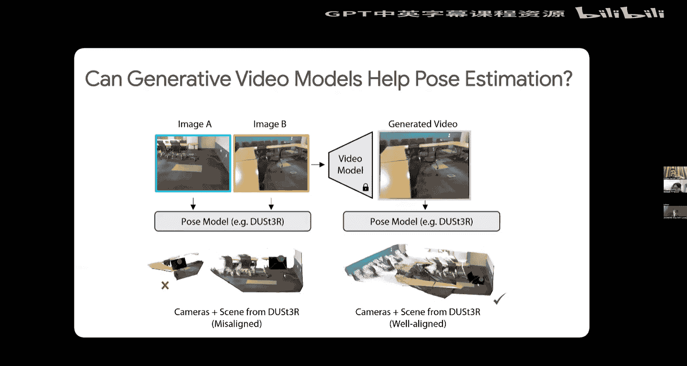

And further， interactive video models like Genie3 already allow us to navigate 3 world。

 So as you can see here， we're not just watching a clip， but we can actually。

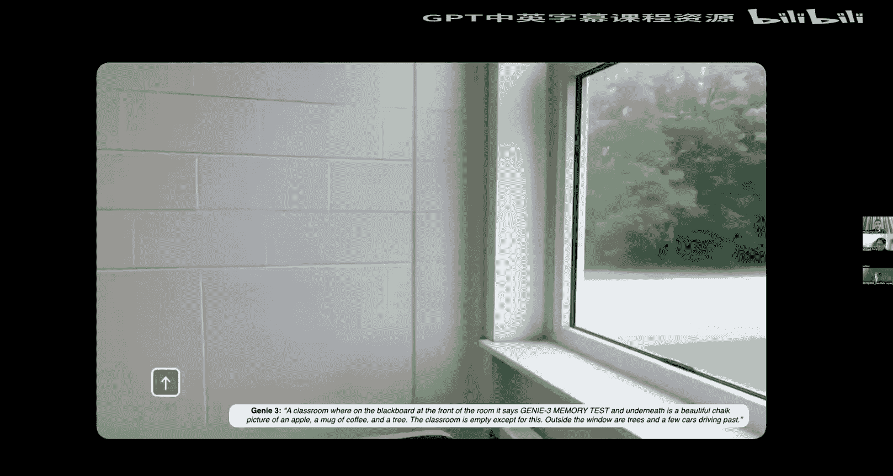

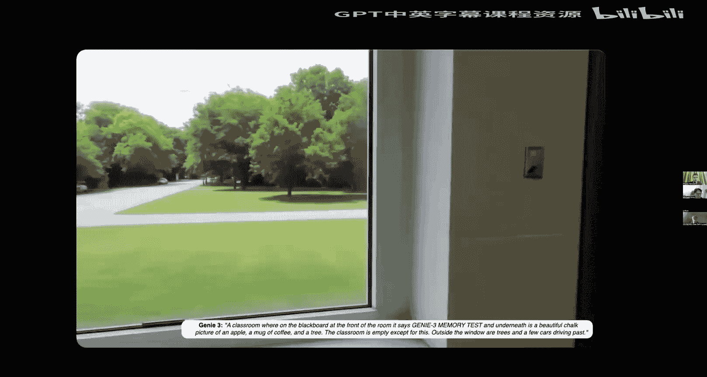

Actively navigate through through a classroom。 So here each key stroke like forward， turn left。

 turn right prompts the model to generate new frames。

 and we can freely navigate an inspector from viewpoints and eventually walk towards the window and look outside。

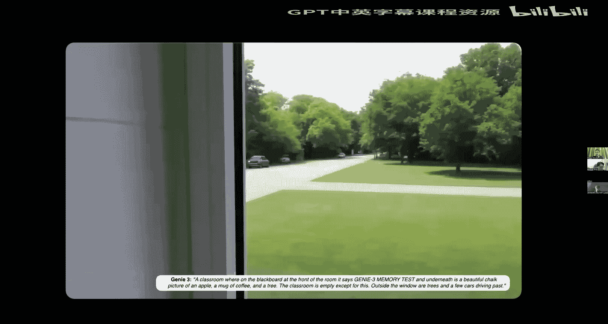

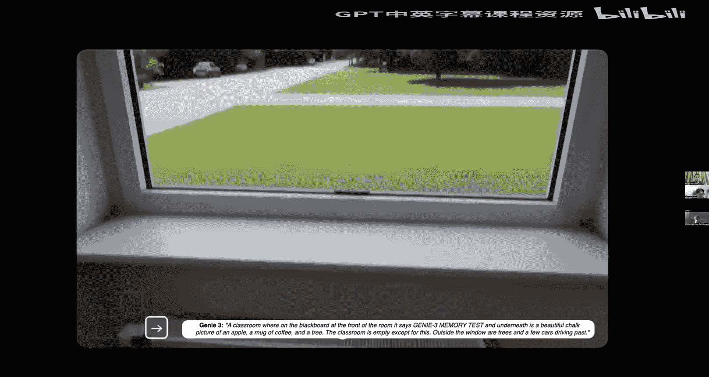

And here is the critical part when we turn back， the classroom looks the same as before。

 and it actually remains consistent。

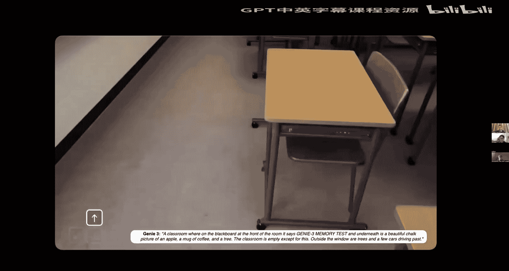

So the question becomes， why do we even need to explicitly model 2D if those purely 2D video models are already as good。

 what's the argument for explicitly modeling 2D？

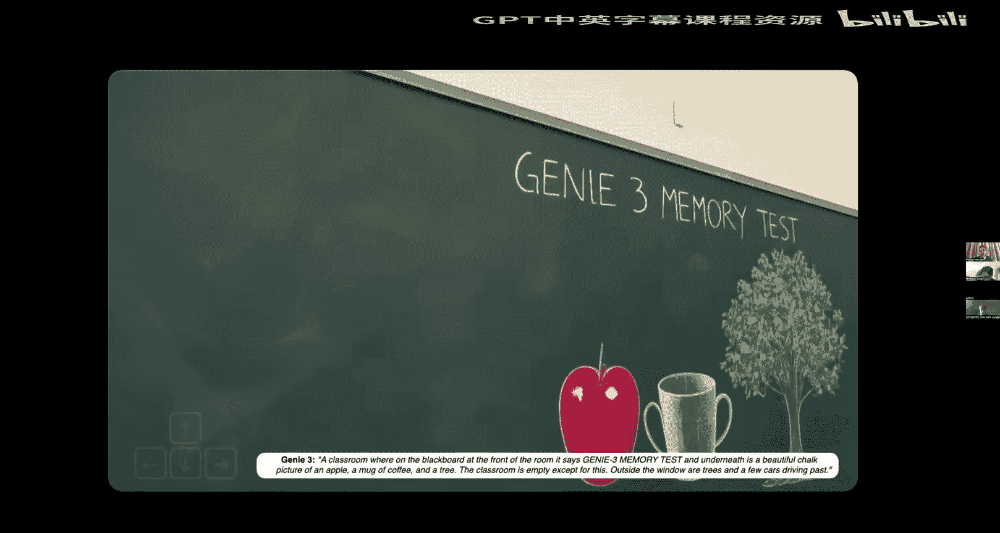

And the answer is， while those video models scale with data and compute。

 the inference cost also goes up， which prevents us from serving these models on phones and tablets currently。

So how do we overcome this issue？

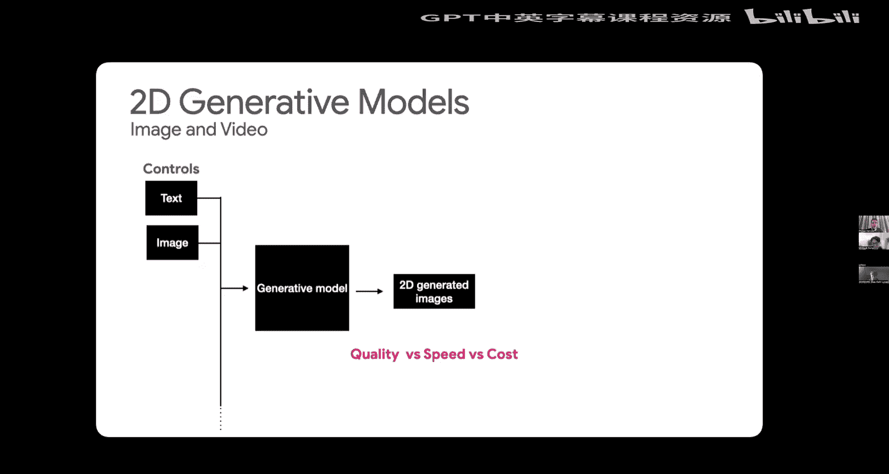

And if you look at this point from a 3D perspective。

 we already know tools like NF that can model 3D content given hundreds of images。

So once we have hundreds of images， we can capture 3D scenes in great detail。

Which then allows us to render the arbitrary novel viewpoints。

And this can be achieved at a very low cost compared to image and video models。

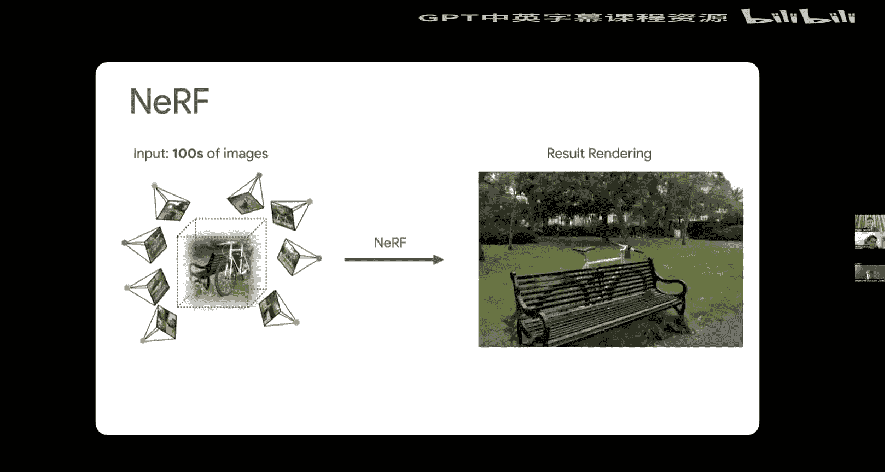

So let's look at an example， so here is a fly through of a large complex scene and it's a house with multiple rooms and in a large garden and what's important here is that this is actually fully interactive。

 which means we can control the camera arbitrarily and choose any viewpoint we want。

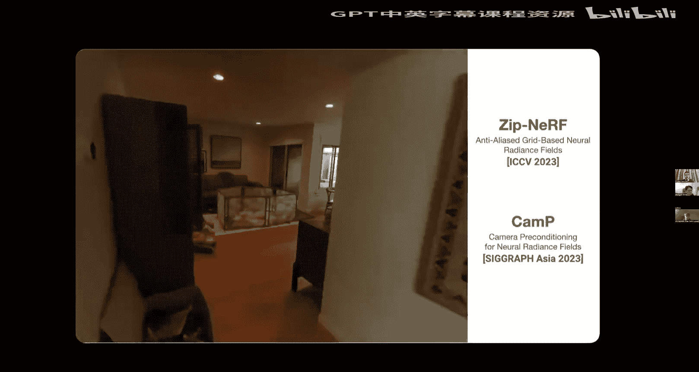

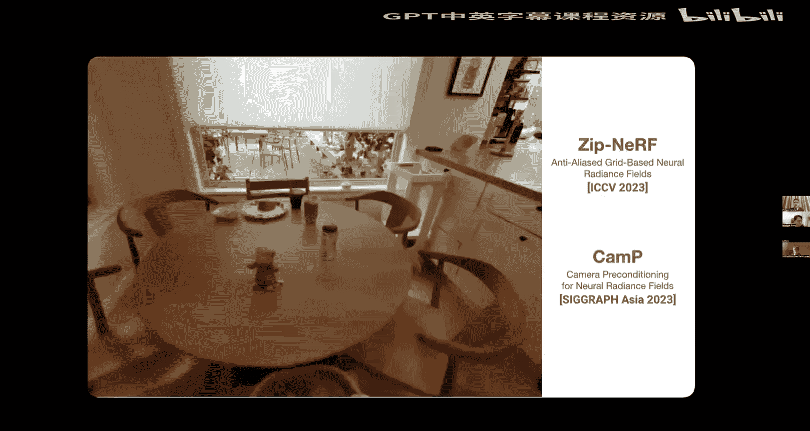

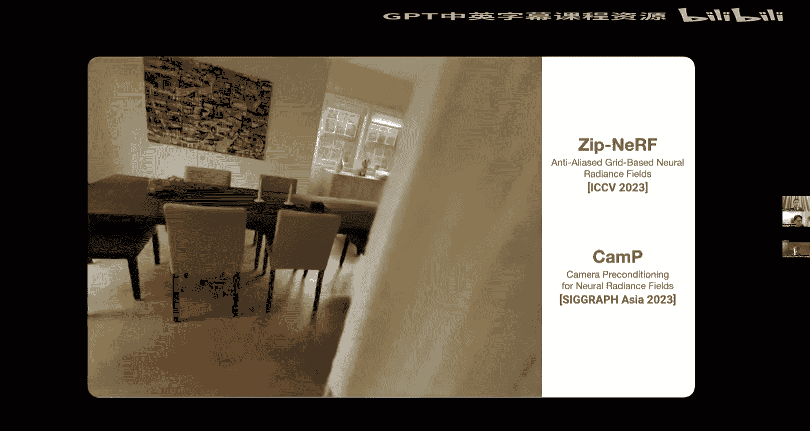

However， the scene was generated by mainly capturing many images of this house from a diverse set of views。

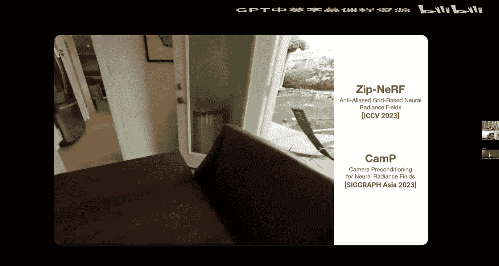

So but the good thing is that it seems like we have two pieces of a puzzle that we can combine。

 so on one side we have generated image and video models that produce highly realistic 2D images and on the other side there is nerve models that can distill those images into an efficient 3D representation that can be served and rendered efficiently。

And this is exactly the combination that we explored in CA3D。

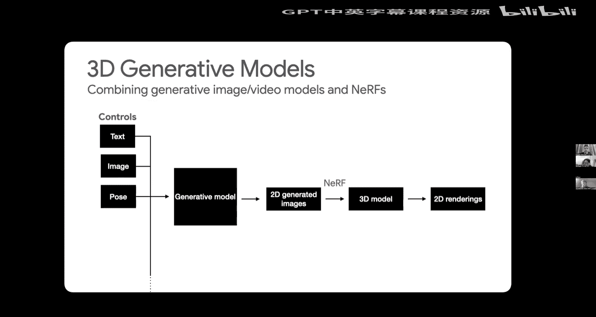

So Catth3 is a method that can take in a text prompt， a single image or multiple images。

 and generate 3D scenes。

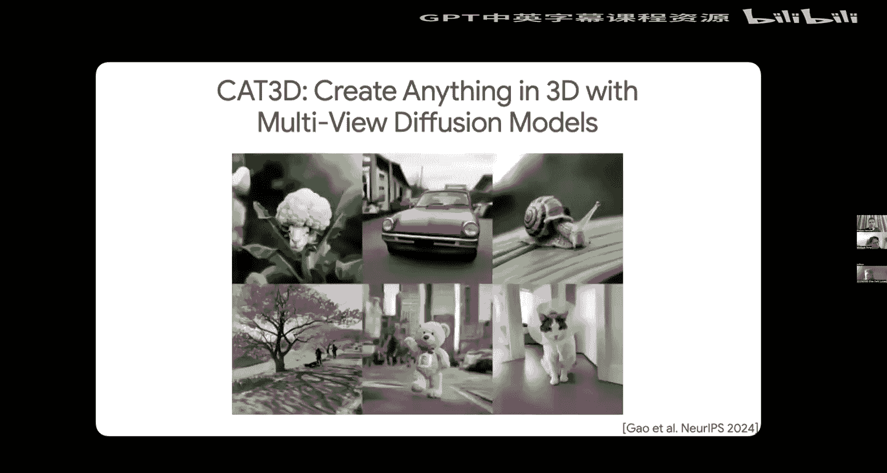

So let's have a look at this method in more detail。 So Katherrie first takes his input。

 observe views， which contain an input image and the corresponding camera parameters。

And we then encode the image using a pretrained VAE into image lants。

And while the post and the camera information is encoded into a per pixel ray called an that map。

Which basically just contains each pixel's array informations。

 so simply it just contains like the origin and the direction per pixel。

And the model also takes in novel views， and for those views， we don't actually have an input image。

So we pass a noisy lant instead of encode the lant to the model as well as the post information。

And to help distinguish between the observed and the novel views。

 we also fit in a mask that tells the model which views are observed and which views are not。

So the input to the model can be any mixture of these two different types of inputs。

And they are treated exactly the same by the model。

 So it's just a large set of use that may be known or unknown to the model。

And so the model takes all of this information in。And then simply produces a set of generated novel views for the specified target views。

And we train this on a large set of post multi view images。

 so it supervised to produce multiple consistent frames at once。

And so because this model has a tension between all of the different frames。

 we can actually get really consistent samples。So once our theussion model was strained。

 we then proposed a two stage setup to reconstruct the results。So here， given some in views。

 we use the multi view model to generate a dense set of views of the desired scene。

 as you can see here。And then we simply reconstruct those views using a relatively standard nerve pipeline。

And while the samples that we generated are not entirely3 consistent。

 they're consistent enough that the nerve reconstruction pipeline is able to consolidate them into a consistent 3D output。

An end to end， our method is able to produce full 3D scenes in as little as one minute from any number of input inputs like three images or even just a single image。

So if you go back to our overview。We see that we can use 3D methods like NF to combine generative 3D models to generate 3D models that are fast and cheap to random。

However， having an optimization step in this loop is still a bottleneck for the inference speed。

 and we asked ourselves， well， can we replace this optimization step with a feed forward model？

And the answer to that question is given another work， which is called B3。

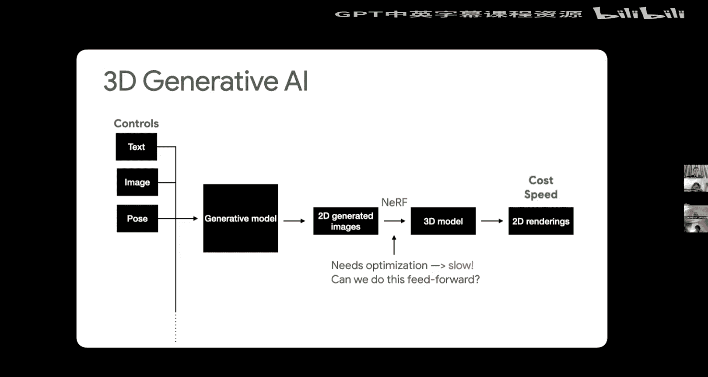

And both 3D lets you generate 3D scenes in less than seven seconds on a single GPU。

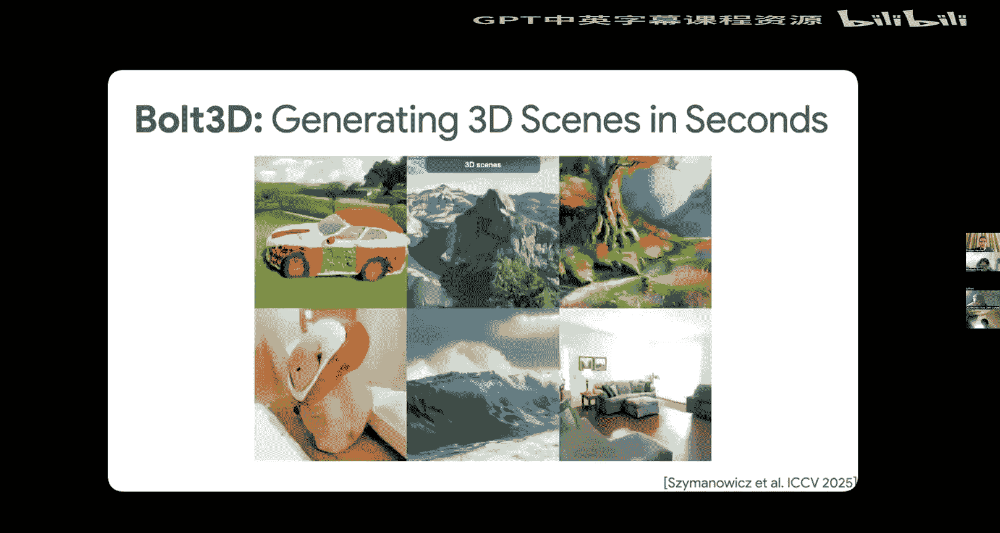

So let's have a look how we achieved this。

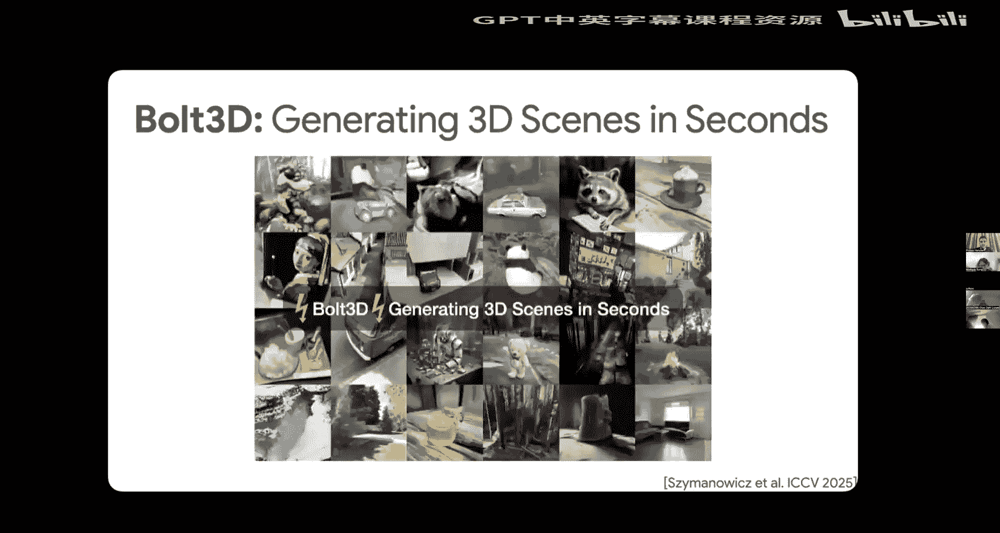

The key idea here is based on splatter images， where the goal is to reconstruct per pixel Gaussian spts。

 given a single image。However， this method was a purely reconstruction based method and couldn't handle any unseen parts of the scene since it wasn't a generative model。

But however， in both three we proposed to also so yeah。

 so in both three we proposed to also represent 3D scene spa images。

 but instead of a reconstruction model， we proposed a generative follow。

And compared to better images， poultry allows us for hallucinating unseen regions of the scene since we're actually proposing a generative model。

And in both 3D， the generation process consists of two parts。

So first we have a latent diffusion model that generates multi view appearance and geometry in the form of images and point maps。

 and if we go back to Catth3 for Catth3 we only predicted RGB latents and here we additionally have point map aence。

And then in the second part， a Gaussian head then jointly regresses the remaining properties of the 3D Gausians。

 namely their scale and opacities， given the images and the point maps。

And the output of the Gaussians are multi views split images。

 which hold 3 Gausians that then together represent an entire 3D scene。

And the reason for this two stage pipeline to first generate RGB colors and XoZ positions。

Which is then followed by predicting opacities and scales。

Is that we can robustly obtain supervision for both the appearance and point maps for multi view data sets。

And for obtain supervision for positions， we simply run structure for motion pipelines on existing multi view data sets which are pretty robust。

However， it's not actually trivial to obtain good quality supervision for opacities and scales of pixel and Gaussians。

 so it's not easy to train a diffusion model to output them。And on top of that。

 a recent work showed that given colors and position information。

 it's much easier to request opacities and skills than to generate them。

And this explains our design choice to first train a generative model of RGB and XYZ。

 which is then followed by requesting the remaining properties。

So let's have a closer look at how we do this。 The generation process is implemented using a multi view latent diffusion model of appearance in geometry。

And then the input to model similar to CatI is a set of scene and unseen views of the scene。

And the observed views contain a clean RGB latent， and this time also a noisy geometry latent anticamera pose of the observed view。

And the unobserved views contain a noisy RGB latent， a noisy geometry latent。

 and the camera pose of the target view。 So compared to Cat3 here we additionally have like a geometry lants for both the unseen and scene views。

And then the diffusion model outputs a set of thin image and geometry latnts。

 and it does it for each pair， one pair for each view or。

And then the image and the geometry are then decod independently to full resolution RGB and XY Z images。

And an insight here is that simply out encoding point mapps using off the shelf RGB out encoders results in very low quality reconstructions。

 And I'm not going to go into detail right now， but we will talk about the geometry。

All 2 quarter later。So next we then train a so once we have this。

 we train a multi view Gaussian head that takes in all of the predicted per viewpoint maps and RGB images to produce a set of ladder images。

That means we transform each view into Gaussians。And here it was important to have cross attention between all of the views so that the network could reason about all these sptter images together to ensure 3D consistency。

And then finally， we can run these images to view our final output。And to train this model。

 we created a large data set of 3D scenes， and we ran master a recent three structure for motion pipeline on all scenes from CO3D。

 RH0K， MVMageNe and DL 3DV。And this was necessary so that all of our data has dense XZ notations for every image。

 making this data unsuit for diffusion model training， and together with synthetic object data sets。

 this allowed us to train our generator on a large scale data set。

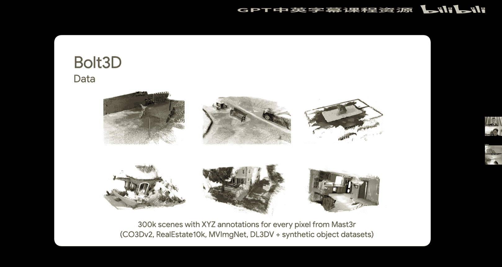

So let's have a look at some of our results， so here we see two scenes that were faithfully reconstructed by just a single image。

 and we can also see that the model here can actually hallucinate unseen regionss。

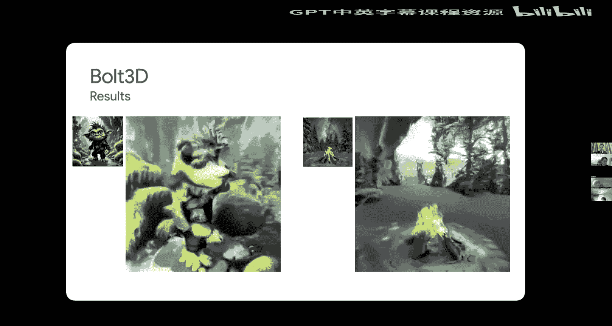

And we also have more examples on our project webpage。

 I mean there's even an interactive view where you can explore our scenes in real time。

 so please take a look yourself。

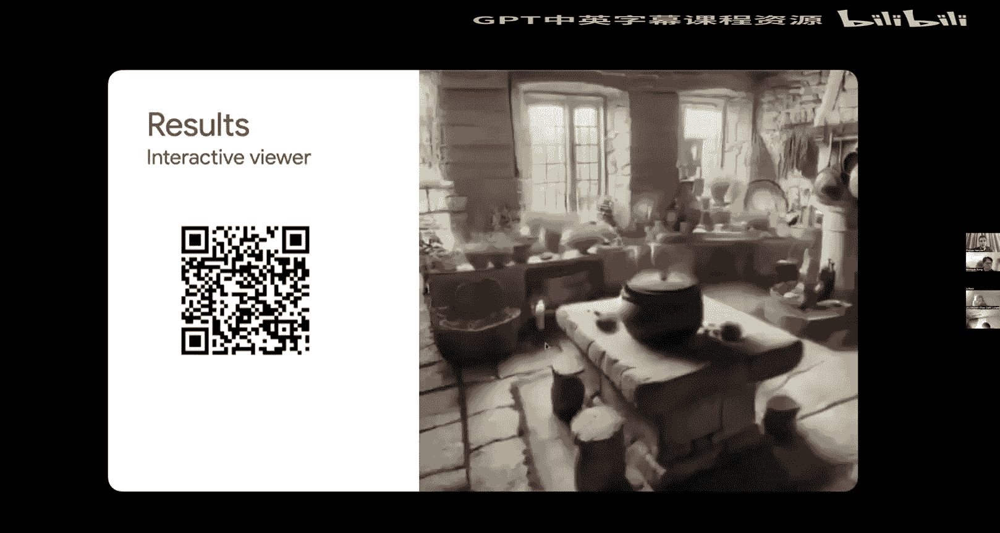

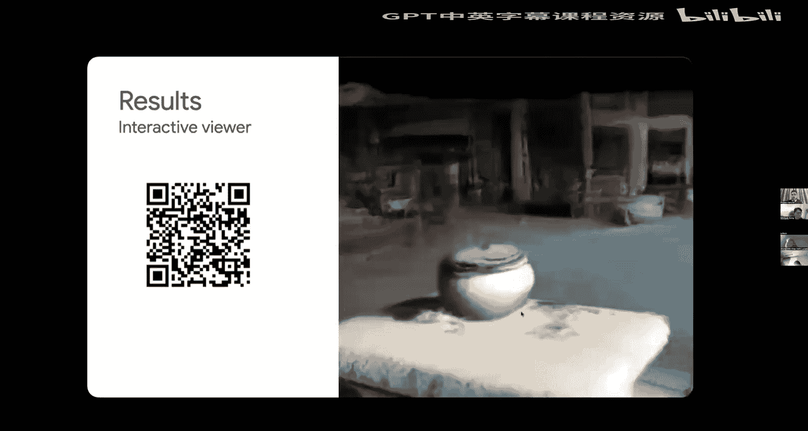

Yeah， so but one thing that I would like now to talk about now in more detail is this geometry auto encodecor because learning to operate a geometry with a latent inffusion model has proven surprisingly difficult initially so we found that VAEs pretrained for image out encoding were not really appropriate for auto encoding geometry。

And we found this to be the case regardless of this scale of the scene。

 and but I actually observed that for bigger scenes， we get even more catastrophic failure here。

And this is likely because the objectives for compressing images are not really appropriate for compressing geometry。

 for example， perceptual losses don't really make sense for geometry。

And another reason is the scale of the data because input images are always within zero and1。

 but this is rarely the case for geometry。

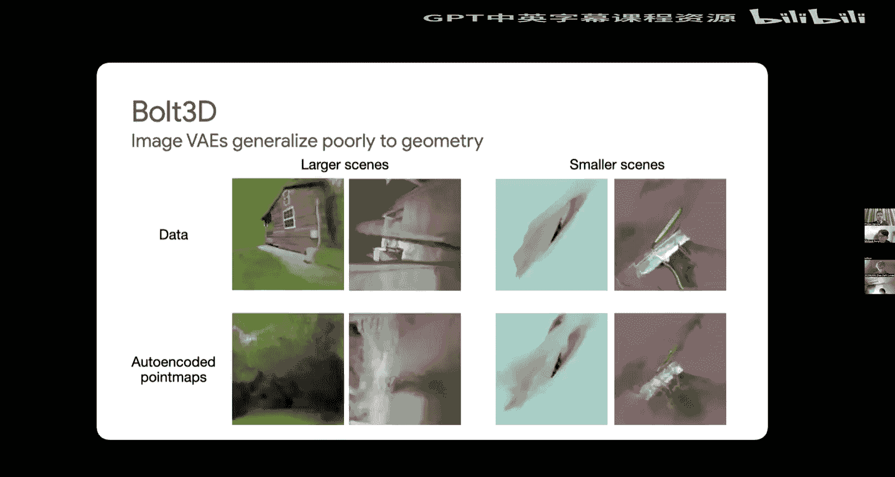

And something else interesting， or another interesting inside that I would like to share is that we found that the decoder in the VAE for XoZ data actually needs to be a transformer。

嗯。Even though that so yeah， so it should be a transformer。

 even though qualitative a quantitatively a convolutional decoder performed similar to a transform decoder。

 but when you actually look at the convolutional decoder or like the results of the convolutional decoder。

 it leads to perceptually jarring artifacts， like not actually maintaining straight lines as you can see here on this slide。

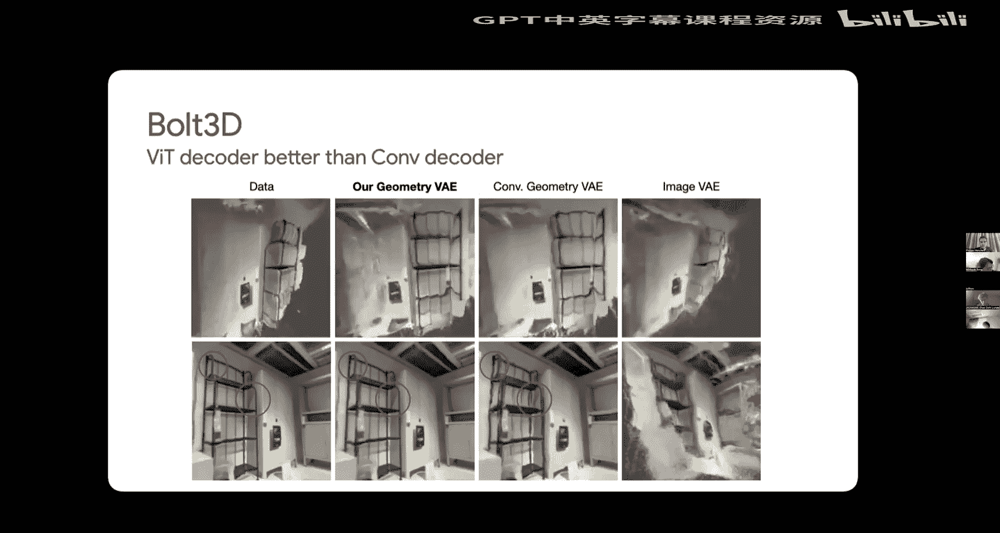

And this can also be seen like those artifacts can be seen across a big range of scenes。

 including those bathroom shell seal。So and since fine tuning geometryory VAEs for both three was quite crucial。

 I would also like to share another line of work in the VAE space with you and this is actually something that we recently submitted to CVPR so you're actually the first to hear about this work and since it's still under review so let's take a quick view tour into the VAE and and then we're going to get back to Gene 3D again。

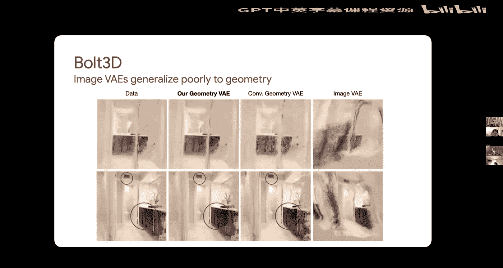

So the paper I'm going to present is called visions languagegu models as perceptual judges for human aligned image compression。

So usually when we train out encoders we use losses such as PSR or SSIM。

 however these losses really poorly align with human perception。

 so for instance humans are very sensitive to perturbations to a faces and text。

 but let's go to natural textures such as graph or fill or other patterns like in this example here。

 the flag on the top right in the image that is shown here on the slide or the text on the window。

And to address this problem， we propose a method that uses an off theshe vision language model as a perceptual judge to improve current auto encoder training to focus more on human aligned image compression。

And as you can see here on the slide， our method improves the text on the window。

 and if you look closely， it also improves the pattern on the flag。

Despite not being actually correct， pixel wise。So instead。

 our method produces a flag pattern that to us human looks kind of the same。

But if you take a very close look， you can see that the white points and a flag are actually not identical。

 but located in different positions。I'm not sure if you can see this through Zoom。But yeah。

 we can see this on on our web page later that once to be uploaded。

So the are questions is like how can we achieve something like this？

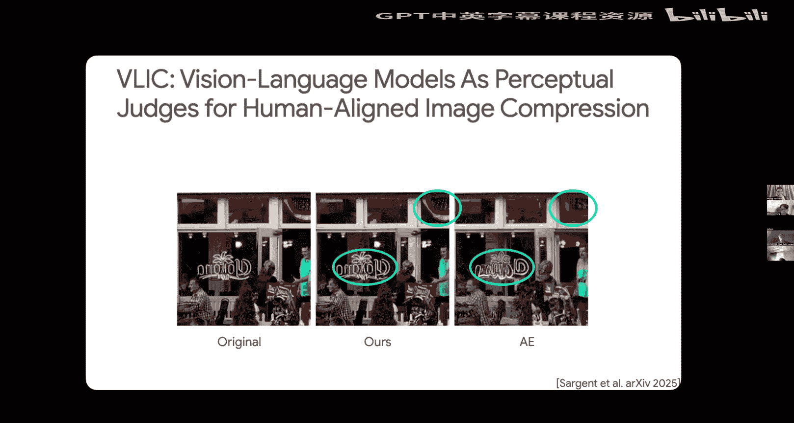

So let's have a look at this method。So the idea here is that given the original image。

We' are using a diffusion auto encoder。And decode the original image twice using two different noise seats to get a decoding A and a decoding B。

And we then prompt a VLM。To evaluate which of the two decodings is preferred。

And based on the response of the VLM。We then' use a diffusion DPO。

To improve the diffusion out to encoder。And in theory。

 here any reward function could be used to determine the losing and the winning decoding。

 but in our case we chosen VLM to do so， which is the novelty of this method。除了这个。

Look at our method in a bit more detail。So again， given those two decodings A and V。

 as well as the original image， we prompt the network to analyze those two different samples from the AE。

And the VLM is then tasked to produce a numerical rating between minus 5 and 5。

 indicating whether the reconstruction A or reconstruction B is closer to the original image。

And here negative numbers means that a is better， which is the case in this example shown here。

And since BLMs are prone to hallucinations， we use the following three strategies to make our laws more robust。

So first， instead of just fitting in A and B， always in the same order。

 we also reverse the order of the input images to the VLM。And secondly。

 we run the VLM for multiple seats for A& B and then sum them up to reduce the noisiness of the outputs of the VLM。

And then thirdly， I mentioned earlier that we can also use any kind of metric here to determine which of the two images is better。

 so what we did for the third one is that we additionally use an LPPS metric to determine which reconstruction is more accurate。

And if the VLM and the LPPPS agree， we then pass the rating to the diffusion GPO。

 and otherwise we just discard the sample。And we also renalations and tested LPIPS and the the VLM preferences independently。

 and while using each preference scheme independently improves the results。

 using both schemes together or like combined results in the best performance。So。

Comparing our method with other competitors， we can see that our method allows us to correctly decode the text。

 as you can see here， and when we look at the building in the background。

 we can also see that it improves the high frequency textures of the windows。

More like the the smaller， yeah， the smaller parts of the windows。And then furthermore。

 in a second example at the bottom。We can see that our method improves the face reconstruction as you can see here。

 if you look at the woman on the right and as well as the patterns on the wall in the background。

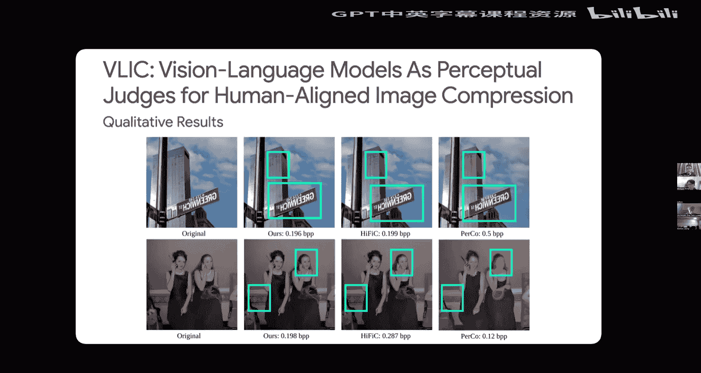

And we also evaluated this method quantitatively against multiple competitors on multiple data sets。

And most of the methods are trained on varying bits per pixel， which we don't denote here as BPP。

 so we also train our method on two different BPPs， one model was trained on 0。

07 and the other one was trained for 0。21 BPP。And when we look at the numbers。

 our method actually performs quite poorly on PNR， as you can see here on the right。

 so our method is shown as a blue line and a higher value for PsN R means the results are better。

 but you can see that our results actually have the lowest and therefore worst numbers。嗯。But this is。

 well， but that's actually， that wasn't really our goal to improve the piece now here。

 but we were rather care about the human perception since yeah， since this is like what we wanted。

And to get a better sense for this， we didn' also run a user study and compute an eO score for all the methods。

And as we can see here， our method actually performs quite well on the MS Coco and the click 2020 data set。

 however， our method actually underperforms compared to the PO ELic method on the click 2022 dataset set and this is a little bit unfortunate but here it's actually hard to say why this is the case because PO EL didn't actually release the code and the click 2022 dataset set also only contain a 30 images which can also potentially lead to noisy results。

But then looking at other perceptual metrics like FID， FID Dno， and the LPIP score。

 we can see that our method actually performs quite well across the board。Okay。

 so this brings us to the end of our VAED tour， and while this wasn't really directly focusing a 3D generation。

 I would be very interested in seeing how we can use VLM post training similar to what I talked here。

 talked about here for 3D related tasks。And with that being said。

 let's hop back to generator 3D again。So earlier I presented both 3D。

 which was a method to generate 3D scenes in a fit forward manner given 2D generated images。

And so far， we've talked about a lot of three generation of of sorry of three generation of content。

 but an important factor for content creation is also to。

Allow for fine grain control over the outputs。And one such control is lighting。

So in the next chapter， we will talk about how to enable light control for generative 3D models。

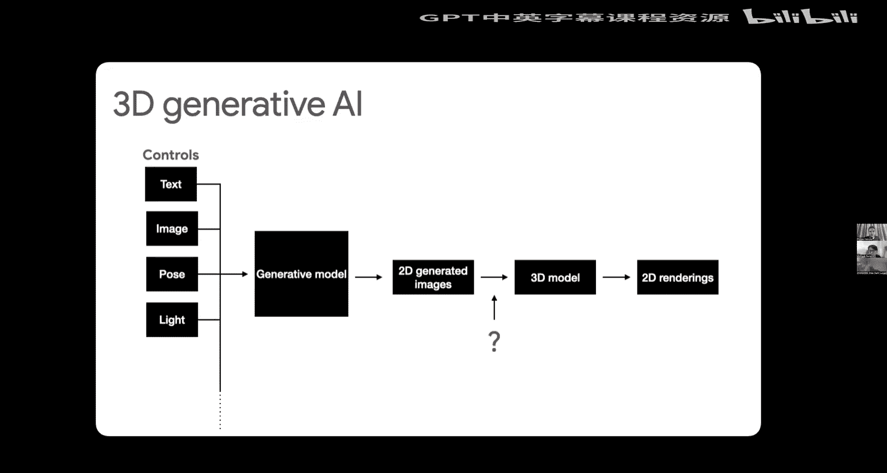

And we addressed this in this task in our method called Roga and here。

 given post images in a target illumination。The goal is to produce a three related model under novel illumination。

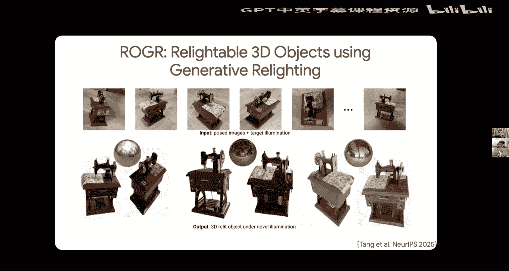

And to achieve this， we train a multi view rewritinging model similar to the multi view models for Catth3 and both3D。

 but this time for relighting。And the difference here is that the input is not only a set of images and their corresponding poses。

 but also has a light conditioning。And we then train this model to produce re versions of the input use for each available。

So for each available light from 1 to light M。And the goal of this multi TV model is to produce a data set of n by M relay images。

That then can be used as a data set for a light conditioned nerve optimization。

And the goal is to relight an object。And there are lots of different illucinations so that we can then train enough to condition on a target light。

So here， think about the light stage where we turn on and off arbitrary lights and the idea is that if we cover a dense enough or sorry a diverse enough set of different illuminations。

The nerves should be able to generalize to unseen target illuminations。

So let's start first with a standardner nerve setup where we condition the nerve for every pose here so for every pose I。

 and we compute rendering loss on the image corresponding to the input pose。

And to train a light conditioner of the task is to encode input lights so we can also feed in。

A an input light as an additional conditioning。And then the next question is， well。

 how do you pick at the right representation？To encode the lighting because this is not trivial。

 And in our case， we opted for an environment representation and we feed this environment environment through a transformer encode on。

To get a light embedding。And while in theory， this should be sufficient to represent the lighting。

 we found that the encoder wasn't powerful enough to always take care of all the specular regions。

So to address this issue， we additionally created a specular bedding that explicitly encodes the incident light from the specular reflection direction。

And instead of only sampling single value from the environment map at the reflection direction。

 we sample locally around the end map to handle different roughness values。

And the way we do this is by pre blurring the endmap so that we can then sample a single location as embedding。

So once we train this nerve， we can then condition it on any target lighting to relate the 3D model and on this slide here we showed that different lighting different target lightings for a given source lighting。

And we can see that our model faithfully recovers specular highlights while competitive methods struggle to do so。

And the competitive methods either misses to fully produce a specular highlight。

 as we can see in a top row， or it overcompensates for the specular highlight。

 as you can see on the bottom row。So as you can see。

 this method fits nicely into our generator3 setup and extended the number of controls。

So what we learned from this type of method set up where we have a generative part and the end then a 3D dissillation part is that we can see that the 3D part will only ever be as good as the 2D generation part as the 3D part is dependent on good generations。

So if you remember Richard Sutton， that says， assume abundance of data and compute and limit the inductive bias。

 we should assume that truly generative methods will scale whereas 3D models will not scale。

But the 3D models are cost and time efficient。And one work that demonstrates the dependence of a strong 2D generator is one of our works called Cubtive。

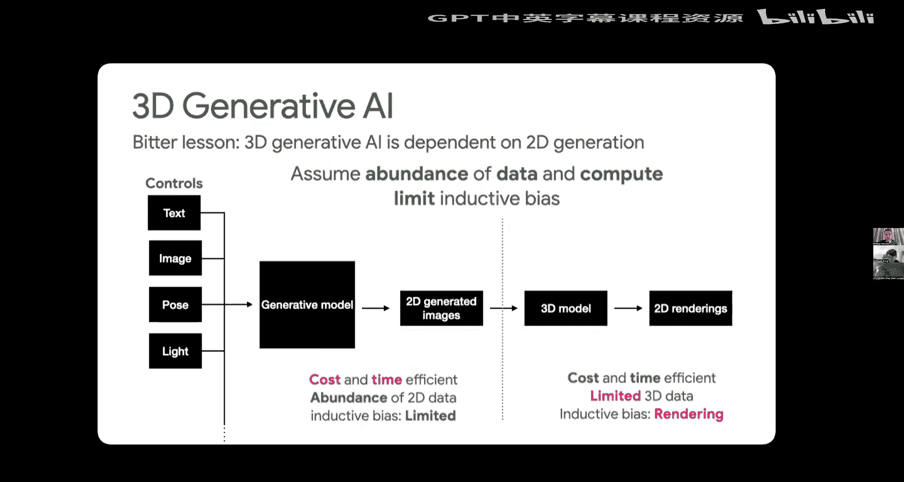

And in Cubative， we address the task of360 panorama generation， given text or a single image。However。

360 panorama data is actually quite limited， so the task is how can we scale a method to generate 360 panorama images despite the limited amount of data？

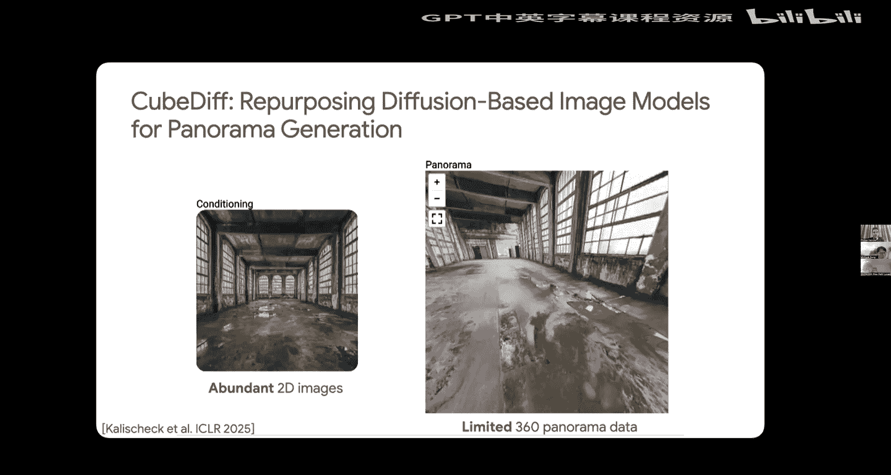

And the key idea here is that we can treat 360 Pan ra images as cube map with six faces。

So treating them as six different sites of a cube means that each individual image is a perspective image that belongs to the fuion of most images that exist on the internet。

And now if we stack up all of those six images along their channel imagine。

 we can train a 360 Panorama generation model using the same architecture as a standard 2D diffusion model。

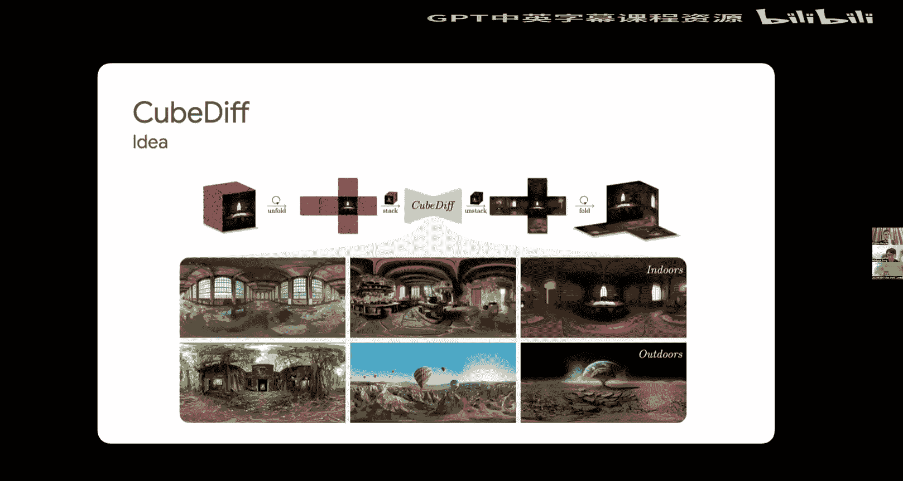

And the way we do this is by feeding the stack of those images to a 2DDconr。And then。

 almost entirely。We areus the architecture of existing 2D models， and in our case here。

 we're just using a pre traineded stable diffusion model。

And since such a preter model is already capable of producing the distribution of all the perspective images。

 we don't actually need to further train the existing layers of the model so we keep those frozen。

However， what is important here， so however， what the model is not capable of doing yet is to reason about the three layout of this cube map and how those six input images belong together。

So what we did is we added tension layers between all the residual blocks that are then trained to learn the spatial relationship of the different images contained in this cube map。

And since the task of understanding the relationships。

Between the six images is significantly easier than learning the entire distribution of images。

 a small data set of panorama images in the order of the magnitude of10s or thousands of images was enough to train the generative 360 panorama model。

And although our Panorama dataset set， as I just mentioned， is limited sorry， sorry。

 and although this panorama data set is actually limited to natural images。

 our model can generate outputs beyond this distribution， as you can see here。

And this is possible because we freeze the foundation。

The 2D Foundation model or the 2D Foundation network。

 which retains its ability to generate any kind of perspective image。And yeah。

 this example you just illustrates the out of distribution capability。

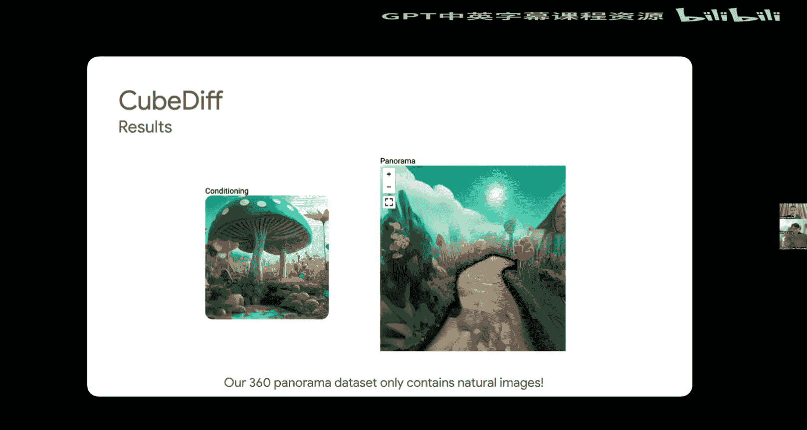

So getting back to the bi lesson， overall， it seems quite untrivial to train 3D methods to be independent of 2D models just due to the pure like our 3D data。

So should we be focusing on making 2D models more cost efficient and speed efficient？

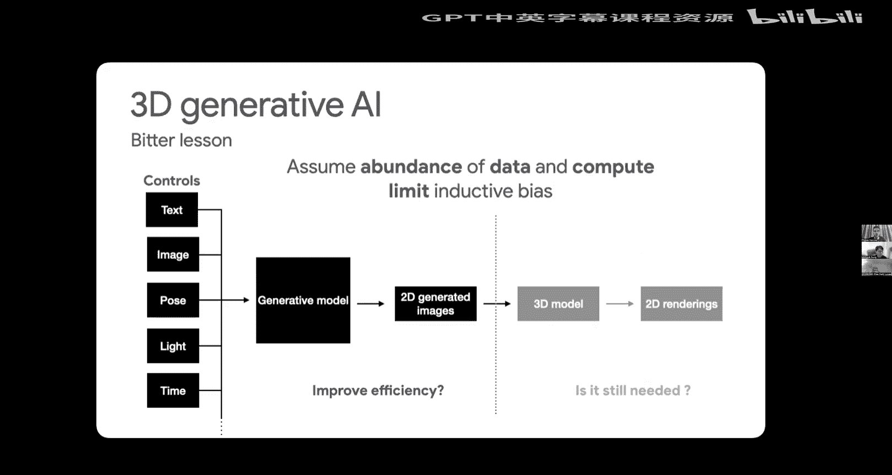

And our friends at WorldLps have been working on an interactive 3D model that is capable of real time next frame prediction on a single GPU。

And while the results are not really perfect。It's it's like it seems to be a very promising direction。

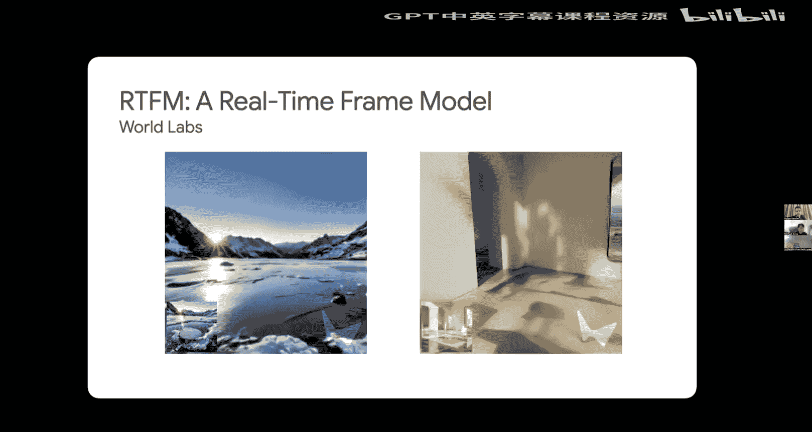

So this come gets us to or like， yeah， so this gets us to like answering the question。

 why is 3D so important for content generation。So while 2D methods are already producing highly realistic videos and have already shown interactive capabilities such as camera control。

We do not yet have a full and precise control over them yet。And more importantly。

 though this model can already be served currently。

 so we still require3 distillation for serving at the moment and whether that will change in the future。

 well I guess we will see。

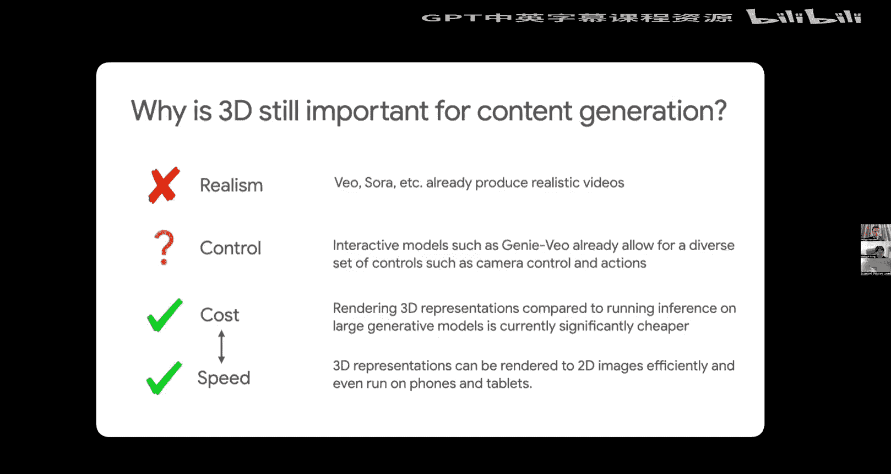

And with that， I would like to conclude and thank you for listening and also say big thanks to all of my collaborators。

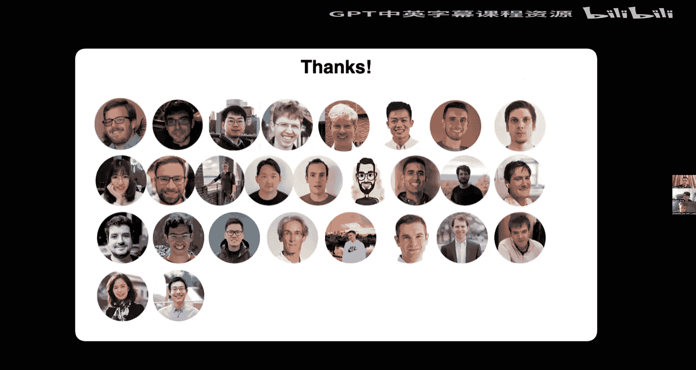

对。