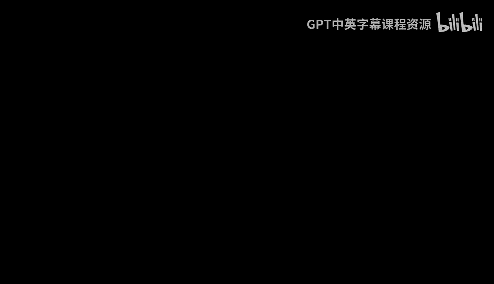
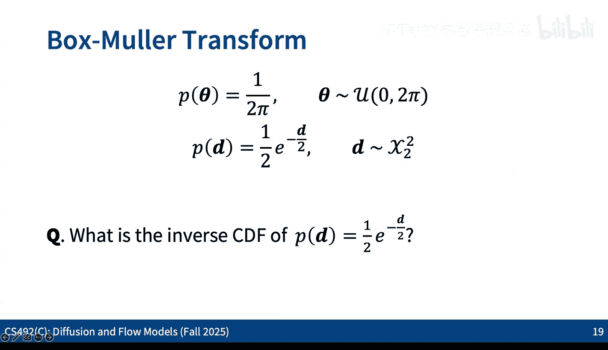
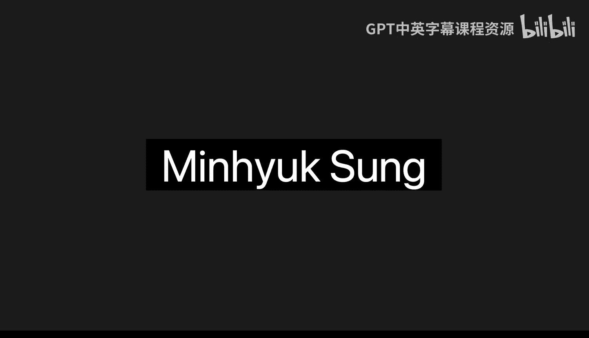
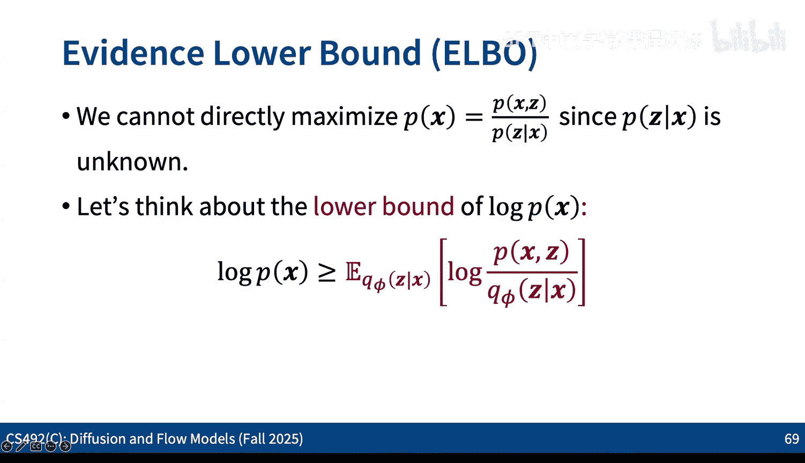

# KAIST《扩散和流模型｜CS492(C) Diffusion and Flow Models 2025》中英字幕 - P1：Lecture 02_ Introduction to Generative Models (Diffusion and Flow Models, Fall 2 - GPT中英字幕课程资源 - BV1CKpvz1EH5

I think it should be okay。 not okay。 then yeah， then let's get started。So yeah。

 so today we are going to review some very basics about the generate models。

 especially kind of some old ideas like the again and the B before we get into the and the flow models。

 So I guess many of you might already have some kind of the background about the models。

 So this part might be boringing or some of you but let me just like briefly go over some kind of the basics before and were gonna also see some kind of the how these kind of the ideas and the B connected models that we are also going to see。

So for all the de models， the basic idea is that， as I also mentioned in the the last time。

The basic idea is that let's say， like we are having this kind of the very large collection of the images。

 Sa Z said there is some kind of the data set， especially the images， which includes the 5。

8 billion of images， Very large scale the Internet skills of images。

 So given this kind of the very large collection of the the data。 here。

 the question is that how we are going to make a kind of model that can produce something that looks like one of them。

 right。😊，So that's basically what do you want to do。

 So given this kind like very huge collection of data data points。

 What we want to do is that we are making some kind of the model that can produce something that looks like one of those kind of data points Now theject like just picking one of these kind of given the data points but making something new but still that looks like one of those kind of images So thats basically all models how are make a model that can produce this kind of。

😊，So how can you do this， It sounds like two challenging problem。 So， but the thing is that actually。

 the your the course project will be really making such kind of model that can produce some kind of new image。

 But that sounds like too challenging。 So we are going to get into some kind of simpler case。

So instead of like seeing some kind of the collection of the images。

 Let's think about like much simpler case。 Let's say。

 like we're just taking some kind of collection of the2D points。

 So now we are having some kind of the lots of the dots in the2D space that forms like this kind of the shape。

😊，And here， the question is that how we can make a model that can kind of the new point。

 but that looks like one of those kind of given points。

So that's theィ page idea how we can make this kind of model。AndActually。

 there can be some multiple kind of ideas of like doing these kind of things。

 But what we are going to discuss in this quest over the entire semester is basically seeing this problem from the statistical perspective。

 So you're gonna say that actually everything here is basically all about the statistics。

 So from the statistical the perspective what we are going to see is that we are going to treat all the given the set of the 2D points as kind of the samples from some kind of the underlying the probability distribution。

So we are going to assume that there is some kind of the underlying the property distribution。

 which is basically defining our the data distribution。

And the given set of the2D points are basically the samples from that specific the distribution。

Then the problem becomes basically， how are we gonna basically sample basically new data point from that the underlying the distribution。

So that's basically the statistical perspective of this kind of the degen problem。Make sense。

So basically， if the probability distribution is known and for some specific types of the distribution。

 what they can do is that we can directly sample the data points from that specific distribution。

How we can do that。Do you have any ideas for this？So we're gonna please basically that main point here。

 but we're gonna basically very briefly see what kind of things that we can do。

Let's think about some simpleplst case that we are having some kind of the categorical distribution。

 So this is even the case that we are having some kind of the discrete discrete。

 the finite number discrete states。 And for each of the states， we have some kind of the probability。

 which some should be one， right。😊，Given this kind of the let's say。

 like we are having this specific categorical distribution。

 having the four states and having some kind of probability for each of the case， right。😊。

For this kind of case， how we can basically sample one of those kind of disities based on this distribution。

We can do this， any ideas？Is this something that you already learned from the statistics course？

I don't know。 So that's basically something that we are going to do。

The simplest idea for this is that we are going to see not just the probability the the distribution。

 but the cumulative distribution， the function like this。

 which is basically nothing but just likeccumulating the probability for the states。

 which is the coming before each of the state。😊，So for each of the like four cases。

 we are basically summing up the probability for the previous these。

 Then were gonna make this kind of the cF the function。

Then what we can do is that actually we can see this kind of DC function not from these sexes。😊。

But from the other axis here。ButBut the point is that obviously。

 like when we sum up all the probability until the last district， these sum should be one， right。

So basically， no， it precedes the c active function。

 It should be basically starting from the zero to one like this。

Then what we can do is that we can simply consider， basically sampling。From these sexes。

So basically in any case， the range of the yイ axis here should be basically0 to one， right。

Then what we can do is that we are sampling from these axises with the uniform distribution。

 basically getting some kind of the random the probability in the range from the range from the zero to one and see where this point turns into for each of the bin here。

Makes sense。That's the very basic idea for the inverse transform dis sampling。

 So we are basically seeing the C depth from the not from the D sexes。

 but from the D sexes in terms of that， we are sampling one of the the point here from the range from the geo to1。

 So that basically becomes the probability and the see。

 like where this basically point pour into the one of the beanss here。

It should be falling into the any and basically have some kind of the higher the probability there will be some more the chances that the point into that specific。

So it's basically very intuitive the idea， right in terms of how we can example based on the given the categor or the distribution。

So this is the very basic idea for the import from dis sampling。And actually。

 we can extend this idea not only for the discrete case， but also for the continuous case as well。😊。

Especially exactly the same thing。 So it's developed made of like。

 given any kind of the Pf from some specific range of some kind of data points。

 we are basically calculating the cumulative distribution the function by by just taking the integral on that point。

 right。So given the kind of the cumulative distributed function。

 that what we can do is that now we are also having the same this kind of the plot。

But not in the discrete space， but in the continuous space。

 Then we can do the same thing in terms of sampling the probability from the zero to one range with the uniform distribution and see where these point first into the each the infinite smooth the smooth bin。

 right， which means that just like competing the inverse of the the C of the function。

So that's the basic idea。 So which means that if we can if we have the probability distribution function。

 if we can compute the CF and also the inverse of the CF。

 then we can use this idea to sample from that specific the probability distribution。Make sense。

Very simple。So let's do some kind of exercise。 You don't need to on this。

 or you can just like play with this。 So given this kind of the Pf。

3 eighth of the x are secured into this range。 Basically。

 how are we going sample from that specific PF。Let's try to basically calculate this。

If if you have the penalty。Paper， try tools all these what you get。So yeah。

 let me give you a couple of ways， you see。So over the electricity。

 you're going to see these kind of the very smoothly tiny problems， like all the slice。

So it's very clear to see that we can compute the inverse DCF like this。哦。

Let's do some kind of some small practices and see So yeah the point is that if we can basically have the knowledge about the Pf。

 the distribution and also if we can compute the cumulative distribution the function and also the inverse of the cf。

 then based on that we can use the simple the idea in terms of like doing the inverse transform the sampling So it's basically all about like first sampling from any uniform distribution and that basically fitting it to the inverse of the c right。

So this is the basic idea。 And the thing is that what we are going to see in this class is that we are going to talk about the Gaussian distribution。

 the normal distribution all the time。 I mean lots of things of basically based on the Gausian distribution and the region like why we are playing with the Gaosian distribution is that we know how to sample from the Gaussian distribution。

 That's basically very kind of the basic things the problem of the the normal distribution is that we know the form of the P Df。

 right。Can you find the closed form of the inverse cF of this form？

If you try to find the inverse of the cumulative distribution function for the standard the normal distribution。

 which youre gonna see that is not。Possible， So that's the problem。 So we got the idea。

 like in case the case， like when you can compute the inverse there。

 Then we can use the idea of the inverse transform sampling。

 But this is kind of be one of the representative keys that we cannot directly compute the inverse there。

 So what should you do。😊，So there are also like lots of the ideas。

 but I'm going to just keep some kind of the。😊，Big ideas like what can do some very briefly for example。

 So lets say for the the case that we are having the standard the normal distribution。😊。

Let's think about that Now。 we are taking not only a single sample。

 but like taking some two independent samples， the X and the Y here。

 which are both coming from the same the standard de normalmal distribution。So in this case。

 the joint the distribution will be defined like this， simply a multiplying these tool。

So if we just like play with the standard normal distribution like this。

 then there's no way that we can sample from this。So what we are going to do is that we are going to change the variables。

 So the idea for the changing the variable is that actually we are seeing like why we are having the two samples。

 not a single sample。 the basic idea is that we are going to treat these like two samples as's kind of the2 D。

 the carte and coordinates。 basically like one of the point in the2 the space。

 in a way that we can joint to convert these two variables into the the variables in the polar coordinates。

 So now we are going to see not the X and the y coordinates but the radius R here and the theta here。

😊，Basically changing the variables， especially like we are going to see， not just the radius。

 but the secured radius are secured there and also to the setta there。

Then based on these kind of the new the variables， now we can also compute the same de joint distribution that becomes like this。

And then obviously， the radius and the theta， those two things will be independent each other。 right。

 one is about the angle and the other is basically about the distance。

Then what it can see is that actually after changing the variables。

 we can see that we are having these two variables like this and the property distribution for each of them becomes like this。

 The good thing is that now for the angle here， it becomes the uniform distribution。

 So we know how we can sample from this。 So it's very very easy。

 The only thing is that now for the security radius， which I just de as the D here。

 that's the same as the R secured。 for the security the the radius。

 we are basically having this kind of the form of the the property distribution。😊。

which is specifically the the high security distribution with the the degree of the freedom of the two but you don't need to exactly mean this。

 The thing is that the P D F looks like this。So which means that now we know the Pf and it looks like something that we can compute the inverse of the CF。

 right。So now it becomes the middle of like， how are we gonna compute the indoors of the D D in terms of that we can sample the security areas。

Can you also try to derive the inverse of the C depth。Y。

Did everyone get this？So I mean， yeah， so you can see like why we are changing the the variables。

 The good thing of like that is that now we can have the form of the P Df that we can easily compute the inverse。

 the accumulation distribution function。😊，Then now you got the idea， right。

 So based on that we can sample from theusian distribution。

 So the basic idea is that for the angle is from the uniform distribution。

 So it's very easy for the security radius。 What we need to do is that we first sample from another the uniform sample another the uniform the distribution sample and then they say computing this right。

 So that becomes the one of the sample of the security radius and based on that just like computing the X and the y。

 and the good thing is that now we get not the single sample but the two independent samples from theian distribution。

So now you gotて basically the basic idea right so given some kind of the pf what we can do is that if we can directly compute the inverse c then we can basically sample based on that by the way all these slides are alreadyed on slack and also can download that so given that the can if we can compute the inverse c then we can basically sample from that。

For the other cases， we can consider doing some kind of the changing the variables in terms of that we are making the form that we can compute the inverse D for the other the cases。

 we can also do something like the rejection sampling。

 but we are not going get into deeper into that。 But there are some specific bunch of the ideas in terms like given the P Df。

 how we can make some kind of the new sample。😊，So you can see that for the cases。

 like when the Pdf is basically known and also the when the Pf is the form that we can complete the inverse DC Cd。

There is nothing to discuss in terms of de modeling。 You can just directly sample from them。 Per see。

 it's nothing to discuss。That means that actually the problem that we are thinking is like much more complicated。

 right， so we are going so get into that。😊，But before we get into that here also the question。

 So that was the case of like the one D case， right。

 What if we have the multivari of the normal distribution。あワ。

Your biggest case was like the1 d Gaussian distribution， right1 d standard deommal distribution。

For the multidial space。How can you do点 multiple things。ai。

It's a very simple thing because like every dimension will be independent at each each other， right。

 So we just need to sample for each of the dimension because like each dimension is independent。

 very simple。This is the case like when you sample from the standard deormal distribution when the various time there is basically identity matrix。

 right。Why did we have some kind of the honest tro the normal distribution？

When the variance is not the identity matrix。Then what we can do is that we can do something like the the V prime the in terms of that we are first sampling from the standard the normal distribution and then computing that。

 which is basically just like mapping to the correspondingly point in the ionrop the Gaus distribution。

So this sounds like for whatever the Gausian distribution that we have is basically possible to make sample from that distribution。

 right。So actually， that's also the reason like why we are playing with the Gaussian education for all the cases。

 because like this is the same policy that been terms like doing some sampling。

And these were like also all the cases like going you have the set of the 2D points。But actually。

 what do we want to do is just like start generating some 2D points。

 We want to make some images word videos or something 3D or something bigger， right。😊。

For the cases like when you have some loss of the images， then what we can do。

So what we are going to do is that we are also simply going to treat the all the RGB images。

 especially we are also going to consider the images in this certain resolution。

 Let's say like we have images in this resolution， the 256 by the 256 Also then the question might be is that how can we also handle some cases like the varying the resolutions。

 right， So that's kind of the problems that we need to do some kind of engineering。

 But now let's think about some simples the case that we are having the images need some kind of resolution the 256 by the 256。

 And then what we can see is that each of the image can be considered as kind of some sort of the very highim vector。

 because like every the pixelel we have some kind of the 3 d numbers RGB numbers and then we are having the 256 by the 256 by the 3 d numbers that is basically representing a single image。

 right。😊，So we can flip each O RGB image as kind of like one single vector in this very high dimensional space。

 256 by 256 by3 dimensional space。Actually， every image is just like one point in a very high image space。

Then the problem becomes the same。 So we are talking about the the points in the2D space。 Now。

 the set of the images can be considered in the points in this very high dimension space。

Then the problem become the same in terms of this if we can somehow get the access of the underlying the distributions。

For this set of the images in this highly imal space and if it looks like something like the Gausian distribution。

 then we can directly sample from that。😊，这D悲选记。Obviously。

 the problem is that we don't know the underlying the data distribution。 So that's the point。

So how we are going to basically get the information about the underlying the distribution of the images in the tight dimension space。

 how we can also derive the the Pf And even in a case that we know some kind of the have some information about the underlying the distribution can sample from that。

 which means that we also should be able to compute the inverse of the C we can we need to do something。

 right， So that's kind of the problem。So basically。

 the only information that we have is just the samples that we assume that the these are samples from some kind of certainty。

 the underlying distribution， but we don't have the information about the underlying distribution。

So in this case that we don't know some kind of information about the underlying the distribution。

 how we are going to sample from it？So that's the problem for the deative modeling。

So the very basic idea for not only for the di the flow models， but for the old digital models。

 specifically is this。So what we are going to do is that we are going to find a mapping from some kind of the simple distribution that we know how we can sample from it to the data distribution that we don't know。

 So we don't have the information about the data distribution。

 but we are going to consider finding a mapping from some simple distribution。

 which is typically the external normal distribution， because we know how to sample from this， right。

And then we are mapping the whole distribution into the unknown the dealer distribution。

So that's basically what we are going to do。So what we are doing with the either again or the Be division or the full model is basically all about finding this mapping from some kind of some simple distribution to the data distribution。

So over the entire semester in this class we are going to use these rotationations here。

 basically Z represent some kind of samples from the some that simple distribution that we are also going to call the latent distribution。

😊，So Z basically means the sample from the typically the standard the Gaussian distribution and the X the data point。

This is the one of the real data point that we have in our train the asset， right？

And P Z the late distribution is the information that we know。

 and the P X is something that we don't know。Right。Soです basicallyディセートオピーインタロリでしまし。

So the generation the process will become basically we are sampling from that the latent distribution。

 the standard the de normal distribution and the mapping this into the one of the data point that will be our the generation the process。

For everything， where the can be8 if flow models for everything。Make sense，And here。

 then the question is that how we can find such kind of the mapping。

 How do we know for such kind of mapping。 So that's the kind of the place where the neural network basically comes in。

 We are going to train a neural network in a way to basically find the mapping from the one of the samples from the latent distribution to be one of the samples from the data distribution。

 So that will be the role of the neural network for the old digital models。😊。

Then in terms like finding this mapping， we are going to see。

 So this is the kind of similar with the auto encoder。

 I guess everyone would know about the auto encoder。

Is there anyone who didn't hear about the Oing photo before？Yeah，Yeah。

 so very basic things about the the learning。 So the goal of the auto encoding is basically to some kind of the do some sort of compression。

 right， So here we want to map any kind of input data point into the latent data point and the idea of like this mapping is that we are having the encoder and the decoder in a way that the decod output should be the same the input there right So that's the basic idea。

 And what you can say is that here the inputr becomes the function which is mapping the input data point into the latent data point and the decoder becomes the mapping from the latent data point into the input data So in our the context this is the X。

 the data point X， and this become the Z the on the sample which is typically coming from the distribution。

And then we can see that the encoder is mapping from the X to Z。

 and the decoder is the mapping from the Z to the X。 And what we need is actually just the decor。

 We don't need the encoder， right， If we can basically have some kind of mapping from the latent to the data point here。

 Then we can use that in our degeneration process。😊。

So the problem is that then how we are going to train this decoder while guaranteeing that basically all the samples from the latent distribution basically go to be one of the data points in the data distribution。

SoFor that， we are seeing some kind of a bunch of the ideas like again and the or many things for many of you who already know about again。

 so let me this part might be boring， so let me go quickly it again。

So the basic idea for the game is that actually it's coming from the idea of the auditudor of the attack。

So the basic idea for the attack is that we know actually neural networks are quite good at many things。

 especially for the classification， neural networks are really good at classifying the truck and whatever some buildings or something。

 some other kind of some dogs or something， right。😊，Here。

 the thing is that these are all the images that are correctly declassified with the pretrain model。

And what if we add some kind of the small noise into these images。

The thing is that I don't know whether you can see any kind of difference。 even for mixture。

 I cannot tell tell any kind of difference between this and this。But actually。

 the middle column here are basically visualizing the difference between these two meters。

Also multiplied by 10 in terms like amplifying the difference。But basically。

 these two are almost the same images， while basically adding some small tiny noise over the images and making some kind of slightly different images。

 The thing is that you pre this kind of the noise into the images。

 The thing is they pre the classifier will see all those images as the ostrich。😊。

Do you guys know我的 was啲。第四。Some more like the prede classifier are basically saying that these images are in the same class we dis。

 So that's kind of the idea of the otherversity attack。

 basically checking how vulnerable the neural network is in terms of basically even when you add some kind of some small noise into the input data point。

 how much it will be basically declassified the old images in the correct way。

So that's the basic idea。So this is basically the test， which is called the aud of the attack。

 We are basically making a neural net in a way that the output of the neural net becomes something that makes the pretrain the classifier to fail。

 So that's the basic idea for the a attack。Then when you have this kind of neural network that plays the role of the offense。

 then we can also fine tune the neural network for the defense， right？

So we can consider also basically finding the neural network in a way that the network also does not fail for those kind of some degene images。

So that's the basic idea。 Then what it can do is that we can make them to compete each other。

So when you make some kind of the some healthy competition between these two neural networks。

 we can basically consider making those in the two networks to improve each other in terms of the we this is like making some kind of the better images。

 And also this one is also doing some kind of better classification。😊，So that's the basic idea for。

 I guess most of you were already know。So we are basically making a discriminator， the classifier。

 which is classifying whether the output is some kind of the real image or fake image that we are generating in the generator。

 And also we are having the another generator， which is making some kind of the some real like images。

 So in a way that we want to basically fold the discriminator， right。😊，So that's the basic idea。

So in the context of the the generated models， we can see that the generator is basically the decoder in the auto including the setup。

 which is basically taking some the the sample from the latent distribution and the mapping it to the one of the realistic data point。

And then the discminator will play the role of basically clarifying whether the output is something that is the real image or some kind of the fake image。

 right？And then we are making them to compete each other。

So if they briefly go over into the loss function here。

 so this is the loss function which is training both the discriminator and also the generator。

 the meaning of this loss function is that basically we are taking the sample of the real image。

 the data point coming from training the data set and also the point coming from late on the distribution。

 right？Tpically this or de distribution。And then mapping this like latent sample into the hour generator in terms like making some fake image here。

喂。And then the what we get with the this community here is basically how likely the input image will be the real like the image。

 So we are to gain some kind of probability or like how likely this input will be one of be with the real images。

And we can see that this is kind of the opt the problem that we are maximizing the loss function over the the parameters of the discminator。

 which means that so maximizing the all the loss function basically means that we want to increased probability of the this obviously。

 this is the real image sample， right， So we need to maximize the probability of like how likely this would be the real image。

 So we should be maximizing this， And then this is the one minus like the time here， right。

 So which means that we are going to decrease this。

 So we obviously the probability of like how likely this like fake image will be treat as kind of the real image should be decreased。

 right， So this is the design of loss function in terms like increasing that and the decreasing that by basically maximizing the parameters over the。

And then from the perspective， the generator， actually， we are now。Increasing the probability。

So now in this case， like we are the you know optimizing over the parameters of the generator here in terms of that we also want to make this like fake image to be treated as some kind of one of the real images。

 So we can see some kind of the competition between this like the discminator and the generator in this term right in this loss function。

So you can see that this is kind of the opt the problem。

 which is basically having the combining both the minimization and also the maximization。

 for some parameters of the neural network， we are maximizing this whole loss function and for some other part of the neural network also we are minimizing this loss function。

So this is basically very wellknow some kind of the optimization the problem in terms of that it's really hard to solve it's very easy to get into some kind of the local minimum So that's actually the problem again。

 So when you train the full neural networks with these kind of the minimize the optimization the problem there are lots of the senses that we get forward into some kind of the the local minimum。

Oh， that's the problem。So the typical di failure cases of the game is that is there anyone who tried to implement and they trained again before？

Have you experienced any kind of problems from begin training？哦。Yeah。Any。Impossible one truth。

It would just keep shift yeah， so is also yeah， there are lots of the the issues。

 Like it's basically hard to see some kind of the convergence of the loss。

 And typically the problem is that many failure cases that you can easily see with the game training is that the discator typically wins。

It's very hard， very easy to see that the disk basically converges faster and then this basically results in that there is nothing learned with the generator。

😊，So it's kind of also the life lesson， right I mean， for all the things that we are doing。

 if you first set some kind of very strong criteria for the de success。

 then there is nothing we can do。 I mean， it's the criteria is already too strict So there's nothing we can want to try explore right So that's very also the very typical the failure cases of the game training。

 So the typically some practice for the game training is that you first need to train the generator first without training the discminator in terms of the de generator can prove something。

 And after that you also need to basically know combine both de generator and the discminator in terms of making them to decomp each other。

But for many of the cases， you can see these failure cases that the disk basically becomes too strong in terms of the generator becomes learns nothing。

So that's the typical def of the cases。And also， the other problem again is that even in the case that when the training goes well。

 there are also lots of the cases， it only learn some kind of the the subset of the the distribution of the the。

 the data points。So especially for the cases that when we have some kind of the multiple some demo like this。

 multiple some kind of some groups of the the data points in the space。

 the output basically learns that not the entirely distribution。

 but only capturing some kind of the subset of the most in terms of like losing some kind of the the diversity of the data points that we have。

 So this is like very typical failure cases。 And if you try to train the again yourself。

 then you're gonna see that actually， the training again is really， really， really difficult。

 So you will need to do last of the engineering。So。These days， like for many kind of companies。

 there is， I think there is no really any kind of like Jane AI the teams really working on the game things。

 But until like2020， I think all the like Jane AI relate kind of the teams in the companies were really implementing games or the image generation where the video generated pretty many things。

 and they even have some kind of some dedicated engineers， The engineers are just like。

Tuning some parametersters of the older beans in terms of getting some kind of better diplomapos。

 even not just like one， multiple people are just like tuning all the parametersters in the game training to better capture all the diversity。

 While its really， really difficult。 So this is like very hard jobs。But still。

 this is the very basic idea。 After the first idea began it's been introduced in the 2013。

 there have been lots of different barriers again。 as you can see， this is even at the fullest。

 So there are also some of the those are very successful。

 the the examples like really making some kind of realistic images。😊。

So alsoで showed in the last lecture these results of making the face images was based on the style game two which was introduced in the2019。

So even at that time， without any kind of distribution flow models， you can see that actually。

 the quality was not bad， right， making something quite in realistic。So the reason。

 I think the main reason like why people shifted the diffusion the flow models from the game is not just because of the quality。

 but actually because of the the difficulty in the training。 So even with again。

 if you do last of the engineering over the many things。

 then you can manage to get some kind of quite good quality of the offers。

 the problems are the two problems are basically the difficulties in the training and also the diversity。

 So there are quite many cases like basically losing some kind of the div for the offers。

 So that's kind of the issues with again。So that's why also people started to consider some kind of new idea。

 which is the VA the variation of the order。So here the question is that how we can bi these models are without solving the minixity problem。

So for that， basically， what we are going to do is that now we are going to see the mapping from the latent distribution to the data distribution。

 not just like finding a D the function， but actually learning some kind of the conditional day distribution。

So here， basically what we are going to see is that we are going to see this kind of like mapping problem as kind of another disseling the problem。

Given any sample Z there coming from the standard theusian distribution。

 how we are going to basically learn this like the conditional distribution in a way that we can sample the X。

 the data point conditioned by the Z which is coming from the standard the distribution。😊。

So that's the basic idea。And we are going to simplify older things。

 It doesn't need to be Gaussian distribution here。s many things we are going to use the Gaussian distribution because of the simplicityplistic And then we are going to model the conditional distribution in this specific way。

So basically the variance is kind of like fixed。 So we are scaling on fixing some kind of variance。

 We only learn the mean here。 And its like mean is better learned by the the the decoding neural network。

 So that's the basic idea。😊，So somehow we can basically learn this kind of the conditional distribution based on that。

 what we just need to do is that we just sample the Z here。 And based on the sample of the Z。

 we also sample the X and let' see。 So that becomes of the our thegen models。

Then the question is how we are also going to learn this kind of the conditional distribution， right。

 So that's the problem。 So you see that all the B A E and also digital models are all about basically learning this conditional distribution。

😊，Oh， that's the point。So before we get into some details about that。

 I'd like to very briefly review some very basics about the statistics。

 I guess all of you will know about those things。 but let me check whether you really know some details here。

So basically， what's the marginal distribution， So marginal distribution is the distribution for the subset of the variables。

 So when you have some kind of the multiple the random variables here。

 give this kind of like joint distribution， the process that we are getting some kind of the distribution for the subset of the variables is called the marginalization。

So this is the case that like when you have the two variables like the X and the G here。

 if we take the integral of the Z here， then this becomes the marginalization for the X。

 basically getting some kind of the probability distribution not for those two。

 but only for the X here， right， So that's the process that we're to call as the marginalization。

Then here the quiz is that。 So let's think about this。

 So given this kind of the joint probability distribution。

 we are having the x and the y and each of the and the x and the y can have these one of those three numbers。

 like either one two or the three， right， given this kind of joint probability distribution。

 what's the probability that the x becomes one。😊，健者 스피커。0 pointsン basic。

Do you say like why is open36？So it's taking the interval right。

 So which means that youre just taking the sum right。

 So if we want to get the probability for the X becomes the1。

 then we just need to take the sum for this right。is like taking the sum along the this axis。

 like this。Things becomes the marginalization to the x right we are getting this some kind of probability distribution which to the only the x。

 so that's the marginalization。Everyone knows the expected value right。

 So basically it's the weighted sum of these possible values that we can take weighted by the probability。

 right？😊，So we can also compute the expected value for the X here。

 So what should you do if we want to take the expected value over the X here。I mean。

 we just need first marginalize the joint distribution along like just taking this sum here。

And then just like taking the weight the with these three numbers with the marginality probability。

 right？Then you can also compete the expected results。These are all the things。

 the base rule this is the very things like the joint distribution here can be basically represented with the products of the conditional distribution and also the some margin distribution here。

 right， So here basically some kind of the terminology that we are going to use that。So as I said。

 we are keep using we we are going to keep using basically these two nots like Z basically of the late distribution and the X is basically the sample from the data distribution。

We know which we know the information that we know is basically the late distribution， right？

So this is basically our prior knowledge。 So we are going to call this prior distribution， right。

So given the prior distribution。呃。你。Conditional the distribution， the， the。

 the probability of like the X， given the amount of the sample of the prior distribution will be called the likelihood distribution。

So this like likelihood distribution is all like， how likely we are going to sample this X。

 given the latent de Z here。That's the likelihood distribution。I mean， it's just like terminology。

 So because like you're gonna say that this is like x conditioned by Z and the G conditioned by X。

 Like， what's you mean of like having the two different names for these two， right。

 So the reason like why we having the the different name is that basically。

 this is our prior distribution。That we know。 And the like the this distribution is the marginal distribution to the X。

 which is the unknown information， right。So what we are going to do is that given the prior distribution。

 actually this is something that we want to get， right？😊。

Givenディ we want to getて likelihood distribution in terms of that we can sample from sampleディ X givenデ。

And sampling especially means like generating the X， right。

 So this is the about our degeneration process。😊，So basically by multiplying the prior distribution。

 the likelihood distribution， we can get the joint description here。😊。

And the posterior is basically the opposite。 So given the data point。

 what would be kind of the how likely it would be sampled from the parameter Z here。

So that's the opposite of the likelihood distribution。そデ is the distribution we call theポディ。给。

So don't get confused。 Like we're gonna say like were gonna see lots of like those things like X conditioned by Z and G conditioned by X。

 like the meaning like all the thing is that we are starting from the prior distribution。

 And then we are going to sample the X from that。 So this this is something that we want to get。

 the likelihood distribution。😊，And in the process that we are basically learning the likelihood distribution。

 we also need to see lots of things about the posterior description as well。

 Well So thiss kind of determinology。😊，So here's what the one quick question is that then how can you compute this conditional probability。

 What's the probability of the y to be2 conditioned by that X becomes the one。嗯。嗯好不好。One over yeah。

 why is there？Can you see like how can you compute this very simple thing， right？

So from the base rule， basically， what we can see is that these probability multiplied by the P。

 is multiplied by the the probability of the x equals one should be the joint probability， right。

So from the marginalization we can compute the probability of the X compute one。

 and we also all have the information about the joint probability， right。

So based on that we can now compute these cells。 So these are all computer replaceplaces。

And the cool vector the liberal divergence。 So this is robot measuring some kind of how much the given the probability distribution the P is basically different from some kind of reference distribution。

 the Q here。 So it' basically some kind of the sub notion of the distance between the two probability distributions。

 but actually it's not distance because it's not symmetry So when you change the P and the Q。

 when you switch these to the quantity of the cool vector the liberal the divergence will be changed。

So it， you can think it's kind of like some asymmetric way to measure some kind of the。

 not exactly the distance， but some kind of the how likely how much the some kind of the given distribution is like far from some kind of the the other the reference distribution the Q here。

So this is kind of the way to measure some kind of some difference between the two distributions。

And then here the question is that what do be the di for the same the case when the given distribution is the same with the reference distribution。

Should be0， right， I mean， my definition of the already data。 this should be0。

 And you can also really check out that like whether this formulation goes to0 when these two distribution does think。

😊，So this is the page idea。And I think we don't have time to work on this for now。

 but I'd like to ask you to basically check count and how we can exactly compute detailed divergence for these like two Gaussian distribution。

 So as I said， like all of our things that we're going to play with in this class will be all based on the Gaussian distribution。

 which means that we should be able to measure detailed dirgence for these two distributions as well。

😊，So check out how we can exactly compute the K difference between the two gaussian recipients。

And one more thing is that so let's briefly talk about the Comx function。

So the meaning of the convex function in the one dimension the case is that basically the function that looks like this。

Havinging some kind of be some theorvature into the the downward。

 So the precise way to define the complex function is that when you take any kind of the two points here。

In two points here， if you take the linear interpolation between the function values of like these two points。

 then all the linear interpolation will basically form this kind of straight line， right。

So when you see the here， the linearpolation of the function values。

 if you take the interpolation between the function values of like these two。

 that will basically form this line， right？Or whatever T in the range from the zero to1。

And if we see that not taking the interpo for the function values。

 but if you take any kind of the intermediate data point here and take the function value of that point。

 if this value is basically lower than any of the values in the straight line。

 that's the case that we are having the come function。

For any kind of the two points or any RBD two points， if we draw a basically D straight line。

 then if we see that all the intermediate points for all the intermediate points。

 if the function value is the same or the smaller than the basically function value。

 the straight line， that's the case that we are having the complex function。喂。

Then what would be the concave function？Obviously the con function with the case that we are flipping design right or then that will be the case that we are having the function that looks like this。

😊，Having the the upward way。So this is the case that we are defining the complex function in the one decay。

Obviously， we can define the complex function， not only in the case， but for the RVT dimension space。

So in any kind of the high imageal space if we have a function that satisfies this for any data points the X here for any number of the points when you take some kind of the the combination of like the function values。

😊，So for some of the cases like for these 3D case， for example。

 like you can consider like the case that we are having some like 3 points making some kind of plane in the 3D space and for all the intermediate some kind of the points in the domain space。

 if we take the function value， if the value is basically lower than the plane。

 then that's the case that we are making hitting some kind of the complexvex function right。😊。

So we can also extend the concept of the convex function。

 not only for the function in the one dimension space， but for the any high dimension space。

Obviouslyity some of these T here should be the one。To make some kind of off the combination。

Make sense， please。So this is a case like when you haveデ some comex function。

 So mean this is the the definition of the comex function。And based on that。

 what we can see is that the genes inequality is basically nothing。 but when it， when the T I。

 the weights， the T is not some kind of the arbitrary values， but some kind of the probability。

So now let's say that for the each of the X I here， we have not only the function F。

 but some another the probability distribution are defined on the same the domain space。

 for the case， we also replace all the arbitrary P here into the probability。😊。

For each will be the that point。If the function F is the convex function。

 then the same thing should be should hold， right。So what we can see here is that this is exactly the same formulation in the in the previous slide。

😊，The same thing， the only thing is that now we are having probability for each of the data point here。

 given any kind of the PDF， so it's just like simply replacing this T as kind of the probability for any kind of the probability distribution over defined over this space in that case the definition of the comp function should go in the same way。

 right？And now when you have the probability here， now we can rewrite these parts into the expected value。

So that becomes like this。So if X is a random variable and also the F is a complexx function。

 then any kind of the probability distribution， this specifically definition should hold which is basically exactly just coming from the R definition of the complexx function。

Makes sense。Nothing special very simple kind of things and also for the con capve function that will be the case that we are flipping the sign into this the other layer around。

Pleases click any questions on this。So this is like basically the big idea about like all the kind of things。

So going back to the Pe， basically， what we wanted to do was that we wanted to basically learn this like likelihood distribution in a way that we can sample from the the Gaussian distribution and also sampling the X the conditioned by the Z。

 So that's basically what we want to do。Then as I said。

 like what's the question here is that so and also we are having some the specific form of the likelihood distribution in this way。

 right it does not need to be Gaussian， but we are just simplifying everything into the Gaussian in this case。

😊，Then here the question is that how we can learn that the likelihood of this。😊。

So that's the question。So what it can do is that we know。This rightウ knowで。

And we have lots of the samples of the X。 This is our between data， right。

Then what we can see is that from the marginalization。

If we can if we have like no this and also the likelihood distribution this from the marginalization。

 we can compute the probability for the given data the data point。😊，And obviously。

 if P has some kind of the good， the likelihood distribution。 These probability should be high。

 right， because these， these are some the samples that we know coming from the data distribution。

So which means that we can consider like finding some likelihood distribution in a way that that basically maximizes the probabilitybabilities for all the data points X here。

😊，Does's the basic idea make sense。We， we know this probability。

 We are also sampling the Z from the Gaussian distribution。

 And then if we can compute this based on that， we can compute the likelihood of the D X。

 And then we want to basically maximize this probability by finding some good likelihood who distribution this。

😊，The problem of like all the things here is that this basically involves the integral。인트그로 오버이지。

Which means that we need to compute this not only put some single Z。

 but basically need to take the integral over the entire space of the Z。

How we can compute the integral in this case。So actually， that's the issue。

 some kind of the simple way of like doing this is that we are doing some kind of the approximation。

 That's the process called the Monte Car method。 Nothing but just know in terms like taking the integral。

 the way to simply like， you know， approximating this is that we just take lots of the samples of the Z。

Yep and just taking sum of this。There can be like one way to somehow approximate this interval right here。

But if we want to get some kind of really accurate approximation。

 then we need to really have tons of the Z here。This will involve Q computation。

 which because like those to compute the probability for the single data point the X。

 We need to actually have some loss of the the samples from the Gaussian distribution。

That makes make some kind of lots of diveness into the competition。So that's the problem。

 we want to basically find the likelihood and maximize the PX here。

 but we don't want to really compute the integral， so that's the kind of the main things。

So how we can do this。I's kind of the interesting the idea。

So that's basically why the posteror distribution comes in here。

While we want to basically learn the likelihood distribution here， actually。

 now we want to compute the marginal distribution， the P X here by leveragingizing some kind of the information about the poster distribution here。

So if we know both the likelihood， likelihood the distribution and also the poster distribution based on that。

 without really taking the integral， we can compute this， right？

From the base rules that we have saying in the paper slide， this clear。

Then what this means is that now we need to have both information。

 both the likelihood distribution and also the posteror distribution。Then based on that。

 we can basically consider jointly learning these two in terms of like that we are maximizing the PX。

Obviously， the problem is that we don't know not only the likelihood distribution。

 but also post distribution。 We don't have this information。 So that's also the another problem。

So what we are going to do is that so this is basically the key idea for the BE and also we are going to keep seeing this like same kind of deformulation also pretty difficult models for the other things as well。

So since we don't know any the poster distribution here the the conditioned by the X what we are going to see is that we are going to instead see some kind of the lower bound for the marginal distribution。

But what the basic idea is that what we want to maximize is basically this， right？😊。

We want to maximize the probability differently data point here。

But since we cannot directly compute this， we are going going to consider the lower bound of this property。

 which is defined like this。And here the thing is that this looks very similar with the previous de here。

Based on the base rule。 But the kind of the difference is that now we are having not the exact the posterior distribution。

 but some sort of the de proxy distribution。Something that is not exactly our posteral distribution。

 but some random gauge the conditional distribution the distribution of the Z conditioned by the X。

So by having some kind of some proxy distribution， we can consider basically defining some kind of the lower bound of the marginal the probability。

 and then basically we can learn this kind of the the likelihood distribution。😊。

So this is the main idea but I think we discuss too many things today。

 So next Monday we're going continue discussing this like elbow the loss function and see based on this how we can train D A and then we're going continue how this idea also can be extended to learn the digital model。

So this is the end of the class。

