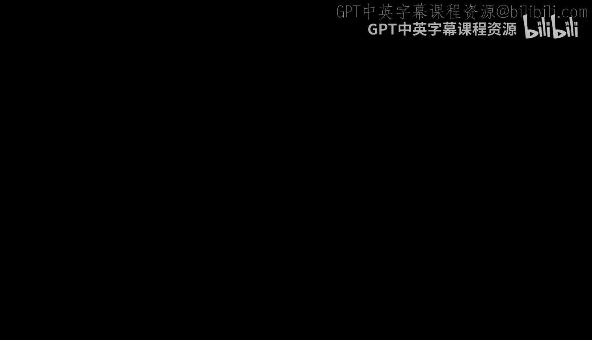
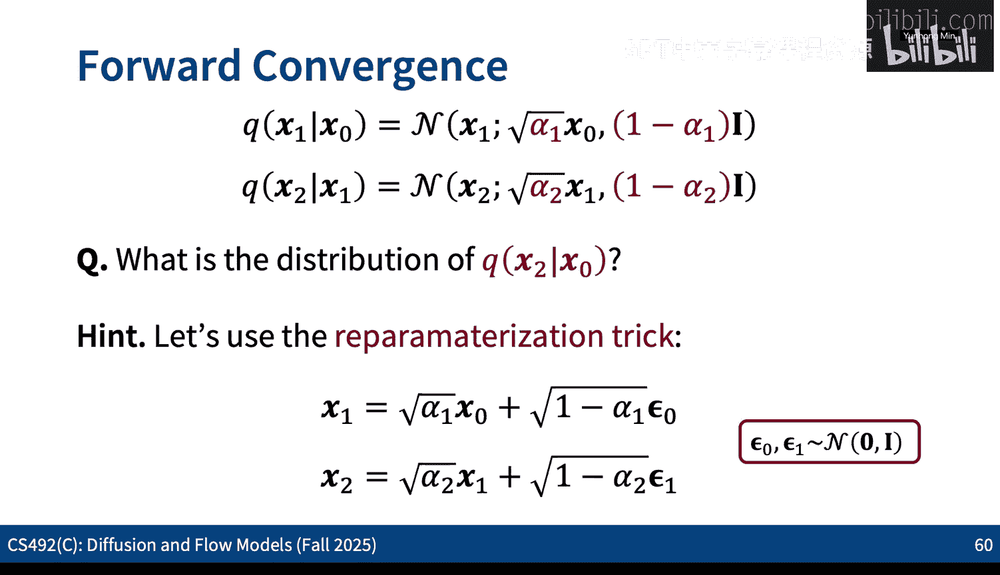
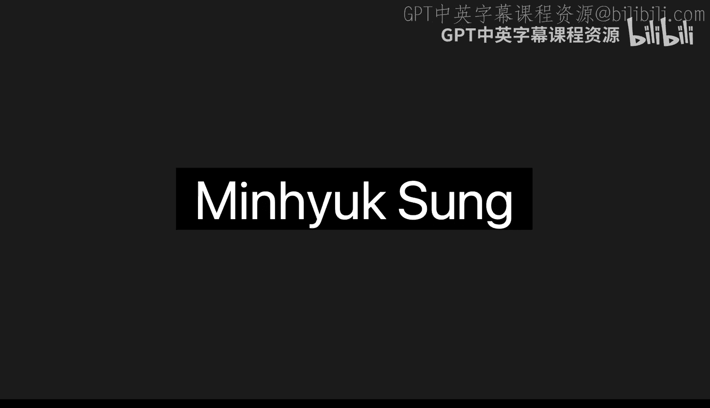
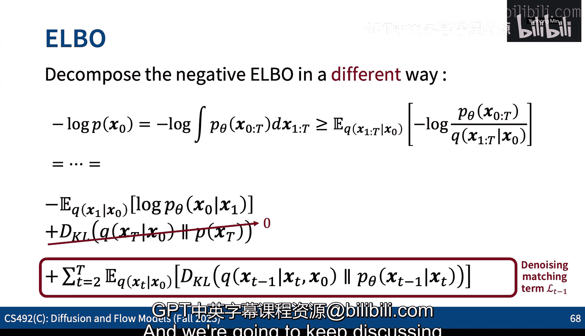

# KAIST《扩散和流模型｜CS492(C) Diffusion and Flow Models 2025》中英字幕 - P2：Lecture 03_ Denoising Diffusion Probabilistic Models 1 (Diffusion and Flow Model - GPT中英字幕课程资源 - BV1CKpvz1EH5

Okay， so welcome back to the and flow model， of course。

 So last time we are discussing some kind of boring things that probably most of you already know about some the gain and the B。

 which are basically is some the basic idea in terms of how we can make some kind of the models。

 So what we start to see from the last classes that given some kind of the large collection of the data。

 how we can make some kind of the model that can allows to basically produce another kind of sample that looks like one of the data points that we have。

 So we started to see these kind of the problem from the statistical perspective in terms of that if we see those kind of the data points。

 it's kind of the samples from some certain the probability distribution。

 and if we have some kind of the certain form of the the probability distribution that we can consider as sampling the data point from that specific distribution。

😊，So that is kind of the basic idea。 especially if the given the distribution is a form of the Gaussian。

 then we have seen like how we can do some kind of sampling from that。

 So that is kind of the basic thing。 The problem is that obviously。

 the given the set of the data points would not from the typically from the Gaussian distribution。😊。

So and also we don't know the underlying the form of the distribution for the data points that we have。

 So for that， like the basic idea that we discussed last time is to basically find a mapping for any kind of simple distribution typically that's the standard the Gaussian distribution。

 But it does not need to be the specific form。 we are basically using the Gausian distribution because of the simplicity for many things so we are basically finding a mapping from the simple distribution the data distribution in a way that the generation the process can be defined as kind of like sampling from the given the simple distribution and then mapping that data point to one of the data points that we have that was the basic idea。

And we started to basically use this kind of the some kind of terms and some kind of notations。

 So we are going to call this kind of the some simple distribution kind of latent distribution and also using the Z as kind of variables for that。

 And X signals the R the data point。Then here also the question is how are we also going to find this kind of the mapping from the latent distribution to the data distribution。

And for that， basically clear， we are going to use the neural and we discussed the two ideass。

 like one is the again and the the other one is the P， right。😊，So for both of the cases， first。

 we are defining a neural net that is like eming the latent the variable into the data point， right。

 That's typically called the decoder or the generator。

 but the key idea is that we cannot just like solely training the decoder or the generator。

 we also need to jointly train the another the network in a way to find a kind of the proper。

And do you remember the A network for the DNA degree？The other network put again。

 the case was basically having the discriminator， right。

 So we are making the decoder or the generator and also the discminator making them to be compete each other in a way that the output can be something that is like non distinguishist distinguishable from the real kind of data point。

😊，And the P A case， instead of like discminator， we are having some kind of encoder。

 which is learning our proxy of the posteror distribution。

 So that was the basic idea that we discussed last time。

 and to get into the idea about the the variation of the posteror in the B。

 we discussed some kind of basic about the statistics like the margins distribution expected value you basically all things。

 right， I guess you remember all those things， right。

 So these are really basic things that were gonna basically keep seeing the rest of the all the lectures in this graph。

😊，Especially for the base rule， we are basically having those termss， the prior distribution。

 that's the basically our latent distribution， the simple distribution that we are basically starting dis samplingling from。

 And then based on this we also learn the generator which is basically the conditional distribution from the latent to the data points here that's the called the likelihood。

 and based on that we are basically basically we want to capture this thread learning probably the distribution for the data points which is called the marginal distribution and based on all those three things。

 we can also define the another one， which is the posterior distribution。

 define some kind of the mapping from the data points to the latent points right So those are also the terms that we're going to keep using over the old the lectures in this graph。

😊，So as I mentioned from the the class last week， we're going to have some kind of quiz every lecture。

 So the twist quiz is that So basically we we some kind of the basic things here right in marginal thing distribution。

 the basic rules and many things and given these things actually。

 these are kind of the homework last time。😊，Given the these two distributions P and the Q both are the Gaussian distribution especially here this is the that two is the standard Gaussian distribution the mean is zero and the variance discrete identity matrix for those two distributions can you compute the key between these two。

So you。I guess got this sensor right。 So this is slightly more digital form for the cases。

 like when you have the two isotropic the go and the distributions， right。

 yeah I'm gonna post this on the the the link so you don't need to take this but basically you can see this。

😊，It's all based on the definition of the key di， right。

 and the question was some kind of for the special case when the queue is especially the standard theus distribution。

 So in this case now we can define the key like this way。 So kind of like demand。

 you're gonna keep seeing the key di in the two this lecture and also for the rest of in this case。

OkayAnd the basic idea for the， if we go back to the， basically。

 we want to basically define the mapping from latent to the data distribution as kind of the sampling process。

 So now we are quarter becomes like basically predicting the mean of that the likelihood distribution the the x condition by the right So given this kind of the prior distribution and the likelihood distribution based on that from the marginal idea now we can compute the distribution for the data point of the X right then the purpose of like learning the likelihood distribution with the decota here should be basically maximizing this kind of distribution for the given the data point of the X。

 right。So here the question is that how can we train basically our the decoder in a way that that becomes learning some kind of the likelihood distribution。

 maximizing likelihood the marginal distribution there， right？So we only this like you know。

 single decoding the network。 It is not possible basically to compute this。

 So we can also actually consider computing this like marginal distribution by just taking some kind of the mon estimate in terms of that we are sampling lots of the and taking the sum like this part of the old the。

 right， but this will basically involves like huge computation because then to approximate this integral we will need to have some loss of the here。

 right， So we are not going get into that way we are going to choose the other way around。

 which is basically say computing this marginal distribution in this form， right。😊。

Using the base rule。 But here the problem is that now we don't know this kind of the posteror distribution as well。

 So that's the problem。 So given that we don't know the posteror distribution。

 what we are going to do is that instead of like directly computing this in this case that when we don't know this information we are going to consider this。

 the lower bound for the look the probability of the P X like this。So why， why is this the。

 the lower amount。 We can best be easily check this out from the。

The the dense inequality that we have seen last time。

 So this is nothing but we are basically multiing the same thing from the denominator and denominator like this。

 And then now this is that converting this into the form of the expected value while taking this probability as kind of the ways。

 right， So these are also the same thing。 And from the fact that the look is the conve function from the the dense inequality that we have seen last time。

 now we can see that these two should have this inequality relationship。

So now from these like four lines， we can easily see that actually this become the lower bound for the low probability that we are going to compute。

😊，So what this mean is that our course we basically finding the you know the likelihood distribution。

 the decoding network， defining the likelihood of the distribution in a way to basically maximize the P right for the all the data points that everywhere we have here。

 right？But since we cannot directly compute the marginal distribution。

 what we are going to do is that we are going to introduce another linear network。Which is this one。

 right， This is called the the variation of the posteror。

 which is not exactly our the posterior the distribution。

 is kind of some sort of the proxy distribution that kind of place rule like the posterior。

 but not exactly the posteror in a way that we can compute the lower bound like this。

 So given this kind of any R for the distribution that we are learning here。

 we can see that like this will basically form the lower bound and know we can basically consider maximizing the P not exactly maximizing the P。

 but basically maximizing this like lower bound in a way to basically learn the the the variation of the posterior and also the likelihood as well。

😊，So if we see are some more details about this like elbow function。

It is theel function we can decompose the joint to here into these two formss。

decomposing this into the these two。And then we can also decompose like this。

 And then we are seeing that now the elbow function have be these kind of the two termss， right。

 So again， we are seeing the key di here。 and also， I think the another the termss there。😊。

So the first term is called the reconstruction term。

 we are going to see like why is the reconstruction term。

 and this is the term that we are going to maximize。

 And the other one is basically the some sort of the regularization， the care。

 the diversity regularization， which will be basically minimized through the training。

So here basically interesting thing is that this is basically the lower bound function that we are going to maximize over training。

That basically means that we are maximizing the first term， the reconstruction term。

 and also minimizing the second term。So minimizing this term。

 can you see the meaning like minimizing this term？你听超电歌。Yes， so basically。

 we are going to make these two be the same， right。

 And Q is some kind of the some book distribution that we are going to learn。And Pz， what is PZ？

Is the latent distribution that we set as kind of the standard Gaussian distribution。

So the meaning of this is that actually the maximizing the elbow basically means that we are finding some kind of the variational the posteror distribution while making it to be close to the external Gaussian distribution as much as possible。

Make sense。So somehow we first need to find a kind of de mappinging with this kind of like the variation of the posterior while making this to be close to the standard of the Gausian distribution。

😊，So as this gets closer to the standard de Gaussian distribution。

 that becomes basically we are maximizing the elbow function。

 which means that we are also maximizing the marginal distribution。😊，Makes sense。

 that becomes theizing the minimum of the output function here。So basically。

 what you can see is that we had the decoding the network here。

 which is defining the likelihood distribution vision。

So we said that the output of this network to be the mean of the the the likelihood distribution。

 So basically， we are setting everything is kind of the Gaussian here for the simple see So when you set the likelihood distribution is kind of the another de Gausian distribution。

 the output， the decoding becomes the mean of that the Gausian distribution。

And what we need to do is that we also need to learn the another the the proxy distribution。

 the evaluation the posteror here。Which is also modeled as or to the carian distribution。

And then in this case， now we also predict both the mean and the variance like this and what we have seen in the previous slide is that we are basically learning this in a way that these two becomes closer to the standard deco distribution。

And then now we can see that actually this becomes quite close to the typical the auto encoder。

 which is in terms of that we are having the encoder mapping from the given the data point into the mean and the standard deviation of the。

😊，So this， the variation of the posterior is basically is learned by the network。

 which we call the encoder， basically mapping from the data point to the latent the variables and the other way around from the latent variable to the data point is the decoder right so that's learning the likelihood of distributions。

So you can see that in this total wise of the neural network is quite similar with the O encoder。

 We are describingcaping the encoder and the decor。 The only difference is that using the encoder。

 we are not actually mapping the data points one of the points here。

 but actually mapping the data points into the the the variation of the postor like this。

And then given the variation in the posterior here。

 we are going to sample one of the data points here。

 and then that will be decoded through the decoding the network， right？So that's the only difference。

 So we are not just strictly mapping one of the data points here into the latent variable。

 but actually mapping this into the variation of the posterior。

 And based on this like variation of the posteror， we are going to sample one of the the latent variable that will be decoded back to the data point。

So that's the basic idea。So in the training time， how we are going to maximize the elbow function。

 So the elbow function was defined like this， and we have seen how we can compute this， right。

So that was the quiz。 So we know that this is the standard de distribution。

 This will be another de distribution， right， exactly the same form that we have seen in a quiz。

 So in terms of that we are having the divergence， we know how we can compute this。 right。

 So the only thing is that we just need to maximize this term。And for this。

 like what we are going to do is that we are going to simply approximate this expected value by just taking some of the samples of the Z from that the the variation of the posterory distribution。

 so given the lots of the samples of the Z typically we just take some few samples。

 but to get some like better just approximation actually we need there more samples of the Z here which this becomes a computing this right。

And then the question is that how we can sample the Z here， right？

So G was basically the sample from the variation of the post here。

 which is defined with the mean and the this division here。

 right so what we can do is that from the B parameter agent that we also discussed last time。

D C can be simply computed by just sampling the standard Gaussian sample and then computing this formulation。

 right this is basically the mapping from the standard Gaussian distribution to the any the arbitrary de Gaussian distribution。

 So the can be basically computed based on the mean and the standard deviation that we are predicting using the encoder and also computing this through the our the standard Gaussian sample there。

So given this kind of the Z， what we can see is that if we plug in these into the just like PDFf or the Gausian distribution。

 then we can simply see that the look of the probability becomes deform of like this that what you can see is that actually these so specific some kind of parameter that we set right So this is kind of the constant value。

So we can ignore in the loss function。The only thing we are basically getting is that it's really this。

 right？So that's why basically this term is called the recon term。

 So what we can see is that given the kind of data points of the X。

 we are basically learning some kind of the version of the distribution from that。

 we are going to sample the Z here。And from this sample， when we decode these back into data point。

 we are going to see whether we can reconstruct the given the input data point here， X here。

So that's basically exactly the same most that we are seeing in the training of the O encoder， right？

So from this basically， what you can see is that this becomes like。

Quite the same with the training of the auto encoder， if we only see this like thecon term。

 the only difference that we are seeing is that we are basically having this like KD that present the electization。

So the two differences with the from the to the version of the encode is that we are not directly predicting the latent variable。

 but the the version of the posterior like this in a way that Z can be sampled from that。

 But from the sample Z， we still want to basically construct， they given the data point X right。

So in a sense， that is especially quite similar with the typically the open code this structure。

And here， basically， we are having some kind of the process like sampling in Z here， right？

 So why is that the sampling is still like differentiable。

 Because like we are not just like actually just sampling in Z。

 We are going to compute the Z using the mean and the variance that mean and the the variance that we are predicting using the variance on that。

 So still the Z becomes some kind of the variable， which depends on the prediction like these two。

 right。So we need complete some kind of the reconstruction the。

With this the still the kind of the loss will be back propagated through the prediction of the mean and the variance。

 So that's why basically we can train post the in quarter and the deco quarter。

And the generation the process， we can basically， so this is kind of the proxy distribution that was basically playing the role to learn the better the likelihood in the generation the process。

 we don't need to use this， right， the basically the only purpose for this ending part is basically to learn the proper likelihood distribution。

 So in the generation the process， we can ignore know this。

We just need to sample from the distance of the Gaussian distribution and just like map this sample show without the decoder。

 So that's the basic idea for theA。So here one question is that should the dimensions of the input data。

 the0 x and also the latent variables D be the same？We呢。Yes， we're not。Yes。😊，No。

That' does not neat to be the same right because that all the mapping from the data point to the latent variables and also the other way around these mappings are all defined by the neural net right so in a sense it's okay to have the lower dimension space or the higher dimension space for the latent space typically for the BAE training we set the lower dimension space for the latent space which so what this D idea。

Any questions for the page？Many of you already know about B， right， So what's the。

 what are the limitations of the A。If you have tried you train degree before。3。Yeah， so typical。

 the output that we gonna get is the like this， right， looks like some realistic differences。

 but I some blur kind of the opposite right。 What we kind of the problems would we create in terms of de formulations。

😊，So the thing is that we are still obviously modeling here everything is kind of the Gaussian distribution right。

 but we are also making the likelihood to be Gaussian distribution and also making the variation of the posterior to be the Gaussian distribution right。

But here， the question is that， is it okay to make it Everything is kind of the Gaussian here。

So that's the question。 typically we we know that set the distribution to beian。

 right but for the typically for the data distribution that we are going to learn the merger distribution even will not。

Close between not be close to the end of the Gaian distribution。

 will will be much more the complex distribution， right。The thing is that。

So the basic idea for the B is that we are maximizing this load probability not directly。

 but basically by maximizing the lower bound， right？Then the question is that when this。

 when does this like the world bound become the same。

 we look probability we are actually going to maximize。

 Can you guess like when these two be the same。喂。九。Yes， that's the right answer。

 but can you also derive like when these two becomes you？

So I recommend you to try to really drive all the things and see when these two exactly become 0。

 So yeah， you can check this out later， but。😊，Basically if you basically rewrite this kind of be this is called the density the gap so basically when you have some kind of the density inequality。

 these come to low bound， but the question is that when these two become the thing so if you rewrite all the things that that you can see that the difference between these two termss becomes another decay K or the divergence between these two basically the probability distributions。

Which means that our the lower bounds become the tight the bound when the learned the variation of the posterior become the same with the true posterior。

So that's the decrease。But then here the question is that would it be possible to basically have both the likelihood distribution and also the two posteror distribution and de Gaussian for the most of the cases？

So in general， when you have some kind of the very complex the data distribution。

 when we make everything as kind of the Gaussian distribution。

 both the all the latent distribution and the posterior and the likelihood。

 it is typically not possible to really basically making both the likelihood and the posterior the Gausian。

 There will be some special cases。 But in general， is' impossible to basically having the Gaussian distributions。

 both for the likelihood and the posterior distribution。😊。

So that's the thing in the B A case we are basically kind of like oversimplifying everything in terms of the making the likelihood also the Gaussian and also the the poster to the kind of the Gaussian as well。

 But for some kind of the complexity data distribution。

 it's actually impossible to make making the likelihood and the posteror both of them is kind of the Gaussian distribution。

😊，So which means that this will be basically very bad approximation for most of the cases。

 like we need some complex the data distribution。So that's basically why we are just some kind of be some limitations of the。

😊，Then here the question is that， what else can we do？We are using the Gaussians for the simplicity。

 but it sounds like we need to do have some kind of the better。

 some kind of the productization both for the likelihood and also the poster the distributions。

 not just the Gaussians， but in other the ways， right。

But what can you do in terms of having some kind of more like the complex de parameters for both of them？

So that's basically what people have explored as kind of like making some kind of the loss of the variance of DA and also one of the ideas in terms of making DA to be more complex is to make some kind of a lucursive DA like this。

😊，So this is the part that we are starting to see some kind of be new thenotations here。But here。

 the basic idea is that now we are going to introduce not only a single the latent variables。

 but the multiple the layers of the latent variables starting from the X1 to all the way to the x kept。

😊，So now we are going to slightly change ournots in a way that we use the export data point and rules the Z from deletent variables。

 right。😊，But now we are going to have some multiple thent variables。

 we are going to switch the notation like this now x0 indicates our the train data， the data points。

😊，And then we are having some kind of the multiple the latent variables from the one to capital T。

 It depends on like how many kind of layers that we are going to have， right。

 So we are having the x to the x1 to the capital T and when the the mapping from the data points all the way to the the Gaussian distribution is defined with some kind of the multiple the mark of the process。

So still， while we have some kind of demoive delays。

 we are still going to simplify this in a way to assuming the microbi on the process。😊。

So here the meaning of the microco be and the process is that it's like all the sampling in the process。

 right？你三。So basically， what we are going to do is that when you sample any of the intermediate delay con here。

 the x2， for example， the sampling of the X2 will depends only on the X1， only from the previous one。

Which means that the any of the intermediate deletent variables will not depend on the any of the some of the previous ones。

 like the X0 there only depends on the one right before the steps。

So that's basically the assumption of the mark the process。

So we are basically adding this kind of rules in terms of to like making the process to be simpler。

 right， So this means that if we think about the our degen the process。

 the generation the process is basically the mapping the x capital T all the way to the X zero there。

 right。It was represented with the single the conditional distribution。イにいいいケーですね。

But now we are going to some multiple steps like this。

 And then the sampling of the X T-1 will only depends on the X T， not any other kind of the。

 the previous steps， which means that now the generation the process can be modeled like this。

So we sample from the x capital T first， and then we are basically taking the product all the all the transition distribution from the all the intermediate steps in terms like determining the probability for the output the x0 here。

Make it。So that's basically and you can see that now these parts was basically simple the Gaussian distribution the previous in the previous。

 right， but now you can see that it becomes like more complex in terms of that now we are taking the products of these distribution。

So still， what we are going to do is that we are going to still define this like tren distribution as the Gausian。

 but when you see the entire some kind of the likelihood distribution。

 this becomes like more than more complex more something that is more complex in the Gausian in terms of that we are now taking the product of the multiple de Gausian distribution。

😊， so that's kind of like one way that we are modeling some more complex distribution with the more prompters。

So it's not just having like one single pair of the mean and the， the variance， right。

 we are having some kind of the multiple the transition distributions。

 So even when the like single the transition distribution is basically simple the Gaussian distribution。

 it see some kind of the product of like this。 this becomes a more complex distribution。

So that's the basic idea。And also our the version of the posterior will be now defined basically by taking the product of the all the transition distribution。

 so that's kind of the same thing， but it's kind of like another way to basically parameterizing both the likelihood and also the posterior the version of the posterior distribution。

对呀。Otherwise， basically when you define this， this Xt should depends on the all the previous days。

 then this will become much more de complex。So now we can we are basically simplifying all the process in terms of the the X T is exampled only from the X T minus-1 without seeing any kind of discrete this kind of things。

 So this will basically make the whole process to be much simpler。

So you can see that if without the mark of the assumption here these distribution should not be sampling X T only from the X T minus1。

 but from the all the other kind of the previous these days。

So then that becomes like we are modeling the function distribution in a way to see all the previously record to sample the XT。

 and the training becomes like way morely complicated。

So the Markovbiion D process is to make everything to be simple。

 the thing is that we are also going to see the non Markovion D cases of probably sometime next week。

Let's see any other questions？S of due process is a master why。这个人。就でもす我二度も。对ですて。Since， I mean。

There is서。So Stanford X1 from the widely of series to help military。对是。ちかバク病と一度七万。谢大。

So the question is that like why do we need to model both the Q and the P as the microcobiion processes。

 is that the question？So actually you gonna see。 but here the the thing is that both the P and the Q Ds。

 both of them are something that we are going to learn using the neural network。

 So as you basically make make them as kind of non more co process。

 the training learning of like these to the distributions will become more complicated in the B E setup。

So that's I thing So now we just because like yeah in the set of like both the P and the Q are learned using the the quarter and the encode for both of the cases If we start to making the x two sampling to be dependent to the all the previous the steps that will be much more complete kind of training。

So that's the basic idea。And know quote。But as I said we're gonna also see some non Markov D case as well。

 but let's make our lives easier for now in terms of everything is kind of the microov process for those of the cases。

 we can still define the elbow function as well and start to basically train all the recursive B through the same process。

 but still kind of the challenges in terms like making the B in the recursive way like this is that for the B。

 basically the idea is that we are learning both the Q and the P right。😊。

Joint training of the kind of the like the the deco quarter and the encode and this joint training is actually the difficulties in terms of the training the the A especially the recur degree。

So actually that's the kind of the one of the motivation that we are seeing the division models here。

 you can so over the entire the class over the the the this the semester。😊。

We are going to see all different kind of the interpretations of the division models。

 different kind of angles of like see， all the the wide individual model basically works and video like one specific way to see the division model H to see it kind of like one specific some kind of the some variant of the hierarchical D。

 the degree。 So let's get into that the basic idea first。😊。

But from the context of the hierarchical degree， we are going to see a kind of a special case。

We dislike two kind of games。First， we are going to match the dimension of the latent this piece to be the same with the dimension of the data points。

We didn't need to match dimensions in the P case， right。

 because all the mappings are to scale done using the neural network right for this specific case。

 we are going to match the dimensions for the all the kind of meetings including all the latent variables and the data points。

 Everything is in the same dimension space， right。Also making our day easier。

 And one more thing is that those these is kind of the key part。😊。

So the problem with BAe was that we are basically jointly training both the operation of the posterior and also the decoding network as well。

 right？So that's kind of the things how they're going to do inter both of them。

Now the thing is that we are not going to learn the variation of the posterior。

 we are going to use some kind of the predefined de of the posterior distribution。

So we are dropping the neural parameters here， so this is not learned， this will be pre defined。

Then the question might be is that even when you predefinine the variation of the posterior will this kind of the predefined the variation of the posterior will minimize the elbow function。

 so that's the kind of things that we are going to see today。

And given this kind of some specific the assumptions。

 I'm going to introduce some kind of some nu terms here。😊，By the way。

 so this is the part that we are going to see some， some kind of more complex kind of things。

 And actually， even more kind of issues is that So this is for the D jump model， this case， right。

 and also we are going to discuss the flow models after some few weeks。😊，For the interpretation。

 the flow models， even were gonna start to use some kind of the different notations。 So basically。

 all the notations here are basically coming from the the papers， introducing these ideas。 Okay。

 even the paper was introducing just like four years ago。 So these are very， as I said。

 we news the subject。 And every paper is actually using all the different notations。

 So that's the kind of deep problems。 So here in the context of the models。

 we are going to use like those notations。😊，Please keep these in mind。

 this is something that you gonna keep seeing in the explanation of theデ digital models。😊。

We are starting from the x0。 That's the data point all the way to the x capital T is basically the mapping from the data point to the sample from the initial deion distribution。

So that was the based on the posterior distribution， right。

 So we're gonna call this process as kind of the fold process。 Okay。

 so the fold process is coming from the data points to the all the way to the the data points。

The reason why we call this in default process is that that's kind of the process that we call as kind of like diffusion。

 like， like adding some kind of noise。 So that's basically what we are going to see。

 So that's kind of main。😊，And as I said， this is the theren。

 the distribution that we are going to predeefine。 So let's see how we are going to predeefine。

And the other way around the mapping from the latent to the data points there is the reverse process。

 and that's the kind of the process that we are going to learn。 So still that we are learning this。

 not this one So this distribution will simply learned。 and this is。

 basically our the generation process， right， hour process is basically the reverse process starting from the X capital T all the way to the X。

 by basically doing some kind of recursive sampling through the reverse the transition distribution here。

 So that's basically what we are going to learn through the neural using the neural network。😊。

And here the key idea in the digital model is that basically how we are going to define this fourth deterren distribution here in a way that our de deposit posteror will be defined as kind of the product like this。

 right？😊，And that specific version the here should minimize our the elbow function。 So here。

 the key idea is to how we define the distribution the distribution innova way that this the maximize this is the elbow function。

😊，Po kitating。So actually， the thing is that there are multiple ways。

To define this like for the distribution。 So let's see the single case first， later。

 we are going to see more cases。 but let's first see the simple case。

 So this is the kind of the our definition of the the transition。

 So over the time over the kind of the the4 process。

 We are basically seeing that the T is kind of the time。

 time is increasing from the zero to capital T in the fourth process。

 So you can say that its kind of like the know over time。

 some kind of the some the some like the the the process， some iter the process。😊，And over time。

 we are going to set some kind of parameter of the better T here。And based on the better T。

 we are defining some kind of the some another de Gausian distribution like this。

 still we are making everything like de Gausian right。

 So you can see that the meaning of like this kind of the transition the distribution is that So basically。

 the better T is basically increasing from the0 to some kind of the numbers。

So the thing is that the is basically non decreasing function over time。

 the ability will be increasing。 but still， we are going to keep all the numbers to be small enough。

 like 0。0 something but we will be some kind of the non0 number and also keep increasing like this。

 So when this is0。 what we can see is that this is nothing but just like having the the same the the the standard the Gaussian distribution。

Right， so if the is0 is basically oh it not the standard distribution。

 So basically zero then basically some kind of the direct the distributionnova the sample of the x Tィ should be the same with the x T minus one。

 right。But as you basically increase the better here。

 what we are seeing is that we are adding some small de Gausian noise while basically shifting the mean to be closer to the0。

 right。😊，So this is kind of doing some kind of shifting to get closer to the0。

 The means getting closer to the0， right， while basicallyically slightly adding some more kind of Gausian noise。

😊，So you can see that this is kind of the process that we are repeatedly adding some kind of the Gaoian noise while increasing the variance like this and also moving that the kind of the terms to be closer。

 get closer to the mean， but not exactly to the mean Right。

 because like all is kind of be better to be some small numbers， right。

So this is collective one specific way that we are defining the fault process。

And you can also still see that there are some kind of parameters of the better。 Actually。

 you will need to implement this in the assignment one。

 So you need to see what's the minimum like this。 And depending on how exactly we also set the better T。

 you see some kind of difference in the performance。

 So there are lots of kind of options for the better。 But basically if you satisfied this condition。

 these are basically increasing non non increasing function numbers。

 So making all this number to be small enough。 then it should work。

 but there are still kind of the boundary of the options。😊。

Even you can consider like the all the better T to be kind of some neural networks and the variables in terms of that we are learning overdefin。

 we can set these like better T to be constant and also linearly increasing and also making the co functions and so there are the bunch of the options。

 but in any case the only condition is that we just need to make all this better to be small enough while making to be non-dating function。

So keep this in mind， so this is the hourly definition for the fourth this transition distribution。

边灯。そ。So we gonna discuss some kind of the more details of like those definitions。

 probably also the next time as well there are so many kind of things to discuss。😊。

So here basically all the kind of the idea is that we are defining predefining the board the transition。

 the distribution in a way to make it the all the distribution the post here to be something that is minimizing maximizing the elbow function。

 so let's actually see whether this exactly really maxs the elbow function。

So if we get back to the elbow function。Actually， once we have some kind of the multiple kind of layers in the kind of B。

 the elbow function becomes quite complicated like this。

 So I'm going to skip some details here some for more details。 We check out the references there。

 But the thing is that if we decompose the elbow function into the as we have done in the B case that we can still see some kind like three types of the termss。

 The first one is the reconstructioncon term that we have seen in the B case。

 and the other one is the de matching term which was the same the key and then we are having some one more which is the which is basically basically nothing but。

😊，Making these two the distributions to be the same。

So that's basically the why we are called basically this second the constant term。

 so we can consider basically computing this constant term。 The problem is that as you can see。

 this term is basically involving two random variabless We are basically having the two latent de variabless here and it's basically maximizing this term to be quite computationally very extensive。

Actually， we are not going to exactly compute this term。

 We are going to consider the other way around to decompose the elbow into the other kind of the terms based on this fact。

Can you see like why these two are the thing？In our case。Yeah。

 because of the Markco and the assumption， right， So since we assume that all the process kind of the mark the process。

 we are going to treat these two be the same。 Basically now X T becomes independent of the sample of the X。

 So that's kind of good thing like having the mark the assumption。

 Otherwise actually the these two cannot be the same。

 right X T should be depend all the kind of the previous kind of states is making the much more complicated。

😊，So with this kind of the microcobi the assumption and having these two be the same。

 not what you can see is that。😊，Now we can decompose the same the elbow function into the different way。

 So having different three。From the same yield of function。

So what you can see is that we are still having the reconstructed term here。

 so we are going to see these like the one by one。Let's see the person So this is the same consult the term。

 And this is basically consulting the X from the x1。

 while we have some all the other kind of the latent from the x capital P， right。

 So this is like only for the final step of the reverse process。 And also in practice。

 the magnitude like these low term is like much similar then the other the terms。

 So we are going to simply ignore this term。 So that's the thing。😊。

The second thing is about the this scale or the diveerence。 So this is kind of the main part。

So what we are going to see is that now we are going to basically see。

 So this is basically the the composition of the R the elbow function。

 which means that sorry this is the negative the elbow function。

 which means that we are going to minimize this。😊，So can you see the meaning will be like minimizing this time？

What's the meaning of like miniim this？So we are basically going to minimize this time， right？

The thing is that actually only traditionalal distribution for the default process was predefined。

 right？And this is like sampling x capital t to the x0。

 so sampling the last one from the very beginning one of the forward process。

This will be also derived from the our definition of the4 distribution。

Then what we need to see is that so this becomes our the bear in the posterior。

And we need to see whether our the de here will be the same with the PxT。Whats the PXT。

ス탠ンテカ distribution을？So this is our the latent distribution we are going to so our degen process is like sampling the Xt here。

 sampling the Gaussian， the Gaussian the sample and the mapping to the x0 right So this is the port process sampling the xt and T from the x0 right the4 process and this is from based on the hourly the of the t the distribution。

We need to see now whether these are。The version poster based on the R definition should be the same with the the or the distribution。

So let's see what do we define in that way。So the question is thatそ that these two are the same right。

 So let's see。 So so basically recall that we defined our the default definition like this。

We're going to do some kind of be simple gi math here。

Let me while we use the better let me just quickly replace the with one minus the here。

 So when you see the party here the now we can see that this is the non increasing function right basically decreasing over time。

And based on this。What we are first going to see is that so let's see。

 like we only defined this like the one step of the transition distribution。

We we know how to sample the X T from the X T -1， right。

But when you think about some kind of the accumulation of this kind of like de distribution。

 can you directly sample the X T from the x0。Which means that would there be some kind of the closed form？

Of the this conditional distribution。X T conditioned by the x0 from the the sequence of the our default the transition distribution。

Do you think that we will be able to get some kind of close phone for them？我来。啊。

We should have the cool response to basically see these mis standard Ga distribution。😊，So actually。

 the answer is obviously， yes， were going to derive some kind of the cloth from these for these。

 the conditionary distribution。😊，And for that， let's what we are going to quickly see is that。😊。

So let's get back to some basics of for the Gaussian the distributions。

 So lets let's consider like we are having the sample from the x1 which is from this specific the Gausian distribution and the x two from this distribution。

 then Ken also express x1 plus x2 as kind of the sample from the another the Gaussian distribution。😊。

Yes我。Yes， the answer is yes。 basically we can see that X 1 plus x2 as kind of a example from this specific deussion distribution。

 So now you can see like why evaluating de distributions， right。

 there are many kind of good properties in the de distributions in the way that we can play like this。

😊，So so you can see here， like when we have the x1 index2。

 both of them them are basically sampled from the different causian distributions， right？😊。

And if you take the sum of these two， then we can see that that is kind of the sample from the another。

 the Ga and the distribution。😊，How about this？Now you have some kind of the two the samples from the same。

 the standard the Gausian distribution。And scaling them to come define the x1 index 2。In this case。

 what's the distribution pretty excellent for sex2？you know点什么？

Yeah so basically actually we can see that x1 the x2 is also kind of the sample from the some the another desian distribution not having the id difference。

 but having this like the cur sigma1 is cur sigma2 is kind of difference for in this case from the things that we have seen in the previous slide we can see that x1 plus x2 is also the sample from this specific deuss distribution。

 right。😊，So these are some kind of very basic de properties of the Gaussian distributions。

 and based on that。😊，Let's see this。So this was basically our definition。😊。

For the transition distributions， right， sampling the X1 from the X U and sampling x2 from the X1。

The good thing is that we define everything is kind of the Markovbian kind of assumption in a way that the x2 does not depend on the x0 here。

 right， So making our like the easier， right， So based on that。

 can you also defined the get the close form for the this conditional distribution。

 sampling the x2 conditioned by the X0。😊，So。Just made to plug in all the things that we have seen in the previous slides。

 so let me give you like the five minutes three minutes to see that you can get some kind of answer for this try yourself what you can get from this。

😊，So if we see like what you get。 and this is the thing， right， no from the sorry。So yeah。

 you can basically derive all the things in terms of the we are here replacing the X T minus one with the this formulation。

 And then if you like relate all the things， you can see that this combining the to the。

These two terms these are all some kind of the Gaussian samples from the Gaussian distributions。

 right from this， you can see that actually the。

I think I missed some of this lighting。嗯。嗯仲啲。

Yeah， from this just rewriting X1 with the formulation and just like combining these two Gaussian distributions。

 Then what can see that actually this conditional distribution X2 conditioned by the X0 can be written based on the Gaussian distribution。

So this basically shows that for any kind of the while we defined this like one step the transition distribution from this。

 now we can derive the closed form of the what we I'm going to call this as a default jumps。

 we are jumping from the x0 to the X T here sampling directly X T from the X0 and this can be done by this like this specific de distribution。

So that you can say like now we are basically defining the de distribution in this way。都。

As you can see， like basically， the X key XT can be now directly sampled from the x0。

 so you actually you can see that while we define the thought process as kind of some sort of the iterative process。

 actually it does need to be iterative sampling。😊，We can actually directly sample the X T from the X U for the full process probably not for the reverse process。

 So that's kind of the thing。😊，So based on that， basically。

 what you can see is that So what we want to see is that whether this the variation the posterior iss not the variation anymore。

 right， basically whether this posterior， the x capital T from the X O。

 whether this becomes close to the standard Gaoian or not， right。😊。

So this will basically the final like this。 and then what we have seen is that we set the better to be some kind of the small number in the zero to one range。

 right？😊，And when this is defined like this， When you take the product of some kind of the number in the range from the0 to  one similar than one。

 if you take the product of the last such kind of numbers。

 you're gonna see that this will get closer to the zero， right。

Which means that as we have some kind of the last of these some kind of the multiple steps in the fold process naturally by definition of the hour the four to transition distribution this poster distribution will get closer to theian distribution this standardian distribution。

And that is aligned with the our the elbow function， right。

 So by the finish of the our default process， that is basically naturally maximizing the R the elbow function。

😊，So you can see like why we did  find40 processing that way？

So next time I'm going continue basically。 So what we are going to do。

 how we are going to deal with like this term。But you can see that here the all the basic idea is that we are starting from the BAe。

 we are modeling the likelihood and the posterior as kind of the Gaussian distribution。

 which are basically not sufficient for the many complexity the the data distribution。

 So that's why we start to see some kind of the hierarchical recursive way making the Be。

 But the thing is that we still don't want to learn the post likelihood and the posterior。

 So now we are going to fix the posteror in a way that that naturally basically maximizes the function。

 And then we're going to only learn the likelihood the distribution。😊。

So basically basically like one specific angle to C， interpret the the divisionff models。

 Then we're going to keep discussing this idea in the next Wednesday。

