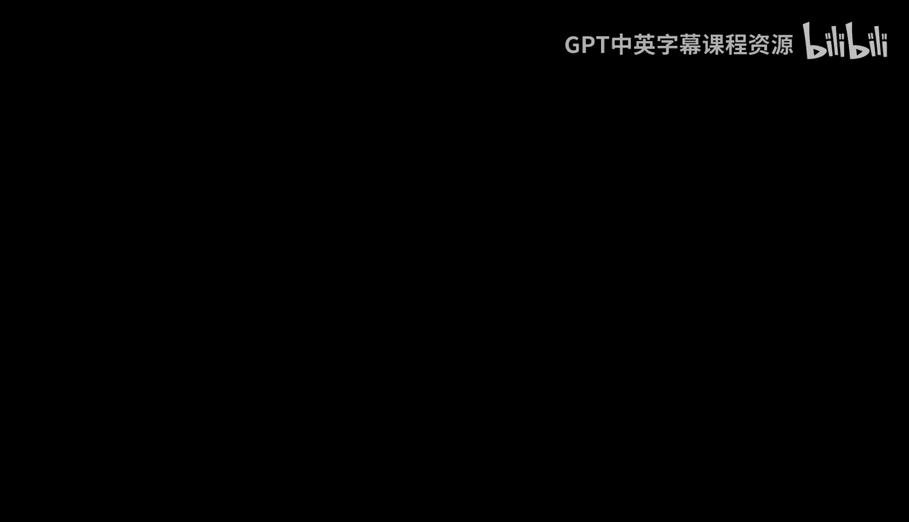
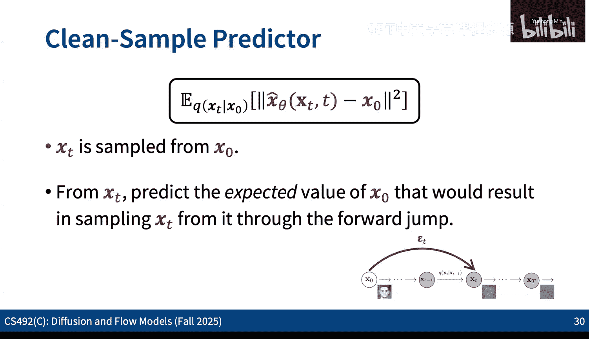
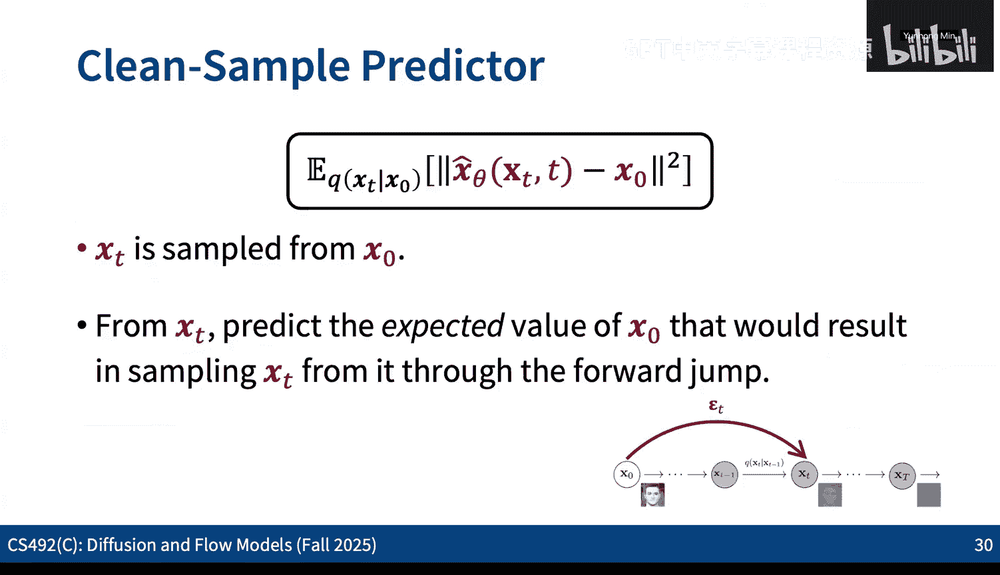
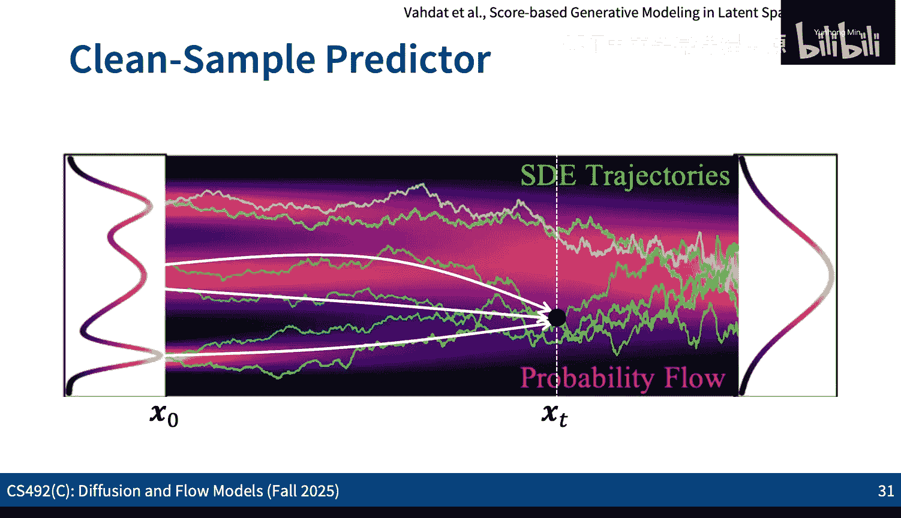
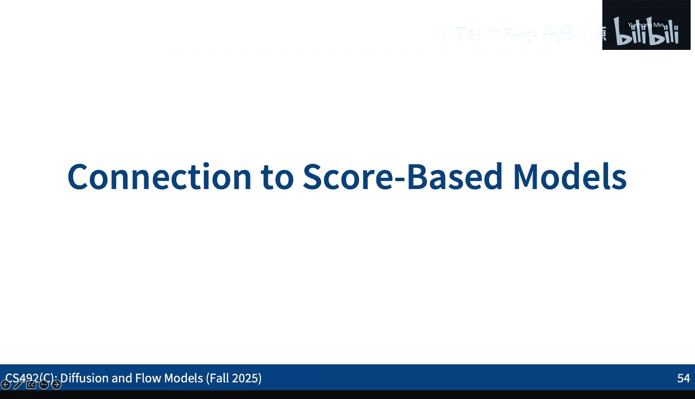

# KAIST《扩散和流模型｜CS492(C) Diffusion and Flow Models 2025》中英字幕 - P3：Lecture 04_ Denoising Diffusion Probabilistic Models 2 (Diffusion and Flow Model - GPT中英字幕课程资源 - BV1CKpvz1EH5

Okay， then let's get started。 So we'll come back to the division and the models。

 So we're gonna continue the discussions for some the basics of the division models today。

 So from the last time， what we are discussing is that basically what we want to do is like all about basically modeling the marginal data distribution。

 right， it all about how were gonna model this kind of marginal distribution and the basic idea for that is to basically model the the prior distribution。

 which is typically defined as the standard de Gaussian distribution and it's also all about how we gonna basically learn some kind of the proper likelihood distribution in a way that this combination can model the marginal distribution。

And the question is that how we are going to basically learn the likelihood of the distribution only by just having some kind of the a set of the samples from this distribution。

And for that， the idea that we have seen in the BE case is to basically jointly learn both the likelihood distribution。

 which is also represented with the decoder and also the variation of the posterior which is dis part。

 which is also basically represented another incoding the network So that is the basic idea and also the limitation that we have seen for the BE is that basically everything is the Gaussian。

 right， so especially for the likelihood distribution we are also modeling this parts that's kind of the Gaussian distribution in a way to basically have the fixed de variance and also only predicting the mean using the decoding the network and this is basically limiting some kind of the expressibility for the marginal distribution because our the marginal distribution we will be basically represented as the combination like these two。

And now these are each of these two both of them are basically modeled as the Gaussian distribution。

 but the the complexity of the data distribution here that we are having might be something that might be too complex to be expressed with the combinations of the two Gaussian distributions。

So here， the question is that how we are going to basically design the news and model in a way that this likelihood distribution becomes something more the complex。

 right， not just the Gausian distribution but something that is basically the more the complex the distribution。

So for that， we started to discuss the basic idea for the some diffion models。

 starting from the recursive D BAE in terms of basically having some multiple the delay layers of the on variables。

 and from that we also started to discuss the diffion models。

So the very basic ideas for the diffusion model is that we are basically having some kind of the sequential the processes starting from the data point from the X0 there all the way to the x capital。

 So as I also mentioned from the last lecture。 So these are the nots that we are going to use for now。

 as I also said we might also need to change the notations。

 But here basically you should basically remember this the X0 indicates the the sample of the clean data point。

 the data point that we have and x capital T here is basically the sample from the unique gaus distribution。

 So that's the kind of the final the latent variables right。

 and then we are some kind of the bunch of intermediate some latent as well the X1 to the all the way to the X-1。

😊，And both for the mapping from the data point to the the final the latent variable and also for the other way around。

 we are having some kind of the sequential process。

 which is just the going from the this way and the other way around。And actually。

 also the mapping from the X0 to the x capital key will be called that's kind of the full process。

 So that's the process that we are So let's see like this is kind of the indicating kind of the time step when you see that this T is kind of time step。

 the process that we are increasing the time step is the full process mapping the data point to the X capital key。

 the final delete variable And the other way around will be called the reverse process。

 So that's kind of basically。😊，And also the key idea for the diffusion model is that we are basically predefining the fold process。

 basically defininging all the transition the distribution for the fold process into some kind of specific form in a way that we don't need to learn the forward process we are only going to learn the reverse process so that's the basic idea in terms like making it like easy to the the neural network。

And one more thing is that， as I also dimension the last time we are going to define all the latent variables in the same dimension space。

 So we are basically matching the the dimensions for the all the latent the the variables and also the data points as well。

 So this was kind of the basic setup for the divisionff models。😊，And also。

 we started to see some one specific diversion of the diff models。

 So these are some kind of some specific kind of the way to define the diff models。

 But the thing is that in this class we are also going to discuss some kind of the different versions or different kind of the models。

 some kind specific models in the division in the of the division the models。

 So we're gonna say that actually， this is kind of like the one version。

 And we are also going to discuss some the other dirgence in the other lectures。

And this is basically the debate model and also the your the assignment one will be the part of the one will be implementing this de model you gonna say that actually quite works well So for this kind of the most debate model。

What we are going to assume is that most default and the processes will be defined as kind of the markco beyond the processes。

 which means that in the process， like when you know itly like sampling each of the X T here from the previous step。

 the X T-1 the X T will only depends on the right before the one。

 the X-1 not depending on the other the previous states。

 So when you see this kind of some conditional distribution sampling X T conditioned by the X T-1 the X0。

 we can easily drop this part， because we know that by the hourly definition X T is not dependent to the X0 here。

 So we can basically easily of the X0 here。 So that basically makes it easy to define all the other kind of。

😊，And also we are going to specifically define the fold the transition of the distribution into this kind of the way。

 So you can see that this is basically defined as kind of the Gaussian distribution。

 and you're going see that we are defining many things into the Gaussian otherwise。

 I mean there are actually the other divergence in terms of not defining this into the Gausian or something else。

 but we're going make it simple in terms of making Gausian we have some kind of some parameters here。

 So here basically the better T is the parameters which is the nondereing function over time in terms of that is basically having some numbers in the range from the zero to one while keep increasing over time。

They can see that its kind of the process that we are somehow injecting the noise， right。

 You see that this is the Gausian the distribution while taking the X T and the multiplied by this parameters kind of center which means that we are slightly shifting the X T1 into some kind of skill。

 So this skill factor is one or the smaller than the one， right， So if the is0。

 you can see that this is kind of the direct the distribution in terms of the the sampling of the X T should be the same with the X1。

But as we keep increasing the ver， we can see that it's basically slightly moving this X minus1 into the center。

 the origin of the coordinate system， while basically adding some kind of the Gaussian noise。

 So you can see that this is kind of the process that we are itatively injecting some kind of the noise into some kind of the data points。

Which means that the reverse process is the opposite。

 So that will be the process that we are itly deducting。

 removing some kind of the noise from some kind of the pure data Gaoian noise。 So actually。

 you can see that the generation the process of the visual model actually can be seen as kind of denoing the process。

 We are gradually removing some kind of the noise starting from the pure the unique Ga of the noise in a way that that is basically map to be the clean data point。

😊，So this is the so basically the very specific way to define the default the transition。

 the distribution。 and then as I said the later the lectures。

 we're going see the other ways of to define the same default the transition the distribution。

But basically， why we are defining the four transition distribution in this way。

 So what you can see is that so from this kind of the hour definition of the process。

 what we are going to do is that we are also going to find the reverse process in a way to basically maximize the elbow function。

 So in the same way。 basically minimizing the negative elbow function。

 right So here the question is that how we can basically define the reverse process in a way to basically minimize this negative the elbow function。

 right。So we have seen how we can decompose these like complex elbow function into the three terms。

 And the thing is that after we decompose these into the three terms， what you can see is that yeah。

 so basically we are having these three。And the first term is the same the recon term that we have seen in the BA case。

 and this is only for the very last step in the reverse process for example the x0 from the x1。

 so actually this is like comparable this is like compared to the other kind of lowest termss this is like much smaller kind of termss in terms of the magnitude。

 so in practice we can simply ignore this part in the lowest function。

And the second thing is that for this like the prior dimension come here。

 the good thing of like defining the fold， the transition the distribution in that way that we have seen in the previous slide is that the good thing for this definition is that it naturally basically minimizes these to be0 right especially in the case like when we have some kind of lots of kind of the time steps so as we basically have some kind of the more some kind of the time steps in the both the fold and the reverse process reverse processes we can see that this will goes down to the zero by our the definition of the the transition the distribution。

 so that is kind of the reason like why we are defining the forward process in that way。

So which means that we are going to ignore this part and we are we don't need to care about this part because like this will go down to 0 naturally by the definition of default process。

 So the only thing that we need to care about would be this part， right。

 So basically how we are going to define this。 you can say that this is the sampling the X T-1 from the X。

 So that's the reverse transition， the distribution。

So for each of the consecutive these steps of the reverse process， this is the sampling like the one。

 the intermediate the variable from the previous one， which is the exit here。

 So here the all question is basically how we are going to define this one the reverse the transition the distribution in a way to basically minimize the column of the growth function。

 So that's basically what we are going to see。So see again。

 this is the same the denoging the matching term， minimizing the clear diveence between these two the distributions。

 and you can see that actually after rewriting all the loss function。

 we can see that these reverse the transition the distribution actually should be the same with this form of the conditional the distribution。

Doesn't look that kind of like natural in terms of the reasse samplingmbling the X t minus-1 conditioned by both the X T and the X0 and we're going to get into that like how are we're going basically derive some kind of close form of like this distribution。

 but basically what you can say is that we need to define our deliver。

 the transition the distribution in a way that this basically matches this distribution。

That means basically we need to know how this distribution would look like， right？

So that's kind of the key point。So before we get into that。

 So so let's see how we can basically give some kind of a close form of like this distribution。

So what you can see is that using the base rule， you could basically ignore the X zero here。X O， X。

 U， X， X O， We can see that this is exactly the base rule， the form， right。

 the form based on the base rule。 actually， we can see that these can be basically composed into these three to like this。

😊，Makes sense。 if you basically ignore ignore this X part。

 this is exactly the same form of the base rule， right that we have seen in the paper slide right。

 So which means that they see the same with the multiplication like those kind of sweet。

 And then now these are all some kind of the some familiar some distributions， right。

As I mentioned in the paper slide。😊，For this distribution， we can ignore this X0， right。

 because of the we are assuming that the fold and reverse the processes are basically the microbi and the process。

 which means that sampling the X T would not depends on the X0， right， so we can drop the X0。

Then we can see that this is the fourth， the transition distribution that we have already defined。

This is basically what we know and also in the previous lecture。

Well we have seen how we can derive the closed one for this。

Do you remember how are we to grab these things？So actually that's the first quiz so before we get into some more details for this based on the definition of the whole process here and also how we define the alpha T hat here。

 let's basically see how we can derive the close phone of all those returnss。So continue。

 So if we see how these are derived。 So these are basically all the things that we have seen in the previous lecture。

 this map also confusing that we are defined introducing the be t which was basically parameter defining distribution and then we are also defining the other part and the are some kind of new parameter actually these are all connected to the So actually you need to really see how these are basically defined because these are something that we keep seeing for the rest of the all the lecture in the square。

 So we keep this in mind in terms of that here the key thing is that once we define the the distribution based on that we can the form of things that I'm going to call jump the distribution jumping from the X to the X right and the thing is that this is also defined。

It's kind ofて顔 the distribution。And then we started to see this distribution。

 because basically this is something that we need to match using our the university， the transition。

 the distribution。😊，And then after also some kind of the slightly the dirty mess here。

 what you can see is that based on the all the closed of these 3D distributions。

 after doing all the kind of the devation， what you can see is that it turns out to be that this distribution is also another the Gaussian distribution。

 which the mean and the variance are creative mind in that way。

 So now it can see that interesting that everything is de Gausian here。

 But we did now we have some kind of the slightly more the complex of the mean and the variance here。

😊，So these are three the main kind of piece。The distributions that we are going to see are in the forward process。

As you have seen this is basically something that we defined， right。

 the fourth the transition distribution based on that we derived this This is the the jumping the distribution。

 So let me go one So this is basically the distribution that we defined or the two consecutive deletent variables Now we can sample the X T from the X T minus1。

 and this is something that we defined， right。And based on that。

 now we also could derive the closed form for this something that I call the full jump distribution。

 like jumping from the X0 to the X T here， So which means that without really doing some any iterative process in default the process we can directly sample X T from the X0。

 So that's something that you really need to remember。

While we will need to do the iterative process in the the reverse de generated process in the forward process。

 actually， we don't need to do any kind of iteration。

We just need to directly we can directly sample the Xt from the X0。

 So that's also kind of the one interesting point， right？

And what we just basically defined the the right was basically sampling the x t -1 by seeing both the x0 and the Xt。

 So that is kind of interesting because like without the x0 here。If we didn't have that， the。

if we didn't have the conditioning the X here， that's exactly the reverse transition process。

 something the X1 from the X。 But here， the thing is that what if we not only the X but some kind of X0 that was kind of some future kind of things in the reverse process So in the kind of the reverse process we gonna only have the X information and something the X1 from this but what if we have the X and also the X0。

 So that's kind of the future the reverse for those case when have the both of them now we can have the information about close form of the distribution。

 which is another distribution。So these are basically some key 3D distributions that you need to remember in the fold process。

And also， the thing is that for the mean and the covariance of the Gaussian distribution。

 the good thing is that for the covariance the matrix。

 These are something that we can just like calculate， right。😊。

We define the ability and based on that we can also calculate those two things。

 which means that we can just directly calculate the cous the term in the discussion of distribution。

But how about the mean for the mean， we also have some kind of some coefficient here that we can calculate。

 and they can see that actually the mean becomes some kind of linear function taking both the X T and the X0。

😊，So that now we can basically signal know。See that the Gaussian distribution here can be basically defined as some kind of the mean function。

 taking the Xt and the XO and the variance here， which we can just actually compute。

And do you remember like why we are seeing this distribution。

 this was the distribution that we wanted to match using the ourD， distribution the distribution。

Right， so in terms of like， you know， minimizing this loss function。

The the question is that basically how we are going to model this reverse distribution in a way to minimize the K with this the probability distribution right。

Then how should we model this？老弟。This question is quite simple， right， how should you model this？

we know how this looks like what this was the Gaussian distribution， even we know the the variance。

 right， the only thing that we need to know we don't know for this is basically the mean function because the mean function is basically involving the X zero。

 why we do not have the X information， the real diversity process。

Which means that in terms of between modeling the reverse de， the distribution。

What we just need to do is that we will just need to also make this reverse transition distribution as the another the Gausian distribution。

 obviously， because like we want to basically match this to this one。

 and it since we want to match this to this。 we can set the same the covariance here， right。

That the same decocoance and the only thing that we need to learn using the neural network is actually dising the mean。

Because here the mean is compute based on the Xial， but while we don't have the X information， right。

 So this is the only the information that we need to predict using the neural network。

So that's the basic idea。 So when you basically de model the reverse de distribution into this way。

Then what we need to do is that we need to basically minimize the K or the divergence between these two。

 right？So if we also recall like what we have seen with the clear dirg in the case that like when you have the two Gaussian the distributions like this and this especially for the same thecos here。

What's the key difference between these two？Do you remember？嗯意思。

This is actually what we have seen this was the quiz last time So you you can check out the electricity data。

 So if you basically compute the key that between these these two distributions when you match the the term here。

Then actually， what he can see is that this speak of nothing but just like。

The alterum of the difference for the these two the the the means of the two distributions。是。

You need to check out how exactly we interact these way。But basically， you see the basic idea。

 what we just need to do is that。In the expected value。 so basically。

 we are computing the expected value for the RB3D time T and also the X0 and the the sample of the X T。

 right， given this kind of sample of the X U and the X T。

 in the training time we will be able to basically compute the mean of the this distribution given the sample of the X T and the X X T and the X0。

 right。And then what we are going to do is that we are basically modeling this reverse transition distribution as the Gausian。

 and then we just need to's going minimize the L2 difference between these two dimension here。

So this is the mean that we are calculating from this。

 and this is the mean predictor for this the restate transition， the distribution。

So typically for these the mean prediction in neural network。

 we are feeding the X T and also the times the T as O。 So given this like two information。

 we need to basically predict the mean over like this is。

This distribution in a way to basically minimizing the L to loss for the RV3D samples of the X0 and the X T here。

可以。Yes。And then also typically in practice there are some kind of the waiting thumb here。

 you can usually just like put this like waiting thumb here， but in practice。

 many people just like ignore nor this thumb because like without even the waiting thumbmy it still works well。

So the very interesting thing here is that after like all this kind of derivation。

 like seeing like how we define the default process and how the elbow function can be decomposed and those minimized after all those kind of things。

 the interesting point is that it turns out to that the training of the mean prediction network becomes pretty simple。

😊，Actually， this will be something that you need to implement in your the assignment one。

 Now you're gonna to see that actually this is really just like few lines of the code in the pipetorrch。

😊，So basically this is something that we are going to minimize right。

 expected value or over the time T and also the X O for the samples of X O and also the sample of the X T here。

 and then basically minimizing the expected value for this， right。

Then we can eat this like follow like one by one we are assembling the exo here。

And then sampling the time0。And then what's the meaning about it is？

This is basically sampling the x T from this distribution right because you know you can see the D prime for of the discussion distribution right。

啊是。Yeah， so this becomes just just like nothing but sampling the X T given the x0 and the time T here。

And then what you do is that we just like the computers these mean。

U our sample of the X T and the X U， and then we predict the mean using the mean predictor and then run the back propagation by minimizing this L losss。

Nixus。So actually， you know， if you understood all the details the the pages here。

 this is actually quite surprising point in terms of that after like all those kind of des everything。

 it turns out to be that the。😊，The neural network training becomes very simple。

 It's really just like few lines of the coded。 So now you can see that how we carefully designed all the code process and also how we carefully decompose the elbow function in a way that the like modeling the reverse the tradition。

 the distribution becomes just like learning the Gaussian distribution and also especially just like learning the mean of the Gaussian the distribution。

😊，And it becomes like quite simple。に こちすん です。Before you said that three a。

 we it doesn't just a normal distribution， but it looks like it also。

That's the yeah really good question and we're going to get back to that point later yeah that's really good point Any other questions。

So so here that the things that you need to basically know see is that know why we define the function processing in that way and why we see this kind of of the elbow function。

 So all the basically the kind of things that we are seeing here is to basically make it easy to model the reverse the the distribution and also make it easy to learn the proper the reverse the transition the distribution。

 So after all those kind of things， what we are saying is that even we can actually compute the building term in the reverse the transition the distribution。

 The only thing that we need to learn is basically mean of that the distribution。

And like learning the mean becomes such a simple。 just like sampling the X0 and the time T and sampling the X T。

 like sampling X0 and the time T and the X T here。 and then basically competing this mean and also be getting the prediction of the mean predictor and minimizing the L to loss in the vector foundation。

So that's kind of the interesting point computer digital models like everything quite create。So here。

 just like one more thing is that so I introduced the idea that we are basically predicting the mean of that the our delivers the transition the decision。

 right？But we know that we know the formulation of de mean。

 So that is specifically the function of the X T and the X0， right？

So what we can do is that instead of like directly predicting the mean here。

We can consider just like predicting the x0。Given the X T。

So what would we consider not the mean predictor， but the X predictor here in a way that we can compute the mean from the X T and the X。

What's the ex here？X0 was the one of the the training the dataポン basicallyスク the clean data sample。

While the X T is some kind of noise data， the the point after we injecting some kind of noise。

So that's kind of thing。 So now we can consider having some kind of the clean sample the predictor。

 which is the predicting the X from the X T instead of basically actually predicting the mean here。😊。

So that's the kind of thing。 just like the other option。

 So what happens with the the clean sample predictor is that actually。

 it becomes the same in terms of the purpose also derive all things that you can see that the same the elbow function。

 especially like this the the matching term here。😊。

Become the same in terms of that we are still minimizing the output to the difference between these two with some kind of the new wait time here。

And also here we are going to simply ignore the weight thumb。

 you can really just like put the waiting term there， but in practice even without the waiting term。

 actually it works well。Then it means that now we can do the same thing in the training time。

Now we can best have some kind of the clean sample the predictor。

 the X0 predictor while matching the X0 here。And at the end， like in the generation， the process。

 we just need to compute the mean from the prediction of the X。that's a先点。

Then the question might be that so what's the meaning of like predicting the X from the X T。

 So what you can see is that。So from this loss function。

What we are basically doing here is that given the X T。

 so X T was a sample from the given any kind of X here。

But what we are doing is that using these low function。

 we are basically predicting some kind of the some expected value。

Of the X0 that would result in basically sampling the X T from it from the4 D jump the prediction。

So actually if we see the real some kind of degen process。 So this is kind of the one D example。

You wantna say that this is kind of the obviously our the prior the distribution the the the distribution and let's say that this is kind of the some complex。

 some kind of the data distribution。So we're gonna basically start like sampling the X in in the forward process。

 we're gonna start by sampling some X zero here and then adding some kind of the noise in a way to make some kind of some。

Sort of the trajectory of the X T all the way to the x capital T here。And as you can see that， no。

 from the RB3D X T。Actually， there can be some multiple possible ex that would result in basically reaching to this point through the process。

喂。And what we are doing with the X0 the prediction here。

Basically with this loss function and also the this network is to basically predict some kind of the expected value。

 some kind of the average value of the X U that would result in basically sampling the X from the forward process。

Make sense。So if we consider this like the queen sample the predictor。

 the interesting point is that actually， if we recall the the kind of the the goal of the kind of the division model is that。

We are going to basically sample the X0 in a kind of the iterative way， right。

 So that's kind of the idea of this some kind of li kind of the the sampling in the division models。

 So starting from the X capital P， we are recursively basically sampling the X T X T-1。

 T-2 all the way to the X0， right。Which means that at the intermediate step。

We don't know what sort to the Xデ구나。Is the need to it the steps， right？

But the interesting kind of thing with the clean sample the predictor is that every time in the every intermediate step of the X T。

 actually， we are seeing some kind of the expected value of the X0。😊。

And that means that our dis sampling of the X T minus-1 is actually based on some kind of the our the you know。

The prediction of the final the output of the X O。So every time from the X T。

 we are seeing basically what we are going to get at the very end of the old university process。

 and based on that， we are not just taking the final the output， but just taking the next step。

 sampling the X t minus1。So that means that we are basically somehow defining our kind of the expectation of the final the output every step。

And we are not just directly taking that expectation， but just like based on that。

 we just like go one more step， X t minus-1， and then also basically refining our kind of prediction and also refining doing the iterations。

 right。So that's kind of the interesting point of the diffusion models。

 So we can interpret the diffusion model as kind of like defining the process of our the final the prediction of the expected the value for the X O here。

It is click。So let me first show this， I think it might be good to show this first。

So this is like one example of the image generation， so you can see that at the very beginning。

 we are starting from some kind of the purely unique gauge and noise， right？And over time。

 we are seeing some kind of the denno the outputs。 So because like we are following some kind of reverse process of like injecting the noise。

 right， So if we visualize the X T， then you're gonna see that it's like gradually denoing the all the intermediate variables here in a way that we are getting to the XO。

But actually， if we see visualize the prediction of the X0。 So every time at the X T。

 we can consider basically predicting the expected value of the X0， right。

 we can also visualize that。Then you can see that it becomes like。

 you know every time we are seeing some kind of the blurry the outputs of the the final kind of things。

 right， while basically refining every step So we are not just strictly taking the X prediction。

 the intermediate step。 but based on the final the output， we just like go one more step。

 and then refining this and also the one more step， right。对以。Actually。

 this is kind of the life lesson， I mean for all the things that we do actually we also need to do this kind of planning so before we really go like some like step by step we just need to first basically visualize what we want to end up getting at the end of the old processor based on that we need to do some kind of planning right and different model is really doing this kind of thing。

G the prediction for the final the output and just like going one more step and just like repeating these kind of things。

So that's the idea of the clean the sample the predictor。

 so this can basically replace the mean prediction， So instead of directly predicting the mean。

 we can consider predicting the X， so that's the one the idea。Actually。

 the thing is that we can do one more thing。 So the one more thing is that so。😊。

So this was the case that we are basically sampling the X T from the X0 first， right。

 and based on these two samples， like we are sampling the X t minus-1 is all right。

So we pre see as how we compute the sample of the X T， actually， the X T can be seen like this。

 right， So sampling the X T from this default fourth the jump distribution can be seen as we computing this with some kind of the standard the Gausian the noise here。

 right the re parameterization is the same。So which means that so now we can define this epsilent t which is now defined based on the xt and the x0 so the meaning like the epsilon t is that is that the standard the Gaus Xand is that result in investigate this jump from the X0 to the xt right so you can define the epsilon t as kind of the with the Xt and x0 here。

So now what we can do is that even we can also consider Lee defining this kind of the mean function。

 not with respect to the X T and the X， but with respect to the X T， and then eps T。

Can you quickly write down like what we're going to get with the for the mean function for these two terms？

This is not something that you need to submit it， so let me continue。So， but yeah。

 you can check out that be just saw game definition excellent。

 And you're gonna say that actually it becomes like this。

 So that means that actually we can also define this like the mean function with respect to the X T and this excellent tip right。

Then you can fill that no now we can also define a new predictor right。

 that means instead of like also having the mean predictor and also the clean sample the predictor。

 now we can also consider the other one， which is the noise predictor。

 which is predicting this like standard gaus and the nodes it2 T in a way that we can just like compute the mean based on the X T and also the predict of the noise。

And then is the same all the thing kind of thing the same thing in terms of it becomes also the same the al lowest term with some kind of the another the waiting time here。

 which we gonna also ignore the practice。 Then you can see that this also becomes like all the same。

 We are just simply replacing the mean predictor into the clean sample the predictor。

 and also now this is the case that we are replacing that into the noise predictor。

 So the other kind of the cases。😊，So you can see that actually。

 there are a bunch of the options here， right， we have seen these three options。

 This is be the most the naturally option in terms of that we directly predict the mean of that the noise sorry。

 the reverse the transition， the distribution， right， most kind of the natural kind of the option。😊。

But instead of directly predicting the mean， what we can do is that we can consider a predictingly sample。

And this becomes the interesting idea in terms of that。 now。

 we are kind of like foreseeing the final the output。 And based on that。

 we basically decide the next step。 So that's kind of the basic idea。

 And this is actually the really key idea in the digital models。

So what we are even going to see probably at 20 me a week is that so you can see this is kind of like making some sort of the trajectory。

 starting from the x capital key all the way to the X0。

 we are making some kind of the trajectory in the space right and every time we are basically foreseecing some kind of the final the destination。

 final the output。And what we can do is that based on our the final output。

 the expected the output for that， we can see whether this is kind of the right trajectory that we want to go。

 which means that we're gonna eventually go to some kind of the clean data point。

 that's going realistic the data point， but that may not be something that you want。

 you might have some kind of the more some kind of the conditions。😊，Or some kind of be some。

The constraints， for example， I don't know。 Like， you might want to。

What should I say you might want to basically make some kind of the red car， not just the car。

 but somehow of for those kind like red color the condition that's some kind of the very specific kind of the type of the output that we want to get right but then what you can get is that based on some kind of our the forecasting of the final the output if that is basically not close to what we want to see based on that we can consider basically adjusting our the trajectory。

So that's kind of the interesting aspect of the digital models。

 we can do some kind of the provide some kind of the guidance in this trajectory degeneration based on the prediction of the final the output。

 so that's the kind of thing。And one more thing is basically this like excellentps key prediction。

 which is the most prediction in this case。 So there are basically these three options。😊。

And whatever we predict using the neural net， what we will need to do in the kind of reverse process is to basically compute the mean of this like reverse transition distribution based on those kind of formulations and then doing some iterative sampling。

And as you can see， basically for one of those kind of things， given the X T。

 whatever you have the mean or the X or the absolute t， given the one of those kind of things。

 you can also compute the other things， which means that even when you have some kind of the mean predictor or the noise。

 the predictor based on that， you can also compute the expected the final the algorithm。

 And you can also compute the the noise from the this like the mean the the clean sample。

 the predictor。So those are basically some kind of interchangeable kind of things。

So then here the question is that so which one you going to use？As as I said。

 implementing this will be the part of the first assignment， right。

 You can choose one of those three mean predictor and conisent predictor and the noise predict。

 which one youre going to choose。One of the many regions like why the diff model is basically more stable in terms of in the training is that we can do this basically typically people use the noise predictor。

 actually there are some cases like using the clean sample predictor and the other things but you're going to say that for many of the cases people use the noise predictor because of that we know that those the noise are basically the standard de Gausian and the samples。

 which means that these are really well normalizedmalized and also killed the。

For the all the neural network training， you know that it's very important to basically do some kind of preprocessing in terms of normalizing all the the input data that way。

 which means that you can say that these are naturally normalized as kind of the standard gaian samples So this basically also makes it very easy to basically train this kind of noise predictor using the neural network So that's kind of be one of the many reasons like why the training of the neural network the digital model is quite this table。

And that's kind of reason like why we also consider the noise predictor。

 we're going to also say like what's the meaning of having the noise here。😊，So in any case。

 basically reading node predictor is the same thing we just need to sample the X U。

 the time T and also the epsilon T and computing X T and running the back prop with the L to loss the same thing。

And based on this kind of the trained den predictor， what should you do in degen the process。I mean。

You know， I mean in the reverse process， what we need to do is basically ely sampling the next one。

 starting from the x capital T all the way to the XO， we just need to sample the next one， the X T。

 x t minus1， x minus2， those things by computing the mean using the node prediction。

So at each step in the reverse process， what we need to do is that first。

 basically predicting the expected demo here by feeding the X0。

 compute this mean of that this thes the transition， the distribution here。 And based on that。

 a sample the X minus-1。Reat this until you reach to the X so you can see that actually this is also just like the lines of the coded in the prior towards。

 you just need to given starting from the x capital T all the way to from the capital T to the1 basically predicted this running the bitboard in the neural network competing the mean and then just like sampling the x t minus。

Make sense。Lially just like fuel lines of the code in the Pyth。

 you're gonna say that after all kind data deviations， like a lot of details in the mess。

 you're gonna to say that absolutely the implementation is super simple。

 So that's also the power of the different models。😊，Yeah soで no so as I said。

 since we can also compute the expected value of the x0 from the prediction of the Epson T and the X T。

 we can see the whole process as kind of the refinement process。 So that's kind of the key idea。

Then here the one more  piecez is that， so given the X team。And also they predicted the noise here。

What to be the estimate of the expected clean sample。So as I said。

 this is really something that you need to do。 So every step you're gonna get the X T and also the prediction of the noise。

 And then we before we just go to the next step， we want to see what we gonna eventually get at the end basically for seeing the final the output from the X T。

 right， So you will be able to basically get some expected clean sample from these two information so。

😊，Let's see how we can complete this。And here one question was that in the lowest function like this。

After we driving all the things， we basically drop this steady weight right then what's the point like no did we really need to basically follow all those kind of kind of things。

 right， I recommend you really basically merely assignment one。

 I recommend you really just try to put this weight and having this weight might know improve the training theverence a little bit。

 So actually for all the things you basically need to know precisely or have like all the expression we did this kind of waiting time right。

😊，But you can also see that this weight is only for basically waiting for each of the time team。

So it means that like having this like the weight here is basically how much are we going to basically put the more the weight for each of the time tip。

So actually， no， there are bunch of the ways to basically replace this weighting in terms of the actually。

 we can also control the normal samples of the time T。And also。

 if you train more and more and more sufficient amount of time with the last of this samples of the time T then that becomes something that we can basically equal nor kind of because we have like of the samples for the old kind of time Sos kind of the reason this is like only depends on some kind of the time T。

 which means that how much we gonna basically do some kind of the impulse for of the times and also that's two。

 for example， like for the almost the last step or the process the x1， example。

 from the x all the way to the x1 to x if you reach to the x2 and the x1。

 this will be already very close to the clean data sample，For those kind of cases。

 even when you stop at that point， that might be already look close to the kind of clean kind of data samples。

 So might be also interesting to see the the graph of this kind of debate and what kind of that you're gonna see typically gonna see that the wait for the at the very beginning at the very beginning and also at the very would be kind of be small because like whatever you sample there。

 it does not affect and much of in terms like making some good trajectory。Soう this kind of thing。

One more thing is that。So as I said this and and also yeah you wont need you don't need to implement this part。

 but the first assignment will be basically simply working on the 2D data points because you will need to use the Google cloud you just need to this simple kind of thing and the basic idea will be basically starting from some kind of the unique Gaussian distribution the 2D space you are basically generating the one of the points in this kind of spiral kind of the graph and I strongly recommend not just like solving this kind of problem but also try to visualize all the thing the in of the Xt and also the expected the output of the X0 as well So what you get every kind of the time step that might be very interesting to see。

And lastly， let me get into this question。So in the fold process。

 actually we model this like the transition distribution as kind of the Gaussian distribution。

 and based on that， we could say that and also this like the whole the fold jump from all the way from the X to the x capital T also becomes the Gaussian。

 right？Then the question is that when you also define this like river。

 the transition distribution as the Gaussian distribution as well。

 does this mean that also this whole likelihood distribution becomes de Gausian？Yes orの。です。No。一。😊。

Looks like the answer is no， right， if the answer was the yes。

 then what's the point of like the heavy。😊，Because as I said。

 like the kind of limitation the VE was that we are modeling this as kind of the Gaussian distribution。

 that is basically limiting the expressibility in terms like for the marginal distribution。

 The thing is that now we are typically defining the likelihood the distribution as kind of the sequence of this diversity transition distribution。

The difference between the default and the reverse process was that in the default process。

 the mean of this distribution was the linear function in respect to the Xt。

So since the mean was the linear from just multiplying some kind of skill at here。

 right to define this for the transition。So since this is the the case that the mean is defined with some kind of linear function T X T。

 we can see that the the sequence of that also comes another the Gaussian distribution， right。😊。

But now what we are seeing for deliver processes is that we are predicting the mean of this distribution using the XT。

Which means that the mean is computed using the neural。

 which will be typically non nonlinear dysfunctioncent。I mean。

 if you make it like the linear function， that is the thing。

 but you're going to typically add some kind of non linearity into your linear net。

So that's kind of the point that is basically making the audio likelihood distribution becomes something more complex than the typical Gausian distribution。

Because of the fact that we are basically predicting the mean of that the distribution distribution。

 which is XT using the non nonlinear linear neural network that is basically making some kind of the more the complexity into our the likelihood distribution and that allows us to capture the more the complex distribution of the marginal distribution as well。

So that's the key idea in the digital models。While the kind of the big posterior distribution。

 the fold process becomes of the Gaoian， the the Gao the distribution and this is something that we are not learning。

 right， It's the predefined distribution。 But based on that。

 we can still define each of the consecutive this kind of the transition distribution the Gaoian While the entire the likelihood distribution becomes something more complex than the the Gaoian。

So we are making the training of the learning of the reverseity transition to be simple as much as possible。

 while still basically having some the more the explicit ability with the likelihood this vision by basically stacking this kind of the reverseity transitions。

So that's the key idea in the division models。プリのです。

So we have seen lots of the details in the mess here。

 actually there are much more this that we needed to discuss for today。

 but I'm going continue the discussion in terms of So basically the thing is that we have seen the three the options for the neural training。

 right the mean prediction and the clean data， the point the prediction and also the noise prediction。

 right。😊，So the meaning of the noise prediction is to make it the training to be easier and faster。

 but we're going to also see the meaning of the noise in the formulation and how this also can be connected to the score based models so we're going to continue next Monday。

I think。

