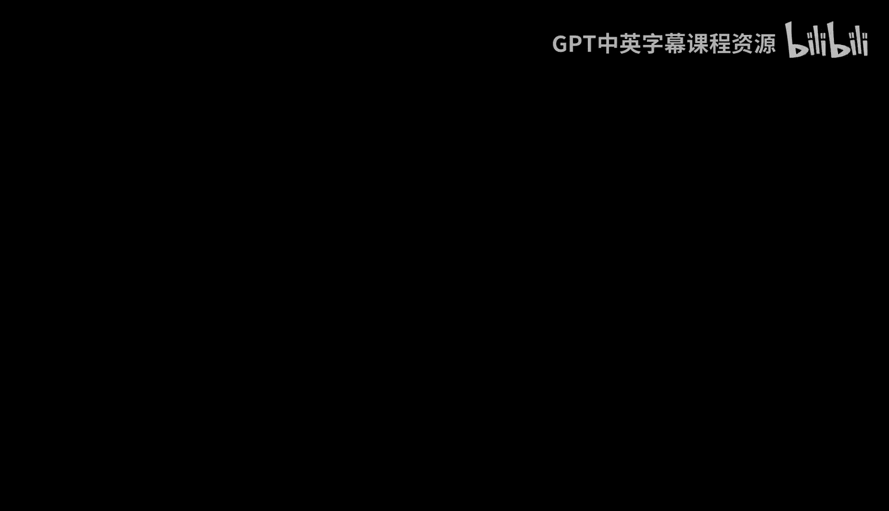
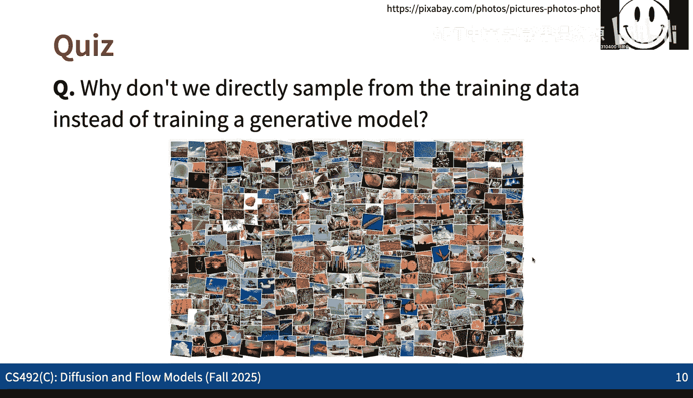
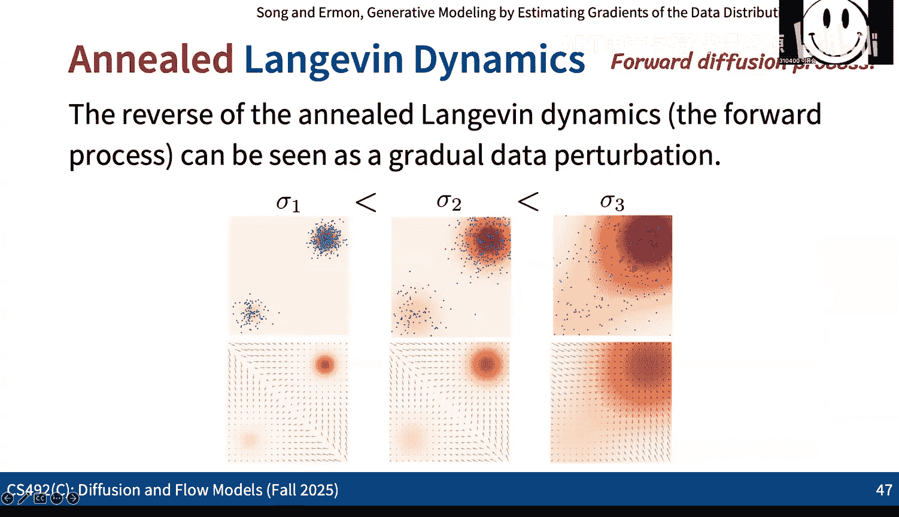
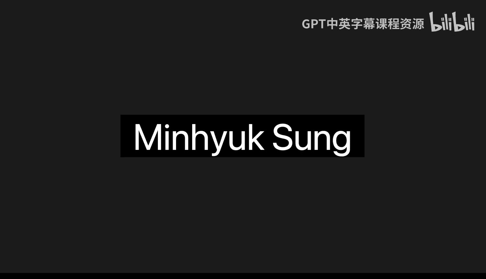

# KAIST《扩散和流模型｜CS492(C) Diffusion and Flow Models 2025》中英字幕 - P4：Lecture 05_ Score-Based Models (Diffusion and Flow Models, Fall 2025, KAIST).zh_ - GPT中英字幕课程资源 - BV1CKpvz1EH5

Okay， so let's get started。 So last time we discussed some kind of the some more kind of the concrete ideas for the division models。

 Especially for the D PM， right， So let me briefly go over these kind of the basic of the these are basically all the most important kind of some basic ideas for the division models that we gonna keep it over this class。

So basically compared to the other models， the basic idea for the models in general only for some specific model for the many for the of the division models。

 the basic idea is that we are basically defining the and delivers the processes as some sequential processes。

 So it is basically not having some kind of the single the latent the variable we are sequentially mapping the data point into the sequence of the latent variables in terms of the final the latent variable becomes the sample from the distribution that we know typically that the standard the ga distribution。

And also that de generation the process becomes the reverse process。

 starting from the standard the Gausian sample and all the way basically we are mapping to the data point from some sequential process and to basically make it easier in terms like training we are basically simplifying the process in a way that the process is basically not some kind of the learned process but we are predefining before the process so that is kind of the basic idea and also to make it like the simpler we are basically matching all the lifetime variables to have the same the dimensions so those are kind of the basic setups for the division models。

And the specific models that we have seen last time were basically having these kind of two characteristics。

 right， The first， the key characteristic was basically having the Markco be on the process。

 which means that the sampling of the X T only depends on the X T-1 in the whole process。

 So this was kind of the one key idea。 And also is the same for the reverse process as well。

 The sampling of the X T plus one was also only depend on the basically X T right。😊。

That's the kind of one thing。 And the other thing is that we specifically defined default the transitional the distribution into this form。

 So we're gonna to basically keep seeing some kind of some sort of the Gaoian form of the fourth and also delivers the transition the distribution。

 And last time we specifically defined this form the transition into this specific form with those kind of parameters。

 right。With some kind of diploma the here。And based on that。

 we could see some kind of the bunch of the other some distributions in the fold processes。

 Basically， this was kind of something that we defined， right。

 the the transition the distribution using those kind of the parameters。 And based on that， actually。

 we also could derive these two the formulation form right。

 So this was something that I was calling as kind of the word jump。

 like basically what this is that we don't need to really like running the fold process in like iter the U we can directly jump the sample any of the intermediate the data point directly from the data point。

 right， and from our the definition of those like transition this was also defined as kind of another Gaussian distribution into this form。

So this was kind of the good thing in terms of like making everything。

 It's kind of the Gausian with kind of like those kind of the the definition。And based on that。

 we could also derive the closed form of those these distribution sampling the x t minus-1 from the first the xt and the x0 right So this was kind of like the distribution that we wanted to batch with using the diversity the transition distribution。

 So the elbow function was basically derived into in a way that we are basically matching the diversity transition distribution to be the same with this distribution right and the good thing was that this was also derived into another de Gausian form with some kind of slightly more the complexity the mean function there right。

So the basic idea with the DPM was to basically how we are going to match the diversity。

 the transition the distribution the same with this one， right。For that。

 we also discussed the 3D options like the first option is to directly predict the mean of that the reverse。

 the transition distribution， which was the case that were having the mean predict。Instead of that。

 we are， we could consider basically predicting the expected value of the final the output of the X0。

 given the X T， right， So that is the case that we are having the clean sample the predictor。

And based on that the clean sample the predictor， we could basically compute the me of the distribution and was also display the sampling in。

And the other option is not to predict the expected value of the X U。

 but the expected value of the epsilon T epsilon T was basically the kind of the Gaussian。

 the standard Gaussian the sample that was being used to sample the X T from the X U， right？

We could see some kind of the des for that。 So given this kind of the nu predictor。

 we could also compute the mean of the the reverse， the transition。

 the distribution and of the sampling， right， So there are basically those kind of three options。

So basically， you need to see basically how once we basically get the some prediction of the either knee or the prediction of the queen sample or the noise。

 how we can basically compute the other， right， so those was something that we could also be derived。

And the good thing is that whatever the predictor that we have the loss function was basically defined as kind of like。

 these are basically some of the output after we decompose the elbow function and were doing some kind of the deri。

 right， So after the all the way of the deri， what we could see is that the elbow function becomes basically very simple the L to loss of the expected value like this while having some kind of the weight terms for each of the time。

 right So we just drop the waiting time here after developing the waiting time。

 we could see that these are all the same kind of the L to the loss function that we can easily implement。

😊，So given this kind of the page idea， so this is really something that you will need to implement in your the first segment so these are basically all about how we' going to basically run the gradient descent with kind of the expected value and for that we will basically need to sample the time T and also the sampling the x0 and based on that we are sampling the Xt and then now we can compute either basically the noise or the coin sample and also the mean right and then we are minimizing the output loss and this is exactly something that we need to implement in our the training the procedure right。

We just need to sample the clean sample。 yeah， the clean， the data point X O the time T。

 And based on that， we are also sampling the X T， right。

 And then from the process of like complete sampling the X T。

 we gonna to have the the the standard the Gaussian the noise here。

 That's something that we will need to matching our the lowest function。

And then we need to just like run the back propagation through these like the L tools and that because we can learn some kind of the some sort of the expected value of the noise there。

 right？This is like quite straightforward。Yeah， and also in the generation the process。

 once we basically train the the noise predictor， then we can do this kind of the iterative process。

 which is basically computing the mean of the reverse transition the distribution。 And based on that。

 we just need to sample the X T-1 in the iterated manner。

 So that's the data of the generation the process。Do you have any questions regarding this？

And one kind of the question that wasai was asking last time was that。

 while we are basically modeling this kind of the reverse the transition distribution as the di distribution after like training all things。

 the sampling of the X from the X Kta T this。Is not necessary The Gausian distribution This is typically non gausian distribution。

 right， So this is quite opposite to the full case In the full case。

 some of the the tradition distribution was the Gausian distribution。

 Then the folded jump distribution was another theusian distribution。

That was because of the fact that the the mean of the tu distribution was defined as kind of linear function。

for the cases that when the mean is defined kind of the linear function。

 which is respect to the desired condition， then we can see that the kind of the accumulation like some kind of iteration of like sampling also becomes another de distribution。

But for the cases like when the mean of this， like the transition the distribution it is basically non linear function。

 then this kind of the sampling may not be basically gauss on the distribution。

So thats basically the basic idea， right？So in the fold process that basically allows us basically not to basically running the it the process。

 we can jump the sample any of the X T given the x0 because like this kind of the jump could be also seen as kind of another like the the distribution。

But in the reverse process， we cannot basically skip like all the process because of that the all the the the posterior distribution here the not basically may not be the Gaus distribution。

 So we don't know some kind of close form of this distribution。

So that's why we still need to basically around the all the kind of recycling sampling the process in the e of the way。

That makes sense。Any quite on this。So the key thing was that we are seeing lots of some kind of be math here。

 but all the way of like doing all the things， the implementation you're going to see that is quite simple。

And also， this can be a quite effective way to basically model some very complexity distribution of this kind of the so this is likely for distribution sampling X0。

 given the unique gaustion the sample of x K。So before we move on to some kind of the other the ideas。

 the one quiz that I wanted to basically。Itmall like changing gear a bit easier。

 So we are assuming that actually actually we are having like lots of the the data points。

 right or the image generation the case。 I told you that there is kind of the data set some kind of the more than like 5 billions of images。

 right。Then given this kind of like the five billion of ingen。

 we basically discussed the idea in terms of how we can make the model that can sample the other one。

 right？But if we already have the five billion images。Then do we really need a generated model。

 why don't we just like sample one of those points？Do you have any。Answer for this。

This is the quiz that you will need to post your the answer in the itemsdence。So actually。

 I'm asking this question because like we gonna see kind of be exactly what's the difference between like like this kind of the dialogue sampling and also the sampling from the division model。

 to this the class。 But before we get into that， So this is really some the question that we can ask。

 right？ If you already have like5 billions of images。

 Then do we really need to have some kind of the a model。

 Why don't just like take one of those kind of things， right。Anyone who want to speak？

How to different together in my household something， but if you have feel conditional something。

 say I want a very specific problem。OutYeah there。这个你。

So yeah the point where the conditional de generation makes sense。

 Also for the unconditional generation， wouldn't there be any kind of other advantage like having these great models。

So basically， we can see first see this is kind of the compression， right。

 So if you're gonna really just like store the five buildings of the images in some kind of the storage。

 I don't know how much kind of the memory that we need right that would be huge amount of the memory。

 right， but if you really just like download some kind of the pretrained from some models like you don't need to take a photo of this。

 I'm I'm gonna some kind of updated version of this slice yeah so basically。😊。

If you gonna basically if you download some kind of some pretrain some image division models。

 for example， and the size of those kind of model would be basically like hundreds of mebyte which is in terms of the compression is basically of the compression the ratio。

 So we are compressing the information the billions images into few the megaby a few hundreds of the mebytes basically which is is kind more efficient in terms of we are including all the information into a single model into very size。

 So it can be advantage in terms of the scalability and also the efficiency and also in terms of the the diversity basically our model is not trained to just like pick one of some kind of given images。

 but it would basically some kind of the new image So in terms of that we may be able to。

Some kind of some sort of the price issue。 It's not only basically revealing some kind of the exact the data should be used in the data based on that we are making some kind of the new data points。

 So in terms of some making some kind of the no images there can be some kind of advantage in terms of we can handle some sort of some privacy。

But does this mean that the RD division model will not generate some any kind of the images indeed given the training the data set？

No guarantee， actually， there are actually some cases that the output of the printing model is really generating some kind of the images that even we can Google in the internet。

 So it's not perfectly automatically handling all those kind of privacy issues there are some kind of be some potential that we can basically make the digital models。

 not to basically directly just speak generate some kind of images exactly the same image that the training data set。

 but making some kind of the new images that can be also some of the advantages and also as we also discuss that in terms of like making some kind of the conditional the model。

 there can be some much more some kind of advantage or the advantages in terms of that we can basically find some kind of some kind of data points that are more aligned with some kind of condition。

😊，So were gonna discuss this kind of the the conditional degeneration the case sometime the next week。

So those are some kind of some other advantages。 There can be more。

 So these are some kind of the the ideas in terms like why we need to have some kind of the digital models。

Okay， so。To this domain topic is actually about the core based models and before we get into that actually what I wanted to bring up is that so we discussed those kind of the three options right。

 the mean predictor and the clean sample， the predictor and the noise predictor。😊。

So these two have some very quickly， very have some very explicit and clear demean in terms like what we are predicting。

 right， So we are actually predicting the meaning of that the reverse the transition。

 the distribution， or which just predict the expected value of the clean the data the points。😊。

But what's the meaning like this， right， It's just like something kind of like reasonable because like now the the things that we need to predict is the standard the sample。

 So in terms of explain some of like managing some kind of the training the procedure of the individualff models。

 this kind of like makes sense but what's the meaning of like this kind of the noise， right。😊。

This does not have some kind of some explicitly meaning in terms of our the context of the digital models。

So today we are going to get into the meaning of like predicting。

 what's the meaning of basically predicting the noise is there。

For that basically we're going start to see some kind of the definition of the new terminologist。

 so today we're going to discuss some many kind of new concepts in the statistics。

 we're going talk about this score， basically this core here is not the score that you know but here this core has some kind of the very specific de meaning so basically this score here basically means the gradient of the log likelihood with respect to the data point actually this is the gradient with respect to the data point x solveward。

 So when you have any kind of the probability the density function here。

 with respect the data point X here， if you take the gradient of the log the probability。

 that's basically the definition of this core function。Makes sense。

 So we're gonna use this time this core lots of the times in this class。

 Yeah You need to get used to the meaning like this right， this core function。

 So let's do some kind of the simple the exercise here。呃。So we defined this kind of the。

Soトデ jumping right sampling xクティ from the x So this derived some kind of the the close formォ into theian distribution here。

 right。So if we compute this core function of this conditional distribution。

 what would the function look like？So let's try the divide the closed form over like those this core function here。

对。Did anyone even get this。对。It's nothing but just like we know the PDF of the Gaussian the distribution from the Gaussian distribution。

 we just need to take the look first and taking the gradient with respect to the X。

 then we're going to get this from it。啊。You can try yourself。 But now after seeing this。

 we can see that this is something kind of like related like what what you have seen before。

 right So when you define the excellent T。 So those that theps T was basically the Gausian sample the unique Gaian sample that was been basically used to sample the X T given the X right So the form was basically defined like this So given the definition of the excellentps T here actually we can see that our the excellent T that has been used for the noise prediction the network is actually identical to the core function of those like4 jump distribution of to scale。

😊，So it's nothing but basically when you multiply some kind of this this scaling factor into this like the units。

 that actually becomes of this core， this core function of the for the jump distribution。

So that's kind of thing。What we are doing is that this kind of the algorithm noiseistic prediction the network was kind of like predicting the core function of this definition。

 the optimal scale。So that's basically what we are。

 basically we are doing really knows the presentation dinner， but actually。

 this is that the precise kind of interpretation are were going to get into like the precise interpretation delay。

And this was also basically the case that we are having this core function for this like conditional distribution。

 right？😊，W could we want to derive the score function， not for the condition the distribution。

 but for the Xt exactly？For any kind of the intermediate data point Xt here。

 what if we derive some kind of this core function of like this distribution？

So this is not that straightforward right for the conditional the case we know the closed form so we could basically directly as derive some kind of the score function here in this case we will need to perhaps use some kind of be some mathematical tools here so as kind of some kind of tools here let's briefly see this the3 formula so we are without basically probing all things the meaning of the formula is basically is。

😊，So let's think about that， we are basically sampling the X here。

And for those kind of the like the data point X， we know some kind of the likelihood distribution with respect to some kind of the mean here。

 So so you can see that this is the same thing。 So given some kind of the the mean Guang Xing here。

Given the mean function we know that the x has some kind of the conditional distribution with this kind of the gaussian distribution。

And we also have the prior distribution with respect to the mean here， right？

Then all the marginal distribution will be defined into this form， right？

So you can see that like given basically we are having some prior and the likelihood here and both we don't know what the the prior is。

 but and it's like we know the likelihood， So this is the setup that we may not know about the prior the distribution。

 but and it's like even the mu we can now say that the likelihood distribution this kind of like simple form actually these3 form that can be generalized into the much more the complex forms。

 but let's think about this like simple form in a way that the likelihood distribution is defined as the Gausian and also the name becomes of the condition itself。

But in this case， let's what we are basically seeing is that while we going we'll be able to sample the X。

이분甜民。We are basically doing the opposite， like given the sample the data point X。

 what would be expected value of the mean here？So if you think about the sampling process of the Px here。

 what we're going to do here is that we're going to first like sample the min here mu here from the prior distribution。

 and then based on that we're going to sample the X using the likelihood distribution。

But let's say we don't have the information pretty prior decision here。

And what we want to do is that given the sample from this like the marginal distribution。

 we want to get some kind of the guess of like what do the some expected value of the mean。

 especially for each of the data point。D the opposite。

Then what actually the is the formula is that actually the mean conditioned by each of the data point X。

 the expected value of this mean can be simply computed into this form。

When we have some kind of these core function here。

So this is the case that when you have the information of the marginal and the likelihood。

 how can it get some kind of the sense of the prior distribution doing the opposite。

 so typically we assume that we have the prior and the likelihood and based on that we do the sampling the margin right。

 but let's say we already have all the samples of the x and that we also have some kind of the information for the marginal distribution and also the likelihood so not exactly having the marginal distribution。

 but we have this core function of the marginal distribution and based on this core function of the marginal distribution how can it get the sense of kind of the mean in terms of like getting the expected value of the mean for each of the the data point。

And for that， like the3ies formula Robertbaski says that， yeah。

 it can have these kind of like some simple form。😊。

So this is the kind of big things with this it would be not easy to get like what's happening there。

 So let's also simply see what this basically means。呃。Before that。

 let's first see these kind of some basics for the Gausian division。

So another kind of good thing in terms like having the Gausian distribution is that so this is actually something that we kind of discussed before。

 But when we define our the prior distribution and also the likelihood distribution like this。

 both as also the Gausian distribution and also with the linear function in the mean here。

 then we can see that the marginal distribution becomes another the Gaussian distribution like this。

 So keep this in mind know take this slide。😊，Then to basically try something with the tweet formula。

 let's think about some kind of the simpler case。That we have the both the likelihood and both the prior and the likelihood defined like this。

So this is actually something that we don't know。 but let's assume that we know this information for now。

 So the main distribution is the standard theian distribution。

And given the sample of the each of the mean， now we're going to sample the x here。

 So that's the L likelihood distribution。And based on that。

 now we can derive the close function for the margin here。

 right Px what the marginal and also this core function here。对的。You will need to use the defect fact。

 so maybe you can download this light or。Based on this， what is this。都。You see this， right， I mean。

 so simply when you set the pli and the likelihood into the Gaussian like this。

 then we can see that this will be basically the our the marginal distribution while also having this kind of the linear function discord function。

 So then let's think about the opposite。 Now， we have some kind of the this as our the marginal distribution。

And we know that the our the see the data point the X there is that some conditioned by some kind of the mean value。

 the mean value there， right， then given some kind of the some likelihood that we don't know。呃行。Yeah。

 but sorry， given some kind of the the marginal distribution and also the like of the distribution。

 given the formula， how can you get the kind of the sense of like what to be some sort of the expected value of the mean for the data points。

So let's say you have some kind of the of the data points here。

And this the data point would be sampled from some some kind of the mean barrier， the mu here， right？

啊。So given the kind of the data point， can you get some kind of the sense of the mean value。

 the expected value of the the here？For example， let's say that given this setup that I just like mention here。

should be the x here from the im distribution， when we take a sample which value is basically positive。

What do we kind of the expected the the mean the the value which respect the x。

 Would it be smaller than the x or the larger than the x。哦是 so。

Given this the prior in the likelihood， we did this marginal de distribution。

 So let's say now we sample basically last we have lots of the samples of the X。

 which was actually sampled by sampling the mu and then conditionally sampling the X conditioned by the mu。

 right。So let's basically do some kind of a universitys process， I mean， given the X。

If we want to get， what was the the that was basically used to sample this X。

 what the kind of expected value of that de？Especially in the case。

 like when the the data point has some kind of the positive values。

So let's say we have the data point here。This data point x here was basically sampled by some of another kind of the mean barrier。

 right？Then would the mean value be placed in the left hand side or the right hand side？

When the point actually is likely the positive with thevalue。Lward right。你修 be left。

Yeah probably the tweet folder， what we have seen is that this is kind of the linear function right。

 So when you see this core function here。😊，呃， if the X is positive。You can see that this core is in。

 right？So then from the tweet formula。We， we know that this is also the positive and this is like negative when the x is positive。

So which means that the expected value of the mean。

Becomes smaller than the x because these parts becomes the negative， right？

And this is quite well aligned with our intuition。 So if we consider。

 basically sampling some the mean bursts and then sampling the x conditioned by that mean with the Gaussian distribution as we go right and the right and the right the x there also would be some kind of on the right side of that the conditional distribution。

Which means that the mean be probably on the left hand side or that the point of the x， right。

 So as we go further， further to the right hand side。

 these x would be some kind of the some outli sample of the the conditional the distribution。

 which is back to the mean， which means that the mean would be on the left hand side。

The expected value to be the late side right？If you go left hand side。

 then there will be some kind of some solutionus the distribution or the conditional the distribution。

 as you go left in the left and left， the mean would be more likely on the likely on the right hand side of that the data point。

 right？Should be greater than the data point， so this is basically aligned with some kind of the definition of the intuitive folder。

Makes sense。So yeah， so you need to get used to like what we are doing here。 So I mean， here。

 the meaning of it is that even without basically knowing some kind of the information about the prior the distribution from the data point of the S。

 how can you get the estimate of the mean that would result in sampling of like this X that's basically the idea about like the two is formula and the two is formula that the giving the sensor。

 how we can compute this kind of the estimate of the mean。呃。Actually， we can use this information。

 this fact to compute this core function of the Xt， not Xt conditioned by the X。

Because what we can see is that so that's what we want to compute。呃。Here。

 so this is basically what you know， right？Dampling the X T conditioned by the X0， right。

 then this means that when you take this as kind of the mu。This whole part is immune， right？

Then looks this the same as like what we have seen the previous level。

 So when you take this as kind of meal， the conditioner the distributed X T also becomes like this with the same form here。

Then using the tweet is formula， what we can see is that now we can compute the expected value of like this part。

 the X0 multipied by this like scaling factor conditioned by the XT， right？

This is basically nothing but directly applying the idea of the tweeted formula。

Then the menu like this is that from the clean data point。

We can actually know sample some kind of the intermediate data point Xt， right？

So now let's do the opposite， given some kind of the noisy the the variable the X T。

 what to be the expected value of the x0。So we are basically computing this with some kind of a scaling from here that can be popped out from the expected here and then using the score function here。

So if we know this core function。Of the XT the problems of the XT， then based on that。

 what they can do is that given any kind of the intermediate data point。

 we can compute the expected value of the final some clean data data point in the reverse process。

Make sense。These can be developed on the between folder。그れ。呃佢。So from this information。

 what we can see is that basically this core function has some kind of some very close relationship with the expected value of the X0 from the X T。

 So you this system， you can see that this is last of the information。

 once we have that this core function， given the X T。

 Now we can actually compute the expected of the X。

 that's basically our some kind of the sort of the forecasting of the final the outputs in the diversity processor。

That can be derived treated folder。And this is also aligned with basically what we have seen in the condition of the case。

 basically this core function for the Xt can be completed as the expected value for the score function for the conditional case or the all the X that could be sampled from the Xt。

 right？😊，So this is yeah the score function kind of things so we can compute the score function of the X C by taking the expected conditional the case for the old the X condition by the X T and we know how we can derive this。

 right。😊，This can be derived using the definition of the distribution。What we have seen the slide。

 And then we can see that now this formulation that we derive using the Gaussian distribution is aligned with the some formulation that we derive from the t this formula。

😊，So these are all basically online in this way。呃， any question to这意。再这样。

So here no we are basically taking some kind of some expected value of like this term conditioned by the Xt and Xt conditioned by the XT is basically itself solve like all the other things are basically some kind of constantvalue。

 then this becomes that this becomes the only part that we need to compute the expected value conditioned by the Xt。

你思。Here to you。Oh， so I'm just like replacing these parts。呃，V this。

This is like something that we have seen in the previous slide。中仲。Here to you。

So mean yeah so this is the core function for the X T。

 then what we can do is that actually we can take the all the possible the X0 So this is like if we just I rewrite this form。

 this is the expected value for the all the samples of the X T that could be basically resulting from the X0 that could be basically coming from the X T。

So all the possible sample of the X0。That can basically result in sampling the X in the order process。

 we are basically competing these like the score function for the contient case and taking the expected value。

 so that's the minimum this formulation。Any questions？So let me think。 So basically that's a thing。

 So now what we can see is that。The score function has some kind of the meaning in terms of like getting the expected value of the x0 for the Xt and actually we're going to see some kind of the more meanings for this。

Let me skip this。 So why do you care about the function。

So actually the main idea that actually we need to discuss for today is that what we have seen at the very beginning is that for the cases that we know some kind of the full form of the probability。

 the density function， especially like if we are able to compute the inverse of the cumulative the distribution。

 then based on that， we can directly sample the data points from the distribution。

Typically we don't know right， so that's kind of the pro point。But here， the thing is that。

In the case that we have the information of the score function， not this division。

 So even when we don't know directly about the probability， the density function。

 if we have the score function。Then based on the information of the score function。

 then we can sample from the distribution。So the process that allows like this kind of thing is the things the process that is called the Ljaand dynamicss。

 which is coming from the physics。How many you are majoring physicss here？For the physics people。

 this might be more the familiar， right， but what we can do is that like what the long demand the dynamics basically shows is that。

The sampling process from the Qx here can be done in this way without using the QX information。

 but using the core function information。So this is something quite similar with like what we have seen in the other regen model case。

 So what you can do is that without probe here the procedure is that once you sample the data point from any kind of the prior distribution。

 if you iterate this process， that's moving this point of it based on this core function here with some kind of injecting some kind of the Gaussian noise。

 if you iterate this kind the multiple times lots of times then you can see that the outputs will converge into distribution。

 especially like when this useful and when it does iterate this like quite many times。

And this is basically a case that， no， we are doing some kind of disse sampling from this distribution without directly having the prior the density function。

 but only using this core function。Ex sense。So this means thatの。Actually。

 even when you have some kind of the the probability， the density function。

 if we cannot compute the inverse， the cuulative distribution。

 then we don't know how exactly we can sample from that， right。

But the things that here now you don't need to compute the inverse of the cuumulative the the distribution。

 You just need to take the gradient of the log of that the probability， the density function。

 The you it like these， like multiple times。 Then you can basically sample from the distribution。

So you can see that actually this core function basically has like all the information about the given the distribution。

So let me play this。So this is kind of the example that we are having some kind of this core dysfunction function。

 which is kind of the vector field over the entire display space and once if it sample from start from some kind of the some I guess the uniform the distribution where the it's kind of prior the distribution over time。

 you can see that all the basically samples that is converging to some specific distribution right。

This is the language resources。Which means that now we can see that this core function encodes all the information。

About the distribution。So if you basically want to sample from that specific distribution。

 the only thing is that you just need to encode this quality information。

So we can think about just like mean training some kind of neural neural net that can basically learn encode this kind of score information for the all the points in the overly space。

😊，So given kind of the information that we have for this core dysfunction function。

 we can basically compress all the information into this core predictor in terms of training these core predictor with the L laws like this。

This is already quite something quite similar with like what we have seen with the noise prediction。

But this is the case that， like， when you have the this information for this core function。

What's the case that we have？In our case like training detergent models。

 we only have the samples of the X， right we don't have the information even for this query panel。

So here the question is that。If we only have some kind of the samples from the QX。

 then based on that how we can basically compute this core function。Obviously。

 if we only have the examples of the x， then we cannot directly compute this core function。

So what we are going to do is that we are going to somehow approximate this Q x function using some the samples of the X that we have。

The way that we are approximating is like the Q X here is taking some kind of the start of the Gaussian and the convolution for the all the samples。

So let's think about some kind of the another the distribution。

 which is the Q X T so you can now the i the T here。

 but this T indicates some kind of this is kind of the another distribution right。

 so let's say this is kind of the another the distribution that is basically coming from this kind of the definition of the marginal the distribution。

So now this is the case that we are taking the institution that we want to learn is kind of the prior here。

😊，And having some kind of or， small ga and the distribution is the likelihood。😊。

And defining another distribution， which is the QX T。Makes sense。啊， so。Yeah like this。

So yeah if we have some kind of some kind of the the Q x的 distribution for some kind of the on these like some three regions some kind of theoian the blur the distribution theq x will look like this right。

Making slightly blurry like this by it just like having the emergent form like this。

Then what we can see here is that once we define the QXT into this way。

 then we know how we can sample from the QXT， so sampling from the QXT will be basically sampling from this distribution and then sampling from thisuss the distribution。

And we have lots of the samples from the distribution， right？

So we can somehow approximate like sampling from this is taking one of the data points that we have。

And then we just like sample again based on this this discussion the distribution。Make sense。

So here basically sampling from the Q X T becomes equivalent like sampling the X U。

 This is already the samples that we have。 We already have the samples of the X U。

 and based on the samples of the X U， then we can also sample the X T here。

Then why do we need to define this kind of the new distribution？

 The thing is that given like the Q the Q xテ now we can。

So what we want to do is that we want to basically learn this core function of the distribution。

But after some kind of the deation， what we can see is that for those kinds of some Gausian summo deep version of the distribution。

 like learning this core function here becomes the same with like minimizing this like this expected value。

So the thing is that while we don't know how we can compute this， right。

We don't have the information for this right， but after basically deing some of those kind of things。

 but it can see is that we just need to actually minimize like this expected value here。

 the thing is that for this conditionalvalue。We define this as kind of the Gausian distribution。

So we know how we can compute this。So you can see that actually after we define some kind of the Gaussian blur the distribution here。

 we are decomping this core function into the sampling the X T from the X sorry sampling the X here sampling the X U1 taking one of the data points and computing this core function with the conditional the distribution in a way to minimize the L to the function right。

So we didn't know how we can basically compute this。

 but we can the this we just need to take one of the samples of the X and for the Gausian distribution。

 we know how we can compute the Discd function， right。

So now it becomes as quite feasible in terms of that we are learning this training this quality predictor。

Make sense。And this is actually exactly the same form that we have seen in the noise British in the case in the diffusion models。

😊，The DPN case we have seen the most predictor， right？

For the noise predictor we are basically having the noise pre here。

 which is matching the Epsilon key。Here， basically interval we have the Eps T。

 we have some kind of the score term which is nothing but just like multiplying some scaling defect into the noise term here。

You can see that actually this is the identical with the DDPM we are basically up to some kind of scale。

So we are basically having some kind of the interpretation like what we are doing in the division model。

 So in the division model， the noise predictor is basically learning some kind of the core function of this kind of the gausianvol some kind of the the distribution。

Makes sense。Andに会社さ thisす。So here the question is that how we are going to determine the various of this kind of like some some Gaussian decomvolution。

So this is some kind of defecto that we can define。

 the thing is that as we basically make it very small。As the variance would be very small。

 then what we can see is that this， like the new distribution would be quite close to the original distribution that we wanted to learn。

 right， That's kind of the advantage advantage。W to be disadvantaged？

As we have some kind of the multimodality in the distribution。

 there will be some regions where the probability becomes almost zero for those kind of some sort of the low density region。

 where the probability becomes very close to zero this core function。

 the local likelihood also would be very close to zero right。

 so this will nothing we going to learn using our some kind of the lowest function here。

 which means that for those kind of the low density region where the kind of the probability becomes very close to zero this core function to be very inaccurate so for the kind of the in like running the random and the dynamics for the low the density regions some kind of the process that we are doing would be very kind of some kind noisy the process because of the inaccurate this core function we gonna learn here。

Because like as you have seen in the case this slide。

So we are starting from some kind of the so in this specific example。

 we are starting from some kind of the uniform samples over these like2 this piece and then moving that along the kind of quad theyhu。

 but if the prediction of this cored is basically inaccurate。

 then kind of at the beginning of the process， the points will be moving some kind of the random points not really reaching to the high dense region。

 so that's basically not good for us。So that's kind of the problem。 So for the low dense regions。

 we're going to get some kind of the inaccurate kind of scores in this case。

So then what you can do is that we can consider increasing these variances in terms of that this becomes like more blurred the distribution。

 not having some kind of some pekinis in some reasons， but having some more blurry like this。

For those kind of cases， since we are not having this kind of the low dense regions， this core the。

This score value will be kind of the higher in these kind of cases。

 then we might be able to have some more chance to get some more accurate disc prediction across the whole entire division。

The problem is that now this blurret the distribution is more different from the original distribution。

 right， So even when you basically you know， sample the the points using this kind of the blurry distribution that will not be exactly the samples that we wanted to see。

 right。So here the point is that actually we wanted to basically sample from the QXT in terms of that this speak from some kind of the good approximation of this the original the distribution。

So there are some kind of deproic course。As we basically increase the variance here。

As we increase the variance here， the bad thing is that the Q X T become some kind of the bad approximation of the original distribution。

 which means that at the end of the old the one D dynamic process。

 the output that we are getting may not be some kind of the points that we wanted to get。

 That's not exactly the sample of the Q x0 right， So that's kind of the problem。

 But the good thing of having the blur distribution is that we are not having the low density regions。

 which means that there are some kind of no issues in terms of having some less accurate function on some kind of some some regions。

For the cases，70 variance is especially small。Then the Q xt becomes quite close to the  Q x0 right so in the high dense regions we will be able to basically move all the points accurately into the samples state we want to get the problem is that when the points starting from some kind of the low dense regions。

 those will be some kind of regions that these core function might be less accurate so at the very beginning。

 the long domain dynamics will be less accurate in this case in the case。

 like when the variance at the high， the long dynamics may be more accurate at the beginning but less accurate at the end。

Makes sense。呃，给你过。So that's the idea in terms like， So what we need to do。 So。

 so what typically we do is that we are basically starting from some kind of demo more broadly the distribution。

In a way that we can have some kind of the good start with some kind of the random de points of the in the particles。

 but over time we want to basically move those points more accurately into some highd regions of the original distribution in terms of that we are gradually decreasing the variance。

 the variance here， in terms of that at the beginning even for the low dense regions。

 the points are moving to some kind of some good regions here and after the points are moving to that closer to the higher the dense regions。

 then now we are having some more accurate some kind of the moving of the old the particles by matching the QXT to be closer to the original distribution。

And this is actually exactly what we are doing in our the reverse process of digital models。

So in the fold process in the division models， you may remember that no if you recall the our the the transition the distribution。

 we are increasing the variance， right？graduallyradually basically adding some kind of the increasing the variance of those kind of Gausian decomvolution in the default process。

And the reverse process is kind of the opposite positive。

We are gradually decreasing the variance of the the change the the the Q x here in a way that we can talk to kind of the。

Good start the low density regions in the de Lato Monday dynamics and then moving to the right points in the high density regions。

So this is kind of the one way that we can interpret our the di the process into the longer one D dynamics and seeing the noiseisy electron key as kind of this core function。

So we can basically consider our kind of the noise predictor into the individual models as kind of the core predictor。

 basically learning the log of the the gradient of the log the probability of the X T in a way that we can learn the long dynamicss like this。

M sense。So I would like to recommend you to check out some kind of the some details here。

 I am going to update all the slides in the link if you can check out。😊。

So you need to basically see the meaning of this core function there and how exactly this concept is aligned with the diffus models that we discussed last time。

 right， so we're gonna keep discussing this idea of this core function all on the all the the lectures in this class。

 So you need to get used to the meaning of that。 And what's the meaning of that。

 we are sampling based on this core function and also the length of the dynamics。

So let's continue discussing this on the Wednesday and then we going and also all the different models we discuss is the based on the microcobi on the process。

 right， we're going to start to discuss some kind of non microco on the process next time。ExGood。

