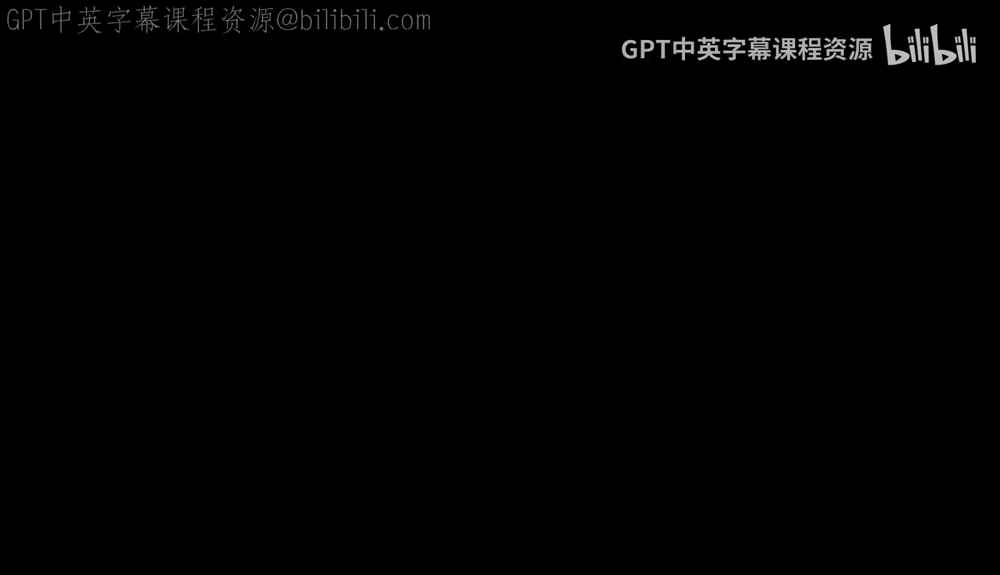
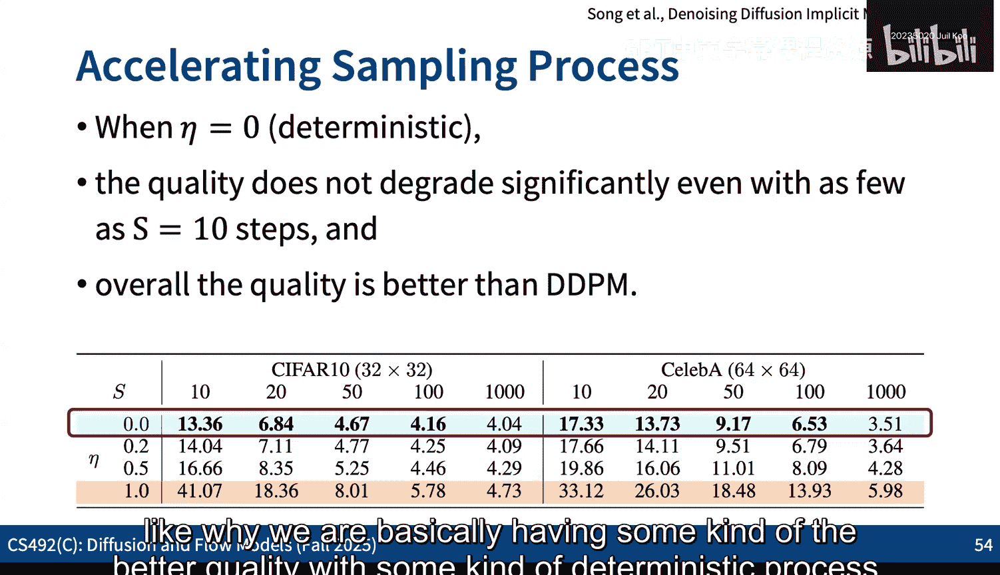
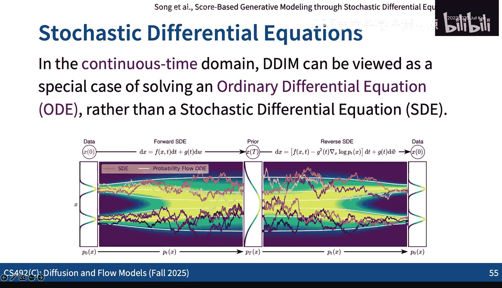

# KAIST《扩散和流模型｜CS492(C) Diffusion and Flow Models 2025》中英字幕 - P5：Lecture 06_ Denoising Diffusion Implicit Models (Diffusion and Flow Models, Fall - GPT中英字幕课程资源 - BV1CKpvz1EH5

Okay， so last time we started to discuss some kind of slightly kind of different way in terms like making the models inspired by the long amount dynamics and also the way to basically calculate these quality functions and the basic idea here is that like what if we basically assume that we are basically having some kind of the large scale training data and just like making our degen process it's not really generation。

 but just like picking one of the data point in the given between training the data set。

 So that's kind of really the possible way but the things that we wanted to have in terms of of feature in our theit model is to make some kind of the making some kind of the nobel images。

 not just like picking one of those kind of images。

So here the question is how can you basically generate some kind of the new data points that are basically not identical to the annual specific the the data points。

So for that， the basic idea that we started to see last time is to add some sort of deep blurness into the training diet。

So basically， what we can see is that let's say this like Q X O here is kind of the underlying the distribution for the data points that we have。

 So that's the kind of the information that we don't know。

 right we only have the samples from the Q X。 So it means that if we really want to track sample the data points from the Q X that will be really just like speaking one of the existing the training the data points。

 So that's not we want to do because we want to make some kind of the something the new the data point。

So for that， basically， we are basically adding some kind of the Gausian noise in terms of you know。

 making some like Gausian， the smoothie， the version of the distribution like this。😊。

So you can see that the new distribution becomes like something that is like applying some sort of theian conversion into the underlying the distribution here。

 the Q X0。 So we are basically defined some kind of the new data distribution。

 which becomes the Q X T。So by adding some kind of the Gaus and the noise into the underlying the distribution。

 we want to basically sample from this and making something that is closely one of the determining data points。

 but still it's kind of new。 So that's basically what we want to do。

So the question for now is that then how we can sample from this kind of the new the data distribution。

 the2 Xt， right？So for that the basic idea was to leverage the idea of the longund dynamics。

 which was basically very the good idea in terms of that we don't need to actually have the information of the Q XT we just need to have some the information of this core function。

 so once we can compute this core which is the gradient of the log the probability and based on that we can basically sample from that the distribution by creating this kind of process starting from the sample of the end of the prior distribution and then basically moving that point using this kind of the step using this core function here。

So this is already actually quite close with like what we are doing in our the in the DDPMD process right。

 so we are going to we are basically seeing some kind of dis similarity between the DDPM and the this process。

Then this mean is that for the new data distribution， for the Q XG， this distribution。

 the only thing that we need to know is basically this core information， right？

This gradient of the local probability。So then the question is basically how we can compute this core function for the Gaussian。

 the blur the distributions。And for that， the basic idea also was that no。

 we are going to train the score prediction the network lattice by minimizing the L to loss with the score function here。

And it turns out to be that if you derive all the things into the new expected value here。

 then we can actually see that this core function can be seen as kind of the expected value over those things。

 basically sampling the XO and then sampling the Xt based on that basically this expected value becomes actually matching this core function for the conditional the distribution。

So that's basically the basic idea in terms of we are going to train this core function in a way that we can perform the long demand dynamics while this core function square the predictor is trained to basically match the score function for the conditionally distribution while basically completing this expected value。

Then it becomes quickly more visible because now for this conditionary distribution。

 this is basically what we defined as the Gaussian distribution， right？For the Gaussian distribution。

 we know how we can compute this score function。 It's just like simply just taking the gradient of the log of the probability。

 So and then now we can see that training this like score。

 the predictor becomes visible because of that， the derivativerivation the expected value here。

And then the only thing is that then how much kind of the noise that we need to add。

 right So as we basically have some kind of add some sort of the small Gaus and the noise into the underlying distribution。

 the thing is that we're gonna get basically very high the accuracy for these core values near in some highly concentrated region like this。

 but some kind of the regions， which are basically quite far from the existing some kind of training the data points。

 basically these core values in this region will be very close to0 So which means that even when you train our these core predictor。

 will be not that much kind of the rate And also since these core function will be close to0。

 there will be basically almost like the moving force to getting closer into the highly concentrated region So that's kind of the problem。

 So apart from the annual like those regions here。With some kind of the particles here。

 did not be really just moving that much into these regions， basically stayinging almost here。

 so that basically will know involvevoke some kind of the loss of the iterations to getting closer to the highest the concentrated regions and also even this courses that we are basically predicting in these regions would be not that kind of accurate。

So the other option is that basically we are increasing the variance in terms of basically adding some kind of the bigger de Gaus and the noise into the underlying the distribution。

 Then the good thing is that now we are not basically having some kind of the less regions like having almost the zero discourse。

 which means that we can basically making it easier to move the particles into some kind of the highly the concentrated regions。

 the problem is that now when you have some kind of the bigger de Gaus and the noise。

 the modified the distribution will debate more from some kind of the underlying the distribution。

 So which means that what we are using for these core function would not be that also the accurate disc cored function to kind of some kind ground through the distribution here。

So that basically multibas in terms of basically decreasing the variance over time。

 So here the basic idea is that we are starting from some kind of the high de varianceance in terms of adding some kind of the bigger the Gaussian noise in a way that from like wherever we start in terms of the particles here。

 we still have some kind of the moving first in terms of moving to some highly some kind satur regions like this。

 and as we have some kind of the particles that are basically getting closer into the highly concentrated regions like this。

 then we are decreasing the variance in terms of that now we get some kind of the more accurate discourse in these regions in a way that now we can get some kind of the more the accurate samples in the highly the concentrated regions。

So that's the basic the motivation of like the annual the long the dynamics。

So which means that in terms of like training our this quality predictor here。

Now we are basically bearing the variance of the gauss and the noise。

 so we are also going to basically learn the score for each of the time step T So word the time step T we are going to basically decrease the the variance over the time so for each of the time step we need to learn the square function right So that's basically what we are going to do。

And after like doing all the things， now this looks like。The same。

 the thing we have seen for the DDPN case， right， So this is actually exactly the same thing with the noise predictor that we have seen in the DDPN case。

 So now we can see that this is kind of the same thing with the DDP。

 So actually this is like one possible way to define the diffusion model。

 and this can be also kind like one way to interpret the diff the processes in the diffusion model。

 So we can see that actually the reverse process of the diffus the model is basically simulating this kind of the annual the long amount the dynamics。

 basically started from some kind of the bigger the gaussian noise and then getting smaller in terms of that we can basically make some better samples with the more accurate this core variables。

😊，So that's the basic idea。And also if we see some kind of the reverse process of the la the dynamics。

 actually that turns out to be the same with the board process in the digital model right。

 is's basically gradually increasing the variances in terms of that we are starting from this kind of the distribution。

 which is close to our the underlying data distribution and basically gradually adding some kind of the bigger de Gausian noise in terms of that from wherever we start with the particles。

 we can basically move the particles getting close to the highly the concentrated regions。So。

 that's the thing。So you can see that actually， this is kind of be like one way to basically interpret each of the division models and also sharing many things with the D PMM that we discussed last time。

But actually it's not exactly the thing with the DDPM。

 actually one small kind of the difference with the DPM。

 the case that the DPM we defined fourth the distribution in this way， right。

 so there is basically some kind of a scaling come here。

While in this specific case with the annual the ladaman dynamics。

 what we have seen in terms like adding the noise was that we defined default these words basically some kind of Gausian the convolution kind of distribution right in this case like we define the default process like this so these are not exactly the same so you can say that like each of these is kind of like one specific way that we are defining the future models while these are basically not exactly the same but you can say that the are basically sharing lots of the ideas in terms of like how we can design some kind of de the generated the process in a kind of the iterative demand manner。

Any questions on this？对。Forward to this model， How do we sample from the client。

How do we sample from the prior？I mean， it's the availableable like how we define the prior distribution。

 so we can actually set any prior distribution， So typically we're going to also start with the standard the Gausian distribution。

ButThat's not need to be standard caution distribution in this case。好。S T gets started。

 but it doesn't become standard counsel。Well， yeah， but in this case。

 the difference with the GDPPM is that no it does not need to be so when when we increase the variance to be very big。

 it does not need to be like matching the Q X T to be exactly the same with the Gausian。

 the standard the Gaussian distribution。So actually， we gonna even you know。

 were gonna start from the any other the prior distribution and then perform the long Monday dynamics to getting closer into that the Gaian blur distribution。

 But thing is that thats would be something that is kind of like deviated from the original distribution。

 right， So that's why we obviously gradually decreasing the variance yeah。Any other？1。

Question you might have is that so how many times steps that we need to have， right？

So both for the TDPM and also this case， we are basically somehow happy notion of decline time。

 right？Starting from the prior distribution and gradually performing the reverse process to getting into one of the realistic the data point。

 which means that in our the implementation， basically we will need to have some kind of be discrete the time steps right starting from the capital T and all the way to going into the the zero right。

 but as you can see here， actually the time does not need to be discreteetized this the whole idea actually can be defined in the continuous the time step right。

Continuous time domain。So actually， so that's not something that we are going to discuss for today。

 but what we are going to discuss in the。Week capital next week is more actually some kind of the deeper idea in terms like what happens if we define all this kind of the process in the continuous time domain。

But it turns out to be that no， if we see this kind of the annual the long Monday dynamics process with the continuous time domain。

 You can see that this is actually the process that we are basically performing some kind of degen based on this like stochastic differential equation。

😊，So basically， this is the the differential equation in terms of that we are having this while basically injecting some kind oftot here。

And also， so as we define the word process in the DP and also in this like score based models in the content time the domain。

 we can first define the world the process using the SD SDE like this and the interesting thing that we're gonna also see next time is basically that oneP defined the SDE for the full process like this。

 then actually we can find the corresponding the SDE for the reverse process as well。

And the closed form for the SD for the reverse process is defined in this way。

 you can see that everything is kind the shared in terms like dual items and we are basically having this which is still the same the core function。

So when you discuss the diff models in the content time d domains。

 we're going to get back to seeing some kind of score functions here and see how this like score function plays some kind of role in the de generation process。

 And we can see that like all those kind of DPM and also this models are some kind of some specific cases that we are performing or the process with the time domain。

 the discretetization。So that's the high level idea that something getting deeper into the division models。

 but we are not going to discuss this for today。就。Before we get into the content time domain。

 this is the today's domain topic that we are going to discuss。So。

If we get back to some kind of the comparisons for the the generate models。

 So we have seen this kind of the three the， some kind of the some properties that we want to basically satisfy with the our the the generate model。

 right。So what we have seen is that for the again again is good in terms of making some high quality samples and also making de generation the process to be assessed。

 The problem is that it typically has some kind of mold collapse issue in terms of like losing some kind of the diversity。

 right。For the BE， the problem was that especially the fs and also making some kind of the diversity output。

 but in terms of the quality， but the quality is really not good right， that was the problem。

 So that is like why we started to discuss the digital model。

 which is good in terms of like making high quality samples with some kind of the diversity the problem was in the speed right。

So if you implement the things in the assignment1， you're gonna see that actually。

 as you have some kind of the more the time steps， as you basically increase the number of be the time steps there。

 you're gonna get some kind of the better quality the office， typically for the DPM。

 you might need some like more or less like 1000 the time steps， which means like 1000 iterations。

 right， which sounds like quite big iterations。So actually the research of the division the models recent researchers for the previous like two or these three years were all about basically how we are going to basically accelerate this kind of degeneration process So actually over the entire semester you're going to see that we are now basically making some kind of model that needs to be performed like the 1000 steps we are going to see how this can be reduced into the 50 time steps and next time you're gonna to see how we can be even more like we these into the10 step。

 the five step three to one step。So basically， this is like all about like。

 how we gonna accelerate this kind of the de generation。

 the process while plea being the quality will be the upper。 So that's kind of the big question。

So as kind of the first step in terms of what basically making it like the faster of the digital models。

We're going to basically discuss this idea， which is the DDIM。

And here the key idea is that last time we basically defined both the wood and the rivers processes as kind of themerco beyond the process。

Which means that when you sample the xt conditioned by the xt minus1 and also any of some kind of the previous these states。

 all these of the previous states can be ignored because we are assuming that xt only depends on the one right before。

 basically xt minus1， so that basically our basic assumption。

 in terms of defining the voltage and the reverse preferences right？

So that's kind of like basicallying。对啊。And here the question is that can you also basically make some kind of non microbi on the process。

The for that， what we are going to see is that for the fourth the transition， the distribution。

What we did last time for the DDP is that we first define this， right？

We first defined default the transition distribution。

 how we can sample the X T conditioned by the X T-1。

 and we defined this as kind of the Gaussian distribution。

 And based on that we could derive the other things this sport distribution like I call this the jump distribution。

 sampling the X T from X 0。 This was another the Gaussian distribution， right。

And also this one as all。 So this was the distribution that we need to match with the our process sampling the X T minus-1 conditioned by the both the X T and the X O。

So this sorts kind of the basic thing。But basically here， the main question is that。

If we get back to the elbow function。 So this is like something that we wanted to maximize here。

 is that what we need to do is that we need to basically have the the probability distribution for the all the latent variables conditioned by the X。

So basically this is all robust basically what to be the likelihood for each of the late variable conditioned by the realistic the data point。

 the X here， right？😊，So once we basically if you find this。

 if you decompose this into the multiple the termss here。

 then what we need to have was basically achieve these two。We could see that， no。

 this was basically already decomposing to that。 we just need to have these two distributions。

So actually this looks like the only information that we needed was actually not default the transition distribution。

 but actually these two。So that basically gives some kind of the motivation in terms of that。

 What if we do not define default the transition distribution。

 but actually directly define these two in a way that。

This all default distribution can be defined based on these two。So that's kind of the main idea。

So here basically we defined basically these first and derive these two based on this。But actually。

 if the only information that we need is the only these to the distribution。

There would there be some kind of the other way around in terms of that we directly define these two and do not define this in terms of basically that we are modeling all this kind of for the distribution。

 basically， this one。Then this would be basically a more de general idea in terms of that。

 so this is really the idea in terms of how we are going to generalize the GDPDPM in terms like define the fold process in a different way。

So that's kind of humating。So what we are going to see is that now we are not going to define this sorry So we are going to basically define this like the board the the the distribution。

 sampling any latent available from the X zero by only defining this tool without defining this like both the transition the distribution。

So this would become like this。 So for any of the intermediate the latent variable。

 So if we wanted to X T previously in the DDPM， what we need to do was basically sampling it effectively right from the X U。

 you go to the X1， X 2 X3 and all the way to the X T， right。

 So that's basically what we need to do last time。But instead like doing this。Now。

 what we are going to do is that these two were basically something that we needed， right。

 And based on that， if we want to basically sample the X T。

 what we are going to do is that actually we are going to jump all the way from the X to the x capital T here。

And then going backward。 So basically， if you have the x0 and the x capital T， based on this。

 you can sample x capital T -1， right， X capital t -2。All the way to the。

So that's kind of the another way。 So when you basically define this and this。

 then if we want to sample the X T， then instead like just going the forward wave， actually。

 we can first chocolate jump from the x0 to the x capital T and goinging the backward。😊，So actually。

 that's kind of the honor way that we can actually define the fold process。

 define the fold process like the reverse process， right， so that's kind of the idea。😊。

So this is kind of the idea in terms of making our default process as kind of the non Markov be and the process。

 because now sampling of the X T -1 depends on the both the even the X T and also the X U。

 which is like the the the first kind of the the the data point。So。

 so in terms of that we only want to define these two。

 now we are going to basically switch out the fold process like this from the X0。

 We first sampled the X capital T and going the backward in terms of going to the the X T。

 So that's basically some kind of changes that we are making。

Then the question is that how should we define these two distribution？Obviously。

 there can be like lots of the ways to defining these two。 but today。

 we are going to see some very specific idea in terms of like， no， still。

 we are directly defining these two while basically making these two be the same。

So this was specific some kind of the the quote the ju description， right。

 the sampling the X T track from the X zero， right。😊。

So we have seen how we can derive this from the previous default full the transition distribution in the DDPM the case。

So given the X T condition by the X T minus-1， we could derive this， right。

But now we are going to define these two in a way to。

 basically making these to be the same with the DDP in the case。

And this basically the four the distribution that we have seen last time。

So youバスハベスデフ these two you youウ need to do yourselfハケにディファイデトイnovaートバス match to the same。

Then before we get into like how exactly we need to define this too。

 the question might be that So what's the point？ So why do you need to make this to this be the same。

You can see that this is like one of the dispensibility cases of the latent variable， right。

In the remote case， basically， we are basically defining this。 So for all the team。

 for all the time team， we wanted to basically model this， right。And based on that。

 we are basically define the elbow function。So this means that EP basically match this distribution。

This means that all the elbow function will be the same as well。

So that's actually the most important part。So when you define these two distributions。

 while basically preserving this to be the same， what we can achieve is that we are making the elbow function to be the same with the DDPM case。

Op to this k factor， right？Can you see the meaning like this。

 what's the meaning that we are making the elbow function to be the same？

Yes so the meaning of this is that。Once you train the DDP model with the same elbow function。

 you can change the generation the process。That's actually quite interesting the point。

Have you seen such kind of the neural net that you paint like one specific way and use the model in different ways？

Is there such kind of case， I think there is no such kind of case way。

 once you train some kind of classification network。

 can you use the anroppo the other kind of things。😊。

So this is kind of the interesting point in terms of that while you basically train a specific model using the objective function。

In the generation the process， you can run either the Markcobi on the process。

 or you can also run the non Markcobiian the process to the same de generation。

And we gonna see what's the effect of that Actually。

 that changes the performance of the the the generatedative the model。

So that's actually very interesting point。 We can actually。😊，No。

 keep seeing this idea multiple times in terms of that once you pre train a model。

 we only change the inference。 the process。 the generation。

 the process in terms of basically improving the performance。

So that's actually quite interesting the idea。Have you seen that kind of the case。 Like。

 you train the classification network and do something at the inference time and just improve the performance。

 You can do this with default models without having using any other information or any other kind of neural network or any other kind of prior information only by just changing the generation process。

😊，So that's the kind of the key thing。 And this is kind of the start to see that we are making some kind of the changes in the generation the process in terms of like accelerating the generation。

 And then we're gonna actually see many other cases。

 like reducing the time from the 1000 to the 50 for now。 and reaching this to the 10，5，3 to1。

 So that's be kind of the case。😊，Okay， so this is kind of our main task for today。

 which means that there will be some key here。 So what we want to do is that we basically want to define these two distribution in a way to basically match this。

 right， for all time step tip。😊，So this are basically the full distribution that we have seen in the DPM case for the all time step T。

 we want to basically match this by defining this tool， right。😊。

So it basically means that for the capital T here， that this is like what we are defined here， right。

 for the capital T here， this should be obviously the thing with this， right。

 by setting the capital T in the time step right， So it is' very obvious， right， So for this。

 we know how we need to define this， right。😊，The problem is like this one， right？

How should it define define this？So嗯。So as we already have some kind of some past experience in terms of defining those things。

 you can now feel like， you know， basically。😊，We don't know exactly。

 but some of these should be something like the Gausian distribution。 right。

 that's what we have seen all the way from the lectures。

 like all the kind of things that we the the process was just the Gausian distribution so we can feel like it should be something like the Gaoian distribution。

😊，And for many of the cases that we have seen， actually。

 this like mean function was also defined as some kind of linear function of those kind of the conditions。

 right？😊，So while we don't have the clear idea for now， let's see that actually。

 let's assume that this should be some kind of the Gausian distribution with some kind of the linear function c these two the conditions。

And then the problem would be basically finding these two。

 So what should be basically this like W G and your WT。And this is actually what you need to do。

 actually， this is quite global。 also very simple。 So we gonna basically consider some kind of induction。

😊，We are starting from the capital key here。We already defined this conditional distribution。

 DVD K T to be the same with the the the this distribution， right。Starting from the kile T。

 and we're going do some kind of induction by decreasingating the attend time step。

So let's assume that the times that T， we already basically defined the other distributions in a way that this to be the same with this。

So we would like to define the some the other the distributions in a way that basically defining this like W U and the WT in a way that now for the T minus-1。

 also this basically holds。That's basically what we want to do， right？

So which means that so let's see how can you derive these distributions from the Q X T and the X0 of this distribution and also the other description that we are going to define。

So given these two。This is like what we are going to define， right。And let's say。

 like we already have this distribution。プ럼デ스트。Just simply by just taking this the product like。

 So for this， this is quite obvious。 So if you ignore the X here， ignore the X0 for now。

 then you can see that this multiplication like these two becomes the joint distribution and taking the integral becomes just like simply the marginalization。

So from the simple kind of the some demand mass， we can say that D should hold。

 So which means that from these to the the distribution now we can compute the X T minus1 conditioned by the X0。

 right。This is obvious。And also one more thing that we actually have seen last time was this。

Without proof because there send some details here。

But when you basically have some kind of the prior distribution and the likelihood distribution that are both of them are defined as kind of the Gaussian distribution like this。

 We have seen that actually the marginal distribution also becomes something like this。

 another the Gaussian distribution。So based on these fact。

 now we can derive the W G and the W T there。So once again。

 when you consider this as kind of the prior and the likelihood the distribution。

 when these two are best deion distribution by the taking the condition de mean as the submin function of the conditions。

 we can derive the marginal distribution as another deusion distribution， right？

So then the question is that we know the prior。And the marginal here。

Now we want to define the likelihood， especially while assuming that this mean function is the linear combination like these two in a way to basically simply finding those coefficients。

Make sense。So， let's try this。Book。The first thing that you need to do would be that so what do the mean and the variance of this conditionary distribution with respect to the W0 and the WT。

And based on that， can you also do you have the the W G and the WT。So， this is the quiz。就。So yeah。

 if you solve those things， I think you should have。第位。For the X T minus-1 condition by the X O。

 you the mean and the appearance should be completed like this。

So based on that you basicallyス computeデティダジ andデWルティー。

Then you will see that the WT and the WG are derived in this form。Is this something to you guys？

looks quite。30 right basically but these that shows that now we can have some kind of some close form into also distribution defining this distribution xテ minus one condition by default xテ andデ x in a way that we can basically match the distribution the same theデ PMMデ case。

😊，Why do we need to consider。So well that's the question。喂月。这个人送是。

Why we didn't consider something shipped。There也算 sense好像。

Similar do you have to serveあ you you mean some some kind of be。So bias them here， right yeah。

Actuallyual my original version of this slice is basically having the bias there after you you gonna see that actually the bias becomes zero。

😊，So I just basically simplify this question that you can easily see like what we get。😊。

But typically， when you have this kind of the linear function without the kind of some。

 the some biot。ウ canセディカドさかショのデションテ it comes anotherデオション。So yeah。

 so I just like make this kind of equation simple in a way that I just already gave you this form。

 these distribution should be in this form。 So let's us finding these equations。

 but that actually involves some kind of the intu life in terms of what this would look like when you define the happy distribution that way。

So， based on this。So this is basically the distribution that we are defining。

And also this was the distribution that we need to match with the our the learned， the reverse。

 the transition， the distribution， right？Here the thing is that now we don't need to specify this。

 so for any arbitrary barriers here。So actually this is really really key point。

Whatever the that you have here。For any of the difference on here。

 whatever you have this definition of like the distribution will match the fourth the distribution of the DPM。

So which means that there is like not just like only one way to make the another nonmicbibin the process。

 depending on like what we choose here， even we can basically make some kind of some variations of the nonmiccobiion in the process。

So we are basically seeing that。Some kind of like very different ways to define the process and also that will change the reverse process。

 right the thing is that even when it makes them like all the changes for default and reverse the processes。

 these are all the cases where the elbow function becomes the same。

 which means that even when you change our default and reverse the processes。

 our the objective function becomes the same。So for the same model that we trained with the same objective function。

 we just need to we can just change the reive process。

So that's the really the key idea in the individual models。So again。

 in the D the case we defined this fourth transition distribution into the specific Gaoian form in a way that we can derive like these to the distributions。

 right。😊，Now in the DDIM， we are directly defining these two distributions。

Then what would be the fourth the transition distribution in this case？I mean。

 depending on so what to be exactly this So depending on how we define this too。

 actually even it not it would not be possible to derive some close form more like this。

So in total that we are seeing some kind of more generalization， right。

 So we are now defining these two。 even these two may not give some kind of any close form for the fourth the transition distribution。

 But it does' matter， right， because like based on these two。

 we can still define the full the process。 And based on that， we can also define the reverse process。

 So that's kind of the key idea。Since the elbow function will remain unchanged after the killing defect while basically which means that the our delivers。

 the tradition， the distribution， will be basically still be defined a way to basically match this distribution。

And we already defined this， right？With some kind of arbitrary difference。So yeah， so that's a thing。

 We don't need to retrain the noise predictor based on the pretrained den noise predictor。

 Now we can think about how we can really perform the reverse process in the DDIM the way。

So since this is still the same， like that the deliver transition should still damage match the this one with some kind of the estimate of the X0 from the X T。

 whatever we have the mean predictor or the clean sample the predictor or the the excellent noise predictor。

 What we just need to do is that any of the predictor， given the X T， we just get the compute。

 the estimate of the X0。 And based on that， we basically sample based on the distribution that we have seen for release the condition of the case。

So that becomes the reverse processing of the DDIMd。So again， indeed the detail in the case。

 So this is actually what we have seen as kind of the quiz。In the previous lecture。

So given the noise predictor here， noise prediction， we get some kind of the prediction of the X0。

 given the X T， right。😊，So based on the prediction of the X0。

 what we can do is that now we can compute this whole de mean function here。Looks complicated。

 but we can still copy。 And based on this， that means that we have some kind of the we know the reverse。

 the transition distribution that should be the same with this。

 We sample from this and then getting the X and repeat this。

So we are making some some smoothly changes in this part， right？

Slightly changing the university transition to distribution in the DDIM the case。

So like in terms of the formulation， this might look complicated， but in terms of the implementation。

 actually you're going to see that this is literally like just like co lines of the changes in the pi turch。

😊，In the from the DDPM to the DDIM。 and the very magical thing is that when you just like change a couple of lines in the pie with the new the university process。

 you're gonna see some kind of the difference in the performance。 Actually very big difference。

 So that's the very magical thing。😊，And here the question is that we now have the option to choose the here。

 right？Whatever the buildingsance that we can choose。啊。Let me ask this question first。

 So what the kind of the maximum value。Can you really choose any variance。

 obviously the skirt the time here， these should be the0 or greater than0 right。

 but can you really choose any value here？Would there be some kind of the upper bound？Maximum three。

对他就那。这地到这个。です。😊，Yeah actually thank answer so hint what root here right variance which means that giving the of the the upper point so basically the variance should be great same word smaller than these right。

😊，So we are seeing the upper mount， what' the low amount， we can set zero， right？

What happens to if it that0 in this case？So then actually， as we have seen in the previous slide。

 we are basically sampling the Xt minus1 iterly from this distribution。😊。

But if the barriers becomes 0， then we always take this mean as the X T -1。Actually， this。

 this is like very interesting case because like what we have discussed over the entire day。

 the previous lectures were all this stochastic process。 We are basically doing some sampling， right。

😊，We are sampling the X t minus1 from some specific distribution。

 which means that every time we are injecting some kind of the noise。😊。

So dis samplingling was basically like this， right。

 We are having some Gaoian and dis here and then basically adding like this， right？😊。

So actually all the process that we have seen was basically injecting some kind of noise。😊。

Having some kind ofto。Which means that even when you start from the x k T， from the same x capital T。

At the end of the all the way to the generation， the process。

 you might get into the very different kind of points。

 because every time you are adding some kind of the random noise。

But when you make these like variables to be zero。Then the whole process becomes deterministic。

So starting from some kind of stochastic process。 now， actually。

 we are discussing deterministic process， which means that if you start from the same x capital T。

 every time you connect that into the same X0。😊，Because like。

 it's just iterationial like this computation。M sense。

So this is actually a very interesting point in terms of that we can find some kind of the process。

 which is basically giving some kind of same the marginal distribution。

 basically that the output will be still the point from the same distribution。

 but delivers the process becomes degen the process becomes deterministic by setting this to be zero。

So they can have some kind of lots of advantage， right。

 if you want to reproduce some kind of outputs， you make some kind of images using some kind of dis image。

 whatever。 and someone ask you to basically reproduce images。 Can you just make this image again。no。

s because like we already have like last of some kind of random noise So I don't know even how I can make this image again。

 right with the D DI you can do that if you like remember the x that you started from based on that If you start always from the same point you gonna always get same output making the generation process to be determined。

😊，And also， you can the thing is that DDPM is actually this special case of the DD IM。

 So I'm going to make this as kind of the homework。

 But what you can see is that if you set the variance term to be like this into the。

 Then what you can see is that actually when you set the variance to be like this。

 Then this becomes exactly the same with the DDPM case。

 So one of the some very specific case of the DD IM actually become some kind of the mark be the process。

😊，So you can see that really， this like DDIM is kind like doing some kind of generalization of the DDPM in a way that we can either increase the variance or basically decrease the variance in a way that we can even make it like deterministic。

😊，Some kind ofデ degeneative ideas。 So check out like whether no。

Or these variables will really make the DDM to be the same with the DDPN。

 but this is kind of homework。And so yeah， so typically。

 we parameterize the various like this in a way that0 means the determineies of the process。

 and the one means the DDPM。 And you can increase this more up to that the upper bound。

 depending on which variance that you're gonna set。

 you're gonna get some kind of different results right。

So why do we care about basically this like D D I in the case。

 So what's the meaning of that kind of the having the difference there， so。

It's not possible to explain the meaning of the difference variance。

 like everything in this like single lecture。 So we're gonna continue this discussion in the actually week after next week。

 especially when we go into the continuous time case， it will be clearer。

 like the meaning of like having the the zero dependence。 But for now。

 were gonna just see some more the empirical results like what you that。

 So we are talking about the kind of the slow speed of the digital models， right。

 So how are we gonna basically reduce the the time step while basically maintaining kind of quality of the output。

😊，So we can consider basically some like skipping some of the time steps。

 So the main thing here is that even when basically somehow train the the D the model by setting some kind of the discrete time step from the one to the capital T。

 we can consider basically in the re process。 we can consider skipping some of the time steps making heading some uniform in double。

 not sampling from the capital T to the T1， but sampling like some kind of the bunch of kind of steps。

 right。😊，So even for this kind of this some skipping kind of the process， actually。

 the objective function is not being changed。 So that's what kind of thing。But typically。

 when you basically reduce the number of the time steps。

 then the quality of the output also gets basically worse。

But without any kind of theoretical things for now， we're gonna get into that later。

 The thing is that when we make our degen to the process to be more deterministic。

 The thing is that even when we decrease the number of the time steps。

 the quality degradation is not that big， much as kind of some stochastic process。😊。

So let me show some kind of the experiment of the results。So this like the image generation。

 the case is something that you will need to do for the image generation the challenge here。

 basically， we use some kind of the evaluation metric， which is called the F I here。

 So maybe we're gonna have some chance to discuss like what this means the insert distance。

 Basically， you can see that this is kind of some sort of the distance between the distribution of the output the samples and the distribution of the ground through the training the data。

 So lower is basically three better。And what this table basically shows is that what sort of the output that we get when we vary theto in the DD I in the case and also when you vary the number of the D time steps。

😊，So when this number is for D1， that's the case that we are making the DDPM， right。

 it saying the DDPM， when you make this to be0， that's the deterministic DDR in the case。

And we can also make this to be the much greater， right， And typically for the GDPPM， as I said。

 like we used it 1000 of the time time steps。And for the。Its like really DD PMM here here。

 This is the last right。 So this is the DD PM the case。 So when the time step is like 1000。

 the F I D is collected 4。07， quite a very quite low number。

As you decrease these normally times steps all the way to the10 here。

 you can see that the F I D increases like 10 times more， like 41。07。

But if you see the the deterministic case here。For all the cases basically the quality is much better。

 basically the better than the D DDPM the case。 And especially if when you decrease the times 10 all the way to the 10 here。

 the quality degradation is not very big compared to this case。

 So this was basically the 10 times more kind of the increase of the F I D。 While this is like。😊。

Three times kind of the increaseオビデアアイディ right。Wch basically shows that even when you basically reduce the time step in the determinity case。

 now we can achieve some kind of good results。You can compare this。And this here in the DDP。

 you needed to basically run the 1000 times that achieve the height of the 4。7。Now。

 for the DDI in the deterministic the case， only with the 50 times step。

 you cannot already get the 4。6。Okay。So this means is that what we need to do in terms of like accelerating the generation the process is not to train your model again with some kind of a new idea。

 Just use the pretrained model。But just change the real deliver process into the DDI and the deterministic process and just like reduce the time step。

And then you can get some kind of the almost the same quality and also the diversity while basically reducing speeding up the computation。

 So that's quite magical things， right。To accelerate de generation the process。

 you didn't need to even retrain your the model， you just need to basically change the generation process。

So， that's kind of the idea。So this is actually the key things that we're gonna keep seeing in this class。

 So from the 1000 to the time step the 10 without doing any kind of fine tuning whatever kind of things。

 by simply changing the generation the process we can still match the same the quality while speed up into the old way the time step 10 if you want to reduce bother the time steps。

 then now you need to have some kind of the fine tuning。

 So that's also the idea that we are also going to discuss。

 So if you see some kind of open source model for the image generation。

 especially then you're gonna say that there are some kind of the options。

 So I guess in the first class， we also have seen the flux。

 the case or the flux there is also kind of the model with some kind of the more the time step and also the single the time step。

 which is like way faster or the single the time step the case is the case that the somewhat fine tuned in terms of like doing some kind of exploration。

So basicallyically this means that if you develop some kind of the new method that you don't even need to do some kind of like second stage training with the single stage training。

 if you can make the whatever division or the flow models in a way that they can run with the single step while achieving the same quality。

That will be really pickinging。That's kind of the unsol the problem if you can really make such kind of the model that is like running with the one step with the same thepohus。

I guess you're gonna make some very big money。 Thats really unsolve the problem。

 But now the state of the artist that like reducing from the 1000 to the 10。 And further。

 if you go all the way to the single step， they need to do some kind of refine fine tuning。😊。

so that's kind of idealデ to discussす。我一自。真空啲。啊嘴就没。Works yeah。For the other D domain。

 you can use the DDIM so actually using the DDIM is quite standard for now for older cases。

 not only for the images for all other D domains you can really use the DDIM the ideas for the old the diion models。

 not only for the image generation。And now it's not very intuitive。

 Like why we are basically having some kind of the better quality with some kind of determin process to better understand that actually。

 we you need to get into this point in terms like how we can interpret like all this process in the continuous time domain。

 So after we start to discuss all the things in the continuous time domain actually。

 what we are going to see is that D D IM is kind of the case like we are finding some corresponding ordinary differential equation from the stochastic differential equation。

 So it's really just like removing some stoch parts in the differential equation in a way to solving the O not the。

 So were gonna basically get into this point。 So what's the difference between distance。😊。

I need quite just on this。So yeah， this was kind of the basic idea for the D on。

 So we discussed some kind of some basic data theories for the di models until this point next week。

 we're going to get into slightly more the practical ideas。

 So what we really need to have in terms of the implementation to make some like images like the degene models and how we can also use some kind of some pretrain image degene models for some more some practical applications So we're gonna have those kind of the ideas the next week I will see you next Monday。

