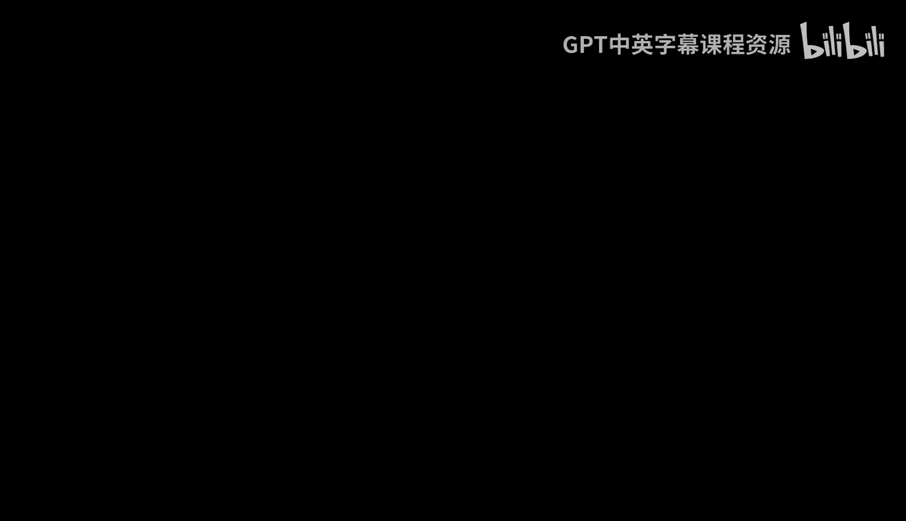
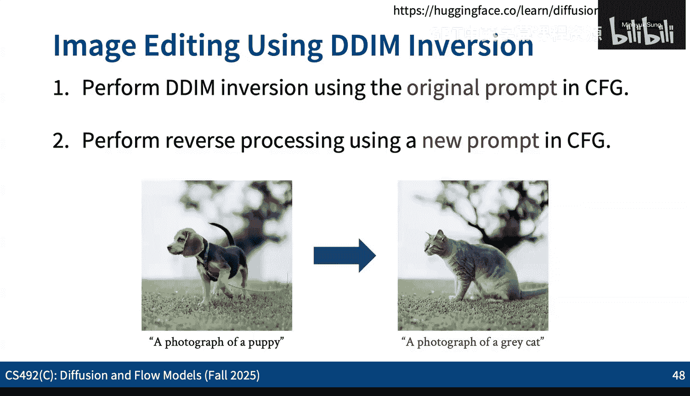
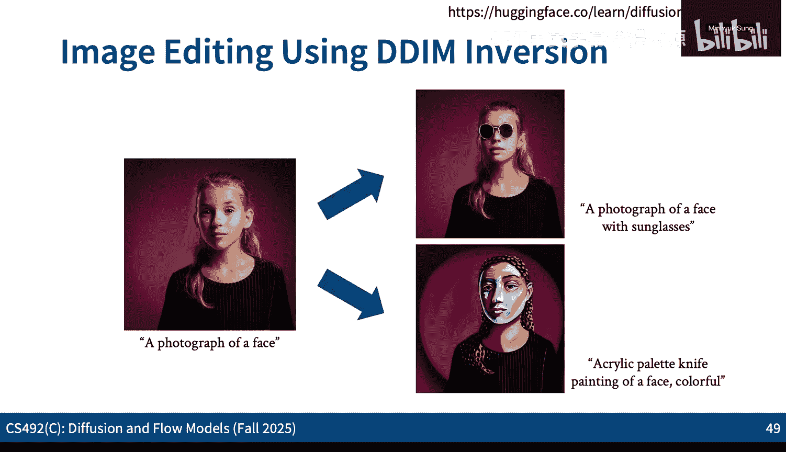
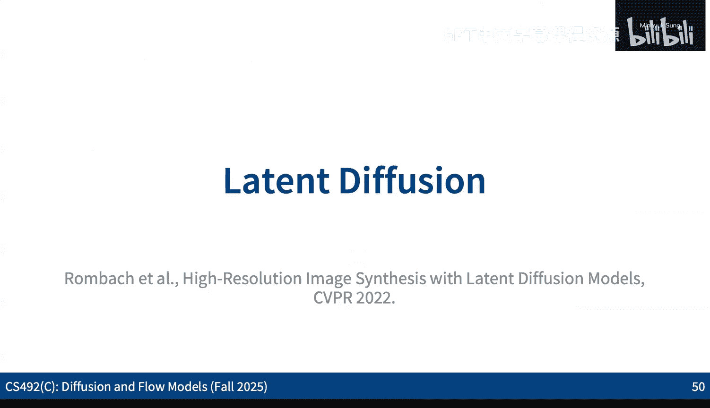
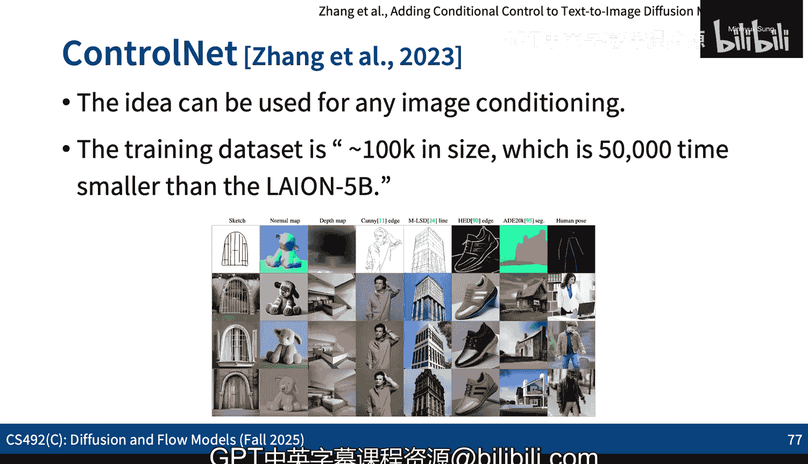
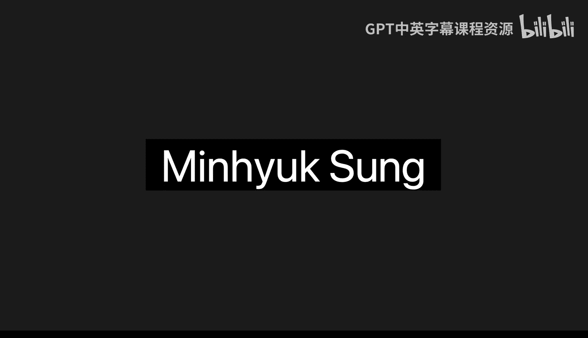

# KAIST《扩散和流模型｜CS492(C) Diffusion and Flow Models 2025》中英字幕 - P6：Lecture 07_ Conditional Generation _ Latent Diffusion (Diffusion and Flow Models - GPT中英字幕课程资源 - BV1CKpvz1EH5

So until the last week we discussed some kind of basics actually these these were basics the DD PM and DD I kind of the models。

 So if you understood the basic ideas about D PM and the DD IM then now you are able to implement a model for any kind of the data。

 So the purpose of the first assignment is to actually implement like the DD PM the DDI in a way that you are making your own model yourself with some kind of very basic D。

😊，So this is really kind of some kind of things in terms like implementing the division model。

 But if you want to like apply those kind of the models for the many the applications。

 you might need to also know some kind of the concepts for so many that can that are basically necessary for the many practical the applications for the conditional generation or some kind of the personalization for the many things。

 So for this week we are going to switch the gear in terms of we are going to discuss more some kind of some practical the ideas for many kind of the applications。

 So the plan for now is that we are going to discuss some kind of more the practical the applications and the practical the ideas this week。

 and then we are also going back to the discussion but like some theory and seeing like how the division models can be also defined and also interpreted in the continuous time domain in terms of we can do the border the acceleration of the generation。

😊，And this topic will be discussed until the week of the midter。 And after that。

 we're gonna start to discuss the flow models。 and then we're gonna get back to some kind of the applications based on the di flow models。

 So that's the plan for now。So the， the topics that we are going to discuss today is that when you have some kind of the additional information for the data。

 So for， for example， like， let's say， we are making some kind of the image models that we can change some kind of images like this。

But for many kind of the cases， the images might come with some kind of some additional information。

 like some kind of the class labels or some kind of the text descriptions。So for those kind of cases。

 like when have some additional information for the data。

 how can you utilize those kind of information to improve the quality of the outputs。

 So this is the first question that we are going to discuss。

And second thing is also about some kind of the fine tune。

 So will see that there are quite many some pretwined models that are basically pretrained with the billions of images。

 for example， for those kind of the pretwined models。

 how can you effectively fine tune these models in terms of that we can do some kind of the conditional generation and also some kind of the personalization。

 So those are some kind of the basic things that we are going to discuss today。

So probably today lecture will be shorterer， but I'm going to quickly go over some kind of like those kind of basic ideas。

😊，So in terms of utilizing some kind of the additional information for the game D data set。

 let's think about this kind of the simpler case that especially for the image generation。

 let's assume that we have some kind of the class labels for the old images。

And given these kind of the labels for the images， how can you use this information to improve the quality？

So that's the idea which is called the quest file the guidance。So for the classifier the guidance。

 what we are going to do is that now we are going to consider not learning the distribution for the image itself。

 but some kind of the joint the distribution for the both the image and the class labels here。

Then here the question is that what we have seen in the DDPM and DDIM also for this scope the base model。

 the cases that the noise predictor actually can be interpreted as some kind of this core prediction right we have seen this kind of the relationship in terms of the quantity that we are predicting using the noise predictor which can be actually it is kind of the same with this quantum here up to this kill defector here right。

😊，So here the thing is that when you consider not learning the distribution of the image itself。

 but the joint distribution of the X and the y here。

 can you also compute this score for this like joint distribution in a way that we can use that information score information in the generation。

😊，So here， like one quick question is that why if we consider what。

 why do we need consider the like the joint distribution。

 So typically we might want to actually consider doing some kind of the like the conditional degeneration。

 right， That means that we might actually be more interesting。

 basically learning this core of the conditional distribution， like X T conditioned by the Y， right。

But here basically I say like you know， that we are going to learn this core function for the joint distribution。

 what's the difference between these two？あ、です。What， what。

 why do we care about the joint distribution instead of the conditional distribution。

 It sounds like we need to know some kind of the conditional distribution， right。

 like given the class label D Y， we want to change some kind of image the X right。哎，你都是哎你。能吗。😔。

Ideas for that。Actually， these two are kind of the same because like the joint like P X， Y。

 is the same with the the condition， the the probability X conditioned by y， multiplied by the P， Y。

 right。And TY would be some kind of the constant value that would be some kind of given information。

So whether we consider this core term the function for the joint distribution or this core function for the conditional the distribution。

 These are kind of the same up to the scale。 the scale of the time becomes a the Py， right。

 which is some kind of given information， So basically like learning this core for the joint distribution can be interpreted as kind of like somehow we are seeing this core function for that the conditional distribution。

Makes sense。So the things that you need to know in the context of the D model is that so basically what we all talk about after we say this like the noise predictors。

 we also have seen some kind of the other options like the mean predictor and the clean sample of the predictor but whatever the predictors that we have。

 all those information can be interpreted as kind of like predicting the noise here。

 and we also have seen that this like noise can be interpreted as basically this like core term for any of the for the intermediate the data point。

 if we can compute these core the terms here， then based on that。

 we can also interpret the compute noise based on this like core function and the rest of the steps of the the generation will be exactly the same。

So the key things in the digital model is that basically how we are going to compute this like score function for any of the intermediate going to the X that's kind of the key idea。

 we gonna keep。Seeing this kind of the ideas about like。

 how we are going to modify this core function in terms of like doing some kind of conditional degeneration or some kind of the guide degeneration for many things。

 So many of the applications of division models come from basically doing some kind of the manipulation of these core termss here。

Okay。So in this case， if could just quickly see what we are going to do is that we are basically calculating the core function for this going distribution。

 right？😊，This can be rewritten into this way。 And you can see that finally it becomes like having this formulation。

 which is basically having the same quantum here。😊，But you know。

 taking subjecting like this amount of the kind of the another the， right。

Which means that in terms of basically computing the noise， we just need to update the LD noise。

By subjecting this part， right。So basically， actually learning this core function for the joint distribution becomes basically modifyifying the noise with basically the dis amount of some kind of be some bias。

😊，And here the question is that basically how we are going to compute this part， right？😊。

So somehow if we can compute this core function for this conditional distribution。

 like the y conditioned by the Xt by subtracting these part。

 now we can update the noise and this updated noise can be used in the generation process。

That's the kind of debate basic idea。How can you compute this？Any ideas？

You can see that first we need to be able to compute the probability of the Col label given the Xt。

 right？Somehow， if we have any kind of the function that can compute the probability of the class label。

 given the X T based on the the that function， actually the what we need to do is taking the gradient of the logo of that the the function。

 right。What do we make a neural net that can compute the function of the probability that become the function of the like the computing the probability for the class label。

 given the X。😊，So if we have like， know， computing these parts， the neural net computing these parts。

 then we can know naturally compute the log and also the gradient of the logo that， right。Mix sense。

What， what is the neural net that can compute the probability the class table given the X T。Yeah。

 so that's the coefficient Ph network， right？啊。The only thing is that that's basically the classification the network。

 which is not taking not only taking the clean image。

 but also that is taking any intermediate the data point， right， So that's kind of the only thing。

 So this means that we just need to train a classification the network that is taking any intermediate XT and it's corresponding the idea。

 right。😊，So can you guess like how can you basically train such kind of your。

Which means that when you have some kind of the of the cleaning image and also the class table。

 what you just need to do is that you need to。Do the thought process。

To corrupt the clean image into the noise image， right。

 starting from the X0 and running the fold process to make some kind of the corrupted image。

 basically the noise the data point X T， that becomes the input to the classification of the network。

And then basically predicting the probability for each of the class label。到。Basically。

 having this kind of the classification D network becomes that we are being able to basically compute this probability。

 Given the X T， we compute the probability of the class label。😊。

And what we are going to do is that we are going to use this information to be able to basically update the noise term here。

 basically becomes like updating this core function， right。Sd function for for this score function。

 this will be the corresponding noise， right。And these like basically updated the noise can be injected into the our delivers process。

 and the re of these steps would be exactly the same。😊。

So that become some the kind of things in terms of we are doing some kind of the sort of the some modification of this these core de functions here。

 in a way that now we want to generate some images that are basically aligned with some kind of given the condition of the class label。

😊，Makes sense。So that's why basically also it's important to understand the relationships between the output that we are predicting using the noise encrypt the network here and also this core function here。

We are having this kind of the the relationship between these kind of the quantities。

 which means that for some kind of the conditional degeneration， for many kind of the cases。

 we can do some kind of the some manipulation of this core function here。

 updating the noise here that will basically guide the trajectory of the the generation of the process and the reverse process。

 the trajectory of the X T in a way that the output become something that we want to see。😊。

So this is actually quite important the aspect of the division models。

 You cannot simply do those kind of things for the B A E or some kind of again for the other kind of models basically for the other models for the again and the B A if you want to make some kind of the conditional the model that becomes like that you are you know training the model from scratch again。

But making another model that can take the condition。 But in this case。

 what we do is that we are basically having pre the mood predictor here。😊。

While basically training another the network， which is the classification network here in terms of that this information can give some kind of the guidance in this quality prediction While all the other steps becomes exactly exactly the same。

😊，Makes sense。So it becomes like if you see some kind of how the like X T basically evolve from the x capital all the way to the x with this kind of the the the vanilla noise for the original noise If we see this kind of specific trajectory by adding this kind of the additional term in this quality function。

 youre gonna see some kind of some deviation of the trajectory into the other making another image。

By updating this code function。So this is the basic idea。

 are we going to see multiple times in the h glass。So， yeah， that's a thing。

 So once we basically have the classifier here， based on that。 now。

 you can update the noise by just taking the gradient of the log of that probability and by just like multiplying those termss。

 you can update the noise the thumbs here。😊，One kind of interesting in some practical the idea is that even you can consider basically controlling the strength of the condition。

So by having the weight time D W here， by increasing this the weight。

 you can somehow enforcing further in terms of that the output is like more aligned into the given the condition。

 which is the class table in this case。So I'm gonna quickly go with the kind of formulation here。

 But the meaning like having the weight here can be interpreted in some kind of ways。 But basically。

 if you see like all the de here， what it becomes is that it becomes like we are having the。😊。

The core term now for the， the the joint the distribution that we have seen in the previous slide。

 but for this term。😊，So we are slightly modifying the the distribution in a way that now we are not seeing this the original joint distribution。

 but somehow of like some sort of the condition the distribution in this case。

 which does not have some kind of any theoretical meaning in this form。

 but practically this basically means that we are basically amplifying some the probability for this like the condition probability here in terms of that we are emforcing the output to be more aligned with given the condition the ideas。

So this is some kind of the practical ideas in terms of basically how we are going to know。

They have some kind of the strong condition in the de generation。 So typically， also。

 what we can see is that when you have some kind of the higher weight here。

 we can see that the output is not only just like online into the given the condition。

 but also become some slightly more realistic while basically also sacrificing the diversity of it。

 So that's kind of some very critical ideas in terms of that we can also have some kind of some strength of the condition in the generation。

So you can also try this yourself。 So the good thing of like this， like the the classifier， the。

 the guidance is that， no， it's not just like liberating the additional information。

 not only to improve the quality， but that also enables some kind of the conditional degeneration。

 So that's kind of the interesting point。😊，What do weダsideト theifier the guidance。

If you are the developer making such kind of system。

 what are you going to complain in terms of like making this system？Yeah， that thats something thing。

 So basically you need to train on neural network， Right。

 So still it might be easier than just like training the division model from scratch again。

 but still it's like making on other neural network， right， in terms of that。

 So it might be basically some curber on having the two neural networks。😊。

So that's why we are basically discussing this idea。 So if you see many kind of some， I don't know。

 some blogs were many， some kind of the articles， many things about the some some the code of many things for the diffusion models。

 youre gonna see this term CFG for many， many the places。

 So this is really very know the standard or the techniques for now in terms of making some conditional the model。

 and the reason for like why they are having this naming of the classifier the free guidance is that actually this idea has been like the motivated by the classifier the guidance。

 And here the biggest motivation is to not to have the classifier。

 But why basically having the same effect in the conditional degen。😊。

So the basic idea here is that how we can do the same thing without really having some declassification of the network。

😊，So what they are going to do is that they are going to basically make the trained the division model in a way that they can directly compute the conditional Disc function。

So it's not basically assuming that we are having some kind of pretrained unconditional model。

 We are training the di model in a way that they can directly predict the conditional dis functions。

😊，So in， which means that when you have some kind of the noise prediction the network。

 that is not only taking the X T but T here， but also taking some kind of the additional the condition the pie here。

The kind of good thing having this kind of the some conditioner this the the moves。

 the predictor is that now this condition does not need to be only the class labels。

This can be anything can be I I'm gonna show some kind of example for that it can be tax description it can be even the audio it can be even many other things。

 right so that's kind of thing。But what we are going to do is that actually the advantage of like having the classifier the guidance is that we could basically control the strength of the the conditioning。

 right？😊，Basically， by increasing the W here， we could basically make the output be more aligned into the given the condition。

😊，So here， the question is that when you also train the digital model to project predict the conditional core times here。

 how can you also control the strength of the condition。So to control the strength of the condition。

 what we are going to do is that we are going to basically jointly learn both the conditional discord function and also the unconditional discord function。

So you can think about like， we are making train the2 neural network。

 One is basically taking some kind of the additional the conditioning information here as the input heading the another day neural network。

 which is not taking any kind of some conditioning the information。

So that can be the cases that we are running the conditional Discd function with the one network and the unconditional discd function with the other network。

 right？But we also don't want to have some two neural net， right， That's sort of basically， you know。

 just no， no。Taking some time， right， So what we are going to do is that we are going to make a single neural net that can learn both the conditional the square function and also the unconed square function in a way basically that we are introducing some kind of denial nu label。

😊，For example， for the class label the cases， If you gonna have some kind of the indexes of the class tables from like one to N。

 we are having some kind of the zero label， which means that that's the unconditional the case。😊。

So like simple idea in terms of we are just making a single neural net that can have both that can predict both the conditions the score and the unconditional score and the nu label here。

 basically indicating the case that we are predicting the unconditional the score。😊，Make sense。

And based on that， the idea in terms of the， the enhancement of the conditioning is that we are doing some kind of the extrapolation。

Of this core function for the conditional the case and the unconditional case。So in this formulation。

 but you consists see that it pre said this the Ramda to be1。sorry， the runnda2 be0 here。

 then this means is that we are not using any kind of the some unconditional disc information。

 only using the the conditional disc information， right。But we are。

 we can also do some kind of the extrapolation in terms of basically increasing this like lambda here。

 not having the0， but having some kind of the higher number in a way that we are basically going further into this part。

 right。😊，Makes sense。可以。So that can be kind of like with the way that we are somehow mixing the conditioning the information and also the unconditional disc information in a way to basically controlling the strengths of the the conditional information。

So it sounds like kind of the intuitive that we are doing some kind of extrapolation like between like these two。

 but。If we see how exactly this is aligned with the classifier the guidance。😊，Actually。

 we can see some kind of the connection between the classifier the pre guidance and the classifier the guidance。

 So I'm gonna go quickly with some kind of formulations here。 But check out this yourself。

 But basically， what you can see is that instead of like seeing the Lada here。😊。

Let's see that actually this like the Lada is basically the the W -1。

 So this W will be basically aligned with the weight the W here in the classifier the guidance。

 So once you basically have this basically introduce the the W here。

Be on the same with the one plus lambda， then we can rewrite the working formulations like this。

And after also rewriting all the formulations in a way like this。

 you can basically delete all those like yourself。😊。

What we can see is that basically by multiplying some kind of a constant here。

 we can see that it turns out to be exactly the same with the conditioning the， the strength， the。

 the control in the classifier， the guidance， the case。😊，So it turns out to be that like， know。

 doing some kind of the extrapolation of these qua termss in the classifier。

 the free guidance becomes the same。 like aligned with some kind of the the condition。

 the this chance the， the control in the classifier， the。

 the guidance in terms of basically we are having the the weight on the W here。😊，It makes sense。

So by setting some kind of the higher number of for the W。

 you can basically do some kind of the control the conditions。 This is like one specific example。

When you said the actually this w should be the same as the la some the w to be d zero here you can see that this source like the case like making some。

😊，Spピ？送。スペシソブティートークアイドンのワスティグオティートークってい。对理个。Can you identify the the some species the do here。

What what is say Huky。 we are probably hky。 I don't know。

 So you can say that we we are basically injecting the class table as the additional input right。

 So you you start to see some more the husky like the dogs at the beginning。

 But as you also increase the weight， then you can see that all the images are more precisely aligned with the class label。

 which is the husky， while also making the apps to be more realistic。😊。

So this is kind of be the case of controlling the conditions。

And compared to the classify the guidance， we de classify the free guidance when you basically control the weight here。

 you can even see some kind of slightly the better the problems in terms of the quality and the diversity。

So the basically the advantages of the classifier of the free guidance is that it very easy to implement。

😊，So the all you need to do in terms of the implementation is that you need to have some kind of the module in the neural net that can take some kind of the additional the input and then doing some kind of dis prediction based on that。

And also， the important thing is that this idea now can be applied to the not only for some kind of class labels。

 but many other things， as I'm going going to show some kind of examples there。😊。

The only downside is that with some kind of pregen neural network。

 if you want to control the strength of the control， basically。

 you need to run the the bit for the process of noise prediction twice。

 both for the conditioning case and the uncondition the case。

 which means that you take some twice of the time in the generation the process。

So they still need the downside。But this is really some very practical idea that is already widely being adapted to the many some kind of the printing model。

😊，So E PU see， many pretried image and the video dejo models。

 they now can basically take some kind of text description as they input right。😊，For those카 of be。

That might be learn the accent。Oh's dress not。OhActually sorry yeah I I was like no you know mixing some kind of there Actuallyディスタ is this sameディ lambdaで usedデディ previously。

2人。8月11。We need have to just。八 special five didn two。

What do the meaning were like interlating this course then？包括你。这没。这。Sos right。Itラ know while had to。

そ thing thatそやアデランダでよ Soデディダブイデランダそンデデラダスジディダブイワン。So if this like W becomes like less than one。

 what's the meaning of that。So when the double is one。

 that's the case that we are learning the score the terms for the joint distribution， right。

And we want to basically enhance enhance the conditioning the factor by having the number greater than one。

If we set the W to be smaller than one， that means that we are basically reducing the impact of the condition。

So that becomes closer to the unconditional case。Makes sense。Party restroom what。哦。

니까 그 만약에 제가 0점9라고 하면은 더블가 직업이 0。8인데 더블가 사귀면。ら 고생 소개게。不要扎心。三月です。so I see I see your point。没有。

So the question is that when this quantity is smaller than the one。

 Then if you compute the this part of the W， then this might be actually decreasing this vector。

 right。this is about like just like， this is like just decreasing the probability。

 but it's not decreasing the probability。 It's just like changing。 So we care about these core terms。

 right， in terms like these core terms here。Let me go to the by the。So actually 더블 times here， right？

So as we basically have this similar value of the W， then actually when the w to be zero。

 then we are completely ignoring this part， right？So in terms of like the the modifying this core terms here。

 right actually basically decrease the the weight W here。

 Then we are basically reducing the impact of the the conditioning。 as you can see in this the the。

 you know， the exact the terms here。So actually we need to see not the probability。

 but the how this score is being changed with the waste that we are using。

So these these are all connected in that way so the lambda in the classifier free guidance is basically some aligned with theW as we have seen in the previous slide。

😊，Yeah。😊，The expolation， the weight Lada in the CFG。Is actually the W-1， right。

 So the decreasing the lambda here basically the same is like decreasing the W that becomes like decreasing the factor of the conditioning in this qua top it becomes like。

 oh the same right。Sorry I was basically somehow of mixing the W and the Lada and the other kind of things。

 I I just wanted to use the Lada in the exploration that was here in a way that you can see how this Lada is basically connected to the W that we are using the classifier the case。

 But actually， I just like copied those the tables from the paper and they were using the W instead of the Lada。

 So mixing some kind of not here。😊，Next thanks。😊，I니こ長さです。

So yeah so if you really so I I guess have you seen the this library the。

Let me just quickly jump to this one。 Have you seen this？So in the demo session。

 probably in the next Wednesday， not this Wednesday。

 our T A will basically briefly introduce how we can also basically play with some kind of the pretrained diff models and the image the generation not the visual content the content will be basically about making some kind of new visual the content using some kind of the pretrained image di model。

We we could make it not for the visual content for the like molecular generation。

 for whatever kind of things。 But since we can see many kind of the good printer model for the image generation。

 we just like decided to make it basically playing with this kind of printer model。😊。

So if you basically Google gives， then you can see many some kind of the pretrained image。

 the division models。 And based on that， you can do many things。

 and for many kind of pretrain models， if you go like some kind of the hugging face page or something。

😊，Then actually， we'll be able to see。Some kind of the option to be able to control the strengths of the condition。

 There are some kind cases for that。 Actually， controlling this strength of the condition is typically really just like literally controlling the weight in the classifier or the three the guidance。

 And based on like putting those kind of condition。

 you can basically make some the outputpost that are aligned with the given the text。

So we're gonna also see some examples of like image to image generation。

 so you can do some like replacing the fruits with the cake like this。 yeah， for those kind of cases。

 you can also consider using the same de classifier the free guidance。

 but were gonna also see some other examples for that。😊。

This is also the other example that you are changing the viewpoint of the images。

 So this is the case that you are taking some both the input image and also the some the angle information as the extra the condition。

And based on the condition you are making some kind of new image so those all can be done with the classified free guidance Also for the3D generation。

 this is the example that you made that based on the given the text description。

 you can also even make the song kind of 3D like some hand generation making like one hand condition by the other hand here and also some for the audio to image generation。

😊，Can you hear this sound？I to maybe be to some。Based on the audio input。

 you can also make some kind of images。Yeah。And also， yeah， there are many other examples。 I mean。

 this is even the case that we are having some kind of the negative prompt。

 So here the page idea is that instead of like setting some kind of the the nerve prompt here set the negative prompt here that becomes like we are removing the concept of like given by the this condition。

😊，For example， in this case。What they do is that we are removing the factor of the mail。

From this image。For some people， this might be not comfortable to see story for this kind of some gender kind of examples for example like remove of the male。

 then you're gonna some kind of more the female like images you kind of like remove the female。

 then you're gonna make some kind of more male like images but obviously this is kind of binary but mean some examples for like showing some making have some kind of negative prompt。

😊，と、メニグジャンプスペーソンですよ。プチ。So more interesting examples using the CG might be that when when it is like combined with the DDIM the inversion。

 So last time we discussed the DDIM right， So the interesting aspect of the DDIM now is that we can make the generation process to be deterministic right So we are switching our some kind of the reverse transition the distribution to be aligned with like this distribution in a way that we just need to have the noise prediction based on that have some kind of the expected value the X0 compute like this mean and sampling from this distribution。

 So the whole process is kind of like exactly the same with the DDPM case。

 The only difference was basically that we are switching this transition distribution。😊。

And here we are going to have the quiz by setting the variance to be 0。This。😊。

Thating variance to be0 basically means that if we go back to the algorithm here。

 we don't need to have this part， right？😊，Adding the variance of0 here basically means that we just directly take this mean as the next step。

 the， the， the latent variable， right， this directly becomes X T -1， right。

 Because this factor will be0， right。So when we have the zero variance here。

 we only have the two lines of the code。Given the X T。

 now we can just strictly compute the X T -1 without injecting any kind of noise， right。

Can you quickly derive the formulation of the xt minus1 with respect to the Xt and also the noise prediction？

哦。I can see that did did you get this。I'm gonna basically update this slide。

 So you don't need to take what of this。 but basically， what this show is， is that we can now。

 this becomes like literally like single line of the code， right， given the X T。

 once you basically have the。😊，The noise prediction based on that。

 the X T-1 can be completed with a single line of the code。So that' kind of thing。

 no noise being injected in the DDIM process。So that becomes that basically means that from the mapping all the way from the x capital T to the Xial。

 from the unique Gaus noise to the clean data point。

 the mapping from here to here becomes deterministic。So as I also mentioned last time。

 this means that once you be basically pick any of the x capital T。

 then you always will gonna see the same x 0 right in the D D IM de generation process。

 That means that can you also basically find the inverse vacuum。気分ディ xクゼロ。

Can you also find the x capital T？Basically here， like one small thing that I'm also going to imp is that this is also for all the cases of the unconditional degeneration。

When the theres no condition， the x capital T will go to the same x zero。

 But if we start to have some kind of the condition injecting some kind of the additional information here。

 depending on which condition that you set， you gonna get the deeper X zero， right。That， thats thing。

 but for the same condition。 for the same xキ T youre get the sameディ X0。😊。

Then can you also get the inverse mapping from the X U to the x capital T。

 Is it possible to get some kind of the precise the competition of the inverse mapping from the X U to the X capital T。

Do you think it's feasible？Yes ma。We have seen this population， right？

So now we are completing the x t minus-1， given the Xt。Then any also compute the X T plus one。

 given the X T。也稣人。He compute。No， yes。Yesス。😊，No。Why， why you tennis。嗯，可以说。呃。没非常嗯。IYeah。

 so that's the thing。 right， So we are having this term。

 So it becomes like we want to compute the the X T from the X T1， right。

 but if we want to compute the sorry X from the X， right then what do what does that mean is that we should be able to compute the noise here the given the the X X T1。

 right， So that's some kind of information that we don't know。😊，So here basically。

 we are completing X T -1 from the X T。 but if we wanted to compute the X T plus one from the X T。

 then actually the noise here should be computed based on the X T plus one。😊。

That's the information that we don't know。 It's like the chicken and the egg problem。

 right If we want to compute noise from the F T plus one， then we need to compute the X T plus one。

 But for that， we actually need to compute noise for them So is the chicken egg kind of thing So then what we can do is that we can do some kind of the approximation by assuming that this the noise function would be kind of the smooth function over the X T。

 which means that when this the noise term is for the X T or for the X T plus one。

 this will be very similar to each other。😊，So we can use those kind of assumption， right？

For some approximation。 So there are some kind of bunch of the ways to basically approximate this like inverse process like the simplest idea that people are using is that given this formulation。

 what we do is that we simply replace like all the t miles into the T plus one in terms of that we are having some approximation of the X T plus one here in a way that now we can compute the food process based on this formulation。

 So starting from the x0， now we can compute X capital T。😊。

What's the difference with the typical default process？Yeah。

 deterministic for the typical default process was we disling the process， right。

 but now we want to run the process in a way that the x capital T that we are getting can come back to the X0 by the deterministic DD IM reverse process。

😊，Make sense。So this will be clear， right， So what we do here is that we basically map the input image actually here。

😊，To the x capital T by the imversion and running the regeneration， basically's generating again。

 using the D D IM the deterministic sampling the generation process。 Then when you have some。

 basically's very tiny the timing trouble thats heading loss of the time step that we can see that we can almost perfectly come back to the original the image X here。

😊，But as I said， we are basically approximating the X T plus one by assuming that the noise would be kind of similar for the X T indexject T plus one。

 This assumption will hold when， when the time step is like very small， right。

 when the number of time steps is like very big。 many lots of these steps。

 when basically chop the time domain within many interval the the lots of the intervals。

 then we can use this assumption and this we gonna be able to reach images。😊。

It means that if we reduce the number of time step， if we have some two large timing intervals。

 there will be some kind of failure cases like this。😊。

But the interesting based on like this ED I inversion is that we can do actually many interesting things。

 One kind of the application based on the EM inversion is that combined the way is C F G。😊。

What we can do is that we run the inversion with the original prompt like a photograph of a popupppy here。

And then now running the reverse process with the new prompt， a photograph of a gray cat。

Then we're gonna be able to see some results in practice in terms of that the output is kind of similar with the input image。

 While now the output is like online with the new text prompt。😊，Interest。

So this is kind of like one example that we can use the pretrain diffion model。

 CFG based diff model for some kind of the image editing examples。😊。

So the digital model not can not only basically generating images。

 but can be used for some kind of like editing the input image， right。

Another example， like taking a photograph of the face and making。

The person to wear the sunglasses and also making the face to be colorful。

 So those kind of the editing can be done by combining the DDI inversion and also to classify free guidance。

えに小ゃさんです。

So we're going to go some more like some practical ideas， a few more the ideas。The latent diffus。

 basically all the pret the image division models are basically trained based on some kind of latent space。

 The problem here is that we are basically paper are basically using this kind of the very huge size of the data the data set for the training of the image division models taking 5。

8 billions of the images and also with some kind of the very high resolutions of the images like this。

So the problem of the digital model is that once you basically have some kind of some high dimension or the the data as some kind of hourly training。

 they said the things that all the latent the the variables should have the same dimension or some kind of detector vectors。

 right， So everything will be the not run in the high dimension space。

 that they will basically involve some kind of the huge computation。😊。

So if you are going to train the。Did you expect this amount of the training they cost for the training。

 the image diffusion models？If you directly train the division model for the five something kind of billion of the images with the large resolution。

 The thing is that if you use a single GPU。We training all the digital models。 it'll take about like。

More or less like two or three years。Three years when you use a singleジ to just like twentyィ models not only for the training but also for the generation if you want to make some like the ten thousand images with the printing model with singleジピオイ take a day one day so huge amount of the computation。

😊，So the question is how can we make it basically more effective in terms of the computation cost。

 The thing is that with the digital models， we cannot basically reduce the the dimensions of the data。

 The only late time should have the same the dimensions with the input data。

 So that's kind of the one of the disadvantages。 So what we do is that we can simply consider doing some kind of the image compression the first in a way that reducing the dimensions。

So in terms of reducing the dimensionality， we can consider actually using the B。 But here。

 the thing is that this is basically B， but not basically having some kind of the high weight for the key regularization。

 So it's actually close to the encoder in a way that we do focus more on some kind of compression into the latent things is that we are reducing the dimension from like to much lower the dimensions compared to the original resolution of the images。

 and once basically map all the the input data into the relatively low dimension of the space based on the latent vector here we can consider running theffusion models over that the latent space。

😊，So this is like very typical kind of the framework。

 the architecture of the neural network to train the division models in the latent space。

 the thing is that you're going to first pretrain the image encoder in the decoder in terms of basically mapping all the imppeator into load damage of the space。

😊，And you're gonna to also have some kind of the module that is basically taking some kind of the extra condition and then mapping this into some kind of the vector here。

And the late。 So you can see that now the。Whatever the architectures that we have for the noise prediction here。

 what would be the input to the noise prediction of the network？😊。

The input to the noise prediction network was the X T， which is the noisy the data point。

 the corrupt data point， and also the time P， right。And additionally。

 we might also take some kind of the conditions here。And as the output。

 we are basically getting some kind of the noise， right， and the noise and the input data point。

 these two should have the same the dimensionality。

RightSo it's made of like what sort of the architecture that we use for that。 So previously。

 people are using the unit for that。 obviously many recently the models are using the transformer for that。

 So the input to this like the unit should be the X T here。😊，And also the time time information。

 And then we are basically combining this kind of input information with the conditions using the attention the model inside the architectures。

So there's basically some typical ideas。 So we're going to have some kind of cross attention between the some conditioning the module here。

And some kind of the noise， the data point information coming as the input。

 and also there are some kind of the some practical ideas in terms of some kind of the noise manipulation by also basically controlling some kind of the attention the kind of the waste there。

 but I'm going skip those kind of ideas here。 But this is some kind of the very typical architectures in terms of the making some image division models and also many other division models。

So as I said， if you go to these page where， if you just look into many pretrained divisionff models。

 you're going to see that actually many division models basically have the same architecture like this。

Okay。Before we end up the tool section， let me briefly go with kind of some few the ideas。呃，受。

So there are actually the bunch of the applications for the， especially for the image models。

 So let me go into some the basic ideas。So here the the thing is that we have kept the idea of the classified free guidance。

 right， that can take any kind of the additional information as the condition。😊。

But let's think about this special case that we are taking imageistic condition。And when， and also。

 the output is also the condition。 So we want to make some kind of the realistic images like this by taking some other images like the some the ads the the map or some kind of the human pose。

 that's kind of the inputed condition。So how can you effectively train this kind of model。Like。

 one idea is obviously using the classified free guidance， right。

 What would be the issue if we just use the classified free guidance to train this kind of thing。

Can you guess？So for all the conditional models， if you want to train those models from scratch。

 that means that you need to have all the pairs， right。So for the image generation。

 we have seen that there is the data set with the five billions of images。

If you want to basically achieve the same quality of the outputs while making some kind of the conditional model。

 that means that now you need to have not only just like 5 billions of the images。

 but the  five billions of the pairs of those images。

Will you be able to have some kind of the five buildings of the peers of the edge map and the clean images？

I mean， this is kind of like global， right， because like you can compute this from this way。

 But these Im I'm not sure， but obviously it just takes like lots of the computation。

 right for collecting the five billions of pairs。 And that also will become like training another model to make the condition of models。

😊，So that's the thing。 what we want to do is that we want to fully utilize the information that is basically already learned from the pretrained imagefi models that is trained with five billions of the images while basically making some kind of a conditional model without really taking some five billions of the peers。

😊，So let's think about the case that we already did some kind of pretri model25 billion of the the images。

 while only taking way smaller set of the pairs， like less than like 100 k were 50 k or something。😊。

By doing some kind ofデフイ tu with some kind ofディ preデ model can you basically do some kind ofデフ tu of the model in way to making some conditionalデ models withま smooth of the pairs。

そ、デスティページアデアル。And actually， if you want to make some kind of your own model and making your own service。

 whatever based on the di models， you're gonna face this kind of issues for many。

 many of the applications， what typically the Japanese people are interesting is basically making some kind of some Japanese anime images like conditioned by the real images。

 making some kind of the anime images or some kind of doing the opposite right。

 for those kind of cases， is basically impossible to make some kind of the five billions pairs for that。

 then how can you make this kind of some the condition of models， for example。

 actually there are many other cases， not only for the images， but for the other domains。

In terms of making some conditional degeneration。So we're gonna say some kind of special case in terms of that the output and the input。

 the conditioning the data， those are basically having the same the modality。

 So we want to make some kind of the clean images。 and also the input is also the image in the same resolution。

😊，For this specific case， what we want to do。 So this is the special case that we want to basically take the small data set of40 pairs while basically having some very few the additional the learnable de prompters and making the network to be frozen。

😊，So this is like really the practical the idea。😊，So what we want to do is that we already have some kind of here。

 say this is the unit， but it does not need to be unit。 It can be transform right。

 So this is the noise prediction network， which is taking the the noise data point X T as the input。

And taking the time of another the input and the predicting the noise， right？

So which means that we already have some kind of the encoder and the decoder。

 encoding the noisey the data point and the decoding this back to into the noise here， right？

We want to fully utilize this information while making another encoder that can now can the encode the additional the condition information。

So but here are some kind of the two big conditions。

The first thing is that from the over the defined tuning。

 we want to basically initialize initiate defining the process in a way that from the beginning。

 we can still make some kind of realistic outputposts。

 while this output may not be fully aligned with some kind of given condition。

So that's the kind of be some trick in terms of， you know。

Doing some kind of the better defined tuning since we eliminate some kind of the working the neural network。

 we want to keep this neural network to be working in a way that still making some kind of realistic outputs。

 while this output may not be aligned with the given the condition， but over defined tuning。

 we want to gradually basically fine older things in a way that that the output still remains is the realistic while still like。

 you know， to be more aligned with the given the condition。So that's the first thing。 Well。

 we want to basically start this like define tu the process in a way that starting to make some kind of the realistic examples。

 basically pre all the information that is learned in the pretend network。

While this may not be fully line with the given the condition， but over training。

 we want that the output to be still realistic， but know taking some more information from the condition。

 That's basically what we want to do。 the first condition。Okay。😊，The second thing is that。This。

 the encoder was trained to take the noise data point X T as the input， right。

And this is like very different types of images with the condition that we are defeating here。

 So this is some kind of the conditioned images。 So there can be some kind of the sketches or some kind human pose。

 whatever kind of things， Basically different types of images。

 And this is also not the clean the data point。 So these can be also some kind of corrupt the data point。

 right， So these are basically two different types of images。

But we want to basically still take the information from this encoder， right。

basicallysically copying the whole encoder here like this and making this like all the parameters be still the trainable。

 But if you directly feed some kind of condition of the image into this encoder。

 then basically this encoder was not trained with this type of images。

 So the output will be kind of the garbage， right， So we don't want to start from like taking the garbage from like taking this condition as the exact input to the the this encoder。

 So that's kind of the second thing。😊，So how can you also gradually make this， the new。

 the copy of the encoder to be gradually adapted to the new types of the image。

 It's kind of the first part。 And also， the second thing is that how can you also gradually basically inject the information learned by the this encoder into this network in a way that。

You know， at the very beginning， this does not make any impact to this neural network。 But over time。

 we are know slowly basically indexjecting some information that we learned from this encoder to this encoder in a way that we can do some kind of demo alignment。

😊，So that's the basic idea。 we are not going to change all the parameters in the pret network。

 We only just like copy the encoder in the part while making all the parameters to be trainable。

And this is the encoder for the new condition here。This is the the conditioning the images， right。

 and all this information will be basically fed into the decoding part in a way that that this basically indexing some of the。

 the conditioning information。😊，But the key things in terms of that we are gradually basically feeding the conditioning information into this decoder and also gradually feeding this like learning information to this decoder is based on the zero convolution。

😊，So the idea of the geo is basically nothing but So having some kind of the two parametersers。 like。

 so let's say this actually is some kind of the can be input or the output。

 and we wna we are basically having the two parameters here。

 A and D B here iss kind of like some of the the the function， right。

 So having this scale factor the bias the factor here。😊。

And we want to basically initialize both A And D P to be 0， which means that at the very beginning。

 this， the output of the zero convolution becomes0， giving zero impact。 But over the training。

 we're gonna start to basically tune the A And D P here in terms of that this becomes like some non zero value。

So based on this information， what we are going to do is that this might be kind of complicated。啲诶。

At the very beginning， what do you do is that So this F was the encoder for the noise data point here。

 X， right。F was the encoder in the pret neural network， which is taking the noise data point。

So when the noise data point is like that today as the input to this in the encode。

 we're going to start to see some kind of be some meaningful variables output， right。

 because this app was trained to basically take this as the input。😊。

But we want to slowly inject the information condition。Here。So at the very beginning。

 we want to make the impact of this to be0。 So why that's why we use the zero conclusion here。

 making the a1 and B1 to be 0， which means that at the very beginning， this will be0。

 This becomes us like we are feeding the x to the F。

 right the same basically like we are running the pre the network。But over training。

 we're going to basically start to have some kind of non jewelryberry for the A1 the D B1 and having some kind of the making some impact with the condition here in a way that while also basically probably basically finding the old departments of the app there。

So that's basically the procedure that we are slowly。

 basically feeding some information of the this condition into this like cop encoder。

 while also basically adapting all the parameters of like this cop encoder。😊，And at the end。

 what we also do is that。For the output of this kind of the copy encoder。

 when you also feed this information into the pre neural network at the very beginning。

 we are not gonna basically you know have this impact。 Basically。

 the output become the same as just running the pre the network but by having the geoconvolutional again。

 making this to come to be0。But over time， when you basically have some kind of nongevalue here。

 we're gonna slowly basically inject the information like learned from the copy encodeder into the decoder here in a way that we can also basically basically reflect the information coming from the condition。

😊，So that's theリィページ idea。So yeah， check out some more details about the architectures here。

 but based on these kind of the some architecture， some kind of the changes。

 what you can do is that even with some kind of the much smaller number of pairs compared to the training the data set。

 we can see some this kind of the very realistic the outputs。

 but also quite well aligned with given the condition。So this is kind of the very interesting idea。

And key， there are some kind of the more the architectures for that。

 collisionlegion is also another the kind of the architectures in terms of not using using the gate attention or something something。

 but you can basically check out that there are some kind of the many interesting ideas in terms of making some conditionally different models that can effectively take some kind of the additional condition。

 So the control network was basically the case that we are taking the the condition。

 But for the other cases we can consider using the CFG for many other things。😊。

So we're gonna know also discuss some kind of the applications and also more techniques in terms of like making some having some the conditionally different models and doing some kind of the guided generation。

何にこ長さんです。So we're going probably continue the discussion for the like the conal de generationeration and also the guided generation。

 probably after the week of the mid。 and this Wednesday， as I said。

 we're going have the assignment one session。 and then next week we're going actually come back to the discussion about the acceleration of the generation。

 and we're going to start to discuss the di models in the continuous time domain。

