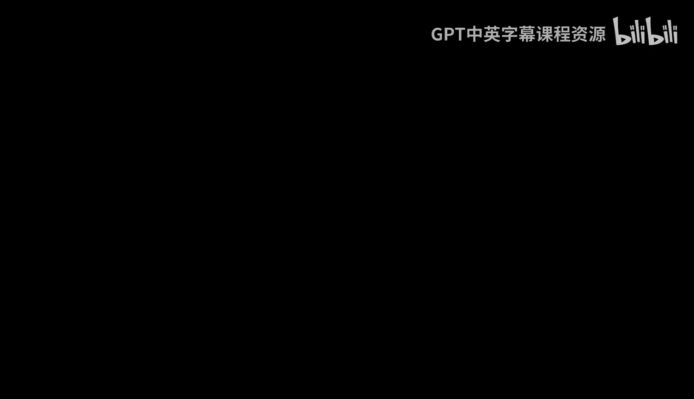
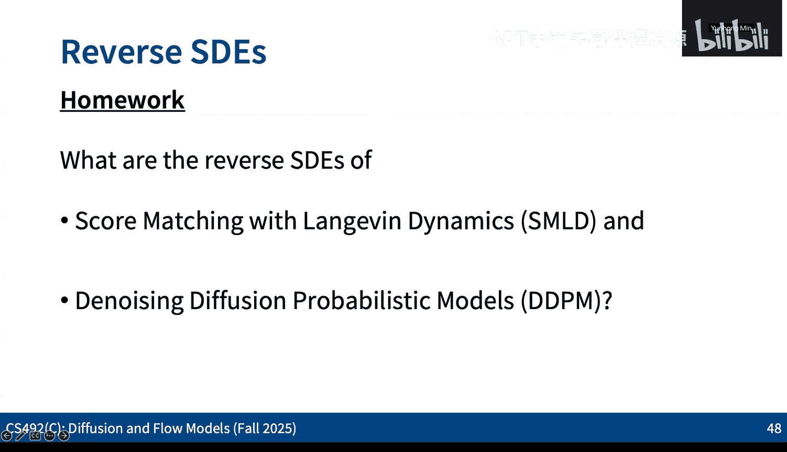

# KAIST《扩散和流模型｜CS492(C) Diffusion and Flow Models 2025》中英字幕 - P7：Lecture 08_ Diffusion Models in Continuous Time (Diffusion and Flow Models, Fall - GPT中英字幕课程资源 - BV1CKpvz1EH5

Okay let's get started。 So actually the topics that we have discussed over are kind of the basic of the division models。

 So if your goal is to basically make your own division model and also if you want to apply those like some kind of the trained division models for some applications。

 the things that we have discussed so would be kind of sufficient for many applications。

And now what we are going to do is that we are going to go deeper into the some the theory of B picture models。

And I think that this is actually kind of the key part。

 key concept in the deep models in terms of like basically having some kind of a different angle in terms of understanding deep models。

As I mentioned at the very beginning of this class。

 we are going to basically see the diffusion models from the very different angles over the time of the this class and this is kind of the time that we are switching out the gear into the you know we are basically now seeing the understanding diffusion models in the continuous time domain。

😊，For the two days topic probably， I guess the two days lecture would be assured there's not much thing that I can tell you。

 but I'm gonna show some kind of lots of des here。 So but the point would not be basically just like understanding like the des the line by line。

 I'm going to tell you introduce some kind of some high level ideas in terms of how we can basically view the division models in the context time domain。

 And based on that basically what we can do。😊，So previously。

 basically what we have seen in this class is that we have seen this kind of like some basic deform for the DP。

 right， So once we basically define the fourth， the transition distribution in this way into the Gaussian form。

 then based on that this is like the default distribution that I call as the jump distribution jumping the X T from the X U。

 this also could be defined as some kind of another the Gaussian distribution。😊。

The another form of the division model that we very briefly have seen in the previous slide。

 which I call that as kind of the N S N， but also it's called the other name， the SMLV。

 This is another kind of the different way that we are defining the fourth the transition the distribution into this way。

 which corresponding the fourth the jump distribution。 Its kind of the other way like this。😊。

So this was basically another way of basically defining this kind of the process of the digital models。

So based on that， basically， we could see basically how we can perform the reverse process。

 which is also like perform in know like the iterative way。

 And as I also discussed in the previous the lecture。😊。

The downside of division model is that its basically taking too much time because of the duration。

So that was kind of the motivation that we started to discuss the idea of the DDIM。

 which is basically turning the stochastic de generation process of the DD PMM into the deterministic process in terms of that we can now reduce the number of the de noting steps up to the5 So that's also something that we need to basically test in your the。

First assignment。And the kind of the good thing of the advantage in terms of understanding to the models in the context time is that now were gonna also see not today。

 but until the week of the next week were gonna see how this the the number of the time steps can go down to almost the10 steps like this。

So this is kind of the core， which is called F I D。 So lower means basically the better。

 which means that the image quality and the diversity is better when this core is basically lower。

 So what we can see is that as we obviously increase the number of time Thats for the GDP PMM at the very beginning is basically nothing。

 but but as we basically goes to the 100th。 And now we can start to see some kind of some quality images。

For the DDIM even from the very beginning， these steps。

 we are basically starting at kind the better here and getting much better as we basically go to the 1000。

 but if we use some kind of the different idea。 for example， like this one。

 then what you can see is that even with the like almost like 10 to the 15 these steps we are achieving very the nice quality of the output images。

 And this is like all done without basically training some kind of the new division models。

 but just like changing the the generation the process of the di models。

 So this was very interesting point in terms of understanding the di models。😊。

So what I briefly mentioned last time is that basically in the continuous time domain。

 the default process of division model can be formulated into this type of this stochastic differential equation。

So basically， you can see that this is like one type of the differential equation in terms of that we have the X function here is the first derivative is basically also represented some kind of some function of the linear function of the the term itself。

But while we are basically having this term， which is basically kind of like injecting some sort of digital characteristic。

So you can see that if we basically visualize the process of like how this X T goes over the time。

 you can see that， no， the point here is basically map to the other the point here。

 basically with some kind of some very Jggy， some pertuing， some kind of the trajectory。

So this kind of the trajectory of the xテ can be represented into the S D so that's the also the kind of the main idea in terms of seeing the different models in the the content time domain。

AndActually， this can be basically some kind of the function of the X T。

 It does not need to be this kind of like the linear form。

 but we're gonna basically start to see some kind of the simpleer the form in terms of that we are having the linear function here。

And when you see basically this kind of the form， what we are going to call is that this term will be called that kind of de drippped the equations。

So basically like sort of like moving the mean the trajectory。 and this is the digital coefficient。

 So this is about basically the amount of this some kind of distortto that we are injecting over the time。

😊，So， and this is kind of the default process。And without creating any kind of proof。

 one of the key things in the when seeing the division models in the content time domain is that once we basically have some kind of the SDE。

 this to differential equation， basically define the full process of division models in this way。

 then we can directly find the SDE for the reverse process， which is now defined in this way。

So you can see that the formulation is kind of very similar with it before the case， right？

And this is also quite interesting point in terms of that once you basically define the S in this way。

 then we can basically find the S for the reverse process。

 which is now defined this way using the same coefficient here and also the drift here。😊。

But you can see that we are basically having another time here。

 which is basically involving this core function that we keep seeing， right。

 So this is kind of the point。So what we can typically do is that are any different models。

 So it's basically exactly the same as basically to what we have seen for the DP and the keys。

 So in the also DP keys， we first define the the default process， right。😊。

And based on that once we can assume that the noise can be basically predicted。

 these core can be predicted using this core prediction， the network。

 the reverse processes is automatically defined， right。

 So it's basically exactly the same thing in the cont the cases。Once we define the full S D。

 while basically， we assume that this core function is kind of known What kind of like the the precate。

 Then we can directly perform the S， the reverse process with this SD as well。

So this is exactly think。So here the thing is that。 So basically。

 how we are going to define these two terms。 when So this is the main equation。

 how we are going to define the the drift term and also the decrease the equation term。

 And what's the meaning of like these termss。So these three things are basically the main things that we are going to discuss today。

So let's go。 first go with the the last sum here。 So basically， this is kind of the the。

In terms of that we are injecting some kind of theto atistic。

 So this term is basically typically the as kind of the renal process or the the brown on the motion。

 So which is basically some kind of the real barrier， some kind of the the function。

 which has some kind of some following the characteristics。

So basically this is the function which is starting with the zero， right。

 So every time basically the time is0 is starting from the zero。

 So you basically almost show that the probability like starting from0 is basically the one。

 So that's kind of the mathematical de meaningan almost show。

And then what the meaning of the the motion is that the increment of the each of the the time step also follow some kind of the normal distribution。

So that's the second characteristics。And the third characteristic is that it' basically independent。

 which means that every increment from the previous step and also the next steps are basically independent each other。

 So this is the third characteristics。 And the last one is that also is the continuous function。

 almost surely which means that the continuity， basically the probability to put continuity basically one for old time。

So you can think that this brown motion basically the function that has those kind of default characteristics you can see that basically this function is already kind of the one single kind of the S basically some kind ofto over the time。

So here the question in this default S E formulation is that how much we are going to inject this kind of the some sort of the stock Why basically somehow like moving the the point of the X T using the drip come here。

So that's the meaning of the the process。So based on that。

 what I'm going to briefly go over is that know for each of the case of the SM LD and also the DPM。

 we are going to see what we kind of correspondinging before thatD。So from this formulation。

 can you guess what to be some kind of the corresponding the FT term here and also GT term here。你で。啊。

Once you see the， you're gonna say that actually the is not kind of the difficult here。

 but before we get into basically how we can basically the let me brieflys review some kind of background Everyone knows the right So Taylor basically nothing but we are basically approximate some kind of increment of the functions with the first and the second and the third of the kind of data。

 So that's kind of the basic idea of the。Based on that， let me ask you like quick question。

So based on the theseesis here。Given any kind of function app when the T plus delta T can be approximated in this way。

 what the kind of the first order， the approximate for this function， when the each is very small。

Do you have any answer for this？8到。Well， minus epsilon。イス。But yeah， try yourself。

 let me give you some time to work on this。诶 did everyone get something like did。明。

Let me know if one some kind ofty here。 but basically using this some kind of first order approximation for this then we we can compare this so these are some kind of basic things so。

Yeah， based on those kind of things。 what we can see is that from the fourth the transition distribution for the SM here which is defined in this way now what we do is that the same kind of the four mark of the chain that like replacing T and the T minus one into the T plus one T right So then we gonna basically see those kind of formation。

So basically， what you can see is that these are for some kind of the discrete time steps， right。

 giving some kind of the time range from the zero to the capital T。

 when you have some kind of the discrete defined finite idea time steps。

 then we're gonna have those kind of the voltage the markcopy chain。

The question is that what if we increase the number of the time test steps into the infinity， right。

 So that is basically the the case that we are finding some kind of the corresponding the the continuous deform like this。

Then in the in the case that we have some kind of the infinite number of three time steps， the。

 the con formulation will look like this， right。This is basically very straight forward。

 and from this based on the tail， the the， the first order the approximation。

 what we can see is that this can be basically approximated into this form。

 that looks like that we are resultinging into this form way shall it。

So this is kind of like the one specific form of the world S D in terms of that the deep term become zero while basically we are basically adding some kind of the more distort over the time。

So that's the kind of the word Sディ for the SMMデ。And which is quite somehow aligned with some kind of the definition of the S in terms of that we saw like the the meaning like this was basically dynamics basically the data distribution was defined as some kind of some Gausian version of the distribution So at the very So we are basically gradually increasing some kind of the variance the Gaussian point in terms of the reverse process at the very beginning we can get some kind of the rough idea for core function in and run over time。

😊，For the reverse process， this core function becomes like more the precise near each of the data point。

 right， So that is the basic idea for the annual the dynamics。

 So in the fourth process basically the idea was basically increasing the variance of theian without really moving each of the point。

 right So basically this fourth S is kind of really aligned with some kind of what we have seen for the annual the dynamics。

😊，So this is basically one specific form。Over the the fold S。But then how about theデPMディ case。

In the DDPM case， the fourth tradition distribution was defined into this rate。So in this case。

 what we kind be corresponding default S。So basically what we can see here is that what we can we can basically needs like the test is that in the SMLD case。

Xティ the mean of the this distribution was xテ minus one without having any time right so from this basically you can see that the the drift time here be kind of basically zero basically no drift here Xティ the mean of black it x minus1 right so every time basically no kind of drift here。

So that's the kind of be the idea in terms that were having the full SD without the fifth term here。

But this is kind of different， right So we can see that over time。

 we are basically moving the each of the point in terms of that this one becomes get closer to the0 right so that is also the basic idea for the DPM which means that probably the corresponding in the corresponding for SD theome would not be0 right that would some kind of the moving force that each of the point to get closer to the0 while basically adding some kind of stoistic。

So in this case， it could also start to see the corresponding the default SD。

Then what we can see is that this is the corresponding the markov chain in the discrete time domain。

 and here lets K1 the small thing that pre define the beta T in the continuous time。

 but it's multiplying this like the deelta the quantity here。

 Then we can also find the continuous deforms like this。

Then using the tailes that we have seen in the previous slide。

 then we can approximate the function like this。 and we know that be is kind of the smooth function。

 right， So we define the better in terms of that is basically not making some big difference for the consecutive the time domains So we can also appxi in this way。

 then from this actually it boils down to this very simple the form of the four And you can see that there is some kind of the moving first in terms like know moving of the point to get closer to the to the origin while basically having some kind of the。

😊，Theto data some kind of di the coefficient。 So which basically shows that we can find some kind of the corresponding default D for each of the cases。

we define the SMLD and also DP with some kind of default the distribution and also default the jump the distributions based on that。

 we can now derive some kind of the corresponding the fourth， the SE de formulation。

 which means that by solving this formulation， actually。

 we can perform the forward process in the content time domain。

And more important thing is that given this kind of the board S D E。

 now we can also directly define the the reverse S D E as well。

 So it means that the reverse process can also be performed by the solving the S D E deform。

So that's the kind of the basic idea。One also kind of a small thing is that while basically keeping some kind of proof here。

 the meaning like this formulation is that if we basically compute the covariance for each of the XT for the infinite the data point。

 actually the covariance of the inter that the data point can be computed in this way。Basically。

 the menu like this is that if at the starting point。For the data point。

 if the coance was basically the one of the identity。

 then we can see that the coance will be basically preservejuurbed as some kind of the identity。

 So that's kind of the meaning of like this formulation。

So that's the reason like why we call basically this the full S as the variance pressure being S。

So we gonna use this term for the rest of the structure in terms of this theD the restD because if the in was basically identity and this will basically keep going for the the x here because this will be cancel。

呃， ifD should be0 here。This is the typepo。So that's the kind of the case that were having the variance preserving the SDDE for the the other case。

 the thing is that for this formulation， the covariency is basically growing over time。

 So this is the case that the variance basically exploding So the fold process the fourth SD of the SMMLD is typically called the the BE SDE。

So those are some kind of topicss that you need to remember for the rest of the lectures。

So now we are basically seeing the same the SMM L D and the DM in the content time domain。

 which for the processes now defines kind of the B S E and the B PD So those who are basically the two recommendationss。

And then here， there are might be some kind of the questions。

 So these are some kind of the two specific de formss of the four SDD， right。

Then the question might be that then what be some kind of the other cases。

 Are these the only cases that we can define the divisionff models where can you basically have any random the kind of default as the S formulation for default process。

Basically， these kind of the two formulation basically， you know， bring up this kind question。

 What do you kind of the other possible cases of like defining different models， right。So， I mean。

 obviously these two are not the only case that we can define the dependent models。

So that was kind of the key idea that we are going to discuss for today。

 We are going to see some kind of the more de general form of the diffusion models。

 which is now defined in this way。So before we get into the SD E deformation。

 we are going to now see some kind of the fe of the division models that's basically is typically called the variationary division models。

 and actually， the previously two cases are basically some special cases like this form。So basically。

 the， the family of the the， the models is basically defined in this way。

 for any cases that when we are defining the default， the jumping the distribution。

 default distribution into this form。With some kind of the R function here and also the sigma D function here。

 if these， the R and the sigma function satisfies some kind of the satfi some kind of the conditions that we're going to call this as kind of one of the cases of the variation of the division models。

So you can really check out whether basically the hourly the definitions of the SMMM D so the DD PMM are really basically satisfying those kind of conditions。

😊，So here， the kind of complication is that we are basically also having some kind of the new notations here。

 We are going to， the thing is that these are also basically very new things， right。

 So we are basically following some kind of the very recent papers。

 as you can see from references here。 The problem here is that every paper uses some different notations。

 That's the problem。 So we are going to use these specific notations。😊。

The thing is that when these like the R and the sigma functions。

 So we are always first going to define the system， the signal to the noise ratio。

 So this is about the signal， right， because you basically define some kind of the mean of this distribution。

😊，The sigma come is basically def some kind of noise。

 This is basically the amount of the the some kind ofto that we are injecting every time when we sample the X。

 right。😊，So when you basically define the signal to the noise ratio as kind of like this kind of term。

 And when this， basically this term is monotonically decreasing over time。

 Then these are all the cases that can be like one of the cases of the variation of models。

 So the meaning of like the that the S and R is basically decreasing over time is that。Over time。

 we are basically adding some kind of the more noise， right， because at the end。

 basically what we want to see is that we want that the basically after like injecting all the noise in the forward process。

 the， the output of the sampling should be basically aligned with the the standard the Gaussian distribution。

 right。😊，See the purpose of the food process is to inject the noise into the all the points that we have in terms of that the finally E basically aligned with the standard the gaian distribution。

In a way that in the reverse process， we can go in the reverse。

 right we sample from the standard Gaussian distribution and basically D noise over time in terms of getting back to the data point which means that as we basically increase the time in the process。

 we need to inject more noise， that makes sense。 So in a way that we can basically make all the output final the outputs to be the samples of the standard the Gaussian D distribution。

😊，So basically thats the meaning of like basically decreasing the the the signal to the noise over the time。

 So basically， you know when you basically define the signal the functions in this way。

 then we can basically have the results like basically aligning the final output to be to the standard the distribution。

So for all the cases。 So this method kind of the one specific way were defined diion models for basically for all those kind of the cases of the evaluation diion models。

 if we can basically。😊，ああ、それで toた。So before we basically how we see how we define the fold process S D from the the this definition of the fold the distribution。

 were gonna first see kind of the opposite here。So let's say， like given the fold process S here。

 when you have some kind of the F function and the G function here。

 then the fourth the distribution here these these two terms。Basically defined in this way。

 So this is kind of the defined by definition， but you can based on this。

 what you can see is that we can go in the other way around， given the fourth distribution。

 which is defined in this way， we can also consider driving the forest。

So basically we will not get into that later。So what basically， based on this。

 what you can see is that now we are seeing some kind of the connection between the full S and default the jump the distribution。

 right， and what we have seen for the SM LD and the D PM case in the previous slide was basically seeing the connection between the default jump distribution of default the tren distribution into the this S。

 right。So now what we are going to briefly see is that basically how basically these three things are basically online each other。

So what we have seen in the previous slide is the the fold deren distribution and deriving the fold S。

 And now basically this like fourth process the default SE。

 we can also see that the fourth jump distribution is defined in this way， right。😊。

And for the DDPM and also SM case， we know these two termss the fourth the jump distribution and the the for the distribution and also the fourth the jump distribution。

So let's quickly check it out whether these are really aligned。So recall the the S and B。

 the transition distribution was defined this way。This like X T conditioned by the X U what defined defined this way。

 right？就放 this。We developed the fold SD， right？And from the port SD。

 we can now see how the fourth the jump distribution is defined this way。

So which means that these all three things are basically aligned with each other， right？So。

 let's quickly see。So you can download those slides from the selected workspace。

 so these are basically what we have screen for the SLD case。

 so this is the our default default SDE and also which was derived from this right？

And then based on this， what you can see is that if we compute the andma and the sigma de functions。

 then the the jump distribution should be defined in this， right？Mes。So let's quickly check this up。

 So given this the F and the G function， what should be the output part function here。

 And also the the thing is that。This might be confusing。

 but actually we only have these like the sigma termss here。

R this is the same the sigmatictic function that we are seeing in the definition of the variational di models。

So let's also quickly check this up。Yeah。By doing these notations can be confusing。

 but we are having the sigma and the D sigma， right。

So what I mean from the sigma is the sigma function defined in the SMLD。

 So we show basically aligned with the。The variance that we are basically having in the annual the long dynamics。

 the annual lung dynamics， we are basically increasing the we are having some kind of Gausian comb some kind of function。

 right， So we are basically gradually increasing the the variance of the de Gaussian in terms of basically some kind of the some kind of some approximation of this core function over the time。

 right。So this is the the the the the variance that we are basically know having some kind of in the the annual the long amount the dynamics。

And this sigma function is coming from the hour the definition of the。

The variation of d models that we are using here。And basically。

 the key things that we are seeing here is that while we have seen some kind of the two specific cases of defining diff models。

 now we are seeing some kind of the general form for any cases that when we can we need define the distribution into this way with this single condition then the S andR basically monotonically decreases over time。

 for any and the sigma functions defined in this way。

 Then we can say that this will be like one of the one specific case of the defining the process of models。

So that's kind of be one key thing， right？So this sounds like you can now make your own diversion of the division models that lets satisfy this。

And then the question might be that then how can you also see the possible kind of options for default S D E。

 right， So if we can derive default default S D E from this formulation。

 then basically we can also find some kind of the some memory of the fourth S D E that is basically aligned with the definition of the variation division models。

 right。The thing is that now we are first seeing some kind of the opposite first。Given the fourth S。

 how we can derive the and the sma functions， given the and also the。

 how we can define the in the sigma function and what we are going to see in the next slide the later slide given these two functions。

 how we can define the same then what can see is that we can see some kind of some of formulation that is basically sending all the data points into the standard de points。

So the thing is that while we basically had the these sigma functions coming from the different resources。

 like this is coming from the SMMLD， this is coming from the the RD definition of the deviation differential models。

What we can see is actually these sort the thing， right basically what consists that obviously the R here should be the1 in this case。

 and from the division， we can see that actually the sigma D function that defined that we define in the SMLD is basically aligned with the sigma function that we are talking about in the division division models。

😊，So that's kind of some sort of the the amount of the noise。

 the the noise that we are injecting over it。So it's kind of like straightforward in the SMMLD case。

 So we could see that from default default t distribution。

 we derived these two things from the previous the the kind of the formulations from these。

 we can also define the default the jump distribution and these two distributions were basically aligned with the OD definitions for the SMLD。

So this is kind of the clear。It might be slightly more complicated for the DDPM case。

So in the Dm case， we have seen that the trans the distribution is defined like this and the four distribution is like this。

 right？Both of them are the distribution。 So what we are going to prefer is that given the this definition。

 we also derive the fourth S E right， and from the fourth S E， now we can also derive this， right。

And the things that we are driving from the4 SD should be aligned with like this definition， right？

So we're going to brieflyly check this out。So the thing is that if we plug in all the things into the our decommation。

So from default the distribution because C the FT and the GT functions are defined like this way。

But if you just put those things into the our deform， then the R part T function becomes this。

Which is kind of like different than what we have seen in the previous side。 So R part T。

 the meaning of the R part T function if I go back to the position division model was the some kind of the coefficients for the X zero here。

 right。😊，The ex here， and which should be the same。Yeah， we第岁。Yeah， should be same with the distance。

which means that the R T function should be basically should look like the product of the one minus ability something。

But now what we are seeing based on the ourdeform is that it becomes like something very different。

 right， some kind of exponential deter。😊，But actually， it turns out that actually this。

 the alpha T function that is defined this way， is kind of be a good approximation over like this exponential deter。

😊，I'm not gonna into any details here but you go down some approximation here you can see that the distribution have seen in previous lecture of approximation formulation。

So actually it turns out that the part function which is the coefficient for the x in the4 distribution actually should be this exponential form precisely in the content domain not some kind of the product。

 So that's kind of thing。 but actually this product is kind of some kind of good approximation of the the the the the exponential function。

The other thing also might be about some kind of the sigma the function， right。

The sigma function should be basically like having this form here， basically。

 the one fact that we know is that the the skirt the sigma function should be the same with the distance。

Can you see why this is coming from the our the definition or the not definition the deviation of the fourth the jump distribution of the DP。

Can you see why these should be the same。耐啲。Because this is basically what we have seen it really fourth the distribution of the GDPP。

 right？This is corresponding to the Ipath T function。 and this is corresponding to the sigma secured。

 right。So from this relationship between these two termss。

 we can see that actually D should be the same with the1 minus the upper T square to it。Makes sense。

 This is basically what we have seen in the prison。 And from this。

 what you can see is that this should be the same with the1 minus the R T this curve。

 So this is like the only thing that we need to check out。

So I'm also going to skip some kind of details here。

 but you can also see later some details here in terms of like how we are basically deriving this form。

So， I mean， with this kind of like the old kind of the details， I'm going to skip some details。

 but what you can say is that in the VPSD case， in the DDPM case。

 the alpha T function and the sigma T functions are basically defined in this way。

So which kind of like looks slightly different with the some default the jump distribution that we have seen the previous the DDPM the lecture。

 but actually you can see that these are quite good approximation or basically what we couldn we can derive in this kind of case。

So this is the case that now we are starting from the definition of the full detection the the distribution and deriving the full S D。

 And based on that， we are now deriving the alpha function and the sigma function in a way that we can derive default full the jump distribution。

Which is kind of aligned line with the positive that we have seen in the previous lecture。But here。

 the thing is that the definition of the alpha and the sigma dysfunction function should satisfy the basically the condition。

 which is that the signal noise ratio， the SNR should be basically decreasing over time。

The question is that it is really true in this case。

Can you see that whether this SNR is decreasing over time。

 or de steppinging of the alpha in the sigma function？Maybe yeah， let's take some time。

 actually we define the ability as some kind of the non decoing function。

 If you recall your the memory about the what we have seen in in the D P lecture you can see that the ability we define the ability as some kind of the non decreasinging function。

Over time。 So this might be actually something that you are implementing in the the first assignment。

 I Yes， but it's， given that the validity is defined as kind of the nonde function and also greater0 or the greater than the0 over time。

Can you see that the SNR comes with nonde function。Makes sense。So basically。

 this term is non decreasing and also like all the positive。

 which means that the integral of like this function would be also increasing function， right？

Makes sense。These whole parts should be increasing function。

Wch means that when you take the exponential of the minuss like this increase function。

 these should be some decreasing function， right。Nextix。And since now sigma is basically1 minus d T。

 then D should be increasing function， right？So yeah。

 decreasing function over the increasing function because the decreasing function。Make sense。So。一一。

到时这。所以。I think we dont need Yeah， it should be the this one。

 it should be or basically the the the positive some kind of debate。Makes sense。So， yeah。

While we basically define the DDPM without any noise about basically any kind of things about the variation of diffus models and also the concept of the signal node the ratio。

 naturally， our de of the DDPM is basically satisfying this condition。

 the signals SNR is very equation over time。So we can see that DPM becomes like one of these some specialty key of the distribution models。

😊，So yeah that's the thing。So what we have seen in the previous slide is that given the default SDE。

 we could derive the forward distributions like this。Actually， we want to do the opposite， right？

Given any kind of the hour definition of default food distribution。

 what would be corresponding the food process DS SD。So this is the main increase。嗯。嗯。都系。

If there is no typo here， then everyone should get this。Anwer right。リで分けです。停机。

If you didn't get this sensor， check this out later and see how you can also direct please。Yeah。

 so that's quite looking。So kind of the summary here is that， you know。

 while we basically have seen lots of some kind of deformulations。

 what I wanted to deliver for today is that how we can basically connect the board。

 the tient distribution and also the the jumping distribution and how it also connected to the SDE deformulation。

How we can go back at first between these two。So basically。

 all the full the division the process can be described into the S theform in the contest time domain。

 and for this specifically for the S S N L D and the D and the case based on the full detection distribution。

 we could see how we can also derive the full S， right。And also， the thing is that。

The four SDE could be basically derived from the definition of the fold distribution and the other way around。

 So this kind of conversion can be done in both ways。 And from this definition of the S。

 we also could see we started the system kind of with some general diversion of the division models for all the cases like when you define the and the signal functions in a way that the SNR is equation over time that will be all the cases that we are defining division models。

 mapping all the data points into the standard deussian distribution and for those kind of cases now we can define the S which also the most important part here is that given the S。

 we can always basically find the reverse the S deform we can immediately basically the derived the reverse the deform from the S the meaning of like these that given the S formulation now we can do the sampling。

Process with some kind ofデ discreteタ the time step。So actually。

 what you can see in the the kind of the the other way to basically see the DDP and the reverse the dis sampling process basically is to basically seeing that it's kind of the discreteation of like this S D de formulation。

So basically the meaning like this is that we can decreaseize thisD into this way in with some kind of the some finite number of the time steps and the meaning of like this formulation basically becomes that is exactly the thing like what we are doing in the DPM case。

 Every time when basically predict score， So when we have some kind of noise predictor。

 we could see that how we can compute the score from the noise predictor， right。

 And then every time we are basically competing X T minus thatta T in the discrete time step which is basically completed in this way。

 So one thing that would be quite interesting to see is that how this formulation is exactly aligned with the reverse process of the DP。

😊，So there can be some kind of be some。30 D math， but you can try yourself how this process this competition exactly aligned with some kind of the reverse process of DPM that we have seen in the previous DD lecture。

😊，So this like all the connecting in this way So even when basically modelsィ some kind of time aligned reverse function function。

😊，So this is basically the different angle of like seeing the division models from the perspective of the content time domain。

Mixes。So I strongly recommend trying this yourself。Basically reinment D PMM in。

 So we the our the basically de of the F and the G function of the DDP。

 we can really just try to compute the reverse process in this way。

 Then we realize actually this becomes exactly the same with the reverse process of the DP。😊。

Make this kind of the interesting point。Actually， so this kind of be one thing。

The more important thing that we're going start to discuss the next time is that。

Without any kind of like the proof here， the thing is that for any kind of some SD deform。

 which is making this kind of trajectory for the ST。

Here the question is that can we find any kind of the ODE formulation。

 the ordinary differential equation without the brown and motion。

 without the renal process in terms of that after the mapping from this point to the other points here。

 the marginal distribution of like those points become the same？

So basically all the like SD formulation is all about the mapping right so given the samples from the given the data distribution。

 what we want to do from the default process is that all the samples are basically mapped to be one of the points of the standard de Gausian distribution。

And the reverse process basically also developing mappinging the other way around， right。

 through this kind of the S and adding some kind of theto。😊。

And the question is that would there be some kind of the O D formulation without this we is basically having some kind of the same mapping。

 So not exactly mapping this to the same point but basically kind of like mapping the whole distribution here into the same distribution here。

😊，That's what you want to do， right basically the purpose of having the S D formulation is basically to map the data distribution into our latent distribution and the other way around。

 right， So given the S， would it be possible to find some kind of the any some O D formulation without like0 the brown terms in terms of like having some kind of the same mapping of the like data distribution to the the latent distribution。

😊，The answer is that surprisingly， the correspondinging the ODE formulation is basically defined in this way without any proof you。

So you can see that actually deform even is quite similar， right？😊。

Especial for the reverse process when the SD is like defined this way with the deep term the app here and there's a deep equation the G time here。

 You can see that this O formulation just having the one of two here without the。

The winner the process here becomes the correspondinging the O D E formulation。

 which is basically the case that now we are basically having those kind of some。J。

 some kind of trajectory but having the much smoother the trajectory without kind of any kind of random noise。

 but also it basically not mapping the point the same point but the mapping the entire distribution to the same delete distribution。

Then what kind of the interesting point of having the OD formulation？

So in the previous flight given the S D formulation we could see basically how we can solve this kind of S D with some kind of the the time domain deization right basically having some kind of x T over the time。

We can do the same thing。For the audio information。

It's exactly the same type of the oiluler deretization that we are also predicting this score every time and also updating the XT through the same information。

 but without the Gaussian noise is injected here， right？

So this also can be done in the same way in the ODA formation。

The thing is that for the O D E formulation。D C specific subject that has been studied like more than。

I guess like hundred years， right。 So there are lots of some kind of the numerical methods that we can solve the audio formulation in a much faster way。

😊，Without having lots of the time steps。So the good thing of like having the the corresponding the O D E formulation is that once we have the reverse S and converting this into the corresponding the property flow。

 the O D， the PO D here， now we can use some kind of the O D E server to perform the reverse process。

So that's kind of the key idea in terms of like how we can basically or achieve some kind of the much faster speed。

So this is the first slide I this lecture。 with DDIN， we are seeing this kind of trend。

 What do you want to do is what they having this right。

 even with some kind of very few that we already get some kind of the very really good results right So we are achieving this kind of speed up by basically converting the S and finding the OD corresponding to each of the reverse SD and using some kind of the fast serverber for the OD。

😊，And this can be done for the O D because for the S D formulation because of the the to， basically。

 we need some kind of the loss of the the time steps to get some kind of the accurate the approximation of like this formulation because of like this。

But when， when we do not have like this term， there are lots of some kind of the techniques that we can solve theform much faster。

 So that's the basic idea in terms of like how we can make some kind of the fast absorb for the pre models。

😊，Makes sense。So， in the summary。So each of the diffusion process。

 the SE has some kind of correspondinging the ODE， which basically matches the same the marginal distribution。

So what this means that the reverse process now can be done by solving not DSSD。

 but the corresponding DOD using some kind of any relatively defectest disorders。

So this is really important idea。 Again， this is also the case that we are achieving all those kind of things without like retraining digital models。

For any kind of the pretrained differential models。

 now we are going to see the same the generation process。 It's called solving the S D， actually。

 even not solving the S D， actually solving the O D we the same pretrain models just like changing the perspective of the de generation the process and basically introducing by by introducing some kind of the faster the O D disorder we gonna to achieve some kind of acceleration in the generation the process。

😊，So that's the be idea。 and we're going to get into deeper into that in terms of how we can find some kind of the effects。

 the OD server specifically for this type of videoD formulation。

So before we wrap up the2 this detector， we have seen like the food SD formulations for the SMMLD and the DDPM。

 right？And also for the generally the case of the SD。

 we also could see how we can also derive the reverse S D for all the cases。

 which means that now we can really derive the reverse SD。For each of these two cases。

Try to drive the reverse SDD yourself this feature for the DDPM case once you derive the reverse SDD formulation with the time domain discreteization that I have shown in the previous slide。

 you can reimment the reverse process of the DDPM based on the reverse SD。

So I also strongly recommend try this yourself this is not the part of the assignment。

 the but reason we are providing some kind of the base quote for the division model is that you can play those kind of things yourself。

So what you are going to see over the second and the third assignment is that from the same base code。

 for the same data set， every time when you change some kind of generation process。

 how you can basically get some kind of the almost the same the outputs。

 but we somewhat figure the step of the computation。😊。

That would be a quite interesting point in terms of understanding the division process like all the meanss years。

Any questions？Okay， so as I mentioned， we are not going to have the lecture this Wednesday。

 but we are going to。

