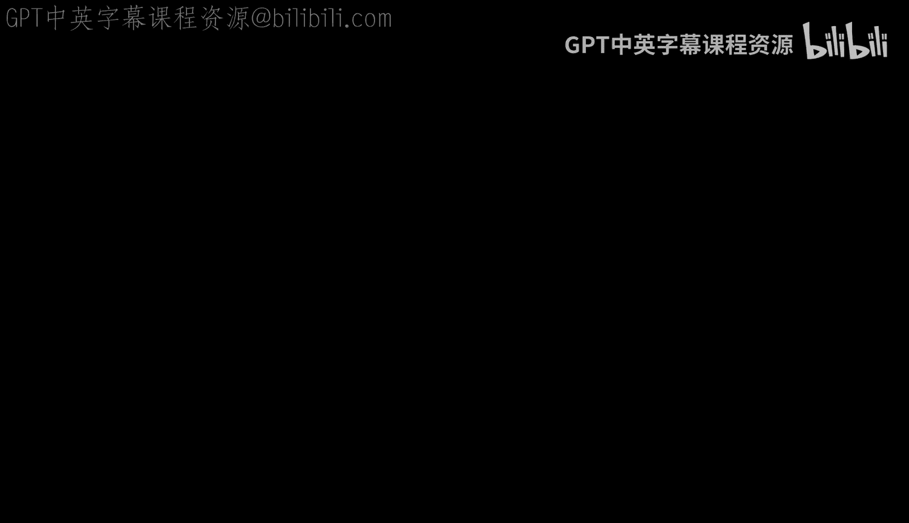
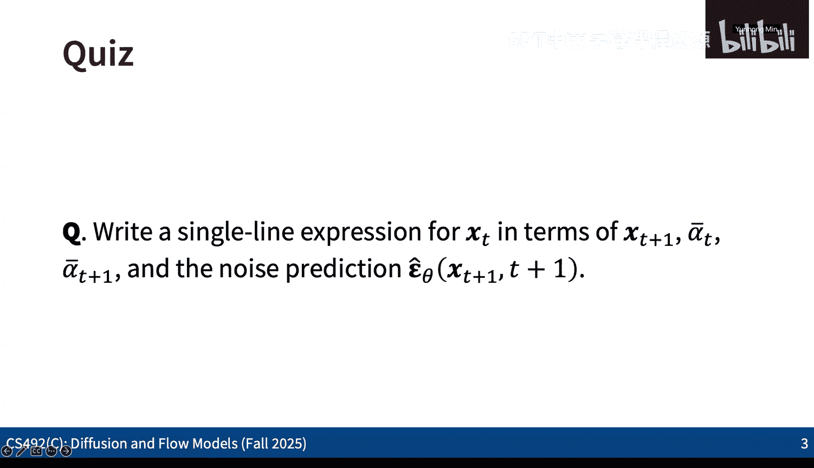
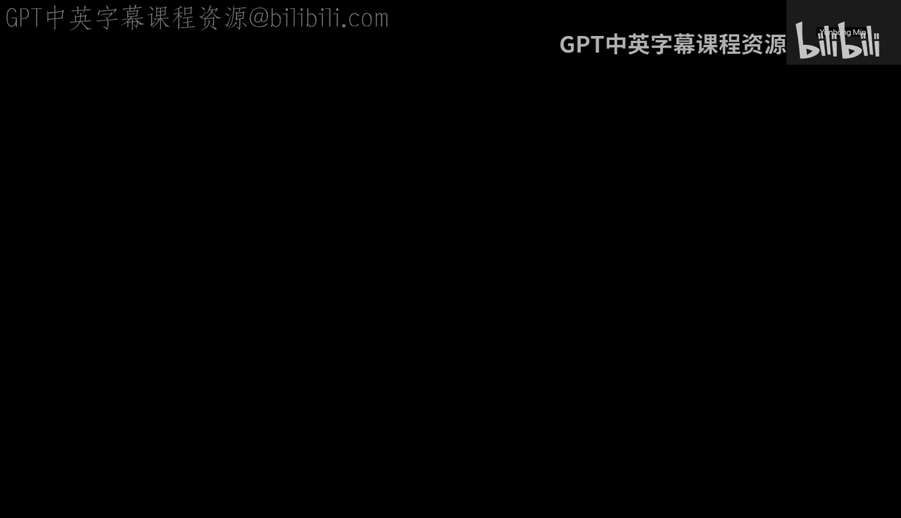
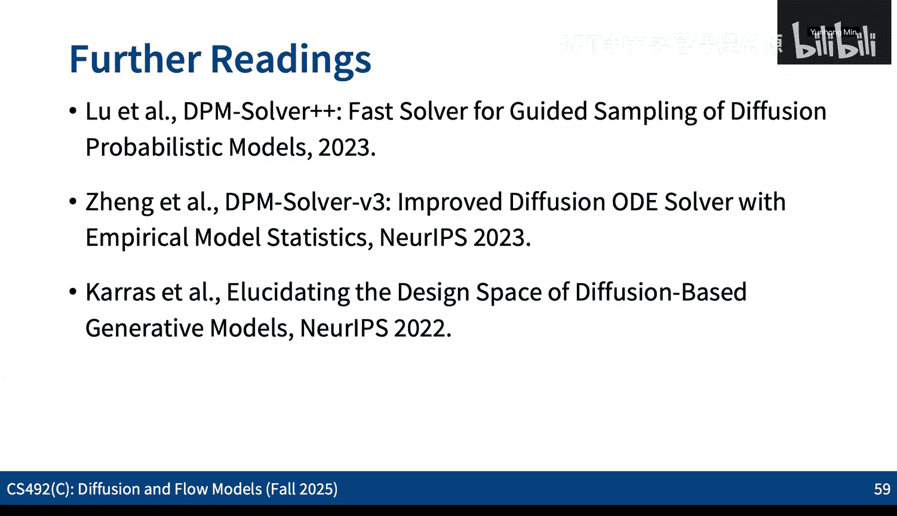

# KAIST《扩散和流模型｜CS492(C) Diffusion and Flow Models 2025》中英字幕 - P8：Lecture 09_ ODE Solvers (Diffusion and Flow Models, Fall 2025, KAIST).zh_en - GPT中英字幕课程资源 - BV1CKpvz1EH5

So welcome back to diff and flow models。 So since it's been a while。

 I'm going to hopefully basically review what we have these cost so far。

 and also the two days lecture will be kind of dense in terms of that we are going to see lots of the formulations But the purpose that I'm showing the all the formulations here。

 is not to just explain the all the formulations is the line by line。

 but more about basically to explain how the things we have discussed in this class are basically all the connected each other。

 So that's kind of the main parts of the today days lecture。😊。

And especially we are going to discuss how the DDIM dis samplingling that we discussed last time is also kind of connected with some kind of content time deformation。

 So so speaking to that， let's basically remind what we have discussed cost before regarding the DDM the deterministic process So what we have seen last time is that we could basically use some the pretrainren model。

 which was basically use for the DDP dis samplingling to make it kind of the D DD and the deterterministic de sampling by changing the formulation like this and based on that we could basically have those kind of three steps in terms like sampling the next one the next the noise sample the Xt minus1 given the Xt here So you should be basically familiar with deform at this point。

 So regarding thisform like let me start with this quiz So yeah so this is the case we can make it this kind of zero。

きディミューして。So based on this， now， what we can do is that。We can write the single line， expression。何すいて。

Of the X T actually the X T in terms of the x T plus one。

 right and also the noise prediction of the from the X T plus one so let's first try to write the expression of the X T in terms of the X T plus one and all the kind of the good and also the noise term here。

啊。We gonna。See this again at the end of like this lecture。

Yeah。

Have you should now get this answer， right。So the thing is that yeah。

 this is legally just like one line of thecode So every time one you just need to do is that I guess you already implement this in the first assignment。

 right， you could actually implement each of the the update step the DI and dis samplingling with the single line right just taking the previous demo noise sample if we just compute all the things while involving the noise prediction here then we can directly compute the activity here right。

So we're going to see this formulation again in the today lecture。

And so we are basically seeing some kind of the sort of more the general diversion of the models we started our discussion from the DDPN and DDIM kind of sort of the the more the general diversion of the division models。

 and then even we are started to see the same model in the continuous time domain。

So in the content time domain， the same the division models could be represented expressed as kind of the stochically differential equation with the default S defined in this way by just defining this like F function here and also the D G function here the the drift term and also the division the coefficient system and the interesting thing was that given the hour the definition of the SE the corresponding the reverse SD was could be derived into this form。

While basically involving some kind of disc score comes here。 So thats what kind of thing。

 Once we define the fourth S， then we can also directly define the reverse into the this formulation。

So this was kind of the key fact that we discussed last time。

And since this core can be now computed with our the Epson predictor， the noise predictor here。

 when you plug this in into the Lib SDD de formulation。

 then now we can see that the LibD SDD can be rewritten into this formulation。

So which means that now we pre just like define our own the F function and the G function here and the then the reverse process becomes solving this like S the A de formulation。

So these are also things that we have discussed last time。

And we basically have discussed some kind of specific dience of division models last time the D PM and also the and kind of the cases So those are some kind of some special cases of general models So general models typically the variation models or models for those kind of cases we could also define models by defining our own function here and also the function here So this is kind of another way that we can define models like basically sampling X noise data given data point here。

😊，So in this case， the only kind of constraint that we had for the definition of the alpha function and the sigma function here is that we just need to basically define these two functions in a way that the signal to the noise ratio。

 the ratio between the aine the sigma becomes like monotonically decreases over time。

 So the meaning basically having this SNR to be decreasing over time is that we are basically gradually adding the noise into given the noise data point in a way that at the end。

 it becomes one of the samples of the standard the and the distribution。

So this basically means that if we can define any of some kind of the alpha and the sma functions。

 basically satisfying the this condition。 So that can be basically another diversion of the diff models。

 So we discuss some kind of some special diversions of like the alpha and the sma functions。

 but actually it does need to be that specific form。

 You can define any forms of the alpha and the sma functions。😊，And also。

 the meaning of like basically defining the fold the diffion distribution into these way is that basically we can do the sampling of the X T into this view。

 So when you basically remember this formulation。 what you can do is that disseling the X T can be basically consider that sampling the annual the clean data point X0 and also the standard demer dis sample D here。

And just taking the sort of the linear de between these two right。

 So this is exactly the online with some kind of the hour data definition of the for。

 the the jump distribution， right， So when you define the for。

 the jump distribution into the this Gausian deform dis samplingmbling the X T here。

Basically it becomes that we are taking any of the X here and then taking the standard gaus in the sample and then basically multiing those kind of coefficients and taking some kind of sum of them right。

So please remember this， we are going to see this in the next lecture as well。

So given this kind of the general form of the diffion model with the full distribution。

 So what we have seen last time is that we can go like the back and first in terms of that given our the definition of the to process the S defining the F function the function。

 the question last time is that how we can also derive the corresponding distribution defined with the Al the sma function。

 So given the app and the function， now we could also derive this like Al the sma function in this way。

 basically defining theffusion models either into the form of the S or into the form of the full distribution like this。

Or we could do the other way around we But based on the definition in the previous this slide。

 given the full decision basically defined with the Al sigma function。 Now。

 we also could derive the F and the give function into this way。

 So those are basically formulations that we have seen last time。😊。

But please also keep this in mind in terms of that given the F and the G function。

 we can also derive the these two and we can go also the other way around。

 Given the four description， we can also derive the port D as well。So how exactly this。

 like the full distribution and also the default SE are defined for the special cases that we have seen last time。

😊，So for the SM M LD case for this correlated description for those kind of cases。

 But you can see is that when you take the sma function as our kind of de parameter function。

 then the full description was defined with this the the function。

 So this is kind of the given function， the usual defined function， right。

 And we just set the alpha function to be one this was the case。

 and given this alpha and the sma function， we could also see that and the function are like defined in this way。

😊，And for the GDPP case that usually already implemented in the assignment1。

 when the be function is kind of our the prompt function。

 then we could see that the R the signal function defined the full distribution now can be defined in this way and also the full S actually becomes quite simple form in terms of the function becomes like the minus the half of the function and the G function becomes of the function。

 So these could be all the right based on the the connection between the full distribution and the S we have seen in these two slide。

And as I said， like these are some kind of the two special cases of like defining the specific the form of the the probability model。

 and actually there are more many， many more。 So they are not going this because all those kind of cases you can see that there are like the PM plus like something like something there are many other other cases if you are also interested in some kind of more options。

 You can check out this kind these paper。😊，And the thing is that one thing that is very confusing last time was that。

 as I said， theres no textbook for this topic。 So for many of the formulations here。

 I'm just following the formulations in some of the recent papers。

 The problem is that all the papers are basically using not using basically the consistent notations。

 which means that there are these kind of the cases， like the。

 basically we have the introduced the DM the lecture。

 are basically different with the R that we are basically using in the PD and the variation of the model。

 the de formulation。 So those are some kind of the confusions， So I'm going to clarify here。😊。

So those are some kind of the definitions that we have seen for the DPM case。 Do you remember。

 So we had that once we define the better function based on that， we define the iPad head here。

 basically this all the output that we have seen the DDP and the slides are not related to the the function that we are seeing in the variation divisionff models。

 So we will need to clearly see how these are basically they connected each other。

So the thing is that。In the DDPM， the fourth the jump distribution was defined into this way， right？

But in the our the the definition of the variationary division model。

 this should be the alpha the function in the variation of the di models， right。

And these should be sigma。 The sigma is in the of different models。So which means that actually。

 the alpha that we have seen the D formulation has this connection。

 the secure root of the alpha bar here becomes the alpha function in the pre of the formulation and also secure root to the1 minus the alpha bar is basically the same with sigma function。

 So don't get confused with this kind of very confusing the notations。

 So this is kind of the problems with the notations that we are using。😊，But basically， yeah。

 we are now going to switch the hour discussion into the more into the general diversion。

 the variation of division models， which means that we are now switching all the kind of thenotations into this。

 Basically introducing like those basically the new variables here。😊。

So based on those kind of the mapping from the variables that we have seen the DDPM case with the of division models。

 now what we can see is that we can basically readw write are all the things that we have seen in the previous lectures。

 the DDP and， DDI in the case， which for the DDI and the deterministic reverse process。

 Now the formulation of the X T can be seen as basically the Rpa and the sigma functions。

 those are find theigma are basically not the things that we have seen the DDPM case。

 but coming from the B the of division model the parameters here。

 So based on those parameters in the of division models now we can see the X T can be basically written into this formulation。

Nothing but just like changing variables here， right？And also for the reverse SD。

 we can also basically revise some part of the deform in terms of basically the alphap and the sympathetictic functions that we are using the V deforms。

So those are some kind of be。Remarks， so please keep these formulations in mind。

 we're going get back to those formulations。 So this is basically nothing but basically we are seeing the same the DDI and the sampling and also the same the reverse process。

 the S based on the variables that we have seen we have basically used to define the the general form of the division models the di the probability models。

So we are going to keep using the Rp and the sigma functions in here。Okay。Please click。

 So please keep this in mind。And one more basically very confusing thing might be is that I'm just going to introduce like one more variable the lambda function here。

 So that's basically making even more the confusion here， but we gonna get back to this。

 like why we are basically introducing this kind of the new variable here。

 So basically the meaning of this like this like lambda the function is basically nothing but the half of the log of the SNR。

 So this when we have the here， this the SNR， right。

 So we can see that this lambda function is the half of the log of the the SNR。

 So when you introduce the lambda function here， then we can also rewrite some part of the formulation。

 basically the G the secured function can be also written into the form of the lambda function。😊。

So this means that when you introduce the Lada function here。

 then we can see the basically converting from the full distribution into the full SD into this formulation becomes basically simpler like this。

 right。The G function can be basically simplified into this way。So those are some kind of the。

Bagic things to discuss to this topic。 So if I just like remind these things that we discussed last time some of the key facts is that basically the fourth the division process can be described into the using the S D in the content time domain。

 So which means that now we can define a SD for the fourth the division the process。

 And then the thing is that we can also derive the correspondinging the S D for the reverse process based on the the process deform。

So those are kind of the some key facts in the content time des。

And also the thing is that we start to see some kind of some more degen version of the di models。

 which we call the variation of diff models， or sometimes it would called the di the pro models and the two the cases。

 the SMMLD and the DDPM or basically the specialty cases of like these kind of de general form right。

So this kind of key effect。 And also the other the key effect was that the full S D E can be basically derived from some kind of the hour the the definition of the full distribution and also the other way can be also done the conversion that we have seen in the previous slide。

So are these clear？So those are some kind of like。Some key connections between the fourth the the content time deform and the discrete time deform。

And also the more important thing is that for the division， the model， the DS SDDE， de formulation。

 we can always find some kind of the correspondinging the ODE formulation。

 which basically matches the same the marginal distribution。

So which means that we also have seen the DDIM case， which is kind of the generalization of the DDPM。

 So when we also could see that how we can convert the reverse process of the model into the deterministic dis sampling。

 right。So actually， this kind of the S E due to the O D E the conversion is kind of like changing the stochastic sampling of the S D into the deterministic sampling using the O D。

 So in the S formulation， we are basically indexjecting some kind of the noise every time。

 right some stoistic in the O D the formulation， there is no some kind of the some random noise。

Which means that we can make the reverse process to be determin which when we start from the kind of the same starting point。

 we're gonna always go to the same end point， so that's kind of something kind of the similar connection that we have seen from the DDP and the DDM case we can basically convert the SE into the correspondinging the OD in terms of that we can do the same kind of dis sampling without basically involving any kind of schistic in the sampling the process。

So which means that when you see the diversity division in the process。

 actually we can conduct all those kinds of degeneity process by solving the ODE formulation。

So that's kind of the key idea in diffussion models。So this was also the formation that we have seen。

 so this kind of corresponding the OD is what typically called the property flow the O D。

So this is the the S formation that we have seen for the university process。

 and then the corresponding the P O D E， they basically matching the same the the marginal distribution is basically expressed into this way。

 Also having some very similar forms， right， The only difference is that now we are having the no。

 one number two here。And not having some kind of the and also， yeah。

 not having the the the node some here。I think this should not be skilled here。

So it'ss some kind of the the type。嗯。Yes， and also we have seen that the liver says D can be basically written into the the image prediction term here。

 and also the same thing also can be applied into the PO D here， right。So given this。

 basically what we can see is that for the our the definition of the alpha and the sigma function here。

 once we define the alpha function and the sigma functions in in the form distribution of division models。

 it we plug in those kind of the app function they key function into the PFOD。

 then now it becomes that the reverse process becomes like solving this formulation。

 given the our the definition of the R and the sigma the functions。

So now we can consider all those kind of data generation process。

 especially solving the ODE formulation。Soso the OD promotion basically means that every time。

 like given the X T， now， what we can do is that we can compute the first the of the X T。

Which means that we have some kind of the way to basically compute the velocity in the field。

So given any kind of the the point in the space， given the information of the X T and also the noise predictor。

 what they can do is that we can predict the velocity into this。

We are having some kind of the information the velocity field。

 But the the thing is that this velocity competition involves some kind of the neural network prediction。

 Right， So every time we just need to basically run the， the， the， the fit for the the。

 the process of the neural network， right。But given this kind of diversity field。

 what we just need to do is that from the starting point。

Wch is the sample from the standard the oceanus and the distribution。

 we just need to find the trajectory over the space in terms of the where this point goes at the end of the all the kind of the time domain。

 right？And the kind of the one of the live way to obviously compute its kind of trajectory might be that we are basically moving。

Very small step every case， right， So every basically the point what we just need is that we just compute velocity。

 And that's why assuming this kind of some sort of theity of the velocity。

 we just like move a little bit into this and just compute velocity again and just moving a little bit right。

 with some kind of a very small steps。 So this is the most the dive way。

 which is called the oil of the method in terms of solving the O D the formulations。

So this is kind of similar to what you have done in the di deliver process， right？

Well the key thing that we are discussing here is that we want to compute these kind of trajectories with some kind of the fear number of these steps and also the challenges that we are basically doing for the image generation is basically how we are going to keep some kind of the good the image outputs with the fewer number of the steps。

 right。So this kind of things。 which means that by just competing the velocity just for the very few steps。

 how we are also going to compute some kind of those kind of trajectory， like more the accurate ways。

So that's kind of the key idea here。So that's also kind of the key idea in terms of that how we are going to basically accelerate the reverse process of theion models。

And for that， actually， without seeing the OD deform that we are having。

 actually there are quite many the techniques that I guess some of you might be familiar your way to like those kind of things。

 So if you took the OD basically the course in the math department。

 then you might confirm with those kind of some kind of the techniques。

 So those are basically the OD techniques in terms of then how we can basically compute those kind of the trajectories we develop the field。

 we develop the number of steps。😊，But these are some kind of some more the。

 the general method without basically leveraging any any kind of the characteristics of the formations。

And the things that we are going to discuss for today is basically how we are going to basically understand some kind of the the specific characteristics of this specific the OD formulation and make some kind of the more efficient disorderer for this OD formulation or this specific OD formulation。

 not for some kind of the general OD formulation in terms of that we can basically solve this OD E with the few number of steps in a more effective way。

😊，So that's kind of the making。So please keep this in mind so this is the audio information that we are going to solve。

 right？So you can see that this O D E formulation has some kind of structure in terms of that actually。

 this form of the OD formulation is called the semi linear。 the first order。

 the O D E in terms of that this looks like some kind of the linear formulation。

 right So basicallys we have the X T here。 and some kind of the coefficient function here。

 So it looks like some linear function， right， So linear basically does not mean that this function is kind of linear right。

 I mean， so we see kind of like the whole function is linear the X T here， right。

 So were having the X T some kind of linear function。 but this is actually not linear。

 this is called the semi linear in terms of that we are having the nonlinear come here， right。

If we did not have like this part， then this would be perfect linear function rate。

 But since we have this like the prediction。 this is neural network。

 obviously this would not be basically the linear function right this having some kind of linearity into the。

 So this is kind of like， know， combining some kind of linear parts and some kind of non nonlinear part here。

 So in terms of the this is called some kind of semi linear O deform。

And we are going to see how we are going to how we can there some kind of some some dedicated disorder for those specific form of the O D formulations in terms of that we can best solve this O D in a like more effective way。

But before we get into that， just in case that you are not with the OD。

 I you like to go with some kind of some more， some kind of the basic things with the OD。

So as I said， this is kind of the form of the O D that we are solving。 Not exactly this。

 because we are also having the X T as kind of the input the parameters of the Q functions here。

 right， But let's start with some kind of the this， like even simpler form。😊。

Exactly the linear formulation， right， So as I said。

 the linear in terms of that this kind of the function that we are going to obtain， right。

 and given this function， this whole formulation is kind of like this formulation it is linear。

 and this is the first order derivative， right。😊，So let's think about this simple deformation and even simpler one。

 Let's assume that this Q T to is liquid zero。 So we some completely linear function here。

 and let's also assume that easier case that the X T is basically always like non negative。

s always the positive in this specific case。Then for this kind of the very simple the form or the O D E formulation。

 how we can find the function that satisfies this equation。Yes but。Yes。

 we are going to take some kind of explanation function with the X T。

 but if we get some into some of the details here。😊。

あレスス assume thatのデ xクティだなすは basically forオルテ then we canベスデ一 side byてオのて basicallyデidingバデ xクティー here。

Then you can see that this left hand side can be simplified into the other way， right？没 you see。

So we are having the1 over the Xt times the first a of the Xt。

And then this left side can be basically simplified into the derivative of the natural lo of the activityiver。

So if you basically take the derivative the log of the x T that we get basically this。

 So in terms of that we can see that by dividing both side with the x by the x T we can see that the left side actually becomes the derivative of the the log of the x。

Then what it can do is that we can simply just take the integral for the both sides and take the exponential template。

 Then you're going say that actually the X T becomes those kind of the exponential the function with respect to the the P function here。

Make sense。可以。So yeah， I just like went all the things like quite best。 But let's see。

 let's try yourself。 So when you have like this simple form of the O D1 over two with the X with some kind of the initial condition that the X is basically1。

 So since this is the case that we only defined kind of the velocity field。

 we also need to have some kind of the starting point， right。

 So let's let's set that the starting point is kind of the when the X when the time is0。

 let's say the x function becomes the one。 So given this initial condition if we the X T whats the X。

😊，Can you try yourself。你就我嘅啲。It becomes like very simple。

 It's basically exponential of the minus1 over two times X T， right， So yeah。

 for those kind of the simple form now， we can see how we can find this solution for the O D， right。

So we are basically getting into some kind of more the complexity decay， so we have seen this。

 let's go into the general decay and let's go even more general case。😊，The semi linear deform。

 So this is exactly deform that we are basically tackling in the PF O D E case。

 So this is kind of the non nonlinear term。 We are having some kind of linear function here， right。

So given this kind of formulation， how we can have some kind of the a the solution for this like the ODE。

 right So that's that's the main purpose like this discussion。

 why we can use some kind of some numerical make the method easiest is kind of the way to taking some numerical make method is the order the method right。

 just like moving know it's very small step every time right but now what we are going to do is that we are going to try our best in terms of like deriving the ana deforms in terms of that we can basically achieve some kind of the better results with the fewer normal steps。

For these like semi linear deforms， what we are going to do is that we are going to leverage this fact。

 that this is basically the solution of this like simple form that we have seen in the paper slide。

So here to derive the anarctic formulations for this like the general decay case。

What we are going to do is that we are going to use some kind of the very well known。

 some kind of clever technique， W， which is called the exponential the integrator。

 So this is the formulation that we are going to solve， right。😊，To solve this。

 what we are going to do is that I'm going to just briefly introduce this kind of the new function。

 which is called the integrating vector， which is basically the function that basically become the solution of like this for the information。

Don't ask me why we introduce this function for now， because we're going get the reason very soon。

 So let's first define this like the new function that becomes basically the solution or like this O D E formulation。

In the previous slide， we have seen that the solution of like disform becomes the distant， right。

 So we're having some kind of exponential dysfunction here， right。😊。

So the region like why we are is clearly introducing this like integrating factor is that once we define this like the meal function。

Let's specifically simply multiply the both sizes by this integrating vector。

I the mutum here the mut here the mut here， and based on the product rule of the differentiation that we know here。

 then now we can see how this like left hand side can be also simplified。

Can you guess like how this left hand side can be simplified in this case？

So remember that the new function is basically the solution like this O D。

The derivative of the function becomes like this。And based on this product rule。

How we can simplify this left hand side。In see that this left hand side。

 the whole left hand side becomes like derivative like some function， right？

So we can see that actually the whole left hand side can be now simplified into the derivative of the。

Product to like these two functions， right， because you the derivative the new function was by definition that we define that becomes the this time。

And this is the data to the X T。 And from the pro rules。

 then you can see that the left hand side simplified into this way。

 So that's why we are introducing the mu function to simplify the formulation into this way。😊。

Then the rest of thing is kind of more like the straightforward。 That is exactly the same thing。

 We're just taking the integral for the both sides。 And also then we are， when you say that actually。

 the mu function is basically non negative。 So even a positive。

 then we can also divide all the things into by the U T。😊。

So you can see that you can also easily derive some kind of the atic。

 the solution for the semi linear， the first of the semi linear， the O E formulation。

 So we are going to basically leverage this fact in terms of basically into this。

 some kind of the more efficient the O absorbber for the pit or the E formulation。

So the only remaining thing is that we just need to plug in this our the definition of the mu function here。

 right？Then it becomes like quite complicated like this like having all the kind of explanation terms。

 The good thing is that it can simplify this further in terms of that they are basically showing the same base of the integral here。

 So by just simplifying all the things， now we can see that this becomes basically our the analytical formulation of the semi linear or the O E。

😊，So given some kind of the starting the point of the S here。

 so DC C is kind of the in the point right so this will be some kind of the some in value the starting point starting from the S right so DC is kind of be given information given this kind of the X S basically we can now compute the X T by computing those kind of the integral here。

Makes sense。So while basically was kind of complicated。

 like what we also do is that given the kind of the exponential of the integrator that we have seen period of this slide。

 now we can basically just derive some kind of the alytic form of the any of the first order。

 the semi linear， the OD the formulations。はい。So keep this in mind might be kind of complicated。

 So if we do one thing more， then let's also see some kind of the more the complex case。

 So now we have the this is still kind of the constant with respect to the Xt right。

 but when you have some kind of like offset time here and be some kind of same the in condition can you also derive the X T it is find this only。

フデス。Is the same with what you get。I just like plug in all the things into the simulation that we have seen and these are canceled out and we can say that actually the activity becomes like this simple right？

So in this like amount time youが some kind of the page I in terms of the how we can or some kind of atic solutions for some simple theオデ for。

So here， basically， the key thing is that not in the kind of the sort of the mass perspective。

 but in the some computer science perspective， what we can basically do is that whatever the O that we have we can basically use some kind of some numerical the approaches。

 We don't hear like what sort of the formation that we have the simplest kind of way， as I said。

 is that basically every time we while basically some kind of linearity。

 we just like move move a little bit and just like go there and just compute velocity gate and just move a little again So that can be kind of the simplest way that we can basically compute the trajectory。

 right， The thing is that if we want to basically compute the trajectory。

 like know like more accurate way， we will need lots of these steps。

 as we also have some kind of the really complex and kind of the the trajectory as the trajectory is basically not treat。

😊，The thing is that if all the trajectories are basically straight。Then how many steps do you need？

We just need one step， right？From the very starting the point to the end point。

 if that the trajectory is just like straight line。

 then what you just need is the velocity at the beginning point， right。

 you just go straight until the end point。So that' kind of thing in terms like solving the audio formulation。

 if we basically want to get some kind of the accurate。

 the results of the computation with the very fewer number of steps。

 The key thing is that we just need to make all the trajectories to be straight as much as possible。

So that's something。 But we don't know for the diffion models that we trained。

 how much those kind of the velocity field that we are getting with the formation would be how much that would be this straight。

 right。So in terms of that， especially for some kind of the all the kind of degree curve be the trajectories。

 we will need to have some kind of the loss of steps to get some kind of the accurate。

 the prediction of the trajectory and also get some kind of the accurate output for the。😊。

So that's kind of the same with like what do we have seen the D PMM case。

 It should be the same because D DP is kind of some kind of discization the case of theD formulation。

 So also in the DD PMM， we need to have some kind of the laws of the steps to get some kind of the accurate output。

 right the same thing in the formulations well。And there are some kind of the many wellknow techniques in the numerical approaches in terms of the whatever theD de that we have。

 how we can basically get some kind of the accurate kind of the trajectories with the fewer number of steps you can basically consider using those kinds of some kind of techniques in terms of reducing the number of steps。

But those are the O the techniques that are basically not using any kind of the information or some characteristics of the specific D OD information。

And what we are aiming here is that we are going to basically consider the characteristics of the OD formulation。

 the POD function that we are seeing， which is having this kind of the first over the semiline structure and based on the observation of this structure。

 how we are going to see some kind of the more the effective way to solve this like OD formulation by somehow der some kind of the analytic deforms as much as possible。

So that's the major idea。 So you picked that fact to the thisform。

 the paper deform that we have seen in the previous slide， as I said， like this is the。😊。

Similar linear kind of things we having the P function here and the Q function here。

 So this is the non nonlinear term9 nonlinear year because that we are involving the noise prediction here。

 right， So this is the only non nonlinear terms here， The neural network。

 and then anything else basically some kind of the coefficients that we are defining。

 So these are basically all the functions that we define， right， So we can basically。

 So these are some kind of the given functions， right。So based on that。

 when you basically compute the exponential of the P function in this way。

 then we can see that actually this formulation can be simplified into this way。

So still we have some kind of the linear account here。

 which is kind of concept some kind of the user defined functions and having those functions。

So the thing is that this is already kind of quite simplified， right， in terms of the re have。

 just like the noise picture here and some kind of terms here。

One kind of the key idea here is that we are going to further simplify this。

By reparitizing the second the integral term here。So this basically shows the reason basically why we are introducing the Lada function here。

 which was the half of the log of the SNL。Here， the key idea is that now we are going to。

 so this the whole the integral part was basically parameterized with the time T， right？

But instead of like basically seeing the time T， what we are going to see is that this lambda was specific the log。

 the help of the log S andR， which is basically monotonically decreasing function。

Which means that there are some kind of the one to one correspondence from the lambda the value into the time T here。

So which means that there are some kind of be， there is basically some inverse function from the time T。

 So theres the the function from the T to the lambda and also the inverse function from the lambda to T as well。

So based on this fact， what we are going to do is that in terms like further simplifying the second part here。

 we are going to basically reprometize the like this whole function。

 not based on the time T here in here is listening to tau here basically repromatizing into the lambda here。

 which is the half of the logos the effect of that is that now we can basically cancel this out because we basically coming back to the becomes the identity function right So based on that we can see that。

Actually， that the complex， the OD information for the reverse process became simplified into these three。

So this is the case that basically showing that how we can compute the Xt from any given the initial point of the XS。

Which means that once we basically have some kind of the initial value at the time S here。

 then now we can compute D X T by solving this solution。

And this is basically only involving some kind of the integration of the noise prediction。

While basically simply basically waiting this time into be some exponential come here。

So this is also kind of our the given function， just like weight out the noise prediction and just taking the integral of the noise prediction。

So the meaning of like this is that we are basically deriving some kind of the analytic formulation like solving the OD in terms of that we only have like this part。

 So this is basically the only part that we still need to solving in a kind of numerical way because like this is involving the noise prediction is the neural net prediction So still there is some kind of the parts that we need to leverage some kind of the numerical method in terms of the integral。

 but we are simply find the part that we are involving some kind of the numerical method in terms of only taking the integral of like those part。

 So in terms of that we can get some kind of the the accurate the competition for the linear part and only remaining this like the non nonlinear part in terms of involving some the numerical method。

And the idea in terms like somehow involving some the numerical method for this integration。

 is is quite simple。 What you can assume is that it basically nothing about just taking the integral like this kind of knowledge prediction with some kind of the wave here。

 right。😊，How can we basically do some kind of achieve some kind of approximation for this？

Basically this is basically nothing， but you can think that this is taking the integral the mu over time。

 which is now parameterizing into the lambda， but basically it's like taking the integral over time with some kind of the wave here。

 right？So basically the one way that we can simply approximate this is that we are basically assuming this low expression function as kind of the piecewise linear。

So some certain range of the time， we're going to assume that this smooth prediction becomes some kind of the constant。

 So this is like coming back to the what we have done in the reverse sampling。

So what you have done in the first assignment was basically define some kind of the time interval。

 right。From the zero to the capital T， you somehow define the time interval basicallysically updating the X T over time。

 right， starting from the X capital T going all the way to the X0。

 basically updating the X T over time， right。And what we are going to do is that we are going to do kind of the same thing in terms of dividing the time domain into the multiple the intervals and what we are going to do is that we are going to assume that this if function is basically the constant for each of the interval。

Make sense。So which means that we need basically compute the next sample。

 sorry these should be extreme plus， there are some types here。

So when you compute the X T given from the Xt plus one。

 we are going to assume that this noise system that we are competing from the X T plus one becomes constant in the this interval。

And we this improve basically the assumption， the approximation。

 now we can compute this like the ana deform of these whole deformations。Make sense。

This is the case that we are assuming that those interval is basically the noise term is basically the constant over the interval and the only thing is that we just need to compute these integral times。

So this is like switch things。 so let's see， let's recall that how we define the Lada function here。

 right？So based on the our the definition of like the Lada function here， can you compute this。

 Can you rewrite this formulation into the R D sigma that we have now seen in the VMD case。

This will be last quiz to。Did you see this？So the exponential term basicallys can be simplified into this way。

Just like simple calculation， right？But based on this simple calculation。

 what we can see is that I end up surprisingly， if you're plugging this deforming here into this part here。

 then。We come back to this information。Do you remember where we have seen this before？

あフドアトチックオド slideオケー butデイディデディティアイムディティトミ example。So we let's replace some kind of terms with the are kind the sigma function that we are using theian deform right。

So it turns out that what we can see is that this is kind of the another way that we can basically interpret the DDI and the deterministic dis sampling。

 So actually， it turns out that the DDI and the deterministic sampling was the first order the disretization of the OD formulation。

 but not just directly discreitizing the entire formulation。

 but just like leveraging the semi linear structure。

 in terms of that we are taking the exact the solution for the linear part。

 we only basically do some kind of the first load approximation for the nonlinear part。

 which is the noise prediction， right， So we have seen that what we are doing for in terms of the approximation。

 here is that we could do the first load approximation for the entire the OD。

But what we are doing is that we only take the approximation for this like second part。

 this part right in terms of the assuming some kind of the piecewise linearity for this like noise prediction。

 right。So by just taking only the numaker the competition for the non nonlinear part。

 with the first load approximation， what we can see is that actually the DDIEM the reverse process。

 the determinative process most turns out to be the first order discreteation of the OD deforms based on the semiing structures。

So that's kind of the interesting point， we can basically see the same。

 basically the de generation process from the different the perspectives。

 we can see that the same thing， which can be interpreted as kind of the first order kind of the approximation of the in the continuous time right。

And the reason why we could achieve some kind of the good results with DDM dis sampling was that that's you know this is kind of the case that we are analytically integrating the linear part and only approximating the nonlinear parts。

 so that's typically the reason that we can typically achieve some kind of quite high accuracy with the few number of steps with the DDI and dis sampling because it becomes like much more accurate the approximations compared to the general case that we are using the UD servers for the entire the UD formulations。

And the good thing about having this interpretation of the DDIN disling based on the continuous time they domain here is that。

 as I said， DDIM is basically approximating this simulation， right？

And we just like do some kind of the first order the approximation。

And what we do the second order approximation and the third order of the approximation。

 So that will be kind of the even better way in terms of like achieving the higher accuracy。

How about the the second approximation？So roughly speaking the idea。

 the very basic idea in terms of achieving the second order approximation is that for the given the time domain。

 the time interval total， we are going to split。😊，Each of the the timing table and basically first performing the first order the approximation by competing the middle point here。

So now we are basically not competing the next sample to the entire timing table。

 but just the half of the timing table is computing the you here。And based on that。

 we are basically do the second time， the update， basically updating the noise prediction with the middle point。

 and based on that we compute the final the data point。 So that becomes some kind of the。

 the basic idea or the second order， the approximation。

And can you also do the third order approximation and the first order approximation？Yes。

 we can how we can do these kind of the things in aive way， right。

 So that's kind of the good thing in terms of that we are having some kind of the different perspectives of the DDIM the sampling into the continuous time domain。

 which means that also with some kind of even fewer number of steps by just like oppomating those kind of trajectories into the second order or the third order for the same number of these steps we can get some kind of the even more the accurate results。

So this is kind of the comparison like DP is supposed to here。 So with some kind of few steps。

 D I D is like very high。 Basically basically not very kind kind of computation。😊，So as I said。

 D TI N is kind of the same。 with did DT I in the solve of one。

 so of one basically means the first order the approximation。 So it goes down to here。

 So we some kind of the number steps。 now we can quite accurate results。

If we basically go into the higher order， into the second order approximation or the third order approximation。

 then what you can see is that even with the 15 steps。Even with these steps。

 so this kind of darkt line is basically here， kind of the accuracy we can achieve with some kind of the 1000 steps with the DDP and the D and the sampling。

Even for the 15 steps， we can achieve some kind of the same number of some kind of the op。

 the same accuracy here， right？So that's kind of the power in terms of basically understanding all those kind of the diffusion the process in the continuous time domain。

When you see basically the SD to the OD devert and basically find some kind of the better way to swap the ODE de formulation。

 even with some kind of the field number steps。And as keep saying in this class。

 this is quite interesting the point in terms of that this is like all done with the same print model。

 you don't need to retrain any kind of the new model using the same print model only at the inference time by just changing the formulation that you are performing the university process with some kind of the better understanding for the audio formulation that we are solving by just introducing some kind of better server with the much fewer normal steps we can even get some kind of get some kind of better results like this。

So that's kind of be some interesting aspects of the division models in terms of the different perspectives of the understanding di models can provide some kind of a better way to achieve some kind of better results with the fewer number of the steps。

So this is kind of the very basic idea in terms of basically introducing some kind of the dedicated OD server for this like PFOD deforms。

 and there are many more in terms of like how we can also into some kind of the better OD servers for the same the OD formulations。

 So if you are more interesting to the more deeper things， more like mathematical kind of things。

 I recommend you to check this out check out those kind of papers。😊，Okay， any questions？So as I said。

 before this lecture was kind of dense with some last offorms。

 I strongly recommend you to basically check out those formations。

 not just like understanding line by line， but you know more but like understanding how those things obviously basically connected to each other that be quite important things in terms of like understanding to the model。

😊。

嗯。😊。