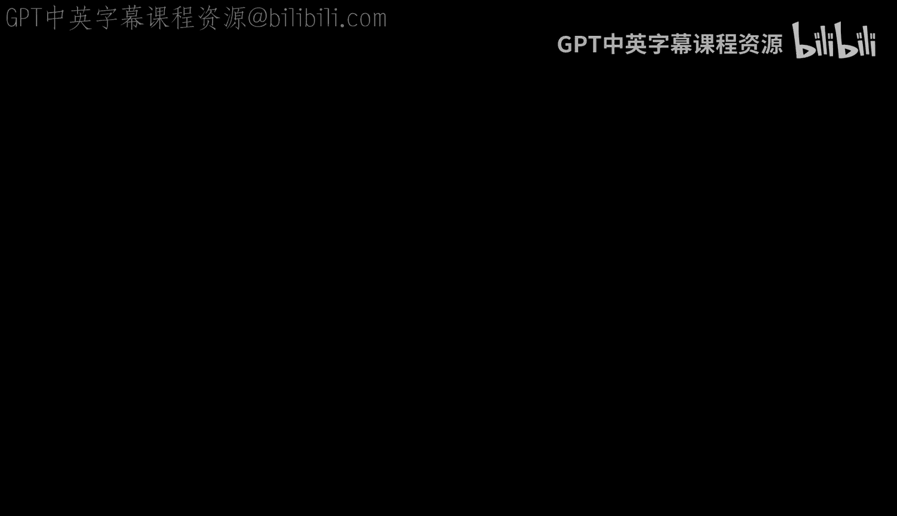
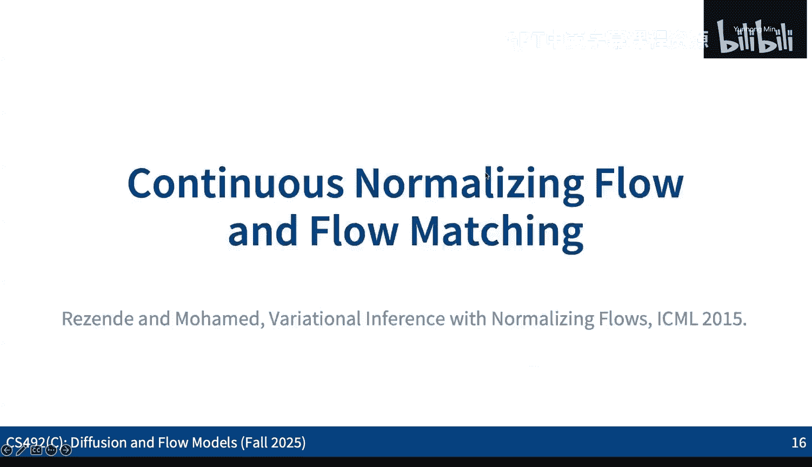
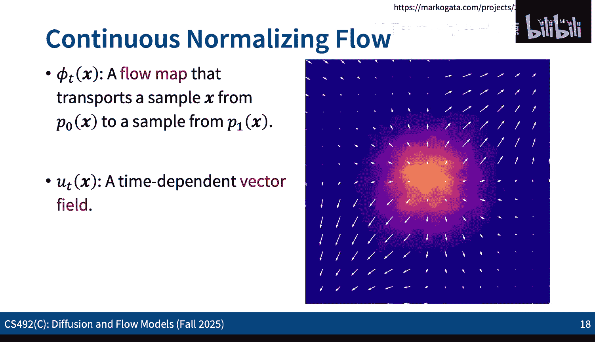
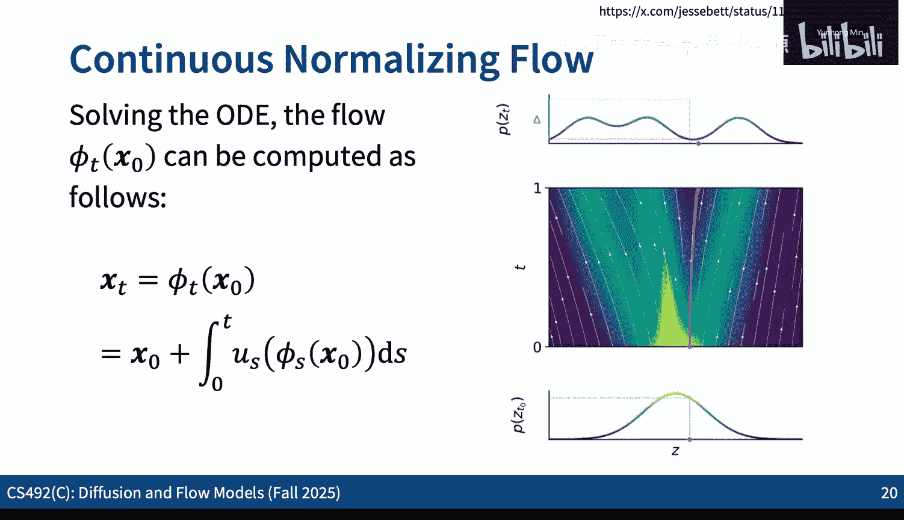
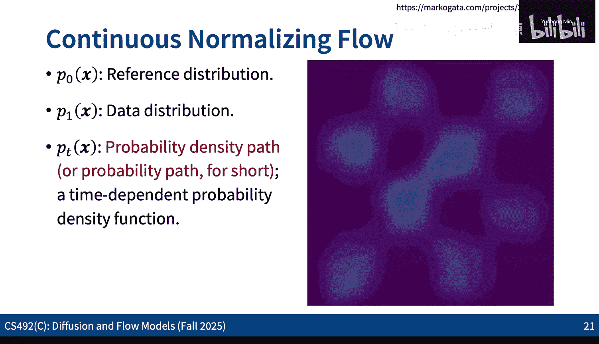
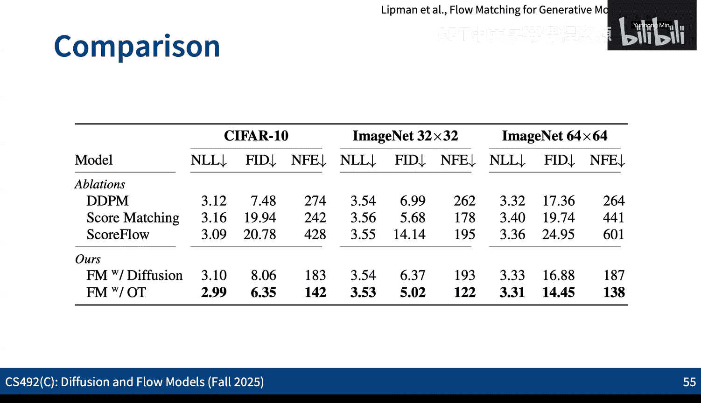

# KAIST《扩散和流模型｜CS492(C) Diffusion and Flow Models 2025》中英字幕 - P9：Lecture 10： Flow Matching 1 (Diffusion and Flow Models, Fall 2025, KAIST).zh_en - GPT中英字幕课程资源 - BV1CKpvz1EH5

So yeah， let's get back to the things that no we have discussed before。

 So last time while we started a discussion for the division models from like DDPM。

 DDIM like school based model kind of things and we actually realized that actually all the things that we are。

😊，No learning basically you know representing with the training of the digital model is that basically it's all about like is practicing the mapping team from the data distribution to the later distribution using the SD formulation right。

 we could see that actually the both default process and the reverse process can be represented as the stochastic differential equation especially when you define the default S into this form。

 we could see that the reverse S or can be you defined in this way with this core function here。

And then what we also have seen is that actually it turns out that we can find the corresponding the OD E formulation that basically matches the emerge distribution。

 which means that by simply solving the OD formulation， now we can do both ways of the mapping。

 right， So that was the basic idea for the diff models。 So after we see this。

 now we can see that like everything the mapping can be basically you know。

 considered as basically the O D E formulation。😊，So this was the P D。

 And the thing is that when he discussed the P D， we did not see the details in terms of like how we exactly can derive this formulation from either the four SD and the reverse D。

 right， which I just said that like this is the P D， right I didn't say like how we can derive this。

 I'm not going get into the all the details further。

 if you are interested basically how we can derive like this formulation。

 I strongly recommend it check out this paper and see how we can do this。😊。

But the very high level kind of thing is that basically to derive those kind of things。

 we need to start to discuss this formulation first， this is the very basic formulation。

 which is called the focal plank the equation， which is the showing some kind of the relationship between the S formulation and the probability。

😊，For the intermediate data point of the X。 So this is the formulation that shows the relationship between these two。

 And from this then we can consider basically driving all the things for the POD。

 but we are not going to get into the all the details because it will take another like one hour。

 But yeah， please keep this in mind because like this is also the formulation that you're gonna keep seeing for the rest of the part of the course。

😊，So this what kind of deep page I。And after we start to see the OD formulation。

 what we can see is that now we can consider making some kind of some dedicated the OD server based on the structure of the deform。

 So the idea that we have seen the D server case was basically activity is like one of these speed the example in terms of like trying to basically make some kind of the anatic dis solutions for the OD。

 while it's impossible to make some kind of the fully analytic disution for the entire the OD。

 But here what we try to do was basically integrating and it like the linear part analyticalically and doing some kind of the approximation for the non nonlinear part of the integration。

 So in terms of that we could say that we can achieve some kind of the better results even with the field step。

😊，So also especially the interesting part of the deep server was that you pre the first order。

 the approximation。For those like non in port， then it became exactly the same with the DDIM right。

 So we could see that like why DDIM perform better the the nontoistic version。😊。

Performs better with the fewer number of steps because it's kind of first approximation for the OD deformation。

 right？And we could go further， which means that we could basically do the higher the approximation for the non nonlinear your part in terms of that we can achieve some kind of the better results with the even fewer the number of the steps。

 So I guess maybe some of you might now try to implement the higher the controller in terms of like reducing the the number of the steps in your。

 but we'll see。So that's kind of the basic idea。So this is the basically figure that I have shown from the very beginning of like this course。

 Basically the advantage of the digital model is the technology the high quality the outputs without any kind of mod collapsed issues。

 Basically the limitation is all about this state right。

 So what we have discussed from the previous lecture is like all about how we are going to produce the quality the outputposts we the fewer the number of these steps。

😊，So we started from the DPN， which required like more or less like。Typically。

 people use the 1000 D time steps， right and then we reduce that into the more less D 50 to the 200 using the DDIM and by seeing that the DDIM can be seen as kind of the the first or approximation of the OD D de formulation when you have some the higher the solutionution。

 Now we could reduce the D time steps into the10 to D 15。😊。

So that's really kind of the remarkable the progress in terms of reducing the competition from the 1000 to the 10。

 right，100 times of kind of improvement， right。😊，the question is that how can you also improve further。

 So if you see the quite recent the image the or the video generated models。

 you can see that their de generation speed is really fast。Actually。

 the very latest de generation the models for the image and theD videos are just requiring only few steps。

😊，1，2，5， kind of the steps， which means that they is something， right。

 It's not just using the in using those kind of the ideas。So。

 there are tos of the ideas in terms of how we can further accelerate the diion process in this degeneration。

 the thing is that what we have seen in these like the previous lectures are basically all the ideas that we can directly apply in the test time。

😊，So that also also a very interesting point of a pig models in terms of that。

You don't need to leadtrain the model using some kind of the pretrain model by simply changing the formulations of the generation。

 you can achieve this level of the acceleration。 almost like 100 to of the acceleration。

 That was the very interesting point， right， But also the idea is that know some kind of decent ideas basically also about like how we can do achieve the further the acceleration with some kind of the tuning。

 So there's also kind of some the ideas。 which is ideas is' called the detill。

 So given some kind of the pretrain model， you do some kind of the fine tuning of the neural network。

 in a way that now we can make it as's kind of like one step generation the model。

 So we can basically get some kind of the output with some kind of the single step the computation。😊。

So for that， like， so we are not going to get into the too much details for the many acceleration techniques。

 but the reason that I'm just like mentioning this is that one of the kind of biggest demo motivation。

😊，Of like discussing the flow models that we are going to start to discuss from today is also about the acceleration with some kind of fine training。

 So that's kind of the vision that I'm just mentioning this。

 But this is really important topic in terms of that we can further reduce the computation。😊。

The most representative the idea for the fine tu based kind of acceleration is the consistency models。

 So we are not going to get into any details for this。 But here， the。

 the basic idea for this kind of the the technique is that。You first basically compute O D E。

 which means that you from the some kind of the noise samples， the standard Gaussian the sample。

 you perform the O D Dis or the way that you get some kind of the realistic the data point here。

 right， So which means that you have some kind of the trajectory from the standard the Gaussian sample to the data point there。

 right， So here， the basic idea is that we do some kind of the noise prediction in the every single point。

 right。And we was have seen that the noise prediction can be used to compute the expected the final value using the the t formula。

 right， So actually， we can see that the， the role of the neural net is actually to predict the the final the output。

 the expectation for final the output， right。😊，So the basic idea for the consent model is that for all the points。

Alllong the way of like this trajectory。We want to basically4 the final the outputs from the earliest stage。

Would be trajectory。So the basic idea is that we make the expectation of the final output in the audio point here to be close to the expectation of the final output in the later point here。

So we already know that this kind of trajectory， we already completed the ODA here。😊。

For the audio here， the Xt prime here， when you see the final the expectation of the final the output。

 we make it be to get closer to the expectation of the final output the next point。😊。

So this' kind ofディページが I。Obviously， there are lots of the details in terms like how we can make this kind of training to be more disabled。

 There are some kind of the details。 you can so check out the details in the paper。

 but without seeing those kind of details， like with the relatively simple idea in terms like having some kind of the earlier stage of some kind of the forecasting for the final the ops。

 we cannot keep some kind of the results in terms like making some realistic di ops。

 even with the very few number of steps， even just even the one or the two steps。😊。

So that's kind of the good idea for the consensus models。 And not only for this。

 there are lots of some kind of similar ideas in terms of like， you know。

 accelerating de generationeration。😊，But the kind of the downside for the all those kind of ideas is that they are all requiring some kind of pretrained efficient models and starting from that for the fine tuning。

 So that's the kind of the idea。 But so by， so which means that by spending more time in the training the phase you can basically reduce the computation in the test time。

 So that's kind of the basic idea for those kind of the acceleration techniques。

So even without like having any understanding for the all the details here。

 now I least you can see some kind of the history of like the literature in terms of like how the techniques have been evolvedvoked over time in terms of that we started from the DDPM1000 steps and the DDI and to steps and DP tour% and were the many other the dedicated theses like going down to the10 steps and then consistency models or some kind of other de acceleration the techniques which also goes down to the one or the two steps while requiring the distillation。

 the technique with some kind of between models。😊，So those are some kind of be some picture in terms of how we can know do some kind of explorations with models。

So the thing is that any other options is the the like all the kind of things that we can do。

 So from today， actually， we are going to discuss completely different digital model。

 which is the flow matching， But after discussing all the things actually realize that while the idea for the flow matching stem from the completely different kind of literature。

 the root。 eventually actually that becomes kind of the identical， with the division models。

 So that's also kind of the very interesting point， while it might be quite no。😊，Paintful in termss。

 like seeing some kind of connections between this too。 So we're gonna get into that。So。

 so it's kind of the some another idea in terms of making some acceleration。 and actually。

 it's kind of the completely new idea of these models。

 So we are going to start to discuss the the four models。

 The thing is that in the context of the individual models。😊。

Here the key thing is that so please keep this in mind。

 so this is the really important point and this is really confusing point。😊。

In the division model context， we have seen the time range。

 the time domain from the perspective of the full， the fold process， right， So the time T。

Itstract from0 from the data distribution， and through the full diffusion process。

 we are mapping the X0 all the way to the x capital T here， right？

So starting from the data distribution X U。And then going to the X capital T， right？

So that was kind of the out combination that we used in the division models。

The thing is that so it's always good to basically keep the all the kind of the the thenotations here。

But the problem is that for the flow matching the context， As I said。

 this is completely new and model， which is coming from the completely new some kind of the literature in the the root。

 basically。😊，And they are seeing basically this kind of a time domain from the generation the perspective。

😊，So which means that now the X2 starts from the something kind of the known distribution。

 which is typically standard the Gaussian distribution in our the case。

 and then which is now mapped to the one of the data points。

 sample from the data distribution to the X1。😊，So， we gonna switchッテ。The time de。

Fliping the time range it was starting from the data distribution to the Gausian distribution now we go into this way the Gausian distribution to the data distribution。

 So now this will be X U and this will be X1。Okay。Oh， you're gonna say that actually。

 this is very confusing。 Even I get confused with this kind of the the changes of the notations。

 Sorry about that。 but I also have some kind of details in terms like what we just like follow like one of those things for the discussion for everything。

 The thing is that。😊，All the materials that you can see for the diff models basically follow those notations and all the kind of the materials for the flow matching follows。

 basically this the time range。 So that's kind of the confusing point。😊。

So we're going to switch from this to this in the discussion for the flow models。

 x basically1 means the data distribution and x0 basically means the sample from the de Gausion distribution。

😊，Make sense。Starting from the x0 to the x1， that's the reity process。Don't get confused。

 So keep this in mind。 And so based on that， let's discuss the format。

So basically you're going say that all the discussion for the everyday dig of model is kind of the same。

 we discuss we basically set the sort of the reference distribution。

 which is typically the central Gausian distribution and the distribution， which is the P1 here。😊。

I'm not going get into too much details for this for now。

 but actually the key distinction between the flow models and the di models is that all the things that we discuss for the digital model is assuming that this reference exhibition is the standard Gaussian exhibition。

 right。😊，If we change this into another distribution。

 actually we have seen that example in our testest， right。

 not having the reference distribution as the standard the isotrop distribution。

 but some kind of unropic distribution but if we change the select reference distribution into the very new kind of distribution in the distribution models。

 then everything will be changed so that will be quite complicated。😊。

The good thing of the default flow model is that we can make this to be really anything。😊。

Even when you basically make this like reference distribution to the any other distribution。

 the formulation is not changed at all。 So that's also kind of the very interesting point of the flow models。

 You can say it's kind of the general right So that's kind of thing。 But in any case。

 like we gonna now basically set the reference distribution is the P0 and the is the P1。😊。

And then we're gonna basically introduce some kind of big new terms。

 which is something that we already have seen。 We are just like having some kind of names for that。

 Basically， were gonna define the function pi， which is the follow map。

 So follow map is basicallying the trajectory。😊，Are starting from the point X here。

So when you have the basically pi T X here， basically the input here becomes the the sample from the reference division。

 typically the P 0。So the input this function should be x 0。

 basically example from the reference distribution。

 and the pi T basically means some kind of the point over the trajectory at the time step T。

 So we already start from the X0， we change the time range and then going to the X1， right。

 and pi T is basically representing that the trajectory。 So there is no stock at here。

 Everything is so this is another basically O D E based kind of models， which means that0 stock at。

 Okay So which means that if you basically determine the starting point X0。

 then all the points along the trajectory will be determined， right。😊。

So which means that we can now define some kind of function for that。So basically。

 the X T starting from the specific the X0 will be denoted as the pi T X U。So that's the。

 the kind of the new rotations。And the vector field。

 so basically this is the OD based kind of the formulations。

 we're going also basically define the vector field， which is basically defined based on the RD full。

 right。😊，So you can see that basically the how the vector field and the full map will be related to each other。

 Obviously basically when you define the audio formulation based on the vector field。

 that will basically compute the full map at the everyday time step T。 So that's kind of basic thing。

So this is nothing but we already have seen that no。

 the floor map here can be basically defined by based on this OD formulation with the vector field here。

😊，So obviously， this starting point of the trajectory should be the same with like this point， right？

By definition of the deployment flow map。 so we are defined the flow as kind of trajectory starting from this。

 So when the time t here is basically0， it should be basically the same d x0， right。😊。

And if we basically map the X0 all the way to the time1 here。

 then there should be one of the sample of the data distribution。Great以。Yeah， so that's I think。

So every the kind of like the single point over the trajectory basically can be completed by solving being the O D E like this starting from the X。

 basically integrating the vector field over the time T So that's thing。

 So we are going to I'm going to sometimes some kind of notations in terms of having the X T here。

 which is kind of the abusing some kind of things， but the nots。

 but indicating the the point at the time step T are starting from the X0。😊，So that's the thing。

And then in the division model， the context， we have seen some kind of the probability distribution for the noisy the data point。

 right？So in these core based models。😊，We had that the reference distribution and the data distribution and then the probability distribution for the intermediate the noise data point X T。

😊，Do you remember how we define this， the data distribution for the intermediate de noiseis data point。

 How did they define for this code base model。Indeed the。Longerman dynamics。

 like what we have seen is basically having some kind of the Gaussian convolution。😊。

For every single the data point， the samples of the the data distribution， right。

 So the thing is that we don't have any close form promotion for this。

 That's why we do all the things away。 We only have the the samples of the data distribution。

And then to perform the long dynamics， basically what we have seen last time for the core base model is that we are defining the probability distribution for the intermediate node data point。

 the Xt as kind of the Gaussian combvolution for each of these single data point right so this is basically the same thing basically the probability distribution for the intermediate data point of the Xt the intermediate time step。

 the T here。😊，We're gonna just have the name for that in the context flow the the matching。

 which is called the probability， the density path， or the probability path。

 So those are some kind of the some the new name for like ghost things。😊。

So please keep these three things in mind。 we going keep discussing those three things。

 we going have the floor map。AndW whichch can be computed by the vector field， right。

 So we pre have this， then we can compute this。 We pre have this， and we can compute this。

 And based on this， we can also compute the probability path as well。 the things。

 So the thing is that in the divisionff models for these core base models。😊。

What we have seen is that actually we are defining this first， right？😊。

We defined like this the know probability distribution for the intermediatemt data point or by basically injecting some kind of the Gaussian the noise。

 doing some kind of Gaussian decom， right， And based on that。

 we can basically formulate all the food and the reverseive processes。 And then based on that， know。

 we can compute the audio formulation in the PFOD， which means that now we can compute the vector field from the probability path that we define。

 right。The thing is that in the flow demo matching， were gonna go in a kind of the reverse way。

 Were gonna basically first define the better field in the flow map。 And based on that。

 how we gonna we gonna see how this probability pass is also basically defined based on like this。

そうではそのかのコネクションスインで時。So here， basically the thing is that it's kind of like more straightforward in terms of like how the vector field and the flow map these two are basically related to each other。

 right， basically， these can be compute by solving the O D from the vector field。

 But the thing is that it's not very clear how exactly this one is basically related we these two。😊。

So that's kind of be some complicated part。 we are not going to get into the of that。

 but this is the part that no this equation comes up again。

And so this is back the equation that we can see some kind of connections like between these two。

 So while this looks quite complicated， the good thing is that if we ignore these parts。😊。

If we see some kind of very simple the OD formulation。

 even or dis because like we you see that this is actually the kind of the OD ED formulation of the effect build。

 right？😊，So if pre ignore these part， then actually this F function can be considered as kind of the our vector field。

 as we can see in the。い。Don very simplifyimplified the version right so when there's no stock atity。

 the add function becomes of the vector field， then we can see some kind of the very simple some kind of connection between the probability path。

 which is basically the probability distribution for the data point at the time step T and also the vector field here。

😊，So actually， this formulation showing the relationship between the field and the probability the distribution is one of the kind of key things to see。

 you know， to derive the P for the from the focus equation。

 but you are not gonna get into all the details for that。But this is kind of thing。

 So now we can see how exactly the， the， you know， the vector of field is basically the related with the probability path。

😊，So based on that， what we can do is that with some kind of de derivation。Here。

 once we basically have any kind of defect field here。Based on that。

 for any of the the data point over the trajectory， we can compute the log probability。

So now the vector field can be used to compute like how likely each of the data point we will be there at the time step T。

 So that's kind of the， the key things here。So basically this means that if we can somehow find a vector field that can maximize this the logo probability here for each of the data sample that we have So x1。

 So don't get confused。 The X1 is the data sample。 not the Gaussian sample we are going from the x0 to the x1 X0 is the Gaussian sample and x1 is the data sample So for the x1 we can now compute the logo probability for each of the data point。

 using the vector field that we have。 So if we can somehow find a vector field that maximize this is the logo probability for all the data point which means that now we found a kind of the good mapping right that's kind of the mapping that we can basically map the x0 into the x1。

 So which means that somehow we can find this kind of the vector field。

 This is kind of the information。😊，This is kind of the function that basically encodes some kind of the information for the mapping。

😊，So， which means that。As we also have done similarly in the division models。

 we can try to basically memorize this information of the vector field that includes the select mapping information using the neural net。

For the each of the sample of the time t and also the sample of the Xt。

 we can consider bis in neural net that can basically predict this kind of velocity。

And that's kind of similar with like what we have seen for the diffusion model case right so as we basically trained the noise predictor in the diffusion models。

 somehow if we can have some the information for the vector field。

 we can consider training neural net that basically in all those kind of the vector field information。

 which is maximizing the low probability for X one right。

 then based on that as we also have seen in the previous slide。

 we can compute the ODE that will become our degeneration the process。

So that's kind of the higher idea in terms of now we can how we can also define the another type of the OD E based deter model by directly defining the the flow man also the vector field before we get into the some specific definitions for the probability path。

But obviously here， the question is that how we can find such kind of vector build， right？😊。

So when you start from the any kind of X0 and then sending that into these the X1 using the vector field。

 there should be one of the realistic data point， right？

So the question is that how we can find such kind of defect field that maximizes the log probability for the ODx1。

😊，So that kind of thing。One global way is that we actually define the lowest function as the logo probability that we have seen in the previous slide。

So when you define a logo probability like this， for any point of the x1。The the sample。

 the data point that we basically actually go all the way back。

 running the OD in the backward word in terms of going into the x0 here。

 then now we can compute this real probability by computing this Basically this means that from the X1。

 we trained in neural net over time in a way that we have the defect field using the vector field。

 we go in the back word all the way to the x0 here and compute the probability in this way。

And basically， we are finding the field in a way that we maximizeims this。

Soディス kindド verbalウーディー formulation here。But。Yeah， so it is clean。Or it of the data point。

Los of the data point X1 that we have， actually。From starting from the arbitrary vector field。

 we perform the OD in the backwardword is kind of the food process in the digital model the case。

 and then having the backward word trajectory。 and based on that。

 we compute the look probability by computing this in a way that we find some kind of the better vector field that makesim imagine this。

😊，So that that's kind of the three。Only version of the idea in terms like， know， how we can know。

Make some kind of desired model by directly learning the vector field here。

So this is really different with like what we have seen the digital model case。

 right in the digitalff model case， we somehow defined the the probability pass， the。

 the conditional the probability pass pass， actually， that were gonna also see in the next slide。

 And based on that， we could drive all the things of the this kind of audio formulation。

 which is giving us the defect field here， right。😊。

But here we don't define any kind of the property pest and frankly somehow try to find the specivity here in total like mixim this。

Obviously， the conclusion that I'm going to say is that this is not working at well。

 So so we're going see like how we can make it to be similar to the digital model。

 the case in a way that we can make it more detractable in terms the training。 But can you see like。

 what's the problem like this， if we train the vector field the velocity printing network in this way。

What the kind of issue。You can really implement this way， but whether we kind we should read this。

I mean， the issue all comes from basically solving the O D， right。

 solving the O D in a like very stable way is super challenging unless we have some very specific form of the O D formation。

 But for those kind of general form， the problem is that， you know。

The O so basically can be not only computationally expensive， but also numerically unstabletable。

 So this kind of issue。So the thing is that EPA trained in your in this way。

 Then every time when you compute loss function， you need to compute the O D E， right。

 and then the back prop should be done all the way through the O D D the solve， right。

 But the O D solve is basically computationally expensive and also can be numerically unstable。

 So this kind of the problems。 So here， the question is that how we can basically learn those kind of the。

Seectctor field without basically making our the loss function to evolve some kind of the O D the soap。

 So that's kind of the， the basic idea here。We easy clear。But can， can you see that no。

 how we are basically evolving kind of things in terms of that we started from the mid PM D damn things and then see how those kind of like mapping can be know defined as kind of the S D formulation and also the O D formulation。

 And then now we are kind of going the other way around。

 now we are going to basically define this mapping directly as kind of the O D formulation。

In a way that how actually we are going deliberates way。 know now。

 we define the mapping as kind of the vector field。 And from this。

 were gonna see how those are basically relatively the and those things。

 So that's kind of the another interesting idea。So let's try to basically make the other the。

 the vector field the learning without basically solving the O D pretty loose function computation。😊。

So from this point， you're going to start to see that actually what we are discussing in this kind of the new general model becomes slightly actually。

Kind of getting quite similar with diffion models。 but having some quite different some kind of the the explanation for that。

So what we are going to do is that。What we need is basically， right？AP defect pass for the time step。

 but instead of directly seeing that we are going to consider all the things which is called the conditional things。

 the conditional the property pass， conditional flow map， and also the conditional defect of built。

See here basically， the condition they probably pass basically means that when we assumed that the data decision。

He basically。A simple de Gaussian distribution， which is centered at the X1 and also the very small reance here。

So can you actually see that this is something that we already have seen in the previous lecture。

Something familiar， no。So this might be confusing because we changed the。

 the time the range and also the sum of the notations here。 But actually。

 what we are doing here is exactly the same that we have done in the core base model。

 You can say that no the。😊，まて。So we are basically doing some kind of the the ga thevolution for the of the data point of the X one。

 right， So in a way that we define some kind of the noisy the data the distribution of for the time step。

So this is exactly the same thing basicallyス having some kind ofian the you know the the this kindvol with some kind of the by seeing the each of pointイで kind of。

The data point is kind of the small des here。 So that's kind of thing。

 So for this conditional set of basically what we are going to see is that now we are going to assume that given a kind of sample of the X1 we are going to assume that the data distribution is given as kind of the very small de center that the specific point of the X1 in a way that we going get back to the the P the marginal the the by taking the integral in this way。

So that's basically what we are going to do。So as I said。

 you can see that this like the conditional setup as kind of the case that the reference distribution is exactly the same while basically we are sort of seeing the data distribution as kind of concentrated the Gaussian centrally given the point of the X1 here。

😊，啊， so。The reason why why we are having this kind of conditional data setup is that the good thing is that now our data distribution became Gaussian distribution again。

 which which we know the analog form。 So once we have some kind of the analog form for the data distribution。

 then we can derive the analog form for the flow map and also vector field as well。

 So all the computation becomes like more detractable in the visible。😊。

And aftercing all the things for the conditioner the setup。

 we're going to see basically how we can compute the marginal the probability the also the marginal the vector field based on those kind of the conditional things。

😊，So thats the data idea。So that's kind of thing。 So basically。

 when you see the conditional deposit pattern like this thing。 So don't confuse something。

 X 1 is the data point， right。😊，From the X 1， given kind of the X1， what it kind of the the。

 the conditional， the power the pass for the time T， right。

So you can see this is kind of the similar with the full process of diff models。

In default process we have seen that how we can basically inject some kind of the Gausian noise with some kind of the drift for each of the data point of the X1。

 right， So this is actually kind of a correspond to the default the jump distribution in the digital model case。

😊，So we， we have seen the bunch of things， right， for the the B P case and the B case。

 though those are defined in this way。 So this formulation may look quite different with the B P case。

 But the reason for that is that we change the the time the range。 So that's kind of the problem。

 right， But this is kind of。Something that we have received seen in the digital model case。

 default fourth jump distribution， which was basically adding some kind of the Gaoian noise into the next one。

 right。😊，So now we can see some kind of connections between the four model and the different models。

And as I said， we're going to keep seeing these kind of those x three things flow map vector field and the probability paths and see basically how those are basically related to each other that's also what we have seen in the previously slide and then we can also see the same thing for the conditional setup you're going to also see the conditional flow map conditional vector field and the conditional the probability path。

😊，呃。And the thing is that。In the division model case， we started to this define this on， right。

 E PMM where we are defining the for jump in based on then all the other things are define。

 defining this first and describing all other things。

 What we are going to do here is that we are going to define this first。

You're gonna first define the flow map into this simple linear function first and see how the other things are basically derived right based on that。

😊，So you can see how we are basically generalize this kind of the idea in terms of expanding our the scope in terms of like having some specific in the previous individual models。

 we have some specific formal like those things， especially thebri evolution or de population and extending this into other things and now we want to basically like expand our the scope in terms of like you know what we first define the conditional the flow map。

😊，And based on that you find all the other things。 So that's kind of the case。

So don't also get confused。 So this is the conditional set up。

 So conditioned by the realistic the data point X1 here。

 and then the flow map already basically take some kind of the starting point as the input。

 the starting point is typically the Gaussian distribution。 But as I said in the flow model。

 it does not need the Gaussian。 but basically the sample from the starting distribution。

 the reference distribution。 and this is basically the sample that we are taking is the condition of the data point。

 right。😊，Then from the technician shop like this。You can see right， I mean。

 so let's if this t is0 here。😊，場シュ beアプドがてです。I mean， very very simplication。It should be X。

 right Why our the definition of the conditional diploma flow basically the follow the definition of that diploma flow maybe is that the the trajectory。

😊，Over the space starting from the x0， right， So if the t is0， then d should be obviously x0， right。

😊，But this is also condition said that we are assuming the data distribution is pretty tiny 값usian central X X1。

 right， then what should be the output when the T is1。😊，That should be close to the x1， right。

 because that's the basically only because the sample of the data distribution， right。

 so obviously from this kind of the conditioning the setup。

 you prespec the x0 and the x1 when the T is0， then the output should be x0 and the T is1。

 that should be very close to the x1 right。😊，Which means that while we see some kind of the de general form of the still some linear function of the conditional diploma flow。

The our definition of like those this function and this function should satisfy those kind of the boundary condition。

We you can define whatever sigma here and the de here is okay。

 Rios in many generalizations in division model case， right。

 So we're going to also see some multiple options defining like those two terms， right。😊，Actually。

 you can literally define any things， but whatever you define for these two things。

 the thing is that when the time t is0， then the output should be x0 and when the time t is1。

 then the output should be close to the x1， you need to define these two in that way right。

And now you want to say that this is something that is getting closer to something that you already have seen。

啊。Problem 5 of the the test was kind of getting close to these。

 right So that's kind of the things that you basically seen some kind of connection between the D model and the formatmaking。

😊，So with this kind of like the linear function you're going to see those kind of be some straight trajectory from the any of the X here mapping to the x1 here。

 So having some kind of these straight traject。😊，So the region。

 like why we are having this kind of simple form， the linear function of the condition of the flow map is that based on that。

 So once we define the conditional flow map into this very simple way。😊，Obviously。

 there should be some ways reasons for that， right。

 The reason for like define the context of raw in this like simple ways that then now everything becomes quite simple。

Then we can easily define that the corresponding the conditional the probability pass also can be defined into the Gaussian distribution。

 We have seen the relationship between the flow the vector field and the flow man and also the vector field and the probability pass right in the previous slides。

 and based on that， if you derive all the things that you want to see that from the linear the conditional flow man。

 actually the conditional the probability pass given the x1 actually becomes the simple the Gaussian theform。

😊，This is also very similar with like what we have seen the basically our theal dius model was defined in this way with some kind of conditions for the SNR for those two functionss。

 right。 So while we are also using on other new notations like the mu and the sigma。

 you can get the sense of like those things will being somehow。😊。

Identical with some kind of the the functions we have seen in previous lectures。

 So sorry for that we have just keep using to new notations because of the those are coming from the different literature。

😊，Well you can see like， these are kind of actually related with the from the terms in the evaluation division models。

So as I said， you need to have those kind of conditions in terms of that。

 we need to satisfy the boundary condition that the time step is0 the output should be X0。

 and the is more than should be the。 So that's thing。So yeah。

 so basically we this kind of the boundary in the the the boundary the condition。

 you're gonna see that when the time T is0 that becomes like this and the time monitor then we we get this。

So then based on that， let's check this out。 so you can just try this yourself like doing some kind of sity check。

 So given this kind of the the condition to flow map。

 the linear function with those kind of some boundary conditions。

 just like put those things and check what you get here。So based on the this kind of simplest。

 the option for the mu and the sigma function， if we you write the conditional the property pass and the condition of the flow and the conditional defect vector field。

 then you're gonna see that we get this form， right。😊，This was quite obvious， right？

Read that kind of be the simply form， obviously the condition the flow map should be interpolation between these two points。

 making straight trajectory from from the X0 to the X1。哎。Makes sense。

 And also the Department pass is defined that way。 And also the vector field is defined as kind of the vector on that in the street line。

That's doing obvious했어요。So this is kind of a lesson for now you don't need to take a photo。

 I'm gonna update the slice。 but this is kind of the lesson here is in terms of that。😊。

Now we can make some kind of the new ODE based dig model by first defining some kind of the conditional。

 the flow map and everything can be derived based on that in the context of like making the defining the some trajectories。

 the conditional the trajecties to first， the condition the trajectories do not need to be any kind of some fancy like complex kind of things。

 even the simplest one would be okay。But also， the other， the option is that。

What if we really follow the things that we have seen in the division model case？

In the diff model case， we first defined the conditional de path into this way。 this is the BP case。

 having some kind of the shift and also sophisticated adding injecting some kind of noise right So the conditional de probability path was basically defined kind of some fold the jump distribution right having some kind of the Gaussian distribution。

😊，And from this， obviously， we can derive the other things as well。 So based on that。

 the continu probability test， now we're going to see that the vector field is computed in this way。

😊，そう。While we're going to discuss also the bar case as well。

 the things is that we are basically using some kind of the condition some sort of these quas in the deepion case。

😊，whichch is to use for some kind of a long one kind of process， right。

 but we now switch everything is kind of the OD formulation。 But instead of the square function。

 now we are seeing some kind of the vector field。😊，And obviously。

 these two will be somehow relate to each other， right。

 Youre not get into these connection between these two next time。

 but we are basically seeing some kind of the other types of the quantity。

 which is now the vector field。 And based on that， we can define all thebo。

 and we can perform basically the de generation the process。😊。

And if we also compare this kind of the conditional def flow matching with the previous case。

 everything was the marginal setup in the previous case。

 when say there's no close form for anything for any of the de vector field older things。

 so we needed to basically learn the vector field with some kind of the very expensive the OD de computation in the loss function。

😊，So to avoid that， what we do is that we start to consider some conditional this setup then basically the data distribution can be considered some kind of some the analog form it's kind of the Gausian deform。

 Then all the things basically can be derived defined into the closed formulation。

 So that's the kind of things why we see the conditional this setup。😊，But obviously， at the end。

While we can directly compute the conditional defect field， that's not something that we want， right。

 we want to basically get the marginal defect field， right。😊。

So how are we going compute the original vector field based on the conditional vector field。

 So I'm going to skip some， some details here。 actually。

 if we start to discuss all the detail that will take another 3 means。

 So if I skip some details here。😊，Based on like those deforms， actually。

 the marginal vector field can be computed based on the conditional vector field and also the conditional the problem pest like this。

So using dis formulation。What we can do is that what we wanted you to do in the previous flow matching case was was basically to learn the。

 you know。Deector field here using the neural net， using this slow function。

But based on the previously formulation， what we can do is that we can still learn the marginal vector field。

But using the conditional defect vector field by just sampling the X1 and Ro the time team。

So these two becomes basically the identical。So basically what we can see is that we can consider basically learning the marginal defect field by just computing the conditional defect field and for this we did not have the analog form。

 but for this now we have the analog form right So it's just like。😊，sortモ kind of things right。

 So we basically sample the x1 and based on that we compute like this like close from this and then basically minimize this。

So this is kind of like very similar with what we have seen in the core prediction case。

 core the prediction in neural network in the diffion case。

 but the thing is that now were basically not learning the core function， but the peistic function。😊。

Just like changing the kind of quantity that we are going to learn in the context of the flow matching。

So there are some connections between these two interview。Well that's the thing。

 so we now have the close form for this。Then you can also see the analogy in terms of training the diff models and the flow models。

 So in the diff model case you already implemented this like what we need to do is sampling the data point X1 and the time step and then sample the noise there and then compute the X T and then basically helping turning digital network that predicts the noise there。

 right。It's kind of very similar。 The only thing is that instead like noise。

 now we basically compute right， X Y and times to T and then sample to X T。

 And then based on that we conditional develop D。 and then we train the neural net that now predicts this quantity not this function。

😊，And then after that， the generation process is exactly the same。

 Here we have some kind of some complicated formulations in these core the models， right。

 it is not actually complicated for the BP case， actually。

 this also a quite simple form in the flow matching the case。

 we directly have the notion of the effect field。😊。

Which means that the generation process becomes that we sample the a here and just like compute OD。

using any audio server that you want to。And this kind of the OD formation has some bunch of the other advantages in terms of the performance and also the acceleration as well。

 So at the beginning of like this lecture， I mentioned some kind of ideas in terms of like how we can further accelerate degen process through defined tuning right using the flow models。

 we gonna also see some very simple surprisingly simple。

 quite but effective ideas in terms of how we can also accelerate these kind of the degen process with the flow models。

 but even before that you can see that so you can see the meaning weak diffusion and we the Ot here which means that this is the case like we are define the mu and the sigma function in a way that that matches the full process of the diffusion models。

😊，And this is the case that we are basically defining the mued schema function as straight to the trajectory。

😊，So by simply changing the part， you can see that we can achieve some kind of the improvement over some kind of the derivative like this。

 which means that we didn't need to make some kind of some curby the trajectory with diffusion models。

 Let's make it everything kind of be straight。But here also one small thing is that we are making the conditionally trajectory to be straight。

But after training all the things we that de the conal de trajectory。

 it does not guarantee that we're going to have some straight the marginal de trajectoryjectories after the old de traininging So yeah we're gonna get into that because everything is expected already right so we're gonna get into that why we we may see some kind of some kind of still bandy trajectory after the training and how we can also fix that still some kind of defined tu so that's the idea that we are going to discuss next time。

何に小さん です。Did you now get the idea into how we can solve the problem5 the last test。

So let's continue discussing flow matching next Monday。

