# KAIST《扩散模型和应用｜CS492(D) Diffusion Models and Their Applications (Fall 2024)》中英字幕 - P10：Lecture 11_ Diffusion Synchronization (KAIST CS492D, Fall 2024).zh_en - GPT中英字幕课程资源 - BV1mwpUzREqX

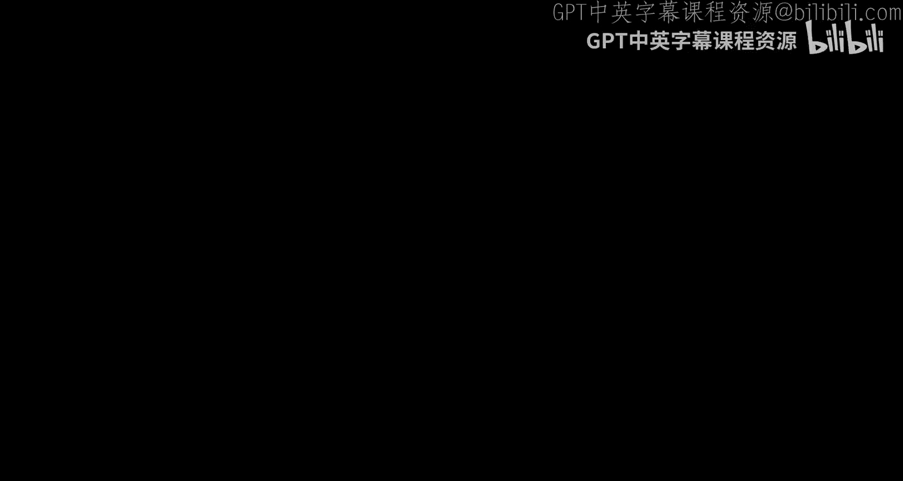

Okay， so welcome back to492 digital models in the applications。

 So we gonna basically continue our discussions about some applications of we pre trained digital models。

So last time we discussed the idea in the school distill sampling。

 which is basically extending the capabilities of the Pre division model in a way to generate not only some kind of some d that has been designed basically for the division models to produce。

But also producing some many other types of the data， for example。

 like for the image models we are basically extending the capability to produce like 3D and also many other things like panoramic images and many other things。

 and for that the be idea was to basically utilize the framework of the 3D reconstruction。

 but basically not minimizing the L to loss with the given images from the different viewss。

 but basically running the back propagations through the loss function that has been used for the digital model you training。

And so this kind of the great decent kind of approach。

 basically updating the given the 3D representation from the multiple reviews。

 we could get some very different some kind of D 3D the outputs。

And this was basically good because like there are not many kind of some kind of large scale the 3D data set。

 but without basically training some kind of the model directly for the 3D data。

 basically we could basically do some kind of the 3D generation by using the 2D generation the capabilities of the division models。

So this was the basic interview for the SDS and what can you generate using the SDS there to be many kind of things that we could basically consider generating using the SDS and obviously we can also generate the images at all so while the standard way for the image generation using the detailed models would basically running the reverse process we can also try to basically use the SDS for the image generation and that was also the part of the assignment form。

Right， so you pick consider basically doing some kind of the image generation using the SDS。

 then that with the case that no we are basically making the rendering the function in the loss function into the basically the identity function。

 so basically the things that we are going to update should be something that we are basically generating using the division models right。

And instead of like running the reverse process， we are basically running the back propagation through the loss function。

Then if it comes to basically doing some kind of the image generation。

 then what would be kind of the difference between running the reverse process and the SDS right so thats also the things that we have discussed last time。

So for the image generation， basically we can consider running some kind of the reverse process。

 but for many other the cases like for 3D generation。

 the region like why we basically considered running the SDS into of the the the process is that basically now the data are basically represented as some kind of pixel colors but as kind of the rendering of the 3D some kind of representations which means that why we basically produce the images from each of the view in the same way as basically we generate some kind of images using the reverse process the way that the data point is basically represented is basically changed so basically now the data is basically parameterized as some kind of the rendering of the 3D representation so we cannot directly run the reverse process into some kind of the parameterization that we are using so our the parameterization is basically 3D parameter plus some kind of rendering in the 3D generation decay so for this kind of the case since we cannot directly run the reverse。

Process for this specific representation， we are basically utilizing the projection function。

 which is the landing equation in a way that we can use some kind of the great descent through the loss function。

And also what we want to achieve， especially for this 3D degeneration the case is that while we are basically still basically generating images from the different viewss。

 we want to basically get some kind of the consistent outputs right so we don't want that old images like generating from the different views are basically completely some different images for the like different objects but basically images for the same objects in terms of like getting some kind of the consistency of course the old views。

So as the way to basically make some kind of the on the outputs。

 we are basically doing some kind of the iterative the update for each of the bureau in a way that we get some kind of the more the the outputs。

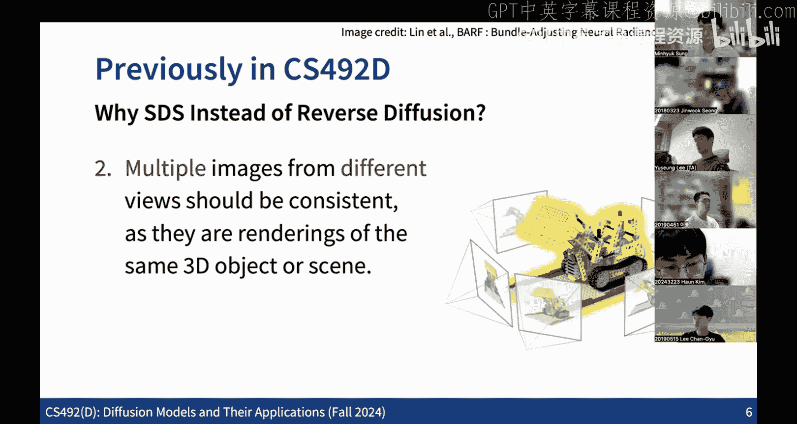

And what were also the limitations of the SDS since we are basically generating some kind of data。

 not using the reverse process， but through this kind of the propagagation。

 one of the limitation was that sometimes we get some kind of the slightly less realistic the outputs and also it becomes also harder to basically converge so especially if we want to see some kind of the convergence in the iterate the update the one way that we could do was basically increasing the classified free guidance。

 the weights in terms of that we are basically also compromising the diversity to get some kind of some converged the outputs in the generation。

So here the question is that why we obviously introducing the SDS to produce some kind of some other types of the the data using some kind of pretrained models。

 would there be some kind of the ways to also use some kind of the typical diversity process to produce some kind of the various types of the data without using the core dis and the sampling？

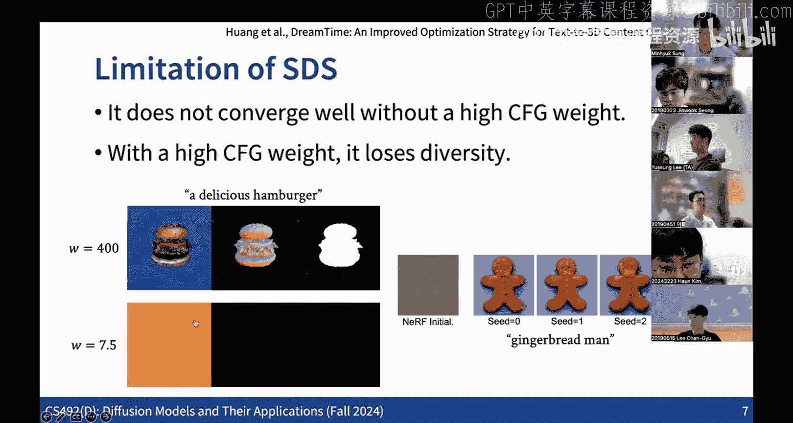

So this is basically the idea that we are going to discuss for today。

any questions on the S before we move on to the topic。So yeah。

 so the next assignment will be basically replacing the SDS with some kind of the joint reverse process。

 they can also produce some kind of the other type of the data。

So before we start to talk about the idea about some kind of joint di process。

 let me first basically introduce some kind of the terminology。

 so basically we are going to consider some kind of the two spaces like one is the basically the calendar space and the other one is the instance space。

And basicallyically the can space is the space where we are basically generating some kind of the data that we want to see so for example。

 for some kind of the panoramic images we can consider some kind of the lo canvas of the image and now that lo canvas becomes the the space。

 the can space where we are basically generating the final the output of basically the data。

AndFor example， these kind of the mesh textures， the texture， the domain， the texture image。

 the space becomes our the best data chemical space we are basically aggregdating all the informations across the different views。

And then we are also having the instance spaces where basically this space the hour the pretrained digital model is generating some kind of data point。

 so typically what we do is that we are having some kind of the multiple views of the images for either some kind of the 3D representation or some kind of the canvas or the panoramic images and then basically putting this kind of the images that we are generating in the instance spaces towards basically this kind of the canonical space。

So basically this is the setup that we are assuming some kind of the given the mapping between the canon and instant spaces。

 we're going to call the mapping from the chemical space to the instant space as kind of the projection and this was actually the rendering in the previous context and we are switching the term into the projection so the mapping from the canon to the instant spaces becomes the projection the mapping and we going to also call the other way around the mapping from the instant space to the chemical space as kind of the on projection the operation。

So those are kind of the given setup that we are having the two spaces。

 chemical space and the instance space， and having the mapping between them and one becomes the projection from the chemical to the instance space and the arm production from the instance to the chemical spaces。

And given this kind of setup， like can you come up with some kind of the applications。

 what be some kind of the setup that the cases that will basically require this kind of a setup。

 like having the two spaces。Any thoughts on this。So3 de generation might be one setup for this。

 but would there be some other applications for this setup？If you have any thoughts on this。

 please post the answer in the select channel。So， we can think about like many applications that we can basically generate some kind of data points using this setup。

 not only for some kind of the image video and 3D things， but also many other things。

But some of the applications that we are going to see for today is that like the first the application is obviously panoramic images。

 so for the panorama， the thing is that while we are seeing so many kind of the pretrained some image di models that can generate some kind of images in some certain resolution。

 you can see that those like di models are basically limited to produce the images in the very specific resolution。

 like5 12 by 512 or like 68 by 768， as you can see in the slide。

So if we want to basically generate some kind of images in the very arbitrary scale。

 or if you want to generate some kind of 3 60 dependingonic images。

 we need to have some kind of some dedicated diffusion models for them。

So here the question is that can we just like produce the images in any scale and any size using the pretrained differential models that can only produce some kind of secure sized images？

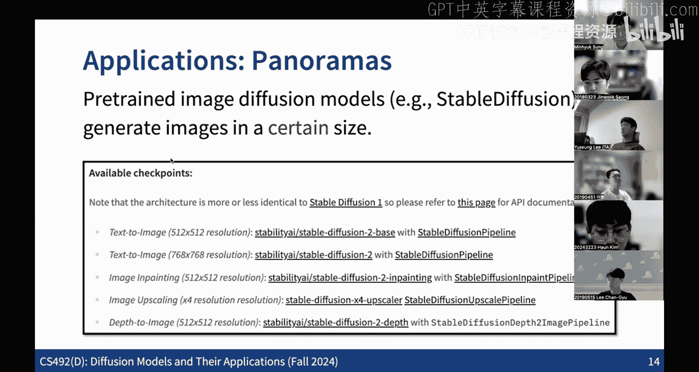

And for that， we can consider having the like defining the canonical and the instant spaces in a way that we are defining the canonical space as kind of be some long the canvas and also instance spaces as some kind of some small region inside the space。

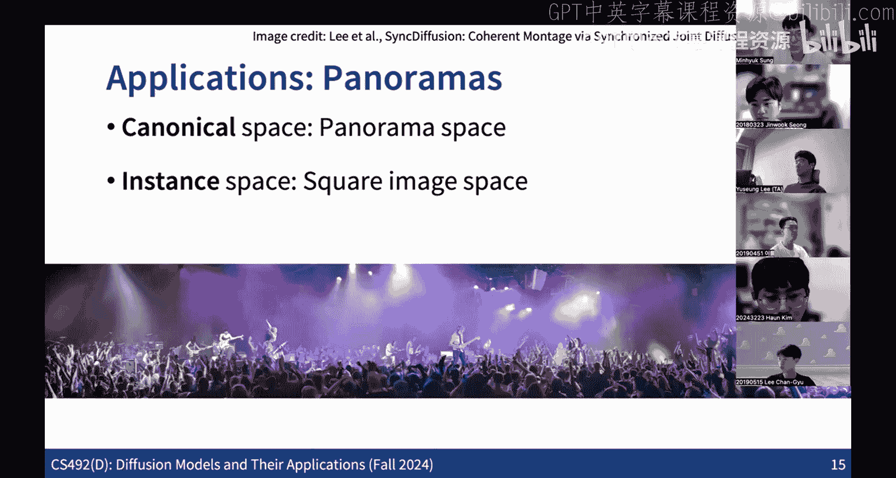

And also the mesh lecturing can be like the one option for that so here basically the texture image is basically some kind of the 2D image that is basically like wrapped over the given the 3D the mesh surface in a way that can define some kind of some color。

 the appearance information of the 3D the geometry。

 so this is like very difficult some kind of the setup in the counter graphics in terms of the shape is some kind of the mesh or some kind of 3D the presentation where basically define some kind of the 2D image that basically like wrapped over the 3D surface in a way that define some kind of the color formation。

And if you see many kind of like 3D models in some 3D online the reposities。

 you can see that many of the models are basically are， you know。

 provided using only some kind of the me information without having some kind of the good quality of the texture information。

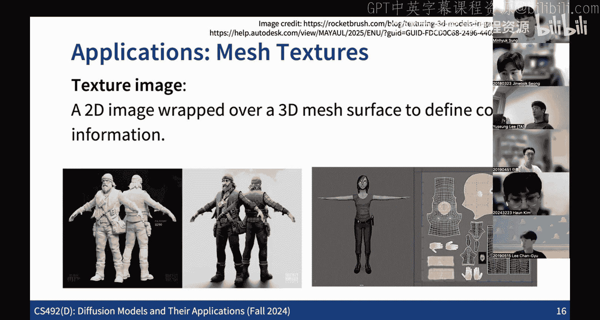

So using the same setup， we can consider generating some kind of the mesh textures given some kind of the 3D mesh。

 so for those kind of the case like the catical space becomes the texture the image space and then instance space becomes some kind of the secure image space that is basically unproed into the texture space so some kind of the mapping to from 2D to 3D。

And the other way around which the protection becomes the land in the equation。

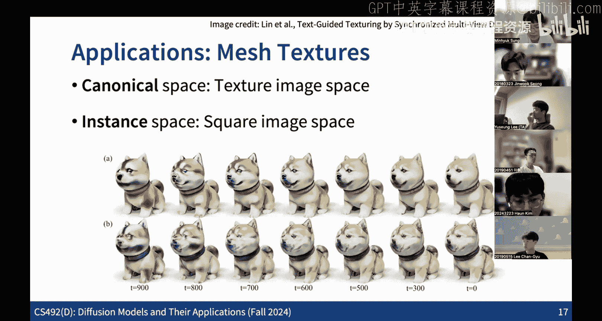

And this is also the another example， which might be kind of interesting to see so when you talk about the ambiguous images。

 basically the ambiguous image is the image that can be interpreted in the multiple ways based on some kind of these transformations。

So as you can see on the first the image， the estein the image is basically converted into some plant images while basicallyscu doing some kind of the chuckling of the deposits right。

And also the second image is basically like the painting of the man and if you basically rotate the image。

 then it also becomes the painting of some kind of people and the campfire， right？

And the last one is also the image with some kind of the plans。

 and then after some kind of the transformation now we are seeing some the landscape like this。

So those are some kind of the ambiguous images。And what do we investigate the can the instant and the instant species for those kinds of cases？

Any thoughts on this？嗯。So also for those kind of abigues， the images。

 the chemical space also becomes the instant space。

 the image space and the instant space has becomes the same the image space so those are some kind of examples that we are having the same space both as the chemical space and the instant space but the mapping between these two are defined in the specific way。

 so you basically as you can see on the left hand side some kind of po the shuffling becomes some kind of the mapping becomes the instant space to the chemical space so we can basically consider that we are having some kind of the multiple the instances of the images that this basically map like one of them that becomes our the chemical base space space through some kind of the specific mapping some kind of the transformations across them。

Another kind of like similar example is the zming videos， so let me play this again。

 so starting from the universe。

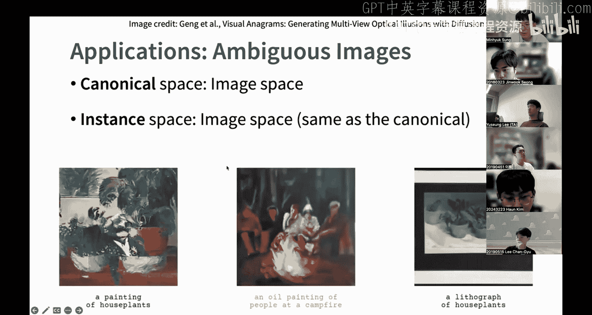

And then going into the planet。And now we are zooming in more seeing some kind of structure over the plane right？

So let me play this again。So this is also kind of some kind of video that is generated using some kind of pretrained image digital model。

Which is basically having some kind of the multiple images that are basically remotely translateed into this some kind of human limited images。

 some kind of the way to basically combine these things。

And you can see that we are basically seeing this kind of transition from the universe image into some kind of a structure image。

 while basically generating multiple images with some kind of the different problems。

 as you can see on the right hand side。So this is kind of like the similar case that we are hitting both the technicality and the instance space as some kind of the image space。

 basically the same space while basically defining their mapping across them as some kind of zooming and zooming out the operations。

So this can be also another big example。And this idea can be applied not only for some kind of the image and the video generation。

 but also many other things， for example， like for the typical some kind of the motion dig models。

 those kind of the digital models are basically generating the motion in the certain the time sequence like the 10 seconds were like some number of the frames。

And for those kind of the cases， if we want to basically elong basically the length of some kind of motion。

 while using some kind of the some pretriren difficult models for the certain the range of time the range of the motion。

 we can consider basically having some kind of the longer the time sequence。

 which becomes double the chemical space and then debuing this into the multiple the instance spaces in a way that we can basically apply the same kind of the idea for some kind of synchronation。

And you can basically imagine that we can also apply the same idea， not only for the emotion。

 but many other things like image and the video like audio or something。

 so there can be lots of applications for that。Any questions on this？

So let me briefly over the idea about the di synchronization。

 so this is basically nothing but basically running some kind of the di the reverse process through the multiple the instance spaces。

So let me first start with some kind of very simple example。

 which is making some kind of IV createdized images。And so for that。

 we are going to assume that we are having the clinical space for the longer the image dec campus。

 and then basically having some kind of the instant spaces we secure the image size。

And if we basically work on some kind of the latent diffus models。

 this should be basically the same the case because as we have discussed in the last time。

 latent diffus model is also mapping the some kind of higher resolution the image into the low resolution。

 some kind of the latent image， so for example， like the a image with the 512 by the 52 the resolution will be mapped the low resolution。

 the latent image which is like 64 by 64 with some kind of some higher dimension like the4 in this case。

So we can also think about that we are also defining the chemical space and the instance space in with some kind of the latent space。

 so we are having some kind of the longer delay latent space with some kind of some higher some kind of the length for specific dimension and then also having some kind of the secure side of the latentency space。

And we specifically define the mapping through the technical and the instant spaces while basically having some multiple instances that are basically mapped to some kind of over wrapped regions。

So as you can see， we are basically having some kind of the multiple， some kind of the regions。

 some subregions over the chemical space， while basically having some kind of the overlaps across the all the instances。

AndIn this specific example， the projection from the chemical space to the instant space becomes the cropping so it people basically crop some kind of division that becomes basically de from the chemical to the instant space。

It可以。So for this kind of be setup up， like what we can do in terms of like doing some kind of some synchronization across some kind of the diff the process is to basically simply a some kind of data the noise data especially in the OEC region so basically what we are going to do is that when we have this kind of the multiple the instances of the images we are going to simply basically run the reverse to the process for each of the instance image so we are starting from the x capital basically the Gaussian。

 the unique Gaussian the sample for each of the instance based images and then basically running the reverse process while basically averaging the noise data point in the OEC region。

So you may basically recall the DDI in the diversity process。

 as we are basically seeing multiple times the same thing。

So basically in the deterministic dis part to this step we are basically calculating these three quantities right so given the xt using the noise the prediction the network we are basically getting the epsilon t which is basically the score each of the case and based on that we predict the final the output the x0 the best prediction from the xt right using the epsilon t here。

And based on that now we are basically sampling the X T minus-1， right。

 So we are basically having these kind like three quantities。

So what we are going to do is that while we are competing those three things from the each of the frame for each of the instance。

 the image， except basically getting the xt minus1。

 we are aoraging this like xt minus1 in the OE region。

In a way that we are basically some doing some kind of synchronization across images。

So this is like very simple to the idea and let's see what like what again。

And before we see basically what do we get through this kind of the operation。

 what happens if we do not average the XT， so if we basically run the reverse process like all basically independently across the old list of these spaces。

 what do be kind of the opposite that we're going to see？啊。Yeah。

 so what the economy basically see that for example。

 like when you have some kind of a prompt like the snow mountains with some kind of the houses under the the mountains。

 then we can see some kind of some kind of variations of images and you see some like all the variations of across all the different the instance the images。

 we're going to basically see some kind of the discontinuity like the seas across the images， right。

So typically without the originaging， this will be some kind of the some outputs that we expect to see while like each of the instance space is basically the following the given the prompt。

 there is basically the same across the images so you can see here right。

But if we basically average the X T every the step of the kind of the denoging the process。

 then the interesting thing is that surprisingly you basically make some kind of the much smooth the outputs。

 So this is the case like the we are denoaging over time。 and as we basically get T to get to the0。

 then we're gonna see that those kind of the outputs。

So this is kind of very surprising output right I mean so without doing anything like when you do some kind of the aaging of the XT basically we are now seeing some kind of the output that there is no same。

 but like all basically the regions of the basically along the canvas is following the given the prompt right。

And you're going to basically we apply those things in your 75 and you're going to say that actually it's basically giving some kind of integrating the outputs like this。

And some kind of be more di。And given this kind of the idea of like basically combining some kind of the multiple the instance images。

 can you also come up with like how we can also， there is some kind of images that follow some kind of the given the layout。

So this is like the example that we are providing this kind of the layout as some kind of input into our system in a way that we are giving some kind of different prompt。

So the previous case was basically using the same prompt for the all the instant images and now we are basically having this kind of layout and the black region is corresponding to the A photo and the green region is corresponding to the a balloon and also we have having the E tower and the pink cloud right So given this kind of layout if we want to produce some kind of the composition。

 the old the objects in the scene what should they do。Betweening the idea that we just discussed。

Yeah so we can basically define the mapping from the instant space to the chemical space in a way that the instant images are basically defined for each of the region for the pink and green and the blue the regions。

 while we are also having the instant spaces for the blue region as well。

 and then we are running the labor process to Italy， of course all the instant spaces。

 while basically averaging the XT， the noiseis data point。

So what we can basically see is that now we can apply the same idea like synchronizing the digital process while even basically taking the different basic condition for each of the instance images right then we can see this kind of the interesting some kind of the opposts like compositing some multiple objects in the scene。

So this would be basically some interesting example that without doing that thing。

 but basically when you do some kind of the abooraging of some the noise data point。

 surprisingly the stable division， basically some image division models can produce those kind of kind of the same the outputs。

 the panoramic images。But then would it work for all the applications that we discussed before。

 So what if we also consider some other applications then what will happen。

So these are basically the things that some kind of the practical aspects。

 but basically what we going to see is that if we start to consider some other types of the panoramic images like these ray60 the panoramic images。

 so this is basically the case that we are capturing the entire scene along these360 the degree of the all the basically angles in a way that all the images are basically now mapped over this sphere。

we can think about that the entire d scene in this 3DD space is basically mapped into the images over this pi。

Then basically the image from a specific view can be considered as some kind of the cropping some reason over this sphere like this。

And it we basically flat and basically this sphere or basically making some kind of this crack over this sp。

 and we can also basically try to map the image over the sphereear into some kind of the rectangular image like this。

 where basically hidden some kind of detergent in the space right？So as you can see。

 the images at the bottom are also basically some 360 deep panoramic images after flattening this pi into the basicallys flat the plane。

You can see some kind of indoor images with some kind of decent distron with some kind of the curves here。

 right？So this is basically the same setup， we are basically having some kind of long canvas for the chemical space and also the secure size of the image for the inside space。

But for this kind of the case， if we think about the mapping the projection from the instance space to the chemical space。

 it will basically no longer basically hitting some kind of secure region in the chemical space。

 but basically having some kind of the distorted spheres like this。

 you can see that these red rectangle the the instance image is map to this kind of some distorted some region in the panoramic image right。

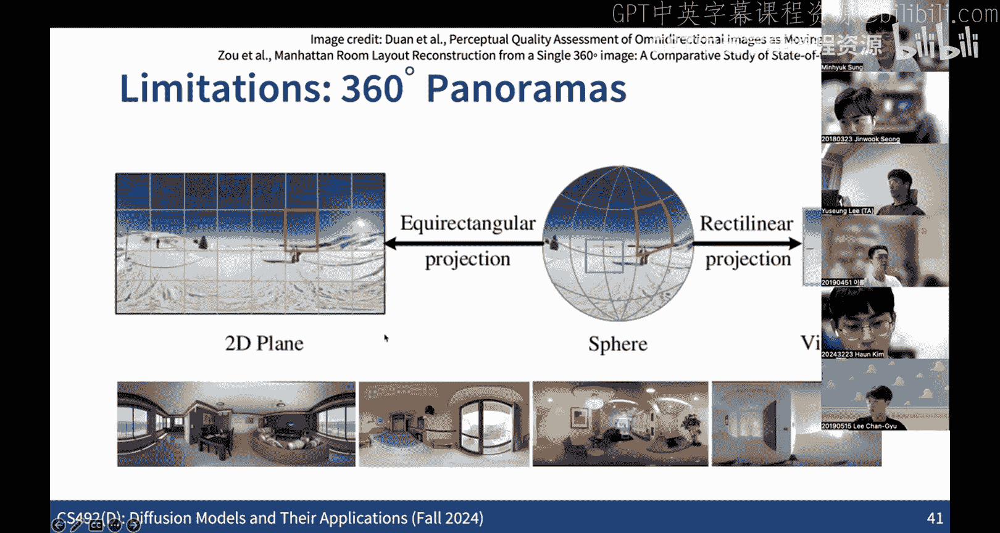

And the other things are very the same。So this will be basically a set that we are basically mapping the pixel in the instance space into some kind of some point in the chemical space。

 but now what we are going to see is that it won't be basically some kind of the one2 mapping of course the pixels so you could consider like one pixel in the instance space and now it will start to basically be mapped to one of the point in the chemical space but basically not only into the center with the pixel in the chemical space but mapped to some kind of the arbitrary point in a way that basically all the basically pixels in the chemical space should be basically interpolated with some kind of the neighbor the pixels which are mapped from the instance spaces。

So if could consider some kind of operation of the arm projection from the instant space to the chemical space。

 those with basically the case that this will basically involve some kind of interpo。

So if we want to basically calculate the pixel color at this point in the chemical space。

 since there is no basically single de point， the pixel in the instance space。

 which is like mapped to these specific point， what we need to do is that we need to basically have the4 neighbor the pixels coming from the instance spaces and then basically incalolulating them。

 right。So basically what we can see is that this is the setup that the projection and the on projection basically involves some kind of the interpolation。

So for those kind of cases， like if we start to see that actually this idea， like aoraging the X T。

 the noise data point is not working well in terms of that now we start to see some kind of the unrealistic theposts like this。

So you can see that now zombie the colors here become some kind of be some constant colors without basically losing some kind of reality in the outputs。

And if you also think about some kind of the mesh uring。

 this will be basically the same the case that the projection and the on projection basically involves some kind of the interpolation and then we start to see some kind of some pro outputs like this。

So here the question is that how we can improve some kind of the realism in the output the images and also some kind of some these 3D representations while using some kind of the same synchronization。

 the idea， so these are some kind of the improved improved the outputs using some kind of different approach for the synchronization。

And also some kind of demome the outputposts here。Compared to the previous results now we can see that the output is much more realistic if you also know about the Gaussian split。

 this is some kind of another representation for this 3D and for those kind of representation we can also apply some kind of color information here using the synchronogenic idea。

So let's get back to some kind of the de general idea for the synchronization。

 so these so basically the setup up there we are having the chemical space and also having some kind of the mapping from the instance space to the chemical space with some kind of the overlap ramps so this is like specific the example like making some kind of texture images over this leadership。

And what we call as kind of dis simplechronization is basically a set of the operations that we are basically on projecting some information defined about the instance space into our the chemical space。

And aboriaging the information like un projected into the chemical space。

 basically basically abooraging those information over the chemical space and then projecting this back into the instance space。

So this really replicate the basic kind of the operation in terms of doing some kind of disinronation。

And what we have discussed last time is that when you have some kind of the multiple this kind of the reverse process from the multiple instance the images。

 we are basically doing some kind of the synchronization for the X team minus1 here， right？

So for each of the frame， we are having the xt and compute the epsilon T and the x robot T using the2 and then sampling the x t minus1 and then averaging this。

 right？And would there be some other options for this？

So we are basically going to see some kind of the other options for them and we're going to discuss some kind of the two key factors。

The first one is basically like what we are going to take the average。

 what will be the information that will be average over the chemical space and the other thing is that what will be basically this space where we are basically conducting the demo in the process。

So those are basically two main things。So as we can see in this like the diagram。

 basically what we can consider for the taking the average operation is that instead of taking the average operation at the x t minus1。

 actually we can consider like aboveraging the x0 by T or eon T so those are some kind of the intermediate some kind of entities that we are calculating for each bisnoing step right。

So we can basically consider changing the entity basically which we are going to basically take the approach in the cu space。

So basically when you change those things， basically have some kind of three options in terms of conducting decent correlationronization。

 right？And how about changing the dno space， So those are basically all the cases that we are conducting the dno the process in the eastern space。

 right？Then can you like also perform the denoting process in the can I create this space correctly？

What is the answer for this。Okay， think about like why we were like thinking about the cases like conducting the denoting process。

 not in the chemical space， but in the instant space。20分钟。

If we want to conduct the dinoging process over the chemical space， then what should we have？

So basically， if we want to conduct the dinoing process over the can space。

 then we will basically need to have a pre trained diff model that has been trained with the data definedable the can space。

 right？So basically what we are doing here is that without basically training is some kind of another model that has been like trained for the specific the data。

 we are using basically the pretrained immediate future models to produce like many other things。

 right。So if we think about the key like generating some kind of de textures。

 if you want to basically perform the denoting the process over the the texture。

 the image domain this space， then we need to have some kind of different model that has been trained with the texture images。

 which is also basically defined for the same these 3D surface， right。

But can you also collect like lots of the images， detector texture images they find over the same the domain。

 the same the3 the surface。No， we don't have such kind of big big data that right。

 it's hard to expect to even have some like more than one detector images that are basically defined on the same distributed surface way。

So basically we don't have the noise prediction the network for the chemical space so this is the basic assumption here so if we have some kind of the noise prediction the network for the chemical space。

 then we didn't need to run this kind of the joint division we could directly generate all the data from the chemical space but since now we are assuming that we don't have the noise prediction network which is trained for the data defined over the chemical space。

 that's basically why we need to basically have some kind of some discrete detour through the instance space right。

Makes sense。So basically， this is like all these setup that we are assuming that theres no some kind of the preprint model trained with the panoramic images or the texture images。

 kind of like we don't have such kind of model we trained with some kind of the large scale data in the chemical space。

While we are basically having some kind of the pretrain diff model。

 trying to use some kind of the tones of the billions of images。

 but basically that are defined in the other space， which is the instance space。

So that's why we cannot basically directly compute the E T here because there's no network for that。

Right， makes sense。So instead step like this， what we can consider is that we first project the XT。

 the noise data point in the chemical space into the instance spaces。

 the multiple the instance space that we going be node the mapping。

And then once you basically have something the projection based on that。

 we predict the noise per of this space。And then on project this back to the chemical space and then take the average the category space right。

So this can be some kind of the another way that we have basically generated some kind of the data point in the technical space while basically having this kind of detour through the instance space。

So we can go down to instance space with the projection of the Xt and then do some load prediction and on project Epsilon T。

 taking average here， were basically compute the t and also on projecting3s into chemical space and also just like calculate Xt minus1。

 sample the xt minus1 and then basically calculate the average here， right？

So we are basically having these three more options in terms like conducting this synchronization。

Does this make sense？We are basically discussing like all different ways that we can do some sort of this synchronization in terms of what we are going to take the average in the chemical space and also how we are basically basically run this kind of dinoing process in which space so since why we cannot actually run the dinoing process in the chemical space we can basically go down to project XT into the instance space first。

 do some knowledge prediction here and then go up to the chemical space through theproion right。

So you can think about that we are having some kind of a difference sort of the roots that we are basically reaching from the XT in the chemical space into the X t minus1。

 also in the chemical space。Make sense。So which means that we are basically having the six options right the first three are basically simply running the denoing process in the inter space while taking the average of the either epsilent T or tD or the XT in the chemical space。

And the other three options are basically running the dinogen process in the chemical space。

 not directly， but through the detour into the instance spaces。

 while also averaging the either Eps T or the TD or the X T here， right。Six cases make sense。

And we can see that actually these two are the identical。 So if we go back to these2 d cases。

 we can see that like taking the average of the X T was basically going back and forth from the here to here。

This becomes like the on projection and the average and the projection becomes like synchronization like steamma as one。

And also for this case， if we on project here and take the average， and then next time 10。

 if we project the XT， then you can see that these two are actually identical。

It's like different diagram for the safety thing。So which means that now we are actually having the five cases。

 so if we summarize this， depending on like in which space we conduct the denoizing and also what we are going to take the average in the chemical space。

 we can consider like the five cases of this synchronization。

And these are also all the cases that we are conducting this synchronization only once。

 we can also consider like conducting this synchronization multiple times。

 so depending on that we can also consider like the many other cases right。

So this is like very kind of the recent kind of technique which is based on kind of the very recent resources for that。

 actually we could say that there are many basically recent work。

Doing these kind of things for the different applications。 So for the panoramic image generation。

 there has been some kind of odd using the case 3， which shows the case that we are abraaging the X T。

 as we have seen in the previous slide also conducting the diing in the instant space。

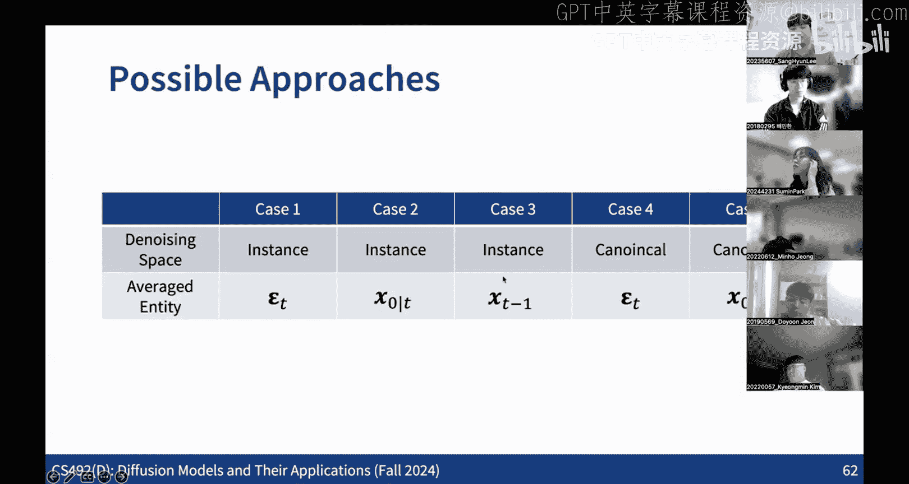

And also for the ambiguous images， the idea was like using the case4。

 which was basically averaging the Epsson T while basically conducting theno in the chemical space。

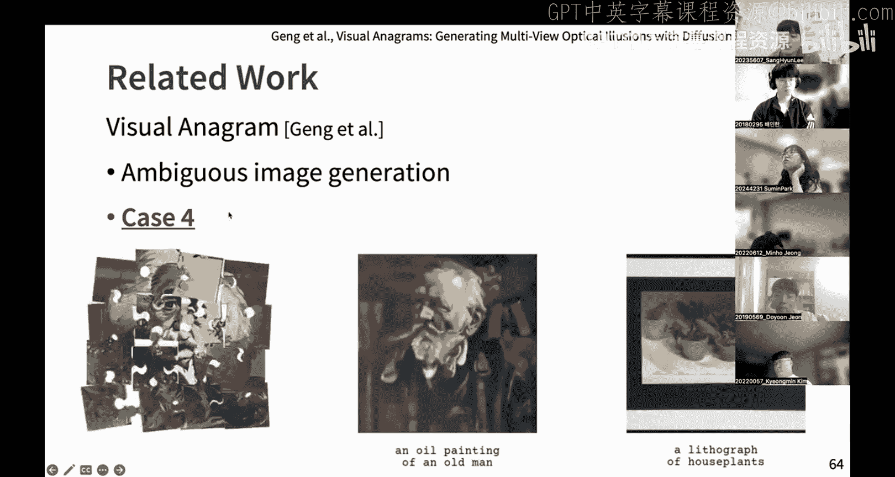

And there also has been some kind of the example of basically taking the case5 for the Me generation。

 which shows basically the case that emerginging the tweet is here while conducting theging in the cu space。

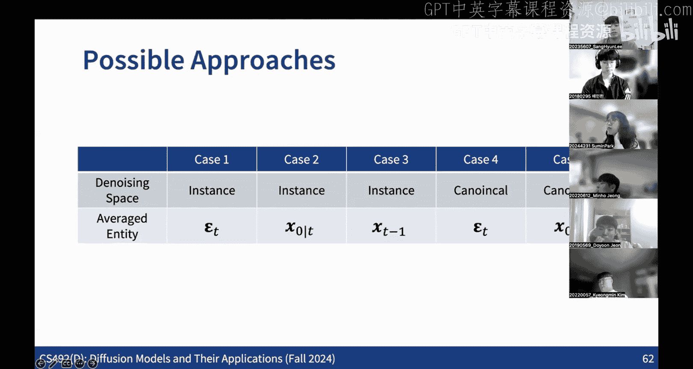

So I recommend you to check out those kind of some related work in terms of like how people are basically exploring this kind of the idea basically to produce like many other things。

 so these are all based on the very recent work you can see that there are many kind of like interest things like happening in this domain so those are basically those are kind of like very simple idea in terms of basically doing some kind of the communication between the technical space and the internet space but you can see that the differences of those kind of the different approaches or basically depending on like where we are conducting the dinoging the process and also what's the entity that we are basically taking the average in the chemical space。

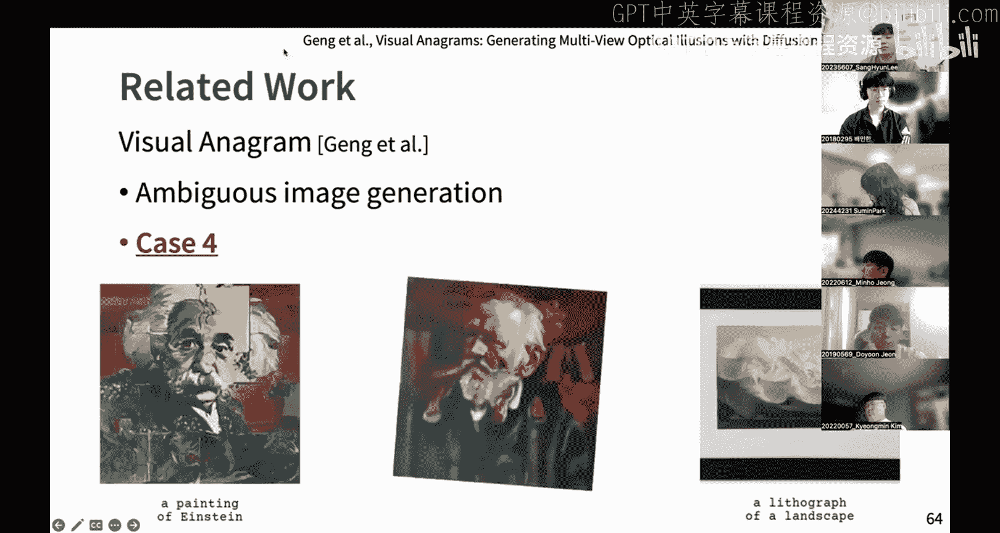

So those areけて5オです。And here the question would be is that then what be kind of the best way。

 what be kind of the best approach across the all the applications。

So I also recommend you to basically try yourself in terms of changing those kind of options and see。

 which give some kind of the best the。Let's see what we can see for many kind of some examples。

 especially in practice， is that it only depends on what becomes some kind of the information that is averaged over the chemical space。

 so we discussed the three options in terms of the entity to gra taking the average。

Whi is based on some these kind of the steps in the dinogen process。

 completing the Epsilon T and also based on that computing utilitiesities and sampling the Xmason。

So given these pre three things， what we can see is that if we take the average of the Epsilon T。

 especially epsilon T was basically this core information right。

 which is corresponding to the information about the direction who the denoging。

So if P basically average the basically epson T， which becomes basically we are taking the average of the basically direction of denoging the trajectory。

So when you basically take some kind of some aboorig of the direction of the denoaging。

 then we can actually get some kind of results， which is basically resulting in some kind of the very long。

 basically the directions early the de the process。

So it means like this may not be kind of the best option in terms of collectingron synchronization。

So the other option was basically to take the average of the Xt。

 which is basically aboveraging the noise data point here， right？

And what we can with of is that MA XT is basically a sample from is certain data dissip， right？

So what we could see is that x0 is basically the data， the real data from the real data distribution。

 we can consider that XP is also a sample from the per the data distribution。

Which means that this should be really a sample for a some specific distribution。

But if you also start to basically take the average of the XT with some kind of the some on projection and the projection。

 the operation， then the average XT may not follow given the specific distribution。

 basically being ded from the given distribution。Then this also basically some kind of a ded sample can lead to some kind of the suboptimal the outputs in the dinoing process。

And this is also the same for the x0， which is also some kind of the predicted the output。

 the final the output that we are going to see。So which means that as the X by T follows the target the data distribution。

 we're going to get some kind of the good results。But this is not the case that we are not directly basically modifying the Xt。

 but only modifying the x0 by t， which is used only for basically sampling the Xt in this formulation。

So as you can see here， what we are basically doing is that after we calculate the x0 t。

 based on this information， we only use this information to calculate Xt minus1 sampling the Xt here。

 right？So this while this is also doing some kind of the modificationification of the trajectory。

 only basically modifying the extra robot T basically resulting in some kind of the minimal deviation from the given trajectory。

 and this is basically giving this some kind of the best outputposts in the menu of the applications。

So if we compare all the5 the cases， the first three was the case that we are conducting the process in the interface space。

And the next two was basically the case that conducting thenoing process in the chemical space。

You can see that the case two and the case5 are these。Yeah。

 these two cases give some kind of depressed best outputs。

So case one and the case4 were the cases that we are taking the average Ipsency。

 which is giving some kind of really bad offers。AndWhen you also average xクティ which is the noise data point we are getting some kind of the output but which is not the kind the best output right not very。

But instead of of taking the average of the X T， you predict take the average of the x0 but。

 which is the is， now we can get some kind of the error results regardless。

 like which space like we take some kind of conduct denno in the process。Oh， wait。

Can you combine all the cases with the instance in chemical waiting。

 I couldn't get like what you mean by the instance and the chemical space waiting。

 but we can consider like combining all the cases。 So as I mentioned before， like know。

 these are also all the cases that we are performing the synchronization， only once， right。

 So for each of the cases， like we are doing some kind of some。

 you know some communication between the instance and the chemical space only once。

 like doing some like one set of the on projection averaging and also the projection。

But we can consider like having a multiple synchronous step in the one theno in this step。

While this may not give some kind of depressed outputs。

Doesing makes sense to introduce additional variance after average since averaging reduces the variance well。

 I mean， yeah we can also consider doing some kind of the introducing additional de varianceance after the the averaging so。

Yeah but yeah， so we can consider like adding some kind of de variance after the averaging。

 but what we can see is that this is basically the setup that we are using the deterministic sampling。

 so there is no variation that we are considering for now。

 but in some kind of the cases that we are encouraging the variance here then we can think about how we can also control the variance in this kind of synchronation the setup。

Any other questions on this。行。So those are some more examples。

So as you can see that obviously like averaging the direction of the denoging the trajectory doest that make sense。

 I mean you when you basically take the average of the directions。

 we can get some totally different in the deno the process and then we're going to get some kind of very random denno the opposite you can see here。

If we average the xT， the noise data point， it still kind of gives some kind of be some okay the outputs。

 but still the output is not good because like the X T can be divided from this uncertainty distribution。

And the averaging the x0 T is not basically making some kind of the big decision。

 but still making some kind of the realistic output like this。

So we can also compare this kind of approaching with some kind of the other method。

 we also discuss the SDS so we can also still compare this approach with the SDS。

And also the other the approach is to be iterated the update。

 so we also discussed this idea last time， which is basically nothing but basically iterately basically generating some kind of images from the different views。

So what we can do in this specific case for the texture generation is that once we basicallyp generate the image from the one view。

 now we can move on to the next view and only fill the missing region over the chemical space and also move on to the next view and fill the missing regions and you can repeat this kind of data process like filling the missing regions where it be iterating over some kind of different viewpoint。

 right。While this might be kind of be some easier and the kind of the simple the solution。

 what are there some kind of the expected limitations of this approach？Any thoughts on this？

So basically we are building some kind of regions based on the odd disease and bills right。

 so there is no way that we can keep some kind of consistency across the bill that are like for each other。

 right？And if you also make a look like coming back to the original debut point again。

 then there will be also no way to basically remove the s with some kind of way to scroll back to the first image right。

So basically like this kind of the method， like itly like updating the。

 it's particularly hard to best achieve some kind of the consistency of course disputes。

So if they compare the outputs that we can obtain with the synchronization with some kind of outputs that we can get with the SS and the it the update。

 you can say that the synchronization， the approach gives some kind of the more realistic the outputs like this。

Especial for the SDS， we see some kind of some strong bias of the colors， as you can see here。

 typically based on some kind of the higher weight of the CFG。

 then we typically we get these kind of some sort of some bias in the colors and also supposed it the updates for some of the cases like it looks okay but we start to rotate the object。

 then we can see some kind of the artifacts in terms like making some kind of seams at some kind of the point like this。

More examples and you can see that no you can see some kind of the patches of the colors here some images here。

 so which is like failing to basically remove all the seas while this inchronation can generate some kind of the more like the smoother the outputs across the use。

The same approach can be also applied not only for the mesh textures。

 but also the Gaussian split textures as well。I some more examples。So now this looks good， right。

 so this synchronization looks like good in terms of that you can produce some kind of the outputs。

But also what we can see is that basically that compared to SS is that actually synchronization gives some kind of the better results compared to the S。

 only when we can have some kind of stronger conditions。So basically。

 what we can see in those kinds of cases is that these are some of the results that we are reportingosing some kind of the depth conditioned division models。

So what we can basically see is that since we want to generate the images that are aligned with the silhouette of the shapes or some kind of the depths of the the shapes。

 what we can do is that we can first render the depth image of this radio object from each of the view and use that depth image as some kind of the condition in the control lens so those are all the cases that we are taking the depth images from each of the views as the condition and using the control to produce the textures。

So those are basically the cases that we are basically having the very strong condition for each of the view。

 and based on that we can give some kind of some strong guidance in terms like what's the output images that we want to get。

But if we do not have these kind of strong conditions。

 then the synchronization may fail to converge and basically case still produce some kind of things so this can be like one limitations and seems like all disynchronization requires to have some kind of strong conditions for the final outputs like the depth images。

 it cannot be directly applied for some kind of 3D generation。

 which is the case that the geometry is not given or bio basically generating the geometry itself like from scratch without having any kind of conditions。

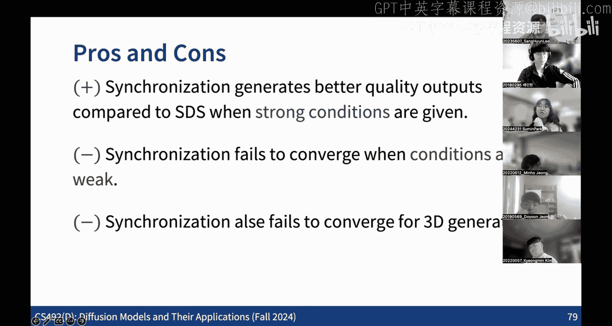

So those are some kind of examples that we are generating the panoramic images without the any depth conditions。

 so without having this kind of like strong conditions。

 we will typically get some kind of results which can be more realistic but fail to basically remove all the things。

 making the smooth the upwards。And compared to that。

 what we can get with the SDS is that SDS basically produces like no less like theres some similar output like this and why're basically making the all the output looks like less realistic。

So you can see there are some kind of the processing coins like SDS can be good in terms of achieving some more the consistency and coerency across the old abuse。

 while basically compromising basically the in the outputs。

 but if we have some kind of the strong conditions like the depth images for of the cases then we can consider basically using the synchronization in a way that we can keep some better the realistic the more realistic outputs。

 while also achieving the consistency as well。So these are some kind of the comparison between the synchronization and also DS SDs。

Any questions on this。So far， we have discussed the idea in terms of how we can utilize the pretrained diff model without any kind of defined tuning to produce like many other things when。

Using the either SDS or the synchronation。So the last topic that we are going to discuss for today is basically how we can also fine tune given the division models in terms of that we can also improve this kind of the the you know。

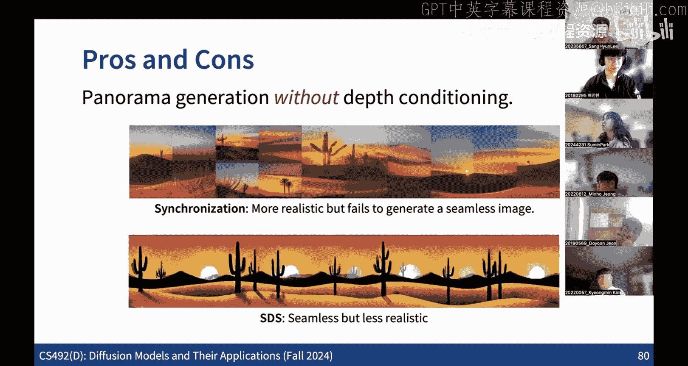

The quality of the outputs of the joint division the process。

So here the question is how we can also fine tune the some image diff model， like for example。

 like stable diff in terms of that we can also improve the quality of the petroic images or the manufacturers in the joint diff process。

Interestingly， for that， we are going to utilize the same approach of the control lag。

So do you remember like what we discussed with the control？

The approach of the control that was basically defined tune the equation model。

 using some kind of the much smaller data set， some typical some conditional degeneration。

 the image generationeration， we use some kind of tens of the thousands of the images。

 the pairs of the prompts and images while the original the image differential model has been trained with the billions of the images right。

So here we want to do the same thing， we want to fine tune some kind of pretrained stable diffusion or some kind of the image diffusion models with the much smaller the data set or the panoramic images or the actual images。

And also adding some kind of review， additional or some loadable parameters into the printed model while bridging most of the parameters given in your network。

So here the question is that how we can introduce kind of the additional the into the noise bridge and the network in a way that we can fine tune those things using the small scaleD data etc。

And here for then， like we are going to use the same digital convolution the idea。

 so zero convolution was basically nothing but basically introducing the two deproors。

That has been that will will be applied to all the basicallyD outputs in the neural network with the one by one decomp。

 which basically means that we are using the same the scaling and opposite parameter A and the B。

 the scale of the numbers to all the outputposts in the neural network。

While initializing these two parameterss in digital zero。

And the idea of the control lab was basically encapsulating each of the layer in the neural network with basically padding digital completionvol。

 so before or the a and the each of the neural the layer。

 we are adding the geo composition in a way that we are introducing the two parameters for each of the cases。

 so having like one geo completion before the neural network each of the layer and also the another digital completion after the layer right。

So this was basically the very simple the idea that we are injecting some kind of the new parameters to be tuned with some kind of additional the data set。

So while we basically keep this， what we are also going to assume for these specific cases that we are going to assume the case that we have some kind of the pre specifiedified de mappinging between the instance and the chemical species。

And based on that， we are also going to assume that the correspondence across the pixels。

 across the instance images is also predefin。ButGiven this kind of the predefined correspondence across the pixels in the across the instant images。

 what we are going to do is that we are going to introduce some kind of the new module。

 which is called the correspondence aware the potential module。

So what we can see is that let's say like this the left most part is basically showing some kind of the architecture of the noise precision the network of this tail division。

 having mean some kind of the multiple delay layers in the unit， right？

So given this kind of pretrain the noise presentation the network for each of the layer。

 we are going to add this cross attention the module。

Which is basically conducting some kind of the cross across the instance images based on the given the information about the correspondence of the pixels。

So all the yellow parts are some kind of the new components。

 which is basically the correspondence attention corresponds aware the cross attention the module。

There's see those kind of things。So how we basically define this kind of the correspond over the cross in the module for then。

 like if we see this kind of the diagram here， let's see that like this pixel S is like one of the pixel in this specific instance space。

And we know that this pixel is specific map to this point in the another instance， the image here。

 So let's say like this is the else， the instance base and then this pixel S here is mapped the T L point。

 this point here。And NL here this basically means the set of the all the auditors of the pixels near basically this point。

 which is basically map to from the D S here。And then using some kind of the each of the layer in the unit。

 we are also calculating the features for all the pixels。

And what we are basically doing is that we simply basically compute the cross attention using some kind of some small layer。

 the shallow at the layer， which is calculating the queryrry key and value。

So given the feature of the pixel as here， we compute the query and for all the basically the neighbor the pixels near the TL here。

 the corresponding the pixel here， we are also calculating the key and the values。

And then based on the we are basically calculating the attention here and taking the wire basically optimize here。

 right？So you can see that this is nothing， but this is like very typical the potential module while taking the query from the pixelix S here and taking the key and the values from the corresponding depict pixelles。

 the neighbors of the corresponding the point here。

So this is the basic idea for the corresponds over the cross attention。

And what we do is that while we are basically adding some the neural conversionvol the operation before and after each of the layer of the neural network。

 we additionally basically inject this corresponds or the attention the model here。

 in terms of that we also do some kind of the in the communication across course given the instance images given some kind of the correspond information。

So you can see that this is kind of like very similar with like what we have discussed for the control net in terms of that we are basically adding the zero colvolution delays here。

 while are basically adding some kind of the external component。

 which is the correspondence where the course attention。

So kind of like simply the idea but basically where after adding this and fine tune the neural network now we can see much better quality of the outputs like these kind of the panorraic images so for those kind of long the prompt now we can see some like much realistic some panoramic images。

We can also get some kind of results for this some car styled imagess and also some kind of oil painting images like this。

And can you guess some kind of some prosic coins for this specific method？

So what is some kind of the process it for this type of this fine tuning based method。Anys。

Compared to this some zeroche method without any fine training。

 what to be some kind of the pro consequence defined2 based based methods。y soをスポしていんですね。Yeah。

 this will basically takes a more resource for the generation。And also。

 but basically the good thing is that this will be able to produce some better results because like it's like fine tuning based on the given panoramic images。

AndBut the downside is that basically it give takes some more the cost for degeneration and also the kind of the biggest。

 the kind of the drawback is that it requires a fine tuning for each case like having the chemical and the instance basically the mapping。

So it basically this means that if we want to produce some kind of the mesh the detector images。

 we need to basically fine tune the network for each mesh for each basically the mapping between the chemical and instance the spaces because you can see that the course attention is conducted based on the correspondence across the pixels of different instance images。

So this is basically the problem in terms of that defined fine tuning should be done not for some kind of degeneerative cases。

 but the specific mapping between the chemical and the instance species。

And what we also have observed in the control net， the case is that actually the control net generals quite well。

 so even for some kind of the unseen， some kind of the condition。

 the control that often basically produce some kind of the realistic outputs。

So we can also see that this kind of the fine tuning the based method also produce some good results。

 but as the kind of the condition is basically is not this case something that has not been seen during the fine tuning。

 the output can be some kind of the un lististic as you can see for those kinds of cases。

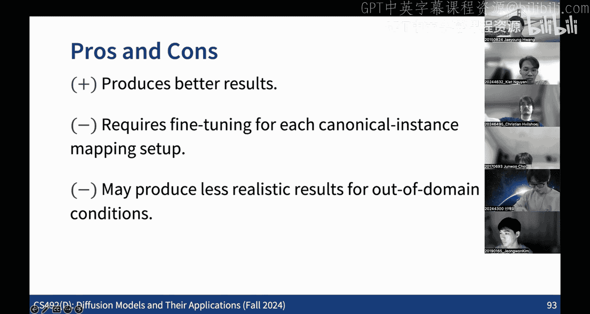

For example， like for the case that like when you fine tune the diffusion model with some kind of the indoor sceneD images。

 it previously test the defined the model for some kind of the prompt describing some outdoor scenes。

 we can still get some kind of the outputs， but the output becomes slightly less realistic。

So for those kind of the out of domain cases， actually we can consider using not the defined the model。

 but the geo method like the disingregronation。So those are some kind of some pro coins for the fine investment method。

Any questions on this？So those are like all the very critical ideas in terms of like how we can utilize some kind of pretrain digital models for the to produce like many other things and next time the next week we are also going to discuss another topic which is about the inverse problems we're also for some kind of the conditional degeneration and then we are also going to move on to some more like the theoretical topics which is about the different way to basically run the diversity process and also we going to start to discuss the flow based model as well。

And for the next Wednesday， we're going to have the session for the assignment5。

 which will be about basically implementing re synchronization and see also compare the apples with DSS case。

So I'm going to see you next Wednesday and if you have any questions on this please let us know on slack。

Okay， thank you。 and I will see you next Wednesday。

