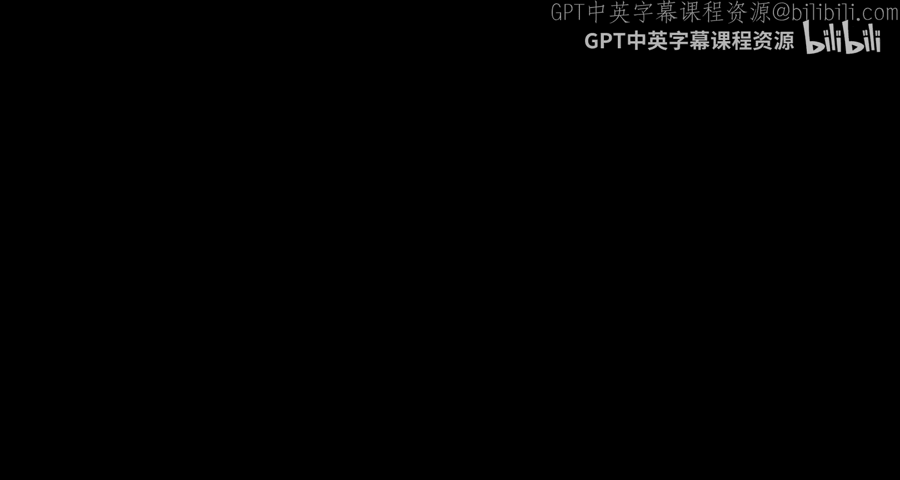
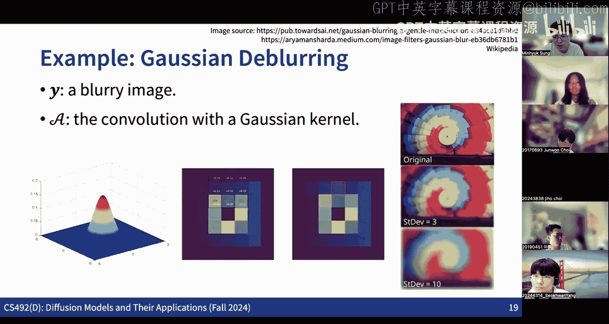
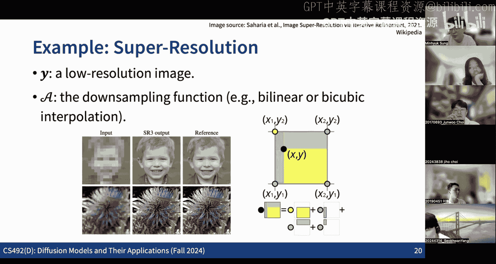
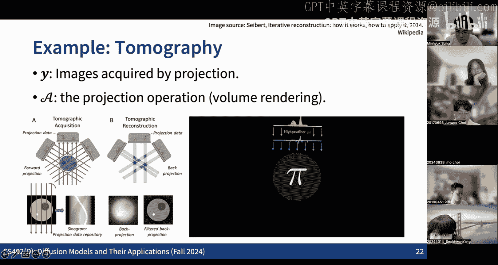
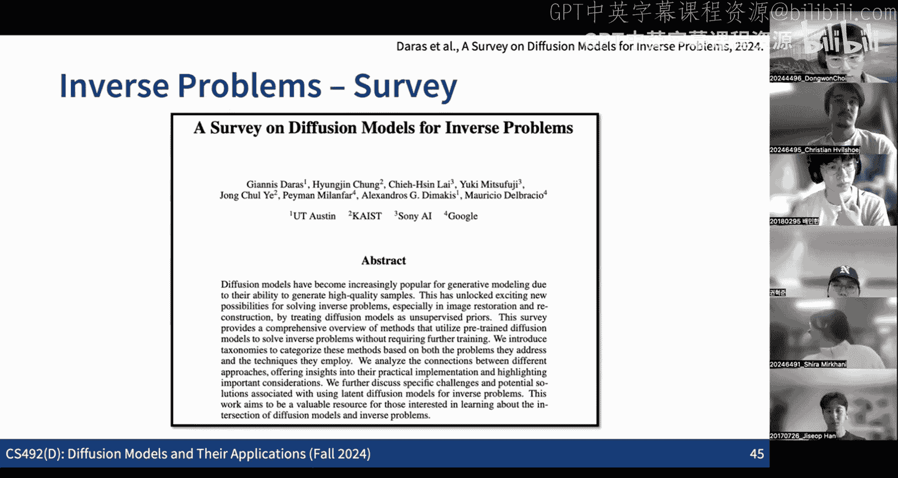

# KAIST《扩散模型和应用｜CS492(D) Diffusion Models and Their Applications (Fall 2024)》中英字幕 - P11：Lecture 12_ Inverse Problems 1 (KAIST CS492D, Fall 2024).zh_en - GPT中英字幕课程资源 - BV1mwpUzREqX

Okayケ to deco just。

Okay， so let's get back to the lecture， So the reason that we had that quizzes for today is that without having that understanding of the that part。

 you won't be able to follow some details of the2 this the lecture。

 so we briefly reviewed the basic ideas about the conditional distribution things and also the t。

So for these S three questions it's placing the PY the Py given the x and the PX。

 this is like just a mineral like using the marginalization and also the base rule right so based on that now we can express the PY as the integral like multiplied by multiplying Py condition the x and or the PxY。

And also， the second question is the same thing， but just simply replacing x into the X0 and also the Xt conditioning。

 right？And since I also said that， this conditional distribution is the same as like dropping the Xt because X T is also samples from the x0。

 because so adding the Xt the condition is not providing any extra information to the y right。

 So based on the defect fact， we can also say that the probability of the y conditioned by X T is also having these form right。

Actually， this conditional distribution is the things that we are going to calculate into this lecture。

And also from the tD formulation now we can also compute the expected value of the x0 given the xt which was denoted as the x0 by T in the pipe structure right and from the t formula then we could all calculate this sorry Proor you're not showing the slides right now so you're not seeing my slide sorry。

嘅要嘅事咪你。Yes。Yeah。So let me get back to the first things。 Yeah。

 so the P Y is basically can be derived from the marginal edition， the base rule。

And also the PY conditioned by Xt can be this formulation based on the things that we have seen in the previous slide。

And also from the tD formula， now we can calculate the expectation of the X0 given the X T。

 which is something that we will also need to implement in the assignment requirement so based on the t the formulation。

 now we can calculate the expectation of the X0 from the X T like this。So please remember these two。

 so these are the fitting that we are going to calculate in the of the parts in the many of the applications。

And given these facts。Can even see my slid and hear my voice。Seems like the connection is sensitive。

Yess。Yeah， from this， like what we wanted to do is that， look， we are now seeing that you know。P。

Y conditioned by x0 is basically having this form。And also the Px0 condition by Xt。

 we are also modeling this as kind of the another de Gaussian distribution based on the expected value of the x0 keep the xt here right。

 so since we can basically calculate mean here of this specific conditional distribution is basically like basically we are defining the variance here。

 so we are specifically defining the variance as some kind of some isropic de variance here。

And given all these facts， now we can calculate the conditional distribution of D y giving the xk。

 right？whichch will basically having this form because now we are seeing this specific the distribution and also the likelihood distribution and when you combine these two based on the properties of the conditional the gausians。

 now we can see that this specific the conditional distribution of the Y。

 given the Xt should have this mean and the variance right。

So these were basically answers for thequiz。Any questions on this？

So your participation course will not be counted based on whether your answers are correct or not。

 but based on whether you submitted some reasonable answers。

 so if you submit blank the page which will not be counted as that you submitted but if you at least like try to solve the questions then it's okay then you it will be counted that you participating okay。

And are you also seeing the slides of the E 12， I just post a link in the E 2 state channel。Okay。

Any questions on this？A is a matrix。Here， it can be a scalear or a matrix。Okay。

 so these are some kind of the details that we are going to see in the two days lecture。So for today。

 we are going to basically wrap up our discussion about some kind of the guided generation。

 so we have seen some multiple cases in terms of doing some sort of the conditional generation right so the first example was about the control net。

 which is basically fine tuning some kind of the pretri diff model with some kind of the conditional input。

 especially when you have some kind of the pairs the input condition and the outputs。

 but when the scale of that kind of the pairs is basically not that big。

 we are basically fine tu some kind of the pretri diff model in a way that we are basically copying the inputcoding part to basically in the condition as well。

And almost apply， we find2 the models， we could be able to produce some kind of the multiplesome conditional the outputposts。

 like taking this sketches the input and the human post the input right。

And this was the case that we are basically assuming that there are some kind of some kind of the data。

 the data set for the input condition in the output pairs over those kinds of cases that we could consider fine tune the model。

 but you do not have any kind of the data to train to fine tune the network。

 then we could also use the SDD approach， which is by starting from some kind of the slightly like less realistic。

 some data point like the sketches in this case， and then running the forward process and the reverse process again in a way that we can find some kind of the closest some realistic the data point from given the unrealistic condition。

So this was basically example of the training free the conditional generation。

And also for some kind of in painting the cases specifically。

 we also discussed the idea of the repain， which is basically the case that we are assuming that we are having a image and the mask and then for the foreground region we are running the demoing the process and the background region we are running the fold the process and then combining the opposite every time step key and then basically repeat this kind of some combination。

So this was some kind of very practical some engineering the idea in terms of that we can do also some in painting。

 but this was very interesting the example in terms of that we can now utilize some kind of the precurrent diff model not only to produce entire the data points。

 but also to basically fill some kind of the missing region。

 where basically preservibing some kind of the other background part and this could be done without basically fine training network。

 but just using some kind of I mean network for that specific purpose。

 but using some kind of the pretrain the di model for the entire data data without any kind of conditions。

And we are going to see some kind of some general def framework to solve all those kind of things。

 So the problem that we are going to see is basically the problem that is called the inverse problem。

Which is the case that we are basically having some kind of the measurement of some kind of the data that we want to see at the end。

 but the measurement is basically not some kind of the data some directly saying the kind of data that we want to see。

 but basically some kind of observation through some kind of the angle。

 so let's say basically we are having some kind of the y here。

 which is basically the observation of some culture factor of the X here。

And the only thing that we know is that basically D Y can be compute by applying some kind of be operation。

 which is the a function here。So we are basically seeing the x。

 which is the data point that we want to see through the angle of the function a。

 through the operation of the a here， but the only information that we are seeing is basically not the x。

 but the y。And also， there can be some kind of the corruption in our the measurementment。

 which is basically adding this kind of some Gausian on the noise here。

So given the why how and also when we do not know the information about the Z here。

 how can it be the original the qua vector x， given also the information about the a function here is the basically the university problems。

So again， basically the information that we have here is that we are having the measurement Y and also the information about the function A here。

 which is basically some kind of operation， which is basically apply to the quarter factor the X。

 so we know the Y and the A， but we don't know the X and z So z is the basically the corruption some kind of the noise added to the R measurement。

 So in some of the cases， the sigma there can be0， which means that there is no noise。

 but we are also having the y and the A and given that how we can get the x information here。

So here basically what you can see is that if the A is basically a linear function。

 which means that if a becomes just like multiplying a matrix to the x and also the matrix is basically full rank the matrix。

 then we can directly solve this big problem by just taking the imverse of the a matrix to the y right but for most of the cases。

 this is not the kind of the deterministic kind of the case like it underde some kind of problems that there can be some possible multi of the x from the given D y。

So how we are going to solve this kind of problem is data question here。

And there are tons of kind of cases， so some of the applications that we are going to briefly see is that like for example。

 especially for the images， we can think about the cases that we are having some kind of the blurry images like this at this you can see the white button right so given the bluried images how we can recover some kind of clean images that basically the cost basically the blur images from some kind of blurring operations。

So in this specific case， we can think about the specifics Y becomes some kind of the blurry image like this。

 and if we assume that the specific Bness comes from some kind of the specific。

 some kind of de blurring the model， for example， like applying some kind of Gaussian corner。

 the convolution of the Gaussian corner becomes the a function here。

So when you assume that the blurry image comes from that we are basically applying some kind of gaussian corner with some kind of convolution over the entire image then we can think about that the convolution。

 the operation becomes the a function and also we are having the blurry image right。

 but given these two information we want to recover the original the clean image。

this can be like one specific example。And also for the full resolution。

 so let's say we are having some kind of the very low resolution images like some pixelated images。

 as you can see on the left hand side， and we want to basically cover the higher resolution images of that specific given the input rate。

Then we can think about like how we can basically you know run the other way around from the high resolution image。

 how we can get the low resolution image， So that becomes our the a function。

 that's basically some kind of the interpolation， the function like bi linear the bi cubic the interpolations。

So given that basically the interpolation the function and also the low resolution image。

 how can you cover the high resolution image is basically the super resolution the problem。

 And this is not only the problem for the images， but also for the 3D or some kind of many other signal。

 would you video many other things。

So we the tradition can be like one application。And also the other application is the in painting and the outpa。

 so these are like all very nice missile that we are basically removing some of the objects or some kind of some clusterutters or some occludes in the images by having some these kind of the masks over the images。

So given that the image with the background， what should be basically the AEDD function in these specific case。

We have seen this case before。So in the in painting case， like what should be the a function here？

Yeah， it should be the masking function for the background region。

 right in a way that we are only taking the background region from the some kind of the the causal factor。

 the data point and then matching whether this is the same with the background the information that we have right。

 so it should be basically the masking the operation for the background region。

So these are some examples in the image processing。

 but also for the many other things like the other example might be the tomography or so many other the 3D reconstruction consultant cases。

 so tomography is especially technique that we can see for the CT construction or the MRI reconstruction for many medical imaging cases。

 so these are typically the cases that we are having some kind of some projections of the 3D object into the multiple use。

And the projection arely based on some kind of the bo render。

 which which basically means that the ray basically pennoterate through the object and accumulating all the information through basically the intersection interactions through the particles in the object。

And typically the way that we can actually recover the original discrete3 object from the projection is basically doing basically another wave of the accumulation from the 2D to 3D。

 so this is basically one example that we are accumulating some kind of the information through the penetration of the ray approach of the view。

And then we investigate do the accumulation the other way around from the 2D to 3D。

 you can see that now we can recover the original the 3D information in the 3D space。

So this is basically the typical technique that we can see the toography。

 but also for those kind of the toographic in the construction。

 we can get a more accurate the 3D reconstructionconial atmosphere when you have some multiple abuse。

 basically many protections from the multiple different D abuse or the cases that when you have some kind of disperse abuse。

 we also would need to basically solve this kind under determined instinct problem in terms of that there can be multiple the causal factor X given some kind of images from different abuse。

So this kind of thing for the inverse problems， the thing is that the solution the problem may not be unique。

 so that's basically why we need to there's somehow delivery some kind of the conditional degened models in terms of that we can generate some kind of the realistic the data point that also satisfies the condition even as some kind of the measurement why the problems。

Basically。So in this case， basically what we are going to do is that as we have discussed in the previous lectures like digital model is like all about basically how we calculate this core function right so once we are able to basically compute this core for the data point noise data point to XT based on that。

 basically we can run the de process using this core to get some kind of realistic data point。

So let's assume that we are having a kind of the pretrained di model。

 which is basically giving some kind of the information about the score of the voice data point X team。

But now we want to basically do some kind of the conditional generation in terms of that we are sampling the like the Xt。

 given the condition of the Y。So when you only have the information about the score of the X T。

 unconitional score， right， how we can also calculate the conditional the score given the y here。

 right。So this is exactly what we are going to do。And from the base rule。

 basically what you can see is that if we consider the condition of the X T conditioned by D y。

 this can be actually seen as kind of the sum like these two。The unconditional noise。

 the X T here and the condition this cor in Y， given the X T。So basically。

 what we can see is that while basically we want to compute the score of the X T given D y。

 to compute this， especially like when you assume that the unconditional noise is basically given。

 the only information that we need to know is basically the score。

 basicallys the condition the problem the score of the y conditioned by the Xt。

So if we can compute this specific score， now we can do some kind of the conditional generation based on the information of the unconditional score of the Xt here。

 right？So the key in the like solving the inversese problem using the diffusion model is basically all of obviously computing this part。

And actually， in the previous lecture， we discussed like how we can calculate these part。

So do you remember， like what is the names of the technique like computing those score of the Y conditioned by Xt？

We discussed two techniques for this。If you did the assignment，2。Then you should have known this。

Yeah it basically class guidance and quant free guidance right so the idea for the classifier of the guidance is that when the y is basically label for some kind of images。

 we could consider basically modeling these specific score the y condition by Xt as some kind of the gradient of the log of the output of the classification the network So the idea for the classifier the guidance is that now we are training a classifier which is taking the Xt as the input and basically predicting the class the label for the image and the taking the gradient of the log of them so that becomes basically the score for this template。

So this was the case that when we basically have the wired kind of labels for the images。

 we are basically additionally training another the network。

 which is the classification network and then competing this from the classification network， right？

And the other way around， especially when the Y is basically not a label。

 but any kind of the condition was to basically also training the network in a way that we can also predict the conditional noise as well。

So the idea of pretty class free guidance was to basically now modify the architecture of the noise prediction network in a way that it can take the condition as well as the kind of input。

 So we could basically provide the nerve condition。

 which is the case that we are predicting the unconditional noise。

 were just taking some kind of condition in a way that we can take the condition of the noise。

And since basically we are having this kind of the relationship between the noise that we are predicting and also the core function here。

 we could consider basically combining these two the output of the unconditional and the conditional the noise。

 which become some kind of the modified the noise， the classified fake guidance based some kind of degeneration。

And this was the case of when the weight is the1， but we could also do some kind of expolation by just setting the lambda to be greater than one。

 right。So these are all the examples that we discussed before。

The downside is that these all basically require to have some kind of the some training data including the pairs of the conditional input and the outputs。

So that's the thing if we have some kind of a sufficient amount of the training data or for the pairs of the conditional input and the output that we can either consider like train using the classifier guidance or the classifier free guidance。

 train the neural network to predict this information。

 this score the Y conditioned by the XT using the neural network。But here。

 the question is that when we do not have some enough amount of the kind of the the the。

 the pairs of the condition of the input and the outputpost。

 then how can it still compute this property？So if you think about the cases of in painting were some kind of super resolution。

 either we can consider basically the collecting lots of such kind of data。

Like taking some kind of the masks in the images or just taking some low rotcing images and training this kind of the network right。

But without like having like some hot fine tu， can you still do the kind of solve the in problems as well。

So we are going to briefly discuss the idea for them so here the thing is that how we are going to model this specific score without the training or without defined tuning。

So let's think about the some easy case first and by the way， after basicallying all the formulation。

 actually you're going to see that the solution for this is a case very simple。

 just like adding one line of the code in the denoting the process you're going to see how it basically works。

So let's first basically think about the some E case first。

 so think about whether the a function is a basically linear function。

So linear function basically means that it's a select matter of like multiplying some kind of the matrix to the x0 here。

 let's see some kind of the output that we want to see。

So it can see like we are basically we want to generate the x0 as the output of the denoing the process while basically the measurement to y is kind of given as the condition as the input。

 right。And the relationship between the x0 and the y is basically represented with the matrix a here when the a function is the linear function。

And as you can， actually the things is that most of the applications that we discussed in the previous slides are basically the cases that a is actually a linear function。

 like all the convolution or the interpolation or the masking projection。

 like these are all the cases that we can represent the relationship from the x to the y as kind of the matrix。

So you can think about what these are basically the while we are basically seeing some kind of especially case。

 actually this can cover most of the applications that we discussed before。可以。

So based on that what we are going to see is that as we have seen in the previous z。

 when we basically have these two conditional distribution like y from the given the x0 and from the x0 to the Xt。

 now we can basically see that the conditional distribution from the of the y given the Xt can be modeled in this way。

Does it make sense？So here， basically one thing is that at the end basically what we want to see is basically the conditional distribution of the y given the xt。

And from the relationship from the x to the y here。

 the only information that we can basically get is basically the conditional distribution of the y from the not given the X T but x0。

 right？Can see here。So from the property of the Gaussian distribution。

 since the Z is basically the sample from the unique Gaussian。

From the properties of the the Gaussian distribution。

 what we can easily see is that the conditional distribution of the y。

 given the x0 can be seen as kind of the another the simple de Gaussian distribution like this。

But here， the thing is that what we need is basically not exactly y conditioned by the x0。

But actually， we need the information about the Y conditioned by the Xt。

In a way that we can add some kind of guidance at the everyday Knowging step。

So what we do is that we are modeling this notly conditional distribution of the x0 conditioned by Xt using the tD sub the formula by taking the mean from the t formula and adding some kind of some you know arbitrary barriers here。

So let's assume that this another conditional dis like x0 from the X T is another de distribution。

In a way that we can also derive some kind of the approximation of the Y， given the X T。

This makes sense。If you are not clear with this， I recommend you go back to the quiz and the answer for that and see how we can derive those things。

 so those are asking case on the output that we could see from the quiz pool so you can check it out。

So the thing is that when the information about the probability of the y given the x0 is basically given into this Gaussian distribution and when you also model the conditional distribution。

 the X0 of given the X T using another de Gaussian distribution。

 now we can approximate this specific conditional distribution。

 Y given the Xt using another de Gaussian distribution。

 which is basically having this mean and the barriers here。

So you can see that the mean become some kind of the skilledd the t this output scale by the matrix a here。

 right？It's some kind of complicated about us here。Then as we have seen in the previous slide。

 what we basically need to is basically about the score function of the y given the Xt。

 since we can now model the distribution of the y of the given the Xt。

 it's just a black middle like competing the you gradient of the look of like this probability。

So its like if we do some kind of the calculation， So let's simplify the notation in terms of that we denote this entire the variance as the big sigma here。

And then we first take the log of the probability distribution here。

And then taking the gradient of the log they probably did。

And you can see that now this core function can be calculated in this way。From the chain rule。

 what you can see is that now we are calculating this factor， and if you also see this factor。

 this is basically nothing but taking the difference between the measurements and also kind of the prediction of the X multiplied by the a here。

 right？So what you can see is that this x0 by T is the prediction of the x0 at every times the T。

And from this， now we can see how the output of the measure one should look like by multiplying the a here。

And we basically see some kind of difference between the real the measurement that we are also getting the observation that we are getting from the prediction。

And this difference is basically multiplied by some kind of scaling factor here。And also。

 we are multiplying the gradients of the ties with this back to the Xt here。

So we have seen that like how we can get the kind of expectation that zero at the given the X T using the formula。

 right。So now you can see the idea in terms of how we can calculate this core function of the y given the xt。

Make sense。So from all the kind of the calculationc。

 now what we can see is that especially like weekly， I go back to the previous link。

If we model this specific conditional distribution that's kind of the the the the X zero condition by Xクテ like this know knowian distribution。

They can calculate so we can calculate the mean here。

 the thing is that we are basically getting some kind of the arbitrary variance here as kind of some isropic de variance。

 so if we model this conditional distribution in this way。

 then from this specific assumption now we can calculate this core of the Y even the xt。

And it's basically mineral basically modifying our basically the noise prediction with this kind of the extra disc scope。

 the term in terms that we are given some kind of the guidance， the demono in the process。

Doest make sense。And this technique is called the pseudo inverse guided diffusion models。

 because like if we think about the special case that there is no kind of the corruption in our the measurement。

 for example， like for many of the cases， like the resolution or some kind of the image in painting case。

 we can assume that there is no kind of the noise in the measurement in this specific case that this killing term for the difference between these two becomes some kind of like multiplying the pseudo imverse of the a here。

You can say that like this is basically multiplying some kind of pseudo imverse of the A here into the some kind of difference。

 so that's why this is called the pseudo imverse guidance。Is cream。Any questions on this？

And now we are also going to see even a simpler version of this。

So previously like we assumed that the variance of like this conditional distribution is kind of the Rs cube。

 right？So let's assume that now the variance is zero。 think about some kind of special case。

 like when the variance is basically zero， then this basically the case that the conditional distribution becomes some kind of deductta function like zero variance。

 we always get the mean as kind of dis sampling the outputs。So in this specific case。

 now what we can see is that now this like conditional distribution of the y given the Xt is also simplified into this form。

So we are basically dropping the like RQ times like AEA transpo stop here in the variance here。

Itals like R 0。So now we can see that the conditional distribution like y given the X T even become simpler。

 like in this way。AndWith this simpler the Gaussian distribution。

 let's also lift up basically the assumption of the linear function。

 So let's think about like any arbitrary a function。

 So now it doesn't need to be even like linear function。

 Then we are also going to see this specific the conditional distribution， right。And from this。

 if we compute this core function， then this will basically have this form。Its called the y。

 given the x T， basically also taking the l to difference between these two and also taking the gradient of this。

 basically the l to the difference。So again， basically here。

 basically this term is taking the t this from the X T。

 we are getting the kind of expected value of the x0 and basically feeding this into the A operation。

And this output should be close to white， right， So that's basically the output that we want to see。

So we are measuring basically l difference between the real the measurement y and basically y。

 which is obtained from the prediction of the x0 and then taking the gradient with respect to the Xt with some kind of killing term here。

So this will be basically some kind of the offset of this chord that we are going to basically add into our the prediction。

对。And even what we can see is that how we can apply exactly this into the den in the process。

 So let me also go back to the things in terms of the DDI DDP and the reverse process。

 So we are going to say the DDPM case here， but actually DDN case is also is not different So the DDPM the D in the process from given the X T we first basically do some kind of noise prediction here。

 based on that we get the basically expected value the x X0 from the Xt。

And then based on that we compute the mean from this distribution and we basically sample the X minus right。

So you please see like all these steps in the one step of the denoing that one actually we can see is that the Xt minus1。

 which is for example from the Xt。Can be seen as kind of be like some a function with respect to some kind of the noise prediction here。

 right， So this is the predicted noise。 And you can see that X T -1 becomes like multiplying some scaling factor into the predicted noise。

And adding some kind of the the other the offset， right？

So xt minus1 is basically the off function with respect to the noise here in terms of that we are just simply having some scaling factor here and adding some kind of offsets here。

Actually， while the formulation looks complicated， it's basically nothinging but like multiplying some scaling into the noise and adding some offset。

 right？And here basically what we want to do is that now we are going to modify this noise， right？

So now we are basically not just taking the unconditional score but basically adding some kind of the conditional score as well。

So which means that we are not just directly taking this noise。

 but adding some kind of a conditional noise factor here。

And this conditional noise basically can be calculated by this core function that we just calculated in the previous dislike。

So if we can calculate the square of be y in the Xt。

 now we can calculate this unconditioned noise with some kind of scaling factor。

 and you just need to basically add these to the some predicted noise， right？

So if we do like all these kind of calculations， like just like adding this additional noise term into the DDPMD formulation。

Then what we can see is that we are also modifying the x t minus1 right。

 So let's say like x minus-1 prime is especially the sample that we sampled without a conditional depart。

So X t minus-1 prime is typically simple at the time step the t -1 we basically the noise unconditional noise here。

So you basically first example the xt minus1 prime using the unconditional noise。

And if we also get some kind of the X minus-1， with the conditional basicallys score or the termss there。

 the what just need to do is that we just need to add this extra tone。

RightSo you can see that this is think but in this formulation。

 we are replacing this unconditional noise into the sum of the unconditional noise and the conditional noise。

Make sense。Just replacing this。Scorre the noise term here include a sum of the unconditional noise。

 plus a conditional noise。And let's say the X t minus some prime is basically the X the X t minus-1 the sample without the conditional noise。

 only using this part， then we just need to basically calculate the offset。

 which is coming from this additional part， right。And what you can see is that it becomes basically adding biton。

 which is some kind of be some skilled the gradient of the altaose。

So if we basically denote this k term as some kind of the here。

 then what you can see is that this is basically nothing but taking the back propagation through the L loss between the real measurements。

And also， the observation coming from the printing of the x0 here。And then basically， you know。

 adding think this kind of gradient term with some kind of scaling factor into the X minus-1 sample。

 which is sampled without a conditional the。Does it make sense？

So you can check out those formulation。So interestingly。

 like what we can see is that adding some kind of guidance through the Y here is basically nothing。

 but we are just like running the di process， as we have done。

 it is a typical DD PM or DDI in the deliver process and adding just like online the code。

 which is basically like。Taking like adding some kind of the gradient for the L to loss between the real the measurement and the observation coming from the prediction of the x0 here。

So basically by just like adding one line of the quote in the demo in the process。

 we can expect to see some of the output， which basically satisfy some kind of the condition given me some kind of the measurement y in the inverse problems。

In this clip？So while we have seen kind of the loss of deformulations。

 you can see that at the end of the older things， the result is that we are just like adding one line of the code to do some kind of the guided degeneration。

Obviously， kind of the limitation is that now we are basically using this approximation。

 Now we are basically modeling the conditional distribution X0 from given the X T。

 that's kind of the another the the Gausian distribution。

 So now we can calculate the mean correctly using the the t deform。

But the variance can can be something else， right， And even actually。

 this distribution may not be a normal distribution， it can be another the types of distribution。

 We are basically simply basically approximating this conditional income as the another deussian distribution in the way that we can basically easily calculate over things。

But basicallyically， we are basically using some very strong the assumption in terms of like modeling this as the Gaussian distribution。

And especiallyspecially for this algorithm， like we'm just like adding one line of the code here。

 even we are assuming that like the variance is also zero。

 so now we are assuming that this dis is kind of the de type the function which can be too strong assumption it may not be true for most of the cases so because of the effect of that actually the output may not basically satisfy given the condition given the given d y there。

And then are so basically lots of the work in terms of basically how we are going to solve the immer problems better using the pretrained individual models。

So if you are interesting more about those things， you can check out some kind of some literature like this paper and there's also even some kind of survey papers which is also you know summarizing all the recent work so this is really based on the very recent research basically solving the inverse problems using the digital models I recommend to check this out for some more information。

And I have some few more slides about like how we can basically apply this idea for the many other applications and how we can also choose like which method for which type of be some conditional degeneration。

 so I'm going to wrap up in you know the rest of these slides on Wednesday and also I'm going to do some kind of you going to have some kind of some orientations for the course project next Wednesday。

아にこ緒そです。So if you had any kind of the difficulties case like following some kind of some equations and some formulations in the slides。

 I strongly recommend you to basically go back toquiz that we had today and see some details there。

 I think itd be really important to understand some more details rather than just like adding some kind of the line of the code in your implementation。

Okay， so I will see you next Wednesday。

