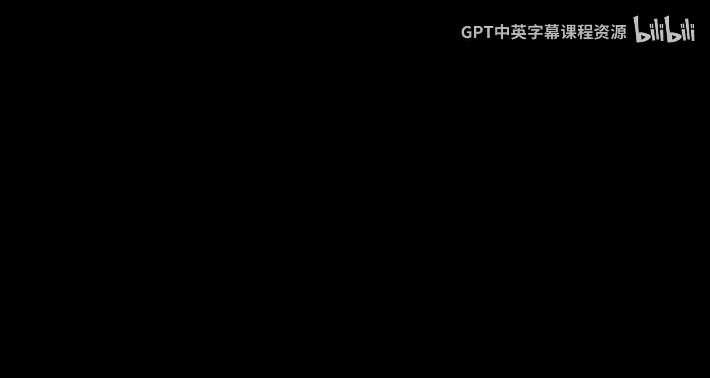
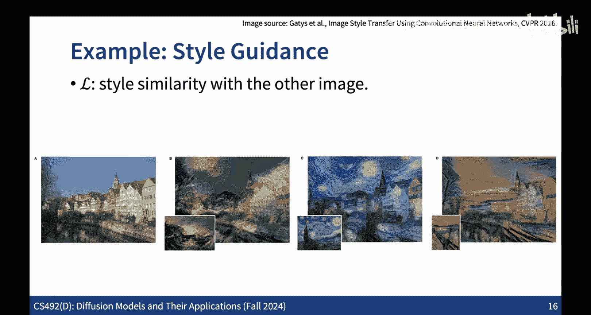
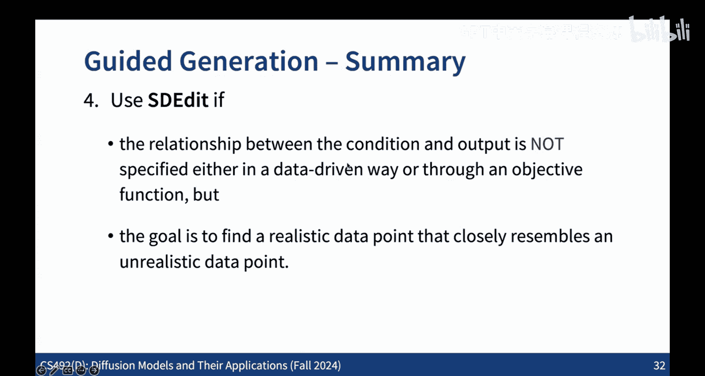
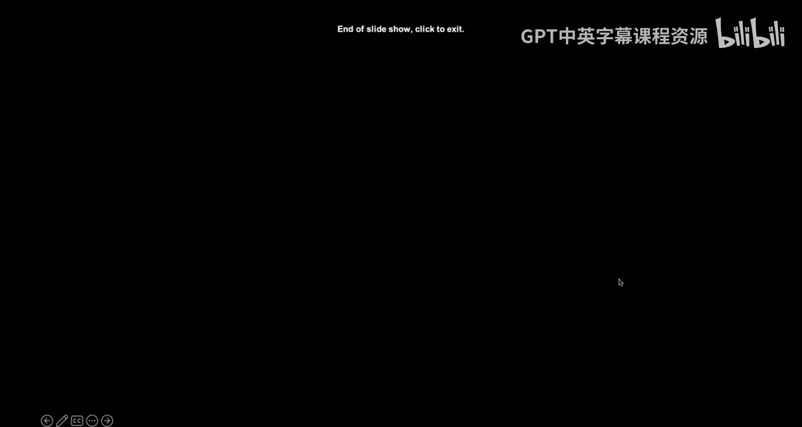
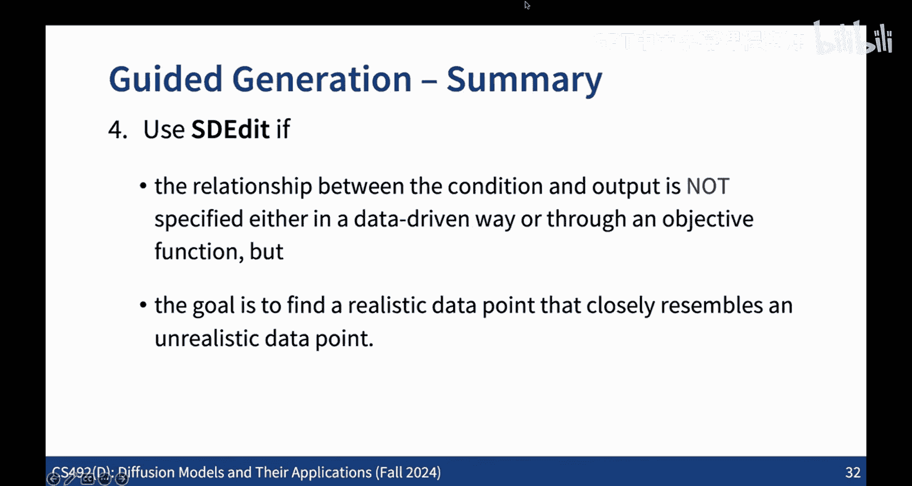

# KAIST《扩散模型和应用｜CS492(D) Diffusion Models and Their Applications (Fall 2024)》中英字幕 - P12：Lecture 13_ Inverse Problems 2 (KAIST CS492D, Fall 2024).zh_en - GPT中英字幕课程资源 - BV1mwpUzREqX

Okay so last time we started discussed the idea about the inverse problems and before that actually we also discussed some techniques about some conditional generation either based on the fine2 or without any kind of the training and the inverse problem was kind of or the general case in terms of basically how we can basically aligning the output the hourde generation with the R the observation when theyre basically the relationship between the generated the output and the observation is basically defined in this way。

 so we are basically defined the relationship between the x and the y x is the R the output and also the y is basically the our observation as kind of some kind of the function and typically this function is the linear function in many of the cases right。

So we have seen some multiple applications， including some like deep loading that we are obing these blur images and how we can basically reproduce the clean image right and also for the super resolution that could be case that we are having the low resolution image as the observation and generating the clean image right the high resolution image and also for the in painting in case we are assuming that we are having some kind of the some kind of the partial input in terms of like having only the background and filling the massization so those are some of the applications of the inverse problems So here these are only cases that we are having the Y is kind of the given input and then we typically we are assuming here is that the A is not inboable so if the a function is basically inboable then we can directly compute the inverse of the Y。

Justject getting the x right。 But when you assume that the a is basically not inable。

 So there would be basically the case that there can be multiple x that can basically match this kind of the output the y here。

 So in these kind of cases， like how we can basically generate the kind of the data point to X that can satisfy these constructs。

 right。So those are some of the cases that we are considering the problems。And for them。

 basically what we discussed is that like， you know。

 division model is like basically all are getting this query condition。

So if we can get the access so the information the degraded so be low will be probably。

 then basically the correct information， right， So if we have this core information。

 then we can just like run the the in the process。So what we learned using the noise British the network was the port or the X heat。

 unconditional spoiling。And now what we want to do is that we are having the y estate condition so given this condition how we can get this core of this specific probability distribution right XT condition by light。

 so if we can basically compute the gradient topic of these probability。

 then we can just run the deno in process。And from the base rule。

 basically what we have seen is that actually to compute this actually we can we just need this information right。

 So if we have the this information Y the y conditioned by the XT based on that。

 we can compute this core of the XT conditioned by y。Y， because from the basal。

 we could see that actually the score of at this time could be expressed as kind of disform of the score of the XT。

 unconditional the the score， and also the score of the Y given the XT。Right。

 so then it becomes that so the final information that we need is sexual this。诶X t condition不位。

But now we can have this like unconditional support information from the knowledge team network。

 the only additional information that we need is to this information。

So this is basically like what we need to compute。And using the CFG and the also the classifier the guidance。

 we could see basically how we can compute that port like y conditioned by the XT by some kind of the extra neural network where fine tuning the network right。

 but here also the question is that how we can also achieve that information without extra de training is the training free approach。

So for that， basically， so what we could see is that while we do not know directly about the probability with the y conditioned by X t。

 we can actually at the probability with the y conditioned by x0。

So this is kind of the given information because like we modeled the inverse problem in this way。

So this is our new information about the relationship between the Y and XO。

So if we think about the special case， whether the relationship or is a linear deion and based on the property of the Gausian distribution。

 since these is the example from the unique Gausian。From the appropriate de Gausian distribution。

 we can actually see that this probability of the y conditioned by the x0 should be another de Gaia distribution。

So this is kind of like the hourly given information。

The way that we are how we model the relationship between Y and AxO。

 and this relationship is to determined based on each of the application。With given information。

So you can go back to this。Do we want to compute this。Probably of the XT conditioned by y。

 then if we have this information on this cor like this， then we can run the demono right。

We only know this corporate X， not this conditioned version。

But what we can see is that if we know this part square the y conditioned by the F。

 if we add this to the unconditional score， then that becomes scoredd like this， the final score。

So that's why we is the compute。Proming y conditioned by Xt。But this X is the O data point， right。

 these things that we are deno every time， there's no way that we can directly to somehow of like get the probability this conditional the probability。

But the only information that we can access is to get this。

Probleming of the y conditioned by x0 with the clean data point。

 that's clearly we can get the problem of the y。Then Washington it has any ways that we can connect digital two。

 so we need some kind of bridge。Connecting from the Y conditioned by the x through to the Y conditioned by the X T。

So to connect these two now we are basically approximating one conditional de distributionion。

 which is going about the problem in the x轴 conditioned by the Xt。

So you previously know this information from the base rule and also the marginalization。

 by combining the prior likelihood distributions， now we can compute this。Okay。

So this is kind of the sequence of kind of the steps。

 like why we are actually requiring those information。Make sense。

So also what we have seen in the last time in got is that if we see that is both the likelihood and the oil distributions are also the Gauser distribution。

 then the combination like these two can be another de Gaussian distribution practice。

 but this is what's going of be known effect right？

So this is kind of things like we want to get this y condition t condition by white。

This can be compete by Y conditioned by ST because then we know this work with ST， right？

What this but we dont know exactly this The only information that we know is that this why condition by X。

So we want to stick this information of this given information。Using some kind of the bridge。

 which is basically dis information， that zero conditioned by the X team。

But the thing is that also we don't know this， so it's matter how we approximate this information。

Great。So but the thing is that we still know the mean of that。

 the mean of the that conditional the probability， geo condition by the Xt can be completed within the previous owner。

 right？But that's basically what we have seen the previous the lectures。

 so the only information that we know about this probably is that the mean of that the probability distribution。

 but we don't know the variance， even we don't know whether this is no more distribution or done。

So the only thing that we are doing is that we don't have the full information about that conditional probability。

 so let's just be just that approximate that we be given the main information and also be some kind of some arbitraryvari information。

We just accept these buildings to be， but I told the with the art spirit。So this is the hours set of。

Then now we approximate this information at the geo commission by the Xt， we know this information。

 right？By combining these two， now we can compute y conditioned by the XT and if we add these to this core unconditional score with the Xt。

 now we can get a final this information。This is kind of the sequences of the kind of work that to complete the inverse problems。

In sense。So after some kind of only con calculation。

 what we could see is that this square the x tone the square function。

 y conditioned by the X T can be computed in the way。

With some kind of with some kind of experience here and we taking the grade to the t with respect the X T。

And this formation actually became simpler when you set the r to be0。

 so when if we assume zero variances。Which means that given the XT。

 we always see sample the the mean between t is the album as the X0。No variance。

 we or sample the mean right if we basically have this kind of very strongly assumption now then even the gradient this core function of the y in the X becomes like this simple right。

Was taking the gradients of the L the loss， the difference between the y and the mapping of theques here。

And taking it gradient with respecting it actually。

So you can see that actually while we have seen some kind of some complicated motivations。

 actually all the computation is like quite simple， we just need to take the X every time。

Taking ties， making to the white space， taking the auto， and taking the gradient。So you see actually。

 this is the legal only let you feel like the record very simple。

And even the simpler thing is that this is like all of obviously adding this as kind of the extra score。

So this is kind of some offset to our， right？So which means that we are are itvo here， right？

So easier like making these noise， but we need to add some kind of the actual the noise here， right？

But adding that voice here actually come the same as kind of getting the extra demo here with some kind of scaling computer。

So what we can actually see is that this is between。

 I think but running the typically denoing process， either in the DDPM or DDIMD framework。

 we basically adding one more line。Which is about taking the grade of descent。With the al loss。

 with respect to the X titome。So you see that this is really one line record in terms adding some kind of guidance。

诶。So I just wanted to emphasize that like while we have seen some kind of reforms in terms of how we bewr the final in terms of the implementation。

 this is like very simple， just like adding one language code。

Inplay how also controlled the scaling coming。Make sense。

So actually this is kind of the power of the diion models。

 so one of the really biggest deep power of the diffusion model is that for many kind of some conditional generations be set。

 for example， like super resolution or like in painting the volume。

 like those are like all given the problems right it。Ahold all these kind of cases， we don't need to。

Traly diffusion models like over separately， we can just use like one single diffusion model like stable diffusion and just do this kind of be some guided generation with some kind of in some guiding from here。

Then we can actually handle multiple applications with a single vi model。

So that's basically the big power of the digital models going be it was not possible with the G and the VAE。

 but we are basically having this kind of property for the division model because of that we are having the iterative the process so only kind of email the process。

 we can basically add this kind of guidance in terms of that we are making the trajectory of the XT to be guided into some specific the detail of the output。

So this is really kind of the powerful point of the deep models。なに quiteそです。

So it a kind of a quick me collect basically what so I'm going to show briefly is that actually this idea can be generalized into many other thes。

 so it doesn't be to be basically having the objective function is kind of the L to loss between the observation and also the mapping of the t。

 but actually it can be applied for any other this or any t or it should be placed or any t input and also for any kind of the loss function or objective function the L there we can basically put this kind of guidance。

We can generalize this idea practically for many other implications as well like one of the example for that is basically like styles similar already。

 so let's say this is example that we are basically converting this image into different style like having this style that those are these styles we can say that the only structural image is the preserve where as we matching this style or those images right。

How can we do this kind of thing do if any kind of imagination， like how we can do this？没不。

So we just need to have some kind of the objective function。

Then can basically measure this tile in already。So what we can typically go over to of these kind of test is that we first run the inversion of this image and we running thenodging process。

Why basically I some kind of the guidance？For the guidance。

 we just need to deploy some kind of this style similarity。

Res becomes a function in a way that we can run the back。So that's the only thing。

 you can see actually this is a real simple just you just me to run the inversion that we discuss people。

 we run engagement process， while heard some kind of objective function or these st already。

So it's the overview available of how we define the some losing position for these style already。

 and there are lots of the options for there。

One tip of the idea for this style similar already is that basically we are taking some kind of some neural net features or some kind of the pretrained neural network that B easy network or something that like D or something and basically measuring the kind of output distance will be some neural features so I mean these are some very critical ideas there's no guarantee but this is like what people really doing in terms of measuring this style similar already like just one some kind of the neural network with the input images。

Expecting some kind of the intermediate features and measuring some kind of output tools you can check out the method called the L tips is like into some very practical ideas about how we can measure the styles similarly。

 but you can see that this is kind of very simple the idea。

We just basically feed the images into the neural network， extract some kind of features。

 measured no distance there， running the back prop。So then you can achieve those kinds of results。

So you can see the procedure running the im， in original。

 while basically having the objective function of this person。And these can be applied to the many。

 many other applications what people are doing for the or response generation is that we are also actually running the email process while you know defining some kind of the constraint with some kind of the objective function。

So it's like all the matter like how we design is kind of some loss function to give some kind of the guidance。

Then you just need to basically run the backgroundag at the every step of the theknow process。

Make sense。So one more example that we want to think about is that we also discussed this synchronization last time do you remember that this is the assignment refine。

 so basically we could see these kind of results by running the imaging process fluid from multiple different frames right？

But one of the kind of the downside that we could see is that while basically this looks kind of like very seamless smooth and the panoramic images。

 now you can see that this type of images are basically stability over the space So here we are to same like the tiny image and they the kind of image So it's not really about the like making the image for the same thing。

 we are really changing some kind of environment over the space So this is basically not really making real these the panoramic images right。

So how can you make some kind of a more consistent output？

So if they want to generate that this kind of order consistent， the opposite， what should they do？

And for them， basically take about like combining synchronation， we did kind of the guide degen。

So the idea about the synchronization is you know averaging something so it can be X here or excellent or So we these more options for the synchronization。

 So let's think about the simples case that we are taking average of the X minus。For that case。

 before we take the average of the x t minus1， what we do is that we first take aqui here。

R is cell disity very the cell dis， and then running the effect propag will go way to the X team。

So getting the X T based on the the rules function there。Ring get back position。

And then based on that of D to the XT， now we sample the XT muscle。And take it。

So this is basically the typical the idea terms that we can also combine the idea of dis inchronization with the guidance information。

Then we can also produce this kind of be some or the consistent image， eta。Next。嗯。Yeah。

So these are some kind of the all the ideas that we discussed before in terms of like how we can utilize some kind of the preprint differential models for the multiple some kind of the conditional generation the implementation。

 we discuss the control net or the classifier the guidance and the GPSPS and also the SV so can you guess like when we need to use like which technique。

So if you have some kind of chances to like apply some kind of those kind of ideas for some conditional degeneration。

 you might need to think about which technique might be the best fit for each of the application。

So can you see kind of differences across those things？你有です。

So you may use a control net for the key system when you have some sufficient amount of ease train here。

So what we discussed really contrary is that especially fine tuning the network。

So while we are still heading the onconitional digital model trained with the billions of images。

 let's say like we still have some kind of the few like amount of images like tens of thousands of the pairs so you should basically the pairs like the input output pairs right like some sketch images and the realistic images and the depths image and the realistic images right so when you have these kind of some pairs be like the sufficient amount of the pairs like that's just like10 something but more than like 1 hundred thousand of things that we can consider using the control them。

So basically to use the control that we should have some kind of enough number of the training given。

 the way that we can find tune the network。That's the first condition where without the training data。

 we can， we cannot use the control network。And also the condition and the output should be same demodality。

 which should be both images， both video， both something you see point right。

 so we saw some of the examples that we are taking sketch images as the input and generating some realistic images or some kind of the pole image and realistic images like having the same deality for the input and the outputs for the condition and the output the image or something。

And also， one more thing is that the condition in the output should be spatially online。

Which means that like if we basically also like taking some kind of sketch I would give a bird。

 for example， we don't expect to generate some kind of the flow images， right？So pixel wise。

 there should some kind of some sort of the alignment， it may not be perfect alignment。

 but we want to really assuming that the condition and the output are having some sort of the pixel level。

 the alignment。Otherwise， it's hard to get some kind of liquid results we you control there。

Now' the kind of example that we are having the enough number between data and also the same modality。

 but not specially online。I think we also discussed that application。Okay。

One of the kind of the example for the cases that when the images are not online。

 especially was the Nobel good， for example， like I have some kind of image from the front view and based on that I want to generate the images of the side view of the same object。

そこどかのケが 買う種類注ムになってく。But in this case it's hard to expect that the images are spatially online because one is the view from the front image and the other is the image from the other view。

 then these two would not be spatially online Excel like online right or to those kind of cases we cannot expect that the control network would work。

For those kind of case， we are heading some kind of enough number。

so the condition in the output will fine to me， but make if the input in the outputs are not specially online or if they are even not having the same the mod。

That we can consider using theQu free guidance。Or are classifiedifier guidance depending on like what's the condition。

 if the conditions are the then we tell consideration the classifier the guidance。

 but for many of the cases you can consider that reading classifier or free guidance。

So for any kind of the condition， so it doesn't need to be a same modality can be text to image or available to image or even image to image when they are not sufficient aligned for many other cases。

 we can think about like using the classified free guidance we can really think about like fine tuning unconditional the model by adding the extra the condition Why changing the loss function is kind of be modified the noise where classified free guidance。

没 sense。You said function is possible for class three items。

 but division like those trained model do not accept condition that I personally define so how is it possible to function So the typical idea for the fine is that we are just like having another inputing importer or the X the condition So actually that like geo three is like one of the deco or the noesis。

We are thinking extra the image information as kind of the new condition right then you need to have the extra the encoding network or that condition。

 the new condition and feeding this information into some part of the that using some kind of the attention or something so it's the moment how we design neural network but typically the idea for that is that you are just like making the encoder for the new condition and then basically training this kind of whole network or having the new parts new brain of the network and then changing the loss function。

 the loss function is the same but we are changing the alpha noise is kind of the classified vehicle node。

 the modified the node。So that's the typical idea。Actually。

 you can see that many of the conditional generation network generating images are either fine change。

 big control net or CFG。For many kind of like some cases that we can use the control net。

 the control line is the best option， but when the input is not spatially aligned。

 or when the input is different modality， then we can still try to use the class sub V0。没什么。

So those are some of the cases that when you have some kind of data that we can use for the fine tool。

So specifically training based will fine training based approach。

But if we do not have any kind of the data or defined fine training。

 then we can consider using the idea of like GPSPS。

 which is the solving the inverse problems without done in fine tu。

 so this all becomes about like defining some kind of the objective function and running basically the backward computation。

So also the advantage of these idea is that even we do not need to have the condition the output appears。

The construct can be defined with some kind of the loss function， any kind of objective function。

 you don't need to basically somehow define the condition。

 the condition can be just like formulated into some kind of objective function。

Like for these styles in already you can have some kind of diverse image where there can be some kind of be some style vector anyway so many kind of cases we can just like define the contrast as some kind of the objective function Also one the example for this is that。

 for example， let's say I make some kind of be some human motion。

 human dancing motion or human some kind of walking motion in the space。

 but I assume that there are some kind of the obstacles in the space So I want to make some kind of the trajectory of the emotions that can avoid all these kind of obstacles right。

So for those kinds of cases we can consider if one is some kind of the most function that basically detects some kind of collision with the obstacles and basically give some kind of the for that。

 then if we have some kind of penalty function for that。

 then we can run the computation through the noise data point next。

So these are the cases like when we do not have some kind of the the pairs or when we cannot define some kind of constraint as kind of like data during away with some kind of condition are the pairs。

 but with some kind of object function。But this is still the case that the function should be differential。

If the function is not differentiable that becomes kind of the big problem。

 so then now we need to really think about using the reinforcement learning many other things。

 so that's kind of thing so it's already better kind of differential will be multi function if this function is not differentiable then unit this with some kind of eager tool like say some reinforcement learning somebody many other things so this is kind of the case。

So S did was also kind of a special case that even the relationship between the condition and the outputs are not fullyly defined。

 either in the data even way or with some kind of objective function。

 so in the previous case was basically defining the relationship between the condition and the output with some kind of the sufficient amount of the training data that we are basically providing lots of the examples you should have the this output for this condition。

Data do you need， providing lots of the data we defining the as some kind objective function。

But in the essay， we also don't know we don't know any kind of the relation between these though。

 the only thing we know is that the condition is still having the same modality with the output。

 but the condition may be some kind of the slightly less realistic kind of the data point and from that kind of the less realistic data point。

 we are finding some kind of the closest realistic data point。

 so it's more about some kind of the projection to basically realistic data point。

So those are basically four cases that we discussed as' kind of some conditional generations。

And you生 kind with difference these work cases。So I hope you can now say like what's the difference between across like the World four cases。

 the specific means that there are lots of the options in terms of how we can turn our best unconditional model into some kind of the conditional generation。

 but depending on the specific situation and the application。

 we can consider choosing all those things。And you can also even think about like combining some of those kind of things for valuable。

喂。Andにこちすです。你我 just送你就再。Now， this picture originally implies gra resources。Pture and。

 I don't know where we got the context of this picture of the average。

 but the grand matrix is also kind of only the way to measure the style scenarioity so for this style similar。

 to get are multiple ways to basically the from。Any你都过这。

The best free guidance not you can use anything I mean for the text to image。

Actually， even we are using the classifier free guidance for the even for the text input。

 it can be audio input， it can be many other things， even for the numbers。

ientSo we to classifiedifier free value for the cost we sometimes sets play。I。瞓照。

You just gave zero to class oh yeah， you need some kind of nerve neural， Yeah。

 so it's also made of like how you define the neuro to。For the text to image。

 there is some typical way to define a pilot neural token， but for any kind of。

 there are also even some examples for the audio2 image or audio to video generation。

 or those kind of cases it's all matter of like how you define the neural tokens。And also。

 kind of some。Small hidden thinging in the classifier of pre guidance is that in the classifier of pre guidance。

 one of kind the main ideas is that we can use a single network both for the conditional and the unconditional de by introducing that neural token。

But actually you can consider just mimic two different networks。

 for the conditioner and the unconditioning case， it's just combining the two so。But， I mean， yeah。

 so you can define the order。ベース on理解のでインプテ。也你的こち。So this is kind of the question。

So when synchronizing epsilon within the chemical space should we lead and the change the variance。

 so that's kind of the reason why it is not the good idea to synchronize the epsilon but so that can actually that's one of the reasons like why it's better not to synchronize the epsilon or synchronizing the t because for the t we don't need to worry about changing the variance。

Good question。Any other questions？就是。So this is kind of the summary for the guideiding generation or the conditional generation and next week we're going to switch the gear into the more slightly more fewer victims in terms of how we can also boost re generationeration the process and then also move on to the full base。

のこす。

Then before we。哦。激你。😔。