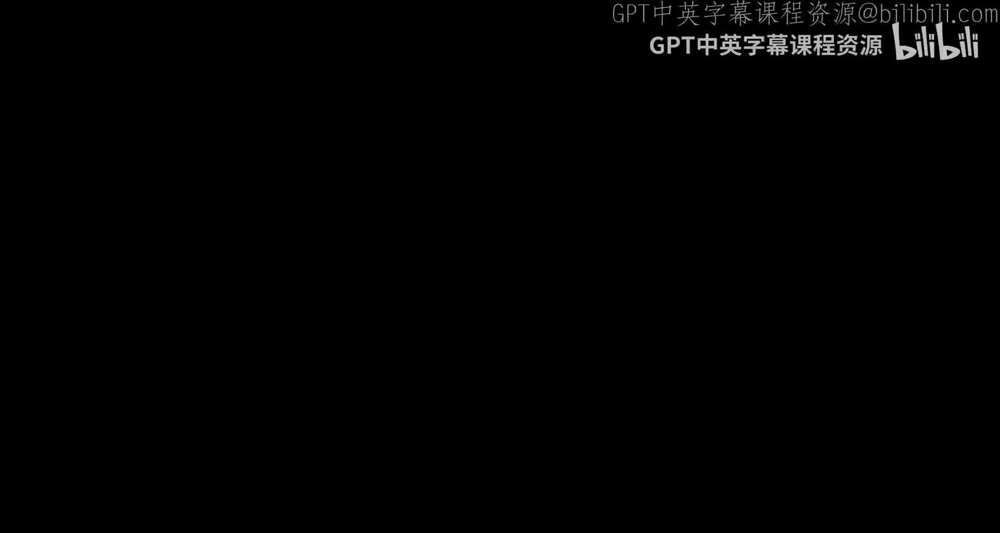
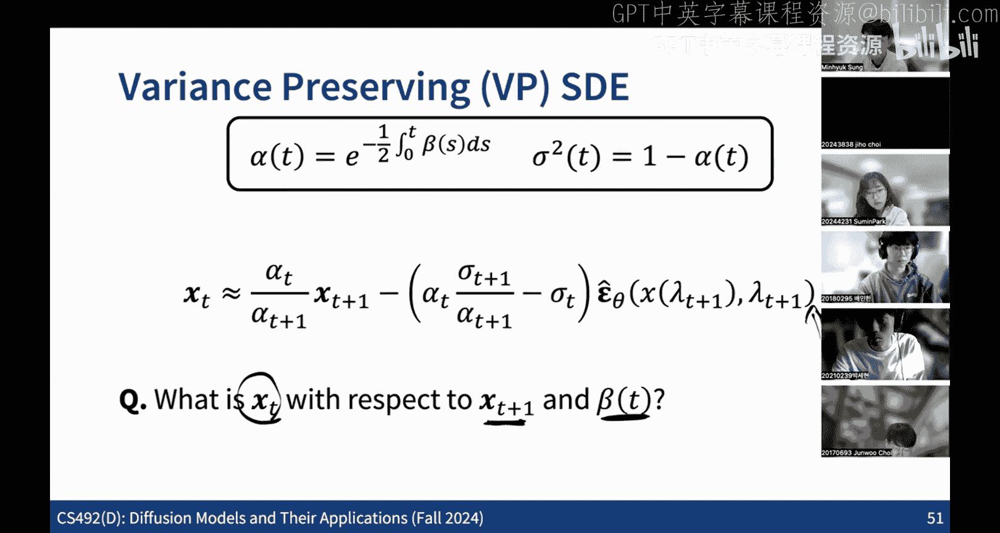
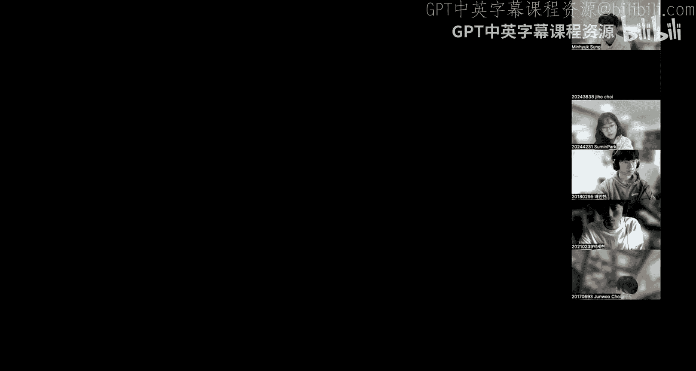
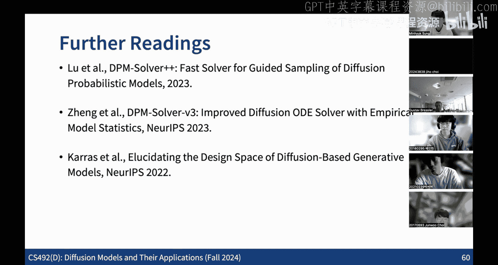
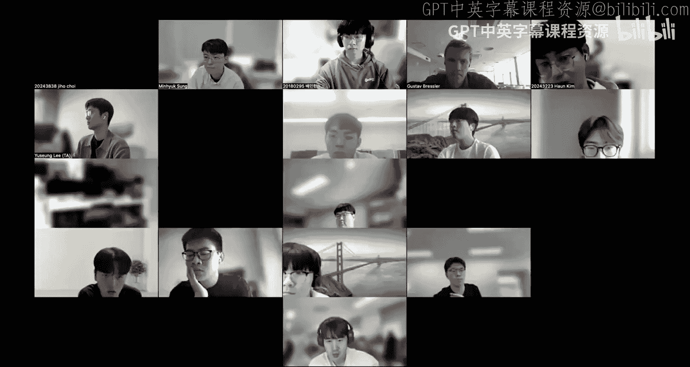

# KAIST《扩散模型和应用｜CS492(D) Diffusion Models and Their Applications (Fall 2024)》中英字幕 - P13：Lecture 14_ Probability Flow ODE _ DPM-Solver (KAIST CS492D, Fall 2024).zh_en - GPT中英字幕课程资源 - BV1mwpUzREqX

Okay so for today we are going to discuss some kind of the new topic about the di models so at the very beginning if we discuss some kind of the processs of the diff models kind of the one of the the kind of the advantages of the di models is that we can really get some kind of the high quality of and also the diversity in the generation also with some kind of very stable the kind of training the process you already implemented like DDPM and the DDIM and we have seen that actually the training is basically not that difficult and also the implementation is basically not that difficult so there are kind of like many other advantages in the di models and also in the di models we are having some kind of the iterative process in the generation and every step in the demo in the process we can add some kind of guidance in terms of that we can do some kind of the conditional generation we can also do some kind of synchronization so these are also basically making another kind of advantages of the diff models in terms of the pretrained。

Fsion model can be applied into some kind of the multiple applications。

So these are kind of good things of the division models。

 but the downside of the division model is that basically it involves some kind of the multiple the denoting steps as as we also have seen in the previous kind of the assignments and also the lectures to get some kind of the high quality outputs Okay we need to have some kind of the more the denoting steps so as we have some kind of the more the denoing steps。

 we can get some kind of the very good quality of the outputs。

So I guess you already basically play with those kind of things。

 but if you basically use the DDPM for the image generation or so many other things。

 typically you will need to run in this kind from the 200 to the 1000 big dinogen steps to get some kind of the okay the outputs right with the DDIM。

 the good thing is that now we can reduce the number of the dinogen steps from the 50 to 200。

 which is still basically involving quite many kind of computation in the dino process。

So when you think about like applying these kind of the generated models for many kind of some real the applications that we can do some kind of provide some sort of the AI service or some kind of some kind of the applications。

 the kind of the bottle deckck might be that how we can reduce the competition time and also the competition the burden in terms of that we can quickly generate some kind of the good quality of the outputs。

So basically the topics that we are going to discuss for this week and also the next week is basically how it's about how we can reduce the competition time while basically maintaining the good quality of your outputs。

So these are some kind of the basically the plot showing some kind of the trade off between the computation time and the quality So the x axises is indicating the number of the function evaluations。

 the number of basically some sort of dno steps So obviously as we increase the number of the function evaluations we are decreasing the basically lower means the better quality of the so we can achieve some of quality with the DDPM and we can say that if we can run it at 1000 times DDPM is giving the best output but if we have some kind of like limit some kind of the computation the time or the burden。

 then we might want to reduce the number of the evaluations into the 200 or the5 for those cases we can say that thePM is not working that well basically DDIM is basically giving some kind of the better performance。

But here the question is that only we some kind of the like 20 or 15 or the 10 number of times。

 can you still get some kind of the good quality of the outputs。

 even with some kind of greattrain digital models， so that's kind of the topic that we are going to discuss today。

And for that， actually for today we are going to discuss some maths involved with some kind of the SDE and the ODE。

 so I strongly recommend you to be prepared with the pen and the paper in a way that you can do the hands on work like understanding those kind of things I think you will need to basically through your own some kind of exercise those things to better understand all the details in the VPM server。

So basically to these come like the first generation。

 we are going to go back to some kind of discussions about like how we can basically see the link between the DDPM。

 the DDIM， which is basically designed for the discrete setup with some kind of the continuous set of division models So in the continuous setup we could see that actually what we are doing with the DDPM。

 the DDIM is kind of like simulating the lines only the dynamics with some kind of certain time step right。

So what we also have seen last time is that actually all the for process， the data de perturbation。

 the process actually can be formulated as one of the stochastic differential equation in the continuous T。

 the continuous time， which is basically having these kind of terms。

 so as you can see in this equation， the xt here is basically indicating the function denoting the xt at each of the time step T。

So now we can see each of the data the trajectory that we are generating basically the final the output can be seen as the function of the Xt。

 which is starting from the x capital and then going to the like x0 and if we see all this kind of the path of the Xt that can be considered as kind of like having the a function over the time domain。

 so now we must be finding a function that satisfies DC equation。

And the last point of each of the function becomes of our the final output right。

 so there will be multiple such kind of functions mapping the data point in the prior distribution to the data point in the data distribution so each of the trajectory becomes the Xt here and the data tip of the first derivative of the XT。

 the trajectory has this kind of the form in terms of that the involving some kind of two terms here like one comes is called the drifting the terms and the other term is called the diffusion terms here。

So the first kind of the important defect is that every basically division default process has some kind of the corresponding stochastic differential equation in the continuous timeon。

So this is like the one important thing。And the second important thing is that if you also see the reverse process。

 basically mapping the x0 to the x capital T， this reverse mapping can also be formulated with another thistochastic differential equation。

 so especially for the fourth process when the SDE basically differential equation is basically represented with the FT here。

sorry the theprint coefficients empty and also division the coefficient G T here。

 then the corresponding the S for the reverse process has this form in terms of that now we are also having the。

The F T here and also G T here and here。The additional basicallyomy is specific score here。

So that's why basically we also basically discussed like you know learning this course。

 so if we could basically learn this score， then we could basically solve this kind of the SDE in terms of that we are finding the XT。

 basically mapping the capital T to the X0 right。So the default process was with mapping the x zero to the x capital T。

 and we are going to the other way around in terms of doing some kind of generation。

And now also our the noise prediction network was basically predicting this score with some kind of a scaling term here right so now we can also replace this quo term here with the output of the noise prediction network with some kind of scaling term here。

So this basically is something that we can try to solve in terms like running the generation。可以。

So one more thing is that so we have seen that like all the kind of the diffion default process can have this kind of the SDE deformation。

 right？Then over here， the question might be then what's the FT and the GT here？And also。

 what's the meaning of this like DW here， right？So we are going to see that one by one without some kind of like seeing all the details in the proof。

So we first going to see the meaning of this kind of a DW this is basically adding some kind of thetoity in the equation without this term。

 the whole equation becomes the typical the differential equation。

 the ordinary differential equation that we can easily solve， but because of this term。

 we are adding some kind oftoity into this equation。So this basically DW。

 basically this time we basically call the winner process。

 which is also called as the brownian emotion， which is basically a real valued continuous time the stochastic process。

 which is having those kind of following the properties。

The first property is that it really starting from the zero so when the time is basically0 the probability that the output of the evaluation of this process to be zero is one。

 so that's the meaning of the like almost sure2 kind of like double0 is0 so every like the trajectory we are starting from the zero So that's the initial condition。

And the second condition is that also the incremental。

 basically the changes from the time to step the S to T is basically characterized into the normal distribution。

So with PC basically the incremental changes from the time step S to T。

 you can see that these should follow the normal distribution with the zero midter。

 so this is the second characteristic。The third characteristic is that in every step。

 the increment each of the time step is especially independent we like what we had in the previous these steps so this kind of like independent increments is another kind of characteristic。

And the last one is that also the probability that the W DT。

 this process is to be continuous over the entire time domain。 The probably for that is specific one。

 So that's another kind the properties of the do process。

And this kind of like brownian emotion has been used in many kind of the other kinds of studies in the you know finance or some kind of physicss and the chemistry kind of like many parts。

 and we are also seeing this kind of the brownian demotion in terms of seeing some kind of this stochastic differential equation that can also characterize our diffus process。

So that's the meaning of like this D D W top here。And图片。So that was the meaning of like this part。

 were adding some kind of stocket tasty。Then also the question is that like then was the3 the eject like the FT and the GT term here。

 So how can you also derive this kind of the FT and the GT term here so that's the kind of the next question。

So for that， actually we are first going to see some kind of the general version of the digital models。

Actually， the DDPM， the DDIM that we have discussed in the previous lectures is basically some kind of special form of the more general form the diffion models。

 so actually we can define some kind of any divisionff model that is basically characterized which is kind of the fourth diff process this is the fourth de chunknc that we determined before。

By basicallysically defining the diff process with this kind of be some Gaosian distribution。

So for any kind of the Gaussian distribution， having this scaling term and also the variance here。

 if basically these two coefficients basically satisfy this condition。

 then you can see that this is kind of one of some the diffusion models like creatingging for the process。

So the only condition that when you define the scalingal term and also the variance here is that so we call this as kind of a signal to noise the ratio。

 so when you see the ratio between the curd scalingal term and also the curd of the variance here。

 when you see that this ratio is like moton equally decreaseable time。

 then we can see that this is one of the diffusion model that we can basically do some kind of default process and the reverse process。

So this is like kind of the more de general form of the diffusion models。

 and we're going see that how what is kind of some special case like this the DD1 and DDIM was kind of special case of this。

And given this kind of the more de general definition of the food process of the diffion model。

 okay what we can see is that now we can basically define some kind of the corresponding corresponding diffion model from the SDE and also we can do the other way around so let's think about this SD which is basically describing our the food process in the continuous domain。

Then given this kind of the default process the SDE， now we can find the full diffusion distribution。

 you see the full jump distribution from the x0 to the xt。

 which is defined with this kill income and the variance here。

 and these two terms are now defined with respect to the app here and also the GT here。

So here the thing is that if we can have any kind of the SD that describes the the default process in the continuous domain。

 that we can derive the forward jump distribution conditioned by the XT conditioned by the X0 with the killing tone and the variance here based on the FT and the GT here。

we can see that there are some these kind of relationship。四。So for any kind of SD。

 if you know the FT and the GT term here， based on that we can drive this killing and here。

And based on that actually we can do the opposite as well。

 so now we just think about the case and now we are having the board the division the distribution。

 which is now defined with the RPT and the signal security for the scaling and the virus here。

And based on that， we can also find the corresponding the SDE using the same the equation here。

 so especially like solving the FT and the GT here with respect to the alpha T and the sigma security T here So if people have solved the FT and the GT based on this formulation。

 then what we can see is that now we can do the other way around in terms of like finding the FT and the G security using the given definitions of the alpha T and the sma security here。

Using these killing individuals here。So this is because showing some kind of the mapping between the SDE deform for the fold process and also the fold the diffion the distribution for the jump distribution if you have like one of them。

 you can find the other based on this kind of de mappinging function right。it is great。

So you can do some kind of the exercise in terms of how we can find the other one finding the SD from the distribution or finding the distribution from the S。

We came further basically also rewrite the G secured term in terms of that since we are having the derivatives of the sigma secured here。

 right？So we can basically rewrite this term into this。

And also we can see that actually the derivative of the sigma T is the same with this because if you take the derivative of the log sma T。

 then you're going to basically cancel out this， then you can see that this actually identical as well。

So the whole purpose of like having this kind of degree writing is that now we can combine these two termss because like we can see that both of them are having the same low term in terms of that we are having the more simplified version here with the lambda T here。

Yeah， so keep this in mind we're going to say this like Lada T in the rest of this slide so the thing is that since the R T is cured over the T is cured since this is like decreasing when you also take the log of the R T over the sigma T。

 this lambda T is also decreasing。So we are just introducing another D variable which is basically decreasingating more time。

And we can also see that this G skirt can be rewritten into this simplified mode when you introduce the sig to here。

So we have seen so far like basically how we can find like。

For diion distribution from the SD and also do the otherly around basically more about basically mapping right？

So this is kind of the unknown fact that we are not going to discuss like very much details。

 you can also check on some kind of the references here to understand the more。But we actually。

 we are going to see like so how these are basically related to what we have seen in the DDP and DDIM the case。

So actually we have very discussed this kind of point in the previous lecture。

 but actually we can see that the DDPM is kind of this pressure case of the general the division the model in terms of like having this specific default transitional distribution so now this is like distribution from the not conditioned by the x0 but conditioned by the x team as so on right？

😊，But we also the seen that if we have the fourth transitional distribution based on that we can also find the fourth jump distribution as well so now we are seeing some kind of the special case of the division model by defining the fourth transitional distribution defined in this way。

 so this was the case of the DDPN which is what's called the variance de preserved in the case because the variance is basically preserved in the SDE deformation。

Actually the other case that we did not discuss much is like this case。

 this is another kind of some special case of some kind of de generalative differential models in terms of the now we are defining the full transitional distribution in the the other around so basically having this kind of specific form。

 which is not having this killing income here， but only the virus here。

So you can see that actually there are multiple ways to define the diff models。

 the only thing is that we just need to have some kind of default transitional distribution that set this condition。

The signal to noise the ratio between this character killing term over the variance。

 these terms should be basically monotonically decreasing。

 this is the only kind of a condition and we can think about like multiple ways to basically define the some diff model。

So actually the reason why this D pain is specifically famous is that this is basically kind of like wellknow some kind of the special form the to the models that is basically known as kind of like practically working very well and also if we see the corresponding the SDE formulation we can see that this's the case that the variance is basically not exploding over time so that's also the region that we are ob some kind of the good diplomas in the realgate cases。

And also what you can see， especially for the variance the pre cases that when you define the full traditional distribution in this way。

 based on that， actually we could see how we can also derive the full jump distribution。

 Xt conditioned by the X0， right？So we have seen like how we can derive this。

Distribution from this distribution， right。In the discrete setup and also we can do the same thing in the continuous setup。

 So if people can calculate this in the continuous setup。

 the one thing that we need to see is that now this D beta T is not defined for each of the times 10。

 we also need to think about the disease kind of the function over the time T right So this is also kind of like predefined function over time T that the user canvas can defined。

 so we can also control the beta T as we want， right。So given the function of the ver。

 now we can see that the fourth s distribution can be basically defined with this kind of a scaling term and the variances here。

So given default fourth the transition distribution。

 now we can see the corresponding default jump distribution， which is in defined in this way。

Then if we also remind the things that we about the beta T that we discussed in the DDP the case。

 so actually the beta was the function， which is like monotonically increasing over time。

 basically non decreasing function over the time T right so given these kind of these characteristics of the be T the function of the beta and also basically definitions of the alpha T and the sma security can we quickly check whether the SNL。

 the signal to noise is also decreasing this case。So this SNL should be decreasing so that this becomes the correct differential model。

 so we can quickly check whether the SNL is basically decreasing in this case。诶 can you。

And so like it's whether this is like deco equationating or not and also why this is deco equationating。

Actually， we can quickly go with this。 I mean， the thing is that we can see that better T is the non decreasing function。

 and we are accumulating the better T over the times the T， right。

So which means that like this integral is also kind of like increasing。

But we are taking the exponential of the minus like this integral right。

 so d be this R part T should be decreasing。And the sigma cur is defined as the1 minus R T。

 which means that d should be increasing。Now， this is increasing。

And we are dividing the upper curd by the sigma cur， right。

 then the whole thing should be decreasing。So we can see that actually this definition of the specific diff model basically satisfies the condition of the SNL。

 which means that this is kind one of the correct the way to basically define the one special case of the di model。

So yeah， so this is specifically one of the examples so and also we can check out like what's the corresponding the SE in this specific DDP the case。

So from the previous slide， which what we can see is that depending on the definition of the scaling term and the variance here。

 we could basically derive the corresponding the SE with this function of the FT and the G security here。

 right？So which means that if we plug in the definitions of the opportunity system security into these functions。

 we can also find the corresponding the SDE in this case， right？

So can you also quickly try to basically find the SD， which is corresponding to our the DDPMD case？

So actually this can a little bit like complicated so you can check out this later or you don't need to And so for now。

 but actually， it turns out that like after like no。

 re writing all the things which you can see that。The corresponding the S E becomes like these kind of like simplistic simple forms。

 like the basically the epipathy basically becomes like one of the。

 the open five times the better here。And the GT also becomes like the root of the Diparity here。

So you can also check out that， you know because we are also finding relationships with the G security here。

 so we also need to have just like GT here。You can check out those kind of some details later and also for some kind of there is another way to prove this you can also check out this reference in terms like how we can also derive the corresponding BE in this case。

So basically the thing is that given the you know DDKM de formulation。

 for this specific the definitions of the transitional distribution in this way。

 you can find actually the corresponding DSDE is basically fine having this kind of form。

 which looks actually quite simple。So which means that if we can solve the SDE this is also for the SDD of the food process and based on that we can also find the SDD for the reverse process and if we can find somehow solve the SDE basically finding some kind of function satisfying the SDE。

 then that will be basically some kind of the trajectory that we wanted to see right。But actually。

 the problem of the SD is that it is basically involving the renal process。

 which is basically making also some kind of the complication in terms like how we solve that kind of the equation。

But really good news in terms of that is that if we think about the SDE corresponding to some kind of diffus models。

 actually there is already some kind of corresponding the ODE not having the re the process。

 which is basically having the same the marginal distribution of the noise data point of the XT at every time step。

So in this figure， what we can see is that these are basically some kind of the visualization of the trajectories that we competed using the SDE and also is corresponding the ODE。

You can see that these red curves are basically like jiggling like this over time。

 because of this sity， but the white curves here are basically generating some kind of trajectories using the ODE corresponding to given the SDE。

So which means that since the marginal distribution of the XT is matches within the ones of the SDE in every time step。

 instead of solving the SDE， actually we can consider solving that corresponding the ODE。

 which is also called the probability flow ODE。So that's kind of thing。

So without seeing some kind of beetles， actually what we are going to see is that actually given this kind of the reverse process。

 the SA deformation， so this was deformation we have seen right。

 and also we introduced some kind of the new notation of the variance here which can replace this time。

Then given this kind of like livers process the SDE。

 actually the corresponding the ODE becomes this tool。

Wch looks extra quite the thing right with some kind of small differences like having the two here。

 right？So which means that like we can think about like running the denoging process as we have done in the DTP the DTI in case。

 instead of that in the continuous space， we can also consider like solving the SDE of like this formulation in terms of getting some kind of the multipled project like satisfying this equation。

 right？And in a tab like this， actually we can consider reso this OD。

 we should become much easier because we are not having the we process here。そデすカイのティーティーページが入りえる。

And especially for the variance de pre in case in the DD the DDIM case。

 we compute the corresponding the FT and the G security here， right？

So if we plug this in into the previous ODED formulation。

 then actually we can see that it turns out to basically solve this specific ODE to run the reity process。

Whi is like all the kind of equation that we are with some kind of the given de promptors for the Ar T and the Ar t or sigma T here。

 these are some kind of the given de promptters right。

And these are some kind of the outputs from the noise prediction network。

So if we can find some kind of the the function Xt， that set like this equation。

 there's some kind of the D outputs mapping the x capital T into the X U。

So for only differential equation theyll give you some multiple different functions and the way that we can basically find the specify one of them is to basically have some kind of the boundary condition。

Which basically means that we if we specify either the starting point or the end point or whatever point in the space。

 then we can specify like one function that satisfies the whole equation。

Which means that given this kind of O D。If we basically specify the x capital T。

 the starting point in the universe process， then we will be able to basically find the full trajectory from the x capital T to the all the way to the X with all the noise data point and also the final the data point。

So actually， what we can see here is kind of a quick summary at this point is that for each of the general the form of the division model。

 actually we can find a SDE that describes the food process in the continuous space。

So that's the first thing， right？And also the good thing is that also its the VB process can also be formulated with another DSDA。

诶。And also for all the SDE describing the difficulty process。

 even we can also find the kind of person in the ODE。

That matches the margin distribution at the utility times step。

So this basically means that instead of running the reverse denoging process with some kind of formulation that we have seen in the discrete the time stepss。

 now we can consider solving the ODE in the continuous time step。

In terms of generating some kind of the data points。

 So that means that if we specify any x capital T with this boundary condition。

 if pay solve be the O D E， then we will be able to get some kind of the final the output of the X U。

So this is kind of the good news because there are tons of some kind of the numerical medical methods of solving the ODE if you took the differential equation of course then you know that like there are multiple ways that we can basically if you put some kind of equations in the differential the equations。

 these kind of some sort of be open shop tools， we will be able to automatically solve all the equations given the boundary condition。

So which means that now we don't need to implement the denoing process ourselves。

 we can just use some kind of the ODE serverber with some kind of the den prediction network in terms of actually generating some kind of functions that satisfies the ODE deform。

Makes sense。So it sounds like it makes like our life way much easier because we don't need to implement the technologyging the process。

But actually， our call for today was not specifically solving the OD formation。

 but it's more about basically how we can solve the equation more quickly with some kind of field number of time steps。

So the thing is that if we use any kind of some existing the numerical， the OD disorders。

 the thing is that we can get some kind of the accurate results。

 but with some many times steps more than 50 or something。

But here the question is that since we know this specific OD formulation here based on some kind of the characteristic or like this specific equation。

 can we make some kind of the dedicated the OD server for this specific equation in terms of that we can also get some kind of the accurate outputs with some view number of the times then？

So that's the things that we are going to discuss for today。Next sense， any questions on this？

So what we can try is that now we know the the we process the O D for the DDPM case here， right。

So you can only consider basically implementing basically not implementing even just using some kind of the new make circle of the ODE with this equation and see what do you get。

 you can really try that and see that you should be able to basically get some kind of good results with some number of the time steps。

That's what we can do。And the thing is that now we are going to go further in terms of like not using some existing audio server。

 but using making some kind of the dedicated some solutions for this specific equation。可以。

So for that， we are going to discuss a little bit some basics about the ordinary differential equation。

 how many of you took the differential equation course before？The mathematics department。

So if you took the differential question course before the things that we are discussing today would be quite easy。

 very kind of like basic things if you didn't take the course it's okay we are going to really discuss some very basic things first and slowly move on to some kind of more difficult things。

So for the remaining of the time， we are going to briefly discuss like how we can solve the OD formulation for each of these specific cases。

 So the things about like the old solving the differential equation is that we just need to come away some kind of solution for each type of the OD formulation。

We are going to start with some kind of the easiest case and going into some slightly more difficult case。

So as kind of the simpleplst case， let's think about this case。

 so the first order linear differential equation。So we are just having all the kind of the good words making this easier like first order linear here。

 so basically this is the first order equation in terms of the we are only involving the first order the tips。

 not the second order the higher order the demo tips here。

And this is also linear in terms of that we are having the linear term here。

So here the linear does not mean that any of those functions cell linear here。

 but we pre treat all these functions as kind of the variables or the coefficients that we can see that actually this whole equation is kind of linear with respect to the Xt which is kind of the variable that we are going to find here。

 but actually this is also a function in this equation right so basically the trajectory of the Xt the basically noise data point over the time step T is basically the function Xt here and we are finding the function of the Xt over the time domain T here with this kind of like linear term here right。

So this is like the most basically the simplest the case of the differential equation。

And let's even make it even like more like simpler in terms of that we are making dropping the opum here。

 so not having the aT here。Broping this part and only having this kind of like the scaling part here。

So given this kind of the simplest form of the differential equation。

 how we can find the X that satisfies this。That's what we are going to see。And for that。

 while we assume that no Xt is not zero over the all the time domain T。

We are going to basically divide the website over the Xt here。

Then can you basically come up with like， any kind of the some expression that is kind of related to this part？

So actually， what we are going to do is that we are going to basically simplify this left hand side。

With some kind of be another types of the derivative to the function。

 then you should have seen this before in the cculu course。So。Which function the derivative。

 like which function is basically matching this left hand side。做悲伤的。

Your memory in from the ccu course， actually we can see that if we have the log function log of the Xt。

 and if we take the derivative tip of this log function， then this becomes same with this one。

So we are basically first taking the derivative of the log of the Xt so that becomes like one over the xT and also the remaining income becomes of the derivative the XT itself。

So we can see that actually the left hand side becomes identical or like taking the derivatives of the logo of the Xt right？

So now we can see basically how we can simplify the left side。

And since the1 size is the derivative of the function。

 what you can do is that we can simply take the integral on the both of the side。

So if we take the interval on both side， then we are having some kind of the offset tone here and taking the interval here。

And we also need to take the exponential as well， taking the exponential on the both sides。

 then we can see that the Xt here becomes one of the functions taking having the exponential de here while basically having some kind of the arbitrary killing income C here。

So we can have some multiple function Xt with the arbitrary C here that satisfies the given differential quo。

Make sense。So this is the easiest case in terms of that we can find the X function from the given differential equation。

So let's quickly do some kind of the exercise with this simple example。

 So let's say like this is kind of the given the OD formulation with this。

 and then we are having the boundary condition that the X should be one。

Then can you find a function the Xt that basically satisfies these two constraints？Yeah。

 we can easily say that it should be X T to the nature minus right。So this is kind of very simple。

So yeah， so this was the simplest case。 So now we are going to go into slightly more complicated kind the case with like going back to the general form。

 So in the first order linear differential equation generally we can consider having this kind of this offset term here right。

 which kind of like sort of the constant term which the X T。

And now we are to go like one step further in terms of that this Q T becomes the function。

 not only we the function of the in terms of the T， but also function in terms of the X T as well。

So this is the case， which is called the first order semi linear differential equation in terms of that we are having the linear term here。

And we are receiving some kind of extra term here， which may not be linear or the constant with respect to the Xt。

 which can be any kind of the higher order function with respect to the Xt。

So this is like more complicated kind of case。So given this kind of more the complex the OD E key function。

 how can you basically find X that satisfies this？So yeah。

 we are going to see the solution for this and before for that let's recall the simplest case so for the case that when we do not have some kind of the offsetum here。

 then we have seen the solution here right。And based on that。

 what we are going to do is that actually there are multiple ways to find the solution in this specific DOD formulation for the semi linear case。

 but we are going to see the example with some kind of technique which is called the exponential integrator。

We change basically nothing think， but basically we are multiplying some kind of the exponential tongue on the post the left hand side and the right hand side。

And don't ask me why， but based on some kind of inspiration from the simplistic case。

 we are going to consider multiplying this term， this specific the exponential term on the left hand side and the right hand side。

And at the end， we are going to see that multiplying this magically basically solves all this kind of problem。

Okay。So let's see that we are multiplying this exponential term both on the right hand side and the right hand side。

 then this becomes like this。Then actually the reason why we are multiplying this exponential to is that now this hole looks kind of like complicated。

 but actually we can easily simplify thelect side。Based on this factor。

 if we take the integral of this integral， then it becomes like just like taking the PTt here， right？

And also we are going to use another defects of the product rule for the derivatives。

 if we take the derivative of the product here， then we can see that usually like this。

 I mean it's like high school kind of device， right。So based on those two facts。

 what can you do in terms of simplifying the left hand side？So if we use these kind of two effects。

 the left hand side becomes the data tip of this product。Or the exponential come here。

And the X D here。So that's the thing so when you basically multiply this kind of like exponential de。

 then all kind of the technique that we are basically using here is that we are making one site as kind of the derivative of a function here。

In terms of that， now we can solve the problem by taking the intro of the both sides。

 That's also what we have done in the simplest caseway。Kind of same thing。

 but it's basically me by multiplying the exponential term here。So based on that。

 what we are doing is that we simply basically take the interval on the both side。

 then because this becomes the offsetor and taking the interval here。

And here is basically we are going to set the S to be greater than t because we are basically discussing the labors process。

 so we are going to get into that， but basically we are taking the integral here。

 having some kind of the constant tongue with some kind of the specific the S here， right？

Then we are having this and at the end， what we want to do is that we actually we want to find function dxt here。

Which means that we additionally need to divide the whole deposit of the size with this by this way。

So we multiplied this term at the beginning， and now we are dividing wholely terms by this exponential term。

So we are dividing by this term basically means that we are multiplying this exponential term without the minus but plus here。

 right， the same thing。So we are dividing the both sides with this。

 which is identical to multiplying this exponential term with the plus here， right？

So we can see that now the Xt has this small nation。可以。

And one more thing in terms of simplifying this is that since we are basically having the integral the same function with the different range。

 like one is from the T to T of three。哦。T to T0， and the other one is basically know t0 to basically S。

 right， So we can basically simplify this in terms of like taking the interval the S to T。

This is also the same in terms of we are taking the integral from the T to T and the other one is the the T tau to the T so we can consider taking integral from the tau to T。

So this becomes the final basically deform for the X T。So given any kind of the choice of the S here。

 depending on what we choose for the S here， we can have some kind of different deformation for the Xt。

 which is heading some kind of the exponential term here and also the integral of the exponential term multiplied by the Q the non nonlinear term here。

So this looks already like complicated， but you can see that this is basically using some kind of technique that we have seen in the simplyistic case。

Make sense。So if this was kind of the best， then I recommend you to check out the slides after the lecture and see how we derive all the things。

So based on this， let's do one more exercise。 so now let's think about that we are not having the linear time here。

 but some kind of the offset here。We sense the same deed condition。

Can you find the X T that satisfies these two conditions。

So basically what we can see is that we know that x0 should be1， right。

 so we can just take this s to be zero， right？So if take this S to visual。

 then it can see that the home formulation becomes like this。

And we can from the definitions of the G， we can cancel these two out then we can see that the function looks like this。

1 plus t times the exponential term。Theァ looks like this。So yeah， basically based on this。

 you can now solve any kind of the first order， the semi linear differential equation with any definitions of the app T。

And also the G X T and T， so this can be not nonlinear and this is kind of this killing tone the linear per。

So this was like very quick kind of the introduction for the O DE and we are going to plug this idea into the the formulation that we have seen in the division。

 the O D E formulation。So let's get back to the audio formulation for the di the models。

So this was basically the OD formulation for the variance the pressure in the case for the DDPM and the DDIM the case。

 right， So for the DDPM decay case， we could see that the linear term。

 this killing term becomes like this function。And also， this is the none in your tongue。

 Why is it like none in your。Because we are having the knowledge prediction the network。

 which is taking the X T as the input。 so our the knowledge prediction the network is also a function。

 and it may not be linear。 Obviously， the typical linear neural network。

 also involvesvokes many the non nonlinear kind of the components right。 So because of that。

 we can see that actually， this is kind of the nonlinear part with respect to the X T。

So we can actually see that the OD formulation， the probability flow the OD that we are seeing is one of the examples of the first order。

 the semilineard OD。So let's think about like solving this equation based on the things that we have seen in the previous slide。

 which would be basically simply plugging this PT and the QT here。Into the。

YeahD question from the PTTN P PTTN the QT here right。So let's just plug in here。

It might look kind of complicated。But nothing but please just plug in this like P and D QT。

 then we can rewrite the audio information into this way。

And from the definitions of the our Ramda T that we have seen before。

 then we can say that the OD formulation becomes like this。Exs。

And one more kind of trick that we are going to use in terms of simplifying further this is that because we are having the derivatives with lambda T here。

 which also looks kind of already like complicated， so to eliminate this term。

 what we are going to do is that we are going to use the fact that the Ram T was kind of the decreasing function。

So Lada t is a the strictly decreasing function over the time step T basically means that there is the one to one correspondence between the Lada and T。

For each of the Ramda， we can specify the corresponding T and the other way around because Lada is basically decreasingd over time。

 right？So because of like this fact， now we can consider having some kind of the inverse function from the time t to the randomda。

Which means that in this equation， we can also change the parameter of the time t into the lambda internal taking the T here。

 so especially for the second in the integral here。

 let's think about it now we are replacing all the parameters about the time domain T into the corresponding the lambda。

Okay， so then we are replacing the T here into the lambda T here and also the s here into the da S here。

And also， the Tau here becomes the Yo lambda Tau。Actuallyual， you know this is kind of the thing。

 We are just like changing the some kind of the notations and the some kind of the you know。

Some kind of the prompters here。But basically for this， if you basically compute given the Arda tau。

 once you compute the corresponding the time step Tau。

 and just feed this into the knowledge pre the network that becomes the same right basically some notation wise basically we're just changing the parameters from the T to the Ramda。

And the good thing is that now we can see that this cancels out， we can ignore this part。

 so after changing the parameters， we can see that the whole equation also becomes like much simpler into this one。

Make sense。So this becomes the R the ODE that we wanted to solve in terms of generating kind of data points。

So it' the minimum now we are how we are going to solve this specific O D formulation。

Then since now it looks kind of like simpler， we can try to basically solve this by some kind of discreettization。

So let's get back to like know discrete space from the continuous space in terms of like having some discrete the time domain in a way that now we think about that we are having the X T and the X T plus more than X T plus global kind of thing into the X capital to T right So this is basically what we have done in the DPM D noging process。

And let's say that now the S is basically the T plus one， the next the time step。

And we can see that the no， the noise data point X T can be completed from the previous the noise data point in the denoging process。

 which is the X T plus one with some kind of be some integral form with the the noise that we are predicting in neural network。

 right。So given the X T plus one， now we can compute the Xt by solving this equation， right？

So the whole thing is that now we are also having this kind of a complicated integral here。

 so how we can there's some kind of the approximation of this kind of integral。

The easiest way to handle this integral is just assuming that no this is only4 the times from the T plus1 to the t。

 right？Which is in the Arda space becomes from the Arda T+ one to the Ramda T。

We know that this range would be very small， very small range of the Arda and also T。

 very short range from the Ar space and also the kind T space。

So in this kind of brain should the range of the Ramda and also T。

 the simplest way to basically approximate this is that we just assume that this epsilon will be constant over this kind of range。

This is basically the first order approximation， assuming that the epsilon here will be constant in the range from the lambda T to the lamb T plus one。

Then what you can do is that we can tick out the elu out of the intro here while assuming that this is completely constant。

And the only thing is that we just need to take the compute integral like this。

It can be computed analytically， very easily， right？Mix this。

So we that's kind of like the assumption that the epson is constant in this range。

 we can also rewrite this， then now it looks like very like you feasible to compute right after doing some kind of the rewriting multiple times。

 we can see that actually the XT at the noise data point at the times the P can be basically computed from the Xt plus one with some kind of the noise prediction。

And also with some kind of this killing tunnel and coefficients here。

Which are all based on the hourly definitions of the kind of the digital models。这。对。So given the X T。

 actually， what week， what we can see is that this is basically identical with the noise prediction with the X T plus one and the T plus one。

So given the Xt plus one， we predict the noise here and compute all the things。

Then this becomes the X T。Without any stochistic。Withets。

So let's do the last exercise here for today， so we have seen that in the variance preserving the case in the DDPM case。

 the alphapa T and the sigma cur it was defined with respect to the beta T here right。

And then now we can see that this becomes some kind of the vote approximation of the OD information。

Where timeて。So based on that， Kenny also describe the Xt with respect to the Xt plus1 and the ver。

Okay think about this question after the lecture so you might just take some time to basically do all the things you don't need to answer this question。

 but try this yourself after the lecture before we see the answer of this question actually the thing is that so this was basically the example。

 that we are basically running the reversebi process by solving the ODE without any stoity right？

And we have seen such kind of example before， what was the case？The case。

 basically running the deno process we thisV was one of the example for that was the DDIM。

 the detomist sampling， right？In the DDI， in the determin example。

 we could basically make it this to be0， and we could see that the X T minus-1 can be compute directly from the X T without adding any randomness。

 right。The very interesting thing here is that it pre basically rewrite all the formulation in the DTIM。

Actually， from all the definition differential models。

 actually we can see that this DDI formulation is identical with the first order approximation will be solving the ODE。

That't mix sense。Yeah， so now we can see like how this DDIM is basically related to solving the audio。

So these are basically all relating this way， we have seen that DDIN is kind of de generalization of the DDPMD case。

 which was the case that we can control it stoet。AndWe could get some kind of very good results with the determin this sampling by making the variance to be0 with the few number of the times step。

But actually， that was identical with disoring the OD formulation。

 which has the same marginal distribution at the times step T。

And since we are basically solving the OD information directly， not the SDE。

 we could get and also be some kind of this kind of the derivation of like how we can solve that with some kind of the first the approximation。

 now we can see why we can get some kind of the good results even with the few iterations。

So this is kind of the connection between the DDIM and the ODE。

 they probably flow the ODE that we have seen today。So this is kind of an interesting point。

 So I recommend strongly recommend you to basically try to derive all the things in terms like from this formulation。

 if you apply those things into the specific DPM case。哇岁。你呢啲片。In the case。

know whether this becomes identical with the deter sampling of the DDI。

So we discussed like all the formulation for the general form multidi models。

 so we can see that how this it applied to this spatial case or the DDPMT case。Yeah。

So this is also the example of like the first order kind of approximation。Well。

 which is basically assuming that this epsilon the noise voltage the output will be constant from the range from the T to the T plus1。

But what can you do in terms of like the higher degree approximation？

One of the ways that we can do some kind of the higher the approximation is that we can do this kind of thing。

 which is that the first spliting the range from the Lada t to the lambda t plus1 into the half。

 so if we are having lambda t to the lambda t plus one， we split the domain into this like half。

Now running the first authority approximation。But getting some kind of the XT kind of prime or something that we are saying to you here is kind of for this specific first step。

And at this point， we basically update the noise， basically recalculate the noise at this point and using this noise now we are using this noise as kind of a constant noise over the entire domain and running the first of approximation again。

So that becomes the second order approximation。How about the third do to approximation？

We can do this like one more time， we can dividing this space not into the half and half。

 but into the one third and basically getting some kind running the first order approximation for the first。

 like one third， updating the noise and also competing for the twice of the range and updating the things so we can repeat those kind of things。

And more formally， the way that we can derive some kind of egoject formulation for the higher order approximation is to use the tail expansion。

 So we are basically representing the same the。Loice here with some kind of the tail expansion。

 with some kind of the order end here。And then we can just also plug in this into the RD equation in terms of that we are making this to be taken out from the kind of intro here in a way that we can compute the analog form of DC equation。

Then after some kind of the derivation， we can see that the higher order kind of the approximation can also be derived into this form by computing this kind of the python here。

You can also check out like whether this equation becomes the same with the first order approximation that we have seen in the previous slide when you plug in those kind of the tops here。

So these is kind of more automated things and the assignment fix is basically converting your DDPM code in a way that you can now generate the data points using the DPM server。

 so the first task is basically implementing the first order the approximation and the second task is to implement the second order。

 the approximation which will be more complicated so as I mentioned at the beginning of the lecture。

 the second task implementing the second order， the approximation is kind of optional task you can only implement the first order the approximation。

So using this kind of the idea of like solving the OD。

 what we can see is that compared to the DDPM and the DDIM case。

 especially when you use some kind of the higher order the approximation with the third order here。

 we can see that even with some very few number of de function variations like 15， 12 and 10。

 you can see that the quality of the output is already way better than the cases compared to the like running almost like 100 times with the other kind of the demono the process。

So this was basically the idea that we are basically accelerating the denoging process。

 not basically seeing all the things in the same you know discretely time domain the denoging process。

 but first thinking about some kind of like connection to the continuous space using the SDE and also basically the corresponding the ODE and solving the ODE with some kind of the based on some kind of characteristics of the deep region the ODE deformation。

So this was basically only the basic idea in terms of basically how we can accelerate the denno in the process。

So this is the basic idea for the DPM robot and actually you can see that there are quite many recent research which is obviously how we can further accelerate and with some kind of very good accuracy of the quality of the outputs using the same kind of the diion models and also the good things of like all these kind of the ideas is that you don't need to also retrain theion models。

 you just need to use the pretrained the node pre network。

 but just like running the denoding process in a like different way in terms of that you can get some kind of the better quality outputs。

 even with the view number of the the function variations so this is also a very interesting kind of aspects in terms of that using the same pretrained the network you can get even the better quality of the outputs with some kind of the different denoting the process so I also strongly recommend you to check out the other kind of recent work in terms of how we can further accelerate this kind of the process。

So this is kind of the end of the2 topic about DPM server and we are going to discuss how we can implement this in the Alem6 in the next week。

 what we are going to discuss is the flow base model。

 which is basically involving some kind of the fine tuning the process in terms of that we can also further reduce the number of the time steps for the faster degeneration。

So we are going to discuss the floor based model next week。아こ長さです。So yeah， the next Wednesday。

 we are going to have the hybrid session for the716， so I will see you next Wednesday。诶 thank you。はい。

