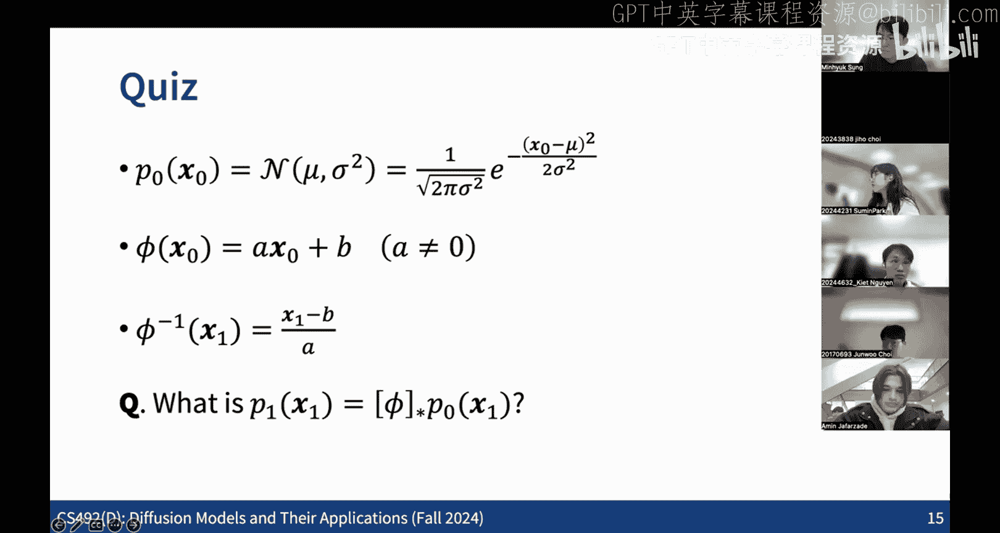
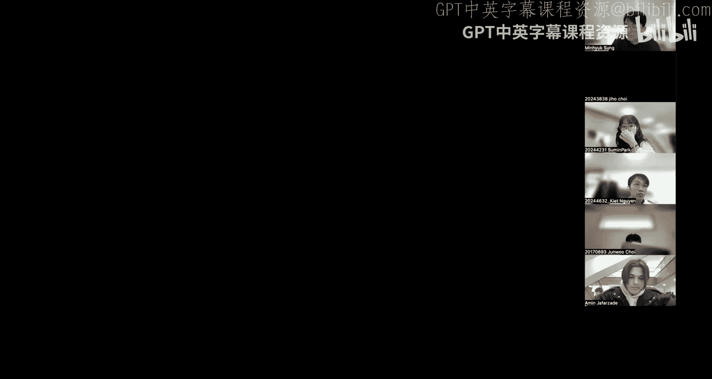
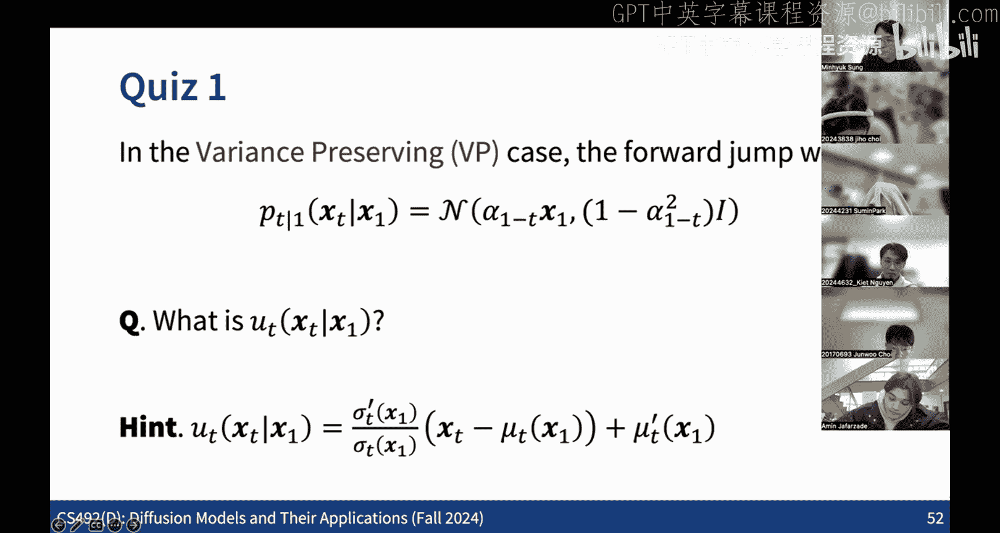
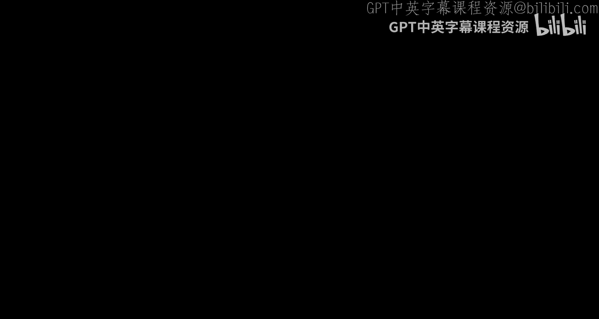
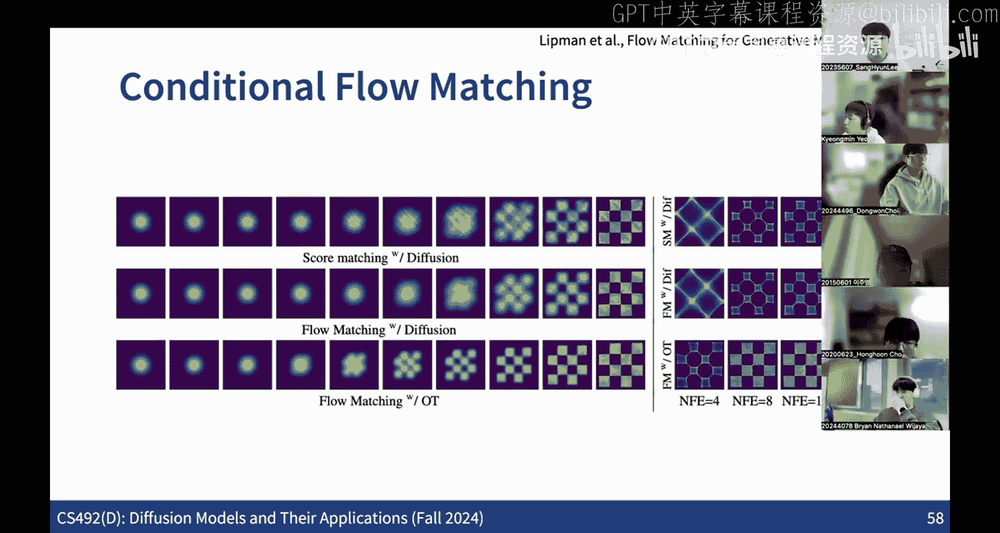

# KAIST《扩散模型和应用｜CS492(D) Diffusion Models and Their Applications (Fall 2024)》中英字幕 - P14：Lecture 15_ Flow Matching 1 (KAIST CS492D, Fall 2024).zh_en - GPT中英字幕课程资源 - BV1mwpUzREqX

Okay。

So yeah today we are going to talk about another type of the gender models。

 which is about the polymer matching model and probably not for today。

 but the Wednesday we're also going to see like why we are discussing this kind of like new model and how this is also kind of related to digital model。

And so what are the kind of the advantage or like having this kind of trauma in the model？

So previously we basically discussed some kind of the process the cons of the division model in terms of the division model is kind of good that can produce very high quality samples。

 also with some kind of largely diversity， and also the trainings or easy so basically also very easy to implement as well and also can be applied for the many applications that well we also discussed many kind of the types of the guided de generation the process。

One of the kind of the biggest data outside of the division model is that it basically involves lots of some kind of the iterative process that basically makes the computation very slow。

So here this question last time was then how we can basically make the generation the process the in terms of like reducing the number of these temp。

So the basic idea for that is that we first started to see as how the SD formulation that we have seen for the division models are also related to the ODE as well。

So basically what we foresee see is that both for the forward process and the reverse process。

 we could see that those kind of deformation that we have seen for the DDPM and also the DDIE in the case can be basically converted into the SDE in the continuous domain and also each of the SDE or so could be basically converted into the corresponding the ODE some kind of the some converting basicallys deformation。

So the problem becomes that no now we can run the generation。

 the process as kind of solving the corresponding the ODE deform。

 so basically the question is that how we can accelerating the absorb the ODED deform in some kind of dedicated dis for the OD formation that we are seeing。

So we didn't see some kind of details in terms of like how we can really convert some this stochastic de equation into the ordinary de equation。

 but the basic idea behind this kind of conversion from the SDE to the ODE。

 is basically based on the equation， which is called the acoplanunk the equation which is basically describing how we can find a ODE which is basically having the same the marginal distribution at each of the types step。

 so based on this formulation and also the SDE formulation that we know for the diff the process we can basically derive the ODE formulation that we have seen last time。

 which is the probability of the ODE that we have seen last time。So given the OD formulation here。

 the question is that we could consider using some kind of any numerical server or the ODE。

 but the downside of using the numerical disorder is that we also require to basically run the multiple steps to get some kind of the very accurate outputs the question is that how we can basically derive some kind of the dedicated for the specific OD formulation that we have here in terms of that we can get some kind of the accurate outputposts by just learning the few steps of computation。

So by the speed deriving that specific disorder， what we could see is that only with some kind of the1 steps were less than the 10 steps。

 we could already get some kind of the results which is like more realistic compared to like running the GDIN or GPM the multiple steps。

So this was the basic idea in terms of that we are seeing like allD formulation in the continuous space and also seeing basically the OD formulation describing everything and basically making some kind of the dedicated robot cord that specific the audio formulation in terms of that we can basically compute the formulation with some kind of the field number steps。

So in this context， we are also going to see some kind of a different type of digital model。

 which is the flow based model。So blue based model is not directly related to the divisionff models。

 but we are going to see how these are kind of like similar to each other。

 so we are going to see some kind of connections between these two。

But actually the thing is that flow based model has been introduced even before the division models。

 so actually the first time that the flow based model introduced was like2014 like 10 years ago。

 so it's kind of like relatively like older model than the division models。

And the basic idea of the flow based model is basically not using some kind of the diffusion process。

 but as we also discussed previously， like all the general model is like all above as you know by some kind of the mapping between some kind of developers。

 the distribution， like some kind of base distribution。

 which is typically the unique Gao Xian the distribution into the data the data distribution。

And the basic idea for the flow based model is that we are finding some kind of the directing some mapping function between these two and typically also this kind of the mapping function is represented as kind of a combination of the multi transformation functions。

 which are also inboable。So basically to hear， the question is that how we can find such kind of the suite of the inability functions that map some kind of the base distribution into the O data distribution。

So and also basically these kind of data transformations are also parameterized into the ODE。

 so in that sense， we are also going to see how the ODA formulations are basically they come in into these kind of the new types of vision models。

And the flow based model also has some kind of the loss of the literature。

 so we won't be able to discuss like all the details for the flow based models obviously if you want to discuss everything for this we will need to have one of of class for those things so there are lots of the kind of the papers and like many things so we are not going to discuss like all the details for that but we're going to see like some kind of the some highle ideas we are also not going to get into the older details for the math but were going to see like some kind of highle ideas and how these are also related to the different models as well。

So since this we are basically skip some of the details for the today days lecture。

 so if you are also interested in some like more details。

 so basically the today days lecture is based on this tutorial in this website。

 so I strongly recommend you to basically check out this website and basically see more the details there and also you can also check out more details in the reference the papers here lots of kind of the papers here。

So before we start to discuss the flow based model。

 like one important thing is that we are going to slightly change the mutations。

So in the diffusion models， basically we considered some kind of the some diffusion process in the time domain。

 which is basically decreasing from the T to0， so our de generatedative process was the reverse process so we winding basically in the time domain starting from the time T to zero。

 so basically what we could see is that the x0 indicated the sample from the data distribution。

capital T was the sample from the basis distribution。

 which is typically in the standard the normal distribution， right？

So the generation the process goes from the capital t to0 and we are going to switch this notation into basically having the genetic process from the zero to1 so basically this is a convention that is typically used for the flow based models where we hope to see that now here the x1 means basically a sample from the hourly data distribution。

 basically the data that we are using for the training and x0 is basically sample from the base distribution like basically coming from the standard demer distributions。

So please keep these in mind so we are changing the dontations that is also making all the kind of things to be more complicated to quickly understand。

 so that's basically the basic idea。So we are going to basically start with the normal light flow。

 so let's say some kind of like very basic idea for the normal light flow。So basically here。

 what we are going to do is that we are going to find a kind of the direct mapping between the La distribution to the our the distribution。

So let's say this pi indicates basically that function。

 dem from the base distribution to the data distribution。

 which is basically continuously differentiable function。

 and also its inversese function also exists and also that imverse function is also continuously differentiable。

So let's think about like adding this kind of function。

 and we're also going to see like how we can find such kind of function。

Then given some kind of the reference distribution like the P0 here。

 So we are starting to use some kind of the change the notation here。

 right So P0 is now the reference distribution， which is the typically standard the normal distribution。

From that， we are basically going to define the distribution like P1。

 which is basically a distribution induced by following the sampling in the procedure and the procedure basically is that we are sampling from the given the reference distribution and mapping this sample into the another basically example here。

So let's say this is kind of our dissembling the procedure。

 and this will basically transform the given the reference distribution into the another the problem the distribution。

 right？So let's say this is kind of like our sampling deposit here。

And given this kind of relationship between the P0 and the P1。

 what we are going to see is that we are going to see some kind of two properties。

 the first properties is that the probability mass in the original space in the space of the P0 should be equal to the probability mass in the transform space in the x1。

 but this relationship holes like this。So this is basically showing some kind of the equality between the two probability mass。

 which is like the probability here multiplied by the some kind of the infinitefinism of the amount of the and the the x1 and the XU here。

 right？And given this， also what we are going to see is that so now the X U also can be mapped from the x1 by the inverse mapping here。

 right？Then the absolute value of the Jacob and the determinant system is basically measures the local scaling of the volume。

So when you think about that， we are having some kinds of infinitefinimal the volume for the x0 and the x1。

 the scaling basically infinite the volume of the x1 to the x0 is basically represented by this absolute value of the Jacobian the determinant here。

So this is basically deciding some kind of a scaling factor between these two。

So when you combine these two， like what it can best they is that now we can directly derive the probability distribution for the P1ness like this。

 so given some kind of the reference distribution like p0。

And also some kind of the mapping function pi here， which is typically called the flow map。

 so given the P2 and the pi， now we can derive some kind of the P the analogy form of the problem distribution of the P1 in this way。

In a way that we you can when compute some kind of inverse function they pile like this and also it's the determinant and also rejectco like this。

The same function also can be represented into the log scale like this。

 then we are just some kind of D plus here， the same formulation。

So we are going to call this kind of a process like mapping the P0 to P1 through the mapping function pi as kind of the pushboard of the operation。

So when you basically define the pi as kind of some some kind of the mapping function from the P0 to the P1。

 now we are saying that this is kind of the push for the operator。

 which is basically mapping like the P0 like this。 So what we can basically see is that when you see this kind of notation。

 basically this means that now we can sample from the P1。

 the distribution here in terms of that we are sampling from the P0 first and mapping to the pi。

So that basically pushing the P distribution to the P1 kind of distribution。Makes sense。

So given this kind of the de and also basically how we can derive some kind of the P1 disappear here。

 using some kind of Jacob and be determined here， let's quickly see how we can transform a kind of the Gaussian distribution。

So let's think about that we are having this kind of like one big Gaussian distribution。

 which is our deepbased distribution like this。And we want to basically push this BPP0 distribution into another DP1 distribution through this country a point transformation。

And like when the A is natural， we can also develop some kind of the inverse mapping like this。

 right？So given this kind of the reference distribution and also basically the flow map。

 like pushing the P0 to the another distribution like P1。

 can you derive some kind of the analytic form of the P1 using these two？

So let's quickly tie this up。

We can typically say that like the absolute value of the Jacobian and the determinant becomes like simply like one over a for one neo function rate。

So if we were to multiply this and we can rewrite this discipline like this and when you multiply a here。

 both for the denominator and denominator here， then we basically take get some kind of the another Gaussian exhibition like this。

This becomes like applying this kind of the ion transformation into the mean here and also multiplying the security of the scale income a here into the variance。

 and this output is also consistent with some kind of linearity， the condition。

 the property of the gaussian this that we could see before。That makes sense。

So we can see that given this kind of the follow map。

 the mapping from the one distribution to the another distribution。

 the pie here and and also given some kind of the base distribution。

 we can as induce the another distribution based on this kind of the push for the operation。

So this was kind of like this simple example that we are basically pushing like one Gaussian distribution into the Gaussian distribution through the a transformation。

Makes sense。So basically what we can see is that while there are like polls of the details。

 like one thing we can quickly try to do is basically finding such kind of a function high given the samples of the unknown the data distribution。

So given some kind of the base distribution there we are going to fully choose the standard the normalmal distribution and also the samples from the the data distribution。

 if we can find such kind of function pi， which is between mapping the samples from the base distribution into data redistriion。

 then that becomes our utility model right， we can basically do some sampling from the base distribution and basically some kind of mapping through that。

So here the question is how we can find such kind of the function pi here。

And there are lots of details in terms of how we can calculate this loss function。

 but here basically also the key thing is that how we can basically also find such kind of the inboable function。

 So basically if we go back to the push forward the operator。

 what we can see is that the push forward the operator is basically involving computing the inverse so that demand function。

 right？And also the computing the Jacobion and also the determinants of the Jacobion as， right。

So how we can basically find such kind of the a inboability function and also computing the inverse itself is kind of the one challenge the earth and also how we can efficiently compute the Jacobion is sort of the challenge。

So basically based on that， so what we are also going to do is that now we are going to consider representing such kind of de function as kind of a sequence of the functions。

Let's say so we are having some kind of the key number of some kind of functions and each of the kind of the function here is kind of like represented into this kind of like simple form in terms of that we are basically adding some kind of the offset to given the data point X here。

So by basically having this kind of simple form of the function。

 wireless basically making some kind of composition of those functions。

 we can basically consider easily computing all the inverses and also the jacoion as well。

So this is like the basic idea that we are basically having some kind of the discrete samples in the time domain and for each of the interval in the time domain。

 we are defining this kind of mapping function。That sounds already quite similar with some of some kind of recursive PE kind of process right and also di models。

And what we are also going to do like like going one step further is basically not even like theiding the time domain into some kind of specific the number of these steps。

 we are also going to think about this into in the continuous time domain in terms of basically making the deelta T here to get closer to the zero。

So basically， when you have this kind of the default function。

 which is like define the with some kind of the register of the update from here。

We can see that this is basically given the X T， we are basically adding this thumb multiplied by the delta T here。

 right adding this this kind of red deal into some kind of input the X T here。

And you they consider basically having these kind of the steps like infinite finite times。

 then we can see that actually this kind of the residual becomes some kind of the developed here。

Basically when we take the de T or the Xt， with respect to the time basically T here。

 we are getting this kind of the velocity term here。

 which basically means that we are updating another kind of the ODE formulation。

 the simplet form of the ODE so given this kind of the ODE deform。

 now we can basically sample the Xt by calculating all the things。

 so starting from the X0 basically when we calculate the ODE deform now we can basically compute the X T like this。

So given this kind of the velocity vector field or the vector field here。

 we can basically sample the Xt by solving this kind of the equation。

So here lets what we are also going to see is that given this kind of the pey field。

 the vectoror field here， we are also going to see how we can calculate the derivative of the probability distribution。

So given the focal plan the equation that we have seen in the previous slide。

 what we can see is that we can derive some kind of the relationship between the vector field here and also the derivative be properly distribution like this。

So can you quickly like derive like how we can given this kind of the OD formation。

 how we can also compute the data teams of the probability distribution like this？

It is actually a very simple question。Any ideas？So actually。

 the answer for this is like quite simple， like know。

 this is showing the connection between the SDE and the ODE here。But actually。

 the formulation that we are seeing is kind of with special case when the basically DG function here is basically0。

So when the input is the OD that we can basically consider basically canceling this out。

Then we could see that actually we can derive the derivatives of the probability distribution here with some kind of the divergence of the multiplication like these two。

So this is basically the equation， which is showing the relationship between the vector field。

 basically define some kind of the mapping through some kind of distributions and also the distribution itself for everyday time step J。

So given the flow of the probability distribution of the PT here。

 we can basically find some kind of corresponding in the vector field here， or the other way around。

 given some kind of the vector field we can also derive some kind of the problem in the flow。

 the distribution of the flow like the PT here。So this applicationplication showing the connection between the flow of the probability distribution and also the vector field itself in the space。

Exes。So given this， like after some kind of the long de。

 what we can also see is that we can also compute the log of the probability of each of the sample of the x1 here as well by also solving the another the OD like this。

So basically we can compute like we can not only sample the x1 here。

 but also basically compute the probability for each of to sample the X1 here。And based on this。

 what we can consider is that now， instead of like finding some kind of the mapping function。

 the flow map from the P0 to the P1， now we can consider learning some kind of the vector field。

 which is also mapping the P0 to P1。So it's basically matter whether we are representing the mapping through some kind of the direct the mapping function or some kind of the effect field。

 basically which is represented like this。So there are also lots of some kind of details in terms of like how we can really learn these kind of detector fields。

 but basically like all the challenges like learning this kind of detector vector field is that it's also evolving as solve of this kind of the ODE formulation。

So every time like we need to compute some kind of below the probability of of the sample of the X1 year。

 we need to solve the ODE formulation that is taking tons of time in the training。

So there's specific kind of default that in terms of how we can learn this kind of de field that can be also be another representation of the ourde model。

So this is kind of like the point like where no we are basically thinking about some kind of the new idea。

 which is the conditional the flow matching。So this is kind of like the main idea that we are always going to see。

 So here the basic idea is that let's first assume that we already know what kind of impact on field satisfying this。

Basically dismissed that we already know the vector field。

 which can basically map the base distribution P0 to the data distribution P1。

Here basically one question is that is there that kind of vector field unique or not？Anyで？

So given any kind of the two probability distributions。

 if you consider having some kind of the vector field， mapping one to the other。

 would there be some kind of the unique vector field or multiple vector field？Yeah。

 actually obviously the answer is no， I mean， there be the field is basically representing the flow from each of the point in the P0 distribution to each of the point in the P1 distribution。

And that there can be lots of the way that we can draw this kind of trajectory between these two points。

And also the correspondence is， they can be basically changed， right？

So there can be multiple ways to make this kind of detector built。

But basically what we are interested is that we just like we are interested like only one vector field that can basically show any kind of the mapping from the one to the other。

So given any de vector field， basically mapping the P0 to P1。

 we can consider basicallycu training a neural network。

 which is basically giving some kind of the vector field information like this。

 which is basically reing the given de field like this。Then our linear neural network。

 we will basically play the role as kind of like you know shooting the mapping from the P0 to P1。

 then that can be used for the generated process right。And by the way。

 is't this kind of equation similar with like what we have seen before？

Like directly regressing some kind of quantity for some kind of re lateant， the data point Xt。

You can see that there are some kind of some analogy to some kind of things that we have seen in the diffusion models right so the loss function is already kind of something that looks kind of similar with the noise prediction the network in terms of that we are basically getting some kind of the quantity in some kind of the intermediate the data point X and basically regressing that quantity and then becomes comes out of the loss function right。

So that's kind of the point that those kind of similarly diient models。

But here the question is that so now we are assuming that this kind of de field is already given and we try to launch those kind of things using the neural network。

 right？But if we already like new this complexity vector build。

 actually there is no point to learn this， right？ically the problem is like solves。

 we can directly use the basically given defector field of early degeneration the process。

So if you hear the question is that do we know this kind of depictor field， no。

 actually there's kind of problem， so that's why we want to learn this kind of depictive field。

So without knowing this kind of the vector field， how can minimize the objective function。

 so that's kind of the point。So we are going to discuss some kind of the interesting the idea。

 which is basically allowing us to basically on this kind of vector field without having some kind of the ground towards effective field。

So for that， we are going to see some kind of the conditional probability distribution。

So let's think about like this conditional probability distribution of the Pxt given the x1。

So since we changed the notation here， the X1 is basically the data point given the data with sample from the data distribution and the X T is some kind of intermediate the data point。

 right， So this is basically probably distribution of the X T， given some kind of the data point X1。

And we are going to consider any kind of the conditional the probability distribution。

 which is basically satisfying like these two constraints。So when the T is equal to0。

 then it becomes like the following some kind of given the base distribution， whatever x1 we have。

 So whatever x1 we have， like if T goes to0， then this the conditional distribution becomes the base distribution like this。

And if T goes to one， then it becomes like almost the same way the deduct target function that the mean becomes the X1。

 and it becomes like very picky some kind of the distribution like this。So can you basically like？

Bjo I such kind of the condition the property distribution。So in the one dimension case。

 it will look like this。For each of the x1 here， as the key goes to do。

 the samples basically follow the given the based distribution。And as t goes to one。

 then need it basically like no con gradient or the x they given the x1 like this。

So this is kind of the visualization of the conditional the probability distribution。Makes sense。

And also， by the way， so is't this kind of the conditional distribution so similar with like what we have seen before？

Is that the some the Xt， given some kind of the data point x1， right？Actually。

 this is kind of the same with the fourth jump distribution。That we have seen the digital model。

So in the notation of the differential models， the x0 was the data point。

And this was basically distribution， basically the probability of the xt。

 given the data point to x0 x0 here， right？So basically these are the identical things。

So we are now seeing some kind of the forward jump distribution in the digital models in the context of the flow based model。

Makes sense。So also given the P0 and the P1， given the base distribution and the data distribution。

 there can be multiple like the conditional the probability the the distribution， the P the X t。

 given the X1。So we can best choose anything as as we have done so far。

 like we are always basically working on some kind of the Gaussian distribution， right？

So we are also going to best consider a kind of the family of the Gausian exhibitions that looks like this。

It's kind of our the conditional the probability test is mapping the P0 to P1。

So we are basically having some kind of the function of the mean here and also the function of the variance here。

Innova way that we are defining this like the mean and the variance innova way that when the t goes to zero that it becomes the like zero and one in I mean this becomes the unique gaussian distribution。

 right。And EPT goes to one， and then we are basically some kind of the direct deta distribution like this。

So basically we can make any kind of the mean function and the variance function that satisfy specifics。

I mean， it doesn't need to be like this specific form of the conditional distribution。

 but for the simplicity， we are going to consider like this specific form。嗯。

And given this kind of the conditional probability distribution。

 now we can also consider the conditional effect of build。So in the previous slides。

 we have seen that like given any kind of the some flow of the probability distribution。

 we could consider some kind of the corresponding the flow here， right， the effect field。

And also for the conditional the flow of the conditional the probability distribution here。

 we can also consider some kind of corresponding the vector field。

 the conditional vector fields are represented in this form。If see is coming from the same equation。

So here me one more thing that we are going to see is that given some kind of big conditional impact of growth。

I the also the conditional the poverty the pass is the conditional vector unique。

The answer is also no there also they infinite the number of the conditional vector build given the conditional the problem the distribution。

Which means that data are basically like all the options。

 both for the conditional probability the pests and also for the conditional defect fields as well。

So among the last of the options， we are going to consider this specific combination。

 but it does' need to be this specific combination。

 the only reason that why we are basically considering like those options is that because like these are all based on the Gaussian distributions。

 we specifically make our life like much easier like everything becomes like much simpler right。

So let's think about that we are having some kind of the conditional probability pest。

 which is like defined into the this specific the Gao Xiang。

And given this like mean function and also the variance function。

 now we are also going to consider the flow map， which is is like dering to this form。

And also the corresponding de field， while the accumulation of multiple de vector fields。

 we are going to consider this as big detector field that looks like this。

So these are basically our some kind of the choice for the conditional they probably depends and the condition of the flow map and also the conditional field。

Exes。So here also like one thing is that given this kind of full M， what we can do。

 So this like full M is specifically mapping from the given the base distribution to this specific conditional distribution。

So as we have seen in the previous slide about the pushboard operator。

 if we want to sample from this specific conditional distribution。

 what we can do is that we can consider like this like flow map is like defining the push forward operator like this。

 which means that now we can sample from the P0 first from the base distribution and push this sample into the the space of the conditional distribution by mapping through this like given the function。

So this is basically the meaning of the flow here， which is basically pushing the P0 distribution into the conditional distribution given the x1 here into the Pxt distribution like this。

And as we have seen in the previous slide， this are typically we are specifically considering this flow mapping the X1 to theXt like this。

Makes sense。So given this， like you might think about like， why we are thinking about like。

 know caring about the conditional the problem the pest and also the conditional the effect of field。

So we are going to say like why we care about this so the first reason for that is that now we can also calculate the original de vector field。

 this one based on the conditional vector field into this formulation。

So we are basically seeing some kind of the connection with the marginal vector build that was something that we really wanted to get with some kind of conditionally impact build that we defined based on some specific the form of the conditional the probability the。

So we are not going to see some kind of big details of like how we can exactly probe this。

 but basically we are going to quickly see like how we can verify this based on those formulations。

 so we are going to see that this equation which is coming from the the vocal plug。

 the equation can be rewritten based on these two equation。

So the first one is coming from the focal of the equation was for the conditional the vector field。

 and the second is basically coming from this statement， right？So given these two。

 basically what you can see is that if you plug this into this equation。

 this is to nothing but the marginalization。But replacing this tell me to the divergence of these two multiplication。

And also dividing the PXT and also multiplying the PXT here。And based on that。

 we can see that the equation that comes from the of the equation actually can be derived from these two equation。

So this is like giving some kind of dis sense of like how this kind of the statement can be basically de。

 right？And the more important thing， this is that actually this was the lowest function data that we wanted to compute。

 right？The problem was that we don't have the information about the vector field。

 the marginal vector field here。But based on the fact that we have seen in the previous slide。

 what we can actually see is that this loss function is actually equivalent with this loss function。

 which is defined with the conditional vector field like this。So this is the key effect。

 so without basically having some kind of the marginal the vector field here。

 if we can calculate the conditional the vector field here。

 then we can replace this loss function into the other the loss function in a way that now we can train some kind of the neural network that is learning some kind of the vector field based on the conditional vector field。

So that's the basically whole the idea。So we are also not going to see some kind of details in terms of how we can exactly prove this。

 but basically what we are going to see is that we are going to see that the expectation of like this kind of be2 that product is the same based on this equation。

So if we see some kind of beetles， like you know， we can say that this expected value can be converted into like taking intervalable the PxT here while replacing the marginal vectorfields like this。

And if we rewrite all the things that we can say that actually expectation the expected value becomes the same with this expected value。

So from this， like what we can see is that like the training。

 they flow de matching the network can be basically you know。

 basically is the same as the training with theselu function by replacing these parts into the conditional vector field。

And given the our the choice of the conditional the probability distribution。

 we could see that how we can derive this time right。

So this is kind of the input of part in terms of that while we don't know the marginal the vector field。

 now we can compute the conditional the vector field depending on our the choice of this specific probably the distribution。

Mix sense。And here one more thing is that basically how we can sample from this。

 So this is basically expected value for the sample of the x1。

 basically the x1 is basically given some kind of data points， right。And given the X1。

 we also need to sample the X T as well。So how can you sample from this？

We have seen this in the previous light， right？So for the vector field。

 if you also know some kind of the corresponding the conditional the flow map。

 which was defined in this way in the previous slide。

So you we have this kind of like the conditional the flow map this function。

 so this is the the mapping function from the P0 to this specific the conditional distribution right you be PXt given the x1。

So we can basically do some kind of push forward operation in terms of the we first sample from the X0。

P you like this， which will come to X0 here。And they think this to the XT。So sampling from the X T。

 given the x1 actually becomes like we are sampling both the X1 and the x0。And based on that。

 we are pushboard the x zero into the X T space。And then calculating the conditional the vector field conditioned by the x1。

And this becomes our defining loss function to train the flow match model。

So you can see that some kind of the difference with the diffusion model is that in the diffusion model。

 we only care about some kind of the data points， so from the data points we do some kind of the poor jump and basically minimize some kind of the noise right with this pretty key noise and the noise that we added for the flow jump。

And here are some kind of differences that we sample not only the x1， but also the x0 as well。

And based on the x0， we basically sample the X T that becomes a kind of push for the operation。

 And then based on given the x1， we compute the conditional de vector field here。

We basically minimize the weak rest they given on the vector field using the neural network。

So that becomes some kind of difference with some kind of different models。Makes sense。

So if we go back to some kind of a previous slide， what we wanted to see was that there can be multiple ways that we can define some kind of the conditional the probability passes here we are specifically considering this specific deform using the Gaussian distribution。

And for that， we are also specifically considering this flow map and also this spectrum field， right？

And given this combination of the conditional problem the pest and also the conditional the flow map and also the conditional the vector field。

 what we could do was that we could first basically convert to those function into this form in terms of that now we are calculating the conditionally the vector field here。

And we also sampled the XT here using the flow map by applying some kind of the push forward operation。

 sampling from the X P0 and pushing into the PT space right。

That becomes kind of the way that we are best training our kind of the flow matching model for the specific the network。

So we discussed some kind of the general form of this aspect the family of the conditional the probability pest。

 and we could consider any kind of the function for the mean and the variance if they satisfy these constraints。

 right。And what will be some kind of the examples that basically satisfy like those kind of deco constraintss。

Any ideas for the mean function and de varianceance function here？

So as I like mentioned in the previous slide， actually this conditional distribution is nothing but that we have seen before。

 this is the fourth jump the distribution。And as we have discussed in the previous lectures。

 actually the division models are also defined based on our definition for the full example of this distribution。

 right？So we discussed the two types of the digital models。

 like one is various pressure in the form of the D ca。

And the other one was basically the the exploding the di model。

 and each of these basically was also defined with some kind of the the specific choice of the forge jump distribution。

Which means that we can consider using this specific form in the ourD flow me model as well。

 if they satisfy these all the constraints。Actually。

 they do satisfy those constraints so we can really consider using the same the four example distribution as kind of our definition of the conditional they probability the pass and then we are deriving the flow map and also the conditional the effect field as well。

Makes sense。So this becomes like we are using the same definition of the full example distribution。

 but using different equation， different loss function to learn the mapping。

So let's think about the case that like we are using the barriers the in the case， So by the。

 also notice that we are having the one minus t here because we are now changing flip the T notation。

 so the generation the process goes from the0 to1 not to the T to0 right。

So decreases of that now we're having the1 minus t here。So in the various visual case。

 the fourth job distribution was defined in this way。And based on that。

 Ken also derives some the conditional the vector field。

 given this kind of the definition of the conditional de probability the。

So we can basically use DC question here， so let's quickly tell this。So by way。

 this is basically the derivative tip of the function sigma function here with respect to the time t here。

So when you see the basically sigma T here， actually。

 this basically means that this is the function sigma with respect to the T as well。

 So this is like the function of the both the X1 and the T。

Did they even get this result？So by taking the derivative what the mean and the variance function here。

 we can rewrite all the things， then we can simplify this conditional de vector field into this form。

So you can see that basically based on the default jump distribution。

 the definition of default jump distribution for the BDPM de formulation。

 we can derive the conditional defector built and based on that now we can consider not running diff model。

 but default full be model。Forly seeing the type of the board of distribution。

So as we also have discussed like multiple the four jump distribution。

 that is also given some kind of different the types of the diff model。

 we can also consider like using different the conditionally probability passage in this case。So。

Let me leave this as some kind of the framework that you can just try yourself after the lecture。

 but also the good thing of the flow the model is that we have some more the flexibility in terms of like choosing the conditional problem Egyptian here。

Also in the diff model， we could consider like various the types of the full default the job distribution。

 but now we are having some all the flexibility in terms of even we can choose this kind of like the simpler form of the conditional distribution this way。

So this is typically used for the flow de model and for this specific conditional de distribution they probability did pass if we they derive the conditional defect vector field and the output also looks like this。

And now we can consider like using this kind of combination。

 but it doesn't need to be this specific form， but we can consider using some kind of the different combinations。

 but this is like one of the simplest the combination of the conditional the problems the pest and also the flow map and also the vector field that also becomes some kind of the simple some kind of linearial function。

So given this kind of combination， now we can consider basically calculating the conditional defector build。

 minimizing the loss wireless basically samplingling the XT through the push forward the operation。

So that will be something that you will need to implement in the assignment7。

And the could think of like training this kind of default flow imaging model compared to the diff model is that now we can get some kind of the more like the straight the trajectory in the space。

Which means that like when you think of like having some kind of the trajectory from the like one point in the P0 space from the P0 distribution to the other point in the P1 distribution。

 there will be the more chances to get some kind of strict the trajectory。

 which means that in terms like solving the ODE， even with the fewer the number of the steps。

 there is like higher chance to get some more accurate the outputs。

So that's the kind of the power of like having some the full domestic model in terms of that we can reduce the normal computation by basically having some more of the straight de trajectories in the space。

So if we compares some kind of the output of the training between the diffion model and the full matching model。

 so these are the cases that we are using the diffion de formulation。

 the diffion for jump distribution and training that using the diffion model and we are seeing this kind of the output。

And this is also the case that we are using the same the conditional the probability pest。

 but with now training the flow matching。And now we are even using like the simpler the form of the conditional they probably depends and training that as kind of the flow dimension。

And you can see that this basically means the number of the function evaluation。

 the number of the steps。In basically solving the OD and you can see that even when we pull the number of these steps。

 you can see that we are already getting some kind of the distribution。

 which is quite close to the given the data distribution。

So this is kind of the power of like using the pull the model。

 which basically gives some kind of the more the accurate the generation。

 the outputs with some kind of the more the pure normal of the kind of these steps。

So this is kind of the basic idea to the floating matching and on the next the Wednesday we are also going to see how more the higher level of the idea in terms of how basically the flow matching the idea is also transforming the field of de geneative AI field in terms of like basically making much faster de models。

So do you have any questions for the floor matching？So this coming Wednesday。

 we are going to continue the discussion for the full matching kind of be some kind of high level ideas and we are also going to have the session for the last assignment or segment7。

And an interviewビーベ kind of the discussion the or those kind of。And then next Monday。

 we are also going to discuss some kind of the future of related models。Okay。

 so if you have any questions for the floor， please leave the questions on this slide。

And I will see you next Wednesday。Thank you。はい。

