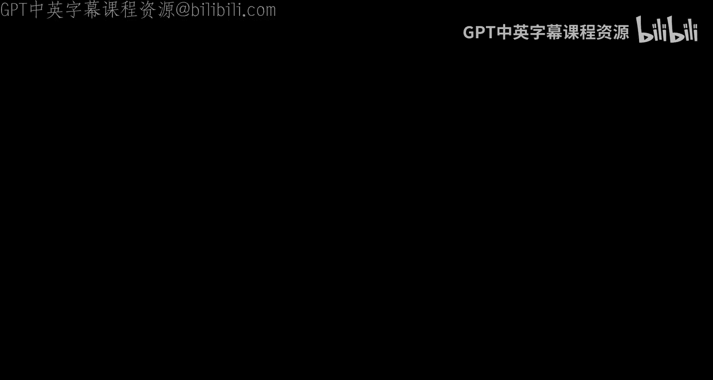
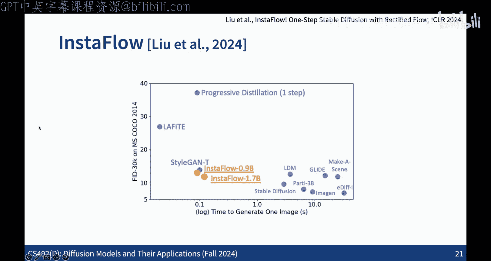
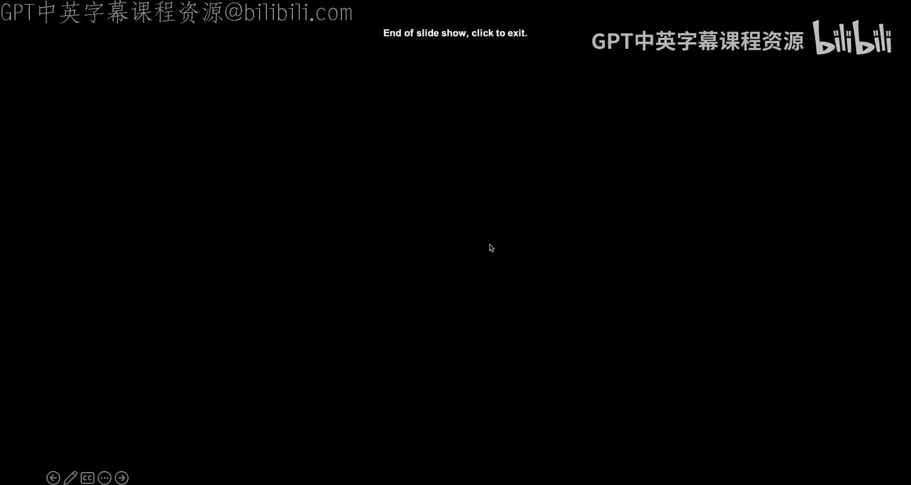

# KAIST《扩散模型和应用｜CS492(D) Diffusion Models and Their Applications (Fall 2024)》中英字幕 - P15：Lecture 16_ Flow Matching 2 (KAIST CS492D, Fall 2024).zh_en - GPT中英字幕课程资源 - BV1mwpUzREqX

你说。Okay so let's get started with the flow matching okay。

 so last time we discussed some kind of the some fundamental things about the flow matching。

 which is the another type of the agent model， we especially saw some kind of the details the math in terms of how we can derive some kind of the exact loss function for the training and we're going to get into more about some kind of the higher level the ideas about like how exactly this works and how we also need to implement this and how we can compare this with the D models that we discuss occur。

So let me briefly like remind things that we discussed last time。

 so last time we discussed some kind of things about the normal light flow and the concept of the push for the operator so now what we are going to do in terms of designing some kind of the gen model is that we are going to basically introduce the mapping function。

 the pi here， which is basically mapping some kind of given the base distribution which is typically the standard the normal distribution into some kind of the data distribution that we want to basically learn through some kind of training so when you basically see that this pi is kind of the function which is the mapping the P0 the base distribution the probability distribution into the data distribution。

 the P1， the sampling through the P1 distribution can be basically seen as kind of the procedure that we first sample from the P0 distribution which is the base distribution and mapping this into the model of the sample or the P1 distribution。

And we basically introduce basically the term， which is the pushboard operation。

 which is the means that we are pushing the digital distribution into the P1 distribution by increasingly given the mapping function pi here。

And discuss that the mapping could be basically expressed with these kind of deforms right？

So this wast the basic idea of the push for operator。

 so basically's in terms like making a general model what we want to do is basically how we can find the push forward operator。

 the pi mapping the standard enmer into the data distribution without knowing some analog form of the data distribution but taking some of the samples of the data distribution。

So for that basically we also discussed some kind of the other concepts which is the velocity field。

 the vector field and also the probability the pass so given the kind of the mapping function pi here which is typically called the flow map we are basically define some kind of the velocity the field which is just like the de of that kind of mapping function which is basically time t here。

 so basically the mapping function the flow map here。

 can be also expressed with in terms of the velocity field which is also given some kind of the lot of the probability the in terms of how the probability distribution is basically evolving over time。

 so the vector field so basically the probability pass over the time space the T the p there。

 has this kind of the relationship between the vector field there which is and this relationship is basically represented with the focalclock equation as you shown here so by solving this equation。

We can basically find some of corresponding the impact field from the given the problem pest and we can do the other real so we have thing this kind of relationship with too。

So the goal of the the flow matching is that when we basically know some kind of the flow mapping the P0 distribution。

 the base distribution to the P1 distribution， the DR distribution。

 how we can basically learn some kind of the neural net that can capture this kind of the velocity information over time in the space the thing is that obviously if we already know the selective the vector field we say that shows some kind of the mapping。

 then we don't need to train in neural network with so that's kind of thing so without having kind of the vector build the information how we can train in neural net that can basically learn this kind of mapping is the problem that we are going solving the flow matching。

So for that basically what we had seen last time is that instead of like the considering defect vector field because like we don't have the information about detecting right so instead of like using considering the defect vector field now we are going to consider the conditional defect field conditioned by the data sample of the X1 so last time we changed the location so which means that the X1 here is basically one of the samples from the data distribution right so conditioned by the one of the sample of the X1 here we are thinking of some kind of the conditional defect field。

And the good thing is that once we start to consider this kind of the conditional defect field。

 now we can see that the rules function， the regression that we have seen in the previous slide can be converted into this form。

 basically almost the same form of the rules function that we are only changing some kind of the disseling part like some kind of some values for the expectation。

And so for that， so here the question might is that so then what sort of the conditional vector field that should we consider there are lots of the options so it's middle what sort of the conditional vector field that we choose and specific form of the vector field。

 the conditional vector field that we discussed last time we're basically was this we chose specifically derived by the definition of the conditional probability pest there So now we are basically considering the conditional the probability pest which is defined as kind of some gausian distribution with a some kind of the function of the mean and also the function of the variance and given the definitions of the probability pest now we can just stay derived the flow map here and by just taking the derivative of the flow map we can also find the vector field right So we are thinking of that this specific form of the probability test and also the flow map and also the vector field。

And also there are lots of the options in terms like what's sort of the mean function and the variance function that you're going to choose and also the simplest form for the mean function and the variance function was like these two。

So by accepting like the mean function and the grid function into this form。

 we could also derive the problem the tense and the flow mat and the impact of field corresponding to these definitions。

 right？So can you quickly like write down like what are some kind of probability has and flow defect field for the definition of like these specific to the mean function and derivative function？

Yes。嗯。嗯嗯嗯。你问点么。You can check whether your answer or is same with this。嗯。Aless speak。Yeah。虚理。So yeah。

 let's see by the mean and the variance in that way in the conditional the probability test now we can derive the follow map into this form and also the battlefield into this form so big the betterfield is good the data input taking the the flow map right。

But this is kind of the most interesting part in the flow matching the thing is that actually we were defining this sigma mean as kind of the very small number right in terms of that the conditional report press becomes something that is very closely deduct function that is having the at the x right。

So actually， what we can see from all these definitions of the flow map and the vector field is that if we see that actually the sigma mean is close to zero and if we just treat them as time zero。

 but what we can see is that the final form of the flow map and the vector field becomes like this。

So which means that after like all the kind of the only derivation。

 what we are doing as kind of the follow map is basically nothing but like linearly incorolating these two points。

 the Xt and the x mode。Let's good the assume please stick。So from this。

 actually what we can see in terms of how we train the our flow ba model is that so this was basically low function that we have seen。

 right？So the difference between the dis function and also the most function that we have used to train the noise prediction the network for the diff model system for the noise prediction network。

 we only sample the X1 right the data point and then we are perturbing this a data point adding some kind of noise and then sending this to some kind of XT in this context and then predicting the noise and then basically see whether the predicted the noise basically going matches some kind of the noise that we added right so we are only sampling the X1 basicallys sampling the XT based on the X1。

So here there one difference is that now we are sampling both the x1 and the x0。

X1 is basically one of the data points and X0 will be one of the sample from the standard des distribution。

And based on that， we are computing the Xt here。Based on the flow function here and our diplomatic function was the simplest form。

 basically simply linear inter， so once we basically sample the x1 and the x。

 we are culating the Xt by linear interpoating those two points with some kind of the time tip we are the tiny also like random itself way。

And based on that， then now we can also compute the vector， the velocity at the Xt。

 what the velocity at the xt are giving the x1 here。

 and we can also see that the velocity be at the Xt with respect to the x1。

 just becomes some kind of the velocity which is also for the interpo between these two points for the x1 and the x。

 so if we take the vector from the x to the x1， that becomes the velocity that we are going to match。

And what we are also going to do is that we simply train in neural network that can create match east velocityacy by just predicting the value。

So you can say that actually it turns out that after doing all this kind of complicated kind of de mess。

 if we define the condition you have press in this way。

 then all the process blockchain training if flow matching becomes this simple form。

Ba'sically nothing but we are every time we are sampling the tiny key and also the data point x1 and also one example from the central of the Gaussian description。

 and based on that we are taking the vector which is like the vector from the x x1 and then basically predicting this vector using theod network。

So now you can see that the implementation will be very simple， right？

So this is was kind of all the interesting things in terms that you know after all the database you can see that training kind of before this model is actually very simple。

And now also you can see that why we defined the conditional reported test in that way in some kind of the through some reverse engineering。

 so we wanted to actually have this kind of the simplest form。

 just taking two points and just taking the vector from to one point to the other as kind of the velocity and just like matching this thing。

And to basically train on the format into the simpl form。

 we define the conditional the project has in that way in a way that we can also have the some specific form of the flow map and also the detector built into that equations。

So you can think about like in the reverse way to achieve this kind of the simplest form in the most function what sort of the conditional problem past that we need to identify。

So maybe from this， you can check out these slides again and see like why we define these things in that way。

So this is kind of the thing， I mean， while we in La some kind of be some you know complicated case of kind of the mass underlying the kind of deformulation。

 it turns out that we can actually train a flow the model using this kind of the simplest form function。

 just like taking the samples of the not only the x1 and also the x0 and taking the vector from the one point to the other to x0 to the x1 is kind of the vector that we want to match and then basically training a kind of the the neural network that can predict this vector。

So very simple the objective function， well now you can see that the meaning of having this loss function is actually just like learning those vector learning the conditional defector built conditioned by the x1 and then that also is per some kind of the equivalentvalence with the lowest function that we want to actually use。

Any questions on this？Oh。And you can also see that actually this looks kind of similar with theffion model in terms of that we somehow sample the Xt。

 somehow sample the XT and then basically getting some kind of quantity at the Xt and training neural network in a way to predict that SP quantity right but the way that we are sampling the Xt in the diion model was only using the x1 and basically adding some kind of the noise。

 some perturbation and also we are predicting the amount of the noise that we added from the X1 and here the thing is that we are not only having the x1 but creating some kind of the XUS as well。

 having some kind of coupling decoupling on the D and based on that we are defining some kind of the defect from the X to the X1 and trying to basically match this kind of defect。

The kind of quantity that we are going to predict is different with different models。嗯嗯嗯。

可 any questions onです。接三。So yeah I you got some kind theページ idea how exactly then the question might be that so。

Why do we care about the full matching， right if the digital model basically works well。

 then should really know about the full matching。 So there might be some kind of question。

 And also does full matching the basic model work better than the digital models。

 So these are some kind of some naturally questions， right。

So actually also this is the very interesting point that is very recent kind of be some alter that people are basically seeing in some kind of very recent research。

 the thing is that while the fluid mat model is kind of working obviously the outcome may not be。

Very good。 I mean， so there are still some kind of the the things that we can improve in terms of the good how people be model。

But the very interesting point， the first interesting point for the flow based model is that the output tends to learn some kind of the more sort of the straight the trajectories which is basically avoid some kind of crossing each other so when you think about that these are some kind of some base and the target distribution and some the top colors。

 some kind of the base distribution and the red corner kind of the data distribution。

 if it is they randomly sample the two points x through in the x1 and do some kind of the linear。

 then we're to see that there can be lots of some kind of the trajectories that can cross each other。

But we increasing the proof here， actually what we can see is the output of like training the flow matching D model is that one it trained on the flow matching D model。

That we can typically see this kind of the output， we see specifically avoiding some kind of the crossing of the trajectory。

 we see especially having those kind of the outputs。And given this， actually。

 what we can do is that once we basically have some kind of be some pretrained some kind of the full base model。

 So let's say that Z1 is basically some kind of be trained full base model。

Then what it can do is that we train again， we just train the Google base model again using another neural network or we we can also consider like just by between the tree training network。

 but that's just like random is sampling the X2 and the X1。

 but now sampling those pairs from the pretraining model。Makes sense。

So previously basically what we have done is that we are independently sampling the X U and the X1。

 so is random is making any kind of some kind of pairs with the X U and the X1。But instead of that。

 now we can consider this sampling the x role and running the generated process of the flow matching with the solving the O D。

 right， and then we can get the x1。So now the pairs of the X0 and the X1。

 basically it comes from the preprint the flow base model。

So we have to be using some kind of the training the based model once and using that information to train again。

我那就拍服ベス model。So DC does be basically some technique which is called the leap flow。

 but if you train the full matching model again what we get is that so DC basically be the output the first the full based model basically you can see that it tries to basically or boil some kind of de making some kind of some kind of traies like this so now we are basically sampling the x and x1 based on this model and basically train again another full based model then we get this。

So interestingly， now you can see that it tends to make some like strict projects like this。

And we can also repeat this again， basically now taking the second model as some kind of be some baseball dis and training again。

 then we get more straight categories like this。You must fight for digified that please。

And actually what you can see is that as we have some kind of the more like the straight trajectories。

 it becomes like much easier to solve the ODE right because like once you basically get the velocity from the very beginning point。

 you can just like go straight without this example like more and more right so basically having the more like straighter the trajectories because it help to basically run the genetic process with some fewer steps。

We some kind of data or accurate outputs。So this is kind of very interesting kind of findings in terms of that what we need to do in terms like reducing the normal base steps inference in the generation time is to basically train the flow based models multiple times。

 you basically train the flow based model like once and using that training another the flow based models and just repeating more times。

And why do we get like this trajectory trajectory obviously norm？Go给 multiple kinds。So actually。

 if you see the loss function again， actually this loss function itself。

 especially measuring these fitness will be protected place。

So basically we are samplinging the xt in the middle of the x and the x1 and try to see whether the factor that we are targeting at the Xt is basically heading basically the direction from the xro to the X1 right。

 which means that actually this most content solve is basically measuring how straight all the trajecties are。

So since we are just minimizing this most functionality more and more and more。

 as you can quite repeat like the multiple times， we can see that actually the present just a straighter。

So there are lots of theque on the this， I just keep some of the views there。

 but this is kind of some of the outputpost that we can see。

But this is like very interesting the result。And here like one more interesting is that now we can apply this idea that only for the flow mat model。

 but actually for any certain model， for any pretrained genetic model。

 we can consider applying this kind of same technique。

But before we get into that actually let's see some kind of results here so these are some kinds of results when we repeat like training the full base models like multiple times so one the world instead the first the output default full base model the true rec rule is the next time the training。

And three of probably the next one， so you can see that if you say the API at the very beginning。

 the API is like very high like 300 or something it's very high number， right？

So if you basically train another four base model， it goes down to 12， which is like way smaller。

 and if you train one more time， then it goes down to eight。

So we can see that like by repeating this kind of the multiple the training the flow base model。

 we can see some kind of improvement of all the results。

And especially like the number of big eight putting something on the FID is very small when you think about that。

 actually， the number of the evaluation is a one step。

So what's the meaning of like having the one step， the ODA disorder， like solving the OD。

 which is like we just like a single step？That basically means that we are not actually solving the like the ODE with some kind of disorder。

 we just like take the velocity vector at the very beginning and that goes straight。

With some kind of time that we had right。Just getting some kind of the velocity information at the beginning point from the sample of the standard Gaussian distribution。

 and then just like go straight， that becomes our definedfin on the alpha。

Even for this kind of the one step kind of de generation， we are achieving some very active output。

 very good quality of the output degenerative process。

 which is like very interesting results compared with that D model typically requires like tens of some kind of deters to get some kind of good results。

And the reason like why we can get some kind of good result with some of like single step degeneration is that the trajectory is from pre straight。

 so we can basically do some kind of the one step de generationeration by restrict taking the velocity information from the very beginning。

So this is like very interesting the output and as I mentioned before。

 like the more interesting might be that actually we can apply the same idea for the stable diffusion as well。

For any generated models because like the goal of the generator model you can see sampling the x1 by starting from the x0 right so we put any like again for anything what we do is that we first sample from the unique Gaussian distribution and then do some kind of the mapping process whether it can be generator for the again or some kind of the you know。

The de process really different models， so we are doing if we have some kind of the pairs of the XO and the X1 away from any kind of the frequent genetic models。

So actually， what we can do is that from this stable division， from the gridtrain stable division。

 we can sample lots so big curve of the x0 and x1。Using some pretrain data and then using these pairs to train a flow based model。

Just like doing the same thing， but not taking between through flow based model is kind of be a base model。

 but using any kind of division model or any model。

 so we can really consider like taking the X0 and the x1 pairs from this table division and using this to print the flow base model。

Then what we can do is that obviously we cannot achieve some better quality than the stable di because now we are using the output of the stable di for the training data right。

 so there is no expectation that we're going to get some kind of the even higher quality。

 but the thing is that we can make the trajectory stricter which means that we can run the generation the process with a way fewer these steps。

So those are some kind of results that we are reducing a computation time income of like reducing the number of these steps。

 so we don't need to basically run the denoing process like multiple pen。

 we can just swap the ODE with some kind of variable few steps whilst students are keeping some kind of good quality。

So this is kind of the idea in terms of then how we can make the generation process the in the multi model。

So if we see some kind of the literature of the agenda models in recent like some years so like for the G and theE seeing that the quality is not very good but still the speed is like quite fast right so the idea in terms of improving the quality while secrificing the speed was basically having some multiple steps of the deno right so that's why there's going be some kind of good quality by refining the X of de prediction in the defeat models through the multiple deno in the process。

And we could also basically reduce the normal steps by converting the DPN into the DD idea right I make some kind of data sampling we just kind of keep around to solving the audit right that we could also reduce the normal steps while getting some kind of the good quality of the outputs。

And the idea in terms of reducing the number of the border was some kind of good quality is to basically use distill some kind of the information from the the division models。

 and then just like training or another two these models in a whether you can get some kind of filter project place。

So this is basically what we are seeing in the recent dayss。Yeah， so I was curious so in theory。

 we can train some diffusion model， then if it performs well。

 we can train the flow model and then just use that flow model in production because it would be much faster。

That's exactly what people so once you have some kind of really good quality of the digital model。

 but that might require like running these steps like multiple times。

 we can just like make another kind of clone like this but like you know compromising the quality a little bit you basically won't be able to get kind of the same quality like sacrificing the quality a little bit。

 but we can make it way faster basically might be by making this the credit this feature。

basically somehow like you know branching out from some kind of plane trained some division model。

 just making another some kind of the flow based model which is running way faster。

 so this is the technique that people are really using to make the generation be processed faster。

So this was kind of really important factor in terms of applying those kind of the techniques in the many applications and the will be some industry problems because if it takes like seconds to just generate like single image then would it be really useful for many applications you will need wait for that second or something longer than that to get some kind of the single image right also it is like involving lots of the computation like all the GPO computation is kind of the cost so basically kind of version in terms of visual models but by converting the digital model into the flow the meta model we can basically be make the generation way faster so even be some less than one second we can get some kind of good result while also reducing the computation time and also the computation results more。

So this is kind of be very recent to the idea in terms of how we can make the generation faster but it's just like re some kind of floor based model。

But then what to be some kind of some downside in terms of reducing the number of iterations？

Any kind of ideas？We need to prepare the data sets that requires sampling of stable ph so we will take lot of time。

Yeah， so that's also kind of like one bi so for training another the flow based model typically for the training the flow based model using this cable equation people typically use like one million samples of the X and the X1 which means that you also take some kind of competition time for that plus some kind of the time for training the flow based model so this was kind of like one big so if we can even without like using some kind of the prepaying model。

 if we can also get some kind of good sample of the X and the X1 so to train the flow based model from scratch without having some kind of the existing data model that will be way there so thats really some kind of the research problem like。

But in terms of like applying those techniques for some kind of the applications。

 do you also see some kind of the downside in terms of like reducing the nominal distance？

I meanIn terms of the generation dispute， obviously like reducing the number of step is really good right but as some kind of the advantages of the division models that what we have discussed in this class is that since we are having some kind of the iterative process in the generation actually we could do some kind of the more some conditional generation with some guidanceiding generation so we have seen lots of some kind of examples in terms of them we are getting some kind of input in the demoing process it can be some kind of like running some kind of backproag or some kind of doing some kind of some manipulation we created the output so we are basically adding some injecting some of the inputs as some kind of guidance in the demo process in terms that we get some kind of some de outputs that satisfy some kind of conference so that also also kind of the power models while the generation the we can do some kind of more some kind of more the guidance in de generation process but we previously run the one。

Degeneration， it won't be possible to apply these techniques so for some kind of guidanceiding generation with some kind of single step degen。

 we might need to also consider some other kind of options for them。

So there can be some kind of the trait in terms of like reducing。はい、こ者さんです。

So I strongly recommend you to basically check those out and also the assignment7 will will be obvious with implementinging the cool method you can really try to basically。

Like some kind of B flow basically the flow matching multiple times and see whether you can really get some kind of strict trajecties。

 so implementing the flow matching would be the last assignment。So， so that's it for the report on。

ちと。2。

