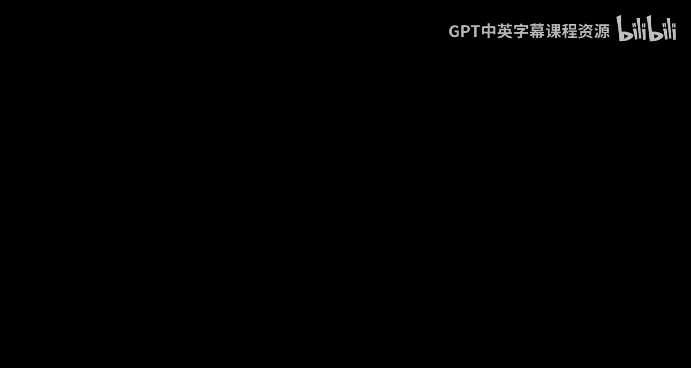
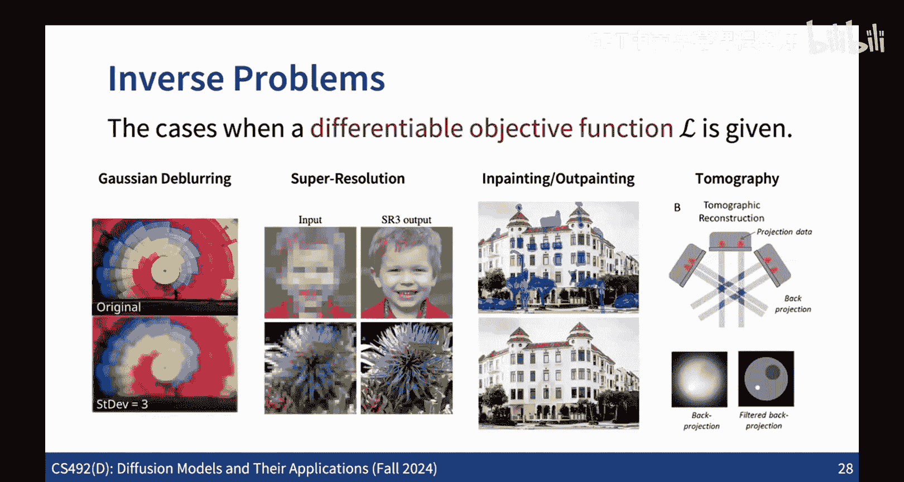
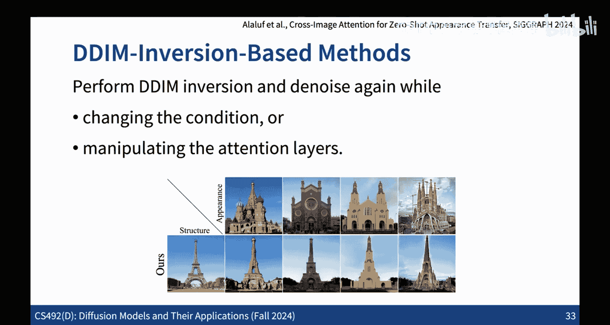
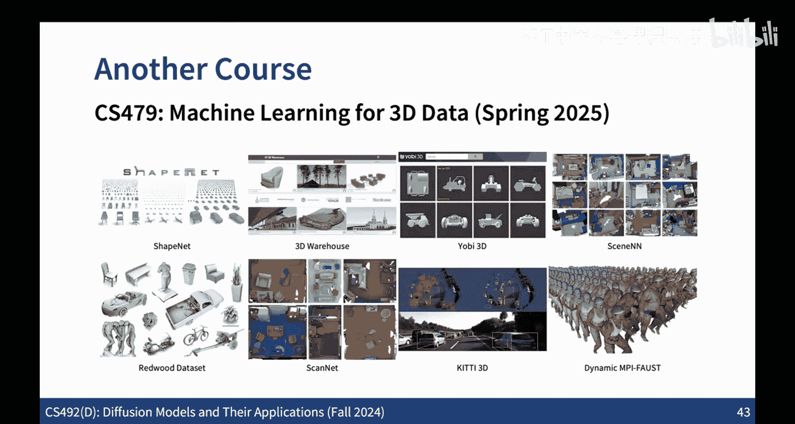
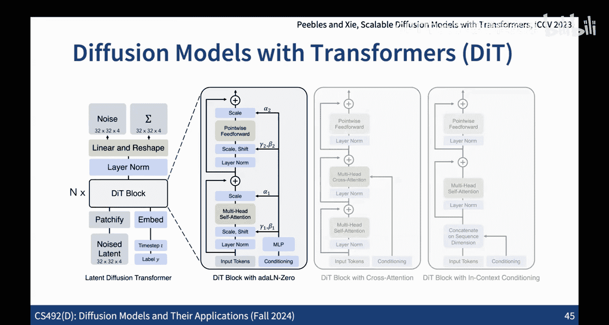
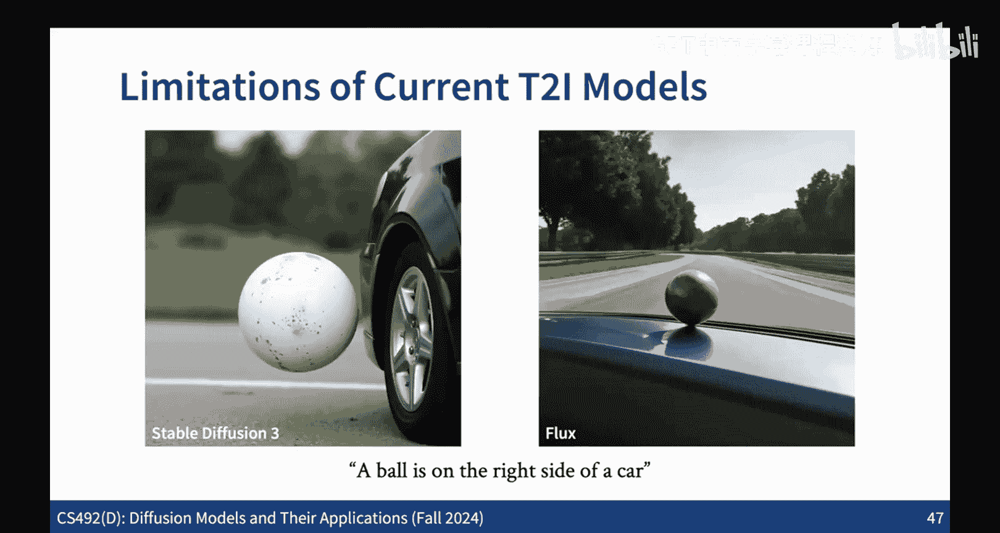
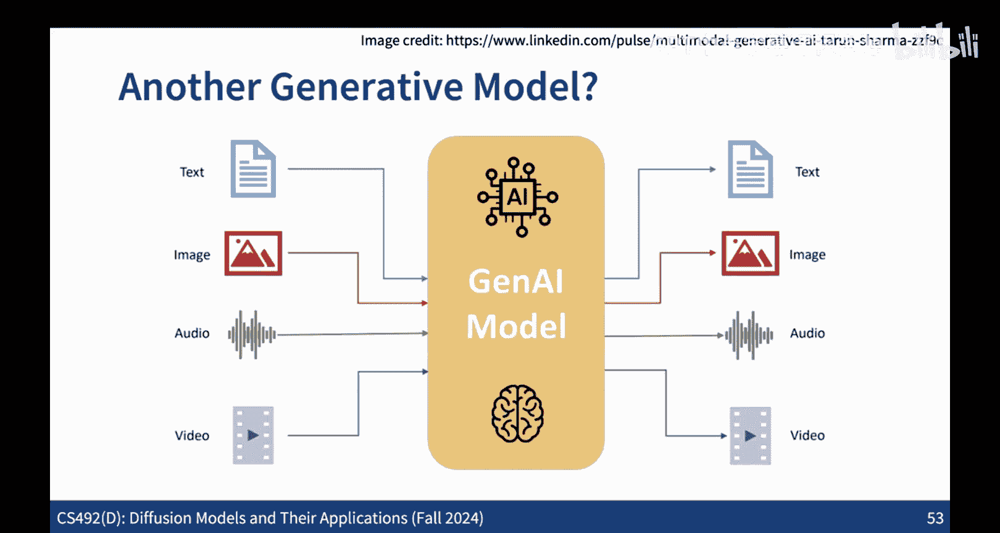
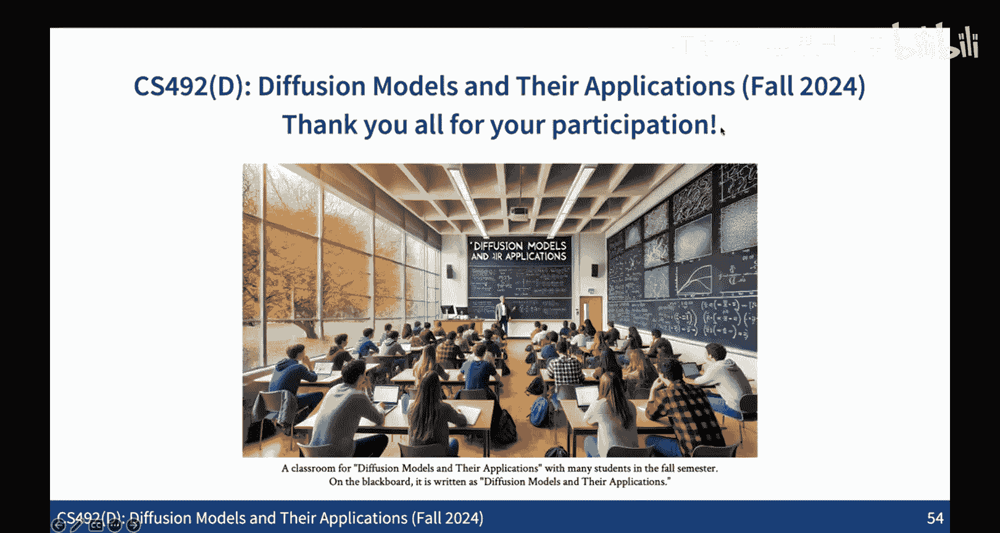

# KAIST《扩散模型和应用｜CS492(D) Diffusion Models and Their Applications (Fall 2024)》中英字幕 - P16：Lecture 17_ Course Summary (KAIST CS492D, Fall 2024).zh_en - GPT中英字幕课程资源 - BV1mwpUzREqX

So yeah so let's test with the last lecture so so far we discuss lots of these for the division models and we are going to briefly review the things that we discussed so can see that like know the things that we are discussed can be classified into some of the foundation things about the different models and also how can we apply those like division models are not only for the generation but only many of of the applications so we discussed both the foundations and the applications and we started our class some kind of the basics about digital models so what's the basic idea of degen models。

The basic idea is that basically we want to do some kind of dis sampling of some kind of the realistic data point based on the information about some kind of the existing samples for the data distribution and for that for all the different models。

 the basic idea is that we are basically learning some kind of the mapping from the base distribution to the kind of the data distribution。

 since we don't know some kind of analytics one for the data distribution。

 we are starting from sampling from the some base distribution which is basically as the simple the standard the Gausian distribution and then mapping this to one of the data point the data distribution so this was kind of basic here for all the types of vision models that we discussed in this class。

And here the idea is that how we can learn this kind of mapping given the samples of kind of the data distribution and for that we discuss some kind of the importance of the ideas。

 the basic idea for this was basically using the again and the idea for the basically of points of the again and all base model and the di models and here the point is that how we can guarantee that the mapping from one of the base distribution to the data distribution really maps one of the realistic the data point to guarantee that the basic idea was basically using the the game which is basically jointly training this kind of the decoding process。

 the mapping from the base the data de and also discminator which is basically discminating whether the output the mapping is really one of the realistic data point or some kind of the big the data point so by joining your training post de generator in the discminator。

 we could see that the mapping can be basically defined in terms of like real mapping to some realistic data point。

And the other idea was specific BAE which is basically not only training the generator。

 which is the decota here， but also encode coder as well， which is I think all of the data points。

 the data distribution into the the base distribution in a way that basically when you basically have boost this kind of like the boost ways of the mapping we could effectively minimize the elbow and the loss function。

 so there the basic idea for the BAE。And also having sort of the accuracycurive of the step for discovery back once they based idea pretty different models。

 so pretty different models this kind of the encoding and the decoding process says basically designed into the sequential processes。

 so we are basically having the code process which is mapping the data point into the samples in the base distribution and the other way around is basically the process which are basically reverse process in the context of the digital models。

So the digital models as the before process was the data peration。

 the process then we are gradually adding the noise into the data point in terms of that we are eventually getting some kind of the pure unique gaugeian the noise and the labor process was the opposite as we was the denoing some kind of the standard gauge the random samples in a way that they can be connected to some kind of realistic the data points。

And did change so be attending for。And there are some kind of pros for the all different types of the digital models。

 so the characteristics of the diff models was that is basically better in terms of like high quality outputs of the generations and also producing some diverse outputs the downside of individual model was that it is basically slow because involve some kind of multipleing some kind of window experiments but actually this kind of the characteristics also could be useful for the many of applications as we also discussed some kind of the for the applications in terms of like implementation and also making some kind of conditional model and doing some kind of personalization and also for some kind of the knowledge installation diff model and some kind of the certain of advantage compared to the other types of the digital models。

actually， there can be they are putting be some kind of multiplepo for making the division models so it does like the matter of how we define this kind of default the jump distribution making the practice row to the X so that was basically conditionary distribution of the xt conditioned by the x0 so depending on how we define this we could basically define some kind of the different types of division models so the only kind of condition to make the di model was basically define the variance over time in terms of like the S andR monotonically decreases over time。

And we specifically discussed like two defined types of differential model。

 the first model was specifically the variance the pressure in the case。

 which was the nu of the DK case， and for that we specifically designed the whole traditional distribution with this form with some kind of the better key here which is the parameter which is increasing over time。

 and the other the option was define some kind of the variance exploding case。

 which was the scrollmetric case， this was like another the case that we are defining the full transition distribution into the specific form。

And the hour discussion was basically focusing on the DTM the case and based on this kind of the definition of the whole process。

 we could consider or basically train some kind of remote prediction in the。

So the basically differential model was basically all about training some kind of the noise prediction in network and for there what we could do was that we are just disling some kind of the random data point and do some kind of the effort jump by sampling some kind of the noise in here and then basically training our kind of noise prediction in network in the a way that they can memorize the amount of the noise that we added given the XT so this was kind of the training the procedure。

And then these was must be identical in terms of the way have sampling from the that conditional distribution。

 like XT condition by X0。And based on that， the reverse process was involving multiple kind of steps which is basically we first predict in the noise here and based on that we do some kind of the prediction。

 they final the output of the x0， which was deluted by the x0 by t here。

 and then based on that we calculate the me of this specific conditional description。

 the the x t minus1 condition by the x t， the x0， and then we also sample some kind of different noise and basically the sample the x t minus-1。

 so this was basically typical process of the generation the degen models。

And we also discussed some kind of some characteristics about the noise that we are predicting。

 but basically the meaning of the noise here was that the noise was specific corresponding to the score。

 which is the gradient for the low probability so my having is kind of the noise information。

 we could do some kind of the other things in terms of some kind of guidanceiding generation as well。

And also every time， but what we do is that given some kind of data point to X。

 we also basically get some kind of expected value with the final output okay X zero which2 point x0 by T and this could be basically the formulation or the X robot by T could be derived right based on the2 formula。

So basically from the labor process to what we could see is that while we are engagingging most data point the XT。

 that could be also also considered basically definingfin the expected value the X。

 assuming in terms of the we seeing some kind of be refinement of the XO over time。

 so by having this kind of be multiple some kind of refin step。

 we could get some kind of be some better output， we is that more realisticistic。

And also we also discussed some kind of the extension of theN into some more digital case。

 so for that basically basically we defined this conditional distribution like X minus one conditioned by the XT and theO while basically controllingtoasticity here so we just basically the idea of the DVI。

So basically DPN could be considered as some kind of picture case of the DDIN and the good thing of having this kind of DDI in the model is that now we can estimate the reverse processes like deminist when you have some kind of zero variance that means that one C that the sample the standard deviation the noise especially x capital D that directly maps to the final output of x0 without any kind of so that was kind zero variance case of the DDIN interest we could could see that this kind of the determinedmin sampling could give some kind of the higher quality the samples with some kind of view number of the steps and the reason for y was basically that this kind of the determinedmin sampling could be considered kind of absorbsolving the reverse time OD with some kind of the first order discization this also of instantly this for the DP。

And for the mold foundations， like what we foresee see is that actually these kind of some deforms of related models in the this space。

 the same actually like solving the SDE， thetochastic differential equation equation。

 suppose the whole process and the labor process could be represented in the different kind of the SDE operation。

And here the one more thing is that for each of the SDE。

 okay for the labors process and the total process。

 we also could find some kind of the correspondinging the OD information that the asL。

 so which means that now we could consider basically running degen process by solving the corresponding the OD information。

And that is the basic idea of the EP server in terms of that we are defining some kind of be dedicated some kind of the server for this testimony for that reverse di OD in terms of that we can also create some kind of some realistic data points with some appeal step。

 so that is kind of be interesting idea without obviously be doing any kind of some retraining or defining thing of the di models。

 which is some kind of the existing efficient model we switching some kind of the idea about the reverse process in a way that we can basically reduceuse the competition time wireless those skills there is some kind of good quality of the output。

In terms of reducing the computation time and the reverse process。

 the other the idea that we also discussed was the B flow which is basically leveraging the idea of the flow basically the model。

 so for the flow matching model all we could do was that given the basically preconditioned pretrained di model we have basically samplingmbling the pairs of the the standard deian dis samples and the data points and given the loss of the pairs of this kind of the X and the x andD pairs。

 we are basically strain another the flow matching the model and this kind of another data model was given some kind of more the straightforward projectorors in terms of that when we solve the OD formulation。

 we can also quickly find some kind of the real data points with the view number of these steps。

So this was kind of the basic idea in terms of that we discuss kind of the major ideas related relatedative models and specifically some kind of characteristics of the digital models as well。

 and also the downside individual models was that it this text like lots of time for de generationeration。

 so we also discuss a kind of ideas in terms of how we can also accelerate this kind of de generationeration differences process。

And in terms of the applications， like we also discussed lots of the ideas for that。

So basically here one quick question one question was that when you basically deal with some kind of the high image in the data。

 if want to generate some kind of the high dimension data。

 one kind of basically the idea to basically incorporate some kind of de models here for those kind of cases we could consider basically course doing some kind of the dim reduction in some kind of autoenr in a way that we are mapping all the data the points into the data space and then as tuning our division model in the data space。

 so this was basically a very practical idea in terms of that we can there's some kind of generate some kind of high quality data for some kind of the high dimension the data。

And how about basically personalization， we also discussed this idea of Eora which are basically personalizing some kind of a pretrain di model for some specifically the the set videos for example I want to escape fine tune some kind of the image di model in a way that can basically some kind of the all different basically images between my。

 for example， how we can do this kind of like some personalization。

 and for that we also discuss some kind of the brain practical the idea。

 which is basically making another some sort of trainable the branch。

 which is basically the role French in terms of that we are having some view the view parameters to be tuned or the training or basically region the main branch。

 and this was basically very the practical idea in terms of we can to add some kind of the stylization into some kind of pretrain di model。

And how about some kind of the conditional de models the conditional degen piece in terms of making some kind of the condition the general model。

 the basic idea was this kind of the glifying free guidance。

 which is the learning was the conditional noise and the one conditional noise using the the saving network and basically the combined the two noise to basically some kind of the conditional degeneration。

And this simple the idea introducing some kind of the nu condition here in terms of learning the unconditioned noise was quite effective in terms of can we apply for any type of the condition。

 so whether the condition is between text or the image or whatever the audio or whatever kind of the mod of the data。

 it does cause the metal that they're hitting some kind of the encoder for this kind of the conditional data and they must learning this kind of conditioner and the unconditional noise。

AndSpecifically， if the conditional the is for the cases like when the modality of the conditional data and also the modality of the output data are the same。

 then we could consider basically leveraging the encoder for the noise。

 specifically we discuss some kind of idea of the control that which is for the image conditioner image generation case so for those cases when the output is also image and also when the condition is also the image。

 then we are basically leveraging the encoder for the noise in terms of that we are basically now encoding the condition using the same encoder where basically adding some kind of trainable some kind of zerocomvol some kind of the。

Some kind of component in the neural network so that those kind phase are different contrary。

And these are some kind of a training or some point thin based idea in terms with making some conditional degeneration。

And the question was that what we do some kind of the conditional de generation without any kind of defined cuning body training。

 so without having any kind of the training data can you still do some kind of be some conditional generation worthy guiding generation？

But those kind of the cases， we could also consider using some other techniques。

So the first technique that we also discussed was specifically the case like when the condition is defined as some kind of some differentiable the objective function。

 so for those kind of cases when it can define some kind of the differentiable objective function。

 we could consider using some kind of the techniques that can solve the inverse problems like the D and the PG。

And for the other cases， we will to discuss some kind of bunch of the ideas that debate paint as they did and also some in based kind of techniques。

And for the inverse problems， actually we also discuss some kind of velocity velocity applications that can be the cases that we can define some kind of the differential of the objective functions like de and the super and the in painting and the tomoography so for those cases we can effectively define some kind of loss function and the interesting point is that here the kind of the thing is like we are cculating some kind of offset to the score that we are using in the denotive process and the offset of this score complete that approximated with the gradient of that objective function which is calculated with the output with some kind of prediction of the so after kind of the lonely arivation we could say that actually this kind of the guided generation can be very easily implemented by simply adding some kind of back propag with the objective function that we are mis gate giving as the input。

At the end of the style， but this was like reason for the idea。

But in cases like when we can not define some kind of objective function we could consider an other techniquess。

 especially the red paint was the technique which was designed for the specifically for the in paint in the cases。

 so when as we want to create some kind of some foreground region while maintaining some kind of the background region in the data point we could consider as say combining some kind of the denno the foreground images and also den noise the per of the background images and then running denno reverse process altogether so this was kind of the simple idea for the in painting in case。

And also for the cases that we are looking for some kind of some realistic data point。

 which is like close from some kind of the product the inputed data point。

 we could simply consider it basically running the folder process and the process a little bit with some kind of the pure amount of the time step in terms of like finding some kind of the realistic data point from the unrealistic data point。

And the other the idea was to stay using some kind of theent DM for that what we could do was that we are running the DDM the emergeency process and then running the generation day gain while changing the condition like this like changing the prompt like this and also doing some kind of the manipulation of the attention layers。

 so this the topic that we also discuss really were in our diverse test structure。

So these are basically some examples like how we can utilize some kind of the division models for like doing some kind of conditional degeneration。

And the other topic that we also discussed is that how can you also leverage some kind of the pre transient model to some kind of the other types of the data or other the modalities of the data。

 so we essentially going that focused on some like generating some different types of like generating some different types of visual content like 3D vector images detectors and like many other things。

And the basic idea for that is that while we are generating some kind of types of individual content。

 these can be basically rendered into some kind of images from the specific use and this kind of rendering can be basically formulated into some kind of differentiable equation。

So given this kind of some differential de rendering the equation。

 what we could do is basically we could just apply the company which is called this core distance sampling。

 we see basically nothing but we are rendering some kind of the visual content into some specific view and then adding some kind of nodes into the render image and then predicting noise from some kind of the product the data point and basically just using the same host function that we used for the training the digital model running the backward all the way to some kind of the visual content through the rendering function。

And the other way around the is some kind of the typesn of daily data was basically running some kind of demonoing process going from the multiple abuse while synchronizing the outputs at the kind of level of the twins。

 so by basically predicting the X every step we are basically synchronizing then of across the different kind of abuse running the denoing process and then we could get some kind of more consistent outputposts in the de process。

So these are some kind of kind of the things that we discussed first。

 so we discussed like quite many kind of things both for the some foundations of the models and also the applications。

And actually this is really kind of the some evolving sort of the area we are also seeing some lots of the research which is also advancing each of the items here。

 so there are actually quite many things that we couldn't cover in this class so there are quite many things that we couldn't discuss in this class some kind of important ideas that we can briefly see here is that actually why we discuss the idea of the Ds over and also the。

like using the flow based model， actually there are quite many techniques in terms like trying to reduce the the number of steps in the deno process and Rely there are some kind of the famous techniques like the progressive distation and also the consult models。

 so these are only techniques in terms of using the teacher student model in terms of the we are making some kind of the on some kind of call leading models that can be basically running some kind of the denoing process with the peer of steps。

 so these are kind of some interesting ideas in terms of how we can reduce the number of steps in the gene process。

And the other thing is that while we will discuss some kind of ideas。

 which is basically mapping some kind of given the base distribution into the data distribution like the standard the normal distribution into the data distribution。

 actually there are some kind of techniques that can directly map between two different data distribution so which is the technique called the shing of reach so these kind of technique can be applied to some kind of some applications like image translation so we are basically directly make some kind of some data in specific distribution like the night-time images and then mapping some of the corresponding images in the daytime images so basically mapping of like two different distribution directly without some kind of the standard normal distribution and this was kind of be another kind of branch of the technique that we couldn't discuss in this place。

And also while we discuss some kind of the types of the visual content and also how we can generate those things using some pre image division model。

 we couldn't discuss some kind of more details for those kind of things， for example。

 like we discuss some kind of the applications like 3D generation but we can then discuss any kind of details in terms of how those kind of the data are represented。

 so theres lots of some kind of representation issues for those kind of data so if you are especially interesting some kind of 3D representations I'm also going to teach some kind of course which about the 3D representation next spring so you can during this course if you are interested more about some details for those like 3D representations。

変メニのです。Before we end this kind of the class， I mean there are actually quite many kind of the important impressions。

 which is about some kind of the questions about the future of the digital models and also the future of digital models。

So the important question might be but know we typically， I mean。

 were using some kind of some different models which are basically basically image different models。

 but we are using to say different models which are basically using the UN architecture for the knowledge prediction。

But is the union architecture is the really best option for the architecture or depending a certified to some kind of the other types ofs to train the image part network。

So many of the previous some kind of audio version of the image digital models were as we developed based the unit architecture。

 and very recently we also started to seeing some kind of the new the models。

 especially image digital models， also video models， which are usually transform the architectures。

 after we switch the architecture from the unit to the transformer， as you can expect。

 we are also seeing some kind of the even some more kind of the improvement in terms of the improving the quality of the output。

And also kind of a good thing on having the transformer。

 the architecture is that since we can basically input the information of the information about the image size into the equivalent building。

 the good thing is that now we can generate images in the RV2D size。

 so these are all the outputs that are basically generated using some kind of transformerbased different models。

 so you can see that these also kind of interesting some kind of the improvement in terms of that now we can control the image size in some kind of random way in some kind of different different models。

So these tests look very good so in terms of not only the quality of the outputs。

 but also in terms of like how well those images specifically follow be given some kind of the text description。

 they can see that only the text description developed images right and specifically the output is really good in terms of not only the quality images but in terms of the clearly they basically is very clearly online to be some kind of given the text the instruction。

So this looks really good， like it seems like no image generation is kind of solve。

 but actually there are quite many limitations as well for the current version of the image division models。

One of the very famous limitation of the current the especially for the individual model is that actually it does not have some kind of the good understanding for the text。

 so as you can see like here the failure case system then that given the text was the A blue is on the right side of the card。

 but is the above is really on the right side of the record。No。

 so this is one of the famously familiar cases of the current version of the electron models in terms of it it does' not have any understanding for these especiallyly already。

So I even't know whether this is because of that because they some kind of the training there in terms of that you there are not many some kind of the image and the text pairs。

 hitting some kind of the description about the specialty arrangement or some problems in the text encoder because for those kind of the well-know some kind of the image if models。

 they are typically in some kind of the pretrained the text decor and this kind of the pretrainedr by text some kind of the not having some capabilities like having this kind of understanding for the specialty arrangement。

 so I don't know but I mean there are some this kind of the very wellknow limitations for the many T point models。

And actually， there are not be more more than this， actually they kind with manyity cases。

And here's the the question is that how we can basically improve the ph module for those kind of the failure cases。

So there are also kind of many discussions in terms of them how we can effectively improve not only digital models。

 but also like A&M and theM for many kind of foundation， right？

One of the famous ideas in terms of improving the many foundation models is to using the reinforce of learning with some kind of human feedback。

 so it is also known that the recent version of the GPT has been improved a by the taking is kind of human feedback and the fine tune with the reinforce of learning and this kind of technique also can be applied for the diff models as well in terms of the better aligned with some kind of given the text description or other types of the condition。

There are still there are many kind of insert like is going on in terms of improving some kind of large K negative models。

And the other question might is that speaking to the GPT。

 so actually the interesting kind of thing now we can see at this moment is that while we are discussing digital models and we know that digital models are basically the best option for the image generation for now。

 how are the text generation？So I guess everyone might be using a GT right。

 so many kind of head items for the assignment for of and we know that actually those kind of the head and those degree are not using inter the models。

 but the designed as some kind of the auto risk models。

 which is basically using some kind of some concentration。

The auto latest models that can be considered as some kind of best option for the sequence generation。

So the idea is specifically talking about this theory we are generating some kind of to like one by one and given some kind of the some to that has been generated so far。

 the the state some kind of the next token and this kind of the next token day generation is actually basically done by training some kind of the classification in network。

So which is in the case that all the tokens are to stay defined in not in some kind of continuous space or in some kind of discrete space and all the data points are some kind of the sequentially data。

 whereas they' doing some kind of deification in the sequential manner based on the that we so far。

 so those kind of data criteria has been very effective probably the tax generation。

Then for many othertypho there， what would be kind of the best option to choose like you know either the digital model or the auto models or something else？

So I think still this discussion is going on for kind of many kind of different types of data。

Like one interesting kind of example might be graph so we are also seeing some kind of the loss of the research of the graph generation like some kind of more like a structure generation or those kind of things we can also consider using either the digital models for the auto models so we can basically see some kind of graph by converting each of some kind of structure with some kind of the sequence of the node but having some kind of role converting the graph into some kind of sequence where we can see like the graph is kind of the whole and running some kind of different models there but obviously the graph is not some kind of the regular structure the data like images but also it's not some sequence of data for those kind of data one kind of the best option for that I think there is no some kind of the clear and for now but these days like we are seeing some kind of the more some research work using different models for the graph generation。

But there are many some kind of the other ways around basically making some different models。

 especially for some kind of different infrastructure。

So there to be kind of like many kind of discussions for this。And how about the videos。

 actually videos also can be very interesting kind of the type。

 the mod of the data in terms of that each of the frame is basically images。

 so it looks like in a digital model might be kind of the best option。

Or actually the sequence of the frames， or basically some sequential sequential data。

 which means that they can also continue in some kind of release models as well。So actually。

 there are some kind of attempts in terms of even integrating both individual models and we able to use models in terms of that we are seeing some kind of be two axis of time。

So for every single thing youre think about the time of be noise right。

 so that's the typical time that we consider being kind of be different models。

But when you see the entire set of the things we can also think about the time of the videos right so that there two different types of the kind the types of the time axis。

For those kind of cases， like running data modelss might be propagating other things through the noise。

 the time day axis， while the automatically smart my data running propagating other things through the video the time day axis。

And there are some kind of attempts in terms like running this kind of propagation into the both axis in terms of integrating these kind of2 years。

But as you can see like depending on some kind of the type of the。

 digital model may not be kind of the best option， there can be still many other options in terms of making different models depending the type of the data。

Then here the last question might be that now we are also seeing some kind of the many molecule mod data at theM is also the case that again they take you both the images and the text as an input。

 and if you think about some kind of the AI model then as they take all the text image and audio video like all the modization data and then also put this some depth is the output。

 then what to be kind of the the option the best kind of type of within the model。

Maybe mean might mean something else， like even some different models like existing ideas with different models in the authors models or something else。

What I also heard from some kind of people is that in many big tech companies。

 they are also developing some kind of GPT， doing giantGB。

 which is a tokenizing everything like text image and you would review everything and just feeding them into the GP pipeline。

And doing some kind of degeneration。which is obviously not the case of using individual models。

 but also there can be some kind of cases like combining some kind of pre automated models and also in different models those are also some of the cases that we can see in the many kind of GPT kind of things。

 the open kind of models， or there can be something else。

So we don't know so still this be very evolving the area and we are justing some kind of larger pitch this。

 I think no one really knew that different models will be this kind of be will become such famous like say were four years ago so everything is really changing very quickly so probably sometime next year or year after next year。

 we might need to discuss some kind of new type of basic models。

So we seeing this kind of be many changes at this。So this is the end of the discussion for the this and thank you all for participating participating this。

And I'd like to also thank our in employees for the great efforts to make this close。

This is the end multi the course。Thank you everyone。

 so before we end this question please don't be dec because we are also going to review the whole session the guidelines so me。

でく。