# KAIST《扩散模型和应用｜CS492(D) Diffusion Models and Their Applications (Fall 2024)》中英字幕 - P17：Guest Lecture 1_ Or Patashnik - The Power of Attention Layers (KAIST CS492D, Fal - GPT中英字幕课程资源 - BV1mwpUzREqX

Eecture。

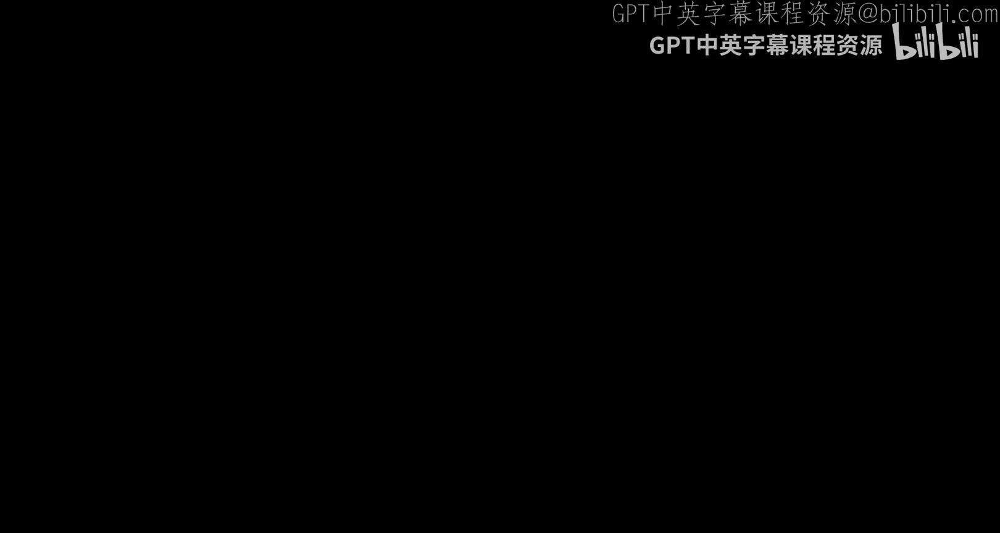

So Or Patunique is the page distance at the therapyrap University and also working at the step research as the intern there as well。

 and she has done last of the work， very great work about like image generation and the editing based on the division models so we have discussed some kind of the basics about the division models of work in this class and she's going to talk about some kind of the more like some important applications in terms like how we can utilize some quick trained division models for many some the diversity applications for these especially for like image generation the manipulations so shell talk about this topic。

So yeah， please take the away。So thank you for inviting me Min thank you for the introduction and I think we have quite a lot of time so although we have a Q&A session at the end of the talk please feel free to stop me if anything is not clear okay so like most of you probably know in the recent years we had a huge advancement in the in generative models and the quality of the images that they can generate in their diversity and actually even though that this course is about diffusion models。

 I think that a huge progress has also been made in other types of generative models such as GN and the autoaggressive models and besides the scale and the large amount of data that was used to train these models。

😊。

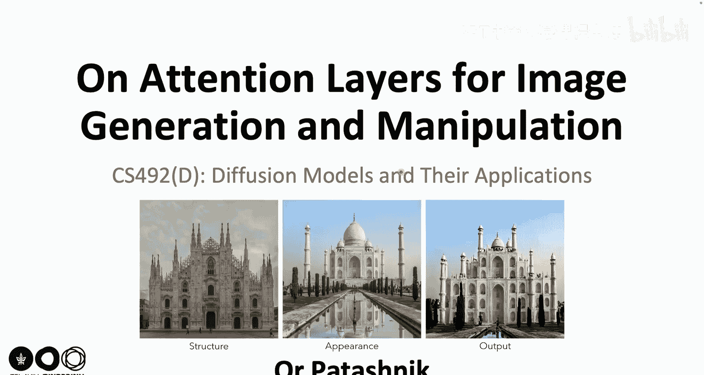

Something that is common to all of these great models that we see recently is the use of attention layers。

So this talk is going to in this talk I'm mostly going to talk about attention layers。

 so I guess that most of you at some point saw this figure transformer and are familiar with this equation of attention and to be honest I actually started to understand what's going on in attention only when I actually play with it。

 I see that there is a question。

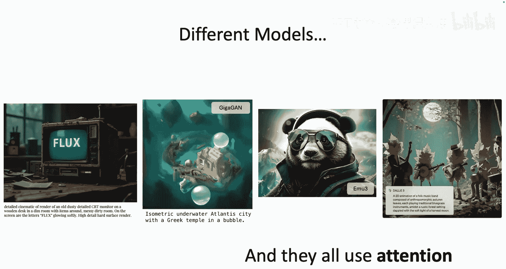

You want to ask something， Sanangmin。好，诶 ok。So again， you can。Stop me if you have any questions。

 so I really hope that by the end of this talk you're going to have much more insights about attention layers and the application that they enable in generative models。

So I'm going to focus on stable diffusion， I guess that most of you are familiar with this so just to remind you where does the attention is used in stable diffusion。

 so each of the blocks in stable diffusion consists of a convolution layer followed by self attention layer followed by cross attention layer so we have quite a lot of attention layers in stable diffusion。

Okay， so now let's actually begin so let me start by explaining what is selfattion so the input for this layer is the feature map which is actually the features of the generated image and first of all in attention layers we project these features into three components called queries keys and values and each of these components has its own role and we're going to see it soon during the talk。

And after we have the okay another thing to mention that again we're going to see along the top is that the information encoded in these features is very semantic information it's not only about appearance and stuff like that。

 but it's a lot about the semantics of damage being generated。

So after we have these three components， the queries keys and values in attention layer we multiply the queries with the keys。

 so it means that each of the queries is multiplied with each of the keys which gives us an attention map per query。

 now note that this multiplication is actually an inner product that measures similarity。

As always with the inner product。 So it actually means that for each query we have in its attention map。

 we have the keys that have the most similar semantic meaning to it。 Okay， so for example。

 you can see here two attention maps corresponding to two different queries。 So for example。

 in this map。 The queries is somewhere on the leg of the bear。

 So we see that the keys that are most similar to this query are the keys on the legs of the bear。

Okay， so these are the attention maps and after we have them。

 we multiply these attention maps with the values。So it means that in the output feature map of the attention layer。

 each feature in each pixel， we have a weighted sum of the values or the weights for this weighted sum are determined by the attention map okay。

 corresponding to this specific location。So a nice example to that shows the power of a attention layer specifically for generating image。

 I think is this example， so here we see a moon above a lake and we see that the moon is reflected in the lake。

And if we look on the attention map of a point of this red point on the reflection of the moon。

 so we get something like that， this is of course in a specific layer in a specific time step so by this you can see how these attention layers allow the model to model long range relations if we've used only convolution layers it would be very difficult to have accurate reflection of the moon we would have to have very very large perspective field but these attention layers allow allow us to model these long range relations。

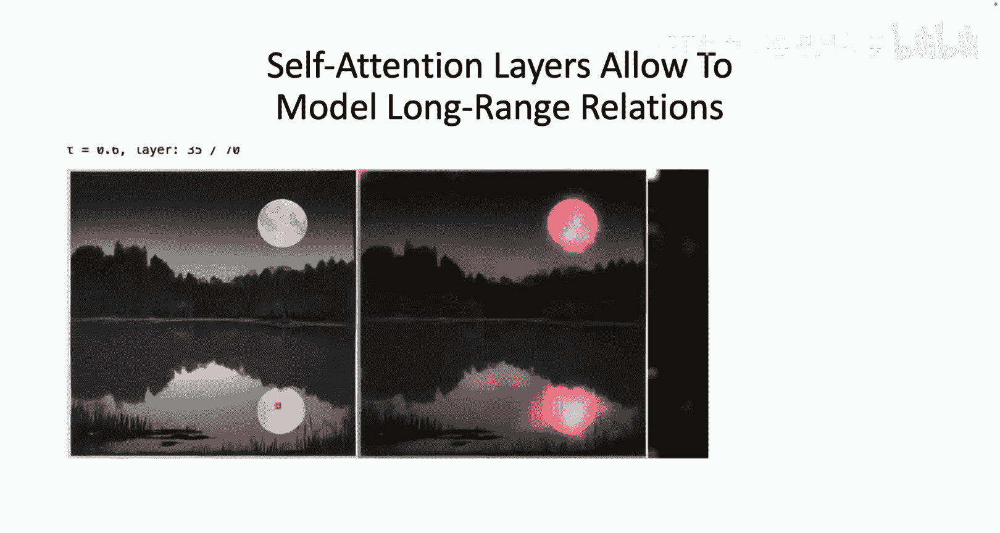

And if we think about it a bit more， why is this the attention map that we get for this point。

 so as I mentioned before attention maps basically gives us the most semantically similar points for these specific red points。

 so what are the most semantically points in the image。

 the points on the reflection and the points of the moon。Okay。

 so now let's move to cross attention so this is very similar to self attention。

 but here we have two inputs not only the features of the generated image but also the input text embedding so in cross attention again we project the inputs into queries keys and values this time the features of the generated image are projected to be the queries and the text embedding is projected to be the keys and the values。

And again， we multiply each of the queries with each of the values so for each point here for each query we have an attention vector that tells us what are the most semantically similar words for these specific query okay so for example so this is here the prompt is a kitten and a puppy you can see that here there is maybe I hope you can see this is a kitten。

 this is a puppy so for a point on the kitten， we're going to have a lot of attention for the word kitten because this is the most semantically similar key for this query。

And then again we multiply these attention maps with the values and again for each feature in the output feature map is a weighted sum of the values here the values are coming from the text embedding and again the weights for this weighted sum are coming from these attention vectors。

And actually another way to there is another way to look on these cross attention layers which is typically used。

 so instead of looking on the attention vector for each query。

 we can also look on the attention map for each key okay so if for example we take the word bear。

 we can find the queries that are most similar to it okay so we kind of transposing the attention map so we can find for each word the pixels that are most affected by by this word and this is also a very useful way to look on these attention maps。

Okay， so now I hope that you have some sense about what is the attention and how do we what is a basic。

This definition and now I'm going to start to try at least to convince you that these layers hold a lot of semantic information which can be used for many types of generative applications。

So I will start with a semantic correspondences and appearance transfer for which of the topics that I'm going to talk about。

 I will focus on one or two works， but I also provided here a list of some works that are relevant。

Okay。So诶。Again， let's go back to the selfattion mechanism and this is so previously I said that we're multiplying the queries with the keys。

 this is the more accurate equation for calculating attention maps we're not only multiplying the queries with the keys we're also taking soft maps so let's I've previously shown the selfat map of this moon but let's also look now on the self-at maps of this giraffe and specifically let's look on the selfat maps for this for three points。

 the red green and the yellow points on the giraffe so if we look and again we're looking on this is a generated image and we're looking on the attention maps during the generation of this image okay so if we take this red point on the head of the giraffe then maybe not very surprisingly we get most of the attention。

And for the head of the giraffe， again， why is that。

 because these are the pixels that are most semantically similar to this red point on the head of the giraffe。

And if we take this yellow point on this leg， so I think this now starts to get more interesting。

 we see that would not only get attention for the same leg but we get attention to all of the legs of the giraffe so this really shows that so actually one time when I gave this stock and before I showed sorry before I showed sorry wait before I showed the yellow point someone told me okay。

 it's just based on the location， it's based on the positional embedding but I think that this example shows that the similarity is based not only the location of the pixel in the image not only on the positional embedding but actually on the semans of the image being generated and again we can look on the green point and not very surprisingly we get attention to the body of the giraffe。

And we can take the same points and also look for this example of the zebra so this time the yellow point。

 for example falls on the grass， so we get attention to the grass。Okay。

 and now things will begin to be more interesting。What's going to happen if instead of computing this self potential map？

by multiplying the queries and the keys coming from the same image now we're going to do the following experiment。

 we're going to take the queries from the image of the giraffe and the keys from the image of the zebra so instead of calculating self attention maps we're going to calculate something we call cross image attention maps。

So again let's look on these three points， so if we take this red point on the head of the giraffe。

 now we're going to get attention to the head of the zebra and note that the head of the giraffe and the head of the zebras of the zebra are not in the same location but again the reason that we get attention to the head of the zebra is that the keys that are most similar to this query on the head of the giraffe are the keys on the head of the zebra。

And this is not a coincidence also if we take this yellow point query on the logo of the gi we get attention to the legs of the zebra Okay and and again this this shows that this semantic information is not only relevant within a single image but it's also shared across different image Okay so for different images the the attention features that that we get have semantic meaning that is relevant across images okay so leg is always encoded in a similar way。

And for this green point on the body of the giraffe， get attention to the body of the zebra。

So after we did this experiment and so I think this is quite amazing。😊，So West。

 what can we do with that？

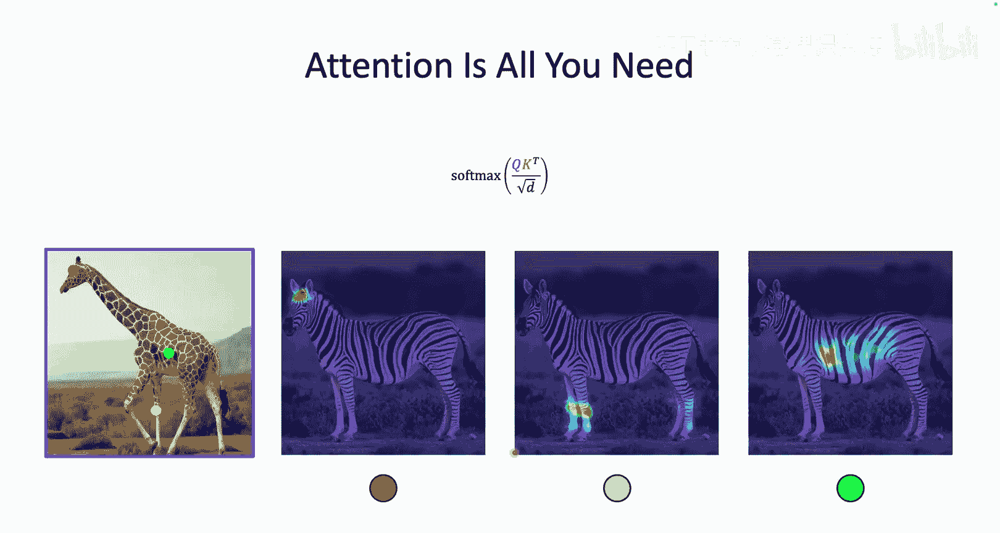

And then we thought about this task of appearance transfer so what is this task of appearance transfer so the input is our two images one is dennoted as the structure and the other one is dennoted as the appearance and the golden in appearance transfer is transferred the appearance from the appearance image onto the structure of the structure image and the challenge in this task is to do that in a semantically meaningful way。

 so we don't only we're not only aimed at transferring stripes on the giraffe we also want to make sure that the appearance from the head is transferred to the head and the appearance from the legs art is transferred to the legs。

So this is the kind of output that we're looking for and if you think about it。

 after we saw these cross image attention maps what we can do is to basically replace all the self attention maps of the model when we generate this image of the giraffe with cross image attention layers where we are going to take the queries from the。

from the gi and the keys and values from the zebra。

 and the idea is to replace the self attention layers along the entire denoing process in many layers of the model。

Okay and why does it work So we've seen how these cross image attention maps look like。

 but why are we taking the values from the appearance image so what is going to be for if we take for example。

 this red point on the head of the giraffe what is going to be the output feature here so as I mentioned before the output feature is basicallyed awaited sum of the values awaited some of the values where the weights are determined by the attention map right so it's going to be the multiplication between this cross image attention map and the values of the zebra。

So what are we going to get here， we're going to get a weighted average of values on the head of the zebra and this is exactly what we want to transfer to the head of the giraffe right so this this is the intuition for why does it work？

Okay， so now let's see some results so on the left here you can see structural images on the media appearance images on the right the output images that we get by replacing self-at layers with cross image attention layers but I guess that you're now quite disappointed because the quality of the images is not really good and we can see that the appearance transferred in some sense。

 but it's not the amazing result of the giraffe that I've shown you before。

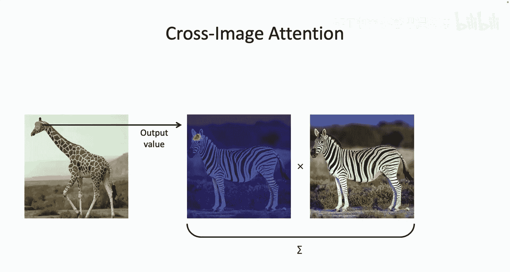

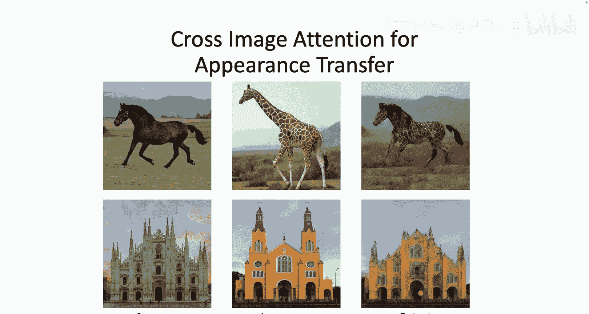

So why do we have these artifacts so we started to investigate？And apparently what happens okay。

 so what we did was to look first of all， on how self attention map for this image。

 for the appearance image in this pin point， how the self attention map look like look like。

And compare it to how the cross image attention map look like okay for the for the same point。

 and as you can see， although these attention maps are supposed to represent similar things。

 they look quite different in some sense， the cross image attention map looks much more noisy if we compare it to the selfat map。

So the conclusion that we got to is that there is a domain gap。

 so previously I told you that the semantic information is shared across different images。

 but still there are some challenges when we try to combine features from different images that have very。

 very different appearance。Okay， and of course this happens not only with this example。

 but also if we take the cars， then if we take a point on the headlight。

 so the selfat map looks very very clean， but if we look on the cross image attention map。

 it looks much noisier so to solve these artifacts we basically need to somehow bridge the gap of the domain gap。

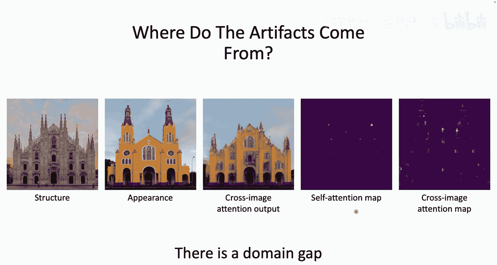

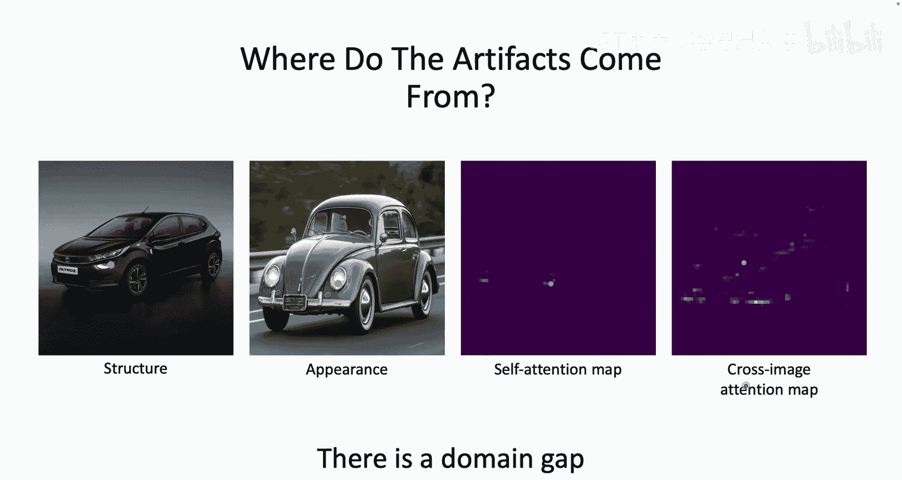

So we came up with three techniques for how to serve that。

I'm not going to spend too much time on it because I think the main ideas that are important here are first of all to see these semantic correspondences that we can get by looking on the cross imageage attention maps and to understand that there is the domain gap。

 these specific techniques are not too interesting but still lets let me explain them briefly so first of all。

 we apply a contrasting operation on the cross imageage attention maps so if this was the example that I showed you previously if we apply contrast operation then we get something like that which already looks much。

 much better and you can also see the improvement in the image that we got so let me show you again。

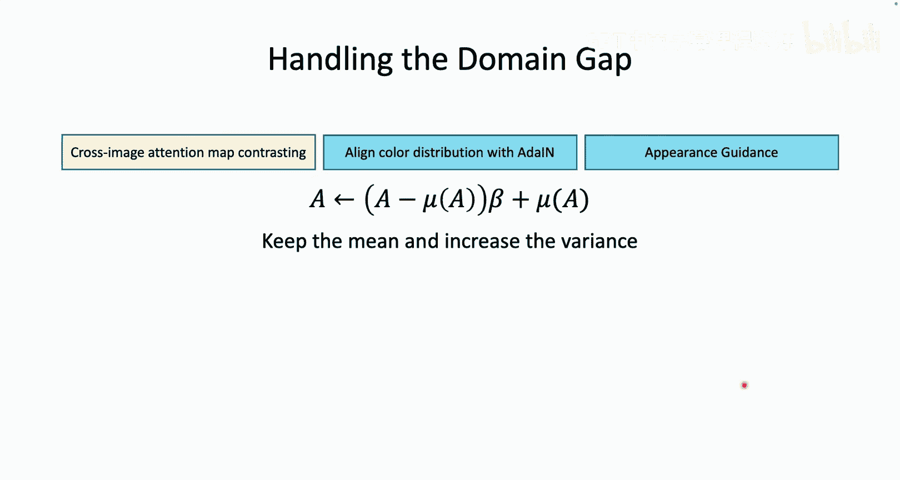

This is before applying the contrast operation。

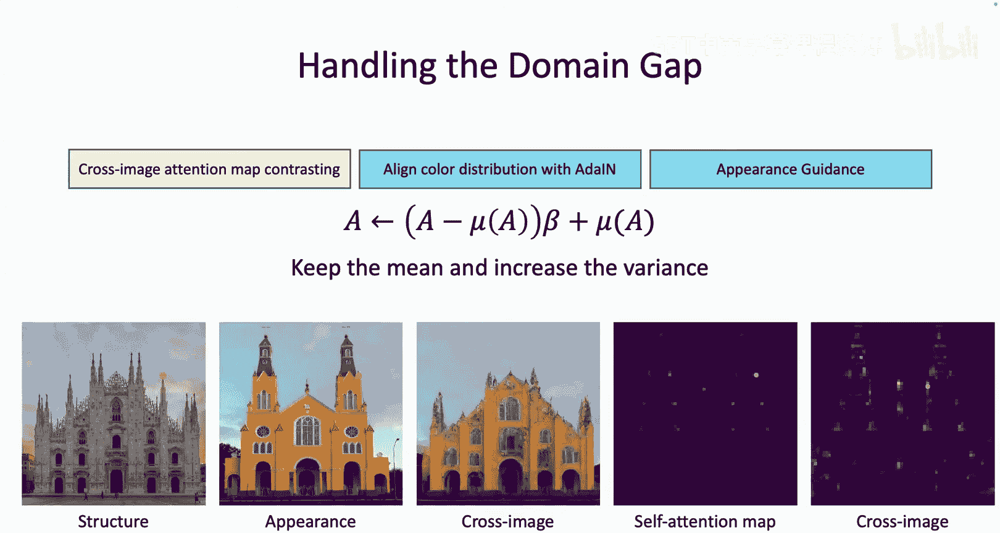

And this is after。But you can see that now there is a bit of misalignment in the colors of the images。

 so another thing that we can do is to apply a adding layer to match the statistics ZT of the appearance image with ZT of the image being generated and this gives us another nice improvement in the results。

 the color look much better now and we don't have the artifacts that we've seen before。

And lastly and another trick that quite had is something that we call appearance guidance and here this is very similar to classify free guidance。

 but instead of denoing withiz and without the text prompt as we do in classify free guidance。

 here will den noise with and without the cross image attention layer。Okay。

 and this gives us this improvement， which already looks quite well。

So let me summarize how do we perform this appearance transfer so we have as inputs the appearance image in the structure image。

 we first of all invert them invert them to z capital T and then we begin a denoizing process actually we have two branches of denoing we have a branch for the appearance image and the branch for the image that that we're generating but and okay so for the appearance image we just dennos it as usual with the pre-trained model and for the image that we're generating the image that we want to have the appearance transfer in we replace along the entire denoing process in different layers of the model we replace the self attention layers with cross image attention layers so we take the queries from the image being。

G and the key and the values from the appearance image。Okay， and actually。

 since we also want to have this appearance guidance that I've told you before。

 we actually have three branches， so in the bottom branch we den is the structure image and this allows us to apply the appearance guidance。

Okay， so now for the now to the fun parts let's see some results。

 so this method of course works not only with the giraffes and the zebras but also with you can see here an example of a horse and the kangaroo and note that here the pose of the horse and the kangaroo is different and even though the pose is different we're able to find the semantic correspondences between these two animals and the transfer the appearance。

And it also works with cars and again pose the poses of the cars are different。

 but we're able to find the semantic correspondences and transfer the appearance and I think that something that is nice to see that we're not only when I say appearance transfer we're not only transferring the colors for example。

 we actually find more high levelve appearance features such as for example the appearance of the headlight and we're really transferring it to this red color okay so we can see it in in the headlights and also in the appearance of the windows and the wheels and so on。

Another example for a building， so here on the left we have the Eeld Tower and on the middle of the Segarda Faamilia and we were able to transfer the appearance。

And with cakes。And I think this is my favorite example from the paper because this building on the right looked pretty cool。

 actually even after I was in Milan and so the Dumo in person。

 it actually actually even like this example more。Okay， cool， so。

What else can we do so I hope that by now you' are convinced that these attention layers allow us to find semantic correspondences between different images which allow this application of appearance transfer but which more application this property of the attention layer allow so another thing that has been shown to be that has been shown to be very powered by these semantic correspondences is a consistent generation and what exactly do I mean when I say consistent generation so the consistency can be in different aspects Okay so we're going to see two different works that allow for a consistent generation。

So in the first work， the goal is to have consistency in terms of the style of the image okay。

 so for example， we want to generate different vehicles。

 toy train toy airplane and so on and we want to have a common theme for this images we we wanted to look like a black and white logo with a high contrast。

So what happens if we just if we just try take to generate this consistency using a prompt right we can just take different prompt like toy train black and white logo high contrast。

 toy airplane， black and whiteh logo high contrast and so on and just generate it with stable diffusion。

 but the problem is that we get here so this what happens when we try to do that here the style is minimal origami style but as you can see we don't really have a common thingme all of the images are aligned with the prompt all of the in all of the images we see this minimal origami style。

 but the style does not look aligned between the different images。诶。

And we're interested in something that looks like that images that。Have a common theme。

So the way that they propose to do that in this work is actually very similar to what we've seen in cross image de the high level idea is to share the features across the different images okay so for example we're going to generate this toy train with this specific style and all of the images are going to look are going to use features from the toy train and this is what're going to allow them to have a consistent style。

And basically the idea， if in cross image attention。

 we replaced the keys and the values with the keys and values of the appearance image here the idea is to concatenate the keys and the values here it's called okay the reference features are are the features of the leftmost image。

 the image that gives us the reference style， the target features are the features of the generated image。

 so as you can see we take the queries from the target features and for the keys and the values we concatenate the keys and the keys of the target image with the keys of the reference image okay and we do the same for the values。

So this allows for each image to。To use both of the image both of both the features coming from the reference image。

 So this allows the image to get the style of the reference image。

 but since were also using the key and the values of the of the image being generated we're also able to generate the right content。

 So for example， if our reference image is this firewoman by taking by taking both。

The values from the reference image and the image being generated were able to have the same style for this gardener。

But still to have different features of a gardener， so this is another nice example。

And actually we can also apply this process to real images by again by inverting the images。

 so here you can see different famous landmarks and actually my advisor really really liked this example so he actually made the poster out of it and put it in his office。

Okay， I will stop for a minute I see that some people asked about inversion I am not going to get into that。

 but inversion basically is the process of given a real sum let me maybe drop it so usually in。

In in diffusion models， wait， let me。Stop the laser。Okay， so usually in diffusion models。

 we start from a Gaussian distribution and we want to dennoise a sample from the Gaussian distribution to the real data distribution。

And in inversion， we're doing the opposite process。

 we start from a real image on the data distribution and our goal is to find the Gaussian noise such that if we take this Gaussian noise and input it into the diffusion model and start denoing it。

 we're going to get the image that we started from and this is a very useful tool generally speaking for imageing。

Okay， so。That would just that you can understand what I mean when I say a in version。

Okay so that was about generating consistent style。

 but as I said before consistency of generation can be not only in the style but also in other aspects so another recent cool work is called consistent story here the goal is to have consistency mostly in the content mostly in the main subject in the image。

 so for example， if we have this front of photo。Of an old man wearing a hat。

 we want to generate the same men walking in the park， writing numbers on a blackboard。

 drinking beer in the bar and so on。 and the main application of this task is for a storytelling that's why it's called conscious story Okay。

 so usually if you just take these prompts and input them into the model。

 you're not going to get the same character。And I'm not going to dive into all the details。

 but just the high levelvel concept here so first of all。

 and this is this is the reason that I wanted to talk about this work first of all they share when they generate this set of a consistent images they share the attention within and within the object mask across the different images so you can see this is the figure from their paper you can see here the SDSA basically it means that they apply this shared attention mechanism across the different images within the mask okay they don't want the entire image to be consistent。

 but only the main subject in the image。Second， another thing that they do。

 they actually find explicit correspondences between different images between the like the main subject in the different images。

 they find these correspondences with a method called the Dft which basically which is based on the attention features and after they have these explicit correspondences。

 they actually inject features from one image into another。

 this is this feature injection block here。And another thing that they do so these two things encourage the consistency across the different images。

 but they also don't want that the images will be exactly the same right they want in some image the men to drink and in another way the men to walk so to encourage the diversity they use some dropout mechanism in a very high level they don't share the entire features。

 they do some masking okay so so for an image being generated。

 they don't give it access for all the keys and values of the reference image but only to sample of them。

So this is the high level idea and as you saw here the results that they get are quite impressive。

 this is also very related to personalization I'm not sure if you talked about it yet but this is a bit easier task than personalization because you don't have to。

Be accurate for a specific reference image， you just need to make sure that the set is consistent。

And okay。Okay， so until now we mainly talked about semantic correspondences and how are they useful。

 so now let me show you that these attention features can also be employed for segmentation。

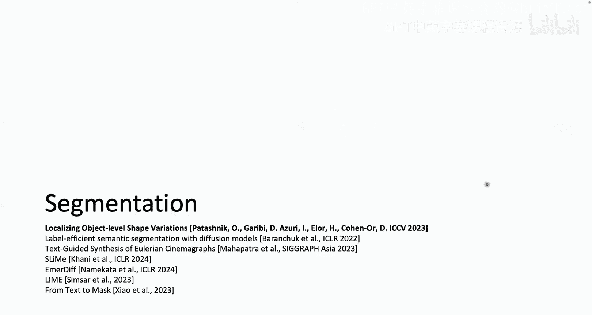

So first of all， if we take if we generate an image and we stack the self attention maps and apply PCA on it。

 a PCA for three channels， so as you can see again I said it quite a lot of times but we get very sematictic information right we see that although the appearance the color of the pen is not solid we get the same color for all of the legs region which shows that this information is not mainly about the appearance but about the semantics。

So how can we employ that for segmentation so given an image that we are generating again we can stack the selfat maps in a specific layer and the specific times stepss so this gives us if the dimensions of the image are h times W then this gives us h times w maps which each of them is h times w right so another way to look at it is that each pixel in the image we have h times w feature vectors that tells us for these specific pixel what are the pixels that are related to it so we have for each of the pixels we have h times W feature vector and a very simple operation that we can apply here。

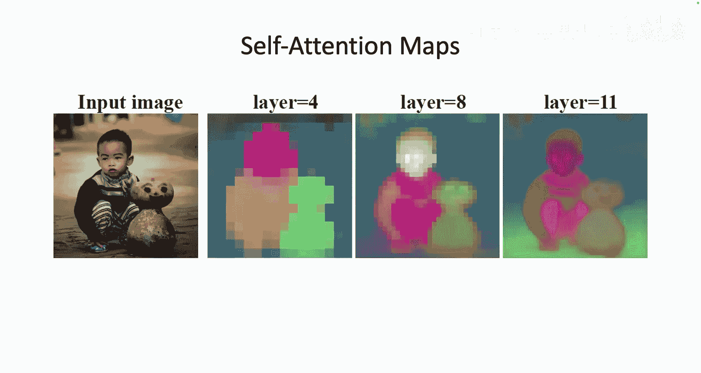

Clustering right for each pixel we have a feature vector we can just cluster these features and as you can see we get quite nice segmentation basically for free right the model was not trained for segmentation and it's a very it's a very very simple thing to do to cluster features。

One problem with this mechanism is that as you can see， for example here we applied camins。

 so we need to know somehow in advance how many segments do we want and as you can see we get several segments for this cat。

So another thing that we can do， again for free by just using the attention layers is to label the segments and how can we label the segments so if the prompt is a key wearing sunglasses so we can take we can take each of the each of the textual and token look on the cross attention map。

And okay so for example this is the cross attention map for the word cat and this is the cross attention map for the word glasses and we can so and for each segment we can find the word that has the highest intersection with this word okay so for example。

 for this blue segment we can calculate the intersection of this segment with each of the cross attention maps and as you can see we're going to get the highest score for the word cat。

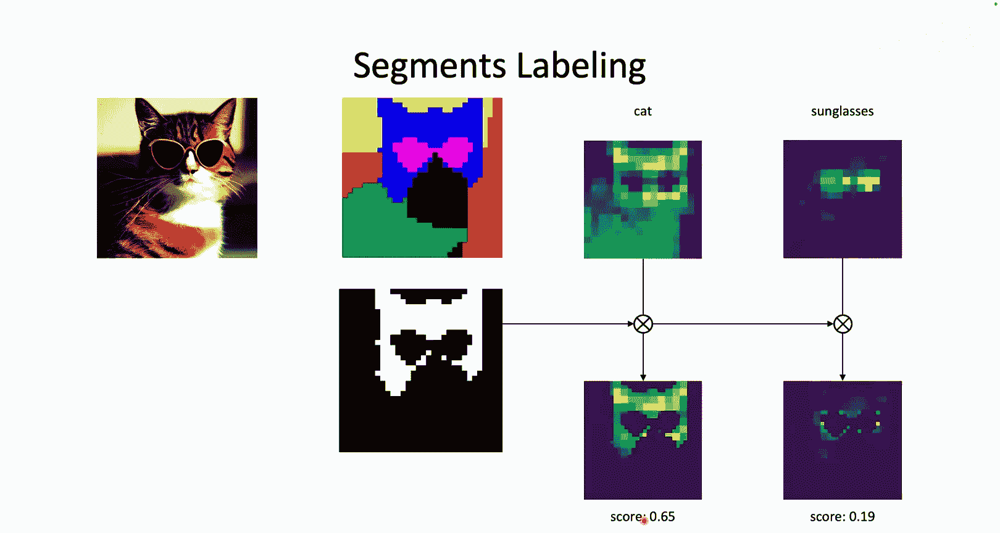

And this after we label each of the segments， you can see that we get a very nice segmentation and again for free without any supervision and why am I talking about segmentation basically it's very useful for many types of image editing tasks if you want。

 for example to blend the background to make it accurate when you're editing the CA so this segmentation method allows to do that。

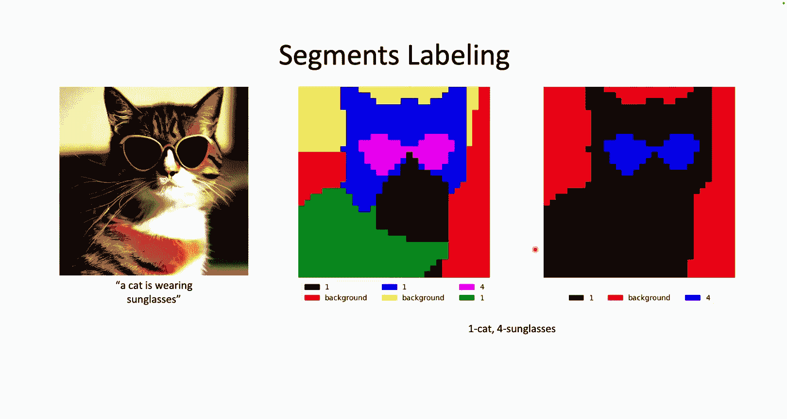

So let me show some results， so you can see here the segments that we get from the clustering and the labeling that we get from this mechanism。

But I'm sure that many of you are now asking them okay but we have a lot of very powerful segmentation methods。

 so why is it necessary to use the diffusion model for segmentation so first of all。

 I think it's very useful as I said before for different image editing tasks because in some cases you want to segment image the image while it's being generated and not only at the end where it's fully den but actually there is more advantages for being able to segment generated image。

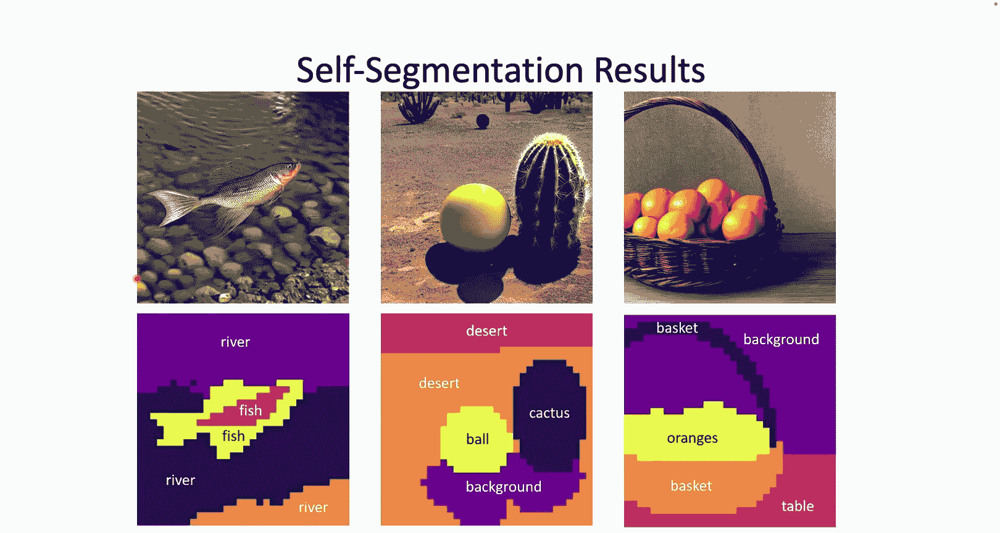

So it turns out that the model really knows what it wants to generate right so for example for this image of the fish you can see that here there is a fin and the model even though it's quite difficult to see this fin。

The model knows that it wants to generate this upper fin of the fish and therefore it's able to segment it accurately and actually if you take this specific image and try to segment it with Sam。

 at least the previous version of Sam and other state of the art segmentation method。

 so most of them fail。To detect this f， so this is another nice property that again the model knows what it wants to generate and therefore it's able to get very nice segmentation for generated images。

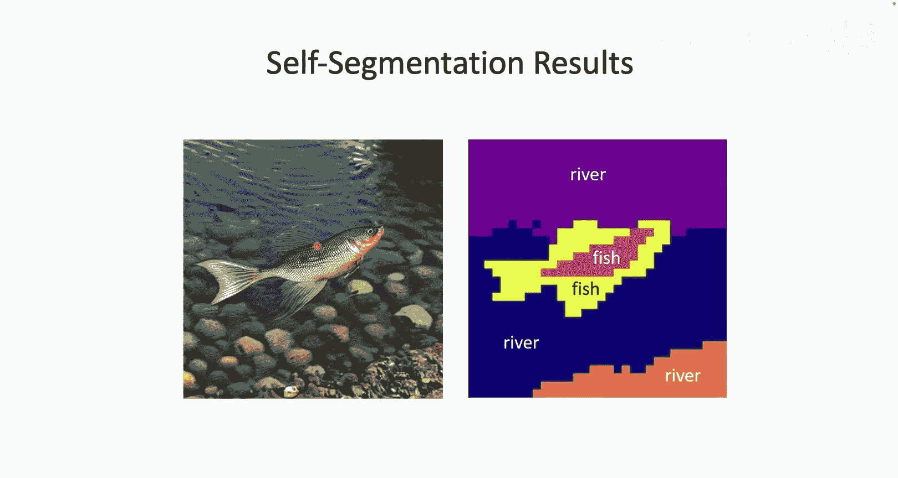

Okay。Another very useful application of attention layers is image editing it's a whole topic with many。

 many works so I'm not going to to talk about all of them but just to give you maybe a teaser so first of all what is what is the task so let's say we have this image of a lemon cake and we want to turn it into a chocolate cake or a be cake or a pasta cake and so on。

And let's assume that this is actually it's not just an assumption， this is a generated image。

 so we have the initial noise that was used to generate this image there we have the seal。

 so a very simple thing to do is to just try to use the same see but changing the prompt。

So if we try to do that， we do get chocolate cake and be cake and pasta cake。

 but they look very different from the lemon cake' not it doesn't really look like editing of the image。

And in image editinging。We want to preserve the original input image。 So we want outputs that look。

More like like duck， Okay， so we have a chocolate cake and a bitcake。

 but theyre very similar to this lemon cake on the left。

So a very common idea that people use and again it's a whole topic and I'm not going to get into all the details but we've seen before how injection of features along the generation can help for different generative tasks。

 so here the idea is that if we want for example， if we have this front a fery bear watches a bird and we want to change just the word bear for example to a cat。

 then we're going to inject the attention map of the word bear while we're generating a cat and this going to help us to preserve the structure of it and therefore we're going to have an alignment with with the input image。

So I think the first work that they did it was prompt to prompt。

 so we can see here very nice examples there are different types of edits and each of them is done by a different but a bit different operation on the attention map but basically the idea is to preserve attention maps and therefore to preserve the structure of the image so for example here a photoque riding a bicycle and we want to change the bicycle into a car。

 so the idea is to inject the cross attention map of the word bicycle while we're generating an image with this prompt with a car。

Okay， so this was just a very short introduction about image editing with a tension layer。

And now I want to ask you a question， so previously I showed you how can we transfer appearance from a bra to a giraffe。

 but what happens if we try to generate a giraffe and a zebra the same image？So for example。

 let's take this prompt a photo of a giraffe and the zebra in the savannah and if we input this prompt into SDX。

 the first image that I got when I prepared this slide is this one okay so we got so on the one hand we got another way to do appearance transfer but on the other hand of course it's not what we meant to get right we wanted to have a giraffe and the zebra but we got two animals with the structure of the giraffe one of them has these stripes of the zebra and one of them has the appearance of the giraffe if you look closely you can see that。

This part of the legs here look like a giraffe and the other parts of this animal look like a zebra。

 so we really got a mix between a giraffe and the zebra。

And of course it happens also when we sample more images， actually it's very。

 very difficult to generate correct giraffe and the zebra at the same image。

 so here you can see that we got a hybrid between a giraffe and a zebra and also here we go out to the neck of the giraffe and the body of the zebra very very strange hybrid。

And of course that it happens not only with giraffes and zebras。

 but also with prompts that may look very simple right if you take this prompted ginger kitten and a grape puppy in the yard and try to generate images using SDX SDX you get very very similar artifacts so here we see that there is a missing puppy we got two kittens here the colors are wrong here we got an extra kitten and here we got a hybrid between a kitten and a puppy。

But and so probably you now wonder why does it happen。

 but if you think about what we've seen about the sematictic correspondences。

 that was very useful for appearance transfer and for consistency。

 so maybe it's not that surprising right because if we try to generate a crab in the frog at the same image。

So for example， a query on the leg of the crab is semantically similar to the leg of the frog so it's going to have attention to the leg of the frog right so this is actually the attention map that we get we see that we get attention to the leg of the frog even though the point is on the crab so by definition this crab is going to get values from the frog so it's going to share features with the frog and we call this property leakage between the two subject features from the frog are leaking into the crab because they have some semantic correspondents。

But this leakage happens not only because of the self attention layers。

 but also because cross attention layers okay so what happens when we try to generate two semantically similar subjects like a kitten and a py so their queries are going to be similar because as we've seen queries contain semantic information so leg is going to attend to a leg actually you can even see that here it's a kitten and a py it's a PCA visualization of the features and you can see that the features of the kitten and a puppy look very similar their queries so if the queries are similar and we multiply each of them with the same keys so their attention attention vectors are going to be similar by definition right because we're multiplying similar things with the same keys。

And if their attention vectors are similar， so again。

 they're going to share values and we're going to have leakage。

 features from the word puppy are going to leak into the kitten and vice versa。

And another way to I think this is another interesting way to look at it， so let's do the following。

 so let's generate an image of a kitten and image of the puppy and let's take from a specific layer towards the end of the denoing process let's take the queries and project them to two dimensions with PCA here we generated the images separating so you can see that the distribution of the queries of the puppy and the queries of the kitten have some overlap but they're not exactly identical right。

So what happens if we try to generate the kitten and a puppy at the same image， so as we've seen。

 the queries of the kten and a puppy are similar。RightSo in the in the output， so as we saw before。

 we're since the queries are similar， were going to have leakage between between the kitten and the puppy and the just。

To to make this point more clear why theques are similar。

 we see it on the left right here we generated the images separately and we'll see that there is an overlap in the distribution。

 so that's what we're going to have leak。So the input of the next layer is going to be even more similar right the features of the kitten and a py。

 so we're going to have even more leakage the next layer。

 the leakage is going to be accumulated and we have many attention layers so we're going to have a lot of leakage by the end of the pass in the model。

And in diffussion models， we apply many steps right many denoing steps。

 so this leakage is accumulated not only across the layers of the model。

 but also across the different time steps and indeed if we do the same experiment if we try to generate a kitten and a puppy at the same image and we look the and we project the queries to two dimensions with PCA we see that by the end of thenoing process the queries are completely mixed since we have the leak engine also you can see that in the image right that we got some hybrid between a kitten and a puppy。

And a common way， so this problem is related to another big topic which is called misalignment between the text and the image being generated and a common way to resolve that。

Wait， sorry， you see my entire screen， right， not the one with the comments。Yeah。

 we are seeing inter screen I will confuse from minute。😊，Okay。

So a common way to resolve that is to optimize ZT along the denoing process okay so along the denoing process before we denno ZT into ZT minus1。

 we apply the model， we compute some objective， the objective is about the alignment of the text and the image we backpro through this loss basically we compute the gradient with respect to ZT。

 we get a variation of this ZT and only after we optimize it， we do the denoing step。

 to get Zt minus1。Okay， and to make this problem of the alignment a bit easier。

 it's also possible to input in addition to the text to have a spatial layout input。

Okay so in a work called layout guidance they did this process of optimization Okay cool so it's a nice teaser for the next weeks so。

So in this work a layout guidance， they do this process of optimization and to define their objective。

 basically they require that the attention of each of the subject will be concentrated in its corresponding bounding blocks。

But a problem with this approach is that they require the query so if they want the attention of the kitten to be only within the box of the kitten and the attention of the puppy to be only within the box of the puppy basically it means that they require that the queries of the puppy will not attend the queries of the kitten and the vice vers of the queries of the kitten should not attend the word puppy。

 but as we've seen the queries of these two subjects even when we generate them separately are similar。

 so what happens when we try to do that is that we do get queries that are much more separated。

 but since it's not a natural thing in the sense that even in this reference distribution we have some overlap。

 so it pushes them too much far away so they get。Into an out of distribution region and indeed you can see that in the image right we got pretty out of distribution image。

So in a work in a recent work called the Bounded attentiontention。

 we did some step toward resolving this leakage， we don't have a lot of time so and'm not going to get into all the details but just maybe the high level the idea is to bound the attention so that each subject is not influenced by other subject in the image okay so the kitten should not we bound the attention so that the kitten is not influenced by the copy we also call this paper be yourself。

 the reason for that is that each subject should be evolved only by looking at itself and not being influenced by other objects so I will skip a bit of the details。

And indeed we see that if we use this bounded attention mechanism。

 we get the distribution which is much more similar to this reference distribution that we have on the left。

 and also we see that in Damon we got the kitten and the puppy。

This is another result here you can see a gray kitten a ginger kitten and so on on the left when we tried to generate this prompt using as the Excel。

 we got wrong number of animals and their colors are wrong and so on and with our method we were able to get much more accurate result。

This is another nice example， but I guess that many of you that know the recent state of the art models may ask。

 okay， what maybe just the model is not good enough what happens， for example， in Fls。😊。

So one of the first prompts that I tried with Fls was this prompt of thezebra and the gira and indeed you can see that flags do much better work with this prompt。

But it's not very difficult to make it fail if we make the prompt a bit more a bit more complicated。

 this is the prompt that we've seen before， so they're supposed to be a unicorn and a hedgehog and the owl so you can see that in two of the images we didn't even get the correct number of animals and here the allwl doesn't really look like a owl and also I think the hedgehog doesn't really look like a hedgehog here we got again this hybrid between you see that the hair of the unicorn looks like a hedgehog but the body looks like a unicorn So even though better models are better with a。

With some problems， still the fundamental problem of this leakage inat error still holds。

 and we still look for ways to resolve that。Okay， so let me give some bottom lines for this doc。

 so I think first of all then maybe one of the most important points is that attention features contain semantic information and dis information is useful not only within the same image but also across image and this allows us the appearance transfer application that we saw and the consistent generation。

Attention map the second point is that attention map。😊。

providerovide semantic correspondences basically for free Okay so I think that I've shown you some applications。

 but I think still there is a lot of room to think about more applications which can use this property。

Ping with attention features facilitates many image synthesis and manipulation applications。

 again it's there is a huge line of works that do that。

 but I think I still think that there is a lot of room for more applications。😊。

And although these attention layers have all these nice properties that we've seen that facilitate image manipulation applications。

 there is still this fundamental problem of leakage that these attention。

 and I really believe that in some sense， attention layers were not specifically designed for generative models。

 and maybe we should think about approaches to make these layers more suitable for generative tasks。

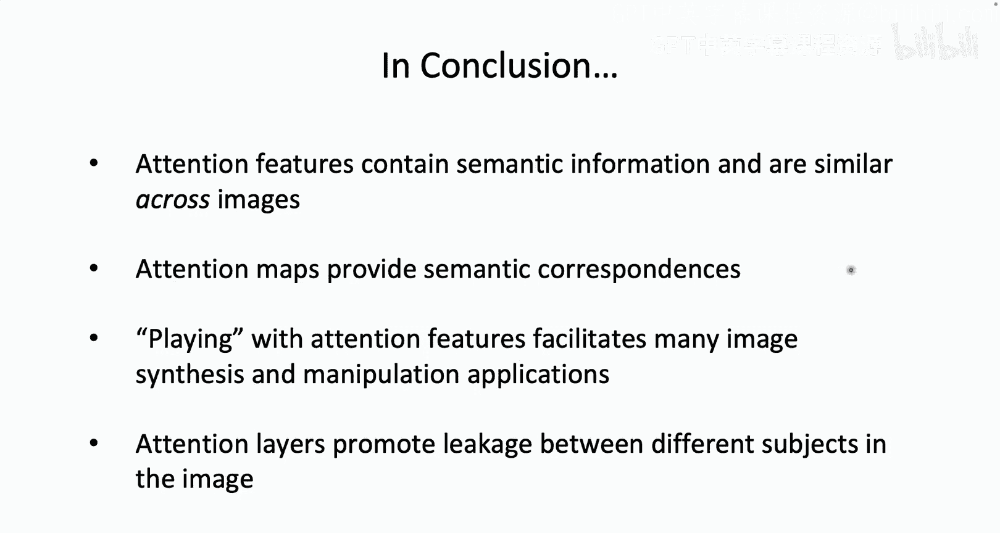

So that's it， thanks for your attention。诶。I think we can now if there are any questions。

Yeah thank you very much for the great lecture so I think this was really great summary of the recent research about like guiding the division。

 the denoing process by manipulating the attention demos and you assumed lots of the very great examples like doing some like appearance transfer style transfer and also iming also even achieving the segmentation map of the objects as well so this was really great summary thank you。

😊，Yeah， and so let's take some big questions from the audience。

Let me yeah I see that someone said that in be yourself maybe we get better results because we just have another input so this is completely correct this is an assumption that makes the the task more easy and we still I really hope that in the near future we're going to have a method that does not require that prevent this click but does not require these bounding boxes so this is this is true。

Yeah， so while we also wait for some more the questions some of the things that I was saw wondering was that so the typical the noise prediction network of the division models will have some loss of the layers and each of the layers has to give the attention the multiple。

So I was wondering whether there would be some kind of be more important layers so in terms of like when you do some manipulation is it like more important to focus on like some specific layers or are some specific layers are basically affecting more into some semantic kind of meanings and also we can do this kind of manipulations for some specific time steps of the denotting process we can also focus on like all these stage or the layers stage so I was wondering whether those kind of focusing on some specific time range affect the output well。

Yeah so this is a good question I think that many of the works that I've presented have a lot of implementation details about doing these injections or sure the attention mechanism in specific layers and specific timets generally speaking I think that it was shown that at the beginning of the denoizing process more like structural features are determined the structure of the image that is going to be generated and at the end of the denoizing process it's more like a fine grained fine grain appearance features maybe yeah so I think it's and also it's true for different layers at least with the stable diffusion the layers which have smaller spatial resolution usually control more the semantics and the layout and the higher resolution layers control mostly。

😊，More fine level more fine detail features， so yeah， for example。

 in cross image attention we didn't replace all the self attention layers。

 but only the the layers in the decoder which have the six last the six or four last layers those with the resolution of。

TheThe， the two hires。Resolution， yeah， so and and I think that there is a lot of for many works explore the differences between different layers and time time steps。

 one thing that I find a bit annoying is that it's a bit different for different models right when we transferred from SD to SDDX we had to again find the correct layers and time steps now that a lot of the models are shifted toward the diffusion transformers probably were going to have different behavior。

 but yeah。Actually， that also the things that I was wanted to ask is kind of the next question。

 So because you also have shown like lots of the examples， like not only with like one single model。

 but also the stable efficient Excel like fs like those are all different the models and also they are using different architectures or you prediction it was so surprising for me that the same kind of the idea。

 like manipulating the attention the outputs are actually working with some different architectures of the node prediction。

 So I was wondering whether there will be some kind of some differences that you have observed in terms like getting these kind of outputs when you use the different architectures。

😊，Yeah， so I think between SD and the architecture of SD and SD Excel are similar enough so that they have similar behavior and maybe it's not exactly the same layers。

 but you can find some mapping。I think that with the diffusion transformers it's a bit unexplored area yet。

 I think people are still trying to do things I do believe that the concepts that we used in these works should apply to these models I do think that we will have to do some changes because the architecture is not exactly the same but I believe or I hope that some things we will be able to generalize them especially that in diffusion transformer basically all the layers or attention features so all the properties that we've seen should be even maybe magnified in some sense。

But it's true that maybe generally speaking in this line of works。

 it's quite a lot of work to when there is a new model。

 it's very fun because the results are getting much better。

 but it's also not very easy to adapt the entire ecosystem to a new model。你你看。

Yeah and so there are some questions in the chat。In style aligned， the image generation。

 are any specific to apply an adding only for the query key while skipping the operation for the value so。

I think that I actually I don't remember exact thing if there is an ablation over that or not。

 but intuitively at least I think that first of all。

 the reason to apply add in is to bridge this domain gap that we've seen in cross image attention。

 and to bridge actually as we saw in cross image attention。

 you need to bridge the domain gap only to find the correspondences and since the correspondences are determined by the queries by the multiplication between the queries and the keys。

 it's not really necessary to also apply the add in on the values。

 you actually want to have exactly the same values as in the reference image。

 but you want to find the correspondences accurately。And and course the attention models。

Do you think that self and cross attention module are each adequate for certain types of application？

It is a potential brand or can we also leverage some interactions between different attention for further and okay so this is a great question。

 I think it really relates to the question that mini ask so in flux and the stable diffusion a3。

There is the concept of self attention and cross attention layers does not really exist anymore。

 it's kind of emerged between a cross attention and the self attention because it just。

About a bunch of text tokens with the image tokens where everything can be attend to everything。

So I think it would be very interesting to see what's going on there。

 but it meant me what exactly is the question so。😊，Yeah。

I think maybe the easy answer that I think that it's very interesting to try to investigate the interactions between these different kind of attentions and Fls。

 I think really gives us the opportunity to do that。

Or there was a question over there about how we can measure know the quality of this style transfer。

 I guess that's really。So this is a good question for many tasks。

 I think in this domain of generative tasks。😊，I think everything that is related to evaluation is pretty difficult and it' pretty problematic because you can also find you can always findversial adversarial examples for any metric that you will define。

😊，I think that specifically here the way that we measured the way that we evaluated was we want to preserve the structure。

 so we measure the LPs between the structure of the output image and the input image。

And I think that to measure this appearance similarity。

 we looked on we basically measured the similarity between different patches of the image because what does it mean to have a similar appearance。

 it basically means that patches that the patches have should have a similar distribution。So locally。

 the images should look similar。Yeah evaluating those things the user user study。

 I think in some sense it's the best way to evaluate a thing， but on the other hand。

When you see a user study in a paper， you don't always 100% believe it because there are many biases and so on。

But yeah。So one more question that I also wanted to ask you is like was what thats kind of the capability of the different models in terms of the like imagination like if we for example。

 like if I try to transfer the appearance of the drop not to the authority animals， but for example。

 like to the human body。😊，Or to be like car or something。And how much it would work。

 actually I was wondering like whether it do make some kind of some broken images or still try to make some kind of be realistic。

 some drop style like human body images。Yeah， yeah。

 so just to make sure that I understand you asked whether this method work when when the objects are not semantically similar。

Do you hear？So in the meantime。嗯 yeah， yeah Ki。Okay。

 so the question was whether this appearance transfer method work when the subjects are not semantically similar。

 right？疫苗。Yeah so of course that's the method to find these semantic correspondences。

 we assume that the subject are semantically similar。

 so it's not expected that it's going to work for what you mentioned is， for example。

 a church and the human body although surprisingly I still not fully understand why it works。

 we did find examples where it works even between very different objects so we can see here for example。

 the mug and the shirt。or the watch and the iPhone。

 but generally of course it's a limitation of the work that it assumes that the objects are seatically similar to find these correspondences。

嗯。Yeah， so there's no more question I't like to just like wrap up this session with the very last question because you are also working in the SNAP research right so J I also wanted to ask in terms of like what do you think in terms of like how these kind of like some techniques for the genetic models are making some real impact in the industry so what do you think in terms of like the challenges in terms like applying these techniques to some kind of the real service。

Yeah， okay， so maybe first of all， I will say that I think that the gap between what we see in papers and what we see in actual applications is pretty large many of the things are not working well enough to be able to productize then。

So on the one hand， it's encouraging because it means that many of the things are not solved enough yet。

 but on the other hand it means that what we see on paper is not is not true a picture of the state of the field。

 I would say，I think that specifically in SNAP we do see that some of the things are getting I was actually pretty surprised to see how fast things can be shipped sometimes into specifically into Snapchat I also think that there are many。

In engineering tricks that， you know， each company has its own tricks and they're not really maybe。

In papers， you don't really see them， but there are tricks that allow to take these works and make them work better。

So yeah， I think that specifically in Snapchat， we do see some things that are shipped。

 but of course that's the gap between what we see in papers and what we see on the application is pretty huge。

I would also say that now on the trip， so I recently bought a new Google Pixson and on the trip that I had now to Milan was I think I was a bit surprised in a positive way of how the taking picture experience is a bit changed it was a bit changed due to the features that we have now。

 of course again， it's not at the level that we see， for example in this talk。

 but still I feel that the experience of taking picture is being changed and you start to feel all these nice features。

Yeah thank you for the great talks question so you asked whether appearance transfer can be realized without attention so generally speaking。

 I never say that thing cannot be realized in a certain way because I think that there is there are many ways that we haven't thought about yet think that the specific method that that I showed is really built on the observation that attention layers allow us to find semantic correspondences in an impit implicit way between images So this work really builds。

On this observation， which is specific to attention layers， but I'm sure that with other models。

 there are different ways to do that。And an inspiration that we had for this work the way we the place we started from is a paper actually not very new one paper which is called swapping go encoder so here they did a similar task with。

With Gs so。I think there is always a way。To do things。

Yeah， so just to give you something of the results。

 so I think you can see the inspiration in our results of the churches。Yeah。

 this is one of you like relatively like older work using in the for this main yeah。😊。

So here they do this appearance transfer without any use of attention errors。嗯。Oh yeah。

 I think we now we can wrap up this session So yeah。

 thank you everyone for joining this lecture and thank you for giving the great lecture today so let's also catch up in in December。

😊。

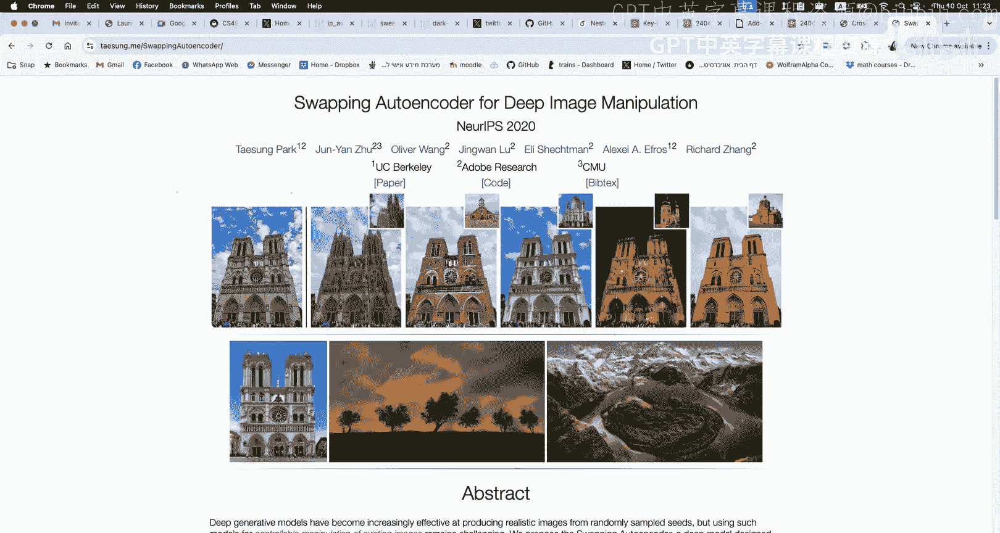

Thank you very much， thank you bye， thank you。😊。