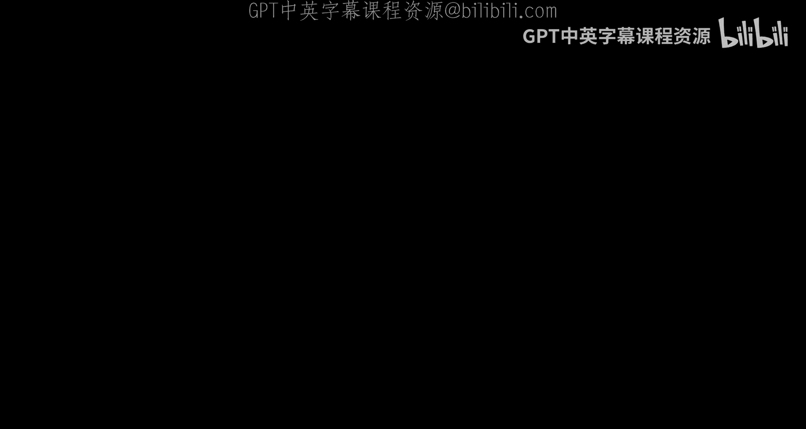
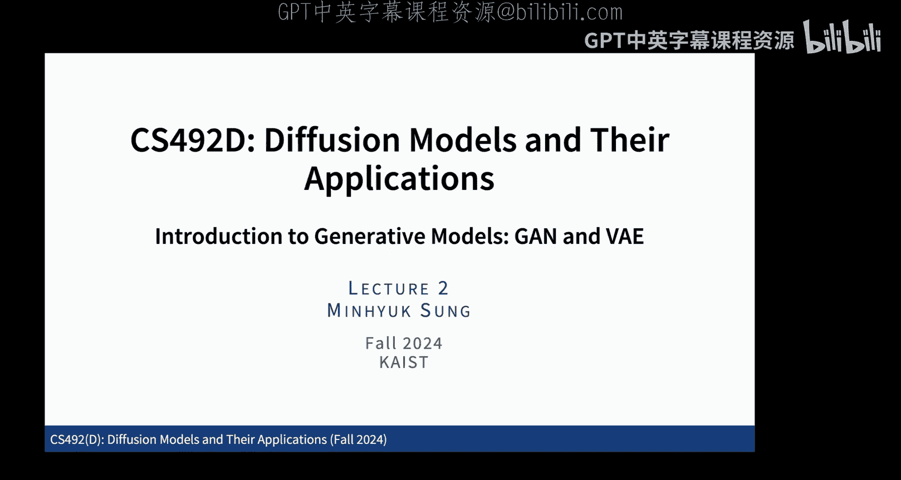
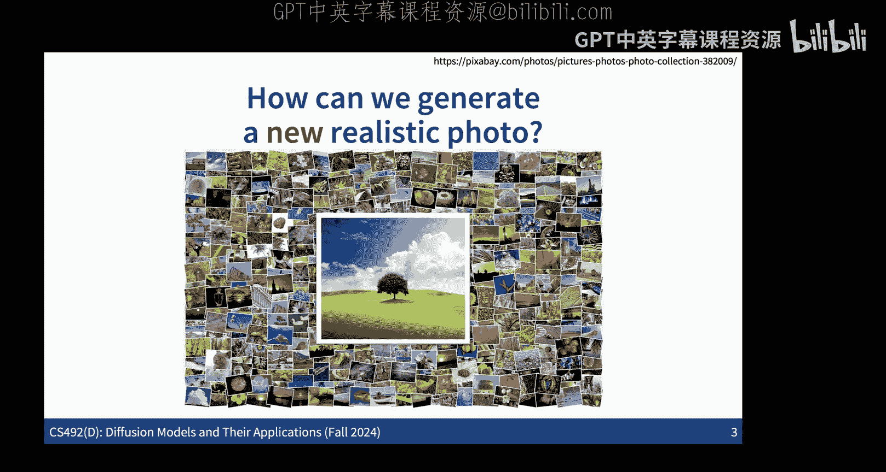
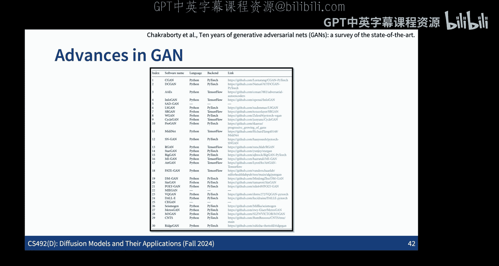
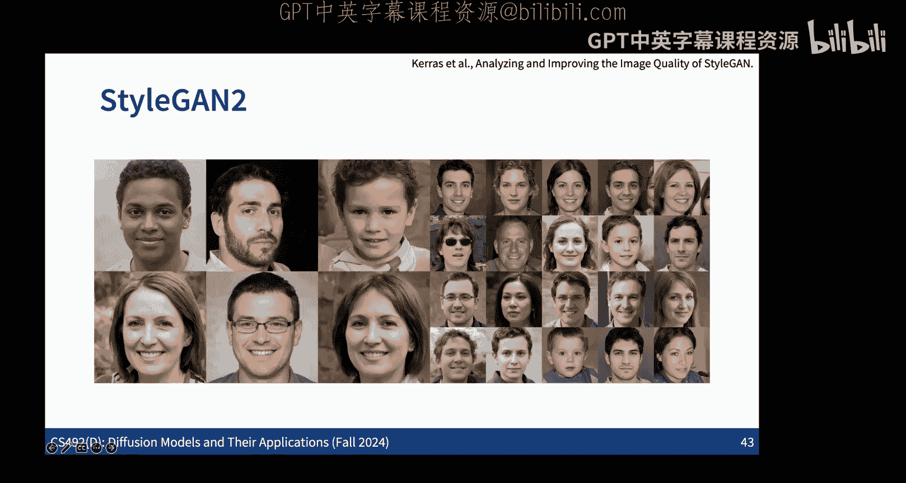
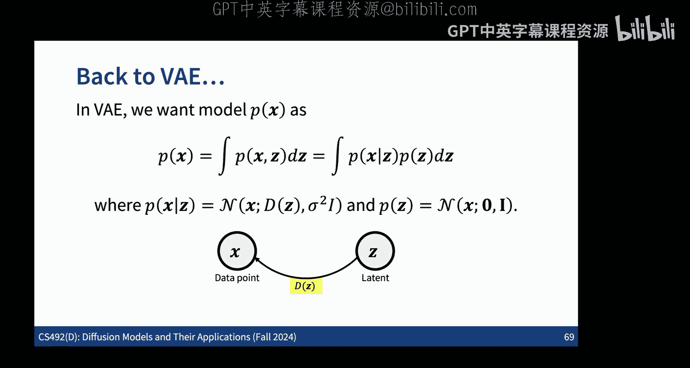
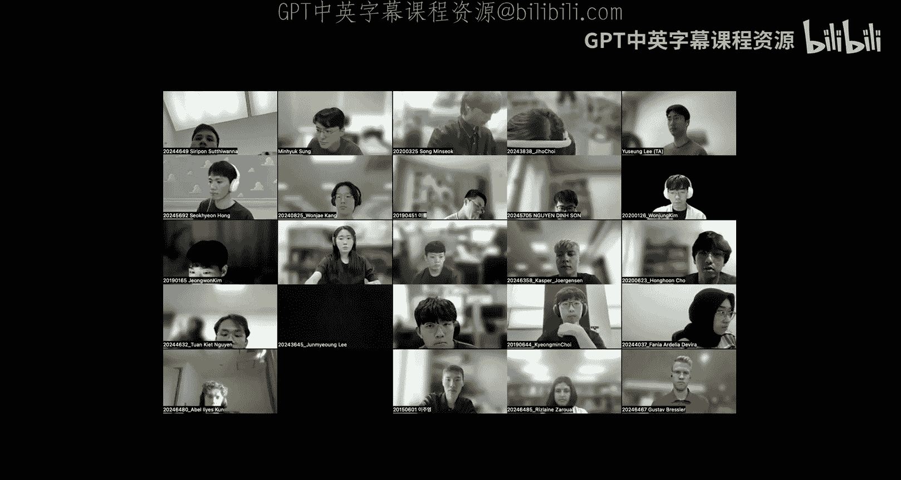

# KAIST《扩散模型和应用｜CS492(D) Diffusion Models and Their Applications (Fall 2024)》中英字幕 - P1：Lecture 02_ Introduction to Generative Models_ GAN & VAE (KAIST CS492D, Fall 202 - GPT中英字幕课程资源 - BV1mwpUzREqX

Welcome back to the circum time of the electro disease 292D diff models and their applications。

 so last time we discussed some we this saw some kind of interesting the outputs of the division models and see what we can generate using some kind of diff models and from today we are going to start to discuss some kind of the very basic ideas about the generate models for today we are going to get some kind of background about the generate models and then we're going to slowly move to the the basic ideas about diff models from the next week。

啊。嗯。And then actually you are going to see that actually there are quite quite some sort of math things about the digital models and digital models so that's see。

So what we are going to do are with the basically the models。

 the main purpose of the agent model is to basically produce some kind of the new data。

 so let's think about this kind of case， let's say we have tons of some real images that we collected from the Internet。

 so they are actually tens of be billions of images from the internet lets say we can collect all those kind of images。

So given the tons of kind of the data that we have， some kind of the photos， for example。

 can we make a of some kind of the framework that can produce another the photos that looks like the legalistic deco photo？

So this is benefit the problem that we are going to solve and we are going to see how we can solve this problem over the entire semester。

And these sounds like two difficult problems。 So how can you really make some kind of the machine that can produce some kind of something like the new real basic decos。

 So we are going to think about some easier case first。

So instead of like having the last of the photos， let's think about this specific case that we are having a collection of the 2 d points in this space。

 so you are seeing the loss of the 2 d points here right。

 so given this kind of the collection of the 2D points。

 if you or basically requested to pick any kind of the point that looks like one of them。

 how are you going to pick the point。So let's think about the problem that we want to sample a new 2D point that looks like one of the data points that we have。

So it like a human being is basically a very easy task。

 you can basically pick one of the point in the space that looks like one of them in the space。

 but if they want to make some kind of the algorithm or the machine。

 they can do this kind of the 20 point generation， how can you do that？😊，So for that， ge。

 what we are going to discuss in this course is basically having some sort of the more like statistical perspective。

So we are going to see this problem as the case that we are basically having some sort of the underlying the probability distribution of the data and then both kind of the2d points where some kind of images are basically the samples that are basically sampled from the underlying the probability distribution。

Then the question is that when you have any lots of the samples that are basically samples from some kind of underlying they probably the distribution。

 how can we basically sample one more point， one more data point。

 that becomes basically the problem that we are going to solve？

So basically the thing is that if you took the probability then the statistics course。

 how many of you have taken the probability then the statistics course before raisez your hand if you taken。

It you just like rate hand here or then I can see like。好。Yeah。

 so this is actually kind of like simply the problem in terms of that if we basically have if we know the probability the density function of the underlying the distribution then given this kind of the probability density function we can just easily sample in your point so that becomes like very simple probability statistics right。

So let's review some basic in the statistics。 So here the question is that if we know the probability is the function of the distribution。

 then how can you sample a new point？This is a question。

 do you have any ideas like if we know any kind of the probability depositulsion based on the how can we sample a new point？

I guess this is like something that you learned in the studies course。

So for those kinds of questions， our TA will basically post the question in our select workspace。

 then we will be able to basically answer this question in the thread。We you posting as the space。

Any thoughts？Let's say you have some kind of the simple Ga distribution in the this space。

Based onでカオに makes some kind大同西先。So yeah let's think about this so basically what we are going to see here is that if the probably the test function is known for the data distribution。

 there is nothing to do I mean this is kind of the solved problem we can just use some kind of some the knowledge that we learned from these statistics course to make some kind of new samples。

Let's think about some kind of the easy case first。

 so let's think about that we are having some kind of discrete probability distributions like for example。

 let's think about the case that we are rolling a dice then there will be six the possible the we're going to get12。

34 five six right for each of the value we're going to have some kind of corresponding the probability。

Then we're going basically have some kind of the table or they probability function and the condition or probability the density function is that all the probability they should be greater words0 or the greater than0 and also the sum should be one right so given this kind of the PD。

 how can we basically sample one of the kind of thevalue。

So basically the simplest idea for that is that we are conflicting the amulative distribution the function。

 so we basically accumulate this kind of probability values over the sequence of the possibility values like this。

 then we're going to have some kind of the like this which is starting from the zero and then reaching to the one after likeccumulating all the probability right。

So given this kind of the graph， what we can do is that instead of like sampling one of the possibly values。

 we just like draw sample the range from the zero to one。

 basically sampling in the domain of the probability。

And based on the value that we are getting from the un distribution。

 we see where this value is basically falling into the reach of the region。

 the range of the values of the accumulated the pro ladies。So based on this idea。

 we can visually sample one kind of par vector。So this is basically the technique。

 which is called the inverse transform disseling， which is quite intuitive and this idea can also be easily extended into the continuous cases。

 all right。So how can you extend this idea for the continuous case。Well， I mean。

 that can be also very straightforward in terms of that we can also compute the cF。

 the accumulateative the density function by taking the integral into one of the value in the domain。

So we are first scalingating basically case the aumative the density function by taking the integral to the PDF。

 which will be also the case that we are starting from0 and reaching to the1 by accumulating all the probabilities。

Then as we have known for this case， what we can do is that once we basically sample from the range from the zero to1 using the uniform dis samples uniform the distribution based on that we can take the inverse。

 so basically the CTF is basically mapping one of the possible value that we can take into the cumulative the probability right。

So if we can compute the inverse， basically mapping from the accumulated the probability into the possibly value here。

 then based on this kind of the inverse function of the CDF， we can map the random thevalue。

Sample from the uniform distribution from the range to the zero to 1 to the possibly various x here。

 so this is basically the basic idea that we can do the sampling given the probability the distribution。

 the function。Here， kind of the one sort of the downside is that to sample based on this idea。

 we should be able to compute the inversese function of the CDM。So this kind of case。

 so in some kind of special cases that we can have some kind of annatic form of the inverse function of the CDF。

 we can directly apply this idea。But for most of the cases， we will be able to this idea， right？

So this is like some kind of some basic things in these statistics and just in case that you haven't seen this before。

 let me just briefly give you some quiz。So let's think about like this kind of the PDF that we are having this formal for the P from the range from the zero to two。

Then from this， if we want to sample a point， then we first need to compute the CDF and also the inverse of the CDF。

 right？So can you just quickly calculate the in of the item function for this item？

You can post this answer in the or this level of space。so as you can see。

 you can easily derive the inverse of the CDF in this case that it looks like this。

 then once you basically computeverse of the CDF， then what they can do is that we just draw a sample from the uniform distribution from the zero to one and then we just take this right then that will become one of the samples that we are getting the given the probability the function。

So basically'sically this is kind of like very simple things like just in case that we cannot derive the inverse of the CDF for the given the PDF。

 what we can do is that we can also try this idea of the rejection sampling。

 which is kind of using some sort of the proxy distribution so while we are basically having the the PDF here instead of just in case that we cannot compute derive the inverse of the CD for given the PDFP here。

 we are taking another the proxy distribution queue here。

we see specific key that we can easilyly derive some kind of the accumulated the density function。

 So one of the the easiest option for the Q， the upper boundary distribution is specifically the uniform distribution。

So we can basically send any kind of in distribution that is basically covering they given the problem as the distribution。

Then what we can do is that instead of trying to sampling the director sampling the data point from the K PP。

 we are growing a sample from the upper bound description queue here。

And we check whether we're going to basically take this the point or not by basically taking another the sample behind here。

So given this kind of X that we are taking here， for example， from the 0。5 here。S。

 let me try to write now。 That like。Yeah。So let's say this is the the X that we sample using the given the proxy distribution the Q here。

And then we are basically taking any kind of the height。

 the random height we be basically using the uniform distribution。😊。

And if this height is smaller than the probability we given the PDF， then we just take this sample。

 otherwise we basically going reject this sample。So this is also kind of the simple idea that we can use some kind of de proxy distribution where we can easily sample the data points from。

 and then using this information to sample from the given the PDF while basically rejecting some of the samples in some specialty cases。

So these are some kind of the basic idea， obviously there are some kind of the bunch of some other special cases that we can even more easily sample kind of the new the points。

 but basically it is shows that if the PDF of the given the data distribution is basically no。

 then the general model is basically nothing， but just example some points for the given distribution right。

also one more thing is that the many kind of the data the probability distribution that we are going to see。

 not only for this vector， but for the many of the re director will will be basically Gaussian distribution。

 so we are going to play with the normal distribution for many other cases。

And for this specifically for the normal distribution。

 we know how we can easily map any arbitrary the normal distribution into the standard de normal distribution right standard normal distribution is because the case that they mean becomes zero and the covariance the matrix becomes the identity right so even this kind of mapping from the any arbitrary the normal distribution to the standard the normal distribution and also the other way around what they can do is that equal want to sample any points from any arbitrary normal distribution。

 we can first make a sample from the standard distribution here Eson here and just like map this to the one of the points the normal distribution。

So which means that if we just want to make lots of the samples from the any arbitrary deormal distribution。

 we just need a sampler from the standard deormal distribution。

 they pick them as sample any points from the standard deormal distribution。

 we can just like map these points into sum of the points。

 the data points of the other the target deor distribution。

Which means that we don't need to have the quote for the some kind of all the kind of de Gaussian distribution。

 we just need the quote for the standard， the normal disseer。

 and then we can just map this into the an arbitrarybit3 norm distribution。It is cream。So yeah。

 basically this is nothing， but we are just saying that like it's just like all the mineral like how we can demo the data distribution and how we can basically sample from it in the case that when you can basically model the distribution with some certain form of the probably the digest function。

 right？And even for the cases that like when you generate some kind of new images。

 we can see this problem as kind of be the same problem。

So what we can do is that let's say like we having the collection of the images， right。

 lots of the images and let's say each of the image is represented as some kind of the RGB image with the resolution fixed resolution of the 256 by 256。

 right？Then what we can see is that actually each of the image is representative with the loss of the numbers。

 we the 256 by 256 by 3 because each of the pixel will have the RG be very barrier， right？

So which means that each of the image is actually a vector， which dimension is 256 by 256 by3。

So this basically means that we can see the connection of the images。

That's actually a set of points in this very high dimensional space。

So we can see that each of the image in the collection especially map to one of the points in this high dimensional space。

 the dimension becomes 256 by 256 by。So generating the images from the given day collection actually becomes the problem that we are having a collection of the points in the high dimension space and basically somehow of capturing the data distribution in this space and making a sample from the distribution。

Is this great？So this is basically what we are going to do in this class in this course。

 so all the things that we are doing with the gender model is basically seeing the collection of the data as some kind of the collection of some kind of the points。

 data points in certain dimensional space， and then basically capturing this kind of some data distribution and sampling from it。

So this is kind of concept that you should know in terms of getting the amazing ideas about the models。

Do you have any questionです。So basically what we are going to see is that let's see to see the case that we are having some kind of the bunch of samples in this some highde space and given this kind of the and each of the points is basically correspondinging to the one of these some realistic photos right then given these kind of samples of the points。

 how can you derive the probably the density function of the underlying distribution。

So the thing is that the only information that we are having is just some kind of samples。

 but we don't know the exact the underlying distribution right we don't have any kind of analogony form of the probability density function for the underlying distribution the only information that we have is they given the collection of the samples that are basically known that sampled from that specific distribution。

So here the question is that if we knew this kind of distribution。

 it became basically very easy problem to sample， they are not to the point。

 but ift if we don't know about the given distribution， but we only have the samples。

 how can we do the sample based on this information。So for that。

 basically what we are going to do for all the gender models。

 whatever models that we have again BE division models for everything。

 what we are basically doing is that since we do not know the exact form of the probably the density function for the given the data distribution。

 we are going to basically start from a kind of simple distribution。

Where we can easily sample the data of the probe。So one of these some kind of the typical candidate for the simple distribution is basically some standard the normal distribution。

 because like we know how we can sample from this standard normal distribution， right？

And what we are going to do is that we are going to have some kind of the mapping from this kind of the some simple the distribution。

Then we into the data distribution。Then the generation the process becomes like we are having some kind of the two steps。

 like one step is basically sampling from the simple distribution。

 which is distant or normal distribution， and we know how we can do that right and then mapping this sample into the one of the data point in the data distribution。

So these three be basically the things that we are going to do for whatever digital models。

 having the just the two steps， like one is sampling from this like the simple distribution and then basically mapping this into the one of the data point in the data distribution。

And as kind of the terminology， we are going to call this simple distribution as kind of the latent distribution。

So this is not the real data distribution， but we have some kind of propxcy distribution we are going to basically map this to the real data distribution。

 right？And also one of the sample they dis sampled from the latent distribution is will be called the latent variable。

So the whole process that we are going to do is basically mapping from the later distribution into the later distribution。

ち짜ス second。Having some trouble， sweetie， Jim said。Okay。

 so this means that we need to have this kind of like mapping from the latent to the data point。

 right？And here the question is that how we can basically help this kind of dynamic。

So this is the place where the neural network comes in for this kind of the mapping from the latent to the data point。

 we are going to use a neural network。And how we train neural network mapping is all about the things that we are going to discuss for detailed models。

デスクリにこえちすん です。Now what do we basically the idea for this kind of mapping。

 I'm wondering how many of you have heard about the auto encoder。

 how many of you have heard about the auto encode？Yeah。Well。

There is a lot ass never heard about the O code。So， we are going to see how。You。

 this problem is basically related to basically the auto order we set。

So the purpose of the auto encoder is basically making a neural network that can basically compress some kind of given input data。

 right， So the basic idea of the auto encoder is that we are mapping some kind of the given the input data。

Into some kind of the latent variable， in terms of that。

 it can be also reconstructed back to the input data， right。

So the basic idea is that we basically map the input data into the rate variable and basically recovering this back to the original data again and checking whether the reconstructed data basically becomes identical with the input data as well。

😊，And what we are doing is that we are basically having some much lower dimension or basically data for this kind of like latent here。

 so in terms of that we are basically doing some kind of compression while this kind of the latent in the much lower dimension space can be also becur into the original data point。

So this is kind of like one of the example that we are utilizing your network。

 we're mapping to this some given the data， some given collection of the data into some kind of the collection of some kind of latent detectors。

 right。So we already have seen these kind of examples like doing some kind of mapping from the given data into some kind of delete and variables。

 and we are going to use this kind of same idea of like mapping between the two the types of the data to train a genetic model。

So that's what we are going to do。 And here， basically， what we just need is not the encoder。

 but actually just the decor， right。😊，So if we only have some kind of the good decoder。

 then what it can do is that we can sample from the little distribution here and just like map this into this some kind of real data。

😊，So actually what we just need here is basically just having the good decoder。

So you can imagine that this is the process then we are sampling from the standard normal distribution and mapping this to the one of the real data points using the decoder。

But here the question comes from like how should we train the decoder like when you basically map all the latent into one of the data points。

 it should be one of be some kind of the some realistic some plausible the data point right so how can you guarantee that they map the points from the latent space becomes one of these some plausible data points from the given the data distribution。

So this is kind of the big problem in these gender models and all the ideas that we are going to see in these course will give usP like how to design。

 how to solve this problem。これ会者さんです。So how we solve this problem for that basically we are having the two。

 we are going to see the two basic ideas for that， one is like again and the other one is the BAE and while we discuss these two basic main ideas。

 we are also going to see next time on how the division model has been derived based on some kind of the advances in the G and the BAE。

So before we get into the digital models， we are going to briefly discuss the basic ideas like the skin and the PE and next time we are going to see how these ideas are related to the kind of the births of the digital models。

Hey sorry has some issues with my iPad one second。是。Okay， let's first move on to the game。

 So game is kind of like was the the most basically famous the idea for these the agenda models and before the debut models basically everyone was basically using the again。

 right。So what we are going to do with the just one second give me just like one second because like my。

Iad has just died。hel能。Thank you。嗯哦哦嗯。オッケー it can sound okay。Can even see my。Okay。

 so let me continue。 so we are going to start to see the item begin。

So before we get into some the page items again， let's pursue this kind of some off topic things。

So we know that actually， neural net is quite good at like many kind of the tests。

 like one of the task that neural net is really good at is the classificationification， right。😊。

So even like more than 10 years ago， like we could basically make some really good classifier based on the neural network that can classify all those kind of images into the like the bosses and into the like I don't know。

 do at the pyramid kind of like many kind of things。😊。

So after we see some really good quality of the clay fire。

 the question is like how vulnerableable is the neural network， how best place cable。

 the kind of the problems of this kind of the clay fire。

So the experiment here is that let's say we are having some kind of。

 like there was basically a classifier that could basically successfully classify all those kind of design like6 images on the leftmost side。

 So those are all the images that are correctlyly classified using in neural network。😊。

And can you tell the difference between the leftmost image with the rightmost image is for each of the left and the right hand。

So we are basically having very similar images on the left hand side and the right hand side， right？

😊，I personally cannot tell any difference between these two。

And the second column here is basically regionalizing the difference between the left image and the right image multiplied by the 10% at 10 times。

Sing some kind of be some difference of the pixel colors for of cases。

And you can see that the difference between these two are very small， very tiny。

 you know basically making very small deportturbationsations into the images on the left hand side。

 but what happened is that if we make some this kind of like adding very small noise。

 very tiny noise on the left the most images， what we can get is that we are seeing the results that the previously classifier classifies all these images into the ostrich。

😊，Do you know like what the old streets is。Otrich is this。

So it's basically very surprising that we can easily like confuse the classifier in terms of adding some kind of some perturbation into the images and the decifier turns to basically classify all these kind of like images into the wrong class。

 which becomes like ostrich in this case。😊，So this basically shows like how vulnerableable is the pretrained the classifier is。

 so there can be basically some ways that we can easily attack this kind of some pretrained linear network。

 right？So we can really even think about like making some kind of the neural network that plays the role of the office。

 so let's think about like this like having some sort of the as attack。

 which basically means that we are basically making another neural network that basically tries to predict some kind of a small amount of the noise we're basically making just like another image that is basically confused by theing the classifier。

So let's think about some kind of like making another neural network that tries to find some kind of the failure cases of the pretri decifier。

Then now we can also use this kind of the the neural network to improve the given decifier。

 so we can also try to fine tune the given decifier in terms of that it can now make some kind of the correct the prediction for some kind of images that were produced by the other network。

 right？And then what can you do， we can also improve the other network as know。

 we can also make improve the aver tech network in terms of that it can produce So more like find some kind of cases that is still basically basically confusing the the given the fire。

So we can basically make them to compete each other。

Like one is basically attacking the other digital network and the other network is basically dependinging from the the other network right so when you basically make this kind of the competition between these two network。

 what will happen。So this is a database question。So in the generation dec。

 what we can think about is that we can think about like having the decoder the previous slide。

 which is now the generator。So the decoder or the generator is basically mapping this sum of the latent variable into one of the photo in a way that we hope that this becomes some kind of the realistic image。

 but this is still kind of the fake image right， synthetic image synthesized by our kind of decoder。

 This is not the real images， right， but we hope that the synthesized images from the decoder will basically confuse the other decifier。

 which isifying the real and the fake images。So for the other classifier of the network。

 which is the discminator， the role of this network is basically taking either the visual images that are basically given from the data set or some kind of decynthesized images that were basically created from the generator and basically classifying whether this is the real or the。

So now the discriminator played a role as de classifying the real in fake images。

 and then we are basically competing dis classifier with the generator。

 which will try to make some kind of the more realisticist images。So from the competition。

 we hope that the generator will be able to make some really good take images that really looks like the real images。

So that's the basic idea of the generative advers of the network that goes into this like more than 10 years old。

啊。So like we are basically having some kind of the2 neural network， like one is the generator。

 which was the decoder。In the previous slide， which is taking the latent sample from the unique caution distribution and mapping this into the one of the synthetic images。

 and we just train this network in a way that this synthetic image becomes like very hard to be differentiated from the real images。

😊，And then the discminator is now taking either these real or the synthesized images and classing these into the real or debate。

And we're going to make this to compete each other。

So let's quickly see how we can exactly make them to be to compete each other so this is kind of the lowest function that is basically used to train both of the networks and we are having the two networks here right one is the generator and the other one is the discminator here right。

So let's basically see each of the column of these those function one by one。

 so basically first we are taking the sample of the real image X here。

 so x here is one of the real image that represents a sample from the given the data set in training data set。

And Z here is basically one of the samples that we are taking from the unique Gaussian distribution from our delete latent distribution。

 right？So we are having both basically X and the Z。 So over the entire dec slice。

 we are going to use the x as kind of the variable representinging one of the some real images and Z is kind of the variable in representinging one of the latent the variables。

And given these kind of samples。What we are hoping is that D is basically generator， right。

 which will basically map dis sampled delete con variable into one of these some synthesized image。

 right， This is the fake image that we hope that it looks really like the real images， right。

 So G Z is basically the fake image here， right。😊，And given this。

 we are also having the discriminator， which is basically measuring the probability of the real images like no probability of the whether like the how likely the input image is a real image right So when we take the Dx。

 this is the probability for the given the sample of the real image。

And here the DGX is basically the probability of the like realism of the given the synthesized the fake image。

 right？It this great。😊，And then if we see the loss function。

 then we you can see that actually we are combining minimization and the maximization。

 So this is kind of very you know course some sort of the optim function in terms of that we are maximizing the overall termss with respect to the parameters of the discriminator So from the discriminator the perspective。

 what we are going to do is that we want to increase the probability for the given the real image X here right that's what we need to do and we also need to minimize decrease the probability for the given the synthesized image Zz here。

So we are training all the networks in a way that we are maximizing everything with respect to the parameters of the discminator in terms of like increasing the probability for the real images and decreasing the propertiesbil for the fake images。

 right。But from the perspective of the generator， we need to do the opposite。

 we need to minimize the whole things， which will be the case that we are actually increasing the probability for the given deeps images。

So this is kind of the crazy， the optimization， the objective function or the the optimization。

For the same， basically the formal version， for the this community perspective。

 we are going to maximize this and from the generated perspective。

 we are going to minimize this right。But you can clearly see this kind of the competition relationship between the discriminator and the generator。

 like one is trying to maximize some quantity and the other one is trying to minimize the quantity。

 right？over the training of this kind of process， like training both the disc regenerator。

 hopefully we will be able to see that actually the generator is basically improving the quality of the fake images in terms of that it becomes very realistic。

 it can be very difficult to be differentiated from the real images。

But this is the case that like when everything goes really well， well as you can see。

 like solving this kind of optimizationimid， the problem is really difficult to problem。

 which means that when you trained in a probe with did gradient and distance and with the back pro。

 okay there will be quite many failure cases。So if you have any experience in training again。

 then you would know that training again is really a challenging problem。

So we will see that there are quite many failure cases like very typical def failure cases of the game is that these not like competing each other。

 but like thisriminator like is dominating everything so the very typical def failure cases of the game training is that the discriminator becomes very strong at the very beginning。

 which means that discriminator can very easily classify the real and fake images for those kind of cases when the disccomminator becomes very dominating the training the process。

 then the generator cannot be improved over the training so that becomes the typical cases that the neural training is not converging to the either case that we want to see。

So even in the cases that when it basically converges well and basically improving the quality of the generator。

 the other some kind of typical behavior failure cases of began is that we are seeing these kind of results。

So these are basically visualizing some data distribution right here。

 So red points thats you are basically disc visualizing the ground of the real the data distribution。

And blue is basically the output of this some kind of some generated the samples using the and the framework。

So the developers gives you some kind of reconstructed the data this for given the collection of the data。

And you can see that there are some kind of the these are some failure cases that the reconstructed distribution is not capturing the overall distribution。

 but just like collaping to the each of the mode， each of these some kind of the subset。

 some you know the close。So this is also very the typical the failure cases that again cannot capture the entire given the collection of the data。

 but basically just like focusing on like a small subset and one on some kind of the close of the points and just collapsing to the test specific mode。

 but this is kind of a problem called the mode collapse。

And there have been lots of the efforts like tons of the efforts to handle this kind of is LED in the training and also the collapse stations。

 so there have been lots of some kind of the previous work that tried to basically solve these kind of issues。

 big problems， so you can also check out these kind of the greatest works。

And before we see the di models like this kind of G idea was kind of de dominating the method in terms of training thegen models。

 so as I also mentioned in the previous lecture even like five years ago even way before the di models。

 the quality of thegen models that we could see was actually really very good these are all some kind of deynthesized images using the again you can see that these output were already very。

But the reason like why the we could see some kind of the rise of the division model was that is basically you know provide some kind of even better quality better the than the the again the framework and also it takes some kind of the lots of advantages in terms like making the training to be much easier and convertverging to much faster and easier。

 So there are some much kind of disadvantages than the again。

 So we are going to discuss some kind of these kind of advantages of the division models from the next week。

아니 questions쳐서밖 game。No questions if you have any questions feel free to post the questions either in the Z chat or this like workspace actually it's better for me to post the questions in this slack。

我来。So this was kind of like very basic idea for the game which is like quite intuitive and it's very And then now we are moving on to the B and I'd like to tell you that now we're going see some more some kind of the mess here so the the basic idea of the Be is that how we are going to also you know。

Make some kind of dig models without solving the mean problem。

So all the problems of the game comes from the fact that we are basically having the optimization hand problem。

 that's basically solving a minim problem， like making the generator and the discator accompany each other by ESB minimizing or maximizing the same objective function in different times and this basically makes the optimization becomes like very unstable。

So without solving being the mini problem， how we are going to make a kind of generate model。

So this is the the parts where basically we start to discuss the BE and for that。

 we are going to basically。Do this kind of thing。 So we are going to basically represent the mapping from the E distribution to the data distribution。

 as's some kind of like sampling from the conditional distribution。

So we going to start to see some kind of the ideas of like introducing some conditional distribution。

So this was basically the case that we are having some kind of the unknown detailed distribution。😊。

We have some kind of underlying but unknown distribution。

 we only have some kind of samples from there， right？

And what we want to do was basically we are having some kind of the keep and fixed simple delete distribution。

😊，And sampling it from here and then mapping this to the one of the data points， right。

And now we are going to basically represent this mapping as kind of also another sampling from the conditional distribution。

😊，And there can be lots of the way that we can basically also model this kind of the conditional distribution。

 but to simplify everything， we are also going to model this kind of conditional distribution as another de Gaussian distribution。

 which is basically taking the output of the decoder as the mean and having some kind of the fixed variance here。

😊，So the changes that we are making here is that now we are also seeing this kind of the mapping from the latent to the data point。

 especially sampling pointing process from the conditional distribution。😊，Make sense。

So based on that， we're gonna to get into some more details。 But before we then。

 let me also briefly review some of the basic ideas about these statistics。

 Are you familiar with all these kind of tos here。Is everyone familiar reading only the terminologist here。

のでス。Rcha。If if you don't know any of those things， would you please register so that I can see。

Is a real okay to just let go or those things？So just in case that you are not familiar with any of those kind of things。

 let's very briefly go over with these kind of debate concepts。So marginal distribution。

 marginal distribution is basically nothing， but basically when you have some kind of the joint problem in distribution with the multiple the random variables。

😊，The marginalization is basically the process that we are investigating the probability distribution we need for the subset of the random barrels。

😊，So for example， like in this case， like when you have the both the x and the Z as the random variables。

 what we can do in terms of like marginalizing for the x is that we just like take the integral over the Z in terms of that we only have some kind of the original distribution for the given the x here。

😊，So this quality marginalization， so let's do some kind of a very easy exercise。

So let's say it is specifically shows some kind of the joint de probability for given the x and the y here。

😊，And if you want to get some kind of the mergeer， some kind of probability for the given x。

 what's the kind of the probability， the x becomes the one。Yeah， to be 0。36 right。

 just like summing up all of these barrier， right？Then next。

 I mean everyone should know basically expected value right expected value is basically nothing but just like taking the mean of the all the possible values while waiting them with the probability right so this is like the value that we expect to see right so weighted the kind of the average of some kind of the possible values weighted by some kind of the probabilitybabilities really potentially the outcomes right。

And let's also try to calculate the expected value。

So given the kind of the marginal distribution over the x。

 can you also compute the expected value of the x。So， we can first compute。E X 1， E X 2 and P X 3。

 right， Its become of sum of the role， right。And once we have this。

 like we multiply this by the possible way。If we take some of this then this output of like 1。961。So。

 yeah， easy。Base rules I guess one of you know the base rule is showing some kind of relationship between the the marginal distribution and the conditional distribution。

 right？So basically from the we know this kind of fact。

 like basically connecting some kind of joint distribution with the conditional and emerge distributions。

 right？😊，So given this kind of the relationship between the conditioner and the marginal and the joint distribution from this。

 we can derive this kind of some kind of the relationship across them， right？😊。

So given the prior and the likelihood， which is basically the conditional distribution from the z to x。

 we can basically compute we can see the relationship with the margin distribution here and the posterior distribution here。

 right？😊，So given basically the kind of some distribution。

 like it can be like a late distribution in our case， right？😊，Basically。

 we have basically likelihood which is basically mapping from the G to x， then based on that。

 we can now compute the joint for example， here。Given the some given delete on distribution。

And the conditional distribution that we are learning with the decoder， based on that。

 we can see that we are but now having some kind of the joint distribution between the x and Z here。

 right？We can easily calculate all those。Let's do one some kind of the simple exercise。

 So given this kind of the joint， the probability the table。

 can you compute the conditional probability of the Ui becomes2， given that x is one。So by the way。

 if you are not familiar with those kind of basic things。

 if you don't know how to solve those kind of some simple questions。

 then the rest of topics that we are able to discuss the rest of the course can be challenging so you can basically tell whether this is kind of the right first for you in terms like getting some kind of page on。

一个。AndObviously， this is because like there in terms of that。

 this multiplied by the P X to be one should be the joint distribution， right， Y 2 and x1， right。

We completed this before， and this is from y is 2 and the x is one here， right？

And from these two numbers， like we can now， calculate these to be like one ofbergt field。

Simple things， right。And then the next is the Quebe or the divergence。

 So we are not getting into the any details of the Quebe level of the divergence because like only for this B。

 we can actually talk about this like for one hour right but the basic idea for the Quebe the of the divergence is to basically have some kind of the measure or like the distance between the two distribution。

 but it's not actually distance。 So basically measuring how close like one given the probability distribution P is to the given the reference probably distribution Q here。

So when you have the two probability the distribution。

 this like key the key yellow the divergentence is giving some kind of the measure of like the closeness from the one to the other from the P to the Q So heres so the one quick question is that if we measure this collective key year divergence for the same probability distribution。

So when given the probability recipient P is the same， with the reference the probability Q here。

 if these two are the same， then what should the kind of number we should get。

You say easy easy right。 And this should be zero， right。

And we are not going to get into some details， but actually you can prove that the minimum number of the key divergence should be zero。

 so the key divergence cannot be negative value all the K divergence should be non negativevalue。

 which means that this key divergence becomes the minimum the value when these two be given the distributions are basically identical to each other。

So this basically shows that as this key dierence is close to zero。

 we are basically seeing that these two distributions are basically close to each other。

And one more question is that is this like one the here that the dis is the same with the taking the。

No distribution in the other way not。So when we measure the key dis from the P to Q and the key dis from the Q to P。

 it the same or not。thank youです。我没钱。Yeah， so the answer is that these tour are can may not be the same。

 right， So this is like why this cannot be whole as kind of the distance。

So this is basically some kind of distance is kind of the symmetric measure。

 So whether you basically swap the P and Q or not， the output should be the same。

 But for this like key dierence， like if P swap the P and the Q here。

 then the quantity becomes like different。 The only case that like when these two becomes the same is like when these the P and the Q are the identical when the basically0。

 Otherwise these two quantity can be the may not be the same。

So this is white like this dierence is not the distance kind of the measure。

 but some kind of de measure like measuringsymmetric asymmetric de measure or measuring the closeness from the one to the other。

And we can actually really calculate the exact value of the K dience for the any some kind of the well known some kind of the analogtic form of probably the density functions。

 So like one kind of like example might be like when you have some kind of the arbitrary submal distribution be some kind of the random mean and the cos here。

😊，With some kind of isometric the variance， when you were specify the standard de normalmal distribution here。

 you pre measure the key key E di from the P to Q， what should be quantity like this。😊。

So you can check out this we are not going into the details because going to be regular time。

 but I strongly recommend you to basically try to best solve this problem yourself。

 you can find easily find this answer in the internet， we can also ask checkP to get this。

 but I recommend you to basically try to solve this yourself。One more thing is begin the inequality。

So to talk about the genes inequ quality， were gonna burst C D definition of the comex function。

So everyone would know about the meaning of the complexs， right。

 But what's the meaning of the Com function。So Comx function is the case that we are having some kind of the comex shape of the function。

 the downloadward of the the function。So when you has some kind of verr of the function like this to the downward。

 So what we can see is that we， this is basically comparing these two cases。

 like the first one is basically taking two end points here。

Taking the no you don't need to submit the homework this is this there is nothing to submit。

 you can just try yourself。So so let's continue。 So here basically we have the two at the points x1 and the x2。

So if the function is complexve， then what we are going to see is that when you first interpolate these two end points in the domain and evaluate the function。

 then you're going to get this right。And then when you first evaluate the functions for those two end points。

 and interpolate is two。It will be the case that or this kind of second case。

 like evaluating function first and then interpoolating will be the same word greater than the case that we are interolating first and evaluating the function。

 right？😊，This is making definition of the convex function。

So when the function is basically having some kind of the comeback shape to the downloadner like this。

 for all the cases over the entire domain， we're going to see the results that no evaluating functions first and then interolating will be same or greater than the interolating and then evaluating the function。

So we're going go into the全線 community based on this。And this is for the 1D case。

 and the same idea can be basically applied to the any kind of multi dimensional dysfunction function。

So even for any kind of like multidiative functions。

 it we basically have some kind of the multiple the points。😊，那 domain没。And basically。

 if you take any of the kind of the point in this come of the some kind of end points in the domain。

 basically taking some kind of the a combination of any kind of the given set of the kind of the the data points。

When if you compare these two cases like first erating and taking some kind of the interpolation and then interolating first and taking the erating function。

 if the function is complex， that means that these should be always same word greater than the previous case。

So this is the definition of the complex function。So this holds when we take some kind of the off sorry。

 it shouldn not be should be I， right， Yeah， and for any kind of T I， right。

 And also the sum of the T I should be one。 So this is the case that we are taking some kind of off some kind of the combination of the the points。

 right。So for all those kind of cases， if basically these holds。

 this means that the function is basically complex then the other way is also the same right？

And based on this， what we can also see is that， no， actually。

 we can see that taking the expected value is the same as kind of taking the off combination。😊。

Because we know that now the weight becomes the probability， right。

 probability is basically the non negativegaivity value。

 and we know that the sum of the probability also becomes the one。So actually。

 it taking the expected value is the case that we are taking some kind of the or combination。😊。

So for the cases like when we are taking some kind of the expected value。

 this property for the compass function will hold。😊，Basically。

 taking the evaluating the function first and taking the expected value should be equal or greater than the case that we are taking the expected value and evaluating the function right。

😊，So this is called the agency inequality， This is basically nothing but just like based on the deviation of the complex function。

デスク？And what happens for the concve function？ You can now guess me of the con function， right。

So Comx was the case that we are having some kind of a comeback shape like this and basically any interpolation of the function becomes like greater than the like this case。

Concave is the case that we are having the opposite。 Now， we are having a complex shape like this。So。

 if pupils click take。Eberrated function and the interpolate like this two。

 it becomes equal or it's basically smaller than the case that you're first interlating and then erating the functions。

 right。So for the conc case like this， inequality will become the opposite。Makes sense。

What's kind of嘅 con方 do you know。So the concrete function that we are going to see in the layout of these slides will be basically the log function the log function looks like basically this。

So which is basically one of the pancake functions。It is clear。So yeah。

 these are some kind of the basic things to understand the rest parts of the BA so if you haven't heard about some of those kind of things please check out those details you can also come back to this kind of。

So let's step back to the PE so so what we are going to do here is that we are having some kind of the sub prior distribution。

 which is the latent distribution let's say we just like fix this it's kind of standard normal distribution it doest need to be standard normal distribution you can also come with some kind of the other cases。

 but let's simplify all the things， so let's say the latent distribution is simply standard normal distribution。

And then we are also modeling the kind of the you know likelihood， the mapping from D Z to the X。

It's another de distribution， which mean is predicted by R decoder， right？😊。

So from the statistical perspective， from this to what we want to do is that we basically want to maximize the marginal probability。

So given some kind of the examples of the real images。

 what we want to do is that we want to model these things。

 especially like modeling this right because like this is already fixed。😊。

So we want to model this in terms of that we maximize the probability。

 the marginal probability for the given the data point the x here。

So here the question is that how can you do that， how can you model this kind of likelihood distribution in a way to mix maximize Px？

So what we can do is that so let me check nature check。Here you mean in the previous item。

 so the question here is that what's the I here is the identity matrix is that one。

In the high dimensional space， multidial space。So basically。

What we want to do is that to compute this kind of marginal de probability。

 we just need to take the integral of this。And we can also approximate this integral by just taking lots of the samples of the x and the Z here。

 right， that's kind of very typical technique called the Mon called example the method。

 which is does connecting nothing， but since we can not compute the integral。

 we are just taking lots of the samples of the X and Z and taking the sum of them。

But if we won't really get some very precise Dpx here。

 then we will need tons of the samples of the X and Z in the multidi space。

 this will be basically very time consuming。So instead of like taking the integral。

 the other way that we can basically compute Px is that we are taking using the base rule here。

So using the base rule， actually we can now compute this kind of the marginal distribution based on the given the prior distribution。

 the likelihood and also the posterior distribution here。This is nothing about using the basic。

 right？But here， the thing is that we know this， we know this pre distribution， right。

 This is given as the unique Gaussian distribution。

 and this is also what we are going to learn using our decoder， right。😊，And if these are given。

 actually， there should be some kind of conditional distribution like the other way around from the X to G。

 right？😊，But there should be some kind of the underlying the conditional distribution。

 the thing is that we don't know what this is。We just like basically learned we fixed this and we learned this。

 and if these two are given， then this proposed posteriial distribution should be somehow even in some form。

 but we cannot directly calculate this。So this is the problem。

If this poster distribution was basically known that we could directly compute this marginal distribution。

 the problem is that now we don't know this。So without like knowing this。

 like how we can do some kind of the good approximation and the good approximation of this Px。

This is the whole idea of the P， and we're going to also get back to this idea or the division model system。

So this is kind of the most important parts and this will be stick more like the complicated。

 so let's see。So here， the whole idea is that。Like。

 we don't know this posteror distribution this like， know， P conditioned by the X， right。

But while we don't know， we are basically compute， we are going to compute the P X here。 Actually。

 exactly the look of this kind of the probability with some kind of low bound。😊。

So basically the things in this kind of the box here。

 the red part is something that is known as kind of that it becomes the low bound of the low of the version of the probability here。

It is guarantee。So which means that what we are going to do is that instead like。

 since we cannot directly compute this probability。

 what we are going to do is that we are not competing this， but competing this。

 And we try to maximize this as much as possible。So if we maximize the lower bound。

 then there will be the result that we are also maximizing the probability， right？

So this is what we' are going to do because we cannot directly compute the Px here。

そデ formal called or guaranteed all， right。And for then。

 what we are doing is that you can see that actually DC is like very similar form with this kind of Bayesian right some kind of the formulationlish from the base rules。

 right？😊，But the only difference is that now we are not taking the exact the given the poster the distribution。

 but we are having some kind of the some different distribution， right？

So this is kind of this a proxy distributional game。

So since we do not have some kind of the information about the exact the posterior distribution。

 we are going to have some kind of de proxy。You can think that this is kind of some a arbitrary distribution。

Wwhichch may not be exactly the same way the ground truth the poster distribution。

 but hopefully it's actually better this is close to the given the posteror distribution。

 but yeah it can be any arbitrary distribution， conditional distribution given the X to the Z。

So for example， like one way that we can basically make this kind of the proxy distribution is that we are basically having some kind of the function like this。

 so making some normal distribution。😊，It's with the Z。

But basically having some kind of the function that is basically mapping the given X into some kind of the mean barrier here。

And also， basically mapping the inputex into some kind of the variance here。

Whatever functions here you have。😡，You basically map any given the x into the mean of the normal distribution and also the variance of the normal distribution。

 and that becomes our dexy distribution。It doesn't matter whatever kind of is some sort of de mean that here if you have any this kind of proxy distribution it doesn't even need to be normal or we're going to simplify everything into today making it everything is kind of normal distribution。

 right it doesn't need to be normal distribution， but if you have any distribution here。

Then this basically the relationship like making the robots real。

But also it's the matter of like how we find some kind of the good proxy distribution here in terms of that we can also maximize the whole the robot here。

 in terms of that we can also maximize these Ps here。😊，It this great。

So here the main idea is that since we cannot directly compute the Px。

 we're going to compute the all bound here using some kind ofproxy distribution here。

And what we are going to do is that we want to somehow find some kind of the good proxy distribution D here in terms of like maximizing this kind of the bound。

 which will result in the case that we are maximizing the P here。

So what is the log P is greater than the expected value。

 So that's basically what we are going to see in the next slide。 So。

 but you can see like there are some kind of some， some kind of analogy between this form。

 The real form the P X here are basically having this。So instead of like having this like P。

 the poster statement here， we are just like replacing this into the some kind of de proxy distribution and taking the expected variable。

😊，I this clear？And why this is basically becomes the law bound。

 this is basically because of the inequality， so let's just quickly see this like one by one。

So from the the marginalization， so this is basically nothing but basically taking the marginalization right so we compute the px as kind of the integral over the joint the probability d over the0 right so this is basically nothing but marginalization。

😊，So this is just like the one， we are just like multiplying one we having the this term both for the denominator and the denominator。

 right？And what we can see is that now we can see this whole integral as kind of the expected value。

😊，While basically taking this as kind of the probability， right？

So you can see that now we are taking these parts as kind of the our probability。

And the rest of the part is kind of the value that we are taking the expected value， right？

Then now we are having this expected value， and we are taking the look of the expected value。

And from the agency's inequality， we can see that actually this becomes equal or greater than this case。

 taking the look first and then taking the expected value。So this comes from the inquiry。喂。😊。

So by combining the facts that we just discussed in the previous slides。

 we can see that this really becomes some kind of the lower bound of look of the property that we want to get。

これ何 걸쳐ちさんです。So we are using the fact that the logo is the concrete function。

So here's one quick question that we can see is that then when these two becomes identical right。

 so this is basically the low bond， then when this becomes the same with given the distribution。

 the problem the here。So this difference between these two is called the Jansen gap。

 then I also recommend you don't need to submit this but I strongly recommend you to just work on this at home。

 just like see when these two becomes zero and what's exact quantity of the difference between these two。

可 you。So as kind of the last slide so let's quickly say this So now basically what we basically want to do is basically working on this kind of elbow。

 basically the low bound and we're going to try to see basically how we can maximize this。😊。

So to maximize this， what we are going to do is that let's first decompote this into the two tos here。

😊，But D is nothing， but you can just like take a slide for a while and。You can see that no。

 we are decomposing this joint property into this phone。And here we are taking this into this out。

And then I'm also flipping the denominator and denominator here。

 these two and flipping these two while taking the minus here， right？

And now you can see that actually the second expected value becomes the form of the K year divergence that we have discussed in the previous slide。

就。Yeah， however I explain this， I think you will need to basically check out this slide after this lecture and see what menu like this。

And what we can see is that basically we are having this term。

This is the term we're gonna call as the reconstructing term。

And you can see that we are maximizing this reconstruction， right？While we maximize this。

 what we also need to do is then we also need to minimize this。😊，Because of the minus here， right？

So this is basically the key diapers， so minimizing this specifically means that we want to make this kind of the proxy distribution to get closer to our de latent distribution。

 which was the unique Gausian distribution， right？So what we are going to do is that we are going to basically maximize this kind of the reconstruction time。

 we're going to see as how we can maximize this， while we maximize this。

 we're going to make our de proxy distribution to get closer。To our kind of be latent distribution。

 which was basically the unique Gaussian distribution。

So we are basically working on this in terms of maximizing the elbow font。

So since we are running out of time。 So were gonna get into how exactly we can maximize this elbow function in the B de formulation。

 And then we're gonna also see how this is like related to the di model were able to see in the next week。

 So that's what we are going to do in the next Monday。Iに quite on this。

So as you have seen like there are quite some kind of de formulations in the slides and I think like however I explain all the things you will need to take take a look like those slides yourself and try to write down theform and see how these are basically right and I like to tell you that from the next lecture and the other directions actually we're gonna to see some more formulations all the ideas in the di models are all based on these kind of some statistical forms so the plan is that we're gonna see this kind of some more like some foundational things about the di models for the next few weeks and then we're going to go over into some more application related kind of things like how we design in neural network and how we basically implement all the things and then we're gonna to get back to some more like letter ideas about improving the di models after the few weeks。

So that's the plan and if you have any questions， please feel free to post your questions in the our network space and me and the ourTs we basically welcome you all your the questions。

So if you don't have any questions， then I will see you next Monday。听 thank you。はい。

