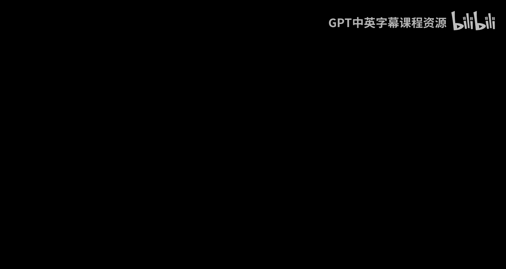
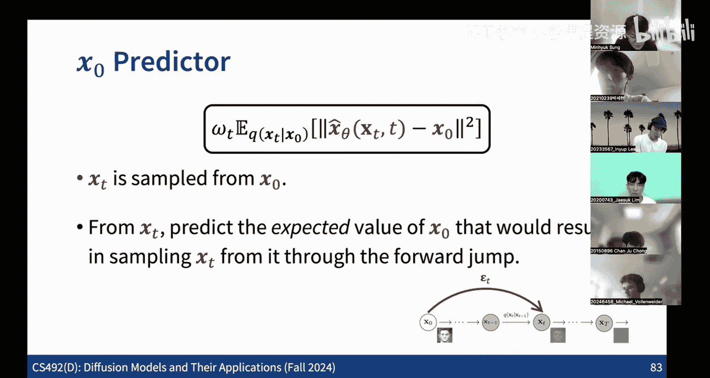
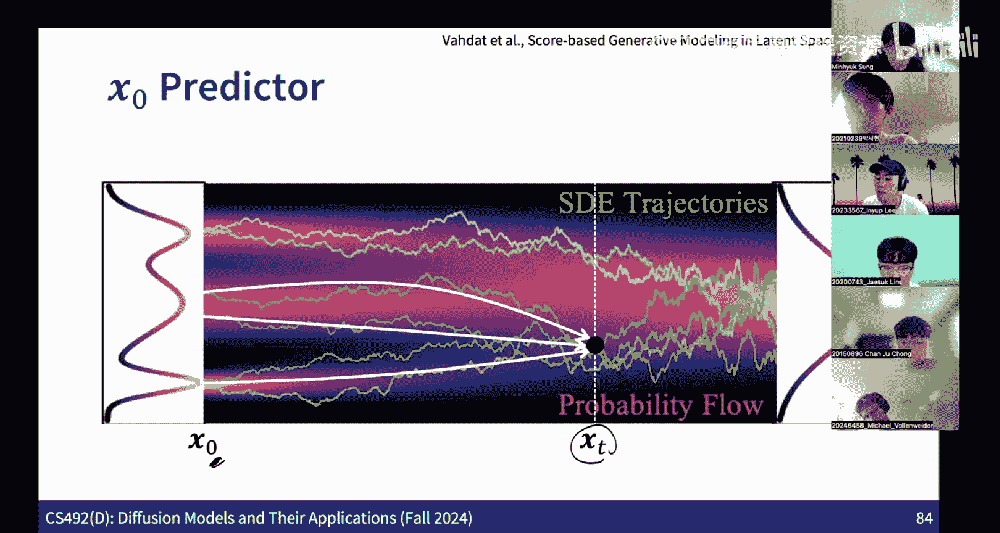
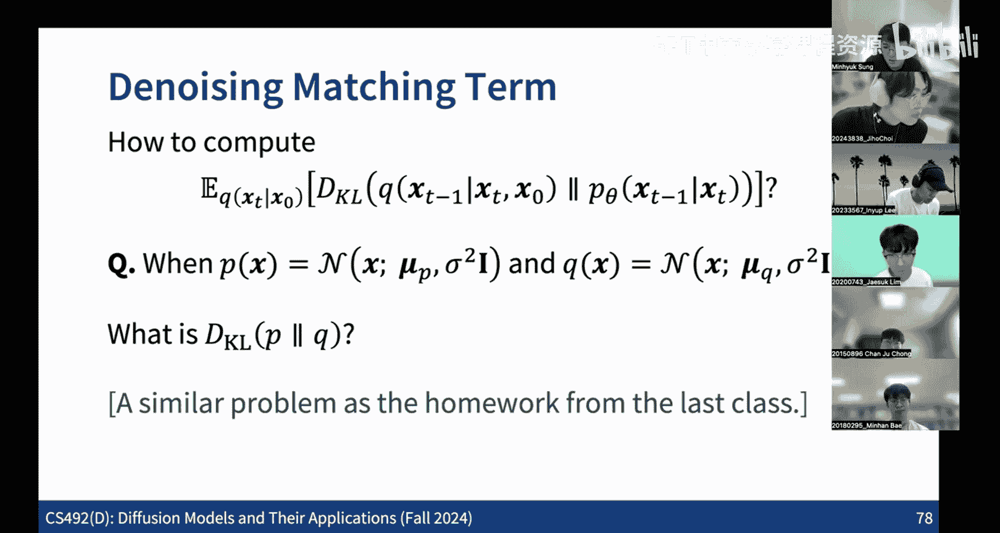

# KAIST《扩散模型和应用｜CS492(D) Diffusion Models and Their Applications (Fall 2024)》中英字幕 - P2：Lecture 03_ Denoising Diffusion Probabilistic Models (KAIST CS492D, Fall 2024).z - GPT中英字幕课程资源 - BV1mwpUzREqX

Welcome back to the diffusion models and their applications so last time we discussed the basic idea about deter models and we want to continue discussing the basic ideas and then we're going to slowly move towards the diffusion models so the plan for this week is that we're going to discuss the the very basic idea for the diffusion models and then we're going to start to discuss the assignment one which is the assignment about implementing the very basic diffusion models。

The one small thing is that we are also contacting the department， the steps for the key cloud GP。

 so I guess we will be able to get the GPP this week， but in the case that we cannot get the GP。

 then we might need to reschedule decisions。So last time we basically discussed the idea like basically seeing this kind of the generation the process as kind of the more like the statistical perspective in terms like seeing the collection of the data。

 that's basically having some kind of the underlying the probability distribution。

 and then we are basically seeing all the data points as basically having the samples。

From the distribution。But the problem is that the data distribution is basically very complex。

 so basically there the probability， the density function is obviously unknown and also it might be very challenging to basically model the probability density functions in some kind of the analytic way。

So the basic idea that we are doing is that instead like directly sampling from the data distribution。

We are basically employing some kind of the simple distribution。

 which we call the distribution and this is typically also a standard deor distribution and then mapping this distribution into our the data distribution in a way that all the generation the process can be done as supposed sampling first sampling from the late distribution and mapping this to one of the data point。

So this is really the page idea for the all the generate models that we are going to discuss in this quest not only for the Ken and the PAE。

 but also for the digital models and flow based models for everything。

 so this is really the very high level the page idea。

And here the challenge is that how we can map the latent distribution into the data distribution。

 so for this kind of the mapping from the latent to the data distribution。

 obviously we are going to use the neural network， so this will be called the generator or the decoder。

But the thing is that how can you also guarantee that the map。

 the neural network from the latent to the data distribution will guarantee that every single day latent will be mapped to one of the realistic data points。

So to guarantee this， we are typically basically employing on another neural network and this basically extra linear neural network depends on basically the method that we are going to use。

But before the again， they generate the aversity network。

 we are basically introducing a unauor network， which is basically discriminator。

 so we are basically making the generator and also discriminator to compete each other in terms of improving their basicallypohus and this was the basic idea for the again。

And also the downside we was that we were basically optimizing the neural network using the miniax。

 the optimization， the objective function， which is very challenging to basically optimize。

So instead of like having the discminator， the other the idea was basically the variation auto encodeder。

 which is the BE， which is now using another the extra encoder to basically learn some kind of the proxy of the posterioror the distribution。

 so now we are having not only the decoder which is mapping from the latent to the data point but also decocode encoder as well which is mapping from the data point to the latent so basically this is following the basic idea the structure of the auto encodeder but basically having some sort of the variation of the distributions。

So understand all these kind of basic things， we also discuss some kind of the basic kind of things in the statistics。

 like the merchant distribution， expect value of all things。

AndHere basically also one of the key thing is basically this like base rule basically we can see all these terms of the base rule in the context we believe in in this case。

 So we are basically having some kind of the data distribution。😊。

which is the marginal distribution in this case and also the latent distribution。

 which becomes the prior distribution in our case。😊。

And the hour degen the process is basically sampling based on the likelihood right so once the sampled from the prior distribution which will be they photograph mappped the data distribution by sampling through the likelihood distribution。

Which incident represented without the decoder。But to basically optimize our the decota。

 we are also introduced another E quota here， which is basically learning the posterior distribution。

 actually precisely some kind of proxy of the posterior distribution。

So keep these kind of basically the toinologist in mind to basically see the rest of the slides。

And also the basic idea to basically optimize all the networks is to optimize through this L body function。

 which is basically the lower bound of the low the probability。

So here the key idea is that if we could basically compute directly compute this probability versus the data point。

 then we mean the ideal of the case， but actually the computation like this is kind of very challenging because like this involves basically computing the probability from the posterior distribution while the posterior distribution is basically unknown in our case。

So since we cannot directly have this kind of theto distribution in this setup。

Instead of that we are basically having this kind of proxy distribution。

 so whatever distribution we have basically this inequality is basically satisfied。

 which means that for any kind of the proxy distribution here， it could compute this expected value。

 then this is guaranteed that this expected value is basically equal or similar than the log the probability。

😊，So our strategy is that instead of like directly competing the log probability。

 we are competing this elbow and basically maximizing this elbow in a way that we are basically also maximizing the probability here as well。

😊，So this is also very a very basic idea that is was applied not only for this。

 but also for the diffion models as well， so we can also see how this elbow will be basically maximized in the diff model case。

But in the B A E， basically， we could also decompose the elbow into the two thumbs。

 So after doing some kind of the de， we could see that the elbow is decomposed into the reconstruction thumb。

 which is basically maximizing the the log probability the conditional probability the X here。

And also decay dis here。Which is basically somewhat of measuring the difference between the de proxy of the posteror distribution。

 the distribution region， and the prior distribution here。

This is making our learned de variational distribution to be closed to the prior distribution。

 which was the standard deormal distribution， right？えデスク？

So this is what we have discussed in the greatest direction。

And can you see like how we can also calculate the dis here？

So this was like one of the homo of the problems that we discussed last time。

So if you didn't try to basically see we can really compute the care dirgence with the Gaussian distribution。

 I strongly recommend you to check out about how exactly we can calculate this care dirgence with the Gaussian distributions so this is also what we are going to see today as well。

So let's assume that we can somehow compute this like the here dience and then here the question might be that how we can also maximize the construct here。

 right？😊，And before that， let's briefly go back to the BAE。

So basically the of the B was that we are basically maximizing this node Px the probability using some kind of the decoder。

And the thing is that this， the likelihood of the distribution will be now represented without the decoder。

 so now the likelihood of the distribution here will be basically represented as kind of the Gausian distribution。

 which mean is basically predicted using our the decoder here。

 so the color of the decoder is basically predicting the mean of this kind of the conditional distribution while we're going to fix the variance here。

So now let's present the micro distribution with some kind of as kind of variation or reformform in terms of that we have some kind of the neural network they parameter。

And then for the to compute elbow， we're going to have the encoder。

 which is also learninging some kind of de variation of the distribution。

 and there can be multiple ways that we are defining the variation of the distribution and the way that we are going to use is basically also having another de Gaussian distribution。

So as kind of the output of the encoder， given any kind of the data point。

 we are going to predict the mean and also the variance of this Gaussian distribution。

 So as the input of the x here， we are basically getting some kind of the the mean。And also。

 the variance of this Gaussian distribution。So you can see that this is a new very similar video encoder in terms of that we are having the encoder and the decor here。

 the only difference is that as the output of the encoder。

 now we are not getting some kind of the single delete latent。

 but getting some kind of the mean end here。And when you basically provide some kind of input to the decoder。

 we are not directly fitting this， but first sampling the latent z latent variable of z here from this normal distribution and then fitting this to our the decoder。

So this isてベと。SoSo give you can kind of clear the picture for this。

 we are having some kind of data description here。😊。

And then we are basically learning some kind of the variation of the proxy distribution here。

 the post area， which is to learn some kind of the Gaussian distribution here by predicting the mean and the variance here。

And then our goal was to basically match this posterior deproxy distribution to be similar with the prior distribution。

Here。😊，Which was like said to be the standard de normal distribution。

And what we are going to do is that we also from in the decoding part。

 once see sample one of the point from the standard de distribution。

 we're going to map this into the data point with this likelihood which is which diminish is basically learned with the decoder。

It is great。So we have the data distribution here and the prior distribution here。

 the mapping from data distribution to the the prior distribution is basically represented with this encoder。

 learning some kind of de proxy of the posterior distribution by predicting mean and the variance here。

And then in the decoder， we are also learning another deco conditional distribution and that we are also predicting the mean of the Gaussian distribution。

喂以。So given this kind of the encoding and the decoding the architectures。

 what we are going to do is that basically we are going to maximize this kind of the elbow the low bond。

 right？And we can calculate this care dierence directly from because that we can we can now we know basically the Gaussian form of like this distribution and also that we know that this should be standardly normal distribution。

 right？But the only thing is basically how are we going to basically compute this？

And this is basically the expected value。And some kind of the simple way to approximate this kind of expected value is to basically use the multi method。

 which is basically nothing that but we are sampling loss of the z from this distribution。

 just example loss of the z this distribution and compute the term inside the expected value multiple times with the multiple samples of them and taking some of these so this is kind of the simple way to approximate this expected value。

It is clear， so we basically sample multiple Z from this kind of the learned the variational distribution and then compute this logo probability with the condition Z and then the technique sum of these。

And how we can also compute this is that no using some kind of the the re parameter trick that we discussed last time。

 how we can basically the way that we can sample from this kind of variation distribution is that we can because we know that this is like a Gausian distribution。

 right？So instead of like directly sampling from this Gaussian distribution。

 we can leverage a sample from this standard deormal distribution and then map this to one of the data point from the sample of that specific de distribution。

 which becomes specifically scaling and translating this standard deormal sample here。

So this is also what we discussed last time using some kind of the repri region three in terms like getting the sample of the variation distribution using the standard de normalmal distribution。

 right？It's great。And based on that， we basically compute this log probability。

 this is basically simple in nothing， but basically having like log form of the Gaus here。

And we end up getting this。So what we can see from this form is that this is basically nothing but basically having some kind of constantum。

 there is nothing to be optimized in here。And then the rest of the to is basically nothing but basically minimizing the difference with the input the data point that we provided into the encoder and the output of the decoder。

 which is basically the some kind of reconstructed the output from some kind of the latent variable。

So you can see that this reconstruction the loss is actually exactly the same as' like what we are doing with O encodeder so in the O encodeder we are basically feeding some kind of the data point and basically reconstructing the same data point and see the difference between these two right so trying to minimize these two so which is both basically the basic things that we are going to do we are basically doing in the O2 encoder so in the variation of O2 encoder we are hitting some kind of the extra decay key the divergence the term but except for that the other term is basically exactly the same the reconstructionconstruct the to that has been used in the O encoder。

So you can see that the duration of auto to encoder is exactly， I mean。

 it's really seen a similar video to encoder while basically having some kind of the extra detailss in the loss function。

Any questions on this？The question is that why do you need a normal white quality want to go。

We didn't have any normalization。I'm not sure what the meaning will beで here taking this from here。

Why why why don't have the D end end here， right， Yeah。

 I think we should have this kind of the normalization。 Yeah， thank you for。啊。Yeah。

 it's kind of a type here。애니 데죠。So if we see how exactly we can train the variation of the O encoder is that it's kind of the same with the O encoder。

 but the only difference is that so we are feeding the data point to the encoder first and then getting this kind of the mean and the variance here。

So and then based on this kind of the predicted demin D variance。

 now we can sample a rate variable C here。And then we are feeding this like the rate and the variable z into the deco。

 and we're going to get some kind of the the you know the distributionion for this some kind of the output。

 the data points。And we are basically taking the mean as kind of our the predicted the the reconstructed input。

And then basically based on that， we are basically taking the computing elbow function and the running the gradient descent。

So this is basically simple the procedure for the training。

question is that would the loss function if we still work if we replace the reconstructioncon loss with something other than the L to norm Well。

 actually the the reconstruction has been derived from the RD elbow function。

So we are not basically just like adding any kind of some random the terms here。

 but that has been basically derived from this specific elbow function。

So if we basically change the records， there will be the case that we are also somehow modifying the allow function。

 then no there will be no guarantee that whether this loss function also becomes the low bound or the low probability。

Hes clear。Yeah， so we need to see that actually all these kind of be the termss are basically exactly derived from the elbow function。

 which has to guarantee that it' the raw bound of the low probability so it's basically not just like combining any kind of random the functions。

Any other big？So here so one thing is that the major difference between encoder for the provision of the case is that we are not directly feeding the output of the encoder into the decor。

 but we are having this kind of disseling step。So from the output of the encoder。

 we sample a rate variable here and then feeding this to our the decoder。

And here the question is that like why this kind of sampling process is also differentiable。

 so if we want to basically train both the input and the decoder using some kind of the propag。

 all the process here should be differentiable， right？

But we are just like having some kind of the samplingling process here。

 sampling the rate and variable of Z from the output of the encoder。And。Typically。

 this kind of the sampling process cannot be differential。

But the reason why this becomes the differentiable is because we are using the reproducttro the。

So as you can see how we sample disease that we are not directly sampling G from the learn the variation of the distribution。

 but we are actually calculating this， so we only sample the standard or de norm D sample here and then calculating this kind of the scaling and the translation。

So since like these are basicallyd terms that are basically learned from the hour the encoder。

 this term also becomes like differentiable with respect to this kind of the mean and the variance here。

This is like why the whole process becomes differentiable。いです great。And how about the generation。

 So these are the train system in the generation， the process， it becomes like much simpler。

 So we just need to sample from the prior distribution， which is the standard the normal system here。

And then we are just like reading this like latent variable internal decoder。

 and then we can just take the mean of the output distribution that's kind of all the output。

So this becomes a simple degeneration the process。And it quite on this。If this is not clear to you。

 please raise questions， please ask some questions。

 otherwise the rest of the part of to this lecture will be more complicated。

So let me use one is one question， so we are basically having some kind of the data distribution with some kind of data points and also the late distribution。

 right？So last time we have seen some examples that the data point becomes， for example， like image。

Then this will the case that were having the demand of the 256 by 256 times 3， right？😊，Then。

When you basically have some kind of delete on the space。

Should latent the dimension of the latent variable should be the same with the dimension of the data point where it can be different。

呃。Yeah so this is also kind of the same with the auto encoders and the auto encoding set of we don't need to basically match the dimension of the latent variables to the dimension of the data point right so in our case it doesn't need to be the case that these to the dimension of these two are basically the same but we can basically make the dimension of the latent variables to be much smooth so it the matter of like what sort of dimension thats。

So yeah， you need to answer these kind of questions since in the June。ok。😊。

Then is the B good of older the cases Well， I mean B sounds like some kind of some interesting idea。

But the thing is that there are quite many kind of failure cases and the very typical behavior failure cases of the BAE is basically getting to this kind of the low quality the apples。

 so if you I also recommend you to basically try to implement the BE yourself about if you try BAE that you're going to see that it's very hard to get some kind of the high quality some very realistic images。

And there can be some multiple regions that we are getting this kind of some low quality results。

 but one of the reasons for that might be is that we are basically doing some having some kind of the multiple the approximations and one of the approximation is that we are approximating our the posteror distribution into the variation form。

And our de variation of the form for the de proxy is having this kind of de Gaussian distribution。

And here the question is that is it sufficient to have the Gausion as our the form of de variation distribution？

So for that， what we are also going to see is that actually the effect is that we are not exactly maximizing the load the probability。

Since we cannot actually compute the load probability probability。

 what we are doing is that we are actually calculating the lower bound and then maximizing this。

And here the question is that when we can get some kind of the eight lower bond。

 which means that when does this kind of this lower bond become exactly the same with the low the probability。

 which is something that we want to really calculate。

So this was actually the whole multi problem that I was asking last time。

 but when these two become the same。Did you try to solve this problem last time？

So yeah here the question is why we try to use some other distribution instead of the normal distribution。

 so that's actually what we are going to discuss today。

Why do you use standard normal distribution pretty late and sample between the generation in between the non standard distribution yeah。

 I mean you can consider using not the standard de normal distribution as the prior but something else as kind of the prior distribution。

So it's kind of the case that we are all lazy， you just like we just like use the Gaussian distribution for everything。

 we can also consider using other types of some kind of the analytics some form of the distributions。

And the focus for today will be basically how we model the posterior distribution not with some kind of a single deion distribution。

 but as kind of some combinational deion distributions。So here the question is that。

When do we get some kind of the results that this lower bond become the same with the load property。

 I recommend you to basically derive all the things and see what we get。

 And the answer for this is that we get basically。The tight the the lower bound when the key di between these two becomes the zero。

So which means that when our de proxy distribution becomes the same with real the posterior distribution。

 then were want to get some kind of the tight low bond。

 so that will be the case that we want to basically achieve throughout our the training。

But here the problem is that then the question is like whether this kind two the postal distribution here will be close to one of the Gaussian distribution。

So only when this kind of the posterory distribution is already closed on kind of desion distribution。

 then we can basically approximate this with some kind of the another deussion distribution。

But in a case that when this is not similar to any of the Gausian distribution。

 then this approximation can be really kind of bad approximation， right？

So actually having some kind of the good model， the good variation or the distribution for the posterior is basically the key in terms like achieving the high quality the generation the process。

Yeah。So that's basically what we are going to discuss for today。

 so actually here the question is that what would be some kind of the better way to approximate the posteral distribution in a kind of de of the way。

So there can be some point to be some kind of method for that。

 I recommend you to check out the particular are more than this there are lots of some kind of de variance of theE。

Here one of the ideas that we are going to discuss for today is basically having some kind of the recursive form of theAA。

So as you can see here here the idea is that we are not having some kind of the single delete latent the variable now we are going to have some kind of a sequence of the latent variable in a way that we are having some this kind of the sequence of the mapping。

So now we are going to slightly change our the notation in terms of that now the X0 becomes some kind of hourly data point。

And then we are having a sequence of the latent variables that becomes from the x1 to the x capital T。

 so we are basically having the t number of the the latent variables and we are having this kind of some sequential genetic。

And then they're going to also basically assume a kind of the microco beian the process。Here。

 the meaning of the microcobiian the process is that it's kind of the stochastic process where the probability of each of the event depends only on the previous step。

 So when you basically sample the X T we're gonna only see the X T minus-1 because the sample of the X T。

 you basically independent with the any of the other the previous steps。So is this clear？

So when you sample basically the X T， this will be conditioned only on the X T minus-1。

 but not the other the previous steps， So we are only basically seeing the exactly know exactly the previous step。

So while best of having this kind of the microbiian the process。

 what we can do is that now we can see the model of the whole process in terms of having this the distribution。

So this is like similar with like what we have seen in the P case。

 but now we are basically having some kind of sequence of the mapping here so in terms of that the all the joint distribution can be now seen as kind of samplinging from the prior distribution and then multiplying all this kind of the transition the distribution。

 basically from the Xt to the Xt minus1。What's the justification。

What's the justification for the micro assumption Well， I mean。

 no justification we are basically this is the way that we are basically demoing our kind of this stochastic process。

そう。This things specifically， so we are basically introduced this kind of assumption assumption in terms of that in terms like making all this kind of the the the modeling becomes like simpler。

 but you're going to also see the non microcobi in the case next time or so。So it is great。

 so we are basically now defined it to the joint distribution in this way。

And then also our the variation of the posterior is also the modeled in this way。

 let's case takinging all this kind of the some you know the of this the distribution for each of the step。

 multiplying all of them， then this becomes our the variation of the posterior sampling from the x0 to the all the other latent bills from the x1 to T。

So based on this， basically what we can do， what we actually we are going to see is that so basically while each of this step from the Xt to the xt plus1 is basically the normal distribution。

 now basically whole the posterior the distribution from the x to the x capital T can be more complex distribution。

😊，So this is basically highly by the idea for some kind of the hierarchicalE。

 basicallys some hierarchical structures of some kind of latentency variables。😊。

So actually basically what we can see is that from the x capital T。

 we will be in the generation the process， we will be able to sample in any kind of the x t minus1。

 we can actually have some multi pulse kind of the x t minus1。And then from each of them。

 we can also sample the X team minus2 having some multiple。

 also we can also have some multiple samples。😊，And then we can spread this out until the x0。

 then from the x capital T， now we are having some kind of the higher killer structure in terms like having some multiple samples of the X0。

So this is basically idea give of like hierarchy of。

And we can also compute the same the the elbow function for this kind case as well。

 So we can also see the details of this elbow function in the case。

So there has been actually the last of the ideas in terms like how we can make some kind of the iterative or the recursive the process in the generation the models in terms of like improving the quality of the output。

 especially there has have been some ideas which is called the flow-based models。

 which are overall basically introduce some kind of the recursive the process for the generation。

 as the kind of based on this kind of the long literature of the flow- based models。

 there has been introduction of the diff models which is something that we're going to discuss for today。

 so to basically discuss the diff models for today we are going to skip some details for the flow- based models。

 but we're going to get back to this idea at the end of the sometime in the November in terms of getting also seeing the connection between the flow- based models and the diff models。

So at skip some the， let's jump into the digital models。Onastic question。

 we use the same encoder queue for the each level the hierarchy what。Well yeah。

 so we can basically use some same kind of the encoder for each little bi hierarchy。

 so it also depends on like how we basically design or the specific neural network typically we can use some kind of same inr。

Any other't take questions。So we can also say that we are even sharing a single network for all the kind of the level of the inding and the decod。

So yeah， let's move on to the basic idea for the variation of the diffusion models。

 so we can see the diffusion models as some kind of the special case of the markco on the hierarchical DBE。

 but having this kind of the two specialty D restrictions。

So the first kind of the condition is that now we are going to match the dimension of the latent space to be the same with the dimension of the data the space。

SoThis is basically one difference with the B。 So in the differential models。

 the dimension of the latent variables should be the same with the dimension of the inputed data point。

And also more the bigger thing is that for the variation of the posterors， this。

Okay we are not going to learn this， but we are going to actually predeefine the variation of the posterior distribution。

So that's why basically we are dropping this kind of the neural parameter pi here。

 so we're going to have this Q here and this will be pre definedfin。

And then we're going to slightly change the commoninology here。So the mapping from the officer。

So the mapping from the data point to the all the latent variables has been called the encoding process in the BE the context right and now we are going to call this kind of the encoding process as kind of the fold process so the fold process is basically mapping from the x0 to x1 to the x2 all the way to the x capital T so we are starting from the data point and mapping this sequentially into the all the latent variables and getting into the xt so this is our default process and as you can see each took the transition this basically the distribution for the transition is basically not learned which is predefined and we are going to see how this is exactly predefined。

And the other step， which basically degen the process and like sampling from the x capital T all the way to the X U will be called the reverse process。

 It is really the reverse of the first process。 and this is the the。哦。

Oh sorry I have some problem with the Jim set， let me raise your advice。

Where did you has been this question me。嗯。对。こ。Can you see my slide？Yeah。

 so this kind of the the generation the process， sampling from the x capital T to the x0 will be called the reverse process。

Why is this。Sorry I don't know why the gym is so very untable。Yeah。

So now the the the the transition for this each of the reverse process will be learned to different。

And here the thing is that like how we exactly define the folder process。

 So this transition distribution from the x t minus-1 to the Xt is defined in this way。

 so we can see that we are using the Gaussian distribution again。

 So everything here is for the Gaussian distribution。

 obviously we don't need to use the Gaussian distribution， we can use any other distribution。

 but let's for the agent case， which is using the Gaussian distribution。

So each of the transition the distribution is now defined as this specific de Gaussian distribution with some kind of the time dependent the parameter here。

 So we are killing the mean and with some kind of the parameter the beta T here。

 which is some kind of the value that we are making the same for every like the the time step T we can or we can make it that we increasing over time。

W basically sending all this like better T to be in the range from the zero to one。

So you can say that the meaning of this is that we are gradually adding some Gaussian noise into the data point。

 so this is kind of the process that we are gradually adding this kind of the Gaussian noise。

 so you can see that the reverses process becomes the denoising process doing some kind of thes of like adding the noise。

And here the question is that what sort of the better key that we're going to use。

Actually before that actually we don't also need to define our the transitional distribution here as this specific form like this has been like the one idea and this was basically the most successful case like predeefine this kind of the transitional distribution but there has been some multiple the other kind of options to define the same distribution so this is like another way to define this kind of the you know the variation of the distribution but there can be also still kind of like multiple the other ways and you may also have time next time you know we're gonna to the next lecture we're going to also see what's the meaning of like having the specific form of the variation of distribution。

And for the better T， so there can be a multiple the options。

 even we can consider like learning the optimal the for each of the default process and we can also make this better T to be constant and also we can make it to be increased over time linearly or quited vertically。

So there has been some ideas in using some kind of cosine function to use somehow schedule the kind of the changes of the time。

 so there are basically the multiple options。And in your the first the assignment。

 you're going to see the example that we are basically linearly increasing the validity to train the digital models。

 so this will be this case。Is the it rateative gauge on a universal approximate early distribution and we essentially model any kind of distribution while the implant numberly。

 yes， this is basically what we are going to see。So we're going to see like why we are deco the tal distribution for the mode process in this way while basically seeing like how we maximize the elbow function in this case。

So as you have seen in the BAE case， it's all about basically how we can maximize the elbow function and given these kind of the definitions of some kind of the iterative process and also the predefined the step we're going to see how we can also maximize elbow in this specific case and as you can see there will be lots of some kind of some kind of details in the equations。

 so we are going to skip some of the details and see some kind of the important pers in the equations。

So instead of like maximizing the elbow， let's think about like。

 we are minimizing the minus of the elbow。 basically some kind of decompposition。😊，Let meちゃかて。

What do you mean by it constant or question方。Yes， we are basically making the varying the be T over time using some kind of the cosine function while making it to be kind of like increasing over time。

So here the question was basically what's the meaning of like using the cosine function。

 so we are basically using some kind of cosine function to basically schedule the ability to be increased over time。

So this is kind of some kind of engineering the tricks that has been introduced some kind of the other papers。

 but yeah it's up to you I mean typically if you use any kind of variety that is like being increased over time then it will basically work and we're going to see like why we need to define that way。

And so let's get back to the elbow function。 So this is the same same the elbow function that we have seen in the B case。

Now we are going to minimize the the minus the elbow function here。

Then with some kind of the some some complex some kind of the derivation。

 we're gonna see that now this elbow function can be decomposed into the three terms。

 But these basically nothing but we basically are doing the same thing that we have done in the decomposition。

 the elbow in the P case。 But if can apply the same idea， decomposition。

 then now we're gonna get this kind of three terms。

 The first one is basically reconstructioncon term which is the same term is the one that we have seen the the case。

😊，And the other one is basically this prior the matching term。

 which is kind of similar with the the divergent term in the previous case。

 and we know how we can compute this， right。The problem I people skin the third term which is kind of the consistency term。

So if you see the meaning of this， this is basically nothing but we are basically matching the fourth step and also the reverse step to be the same for each of the time step T。

 So for each of the time step the T we' gonna sample the X t minus-1 and the X T plus1 and then basically were gonna see that whether these the fourth step。

 the transition and the reverse the transition become the identical or not。

 So as we basically make this to be kind of constant as much as possible。

 we're gonna see the results that the elbow function is basically the minus the elbow function is basically de minimize。

But here the question is that how we are going to calculate this consistent term。

 The problem is that now we are having basically not only one the random variables。

 but having the two random variabless。So when you have this kind of the multiple random variables in the expected value。

 then the the computation with the Monte the method becomes like way more expensive。

So the problem becomes like how are we going to basically compute this consistent with the more than one the random variables in the expected value。

So this is kind of the challenging part。 So here the idea is that how we can avoid like having some multi the random variables in the expected area。

So that's kind of one of the idea to avoid this， we are going to basically see the other way around to basically decomposing the elbow into the other some kind of the some a set of the thumb。

And also to decompose the elbow in the different ways。 we are going to use this fact。 So these two。

 we are going to use the fact that these two are basically identical。

And can you say like why these two are be identical in our decades？Yeah。

 because like we assume the microcobiian the process。 So in the microco the process。

 as I mentioned in the previous slide， we're gonna we always assume that X T is only dependent to the previous step。

 X T minus-1 and is's basically independent to the X。

 So even when basically add some kind of external condition X0 here。

 we know that this X0 is basically independent to the X T。 So we can ignore this。

So we are going to use the fact that no this the conditional form becomes the same weight like this。

So using these facts， if we really decompose the same the elbow function。

 then now we are going to get this set of the items。So if we see this like one by one。

 the first tower basically become the same the reconstruct the loss， so this has not been changed。

And the second term is kind of the new deployed machine term。

 and you can see that this is basically the same with the key di term we haven't seen in the the case。

 right。And then we are having another some kind of the， which is the demoizing the batch to。

 And we' gonna see how we gonna basically minimize this way。😊，So it is great。

 so we are having investigated these three times。So reconstructioncon。

 basically we know how we can minimize this。 like as we have done in the we the case。

 we can sample the x0 from the x1 and basically see whether basically the x0。

 the reconstructed the x0 is basically the same way the input the X0。

 So we can basically minimize this loss function separately in some kind of the neural network。

And the problem might be basically these two thumbs like first we are having the prime matching term here and then also we are having the division time here。

 so let's see these two thumbs like one by one。For the prior matching term。

 So this is the same the K diverse to with the things that we have seen in the B case， right？

And here， basically the important thing is that there has been。

 there is nothing to be optimized because like this is like predefined。

So this basically the the the posterior distribution from the x0 to the x capital T is not learned。

 So we predefined the for process， like every step in the fold process is basically predefined since and because of that。

 like the whole process sampling x capital T from the x0 is also kind of some the process that we are using some kind of the predefined the posterior distribution。

 right。So there isn like nothing to be optimized and also we know the we predefined the prior distribution as well。

So it's be made of like whether our the predefined all the distribution basically satisfy this condition。

So the thing is that we just need to see， like whether this posteror distribution becomes identical with this standard normal distribution。

😊，And the question like whether these two are the same or not is basically this with some kind of the some conditions。

 So we're going to see like why these two are basically the same。In some specific the the cases。

So they that we are defining the each of the transitional the distribution。

 sampling x T from the Xt minus-1， we're using this specific Gaussian distribution， right。

To simplify some kind of calculation， we're going to introduce the other party。

 which is basically nothing but basically taking one minus better。

So I was all the aer in the range from the to one and having some kind of the relationship or like the equation over time。

So we can optimize how we predefinine them using deploy Washington。No， there is no optimization。

 So what we are going to see is that with our the definition of the this like the deposit distribution with the Q x or the x one So when we going see that like when you define our the full distribution in this way were going see that these two become the same。

So which means that these scale diveence will also becomes 0。

You could just say that like we define our default process in a way that this care dirgence becomes zero。

It is clear， so there is nothing we don't we need to do for this specific。系い weekend。啊意思 great。

Iにこ on this。So going back to this slide， basically's say what we are going to see is that we are going to see like this just like becomes zero。

We need define our the poster distribution from the X T plus one to the X T as that specific way。

Then we know how we can basically minimize the like reconulate loss and we also going to see how we can also minimize this diffusion top。

😊，喂。And so me just introduced the Ree here。And here。

 the question is that like now we defined one step of default process， right。

 sampling X T from the X T -1。But from this kind of the definition definition。

 from the one step before the the process， can you also basically see the distribution like sampling X T directly from the X zero from the sequence of the default the the process step。

So this means that like why we are basically sampling each of the X T， like in the sequential manner。

 when you see the X T as kind of the sample conditioned by the x0。

 will there be some kind of analogtic form like design seeing this right？

So let's say this for that let me ask some kind of the quick question so let's say like we are having the a sample x1。

 which was like sampled from this specific de Gaussian distribution and we also have the x2。

 which is like sample from the another de Gasian distribution。So if we see the X 1 plus x 2。

 what's the distribution like this specific random variable。And this is the easy question， right， so。

The some of these two， basically still follows like this de Gausion distribution rate。

So we can see that like when you basically add two random variables that are sampled from the Gausian distribution。

 the output also becomes like one of the sample of the another de Gaussian distribution， right？

I think the question is that now we have some kind of。

Now we have the two standard normal distribution， Epsilon 1 and the Epsilon 2 here。

And then X1 and the X2 are basically represented as some kind of skilled the the standard the normal the samples。

So in this case， what the is can also say is that。If you also see the basically the additional like these two。

 we can also see that the additional like these two also become the sample of this specific the the Gaussian distribution。

 which means that now we can represent the sum like these two random variables。

 thats kind of the another these killed this standard or de normalmal distribution。So it is clear。

 so when you have the x1， which is like once killed this standard the norm dis sample and the x2 is also another killed the standard dema sample。

 the addition like these2 becomes the same kind of the scale this standard norm dis sample。

 anotherpsil here。可以。So we're going to use the spec to see basically to derive the distribution X T conditioned by the X U。

So for that， let's first see describing two specific these steps like sampling x1 from the X U and then sampling x2 from the x 1。

😊，And we know that these two distributions are described in this way， right。

Then what is the distribution like this。So let's use the reppriation trick。

 so now we can re the x1 in this way using one theer the Gausian the the sample and x2 is another we do another dis the Gaussian sample way So based on this。

 can you also describe the distribution of like x2 conditioned by x2。

So let me give you some time to think about this。你 guess我s给 you。I think correct answer。

 so we can just succeed it like one by one。 So x2 is like discreted like this。

 and we can replace x1 as's kind of de formulation the X1 like this。

Just plugging the formulation of the X1 here and then we can read right all de formulation and as we have seen the previous slide now we can combine these two these killedt these standard de normmer samples with basically the one skilledilt the standard denmal sample like this。

And based on that， we can say that now this specific deco conditional distribution follows basically becomes like this another desion distribution。

 right？And we can repeat this process until from the0 to the time any times the T。

It can if we repeat the same process。 then now we're gonna see that X T can have this kind of form。

 as's kind of like having the like this and also the variance of like this。

So from this right now what we can see is then we can derive the form of the the normal distribution for this specific conditional distribution。

 so if we want to sample X T directly from the X dual。

 then now we can basically use this Gaussian distribution。

Whether this like the Alpa T bar is basically the multiplication of the all the alpha I over the from the time the want to the time T。

So here， what you can see is that like while we basically defined this kind of default process as kind of some sequence of the like sticking the Gaussian disseling。

 actually we can directly sample the Xt from the X0。Without having this kind of sequential process。

 this is like done by a definition of our the fourth step， the theal distribution。

So this is kind of the interesting the that now we can directly as the Xt from the x0 without this sequential process。

Because like we define each of the step of the default process as in this form。A cream。So yeah。

 so for any arbitrary time step T， we can directly sample the Xt here from the hour the input the data point to the X0 here。

And from this， like what we can see is that now we can see that the posterory distribution from the X u to the x capital T now has this specific de Gausian deform。

 right？Whether basically the R T bar is basically is defined in this way。And we are basically no。

 pre defineine the as kind of some kind of numbers in the range from the zero to one we also basically increasing over the time。

So if we basically multiply this term within in P 9 number of D D times1， what should we get。

 ass the output。Yeah， so we are basically multiplying something similar than one right in the range from the0 to1。

 right， So if we basically multiply this quantity as much as the possible。

 were gonna see that this converges to 0， right。This means that this becomes zero and this becomes you。

 Then we can see that the whole distribution converges to the standard the normal distribution。对。

So from our the definition of the fold process， we can see that。This prim term becomes close to zero。

And also this become zero as we basically have some more the number of the time steps in the forward process right？

So there is basically nothing to be optimized， so this is basically just like becomes zero by definition of the already product process。

In this clip any questions on this。So we are basically one way to see how we can minimize the negative elbow in our the digital models。

And we have seen that the negative of outputome can be decomposed into three terms。

 the first one was the reconstruction the， which is the same loss that we have seen in the PEE case。

And we are also having this kind of the de matching term。

 which was also the same decay di term with the we have seen the PA decay。

 and this become the zero by our definition the process。

The rust is basically is like theno in depends。So basically the main thing here is basically how we are going to minimize this deno。

 which is defined in this specific degree。So we're going to see how we can minimize this。

And before we shall minimize this， the meaning of this is that we are basically matching this kind of the you know the likelihood term which is defined as kind of like some variational the distribution。

 to be the same with this specific the posteror distribution。

 which is conditioned by both the XT and the X。😊，So here the question is that how we can basically derive this。

 right？就。How can you basically compute this specific depository distribution。From the base rule。

 we can see that now we can redefine this specific distribution into this form， right？

But this is basically nothing just like applying the base rule， right。From the base rule here。

 what we can see is that first all for this， we can just like drop this X zero， right。

 from the macrocoion the the assumption we can see that X T is only dependent to the x minus one。

 So we can easily drop the X zero here。And from the previous slide。

 we haven seen how we can derive these two specific the distributions， right。

These are basically all the kind of the jump in the fold process from the x0 to the xt minus1 or the x0 to the xt。

So to remind those things， can you quickly see the previous slides and see how these three distributions are defined？

So let's just quickly check out the previous slides and see how these three terms are defined。

Oh you can access this slides I posted a link to the slides in the slide of space。

So you can see that no， I'm posting the link of the slides in the select of space before the lecture。

So what we have seen in the previous slide is that we defined this default。

 the transition distribution。And based on that， we also have seen like how we can also derive these。

 the fold jump， the distributions from the sampling from the X U to basically sampling X T or the X t minus way。

So this is like by definition， and these rub basically derived from the previous slide。

So these are like what we have seen the previous slide。

 so from the definition of the hour default the transitional distribution。

 we have seen that how we can also derive these two terms as well right。

So here the question is that whether this kind of combination of the like Gaussian description will have some other kind of analogT form。

So typically when you have this kind of the ratio of the Gaussian distribution in general。

 this kind of like ratio de Gaussian distribution cannot be another de Gaussian distribution for most of the cases。

 but for these specific case， you we see the combination of like those three three terms after some kind of the wrong distribution you can also check out some more details in this kind of references。

 you can see that actually this like the combination of Gausian distributions become another the Gausian distribution。

 which is now having this kind of like more complicated like mean and the variouss like this。

So you don't need to like remember this kind of the mean and the variance。

 but the key thing here is that now the mean is specifically defined as kind of the function of the both the xT and the zero。

So if you basically have the given the X0 and the X T and the X0。

 you can see that now this like memi basically compete as some kind of linear tulation like between these two。

While the various time here becomes some kind of predefined。

 so these ares not a function of the xt or the x0， but this basically determined based on the time step T and also the hour the predefined the ver T here。

So this is the case that we are the X0 and the X D， which might be kind of some sample from the X0。

 and based on these two， we are now sampling the something that is like what the before the X T。

 which is like X t minus1。喂。And here like one more quick thing is that form deep basically defaults the jump the distribution now we can see that as I said。

 like Xt is kind of like something that is also like sampled from the x0 right and there should be some kind of the epsilent T which is some kind of dis sample from the standard the normal distribution that resulted in like sampling the Xt from the X0 right。

So if we basically have the given the X T and the X U。

Then now we can define some kind of the another variable， which is like epsilon T。

 which is like defined like this。 So the meaning of like epsilon T is is basically some kind of the the standard。

 the de normalmal de noise that that's resulting the sampling X T from the X U。

So now when you basically have the both the x0 and the X T instead of basically having the x0。

 you we basically have the information of like Epsilon T from the X T and the Epson T。

 we can also derive the x0 as well right。So which means that with this kind of the new variable of the eps T here。

 we can also readwrite specifically the function of the mean of the distribution。

 so let's try to rewrite the mean of the distribution。

 not as the function of the xt and the x0 but as the function of the xt and the eps t。

I recommend you to calculate these things yourself。

 not just like huntinging and pasting something the like。Yeah。

 so when you introduce another de epiee here using this。

 now we can also rewrite the mean of the distribution in this way。So basically。

 what we are seeing here is that we are basically seeing that this specific the posteriorion distribution is another the normal distribution。

W whichhi mean。Can be a function of the E X0 and the X T。

Or if we have some the information about like Epsilon T， then instead of like using the x0。

 you can calculate the mean as kind of with the epsilon T and the X X T here， right。😊。

And also here the variance is basically somehow like predefined with our the prompors de， right？

So this is basically know how we can calculate the distribution like this specific the conditional distribution。

So if we go back to already denoizing the matching term。

 the purpose like all the d was basically calculating the key divergence between these two right so if we can calculate the key divergence between the two the Gaussian distribution then we can basically minimize this so before that we first need to define the de variation of form of this distribution so it's made of like how we define the de or distribution of this likelihood the distribution。

So for that， what we can see is that since like this is some kind of the predefined parameters defined based on the parameters of the B。

 we can just directly use the various now。The only thing is that we just need to be able to predict this mean of the you know the gasian distribution。

So the way that we can make some kind of de variation or theform of this specific distribution is strictly using the barriers here。

And only using some kind of neural network to predict the mean of the Gaussian distribution。

Why is making the samego description， right？So then the question is how we can compute this。

So for that were going to first state that how we can compute the key di between these two Gaussian distribution。

 so let's think about like these two Gaussian distribution which are having different means here。

 but having the same the variance here。Then what is the care diversity between these two。

 So if we just go faster for these two specific the Gaussian distribution like sharing the same difference here。

 we can see that the care diversity becomes basically minimizing basically the measuring the kind of the distance between the mean of the distribution with some kind of weight come here。

So which means that our denoaging dimension matching term also becomes the case like now calculating the difference between the mean of the given the distribution with some kind of the mean that has been predicted using the neural network。

So while all the album function looked very complicated。

 you can see that now it just like boils down to like very simple decay case。

 they we just like matching the mean of the two distributions。

And so here one more thing is that instead of like predicting the mean of the distribution。

 we can consider like making a neural network， not predicting the mean。But actually。

 the x0 from the X T to the T。So given the X T and the T。

 we previously had some kind of digital neural network or some the having the neural network。

 which is in predicting the mean of that distribution。

 but instead of that we can consider having the another digital neural network。

 which is now predicting the X0 here。Then what if we have this kind the X predictor。

 then how should we also modify the loss function？So if we go just quickly read like this。

 we can see that now we can reformte the same loss function like deriving the loss function with the X predictor。

 we shows that it becomes like minimizing the difference of the X with some kind of the weight here。

So what can if you see the meaning of like this specific loss function， you can see that basically。

 you know， all the X T is like sample from the X0。And there can be some kind of the multiple the data points that could like result in like sampling in the X over the default process。

 right？And like the meaning of like this kind of the loss function is that we are having a neural network。

 which is basically like predicting the expected value of the X0 that could basically result in sampling the Xt through the process。

😊，It is clear， so we need to see the meaning of like this specific loss function， so for every Xt。

I mean， there will be some kind of default process that are assembledd from the times that view。

 right？So from the any kind of the X U， those will basically result in like sampling in the Xt and some of the X U will basically result in will have some kind of the probability that resulting in like reaching to this specific the Xt point。

 right？😊，Does it make sense。So this is by some kind of the our di in the process startinging from here。

We are starting from some kind of data point here。AndThen from each of the point。

 we're gonna make some kind of small step in terms like know jumping some to some other points over the time domain D。

And some of the X jo here will have some kind of probability to basically reach to specific X T T here。

喂。Some of the X that we are basically is sampling is kind of input data point after some kind of times the t through the forward process。

 we're going to see some results that X Europe is reaching to the same xt here。

So basically we can consider like what are some kind of the what is these expected the Xg X zero here that would result like getting the XT through the default process over the times the P。

So the meaning of the most boxes here is basically。

After some kind of derivation， we are having some kind of the neural network。

That is basically predicting some kind of the expected value of the XO that will result in like sampling the Xt through the default process。

😊，いです great？So what we are basically doing is that we are having some kind of the multiple default process and see like seeing the backward the process and seeing what are the basically the X the input data points that we basically make some kind of xt so the interesting thing here is that while our goal is to basically sampling through the x capital T to the X0。

So some kind of the intermediate deletent kind of variables， like every step。

 like actually what we are doing is that we are directly predicting some kind of the expected value of the X0 in terms of that we are making some kind of the one step of the diversity process。

😊，So we're going to see how we're going to basically generate some kind of the new data points in the inference time。

 the universe process is basically just like sampling like one by one like for each of the step。

 but this kind of dis sampling what we are doing is that we are directly predicting the X from each of the late space of the XT。

And this is basically the meaning of the diff the term here。It's the difficult。

And this is basically some kind of the decomposition of the complex function in this specific case。

 so we're going to continue discussing this kind of the diff models in the next time and then we're going to also see basically the the assignment one and discuss some kind of details about implementing these divisionff models。

If you have any questions， please post the questions in select the lecture3 channel that I'm going to go through the questions。

Okay， so I'll see you on next Wednesday。

诶。Thank you。